# RELIGIOUS EXPERIENCE: NATURE AND OBJECT — Examiner-Grade Mindmap

> **Syllabus (verbatim):** Religious Experience : Nature and Object (Indian and Western).
> **Catalogue key:** `philosophy-paper-ii-philosophy-of-religion-06` · Paper II · Philosophy of Religion
> **Sources used:** `paper-2/philosophy-of-religion/Religious-Experience.md` (canonical owner, read in full) · `_advanced/Philosophy-of-Religion-Dossier.md` §6 and the promotion ledger (optional depth) · `paper-2/_PYQ-PhilosophyOfReligion-2018-2025.md` · `paper-2/_PYQ-PhilosophyOfReligion-2026-Supplement.md`. The six `paper-1/_themes/` files were searched for James, Otto, Alston, Swinburne, mysticism and religious experience; none contains relevant passages, so none is cited.
> **Evidence key:** ✅ canonical doctrine / fact · ⚠️ analytical synthesis for exam use · ❓ contested / uncertain · 📰 dated current anchor only (none used)

> [!IMPORTANT]
> **Core thesis.** Separate four layers: **phenomenology** (what it is like) → **claimed object** (what it seems to be of) → **interpretation** (how a tradition names it) → **epistemic force** (what it justifies). Psychological genuineness, doctrinal authenticity and metaphysical veridicality are three different achievements. ⚠️

> [!NOTE]
> **Adaptation.** The 15-module blueprint is written for single Indian schools. For this topic: Module 1 holds the ownership firewall, the experience-varieties and the lineage of accounts; Module 2 holds the nature of the experience and its epistemic warrant (credulity, doxastic practice, testimony, constructivism); Module 3 holds the interpretation-and-mediation disputes and the sceptical/defeater pressure; Module 4 holds the claimed objects (the "MORE", the numinous, Brahman, personal God, nirvāṇa, the sacred); Module 5 holds the stance on veridicality and revelation. The sources give **no kāma/artha/dharma/mokṣa hierarchy** for this topic, so Module 7 carries only the practical-fruit and prayer/worship material the owner file gives, and says so. Modules marked "no source material" are stated briefly.

---

## 0. Master Overview

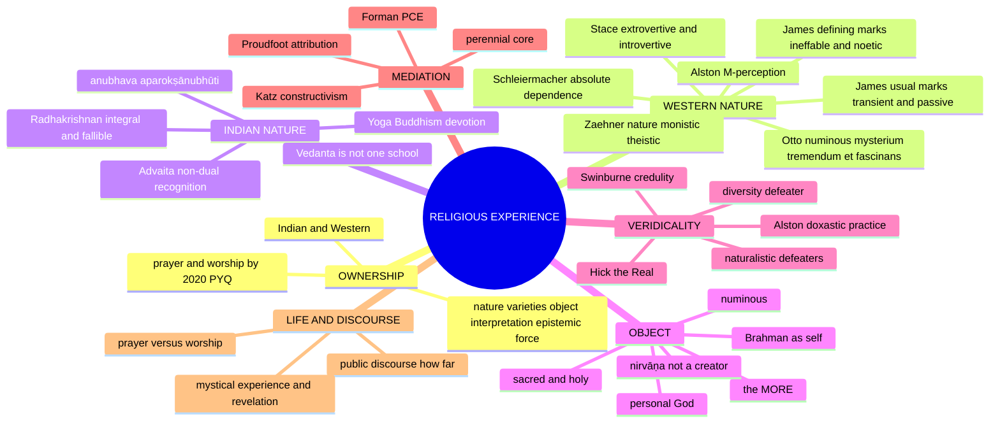

---

## 1. Identity, Lineage & Doxography: Ownership, Varieties and Accounts

### 1.1 Ownership firewall ⚠️

| Owned here | Boundary (owned elsewhere) |
|---|---|
| Phenomenology and typology of mystical, numinous, conversion, devotional and revelatory experience | Faith's reception of revelation: Reason, Revelation and Faith |
| Experience as defeasible evidence and testimony | Full existence-proofs: Proofs for God |
| Conflicting experience-reports as an epistemic defeater | Full pluralist theories and the absolute-truth debate: Religious Pluralism |
| Ineffability only as a feature and communication problem | Semantic theories of religious language: Religious Language |
| Indian yogic, devotional, Buddhist and Vedāntic comparisons | Complete school doctrines: Paper I canonical owners |
| Prayer and worship because of the direct 2020 PYQ | Wider faith, ritual and non-theistic religion: their own owners |
| The **sacred/holy-as-object** pole (§9.10 of the owner) | The **evil/profane-as-foundation** pole: Problem of Evil §9.6 (2019 Q6(b)) |

> [!WARNING]
> "Subjective" means **first-personal, not unreal**. Ineffability means an experience resists adequate expression, **not** that it has no phenomenology or reportable content. A neural correlate may explain mediation without by itself proving veridicality or illusion. ⚠️

### 1.2 Four analytical layers and six varieties ⚠️


| Variety | Structure | Typical attribution |
|---|---|---|
| Mystical / unitive | Unity, non-duality or communion; often ineffable and noetic | James, Stace, Advaita, theistic mysticism |
| Numinous | Awe before overwhelming and attracting holiness | Otto's *mysterium tremendum et fascinans* |
| Conversion | Reorganisation of a divided self, orientation and conduct | James; assessed through enduring fruits |
| Revelatory | An event or presence received as disclosure | Hick's non-propositional / experiencing-as model |
| Devotional | Prayerful address, surrender, love, worship | Theistic traditions; *bhakti* paths |
| Yogic / meditative | Disciplined concentration or insight with stated stages | Yoga, Buddhist meditation, Vedāntic contemplation |

### 1.3 Lineage of accounts (who says what) ✅

```mermaid
flowchart TD
  R0["RELIGIOUS EXPERIENCE"] --> W["WESTERN ACCOUNTS"]
  R0 --> I["INDIAN ACCOUNTS"]
  W --> W1["William James<br/>Varieties of Religious Experience, Lectures XVI-XVII"]
  W --> W2["Rudolf Otto<br/>The Idea of the Holy (1917)"]
  W --> W3["Schleiermacher<br/>The Christian Faith"]
  W --> W4["W. T. Stace<br/>Mysticism and Philosophy (1960)"]
  W --> W5["R. C. Zaehner<br/>Mysticism Sacred and Profane (1957)"]
  W --> W6["Katz 1978 vs Forman PCE"]
  W --> W7["William Alston<br/>Perceiving God (1991)"]
  W --> W8["Richard Swinburne<br/>principle of credulity"]
  W --> W9["Durkheim 1912, Eliade 1957<br/>the sacred"]
  I --> I1["anubhava / aparokṣānubhūti"]
  I --> I2["Advaita: aham brahmāsmi<br/>Bṛhadāraṇyaka Upaniṣad 1.4.10"]
  I --> I3["Viśiṣṭādvaita, Dvaita"]
  I --> I4["Yoga, Buddhism, devotion"]
  I --> I5["Radhakrishnan<br/>The Hindu View of Life (1927)"]
```

No source material beyond the above for founder/lineage, āstika/nāstika classification or lost-text issues; this topic is a conceptual cluster, not a single school.

---

## 2. Theory of Knowledge: Nature of the Experience and Its Warrant

### 2.1 William James: marks of mystical states, correctly graded ✅ (2022; 2026 Q5(a))

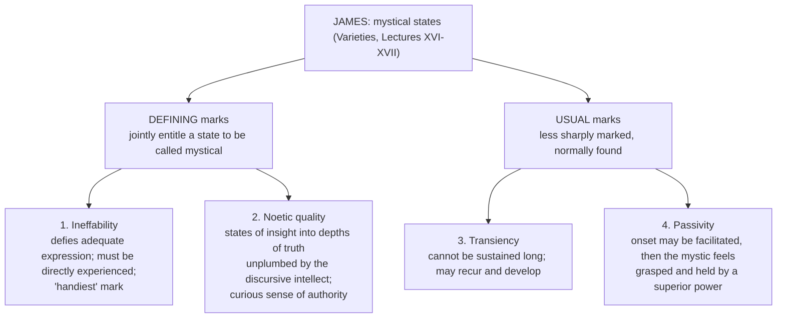

> [!TIP]
> **Mnemonic.** **I-N** = Ineffable + Noetic = *defining*; **T-P** = Transient + Passive = *usual*. Two-plus-two, not four equals. ⚠️

> [!WARNING]
> A flat list of four is the standard error. The grading lets you say a state may be genuinely mystical **without** being brief or wholly passive, which is exactly the case of Indian *jñāna*, a **stable, established** realisation. A flat list makes Advaitic realisation look like a failed mystical state. The four marks describe **mystical states**, not every religious experience. ⚠️

**James's method ✅/⚠️:** empirical and pragmatic; studies first-person documents; refuses **"medical materialism"** (James's own term, *Varieties*, Lecture I: the fallacy of discrediting a state by its physiological or pathological origin); evaluates religion by **fruits**, adopting (not coining) "by their fruits ye shall know them" (Matthew 7:16/20); religion is **personal before institutional**; the experience of the **"MORE"** connects the self, through the subconscious, to a wider reality. Varieties covered: healthy-mindedness and the sick soul; the divided self and conversion; saintliness; mysticism.

**Three conclusions about authority (end of Lectures XVI–XVII) ✅:**

| # | Conclusion |
|---|---|
| 1 | Well-developed mystical states are normally entitled to authority **for their own subject** |
| 2 | They carry **no obligation of assent for a person who has not had the experience** |
| 3 | Their existence **undermines the claim that ordinary rational/sensory consciousness has an exclusive veto** over other forms of consciousness (it does **not** force outsiders to accept a mystic's theology) |

### 2.2 Why James calls mystical states a genuine expression (2026 Q5(a), 10 marks) ✅/⚠️

| Ground in James's inquiry | Why it matters for *genuine expression* | Necessary limit |
|---|---|---|
| Recurring, describable marks in first-person testimony | Identifies a recognisable experiential type, not empty doctrinal language | A stable type is not yet a supernatural cause |
| Noetic *seeming* and the sense of a larger "MORE" | Explains why subjects take the state as disclosure significant for religious life | Felt insight does not entail knowledge of a determinate God |
| Lasting reorientation and **fruits** | States can unify a divided self and change conduct beyond an episode | Good fruits also occur without the subject's favoured metaphysics |
| Refusal of **medical materialism** | Psychological/neural origin alone cannot show the experience false or worthless; ordinary perception also has causes | Causal neutrality is not positive proof of revelation |

**2026 verdict:** genuine as a psychologically real, potentially transformative *form of lived religion*; the claim that it reveals a particular metaphysical object remains defeasible. Constructivist critic: does doctrine shape the supposedly noetic content (Katz)? Defender: mediation need not imply fabrication, but cannot bypass conflicts between reports. Do **not** convert this into the full proof-from-experience argument owned by Proofs for God (a single bounded line only). Also mentioned by James: a spectrum from ordinary heightened meaning to explicitly religious mystical reports; not every unusual episode is sacred.

### 2.3 Otto's numinous ✅

- **Doctrine:** non-rational awareness of the holy as ***mysterium tremendum et fascinans***: mysterious, overwhelming (*tremendum*), attracting (*fascinans*), "wholly other"; **a priori**, non-rational awe.
- **Argument:** ordinary moral predicates do not exhaust holiness; religious awe shows a distinctive quality disclosed in experience, later schematised by rational and ethical concepts.
- **Distinction:** non-rational ≠ irrational; it means not reducible to conceptual-moral judgement. Example: creature-feeling before the wholly other = dread + humility + fascination.
- **Objection → reply:** psychology can explain awe without a numinous object; Otto's phenomenological reply describes intentional structure, but description alone does not prove veridicality. ⚠️
- **Schleiermacher:** religion's essence = **"feeling of absolute dependence"** ⚠️.

### 2.4 Stace and Zaehner: rival typologies, opposite answers ✅/⚠️

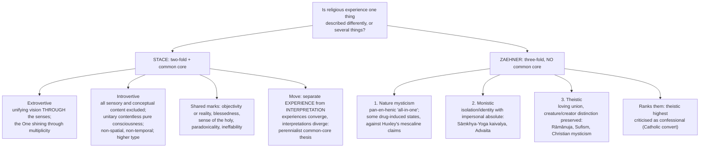

- **Objection to Stace:** "interpretation" does all the work; subtract enough and any two experiences look alike. **Reply:** the shared marks are reported *within* the descriptions, not imposed afterwards.
- **Objection to Zaehner:** smuggles in a theological ranking. **Reply:** retain the classification, drop the ranking. His genuine point: monistic and theistic reports differ in logical form (identity vs relation).
- **Verdict formula:** keep Stace's extrovertive/introvertive distinction; keep Zaehner's monistic/theistic distinction; drop Zaehner's ranking.

> [!WARNING]
> Do not merge Stace and Zaehner. Stace: two types + common core. Zaehner: three types + no common core + contested ranking. They are rival, not complementary.

### 2.5 Katz–Forman dispute ✅

| Position | Claim | Pressure |
|---|---|---|
| **Katz** (1978, "Language, Epistemology and Mysticism"): constructivism | "No unmediated experiences": tradition, expectations, concepts, practices shape the experience itself; a Jewish mystic does not have a Buddhist experience differently described | Weakest at the contentless case |
| **Forman:** Pure Consciousness Event (PCE) | A contentless state has nothing for concepts to shape | Concentrates where constructivism is weakest |

Verdict: constructivism is very strong for *extrovertive* and *theistic* reports and weakest for the *contentless* case. ⚠️

### 2.6 Alston: the perceptual model ✅ (*Perceiving God*, 1991)

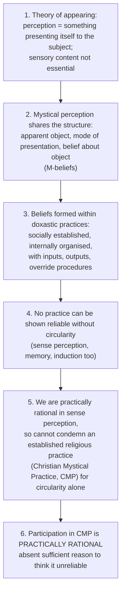

- **Distinctions ✅:** *prima facie* (defeasible) vs *ultima facie* (all things considered); Alston claims **practical rationality of engagement**, not proof of reliability; distinct from Swinburne's principle of credulity (a general principle about seemings, not a practice-based argument).
- **Diversity objection (Alston's own most serious):** incompatible mystical practices (CMP, Buddhist, Advaitic, Islamic) are each socially established and self-supporting. Response: rational to **sit tight** in one's own practice absent a neutral adjudicating ground — an uncomfortable position.
- **Second objection:** mystical perception lacks cross-checking, prediction and intersubjective agreement. **Reply:** CMP has internal override systems (discernment criteria, doctrinal tests, spiritual direction), weaker than science's but not absent.
- **Verdict:** Alston shifts the burden: the sceptic must show what makes religious practice *relevantly worse* than sense perception. His honest stopping point: diversity has no non-circular resolution.

### 2.7 Indian accounts: *anubhava* ✅

- **Anubhava / aparokṣānubhūti:** the highest religious experience is **immediate, intuitive realisation**, not mere belief; the goal of the whole spiritual path.
- **Advaita (2024) features ✅:**
  - **Non-dual recognition:** the presumed separation of self and Brahman is sublated (*aham brahmāsmi*; Bṛhadāraṇyaka Upaniṣad 1.4.10). *Nirvikalpa samādhi* may be discussed as a meditative state, but a transient trance alone is **not** liberating *brahma-jñāna*.
  - **Self-certifying (*svataḥ-siddha*)**, beyond objectifying speech (*avācya*; *yato vāco nivartante*), bliss (*ānanda*), beyond ordinary cognitive categories.
  - **Identity, not relation to an object:** distinguishes it from theistic (dualistic) mysticism.
  - **Stable knowledge (*jñāna*)** matters more than episodic ecstasy.
  - **Argument:** subject–object cognition presupposes witnessing consciousness; *śruti* removes false identification; disciplined inquiry culminates in recognition that ātman is Brahman. **Example:** the **tenth-man story** — instruction removes ignorance of an already present fact.
  - **Objection → reply ⚠️:** a contentless experience cannot identify Brahman. Advaita: Brahman is self, not an inferred object; conceptual instruction prepares a non-objective recognition.

> [!WARNING]
> Do **not** call the Advaitic experience ***anirvacanīya***. In Advaita's technical vocabulary that term is the status of **māyā and the world-appearance** (*sad-asad-vilakṣaṇa*), not of Brahman or its realisation. Spell it *anirvacanīya* throughout.

### 2.8 Vedāntic religious experience is not one school (2021 Q7(c)) ✅/⚠️

| School and method | Nature of liberating experience | Object / self-relation | Specific difficulty |
|---|---|---|---|
| **Śaṅkara's Advaita:** *śravaṇa–manana–nididhyāsana*, removal of *avidyā* | Stable *brahma-jñāna*, not a transient state alone; self-luminous recognition | Self **not other than** Brahman; Brahman not an external object; *aham brahmāsmi* | Why call a differentiated-content-free state knowledge of Brahman? *Śruti* and reasoning supply the criterion; outsiders can still question |
| **Rāmānuja's Viśiṣṭādvaita:** scriptural understanding, *bhakti*, grace | Enduring loving contemplation and personal communion; devotion remains meaningful at the goal | Self and world real, dependent **modes** of personal Brahman; difference not erased | Identity reading of *mahāvākyas* is rejected, not just experienced differently |
| **Madhva's Dvaita:** devotion with grace and scripture | A real subject's God-directed knowledge and loving service; liberation does not make the finite self God | Soul and Viṣṇu **eternally distinct**; divine encountered, not recognised as one's identical self | Competing Vedāntic readings cannot all literally describe the same self–God relation |

A common soteriological aim does not make identity, qualified dependence and dualistic relation logically identical. For the 2024 explicitly-Advaita question prioritise the Advaita material, not this survey. *Anubhava* here = claimed experiential fulfilment or confirmation, not a uniform empirical observation overriding scripture.

### 2.9 Indian experience-types: bounded bridge ⚠️

| Tradition | Experience-structure | Claimed object/terminus | Control |
|---|---|---|---|
| Advaita | Non-dual recognition through hearing, reflection, contemplation | Self as Brahman | Not an encounter between two independently existing terms |
| Yoga | Disciplined concentration culminating in seedless absorption and discriminative freedom | Isolated consciousness (*puruṣa*) | Yoga's special Lord is not the creator-object of every experience |
| Devotional traditions | Love, surrender, remembrance, prayer, worship | Personal Lord | Relation and grace remain real; do not redescribe as Advaitic identity |
| Buddhism | Meditative insight into impermanence, no-permanent-self, conditioned arising | Dharma / cessation (*nirvāṇa*), not a creator God | Noetic and transformative claims remain tradition-mediated |

The table is a bridge only; meditation stages and liberation doctrines remain with Paper I owners.

### 2.10 Radhakrishnan, *The Hindu View of Life* (2025 Q8(a), 20 marks) ✅/⚠️

**Anchor ✅:** Lecture I, "Religious Experience: Its Nature and Content", print pp. 15–31 (OCR may corrupt page labels).

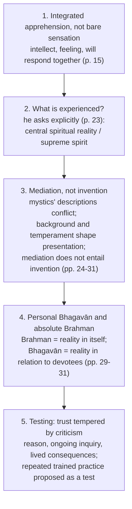

- Religion is lived *darśana/anubhava*, not a fixed creed; experience is called *svataḥsiddha* **then immediately** said to be liable to error and to need testing by logical thought (pp. 15–17). Vedic testimony records seers' experience but must be re-tested (pp. 17–19).
- The shared Real behind descriptions is **his argued interpretation**, not an observation demonstrated by universality. God as personal is an intelligible human representation, not an exhaustive statement of reality in itself (pp. 24–31).
- "Integral intuition" is an analytical label; it is not a hunch but disciplined, integral, transformative awareness.
- **Evaluation ⚠️:** (a) self-certification may describe conviction, not warrant for one external object; his own appeal to fallibility prevents a quick appeal to infallibility; (b) incompatible contents (personal union vs non-dual identity; Buddhist non-self vs Vedāntic Self) may require substantial reinterpretation of participants' claims; (c) the mediation that defuses diversity may leave no independent test that selects the Real over a naturalistic explanation — this does not make the experience unreal. **Verdict:** powerful account of experience as integrated and correctable; lived spiritual significance **does not by itself prove** a single supra-personal object.

> [!WARNING]
> Do not silently credit the Bhagavān/Brahman synthesis to Rāmānuja, or claim Buddhist non-self literally affirms Brahman, or present Radhakrishnan as simply rejecting reason or scripture. Do not claim every Hindu school agrees with him.

---

## 3. Dialectical Wings & Sceptical Refinements: Mediation, Defeaters, Perennialism

No named sceptical *school* belongs to this topic in the sources; the corresponding pressure is the set of **defeaters** and the **mediation dispute**.

### 3.1 Interpretation and mediation ⚠️

| Position | Claim | Pressure |
|---|---|---|
| Perennial / common-core | Traditions interpret a substantially shared experiential core | Subtracting "interpretation" may manufacture abstract sameness |
| Constructivism | Concepts, expectations, practices shape the experience itself | Contentless or minimally conceptual states pressure the universal claim |
| Proudfoot-style attribution | An experience is religious partly because the subject explains it through a religious scheme | Explaining classification may not exhaust phenomenology or object |
| Hick's plural mediation | Diverse traditions are culturally conditioned responses to one Real | An unknowable Real may be too indeterminate to support specific claims |

The strongest conclusion separates **occurrence**, **interpretation** and **veridicality** rather than inferring any one from another.

### 3.2 Defeaters ⚠️

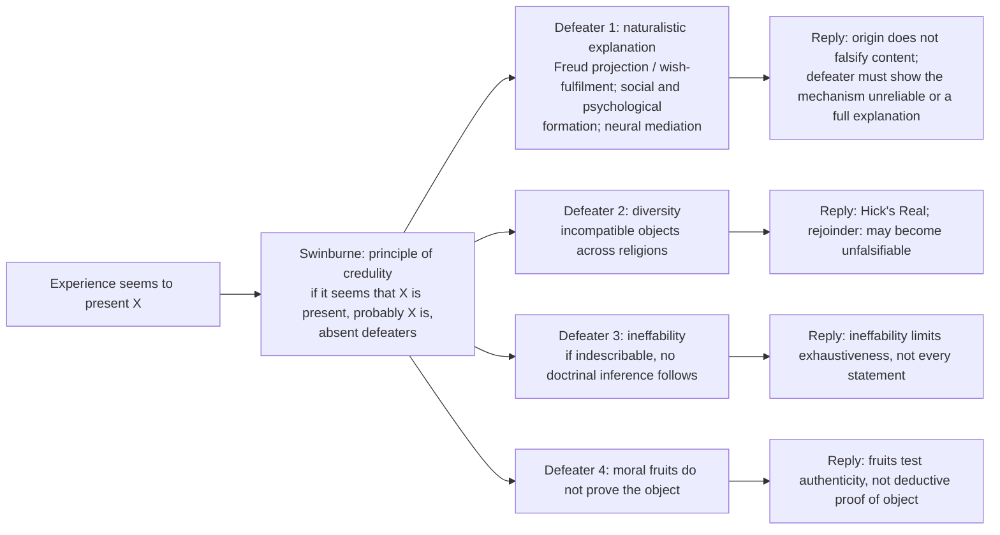

### 3.3 Advanced dossier debates (optional depth, §6) ⚠️

| Debate | Positions | Strongest extra objection → reply | Safe use |
|---|---|---|---|
| Perceptual model vs constructivism | Prima facie awareness of a real object vs mediation by concepts, practices, expectations | Tradition-shaped experiences cannot disclose a common object → all experience is mediated, yet mediation does not erase objectivity | One evaluative contrast after James or credulity |
| Perennial core vs hard diversity | Common experiential depth vs genuinely divergent structures (Advaita, theism, Buddhism) | "Same core" flattens → claim only family resemblance or analogous transformation | Radhakrishnan / plural-experience answers |
| Neuro-reduction vs non-reductive embodiment | Neural correlation explains away vs mediation compatible with disclosure | If experience has a neural cause no extra object is needed → mechanism and truth-value are distinct questions, as in ordinary perception | A current analogue only; do not let it dominate |
| Non-dual awareness vs intentional encounter | Self-luminous non-dual awareness vs knower–known relation to God | Contentless awareness cannot justify doctrinal claims → doctrine prepares and interprets recognition; the liberating moment is non-objective | Advaita vs James / Otto / revelation |

*What not to over-study:* neuroscience vocabulary, measurement claims, long mystical taxonomies absent from syllabus or PYQs. *Promotion trigger:* if UPSC directly asks perception models, constructivism or the epistemic force of religious testimony.

---

## 4. Metaphysics & Ontology: The Claimed Object

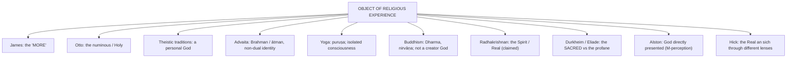

### 4.1 Sacred and holy as the generic object (2018 Q7(a), 20 marks) ✅/⚠️

- **Stem structure:** grants the generic category and asks whether the *specific* one (God) can also serve → a **graded** answer.
- **Why 'sacred/holy' became generic:** (1) **Otto**: the *holy* is a distinctive quality disclosed in numinous awe, prior to moral and rational predicates; (2) **Durkheim**: the *sacred* is defined **relationally** against the profane and by protecting prohibitions, needing no deity; (3) **Eliade**: the sacred manifests (*hierophany*), structuring space and time (*axis mundi*); (4) decisive reason: **non-theistic religions have a sacred but no God** (nirvāṇa/Dharma, Tīrthaṅkara/siddha, the *apauruṣeya* Veda, the Tao).
- **Can God be the object?** Yes for theistic traditions (classical theism, Viśiṣṭādvaita, Śaiva Siddhānta, Islam, Judaism): God is the **source and measure** of holiness. **No** as a generic definition: it would define Buddhism, Jainism and Mīmāṃsā out of religion by stipulation. Relation: **sacred = genus; God = one (personal-theistic) species.**
- **Discriminator:** Otto's holy (phenomenological quality of an object) ≠ Durkheim's sacred (social classification).
- **Indian parity:** *pavitra/śuddha*, *maṅgala*, *puṇya*, *tīrtha*, *kṣetra*, *devālaya*; sacred time (*parvan* days, *muhūrta*, ritual calendar); Veda's sanctity without a sanctifier. Indian sacred is often organised by **purity/auspiciousness**, not Otto's dread — a limit on Otto's universality.
- **Objections:** (i) over-breadth (flags, nations) → add a **soteriological relation**; (ii) genus subordinates God → the subordination is conceptual, not ontological.
- **Verdict:** "sacred" and "holy" are the generic object-terms; God remains the **paradigm instance**, not the definition.

---

## 5. Rejection / Affirmation of Transcendent Realities: Veridicality and Revelation

### 5.1 Veridical or merely psychological? ⚠️

- **For:** Principle of Credulity (Swinburne); noetic quality; convergence of mystics; testimony extends warrant to hearers.
- **Against:** naturalistic explanations (Freud, social/psychological formation, neural mediation); diversity across religions.
- **Key distinction ✅:** explaining neural correlation does not by itself explain away the putative object; **causal explanation and epistemic defeat are separate**.
- **Hick's pluralist reply ✅:** culturally shaped responses to one ultimate Real (detailed pluralism owned by Religious Pluralism). Critics: the unknowable Real cannot ground determinate claims.
- **Conflict example:** personal God, non-dual Brahman and emptiness generate a cross-tradition defeater problem.

### 5.2 Mystical experience and revelation (2023 Q8(c), 15 marks) ✅/⚠️

**Define the relata:** mystical experience = putative immediate awareness, unity or encounter with the ultimate; revelation = the **claim that divine reality or truth has been disclosed**. One concerns a way of undergoing something, the other its attributed source, content and authority. They overlap **without** being coextensive (a Christian may take an encountered presence as revelation; a Buddhist meditator may report liberating insight without a revealer; prophetic speech or a text need not be a mystical union).

| Direction | Mechanism and example | Limit |
|---|---|---|
| **Experience → interpretation as revelation** | James's noetic seeming motivates disclosure-language; a Hick-style account takes a divine presence as disclosed then interpreted in propositions | Phenomenological force cannot establish who disclosed what; rival mystics disagree |
| **Alleged revelation → disciplined experience** | Upaniṣadic *śruti* instructs Advaitic self-inquiry; theistic scripture shapes prayer and communion | A tradition may shape the experience (Katz); a scripture certifying its own authority is circular |
| **Reception and communal transmission** | A mystic's testimony may renew devotion; a community tests moral fruits before treating it as normative | James grants no automatic obligation to outsiders; sincerity does not guarantee divine origin |

**Why it matters:** mystical experience vivifies inherited teaching and transforms the divided self; revelation supplies content, continuity and norms; independent ethical and rational checks resist self-authorising claims. **Verdict:** neither make all mysticism infallible revelation nor make every revealed proposition depend on a prior mystical state. Authentication in full belongs to Reason, Revelation and Faith.

### 5.3 Public discourse: how far? (2019 Q7(c), 15 marks) ✅/⚠️

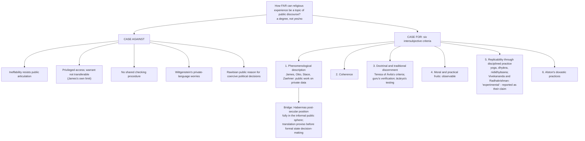

- **Concession ⚠️:** these criteria test **authenticity**, not **truth**. Replicability is training-dependent (like expert perception), not a public laboratory test; an uncommitted observer cannot run the "experiment".
- **Verdict:** can enter public discourse as **data, description, testimony and disciplined practice**; first-person force is not transferable; public discussion ≠ public proof.

---

## 6. Explanatory & Causal Principles: Prayer, Worship and Practice

### 6.1 Prayer vs worship (2020 Q7(b), 15 marks) ✅/⚠️ — two deliverables, both required

| Axis | Prayer | Worship |
|---|---|---|
| Essential act | **Address** / communication | **Ascription of supreme worth** (homage) |
| Direction | Person-to-person (I–Thou) | Creature-before-the-holy |
| Form | Verbal or silent; may be spontaneous | Ritual, embodied, rule-governed |
| Locus | Often private | Characteristically corporate |
| Presupposes | An addressee; **petition** expects a possible response | A reality of supreme value; response not required |
| Non-theistic availability | Petition strained; praise/aspiration can take prayer-form ⚠️ | Available ✅ |

**Adoration is the overlap** (both address and ascription of worth). Western scheme **A-C-T-S**: Adoration, Confession, Thanksgiving, Supplication; contemplative/wordless prayer is the limit case where address becomes silence.

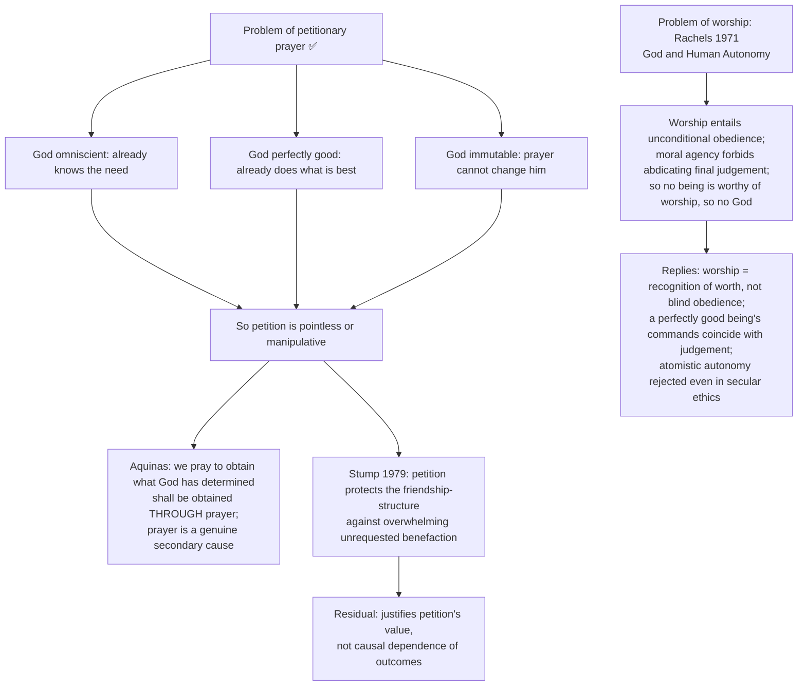

**Indian material ✅:** *prārthanā* (petition), *stuti/stotra* (praise), *japa* (repetition), *dhyāna* (meditation), *upāsanā* (structured contemplative worship), *pūjā/arcana* (ritual service), *vandana* (salutation), *ātma-nivedana* (self-offering); the last five appear in the *navadhā bhakti* list. **Decisive cases ⚠️:**

| Tradition | Case |
|---|---|
| Jainism | Tīrthaṅkara is *vītarāga* and grants no requests; *caitya-vandana* = worship without answered petition |
| Mīmāṃsā | Efficacy lies in *apūrva* generated by correct performance; the deity is a grammatical dative, not a granting agent |
| Advaita | *Upāsanā* of a saguṇa form is efficacious at *vyāvahārika* level, transcended (not repudiated) at *pāramārthika* |
| Buddhism ✅ | *Pūjā* standardly commemorative and dispositional; devotional Pure Land traditions complicate this |

**Place in religion:** prayer = **relational** organ; worship = **evaluative and communal** organ. A religion can survive without answered petition (Jainism, Mīmāṃsā, classical Buddhism). **Verdict:** "Petitionary prayer expects a **responsive** ultimate; worship may honour a **supremely valuable** one without expecting intervention; their overlap is adoration."

---

## 7. Ethics & Human Goals

The sources give **no kāma/artha/dharma/mokṣa hierarchy** for this topic. The practical-fruit and transformation material is what the owner file supplies:

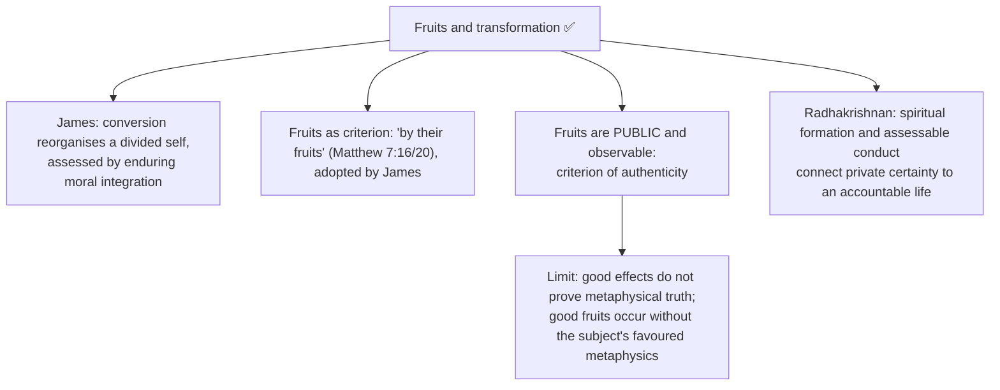

---

## 8. Inter-School Comparative Matrices

### 8.1 Comparison grid ⚠️

| Thinker | Nature | Object | Key term |
|---|---|---|---|
| James | **defining:** ineffable + noetic; **usual:** transient + passive | the "MORE" | varieties; fruits; medical materialism rejected |
| Otto | non-rational awe | numinous / Holy | *mysterium tremendum et fascinans* |
| Schleiermacher | feeling of dependence | the Infinite | absolute dependence |
| Stace | extrovertive (unity *through* the senses) / introvertive (contentless unitary consciousness) | the One | common-core thesis |
| Zaehner | nature / monistic / theistic | Nature, the isolated soul, or a personal God | *pan-en-henic*; typology with ranking |
| Alston | perception-like, with an appearing object | God as directly presented | M-perception; doxastic practice |
| Advaita | stable non-dual knowledge, self-luminous consciousness | Brahman (= ātman) | *aham brahmāsmi*; *nirvikalpa* episode is not the whole account |
| Radhakrishnan | integrated *darśana/anubhava* | the Spirit / Real (claimed) | self-certifying **and fallible** |
| Durkheim / Eliade | socially and spatially structured | the **sacred** (vs profane) | hierophany; *axis mundi* |

### 8.2 Inter-thinker debates ✅

| Account | Nature | Object | Epistemic claim | Main risk |
|---|---|---|---|---|
| James | Mystical, transformative | "More"/divine | Personal authority; fruits | Subjectivism |
| Otto | Numinous awe | Holy / wholly other | Phenomenological disclosure | Reification of emotion |
| Advaita | Non-dual recognition | Brahman as self | Self-certifying knowledge | Content/criterion problem |
| Radhakrishnan | Integral intuition | Spiritual Real | Universal experiential core | Advaitic assimilation |
| Theistic mysticism | Union / communion | Personal God | Relational knowledge | Conflict with non-dual reports |
| Buddhism | Insight / awakening | Nirvāṇa / emptiness, no creator | Transformative insight | "Object" category may mislead |
| Stace | Extrovertive / introvertive | The One | Common core beneath interpretation | Interpretation does all the work |
| Zaehner | Nature / monistic / theistic | Nature, absolute, or personal God | Types irreducible | Confessional ranking |
| Alston | Perceptual (M-perception) | God directly presented | *Prima facie* justification; practical rationality | Diversity of established practices |
| Durkheim / Eliade | Socially and cosmically structured | The **sacred** | Functional, God-free definition | Over-breadth |

### 8.3 Indian–Western parity bench ⚠️

| Axis | Western | Indian | Discriminating point |
|---|---|---|---|
| Structure | Encounter/union with an Other (Otto, theistic mysticism) | **Identity-recognition** (Advaita) or **isolation** (Sāṃkhya-Yoga) | Relation vs identity is a *logical*, not stylistic, difference |
| Duration | Transient (James's usual mark) | *Jñāna* **stable and established** | Why James's grading matters |
| Method | Grace, contemplation, sacrament | Disciplined, staged, repeatable (*aṣṭāṅga*, *śravaṇa–manana–nididhyāsana*) | India's replicability claim in the public-discourse question |
| Authority | Authoritative for the subject only (James) | *Svataḥ-siddha*, tested by *guru* and *śruti* | Both restrict transferability; India adds institutional discernment |
| Object-term | God, the Holy, the numinous | Brahman, *puruṣa*, nirvāṇa, the Tīrthaṅkara | Generic term must be "sacred", not "God" |
| Ritual correlate | Prayer, sacrament, liturgy | *Upāsanā*, *pūjā*, *japa*, *dhyāna* | Jain/Mīmāṃsā worship *without* a responsive deity |

---

## 9. Criticisms & Reconstructed Replies

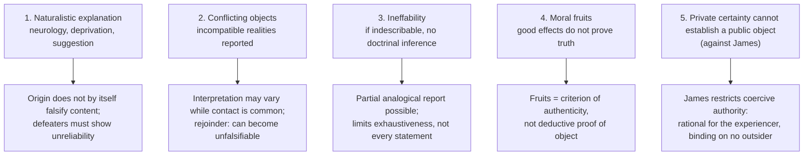

Per-doctrine objection → reply ledger ⚠️: **Otto** (psychology explains awe → intentional-structure description, which alone cannot prove veridicality); **Advaita** (contentless cannot identify Brahman → Brahman is self; doctrine prepares recognition); **Radhakrishnan** (privileges Advaitic unity → universality concerns experiential depth, not identical description; adequacy contested); **Stace** (interpretation does all the work → shared marks within descriptions); **Zaehner** (theological ranking → drop ranking); **Alston** (diversity → sit tight; weaker cross-checking → internal override systems).

---

## 10. Controlled Western Comparisons

All Western thinkers here belong to the topic itself (James, Otto, Schleiermacher, Stace, Zaehner, Katz, Forman, Alston, Swinburne, Hick, Durkheim, Eliade, Freud, Habermas, Rawls). The sources give **no separate East–West comparison table with guardrails**; the only controlled pairings are those below.

| Pairing | Point of contact | Decisive disanalogy |
|---|---|---|
| James's marks vs Advaitic *jñāna* | Both treat the state as noetic | James's **usual** mark of transiency does not fit stable *jñāna*; relation to a "MORE" vs **identity** |
| Theistic mysticism vs Advaita | Both report direct awareness | **Relation** presupposes two terms; **identity** abolishes one; a common-core theory must explain this away, and Zaehner's refusal to is his most defensible move |
| Otto's holy vs Indian sacred | Both name an object-quality | Indian sacred is often organised by purity/auspiciousness, not dread |
| Radhakrishnan's Real vs Buddhist / Vedāntic claims | Shared ethical transformation | Shared transformation does not establish metaphysical identity |
| Alston's practices vs yoga / *nididhyāsana* | Disciplined, established practice | Cross-checking is training-dependent, not public laboratory testing |

> [!WARNING]
> Do not treat Otto's holy and Durkheim's sacred as one word; do not merge Stace and Zaehner; do not report Alston as proving reliability.

---

## 11. Diagnostic Deep-Dives for High-Frequency Themes

### 11.1 Five repeated distinctions ⚠️


### 11.2 2025: Radhakrishnan answer spine

Anchor Lecture I pp. 15–31 → integrated *darśana/anubhava* with self-certifying yet fallible character → object: central spiritual reality; personal Bhagavān / supra-personal Brahman as his proposed reconciliation → test: reason, inquiry, lived consequences → challenges: opposed reports, naturalistic attribution; no inferring a common Real by definition → verdict: lived religion plausibly precedes dogma, but inward conviction does not prove one spiritual object.

### 11.3 2024: Advaita features spine

Aparokṣānubhūti → stable non-dual knowledge (not necessarily a transient *nirvikalpa* episode) → subject–object duality sublated → *aham brahmāsmi* → *svataḥ-siddha* → *avācya* → *ānanda* → contrast with theistic/dualistic mysticism and James's "MORE" → object is **not encountered but realised as one's own Self**. Never write *anirvacanīya* here.

### 11.4 2022: James nature-and-variety spine

Empirical, pragmatic study of personal religion → defining ineffable + noetic; usual transient + passive; the "MORE"; test by fruits; varieties (healthy-minded vs sick-souled; conversion; mysticism) → strength: takes experience seriously; limit: subjectivism, veridicality unproven → religious experience is the living root of religion, though its object needs further warrant.

---

## 12. PYQ Routing Ledger (2018–2026)

> Corpus signal: **exactly one primary-owned part in every paper from 2018 to 2026** — 8 of 112 in 2018–2025, plus 1 in 2026 (9 of 126). No pre-2018 table exists in the owner file.

| Year | Q | Marks | Exact demand | Map to |
|---|---|---:|---|---|
| 2018 | Q7(a) | 20 | The terms 'Sacred' and 'Holy' have come to serve as generic names for the object of religion. Do you agree that one can have God as the object of religion? Discuss. | §4.1 |
| 2019 | Q7(c) | 15 | How far can religious experience be made a topic of public discourse? Analyse. | §5.3 |
| 2020 | Q7(b) | 15 | Distinguish between prayer and worship and determine their place in religion. | §6.1 |
| 2021 | Q7(c) | 15 | Explain the concept of religious experience in the light of Vedāntic tradition. | §2.8 |
| 2022 | Q7(c) | 15 | Discuss the nature and variety of religious experiences as presented by William James. | §2.1 |
| 2023 | Q8(c) | 15 | Examine the relation between mystical experience and revelation and expound their significance in the religious life. | §5.2 |
| 2024 | Q8(c) | 15 | Discuss the main features of religious experience according to Advaita Vedānta. | §2.7, §11.3 |
| 2025 | Q8(a) | 20 | Evaluate the nature and object of Religious Experience as explained by Radhakrishnan in 'The Hindu View of Life'. | §2.10, §11.2 |
| 2026 | Q5(a) | 10 | On what grounds does William James characterize mystical states as a genuine expression of religious experience? Elaborate. | §2.2 |

**Primary-owned total: 9** (8 from 2018–2025 plus 2026 Q5(a)). Route notes from the 2026 supplement: keep the printed word **grounds** — criteria plus their warrant, not a narrative of *Varieties*; veridicality (credulity/testimony, Katz) admissible as evaluation; the argument *from* religious experience as a proof of God belongs to Proofs for God (one bounded line only).

**Cross-owned, listed but not counted:**

| Year | Q | Marks | Owner | Link to this topic |
|---|---|---|---|---|
| 2019 | Q6(a) | 20 | Religious Language | "Discuss whether and how does religious symbolism lead to mysticism." |
| 2026 | Q5(e) | 10 | Reason, Revelation and Faith (§9.1B) | "If religion were a subject of reason alone, it would have lacked an experiential account." Experiential half imported as a bounded cross-link: Schleiermacher's feeling of absolute dependence, Otto's numinous, James's noetic quality |

---

## 13. Top 10 UPSC Exam Traps

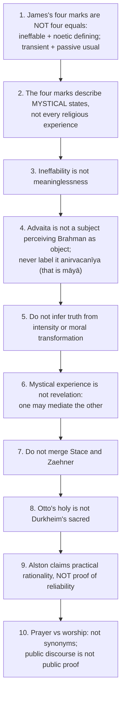

Extra traps from the owner file: do not present Vedānta as Advaita alone (§2.8); do not report a *nirvikalpa* episode as the whole account of liberating knowledge; do not claim the Bhagavān/Brahman synthesis is Rāmānuja's; use 📰 only for a dated contemporary anchor — neuroscience without a dated source is a general analytical point, not news; replicability claims are method-dependent and reported as Vivekananda's and Radhakrishnan's claim.

---

## 14. Technical Vocabulary & IAST Bank

| English gloss | Term (IAST / original) | Meaning | Status |
|---|---|---|---|
| Direct realisation | *anubhava* / *aparokṣānubhūti* | Immediate intuitive realisation | ✅ |
| Self-certifying | *svataḥ-siddha* | Advaita / Radhakrishnan (*svataḥsiddha*, qualified by fallibility) | ✅ |
| Beyond objectifying speech | *avācya*; *yato vāco nivartante* | Advaitic ineffability | ✅ |
| Indescribable (status of māyā) | *anirvacanīya*; *sad-asad-vilakṣaṇa* | **Not** a term for Brahman or its realisation | ✅ |
| I am Brahman | *aham brahmāsmi* | Bṛhadāraṇyaka Upaniṣad 1.4.10 | ✅ |
| Non-conceptual absorption | *nirvikalpa samādhi* | A state; not the whole account of liberation | ✅ |
| Bliss | *ānanda* | Advaitic feature | ✅ |
| Stable knowledge | *jñāna* | Established realisation | ✅ |
| Hearing, reflection, contemplation | *śravaṇa–manana–nididhyāsana* | Advaitic method | ✅ |
| Vision / lived realisation | *darśana* | Radhakrishnan's lived religion | ✅ |
| Devotion | *bhakti* | Devotional path; *navadhā bhakti* | ✅ |
| Kaivalya / isolation | *kaivalya*; *puruṣa* | Yoga / Sāṃkhya-Yoga terminus | ✅ |
| Cessation | *nirvāṇa* | Buddhist terminus | ✅ |
| Petition / praise / repetition | *prārthanā* / *stuti, stotra* / *japa* | Prayer forms | ✅ |
| Structured worship / ritual service | *upāsanā* / *pūjā, arcana* | Worship forms | ✅ |
| Salutation / self-offering | *vandana* / *ātma-nivedana* | Worship forms | ✅ |
| Free of attachment | *vītarāga* | Tīrthaṅkara cannot grant requests | ✅ |
| Unseen potency of ritual | *apūrva* | Mīmāṃsā ritual efficacy | ✅ |
| Everyday / ultimate level | *vyāvahārika* / *pāramārthika* | Advaita levels | ✅ |
| Pure / auspicious / meritorious | *pavitra, śuddha* / *maṅgala* / *puṇya* | Indian sacred vocabulary | ✅ |
| Crossing-place; sacred field | *tīrtha* / *kṣetra* | Sacred space | ✅ |
| Fearful and fascinating mystery | *mysterium tremendum et fascinans* | Otto's numinous | ✅ |
| Manifestation of the sacred | hierophany; *axis mundi* | Eliade | ✅ |
| M-beliefs; doxastic practice | M-perception | Alston | ✅ |
| Pure Consciousness Event | PCE | Forman | ✅ |
| All-in-one | *pan-en-henic* | Zaehner's nature mysticism | ✅ |
| *Prima facie* / *ultima facie* | — | Defeasible / all-things-considered justification | ✅ |
| Medical materialism | — | James's term | ✅ |
| Principle of credulity | — | Swinburne | ✅ |

---

## 15. Graded Verdict & Answer Architectures

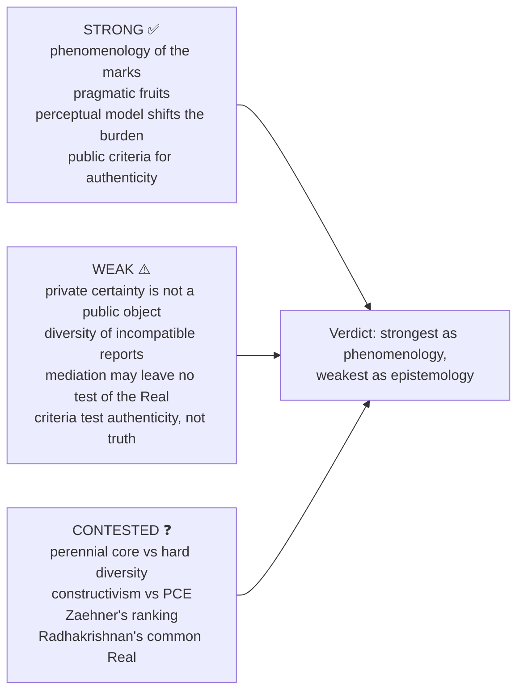

### 15.1 10-mark

```text
Define the experience -> list structured marks -> identify object ->
one epistemic objection -> limited verdict.
```
For 2026 Q5(a): grounds = two defining and two usual marks; noetic seeming and durable fruits; medical materialism cannot discredit by origin alone → authority for the subject, not outsiders, yet ordinary consciousness cannot veto every alternative mode → "genuine expression of personal religious life, not guaranteed divine contact."

### 15.2 15-mark

```text
Nature/object distinction -> thinker's account and presupposition ->
canonical example -> Indian/Western contrast -> veridicality objection and reply.
```

### 15.3 20-mark

```text
Phenomenology -> claimed object -> warrant from credulity/testimony/fruits ->
naturalistic and diversity defeaters -> Indian-Western comparison ->
graded verdict separating personal justification from public proof.
```

### 15.4 Directive decoder ⚠️

| Directive | Examiner is buying | Live example |
|---|---|---|
| Do you agree that…? Discuss | Explicit, graded position on the printed proposition | 2018 Q7(a) |
| How far can X…? Analyse | A **degree**, not yes/no | 2019 Q7(c) |
| Distinguish A and B and determine their place | Two deliverables — obey both | 2020 Q7(b) |
| Explain X in the light of [tradition] | Tradition-internal categories and plurality | 2021 Q7(c) |
| Discuss the nature and variety of X as presented by [thinker] | The marks **and** the typology | 2022 Q7(c) |
| Examine the relation between A and B and expound their significance | A relation **plus** a significance claim | 2023 Q8(c) |
| Discuss the main features of X | Enumerated features, each contrasted with a rival account | 2024 Q8(c) |
| Evaluate … as explained by [thinker] in [named work] | Fidelity to the named work, then assessment | 2025 Q8(a) |
| On what grounds does X characterise… Elaborate | Grounds **and** their epistemic limits | 2026 Q5(a) |

### 15.5 Graded-verdict ladder and templates ⚠️

| Band | Script contains | Typical fault |
|---|---|---|
| Weak (≈40%) | Flat four marks; mentions Otto | No object-analysis; no veridicality |
| Average (≈50%) | Marks + numinous + Advaita | Marks ungraded; Indian experience as "mystical feeling" |
| Good (≈60%) | Nature/object separated; one epistemic objection | Typologies and diversity defeater absent |
| Strong (≈65–70%) | Graded marks; identity-vs-relation; credulity/defeater apparatus; Indian parity | Alston overstated as proof |
| Top (≈70%+) | All above + a discriminating distinction + the defeater that would change the verdict | — |

> [!TIP]
> **Anchor lines.** (1) "Religious experience confers *prima facie*, defeasible justification on the subject and testimonial weight on the hearer; it does not establish its object publicly. Diversity, not neurology, is the serious defeater — causal explanation and epistemic defeat are different things." (2) "___'s account is strongest as **phenomenology** and weakest as **epistemology**." (3) "Theistic mysticism reports a **relation** that presupposes two terms; Advaita reports an **identity** that abolishes one." (4) "Phenomenological certainty and public proof are different epistemic achievements." (5) "Sacred/holy is a comparative generic term; God is a possible theistic object, not a universal definition."

---

## Link-outs

Reason, Revelation and Faith (non-propositional revelation; Reformed epistemology; Alston's doxastic practices) · Religious Language (ineffability, *neti neti*) · Religious Pluralism (Hick's Real, diversity defeater) · Problem of Evil (owner of the evil/profane pole; this file owns the sacred/holy pole) · Soul, Immortality, Rebirth and Liberation (*aparokṣānubhūti* as the cognitive event of liberation) · Religion without God · Paper I Yoga and Vedānta · Philosophy of Religion PYQ banks (2018–2025; 2026 supplement).

## Sources

William James, *The Varieties of Religious Experience* (Lectures I, XVI–XVII); Rudolf Otto, *The Idea of the Holy*; Friedrich Schleiermacher, *The Christian Faith*; W. T. Stace, *Mysticism and Philosophy*; R. C. Zaehner, *Mysticism Sacred and Profane*; Steven Katz (ed.), *Mysticism and Philosophical Analysis*; Robert Forman (ed.), *The Problem of Pure Consciousness*; William Alston, *Perceiving God*; Richard Swinburne, *The Existence of God*; Eleonore Stump, "Petitionary Prayer"; James Rachels, "God and Human Autonomy"; Émile Durkheim, *The Elementary Forms of Religious Life*; Mircea Eliade, *The Sacred and the Profane*; S. Radhakrishnan, *The Hindu View of Life* and *Indian Philosophy* Vol. II; Advaita sources on *aparokṣānubhūti* (as listed in the repository owner and advanced dossier).
