# RELIGION WITHOUT GOD — Examiner-Grade Mindmap

> **Syllabus (verbatim):** Religion without God.
> **Catalogue key:** `philosophy-paper-ii-philosophy-of-religion-07` · Paper II · Philosophy of Religion
> **Sources used:** `paper-2/philosophy-of-religion/Religion-without-God.md` (canonical owner, read in full) · `_advanced/Philosophy-of-Religion-Dossier.md` §7 and the promotion ledger (optional depth; read) · `paper-2/_PYQ-PhilosophyOfReligion-2018-2025.md` · `paper-2/_PYQ-PhilosophyOfReligion-2026-Supplement.md` (this topic: 0 primary parts). The six `paper-1/_themes/` files were searched; none has Religion-without-God content, so none is cited (the Pramāṇa file's only Nietzsche mention concerns Jaina perspectivism and is irrelevant here).
> **Evidence key:** ✅ canonical doctrine / fact · ⚠️ analytical synthesis for exam use · ❓ contested / uncertain · 📰 dated current anchor only (none used)

> [!IMPORTANT]
> **Core thesis.** The clause owns the **necessity question**: is belief in a personal creator required for religion? Every answer is decided by the **definition of religion** adopted in the first three lines. Creator-belief is not necessary for religion as a cross-cultural category; it is central to many actual religions. God is necessary for *some specifically theistic goods* (petition, grace, covenant), not for every religious function. ⚠️

> [!NOTE]
> **Adaptation.** The 15-module blueprint is written for single Indian schools. For this topic: Module 1 holds the ownership firewall and the definitions of religion; Module 2 holds the *justificatory* grounds (agnosticism, Cārvāka's *pramāṇa* argument, Mīmāṃsā's authority theory); Module 3 holds the revisionary and sceptical wings (critics of theism, fictionalism); Module 4 is the inventory of what each route removes and what replaces it; Module 5 is the stand on transcendent realities; Module 6 the causal substitutes for a creator; Module 7 value and motivation. The sources give no *āstika/nāstika* classification for this topic as a whole; it is not invented here.

---

## 0. Master Overview

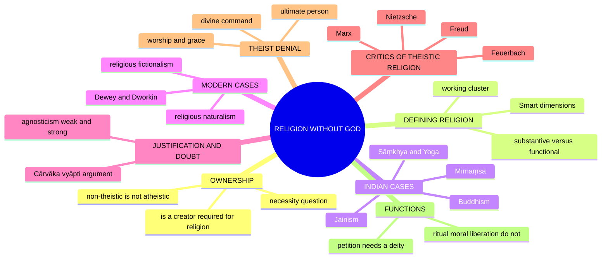

---

## 1. Identity, Lineage & Doxography

### 1.1 Exact printed ownership and cross-topic firewall ✅

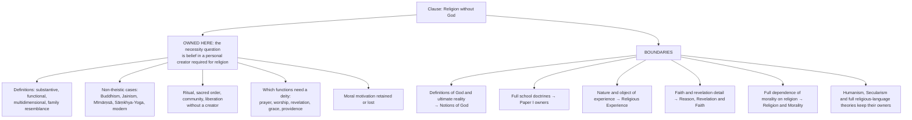

> [!WARNING]
> **Non-theistic is not identical with atheistic.** Rejecting a creator does not entail denying every deity, sacred being, devotional act or transcendent value. ⚠️

### 1.2 What makes something a religion, if not God? ✅/⚠️

- **Ninian Smart's dimensions:** doctrinal, mythic, ethical, ritual, experiential, social and material. These give a comparative **profile, not a seven-item necessary-and-sufficient checklist**; no one dimension requires creator belief. ✅
- **Functional definition:** religion = a way of life orienting one toward **ultimate meaning, liberation and the transcendent/absolute**, which need not be a personal God. ⚠️
- Hence 'religion without God' is coherent: **the sacred/ultimate ≠ necessarily a deity**.
- Substantive definitions identify religion by reference to gods or the sacred; functional definitions identify orientation, practice, community, meaning or liberation. ✅
- If creator-belief is made necessary **by definition**, Buddhism is excluded **by stipulation**, not by discovery. ⚠️ ("Religion" names a family of historically varied practices rather than one essence.)

### 1.3 Necessary, sufficient and over-broad criteria ⚠️

| Candidate feature | Necessary? | Why not alone sufficient? |
|---|---|---|
| Personal creator God | **No** — Buddhism, Jainism and classical Mīmāṃsā are countercases | Defines theism, not religion as such |
| Sacred or ultimate concern | Strong candidate but very broad | Nations, art or political causes can become ultimate concerns |
| Ritual and disciplined practice | Widespread, not universal in one form | Secular ceremonies also have ritual |
| Ethical orientation | Common | Ethical philosophies are not automatically religions |
| Community and tradition | Common | Clubs and nations also organise community |
| Diagnosis and liberation / salvation | Strong discriminator | Some traditions stress worship or belonging more than liberation |
| Myth, doctrine and experience | Family features | Each may be thin or absent in a particular strand |

**Working sufficient cluster.** A socially embodied and disciplined orientation to an ultimate/sacred order, expressed through some combination of doctrine, ritual, ethical formation, experience, community and a transformative or soteriological goal. This excludes neither non-theistic traditions nor every secular analogue, while blocking the claim that any strong commitment is religion. ⚠️

> [!TIP]
> **Mnemonic — 'Religion = the 3 D's minus God: Discipline, Dharma, Deliverance.'** A religion can offer a path, ethics and liberation without a creator deity; Buddhism is the strongest counterexample to a creator-necessity definition.

**Boundary tests (bounded modern caution).** Civil religion and secular spirituality may display ritual, sacred symbols, community and ultimate concern, but without a transformative/soteriological discipline the category becomes too broad. They are boundary tests, not additional syllabus owners or substitutes for the Indian cases. ⚠️

### 1.4 Doxography: the source map

| Strand | Texts / anchors named in the sources |
|---|---|
| Buddhism | *Brahmajāla Sutta* (DN 1); *Aggañña Sutta* (DN 27); *Cūḷamālukya Sutta* (MN 63); poisoned-arrow parable |
| Mīmāṃsā | Jaimini, *Mīmāṃsā-sūtra* 1.1.2; Kumārila, *Ślokavārttika* |
| Cārvāka | Mādhava, *Sarvadarśanasaṃgraha* (opponent-preserved) ❓ |
| Nietzsche | *The Gay Science* §125 (also §108, §343); *On the Genealogy of Morality* |
| Marx | Introduction to *A Contribution to the Critique of Hegel's Philosophy of Right* (1843–44) |
| Feuerbach | *The Essence of Christianity* |
| Huxley | coined 'agnostic' (1869) |
| Modern naturalism / fictionalism | Dewey, *A Common Faith* (1934); Dworkin, *Religion without God* (2013); Cupitt, *Taking Leave of God* (1980); Le Poidevin, *Arguing for Atheism* (1996); Goodenough, *The Sacred Depths of Nature* (1998) |

---

## 2. Theory of Knowledge (Epistemology)

### 2.1 Agnosticism: the epistemic stance ✅

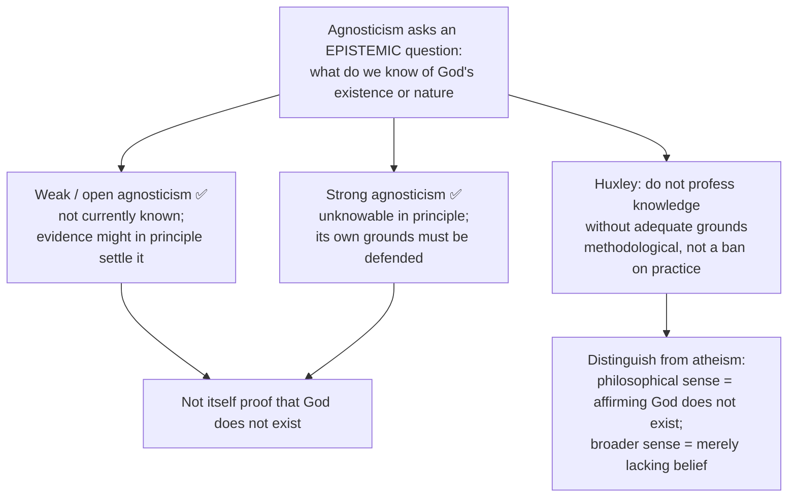

| Position compatible with 'agnostic' | God–religion relation | Qualification |
|---|---|---|
| **Suspended assent** | Withhold judgement about God yet take part in a non-creator Buddhist path or inherited rites as inquiry/practice | Mere attendance alone does not show deep commitment |
| **Agnostic religious faith** | Hope or commit to a theistic tradition while acknowledging no *knowledge* of God's existence | Huxley's stricter evidentialist method may disallow confident assent on weak evidence; do not claim he endorsed every agnostic believer |
| **Strong unknowability / impersonal ultimate** | Claim the ultimate exceeds possible human knowledge yet cultivate reverence and practice; whether a personal God remains the referent is left unresolved | Spencer's 'Unknowable' is not evidence for a creator; calling it 'God' can obscure rather than settle |

- Kant's practical faith is compatible with denying *theoretical* knowledge of God but is **not** equivalent to suspending all belief; Spencer's 'Unknowable' is a stronger limit thesis. ✅

### 2.2 Cārvāka: the *pramāṇa* argument against supersensible entities (2025 Q5(a)) ✅

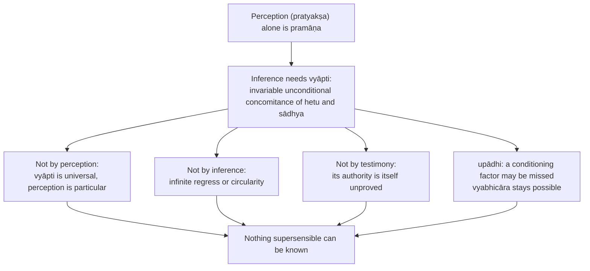

- **Upādhi caution ✅:** wet fuel helps explain why **fire produces smoke**; it constrains a hasty *fire → smoke* generalisation, **not** an observed counterexample to *smoke → fire*. Nyāya argues such constraints can be discovered with observation and *tarka*.
- **Application to religion ✅:** God is never perceived, so inference from world-as-effect to an intelligent maker is doubly worthless; the soul is not a separate substance (*dehātmavāda*; the *madaśakti* fermentation analogy, with *kiṇva* among the ingredients); karma and *adṛṣṭa* are imperceptible postulates; the Veda's authority is denied; *svabhāva-vāda* explains order without a maker.
- **Replies ⚠️:** (1) self-refutation: 'inference is never valid' is itself a universal; rejoinder: a *prasaṅga* (reductio) reading; (2) pragmatic argument: no one can eat, speak or argue without inference; (3) Nyāya's *bhūyodarśana*, *vyabhicāra-adarśana*, *tarka* and *sāmānya-lakṣaṇa-pratyāsatti*; (4) parity: perception also errs (illusion, dream, defective organs); (5) the reported **Purandara** strand accepting *laukika* inference while denying it for the *atīndriya* ❓ (fragmentary, opponent-reported).

### 2.3 Mīmāṃsā: authority without an author ✅

- The Veda is *apauruṣeya* (authorless) and eternal, not dependent on a divine speaker's reliability; cognitions are prima facie valid on the school's *svataḥ-prāmāṇya* account; Vedic injunctions (*codanā*) disclose dharma. 
- **Definition of dharma:** *codanā-lakṣaṇo 'rtho dharmaḥ* (Jaimini, *Mīmāṃsā-sūtra* 1.1.2): known **only** from injunction, not from perception, inference or any deity's command. ✅
- Meaning is carried by the eternal word–referent relation (*śabdārtha-sambandha nityatva*), which Nyāya denies as conventional.

---

## 3. Dialectical Wings & Sceptical Refinements

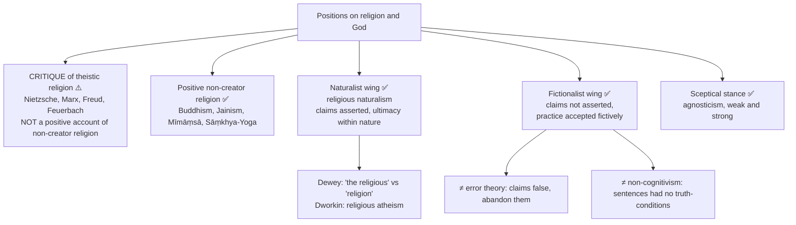

### 3.1 Western critiques of theistic religion ⚠️

| Thinker | Thesis | Source discipline |
|---|---|---|
| **Nietzsche** | 'God is dead… we have killed him': the Christian God has become **unbelievable**; Christian morality = **slave morality** born of *ressentiment*, life-denying; call for **revaluation of all values** and the **Übermensch** | ✅ *The Gay Science* §125 (the madman). A **cultural diagnosis**, not a syllogistic proof of atheism; targets religion **and** its morality together |
| **Marx** | Religion = 'the opium of the people', a consoling illusion masking economic exploitation; dissolves with a just society | ✅ quote the fuller sentence if used; it is more sympathetic than the slogan |
| **Freud** | Religion is an **illusion**, wish-fulfilment / cosmic father-projection | ✅ |
| **Feuerbach** | 'Theology is anthropology': God is the **projection** of humanity's idealised essence | ✅ standard summary of *The Essence of Christianity* |
| **Comte** | A 'religion of humanity': devotion to human values without a deity (link to Section A Humanism) | ⚠️ |

> [!WARNING]
> **Ownership note.** The printed 2025 Q5(c), 'Present an account of Nietzsche's criticism of religion and morality', is owned by **Religion and Morality §9.6** because the stem couples religion with morality. This mindmap keeps Nietzsche only as a critique of theistic religion and as the **bridge to post-theistic value**; it does not duplicate that ownership.

### 3.2 Religious fictionalism and non-realism ✅

- **Thesis:** religious sentences are (or may be) literally false or unwarranted, yet participation — taking the claims in a **fictive, non-assertoric** spirit — is rationally permissible and even valuable.
- **Positions:** Don Cupitt's non-realism (*Taking Leave of God*, 1980: God as personification of the religious ideal; 'Sea of Faith'); Robin Le Poidevin (*Arguing for Atheism*, 1996) on explicit religious fictionalism; Andrew Eshleman on the fictionalist's participation; Howard Wettstein on religious experience without metaphysical commitment.
- **Objections ⚠️:** (i) insincerity/self-deception — reply: immersion in a fiction is a familiar non-deceptive capacity (literature, ritual drama); (ii) motivational — the practice's power derives from believing it true; reply: the sustained efficacy of narrative and ritual (an empirical claim, contested); (iii) internal — believers reject the description, so it is revisionary of what it purports to save.
- Optional residue (advanced dossier): whether a fictionalist can *sincerely* participate in the practice she declines to assert. ⚠️

---

## 4. Metaphysics & Ontology

### 4.1 Five ways of doing without God — the parity bench ⚠️

| Route | What is removed | What replaces it | Still a religion? | Live PYQ use |
|---|---|---|---|---|
| **Buddhism** | Creator and permanent self | *Pratītyasamutpāda*, Dharma, Saṅgha, nirvāṇa | ✅ Yes, fully | 2024 Q7(a) |
| **Jainism** | Creator only | Karmic matter, vows, the perfected *siddha* | ✅ Yes, fully | 2018 Q5(c) |
| **Mīmāṃsā** | Author of the Veda **and** dispenser of fruit | *Apauruṣeya* authority + *apūrva* efficacy | ✅ Strong case under ritual/functional definitions | 2020 Q6(c) |
| **Sāṃkhya / Yoga** | Creator (Yoga keeps a non-creating Īśvara) | Prakṛti's evolution; *viveka-khyāti*; *kaivalya* | ✅ Yes | 2021 Q5(d) |
| **Modern naturalism / fictionalism** | Supernatural ontology, or assertion itself | Nature as locus of ultimacy; practice without assertion | ⚠️ Only on a functional definition | 2018 Q5(c) |
| **Cārvāka** | The whole supersensible order | *Svabhāva* and this-worldly ends | ⚠️ Not an attested religious/soteriological tradition; this does **not** disprove religious naturalism | 2025 Q5(a) |

### 4.2 Buddhism as a religion without a creator ✅

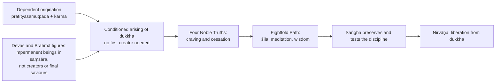

- Early Buddhism does not make a creator God part of its diagnosis or path. Gods remain within saṃsāra. ✅
- The undeclared questions (*avyākata*, e.g. MN 63) concern such matters as the world's eternity and the Tathāgata after death — **not** an official suspension of judgement about creator-existence; the *Brahmajāla Sutta* (DN 1) treats a purported creator-Brahmā's claim as arising from ignorance of prior conditions. ✅
- The poisoned-arrow parable prioritises removal of suffering over metaphysical delay: a practical illustration, **not** proof of atheism. ✅
- Dharma, Saṅgha and nirvāṇa organise doctrine, practice and value without functioning as one-for-one substitutes for a personal creator; later Mahāyāna devotion to Buddhas and bodhisattvas shows non-theistic does not mean devotion-free. ⚠️

### 4.3 Jainism, Mīmāṃsā and Sāṃkhya ✅

| School | Doctrine | Argument |
|---|---|---|
| **Jainism** | Perfected liberated beings, no creator | An embodied creator would be limited; a perfect being lacks motive to create |
| **Mīmāṃsā** | Dharma via authorless Veda and self-fructifying ritual efficacy | A divine author is unnecessary for eternal Vedic authority |
| **Sāṃkhya** | Cosmos through prakṛti for puruṣas, no creator | Unconscious prakṛti evolves through the guṇas in proximity to puruṣa |

- **Distinction:** Yoga's special puruṣa Īśvara is not straightforwardly a creator in the classical Sāṃkhya sense (link-out: Yoga, *YS* 1.24). ✅
- **Canonical examples:** karmic matter binding jīva; Vedic injunction; milk seeming to nourish the calf as an analogy for non-conscious purposiveness in Sāṃkhya discussions. ✅
- **Objection (Nyāya)** that unconscious principles cannot organise ends → **reply:** observed regularity need not be modelled on artifact production. ⚠️

### 4.4 Religious naturalism ✅

- **Thesis:** ultimacy, reverence and the religious response are located **within nature**; no supernatural person, yet nature sustains awe, gratitude, humility and commitment.
- **John Dewey, *A Common Faith* (1934):** 'religion' (an institution with supernatural claims) vs 'the religious' (a **quality of experience** unifying the self and orienting it to inclusive ideal ends); 'God' may denote the **active relation between the ideal and the actual**, not a being.
- **Ronald Dworkin, *Religion without God* (2013):** 'religious atheism' — (i) human life has **objective intrinsic** meaning and (ii) the universe is **sublime and intrinsically beautiful**; value realism, not theism, is the core.
- Others: Julian Huxley's evolutionary humanism; Ursula Goodenough; Donald Crosby and Loyal Rue; **Spinoza** (*Deus sive Natura*) as historical ancestor.
- **Objection:** aesthetics and ethics in religious vocabulary; nothing worshipped, nothing saves. **Reply:** ultimacy, reverence, communal practice and self-transformation are present; demanding a supernatural person restates the theistic definition. ⚠️

---

## 5. Rejection / Affirmation of Transcendent Realities

### 5.1 Which religious functions need a deity? ⚠️

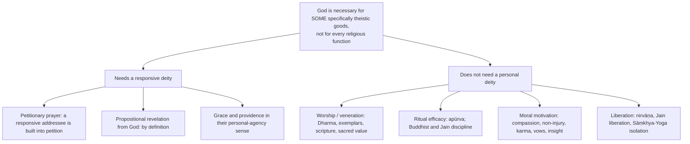

- Non-theistic substitutes for petition: meditation, aspiration or recitation — not petition in the same sense. Mīmāṃsā offers authorless scriptural authority, **not** creator-revelation. Self-effort, karmic law, disciplined path or communal support perform other functions than grace. ⚠️

### 5.2 Cārvāka: rejection of the whole supersensible order ✅/❓

| Target | Cārvāka stand |
|---|---|
| God | Never perceived; inference to a maker worthless |
| Soul | Consciousness emergent from body (*dehātmavāda*); no survival, transmigration or liberation |
| Karma, *adṛṣṭa* | Imperceptible postulates invented to prop up ritual |
| Veda | Authority denied; verses attributed to **Bṛhaspati** in Mādhava mock the *agnihotra*, the three Vedas and ascetic practice ❓ |
| Order of the world | *Svabhāva-vāda*: thorn sharpness, peacock colour need no maker |
| Elements | Four *bhūtas* (*bhūtacatuṣṭaya*): earth, water, fire, air; ether rejected as imperceptible |
| *Puruṣārthas* | Reduce to *kāma* and *artha* |

> [!WARNING]
> **Attribution discipline ❓.** The 'Bṛhaspati' verses and the popular hedonist couplet (*yāvaj jīvet sukhaṃ jīvet…*) survive only in opponents' doxographies (notably Mādhava's *Sarvadarśanasaṃgraha*); report them as doxographic, never as verified primary text.

**Is Cārvāka a 'religion without God'? ⚠️** Not a standard positive example: the reported materialist school critiques unseen entities but lacks an articulated soteriology, sacred practice and devotional community comparable to Buddhism, Jainism or Mīmāṃsā. This historical contrast **does not prove** a supersensible object is required for every possible religion; religious naturalists and fictionalists dispute that requirement.

### 5.3 Nietzsche: the post-theistic horizon ✅

1. Modern truthfulness and science erode traditional belief. 2. Inherited values depended on that framework. 3. Their collapse creates nihilism. 4. Overcoming requires revaluation and self-creation. ⚠️ Presupposition: values have genealogies tied to forms of life and can be judged life-enhancing or life-denying.

---

## 6. Explanatory & Causal Principles

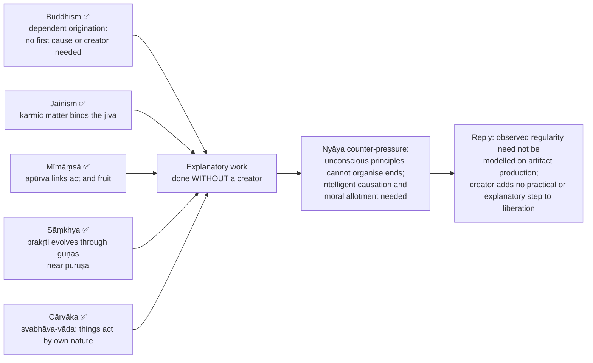

### 6.1 *Apūrva* — the argument ✅

1. A Vedic injunction promises a result (heaven from the *jyotiṣṭoma*) that does not follow immediately upon the act. 2. The act is momentary and perishes; the result comes much later, often after death. 3. On the school's causal account the perished act cannot itself produce that later fruit. 4. An **unseen potency** linking act and fruit is posited. 5. That potency is ***apūrva*** ('not previously arisen').

- ⚠️ Reconstructing it as an *arthāpatti*-like explanatory postulate is useful, but do not present its existence as perceived or verified by the promised post-mortem result.

| | **Kumārila Bhaṭṭa** | **Prabhākara Miśra** |
|---|---|---|
| *Apūrva*/duty | *Apūrva* as a **potency** (*śakti*) in the act or the agent, linking act to fruit | Reframes around ***niyoga/kārya***: the sheer 'ought-to-be-done' disclosed by the injunction, motivating action without a promised fruit as primary content |
| Ethics | Closer to a **consequential mechanism of desert** | Closer to a **deontology of the injunction** |

### 6.2 Why Mīmāṃsā removes God ✅

(1) No author is needed for the Veda, so Udayana's *vākyāt/pratyayataḥ/śruteḥ* arguments have no purchase. (2) No dispenser of karmic fruit is needed since *apūrva* does that work, answering Nyāya's *karmādhyakṣa* argument. (3) Deities named in the mantras are **elements within the ritual structure** (the dative to which the oblation is offered), not agents who hear, choose and grant. ⚠️ Kumārila's *Ślokavārttika* contains sustained arguments against a creator God (motive problem; impossibility of a bodiless agent acting on matter).

- **Objections → replies ⚠️:** (a) an unconscious potency cannot *select* the appropriate fruit — the relation is law-like, not deliberative; the objection begs the question against natural law. (b) How can a beginningless, authorless text have determinate meaning? — eternal word–referent relation. (c) Religion or bureaucracy? — it has a sacred order, soteriological promise, disciplined practice and community, exactly what a functional definition requires. 
- ❓ **Later Mīmāṃsā authors drift toward theism**; the atheistic reading is of the *classical* system.

---

## 7. Ethics & Human Goals (Puruṣārthas)

> [!NOTE]
> The sources give no *kāma/artha/dharma/mokṣa* hierarchy for this topic as a whole. This module carries only the value, motivation and post-theistic-value material the owner gives.

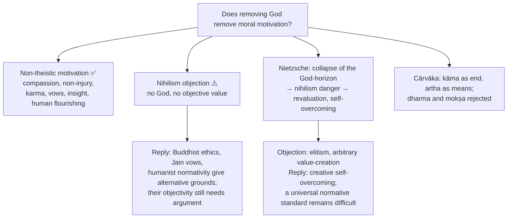

- **Motivation objection:** without divine reward, religious discipline weakens. **Reply:** compassion, insight, karma and communal vows supply non-theistic motivation. ⚠️
- **Buddhist pressure points (2024 evaluation) ⚠️:** who sets obligations, rewards virtue and guarantees justice? — intentional action, consequences, non-harm, compassion, precepts and communal correction; **remaining cost:** karma's trans-life operation and distribution remain independently contestable.
- Prabhākara's *niyoga* vs Kumārila's desert mechanism (§6.1) is the Indian parallel to deontology vs consequence. 
- Full dependence of morality on religion remains with *Religion and Morality*.

---

## 8. Inter-School Comparative Matrices

### 8.1 Master matrix ✅/⚠️

| View | Creator God | Ultimate / goal | Moral-causal order | Why religious? |
|---|---|---|---|---|
| **Buddhism** | ✅ Not required | Nirvāṇa | Karma / dependent origination | Path, Saṅgha, liberation |
| **Jainism** | ✅ Rejected | Liberated jīva / siddha | Karmic matter | Vows, asceticism, liberation |
| **Mīmāṃsā** | ✅ Unnecessary | Dharma / heaven in classical ritual theory | *Apūrva* | Vedic injunction and ritual |
| **Sāṃkhya** | ✅ Unnecessary | Kaivalya | Prakṛti–puruṣa process | Discriminative liberation |
| **Nietzsche** | ✅ Cultural belief overcome | Self-overcoming | Genealogical value creation | ❓ Critique / post-religious spirituality |
| **Humanism** | ✅ Absent | Human flourishing | Autonomous ethics | ⚠️ Religious only under broad function |
| **Cārvāka** | ✅ Rejected, with all supersensible entities | *Kāma* and *artha* in this life | No post-mortem karmic order in its reported doctrine; *svabhāva* explains worldly regularity | ⚠️ Not an attested religious/soteriological path; naturalist religion remains a separate live possibility |
| **Religious naturalism** | ✅ Absent | Ideal ends within nature (Dewey); sublime value (Dworkin) | Immanent value-realism | ⚠️ Reverence, community, ultimacy, nothing supernatural |
| **Religious fictionalism** | ✅ Not asserted | Whatever the practice delivers | Practice-internal | ⚠️ Participation without assertion |

### 8.2 Buddhism, Jainism, Mīmāṃsā — three non-creator religions compared

| Axis | Buddhism | Jainism | Mīmāṃsā |
|---|---|---|---|
| What is removed | Creator and permanent self | Creator only | Author of the Veda and dispenser of fruit |
| Authority | Buddhist teaching within its framework | Not detailed in this owner file | *Apauruṣeya* Veda |
| Efficacy / causal link | Karma, dependent origination | Karmic matter binds jīva | *Apūrva* |
| Goal | Nirvāṇa | Liberated jīva / siddha | Dharma / heaven (classical) |
| Object of reverence | Buddha, Dharma, Saṅgha; Mahāyāna bodhisattvas | Perfected *siddha* as an achieved, not governing, divinity | Deities as ritual-structure elements |

### 8.3 Agnostic–atheist–non-theist–fictionalist distinctions ✅

| Term | Meaning (as given) |
|---|---|
| Non-theistic | No creator doctrine; not identical with atheistic |
| Atheism | Philosophical use: affirming God does not exist; broader psychological use: merely lacking belief |
| Weak agnosticism | 'Not known' |
| Strong agnosticism | 'Unknowable' |
| Religious naturalism | Ultimacy within nature; claims asserted |
| Religious fictionalism | Claims not asserted; practice accepted fictively |
| Error theory | Claims false; stop |
| Non-cognitivism | Sentences never had truth-conditions |

---

## 9. Criticisms & Reconstructed Replies

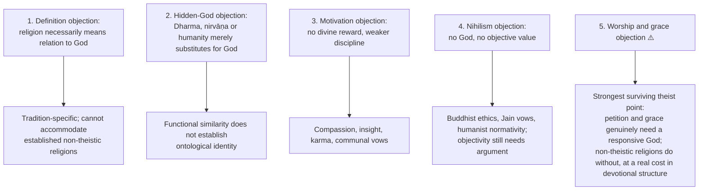

### 9.1 The theist's case — argue it properly first (2019 Q6(c)) ⚠️

1. **Definitional:** religion is relation to a personal transcendent, so 'religion without God' is a category error. 2. **Worship needs a recipient:** Jain *vītarāga* worship is really commemoration, not religion. 3. **Obligation requires a commander** (divine command). 4. **Grace/salvation requires an agent** who can give it. 5. **Ultimate concern without an ultimate PERSON** collapses into ethics or aesthetics (the objection to Dewey and Dworkin).

**Rebuttal:** Smart's dimensions; Buddhism's complete soteriological structure; Mīmāṃsā's *apauruṣeya* Veda plus *apūrva* (authority, efficacy and desert secured without a deity); the Jain *siddha* as an achieved, not governing, divinity; the definition-by-stipulation charge.

### 9.2 Buddhism's pressure table (2024 Q7(a)) ⚠️

| Theist's pressure | Buddhist response | Remaining cost or debate |
|---|---|---|
| Who sets obligations, rewards virtue, guarantees justice? | Intentional action, consequences, non-harm, compassion, precepts, communal correction | Whether karma's trans-life operation is credible remains contestable |
| Who is worshipped or prayed to? | Veneration of Buddha and Dharma, recollection, meditation; Mahāyāna bodhisattva devotion is real | Some schools invoke salvific assistance; calling *all* Buddhism non-devotional or flatly atheistic is misleading |
| If no enduring self or personal God, who is saved? | Dependent continuity rather than immortal identity | Critics press continuity and the meaning of a negatively framed goal; full analysis in Soul–Immortality–Rebirth |

### 9.3 Objection → reply on other claims

- **Definition too broad (nationalism as religion)?** Combine function with disciplined relation to an ultimate/sacred order and soteriological practice. ⚠️
- **Agnosticism reduces religion to ethics or aesthetics?** Community, ritual, transformation and orientation to ultimacy exceed ordinary morality. ⚠️
- **Devotional Mahāyāna appears theistic?** Buddhas and bodhisattvas may perform religious functions without becoming an omnipotent creator. ⚠️
- **Revaluation risks elitism (Nietzsche)?** Creative self-overcoming; a universal standard remains difficult. ⚠️

---

## 10. Controlled Western Comparisons

| Comparator | Point of contact | Decisive disanalogy / guardrail |
|---|---|---|
| **Nietzsche** | 'God is dead' diagnoses collapse of the Christian-metaphysical horizon | Buddhist/Jain non-theism **never had** the horizon Nietzsche is mourning; the phrase is a cultural diagnosis, not a bare atheist slogan or an empirical event |
| **Marx / Freud / Feuerbach** | Critique of theistic religion as illusion, projection or consolation | These are critiques of **theistic** religion, not positive accounts of religion without a creator |
| **Comte** | 'Religion of humanity' | Link to Humanism (Section A); religious only under broad function ⚠️ |
| **Dewey** | 'The religious' as a quality of experience; 'God' = relation between ideal and actual | Contests the assumption that any supersensible order is necessary; more disputed as a religion than Buddhism/Jainism |
| **Dworkin** | Religious atheism: objective value + sublime universe | Value realism, not theism, is the core |
| **Spinoza** | *Deus sive Natura* as ancestor of religious naturalism | Historical ancestor only |
| **Cupitt / Le Poidevin** | Non-realism / explicit fictionalism | Not error theory, not non-cognitivism |
| **Kant** | Practical faith with no theoretical knowledge of God | Not Huxleyan suspension |
| **Huxley / Spencer** | Agnosticism; the 'Unknowable' | Spencer's is a stronger limit thesis, not evidence for a creator |

> [!WARNING]
> **Indian comparison (do not omit).** ⚠️✅ Advaita's two-level apparatus does structurally similar work without fictionalism: *saguṇa* worship is genuinely efficacious at the *vyāvahārika* level and is **sublated, not exposed as fiction**, at the *pāramārthika* level — **sublation is not falsification**. Buddhism's two truths (*saṃvṛti/paramārtha*) permit full participation in conventional religious practice while denying ultimate substantial reference. The point that earns marks: **Indian systems offer graded truth where Western fictionalism offers pretence**, preserving the practitioner's sincerity.

---

## 11. Diagnostic Deep-Dives for High-Frequency Themes

### 11.1 Two necessity tests (2018 / 2020 / 2021) ⚠️

| Printed demand | Direct argument | Strong objection and discriminating reply |
|---|---|---|
| **2018 Q5(c): justify without God** | Buddhism's diagnosis/path/goal and Jain vows/liberation are actual counterexamples to *necessity of a creator*; classical Mīmāṃsā supplies scripture, ritual and delayed efficacy without a creator | Theist: loses divine grace and relationship. Concede those goods are absent or differently construed; absence does not erase the remaining religious pattern |
| **2020 Q6(c): God a prerequisite?** | A necessity claim is refuted by **one genuine non-creator religion**, not by a list of atheists; specify the cluster that makes Buddhism religious rather than a moral philosophy | Theist insists on transcendence as necessary relation; Buddhist liberation/karma and sacred exemplars supply soteriology, though whether every case needs a transcendent referent is contested |
| **2021 Q5(d): religious *life* without belief?** | Contrast practice with **doxastic assent**: a non-theist can follow the Eightfold Path; a Jain worshipper need not expect a granting God; an agnostic can participate while suspending creator belief | Occasional ritual attendance is not a religious life; discipline, inward commitment, community and an orienting end distinguish robust practice from habit |

> [!NOTE]
> **Residual boundary.** Dewey's 'religious' quality and Dworkin's religious atheism contest the assumption that any supersensible order is necessary. A Cārvāka who rejects an unseen order has not thereby established **either** a religious way of life **or** its impossibility. Atheism alone is not sufficient for religion and creator-belief is not necessary. ⚠️

### 11.2 Answer skeletons for the live stems ⚠️

```text
2024 Q7(a) Buddhism: criterion → dependent origination, karma, path, Saṅgha, nirvāṇa →
  creator-Brahmā vs devas → theist's challenge + Mahāyāna devotion → graded verdict.
2019 Q6(c) Theist's denial: ARGUE THE THEIST'S CASE FIRST → rebuttal →
  strongest surviving point = worship/grace, not the definition.
2023 Q5(e) Agnosticism: define (weak/strong) → contrast with atheism →
  relate to religion (suspended assent / agnostic faith / unknowable) → objection → verdict.
2025 Q5(a) Cārvāka: epistemological critique, not hedonism → vyāpti argument →
  application → self-refutation/Nyāya/parity → prasaṅga + Purandara reply → verdict.
```

### 11.3 Verdict formulas ⚠️

- **Buddhism (20 marks):** Buddhism is an historically substantial religious counterexample to a creator-necessity definition because its doctrine, community, ethical discipline and liberation are not just labels. It does not show that personal prayer, covenant and grace survive **unchanged**, nor that the Buddhist account of karma or nirvāṇa is true. Distinguish a **non-creator path** from denial of all devas and from the claim that every tradition's God is identical.
- **Agnosticism:** agnosticism can **decouple** a claim to knowledge from belief and participation; it does not itself demonstrate a godless religion or guarantee that an agnostic is religious. The more a tradition requires assent that God exists for prayer or salvation, the harder suspended assent fits.
- **Cārvāka:** it presses an important problem for inferences beyond perceptually anchored concomitances; an uncompromising perception-only rule faces self-refutation and practical-inference objections; a reported moderate strand permits everyday inference but challenges unseen theological inferences; Nyāya's reply needs engagement, so the challenge does not by itself refute every natural theology.
- **Mīmāṃsā:** a strong counterexample to the claim that religion requires God under ritual, functional or multidimensional definitions; it shows the religious functions God performs are **separable**.

---

## 12. PYQ Routing Ledger (2018–2025; 2026 supplement)

> **Corpus signal.** ✅ 7 primary-owned parts of 112 in 2018–2025 (absent as a primary owner only in 2022); **0** in the 2026 supplement (7 of 126). The 2026 supplement notes that *Religion without God* is absent for only the second time and that both it and *Soul* should be treated as **due, not deprioritised**. Cross-links do not create duplicate ownership. The owner file has no pre-2018 PYQ table.

| Year | Q | Marks | Exact demand | Map to |
|---|---|---:|---|---|
| 2018 | Q5(c) | 10 | Can you justify religion without God? Support your answer. | §1.3, §4.1, §11.1 |
| 2019 | Q6(c) | 15 | How would a religious person deny the possibility of a religion without God? Discuss. | §9.1, §5.1 |
| 2020 | Q6(c) | 15 | Critically examine the concept of God as prerequisite for a religion. | §11.1, §1.3 |
| 2021 | Q5(d) | 10 | Is religious life possible without the belief in God? Discuss. | §11.1, §2.1 |
| 2023 | Q5(e) | 10 | What is Agnosticism? How do agnostics conceptualize the relation between religion and God? Discuss. | §2.1, §8.3 |
| 2024 | Q7(a) | 20 | State and evaluate Buddhism as a religion without God. | §4.2, §9.2 |
| 2025 | Q5(a) | 10 | Discuss Cārvāka's critique of the belief in the existence of suprasensible entities. | §2.2, §5.2 |

**Cross-owned (not counted).**

| Year | Q | Marks | Demand | Owner |
|---|---|---:|---|---|
| 2025 | Q5(c) | 10 | Present an account of Nietzsche's criticism of religion and morality. | **Religion and Morality** (§9.6); this mindmap keeps only the post-theistic bridge (§3.1, §5.3) |

**2022:** no primary-owned part. **2026:** none; the two 2026 Philosophy of Religion absences (this topic and *Soul*) are flagged due, not deprioritised.

**Directive decoder ⚠️**

| Directive | Examiner buys | Structural consequence | Live example |
|---|---|---|---|
| Can you justify X? Support your answer | A defended answer with the criterion stated | Announce the definition of religion **first** | 2018 Q5(c) |
| How would [an opponent] deny…? Discuss | The opponent's case, argued sympathetically, then assessed | Half the marks are in constructing the theist's argument | 2019 Q6(c) |
| Critically examine X as a prerequisite for Y | Test of a necessity claim | Find one clear counterexample and defend it | 2020 Q6(c) |
| Is X possible? Discuss | A possibility claim established by an actual case | One case in depth beats four mentioned | 2021 Q5(d) |
| What is X? How do X-ists conceptualise…? | Definition **plus** positional account | Define, subdivide (weak/strong), then give the position | 2023 Q5(e) |
| State and evaluate X as a religion without God | Both halves | State the doctrine fully before assessing | 2024 Q7(a) |
| Discuss X's critique of belief in Y | The **argument** of the critique | Give the epistemology (vyāpti), not slogans | 2025 Q5(a) |

---

## 13. Top 10 UPSC Exam Traps (14 recorded in the owner file; all given)

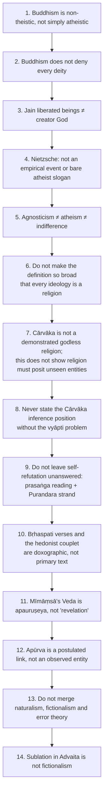

Extra source-recorded cautions: the undeclared questions (*avyākata*) are not a creator-existence list (DN 1 addresses the creator-Brahmā claim separately); the poisoned-arrow parable is a practical illustration, not proof of atheism; wet fuel qualifies fire → smoke, not smoke → fire; do not claim Huxley endorsed every agnostic believer; do not replace the requested evaluated Buddhism with a general survey; do not treat 'unrefuted' or 'fatal to every natural theology' as the verdict on Cārvāka.

---

## 14. Technical Vocabulary & IAST Bank

| English gloss | IAST / term | Meaning | Status |
|---|---|---|---|
| Non-theism | — | No creator doctrine; ≠ atheism | ✅ |
| Dependent origination | pratītyasamutpāda | Conditioned arising; no creator needed | ✅ |
| Undeclared questions | avyākata | MN 63; not a creator-existence list | ✅ |
| Community | Saṅgha | Preserves and tests the discipline | ✅ |
| Liberation (Buddhist) | nirvāṇa | Liberation from dukkha | ✅ |
| Suffering | dukkha | | ✅ |
| Ethics / moral discipline | śīla | | ✅ |
| Individual soul | jīva | Jain; bound by karmic matter | ✅ |
| Perfected liberated being | siddha | Achieved, not governing, divinity | ✅ |
| Authorless | apauruṣeya | The Veda; not the speech of a God | ✅ |
| Injunction | codanā | Discloses dharma | ✅ |
| Unseen ritual potency | apūrva | 'Not previously arisen'; postulated link | ✅ |
| Intrinsic validity | svataḥ-prāmāṇya | Mīmāṃsā | ✅ |
| Postulation | arthāpatti | Analytical comparison for apūrva | ⚠️ |
| Injunctive obligation / what is to be done | niyoga / kārya | Prabhākara | ⚠️ |
| Potency | śakti | Kumārila's *apūrva* | ⚠️ |
| Primal matter / spirit | prakṛti / puruṣa | Sāṃkhya | ✅ |
| Isolation | kaivalya | Sāṃkhya-Yoga goal | ✅ |
| Discriminative knowledge | viveka-khyāti | | ✅ |
| Invariable concomitance | vyāpti | Cārvāka's target | ✅ |
| Reason / probandum | hetu / sādhya | | ✅ |
| Conditioning factor | upādhi | | ✅ |
| Deviation | vyabhicāra | | ✅ |
| Repeated co-observation | bhūyodarśana | Nyāya | ✅ |
| Absence of counter-instance | vyabhicāra-adarśana | Nyāya | ✅ |
| Supportive reasoning | tarka | Nyāya | ✅ |
| Body-self doctrine | dehātmavāda | | ✅ |
| Four elements | bhūtacatuṣṭaya | Earth, water, fire, air | ✅ |
| Own-nature doctrine | svabhāva-vāda | | ✅ |
| Ordinary / suprasensible | laukika / atīndriya | Purandara strand | ❓ |
| Reductio | prasaṅga | Dialectical reading | ⚠️ |
| Worldly / ultimate level | vyāvahārika / pāramārthika | Advaita | ✅ |
| Conventional / ultimate truth | saṃvṛti / paramārtha | Buddhist two truths | ✅ |
| With / without attributes | saguṇa / nirguṇa | Brahman | ✅ |
| Religious naturalism / fictionalism / non-realism / error theory | — | See §8.3 | ✅ |
| Religious atheism | — | Dworkin | ✅ |
| Resentment | ressentiment | Nietzsche | ✅ |
| Revaluation / Overman | — / Übermensch | Nietzsche | ✅ |

---

## 15. Graded Verdict & Answer Architectures

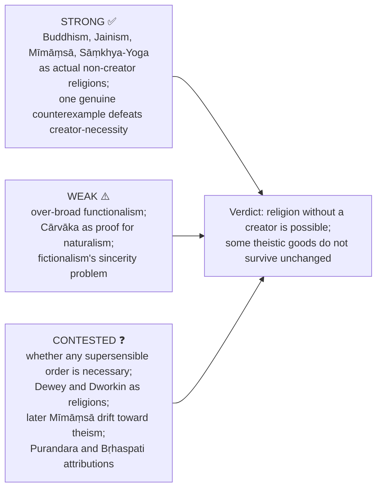

### 15.1 10-mark

```text
Define non-theism / agnosticism → doctrine in four steps → distinguish nearest confusion →
one objection → verdict on whether God is necessary.
```

### 15.2 15-mark

```text
Substantive vs functional frame → one Indian case in depth →
canonical example → theistic objection and reply → comparison with another school.
```

### 15.3 20-mark

```text
For the Buddhist-specific stem: define criteria → dependent origination, karma, path,
Saṅgha, nirvāṇa → creator-Brahmā vs devas → one theist challenge + Mahāyāna devotional
qualification → graded verdict. Use Jain/Mīmāṃsā only briefly as contrasts;
do not replace the requested evaluated Buddhism with a general survey.
```

### 15.4 Graded-verdict ladder ⚠️

| Band | What the script contains | Typical fault |
|---|---|---|
| Weak (≈40%) | 'Buddhism has no God but is a religion' | No definition of religion; 'atheistic' used loosely |
| Average (≈50%) | Functional definition; Buddhism and Jainism outlined | Theist's counter-case not constructed; Mīmāṃsā missing |
| Good (≈60%) | Definition defended; one case in depth; one objection answered | Over-broad functionalism not policed; devotional Mahāyāna ignored |
| Strong (≈65–70%) | Substantive/functional dispute explicit; two Indian cases; worship/grace objection met | Modern naturalism/fictionalism absent; Cārvāka misclassified |
| Top (≈70%+) | All above + discriminating distinctions (non-theistic ≠ atheistic; *apauruṣeya* ≠ revelation; sublation ≠ fictionalism; Cārvāka as limiting case) + concession that petition and grace require a responsive God | — |

### 15.5 Ready anchor sentences ⚠️

> [!TIP]
> - **Possibility stem:** 'Religion without a creator is actual: classical Mīmāṃsā claims authorless authority and ritual efficacy, and Buddhism supplies a complete diagnosis-and-path structure. Whether **every** religion must postulate an unseen sacred order is contested by naturalists; the Cārvāka case alone does not decide that wider issue.'
> - **Prerequisite stem:** 'God is a prerequisite for *some* religious goods — petition, grace, covenant — but not for religion as such. The theist's strongest argument is therefore devotional, not definitional, and should be met on that ground rather than dismissed.'
> - **Definition stem:** 'A definition narrow enough to exclude Buddhism is question-begging; a definition broad enough to include nationalism is empty. The workable middle requires a disciplined relation to an **ultimate/sacred order** together with a **soteriological practice**.'
> - **Safe formulations:** 'Creator-belief is not necessary for religion as a cross-cultural category; it is central to many actual religions.' · 'Mīmāṃsā claims Vedic authority and ritual efficacy without a creator, but *apūrva* remains a postulate.' · 'Cārvāka's reported critique of unseen entities does not itself construct a religious path; its example cannot prove religious naturalism impossible.'

> [!NOTE]
> **Rule.** Every question in this clause is decided by the **definition of religion** adopted in the first three lines. State it, defend it briefly (substantive vs functional vs multidimensional), then apply it consistently; inconsistency here is the commonest cause of a mediocre mark.

---

## Link-outs (from the owner file)

Religion and Morality (primary owner of 2025 Q5(c) Nietzsche) · Proofs for God (Jain and Buddhist anti-creator arguments; Mīmāṃsā against Udayana) · Soul, Immortality, Rebirth and Liberation (Yoga's non-creating Īśvara; kaivalya) · Reason, Revelation and Faith (Cārvāka as the limit of evidentialism; *apauruṣeya* authority) · Religious Language (non-cognitivism, non-realism, fictionalism) · Religious Experience · Paper I: Cārvāka, Mīmāṃsā, Sāṃkhya, Yoga, Buddhism, Jainism · Paper II: Humanism, Secularism and Multiculturalism · PYQ Bank 2018–2025 · 2026 Section B supplement.

## Sources

Chatterjee & Datta, *An Introduction to Indian Philosophy*; C. D. Sharma, *A Critical Survey of Indian Philosophy*; Mādhava, *Sarvadarśanasaṃgraha* (reported Cārvāka position); Jaimini, *Mīmāṃsā-sūtra*; Kumārila, *Ślokavārttika*; Nietzsche, *The Gay Science* and *On the Genealogy of Morality*; Dewey, *A Common Faith*; Dworkin, *Religion without God*; Goodenough, *The Sacred Depths of Nature*; Cupitt, *Taking Leave of God*; Le Poidevin, *Arguing for Atheism*; John Hick, *Philosophy of Religion*; Ninian Smart's multidimensional study of religion; *Oxford Handbook of Philosophy of Religion*, 'Nontheistic Conceptions of the Divine'; *Stanford Encyclopedia of Philosophy*, 'Atheism and Agnosticism'; Buddhist anchors: *Brahmajāla Sutta* (DN 1), *Cūḷamālukya Sutta* (MN 63) — different question sets (all as cited in the owner file).
