# RELIGION AND MORALITY — Examiner-Grade Mindmap

> **Syllabus (verbatim):** Religion and Morality.
> **Catalogue key:** `philosophy-paper-ii-philosophy-of-religion-08` · Paper II · Philosophy of Religion
> **Sources used:** `paper-2/philosophy-of-religion/Religion-and-Morality.md` (canonical owner, read in full) · `_advanced/Philosophy-of-Religion-Dossier.md` §8 and the promotion ledger (optional depth; read) · `paper-2/_PYQ-PhilosophyOfReligion-2018-2025.md` · `paper-2/_PYQ-PhilosophyOfReligion-2026-Supplement.md` · `paper-1/_themes/Causation-across-schools.md` (only the *apūrva* / *adṛṣṭa* passages bearing on the impersonal-versus-theistic moral order). The other five `_themes/` files were searched for ethics, morality, dharma and divine-command content; none has a passage on religion–morality relations, so they are not cited.
> **Evidence key:** ✅ canonical doctrine / fact · ⚠️ analytical synthesis for exam use · ❓ contested / uncertain · 📰 dated current anchor only (none used)

> [!IMPORTANT]
> **Core thesis.** The clause owns the **conceptual, epistemic, motivational, sanctioning and sociological relations between religion and morality**, together with their mutual criticism and the Indian–Western comparison. Almost every stem is a claim of **necessity, dependence or incompatibility**, so the first move is always to ask *which* relation is asserted: metaphysical grounding, moral knowledge, motivation, or sanction. Sociological influence does not establish philosophical dependence. ⚠️

> [!NOTE]
> **Adaptation.** The 15-module blueprint is written for single Indian schools. For this topic: Module 1 holds the ownership firewall and doxography of thinkers; Module 2 holds *moral knowledge* and the felt-obligation analysis; Module 3 holds the radical and sceptical wings (Euthyphro pressure, Nietzsche, debunking); Module 4 is the inventory of grounds of obligation; Module 5 is the stand on transcendent realities (God, karma, *ṛta*); Module 6 holds the causal and explanatory principles (how religion influences morality); Module 7 holds motivation, sanction and moral critique. The sources give no *āstika/nāstika* classification and no *kāma/artha/dharma/mokṣa* hierarchy for this topic as a whole; neither is invented here.

---

## 0. Master Overview

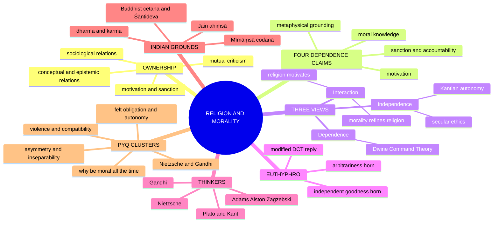

> [!TIP]
> **Mnemonic — 'Depend / Detach / Dialogue'.** Morality depends on religion (Divine Command), detaches from it (Kant, secular ethics), or dialogues with it (interaction). The Euthyphro splits the dependence view. ✅

---

## 1. Identity, Lineage & Doxography

### 1.1 Ownership firewall ✅

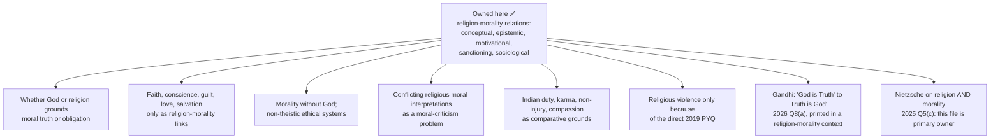

| Owned here | Boundary (remains with) |
|---|---|
| Whether God/religion grounds moral truth or obligation | The moral argument for God's existence → Proofs for God |
| Faith, conscience, guilt, love, salvation, moral commitment only as religion–morality links | Complete faith/revelation epistemology → Reason, Revelation and Faith |
| Morality without God; non-theistic ethical systems | Definition and possibility of religion without God → Religion without God |
| Conflicting religious moral interpretations as moral criticism | Full pluralism and absolute-truth theories → Religious Pluralism |
| Indian duty, karma, non-injury, compassion as comparative grounds | Complete Indian ethics and liberation doctrines → Paper I / Ethics owners |
| Religious violence only because of the direct 2019 PYQ | Descriptive history, political ideology, detailed just-war doctrine are not substitutes for philosophical premise-testing |
| Gandhi's shift from 'God is Truth' to 'Truth is God' (2026 Q8(a)) | *Sarva-dharma-samabhāva* and the equal-respect thesis → Religious Pluralism; Truth as *sat* in relation to Brahman → Notions of God |

> [!WARNING]
> Sociological influence does not establish philosophical dependence. Religion may motivate or sanction conduct without constituting moral truth, and morality may criticise a religious command without denying every religious role. ⚠️

### 1.2 Doxography of positions and thinkers ✅/⚠️

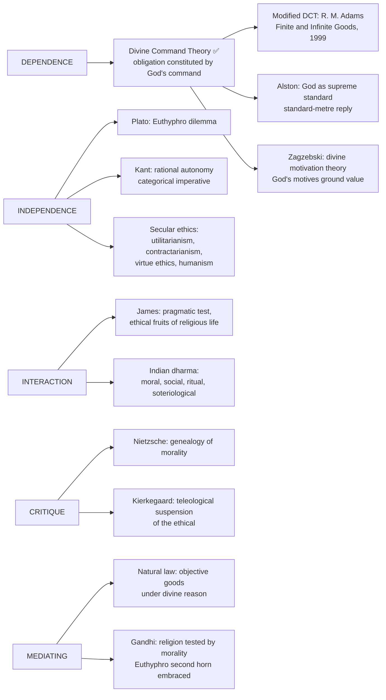

### 1.3 Source and quotation discipline ❓/✅

| Item | Status | Safe use |
|---|---|---|
| Euthyphro dilemma | ✅ Plato, *Euthyphro* 10a | State **both** horns |
| 'If God does not exist, everything is permitted' | ❓ A summary of a Dostoevskian theme, not a verified verbatim line | Never present as a quotation |
| *Finite and Infinite Goods* | ✅ R. M. Adams (1999) | Modified DCT: obligation from a loving God's commands; goodness from resemblance to God |
| 'Standard metre' reply | ✅ William Alston | God as supreme standard, not a conformer |
| 'Does Moral Philosophy Rest on a Mistake?' | ✅ H. A. Prichard (*Mind*, 1912) | Pairs with Bradley's Essay II |
| Ring of Gyges | ✅ Plato, *Republic* II 359d–360b | Canonical statement of the 'all the time' problem |
| Hume's sensible knave | ✅ *Enquiry Concerning the Principles of Morals*, IX.ii | Hume's own difficulty, honestly admitted |
| Intrinsic / extrinsic religiosity | ✅ Gordon Allport; quest orientation ✅ Daniel Batson | Apparatus for the 2018 stem |
| *Ressentiment* critique of Nietzsche | ✅ Max Scheler (1912) | Christian love from abundance, not impotence |
| *Gay Science* §125; *Genealogy* I–III; *BGE* Preface | ✅ Verified locations | Paraphrase the rhetoric; quote sparingly |
| Aquinas' three war conditions | ✅ *ST* II-II q.40 | Authority, just cause, right intention |
| *Just and Unjust Wars* | ✅ Michael Walzer (1977) | Modern *ad bellum* / *in bello* systematisation |
| 'Greater / lesser *jihād*' | ❓ Report of disputed authenticity among ḥadīth scholars | Cite **with** the flag |
| *Dār al-islām* / *dār al-ḥarb* | ⚠️ Juristic-historical constructs, not Qur'ānic terms | Say so explicitly |
| *Kūṭa-yuddha* | ✅ Kauṭilya, *Arthaśāstra* | Indian realist counter-tradition |
| *Compelle intrare* (Luke 14:23) | ✅ Augustine's Donatist-controversy use | Examined as a position, never endorsed |
| Locke, *A Letter Concerning Toleration* (1689) | ✅ | Incoercibility of belief |
| Śāntideva on ownerless suffering | ✅ *Bodhicaryāvatāra*, ch. VIII | Strongest non-theistic grounding of impartial altruism |
| Gītā 2.3, 2.42–43, 2.47, 3.19 | ✅ Verified chapter/verse | Paraphrase translations |
| 'Two years ago I went a step further and said that Truth is God' | ✅ Gandhi, *Young India*, 31 Dec 1931, pp. 427–28 | Quote **with** 'two years ago' so ≈1929 is visible |
| 'He is even the atheism of the atheist' | ✅ *Young India*, 5 Mar 1925, p. 81 | Inclusiveness passage |
| 'There is no such thing as religion overriding morality' | ✅ *Young India*, 24 Nov 1921, p. 385 | Pair with *Young India*, 21 Jul 1920, p. 4 |
| 'The essence of religion is morality' | ✅ *An Autobiography*, Introduction | Morality-inside-religion |
| 'The means may be likened to a seed, the end to a tree' | ✅ *Hind Swaraj*, ch. XVI | Means–end unity |
| 'Truth is God' as a Lausanne 1931 invention | ❌ Unsupported | Source places the formulation about two years earlier |

---

## 2. Theory of Knowledge (Epistemology)

*Adapted: the 'epistemology' of this clause is **moral knowledge** and the analysis of **felt obligation**, not a* pramāṇa *theory. The sources give no* pramāṇa*-style rejection or acceptance for this topic.*

### 2.1 Four different dependence claims ⚠️

| Claim | Question | Religious role | Independent alternative |
|---|---|---|---|
| **Metaphysical grounding** | What makes moral truth or obligation valid? | Divine nature, command, or created natural order | Moral realism, rational autonomy, flourishing, contractual or non-theistic grounds |
| **Moral knowledge** | How do agents know what is right? | Revelation, scripture, conscience, tradition, exemplars | Reason, experience, empathy, public argument |
| **Motivation** | Why act morally when it is costly or unseen? | Love, gratitude, hope, repentance, salvation, community, divine relationship | Duty, character, solidarity, compassion, self-respect |
| **Sanction / accountability** | What connects conduct with reward, guilt or consequence? | Judgement, sin, forgiveness, karma, eschatological consequence | Law, social response, internal conscience, causal consequences |

> [!WARNING]
> Success in one role proves no dependence in another. A religion may strengthen motivation while accepting independently knowable moral truth; secular ethics may justify duty while struggling to motivate every agent in every case. ⚠️

### 2.2 Three kinds of dependence inside Divine Command Theory ✅

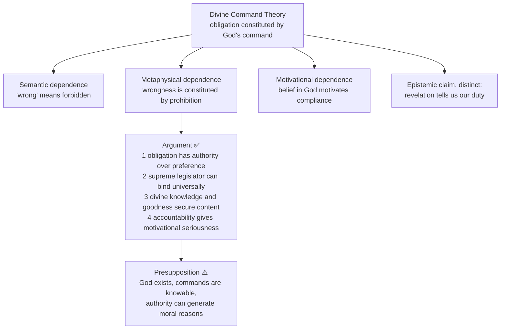

### 2.3 Why a norm can *feel* obligatory without referring to God (2025 Q8(b)) ⚠️

| Question | Theistic route | God-independent route | What follows |
|---|---|---|---|
| **What makes it right?** | Divine nature or command | Rational consistency, welfare, virtue, non-injury | A grounding claim needs an argument; felt urgency cannot prove it |
| **Why do I feel bound?** | Love, answerability, religious upbringing, judgement | Kantian respect for law, cultivated compassion, conscience, identification with others | A psychological claim is not identical to grounding |
| **Why do I obey?** | Commitment, hope, fear or communal support | Character, conviction, sympathy, solidarity | Either believer or non-believer may fail to comply |

- **Necessity test ⚠️.** One case of a sincerely felt duty without God-reference defeats the claim that such reference is **necessary** to produce the feeling. A Kantian who regards humanity as an end, a Buddhist who cultivates compassion and a Jain bound by a non-creator vow supply different candidate mechanisms; they do not decide the metaphysical truth of the norms.
- **Sufficiency test ⚠️.** Someone can believe God commands a norm yet feel no urge to follow it or interpret it differently. God-reference is therefore not **sufficient** either.
- **Strongest theistic reply ⚠️.** An agent's God-independent *feeling* need not show the *objective ground* is God-independent: a theist may hold that conscience responds to a divinely ordered moral reality without naming God. This is a metaphysical proposal needing defence, not a rebuttal of the psychological counterexample.
- **Objection → reply ⚠️.** Fear of punishment can produce strong constraint without moral worth. Love and gratitude can generate deeper responsibility, but a critic may still ask whether action rests on respect for persons or deference to authority. Verdict: **not necessary for felt obligation**, while recognising contingent religious reinforcement.

### 2.4 'Religion as source' disambiguated (2026 Q6(b)) ✅/⚠️

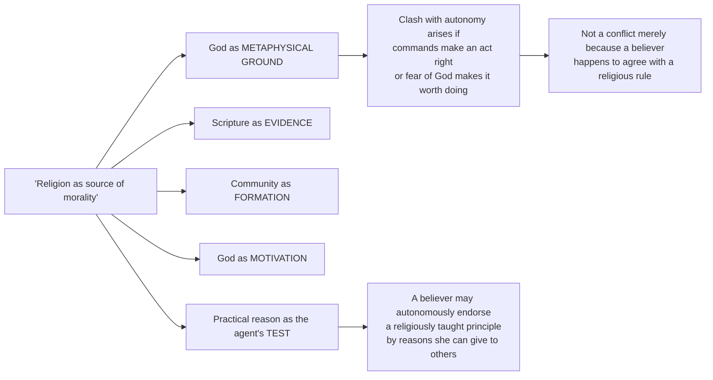

### 2.5 Fallibilism: Absolute and relative truth in Gandhi ✅

| | **Absolute Truth** | **Relative truth** |
|---|---|---|
| Status | Eternal; identical with God; *sat* (that which is) | What a finite seeker has 'conceived' so far |
| Access | Never fully possessed by an embodied person | Conscience, reason, experiment, scripture tested by reason |
| Authority for action | The standard that judges every claim | Sufficient to act on **now**, binding on the agent |
| Corrigibility | Not corrigible | Always corrigible; Gandhi's 'experiments' modelled on scientific experiments |
| Consequence | Grounds objectivity: not all views are equally true | Grounds humility, dialogue, refusal to coerce |

---

## 3. Dialectical Wings & Sceptical Refinements

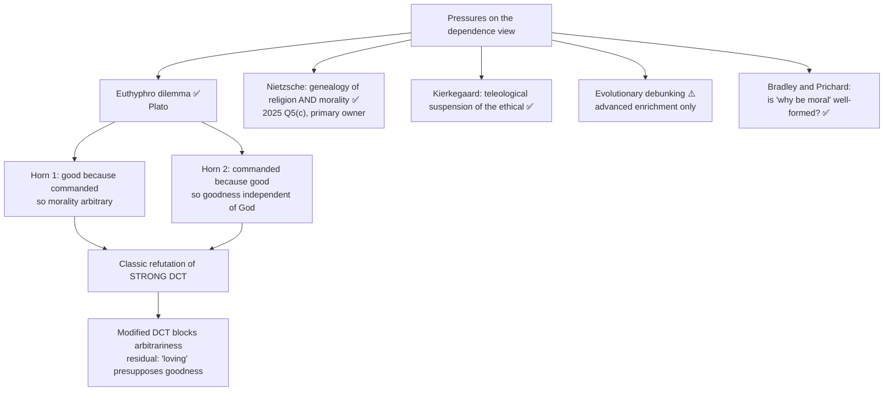

### 3.1 Euthyphro ✅

*Is the pious loved by the gods because it is pious, or pious because it is loved?* Both horns must be stated: **Horn 1** (good *because* commanded) makes morality arbitrary, since God could command cruelty and it would be 'good'; **Horn 2** (commanded *because* good) makes goodness independent of God, so God recognises a standard He did not invent. Do not reduce it to 'God versus morality'.

### 3.2 Nietzsche's criticism of religion and morality (2025 Q5(c) — primary owner) ✅/⚠️

> [!NOTE]
> **Ownership.** The 2025 stem couples *religion* with *morality*, so this file is the primary owner. Religion without God retains Nietzsche only as a critique of theism and as the bridge to post-theistic value, and routes the PYQ here.

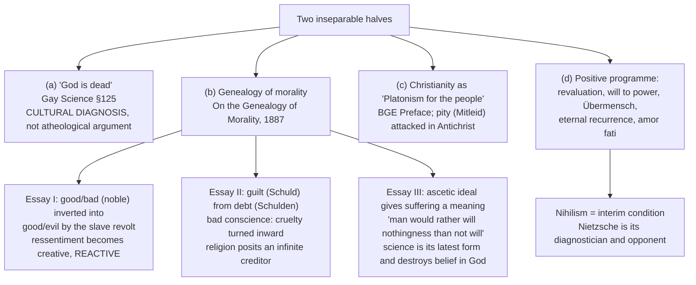

- **God is dead ✅.** *The Gay Science* §125: the madman announces we have killed God and asks who will wipe the blood off us. §108 and §343 make the delayed-consequences point explicit. Read as cultural diagnosis: the Christian-metaphysical framework has become *unbelievable* to the culture built on it.
- **Presupposition ⚠️.** Valuations have histories traceable to types of life and can be assessed as *life-enhancing* or *life-denying*, which presupposes a standard ('ascending life') Nietzsche never systematically justifies.
- **Objections → replies ⚠️.**

| # | Objection | Reply | Residue |
|---|---|---|---|
| 1 | **Genetic fallacy:** origin in resentment does not make a value false | His target is the **value** of a valuation, not truth-value: what life it expresses and produces | Does not deliver the refutation his rhetoric suggests |
| 2 | **Missing criterion:** why is the Übermensch's creation better? | Internal standard: self-overcoming, affirmation, willing one's life eternally | Critics: a preference, not a norm |
| 3 | **Caricature of Christian ethics** | Max Scheler (*Ressentiment*, 1912): Christian love descends from abundance, not impotence | Best-named counter-authority |
| 4 | **Political appropriation** | Vulnerability partly of his own rhetoric; his sister's editorial role in posthumous material is well documented ❓ | Appropriation risk |

- **Verdict formula ⚠️.** 'Nietzsche's achievement is to make **morality itself** an object of historical and psychological suspicion, and to show that the death of God is a problem for ethics before it is a problem for theology. His failure is the constructive half: the revaluation supplies no criterion by which one creation of values is better than another, which is why his critique is more durable than his solution.'

### 3.3 Kierkegaard and the limits of public justification ✅

Kierkegaard's 'teleological suspension of the ethical' presents Abraham as unable to make himself intelligible; it does not offer a generally checkable public licence. It is also the 'honest philosophical statement' of how religiosity can supply a route to acts that are, judged ethically, immoral (§11.5). It does not follow that *all* devotion suspends ethics.

### 3.4 Evolutionary debunking ⚠️ (advanced enrichment, not Core)

| Position | Content |
|---|---|
| Debunkers | Moral intuitions were selected for survival, not truth |
| Realists | Reflection can correct evolved starting points |
| Strongest extra objection | Moral beliefs are epistemically contaminated by adaptive origin |
| Counter-reply | Causal origin alone does not refute truth, especially where reflection, criticism and convergence operate |

*Use as a modern extra objection, not as the main structure.* Promotion trigger still open: if a PYQ asks it directly.

### 3.5 Is 'why be moral?' well-formed? ✅

Bradley (*Ethical Studies*, Essay II, 'Why Should I Be Moral?'): the question may be self-defeating, since asking for a *non-moral* reason is asking morality to justify itself before a tribunal it does not recognise. Prichard (1912): demanding a self-interested justification of obligation misconstrues obligation.

---

## 4. Metaphysics & Ontology (inventory of grounds of obligation)

### 4.1 Grounds of moral obligation ✅/⚠️

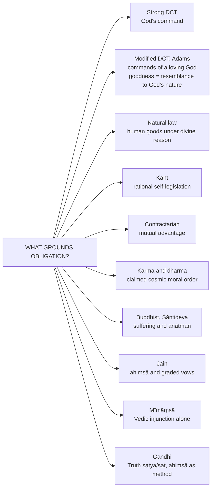

### 4.2 Parity bench ⚠️

| Grounding | Ultimate ground | Handles Euthyphro? | Handles 'all the time'? | Standing objection |
|---|---|---|---|---|
| Strong DCT | God's command | ❌ Impaled on a horn | ✅ By sanction | Arbitrariness |
| Modified DCT (Adams) | God's loving nature | ✅ Blocks arbitrariness | ✅ By love, not fear | 'Loving' presupposes goodness |
| Natural law | Human goods under divine reason | ✅ Mediates the horns | ⚠️ Partly | Nature-to-norm |
| Kant | Rational self-legislation | ✅ Not applicable | ⚠️ Justifies, does not motivate | Formalism |
| Contractarian | Mutual advantage | ✅ Not applicable | ❌ The perfect knave survives | Detectability of dispositions |
| Karma / dharma | Claimed cosmic moral order (varies by school) | No commander in non-theistic accounts | ⚠️ If karmic causation holds, no act escapes it; a premise, not observed evidence | Unverifiability, victim-blaming risk |
| Buddhist (Śāntideva) | Suffering and *anātman* | ✅ Not applicable | ⚠️ Reason for impartial concern; motivation still needs cultivation | Why deny conventional differences between agents? |
| Jain | *Ahiṃsā*, graded vows | ✅ Not applicable | ✅ Vow-structure | Rigorism |
| Mīmāṃsā | Vedic injunction alone | ✅ No personal commander | ⚠️ Ritual-bounded | Authority outside the tradition |
| Gandhi | Truth (*satya* / *sat*), *ahiṃsā* its method | ✅ **Second horn embraced** | ✅ Truthfulness is a whole-life discipline | Conscience is proximate judge; metaphysics thin |

### 4.3 Doctrine dossiers (each: statement · presupposition · distinction · example · objection → reply) ✅/⚠️

| Doctrine | Statement | Presupposition | Distinction | Example | Objection → reply |
|---|---|---|---|---|---|
| **Divine command** (9.1) | Obligation consists in being commanded by God; modified versions ground commands in an essentially loving divine nature | God exists, commands knowable, authority generates moral reasons ⚠️ | Semantic vs metaphysical vs motivational dependence | Abrahamic command cases test whether obedience can override ordinary moral judgement | Euthyphro; modified theory: commands express a necessarily loving nature, though critics ask whether love is good independently |
| **Kantian autonomy** (9.2) | Obligation arises from rational self-legislation under universally valid law, not reward, punishment or command | Practical reason can generate categorical norms ⚠️ | Autonomy is not doing whatever one wants | A truthful act from fear of divine punishment lacks the autonomous moral worth of action from duty | Formal universalisation may underdetermine content; Kantians add humanity as an end and the kingdom of ends |
| **Natural law** (9.3) | Norms are rationally accessible participations in an objective order grounded ultimately in divine reason | Human nature has intelligible normative ends ⚠️ | Mediates between command theory and autonomy: God grounds order, reason knows much of it without revelation | Preservation of life and social cooperation as basic goods | Nature-to-norm risk; practical reason grasps goods as reasons, not bare biological facts |
| **Indian dharma, karma** (9.4) | Dharma joins normative order, social role, ritual duty and soteriological consequence; karma links conduct to future experience without requiring command in every school | Moral action participates in a wider causal or liberative order ⚠️ | Dharma is not simply morality | Arjuna's conflict; Buddhist *cetanā*; Jain *ahiṃsā* | Role-dharma can preserve hierarchy; reformist reply appeals to non-harm, equality, conscience, spiritual unity |
| **Religion's moral influence** (9.5) | Religion can motivate, socialise and symbolically deepen morality, but influence is contingent and may legitimise exclusion | Belief and practice shape agency but do not determine it ⚠️ | Causal influence ≠ logical dependence | A vow of non-violence strengthened by religious discipline still needs reasons accessible beyond the community | Religious conflict shows corrupting influence; distinguish ethical resources from identity mobilisation and interpretive abuse (explanatory, not exculpatory) |

### 4.4 Modified DCT and its alternatives ✅

- **Adams:** obligation = commands of a **loving God**; goodness = resemblance to God's own nature rather than commands. Euthyphro's first horn is blocked: God cannot command cruelty.
- **Alston:** God is the **supreme standard** of goodness, like the standard metre bar for length; no vicious regress and no arbitrariness.
- **Zagzebski:** divine motivation theory, a virtue-theoretic variant: God's motives, not commands, ground moral value.
- ⚠️ **Residual objection:** calling the divine nature 'loving' uses a moral concept whose content we must already grasp independently. Non-arbitrariness is secured at the cost of conceding **conceptual independence** to goodness. Advanced residue: whether grounding value in the divine *nature* merely relocates the dilemma one step back.

---

## 5. Rejection / Affirmation of Transcendent Realities

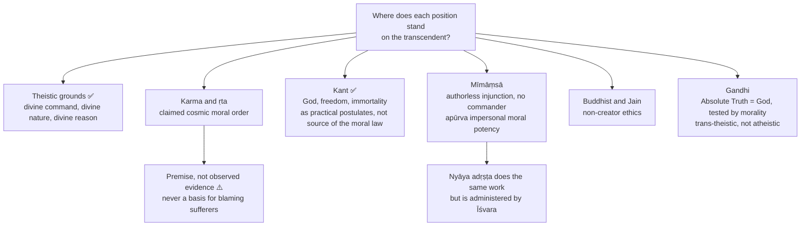

- **Divine sanction ⚠️:** on theistic assumptions, an act unnoticed by people remains answerable to God; fear alone is heteronomous on Kant's account; belief does not guarantee compliance.
- **Karma ⚠️:** karma can motivate accountability without a divine commander in some schools, but it does not authorise observers to infer guilt from another's suffering, and it does not establish an undetected act's actual fate.
- **Impersonal versus theistic moral order (Causation theme file) ⚠️:** Mīmāṃsā's *apūrva* is an imperceptible persisting potency, established by *arthāpatti*, that links a perishing act to its distant fruit; it is **impersonal and self-executing**, so no God is needed to dispense fruits (*nirīśvaravāda*). Nyāya's *adṛṣṭa* does the same work but requires Īśvara to administer it. Jainism's karma is literally material; Sāṃkhya-Yoga uses *saṃskāra / karmāśaya*; Buddhism uses *vāsanā / bīja* in the *santāna*. The objection (apūrva as an unverifiable posit) retains residual force.
- **Gandhi ✅/⚠️:** he does **not** endorse metaphysical atheism as true; he re-describes the sincere atheist's fidelity as implicit participation in the divine. Position: theistic or **trans-theistic**, not secular. He retains Absolute Truth as God, prayer, *Rāmanāma*, grace and *mokṣa* as self-realisation.
- **Kant ✅:** religion is related to morality, while God, freedom and immortality function as practical postulates rather than the source of the moral law.

---

## 6. Explanatory & Causal Principles (how religion and morality interact)

### 6.1 The interaction view (2023 Q5(c)) ✅

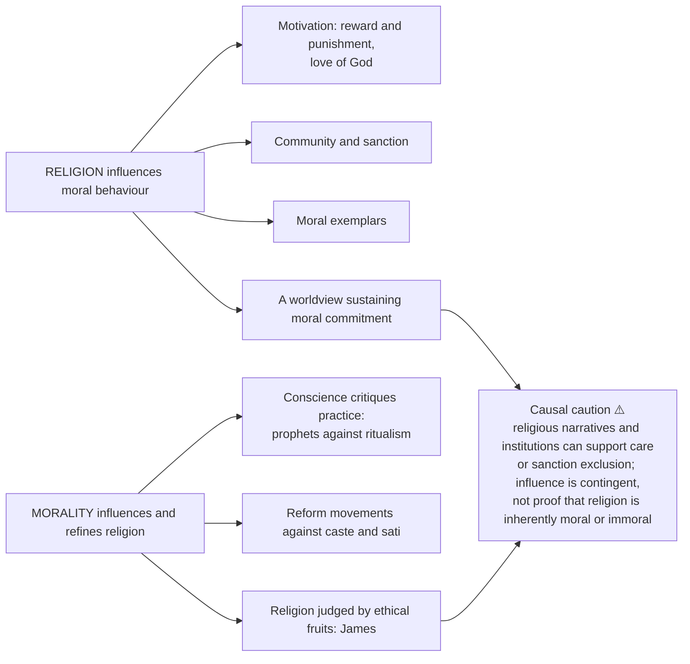

### 6.2 Religiosity as an amplifier (2018 Q5(d) mechanism) ⚠️

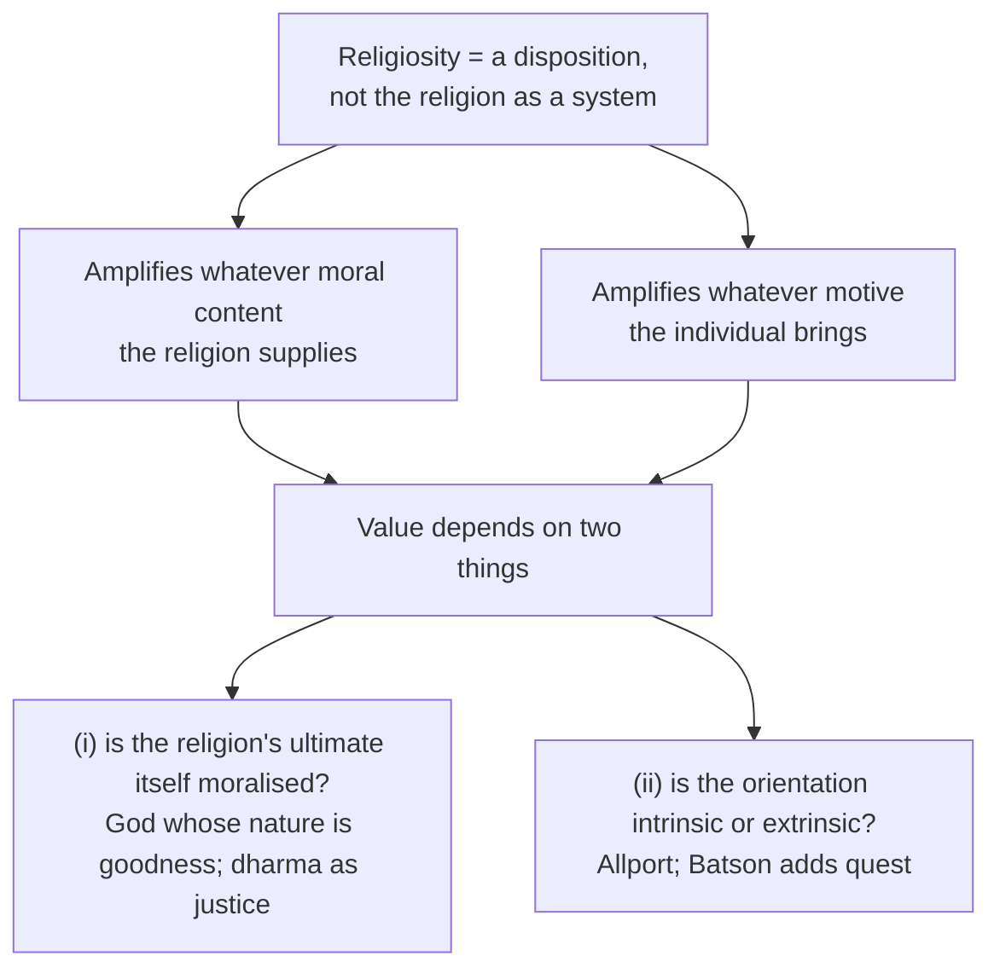

- **Objection → reply ⚠️.** *Objection:* this makes religiosity morally inert. *Reply:* not inert; an amplifier is not neutral in effect, only in direction; traditions can be assessed by how strongly they build internal critique and moral universalism into the amplification.

### 6.3 Causal principles of the Indian moral order ✅/⚠️

- *Dharma* as combined moral, social, ritual and soteriological order; *ṛta* as cosmic setting, claimed not proved; karma as claimed causal link between action and consequence; *apūrva* / *adṛṣṭa* as the mediating potency (§5). **Distinction:** dharma is not simply morality: it can include ritual and role-specific duty, which makes internal moral criticism necessary.

---

## 7. Ethics & Human Goals

> [!NOTE]
> The sources give no *kāma/artha/dharma/mokṣa* hierarchy for this topic as a whole. This module carries only the motivation, sanction, moral-critique and Indian-duty material the owner gives.

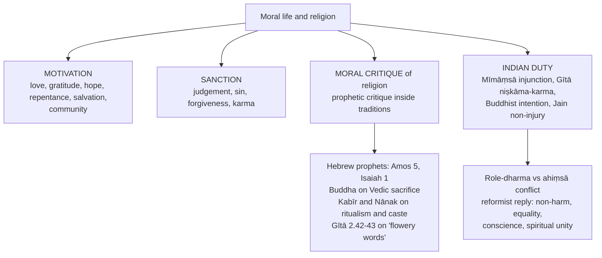

- **Indian duty is not one moral theory ✅:** Mīmāṃsā grounds ritual duty in injunction; the Gītā joins role-duty with disciplined action and devotion; Buddhism grounds conduct in intention, suffering and compassion; Jainism radicalises *ahiṃsā* through vows; Nyāya and theistic Vedānta connect moral consequence to divine governance.
- **Moral criticism within and across traditions ✅:** a claimed command remains answerable to identification, interpretation, consistency, proportionality, human dignity and the moral status of the authority invoked; this is not automatic secular hostility.
- **Plural moralities ⚠️:** no inference from 'religion supports morality' to 'all religions share one moral code' is valid.
- **Non-theistic groundings ✅:** (1) **Buddhist:** *cetanā* (intention), the causal structure of *dukkha*, the *brahmavihāras* (*mettā, karuṇā, muditā, upekkhā*); Śāntideva's argument (*Bodhicaryāvatāra* VIII): since there is no substantial self, suffering is **ownerless**, so the reason to relieve my future suffering is as strong as the reason to relieve another's. (2) **Jain:** *ahiṃsā* as supreme vow extended to all *jīvas* in proportion to sense-capacity; the *aṇuvrata / mahāvrata* structure grades obligation by vocation; *anekāntavāda* as an ethic of **intellectual non-violence**. (3) **Mīmāṃsā:** duty from injunction (*codanā*) alone; a pure deontology of the *śāstra*. (4) **Secular Western:** Kantian autonomy, utilitarian welfare, contractarian agreement, virtue-eudaimonism, each with a known difficulty (formalism, demandingness, circularity, thick-nature dependence).
- **Comparative verdict ⚠️:** non-theistic accounts show moral reasons and practice can be intelligible without a personal creator; this does not by itself refute a theist's separate claim about morality's ultimate metaphysical ground. Theistic ethics may claim to unify obligation, motivation and cosmic significance; Euthyphro and the interpretation of commands remain live costs.

---

## 8. Inter-School Comparative Matrices

### 8.1 Comparison grid ⚠️

| View | Claim | Thinker | Weakness |
|---|---|---|---|
| Divine Command | Obligation constituted by God's command (versions differ) | DCT, Adams | Euthyphro: arbitrariness / independent-goodness pressure |
| Autonomy | Morality = reason | Kant | Motivation / why-be-moral gap |
| Independence (secular) | Ethics needs no God | Utilitarians, humanists | Grounding of obligation |
| Interaction | Mutual reinforcement | James, Indian dharma | Relation is contingent |
| Indian (dharma) | Role, moral and ritual duty can overlap or conflict | Gītā, Mīmāṃsā | Role-duty, hierarchy, cross-school disagreement |

### 8.2 Inter-thinker matrix ✅

| View | Ground of rightness | Source of obligation | Motivation | Main problem |
|---|---|---|---|---|
| Divine command | God's command / nature | Divine authority | Accountability / love | Euthyphro and access |
| Natural law | Objective human goods | Practical reason under divine order | Flourishing | Nature-to-norm |
| Kant | Rational universal law | Autonomy | Respect for law | Formalism |
| Utilitarianism | Consequences / welfare | Impartial maximisation | Sympathy / reason | Rights and demandingness |
| Mīmāṃsā | Vedic injunction / dharma | Scriptural authority | Ritual duty / result | Authority outside tradition |
| Buddhism / Jainism | Non-harm, intention, liberation | Insight / vow / path | Compassion and karmic seriousness | Metaphysical warrant |
| Modified DCT (Adams) | Resemblance to God's loving nature | Commands of a loving God | Love, relationship | 'Loving' presupposes an independent moral concept |
| Śāntideva | Ownerless suffering (no substantial self) | Impartial reason | Compassion (*karuṇā*) | Depends on *anātman* being true |
| Nietzsche | ❌ Denies the ground; values are created | Self-legislation of the strong type | Affirmation, self-overcoming | No criterion for better creations |

### 8.3 Gandhi against the file's other positions ⚠️

| Position | What grounds moral obligation | What tests religion | Status of the atheist | Euthyphro position |
|---|---|---|---|---|
| **Divine Command (Adams-modified)** | Commands of a loving God | Revelation, interpreted by tradition | Outside the moral-religious community as such | First horn, blocked by God's loving nature |
| **Kantian autonomy** | Self-legislating rational will | Reason alone; religion within the bounds of reason | Fully included | Second horn, no divine remainder |
| **Nietzsche** | Nothing given; values created | Genealogy of the values religion underwrites | Diagnostician of the death of God | Rejects the dilemma's moral realism |
| **Mīmāṃsā** | *Codanā*, injunction without a commander | Vedic injunction, self-validating | Irrelevant: no God required | Dissolves the dilemma; duty without a person |
| **Gandhi** | Truth (*satya*), of which *ahiṃsā* is the method | **Reason and morality**: any doctrine conflicting with them is rejected | **Included**: fidelity to truth is itself religious | **Second horn embraced** |

### 8.4 Just war, *jihād* and *dharma-yuddha*: restraint-regimes ⚠️

> [!WARNING]
> **Handling rule.** These are internally contested normative traditions with long juristic histories. Compare *criteria*; do not adjudicate between faiths, do not characterise any community, and mark contested points ❓.

| Criterion | Just war | Classical Islamic juristic tradition | *Dharma-yuddha* |
|---|---|---|---|
| Legitimate authority | ✅ Required (Aquinas) | ✅ Required | ✅ Required (the *rājan*) |
| Just cause | ✅ Required | ✅ Required | ✅ Required |
| Right intention | ✅ Explicit | ✅ Emphasised (*niyya*) | ✅ Detachment from hatred (Gītā's *niṣkāma* framing) |
| Last resort | ✅ | ⚠️ Present in juristic conditions | ✅ *Sāma-dāna-bheda* before *daṇḍa* |
| Non-combatant immunity | ✅ Central | ✅ Explicit prohibitions | ✅ Detailed lists of the protected |
| Proportionality of means | ✅ | ✅ | ✅ (prohibited weapons) |
| Temporal / spatial limits | ⚠️ Not classical | ⚠️ Truce and treaty rules | ✅ Cease at sunset; fight only equals |
| Internal realist counter-tradition | ✅ Realism, *raison d'état* | ⚠️ Contested modern readings | ✅ Kauṭilya's *kūṭa-yuddha* |

---

## 9. Criticisms & Reconstructed Replies

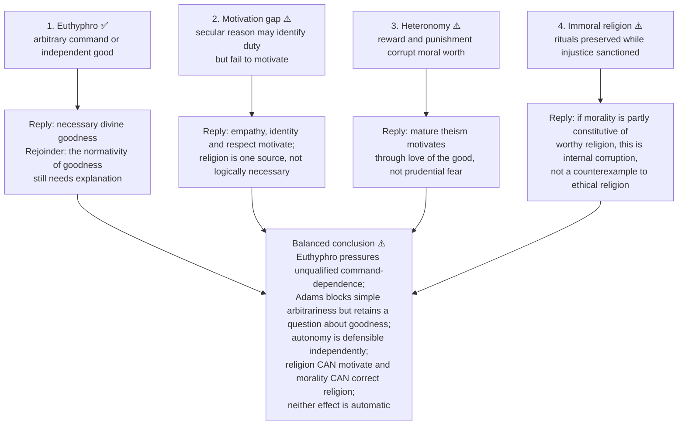

### 9.1 Objections to Gandhi's inversion → replies ⚠️

| # | Objection | Reply | Residue |
|---|---|---|---|
| 1 | **Merely verbal:** if 'God' adds nothing to 'Truth', the formula is rhetoric | For Gandhi *satya* carries ontological reality (*sat*), moral truthfulness, conscience, love / *ahiṃsā* and the final object of self-realisation; 'God' asserts its **ultimacy and claim to total self-surrender** | Changes worship from a person to a discipline; critics say *bhakti* loses its object |
| 2 | **Subjective relativism:** 'truth as I see it' can license fanaticism | Relative truth is bound by humility, reason, moral scrutiny, non-violence and readiness to suffer rather than inflict suffering; fallibility *forbids* coercion | Conscience remains the proximate judge; Gandhi's own reversals show the standard is demanding |
| 3 | **Morality swallows religion:** doctrine and ritual reduced to ethics | Gandhi distinguishes **religion** (transformative relation to Truth) from **sectarian creeds** | A tradition locating its core in sacrament or revelation will reject the reduction |
| 4 | **Gandhi became an atheist / secular humanist** | ❌ False: he retains Absolute Truth as God, prayer, *Rāmanāma*, grace, *mokṣa* | Best called **trans-theistic** |
| 5 | **Metaphysically thin** compared with Advaita | Gandhi is a practitioner, not a systematiser; affinity with Advaita's *sat* is real but personal/impersonal is unresolved technically | Glyn Richards, 'Gandhi's Concept of Truth and the Advaita Tradition', *Religious Studies* |

### 9.2 Residual force of the Indian counter-critiques ⚠️

Role-dharma can sacralise hierarchy; the reformist reply is internal critique (non-harm, equality, compassion, conscience): religion can morally revise itself instead of simply sanctioning status-quo duties. Karma can be mis-used to blame victims; it does not establish that victims deserve suffering.

---

## 10. Controlled Western Comparisons

*The owner gives Indian–Western pairings within its own argument, not a stand-alone East–West table. Only those pairings are carried; none is invented.*

| Pairing | Point of contact | Decisive disanalogy / limit |
|---|---|---|
| **Kant and Mīmāṃsā** | Both give a non-commander ground of duty | Mīmāṃsā locates dharma in authorless Vedic injunction (avoids a personal commander, not the authority question); Godless authority is **not automatically Kantian autonomy** |
| **Nietzsche and the Gītā** | Kṛṣṇa charges Arjuna with *klaibya* (2.3): structurally the same accusation of impotence | The Gītā's remedy is *svadharma* and non-attachment, a duty-ethic grounded in cosmic order, not a self-legislated creation of values |
| **Nietzsche and Buddhism** | Nietzsche's repeated claim that Buddhism is 'life-denying' | *Nirvāṇa* is cessation of *craving*, not of life; *karuṇā* is active and other-regarding; the middle way rejects self-mortification, the very ascetic ideal he attacks. He rates Buddhism above Christianity as 'more realistic' while still classing it as nihilistic (say this precisely) |
| **Nietzsche and Cārvāka** | Closest Indian analogue in *conclusion*: this-worldly value, rejection of the priestly order | Not in *method*: Cārvāka is empiricist where Nietzsche is genealogical |
| **Adams / Alston and Gandhi on Euthyphro** | Both confront the dilemma | Adams occupies the first horn with a loving nature; Gandhi embraces the second: religion answers to the good |
| **Śāntideva and Kantian / secular impartiality** | Impartial altruism without God | Śāntideva rests it on a **metaphysical** premise (ownerless suffering), which depends on *anātman* being true |
| **Hume, Hobbes, Gyges and karma / niṣkāma-karma** | All address the undetected hard case | Karma is a contested metaphysical premise; *niṣkāma-karma* shifts focus from reward to duty without removing the challenge of cultivating non-attachment |

> [!WARNING]
> Do not flatten the comparisons: Buddhist, Jain, Mīmāṃsā and Gītā grounds differ among themselves, and Western parallels are illustrative only. Treat them after the Indian argument, in a line or two.

---

## 11. Diagnostic Deep-Dives for High-Frequency Themes

### 11.1 Religiosity and 'immorality' (2018 Q5(d)) ⚠️

> [!WARNING]
> The held 2018 paper visibly prints **'immorality'**; keep the printed word. The stem concerns *religiosity* (a disposition), not *religion* (a system).

| Argument for a positive connection (religiosity can generate immorality) | Content |
|---|---|
| Ritual-substitution | Observance displaces moral substance: Hebrew prophets (Amos 5, Isaiah 1); the Buddha on Vedic sacrifice; Kabīr and Nānak on ritualism and caste; Gītā 2.42–43. Every tradition containing this critique is itself the evidence the danger is real |
| In-group / out-group | Boundary-marking has a predictable moral cost; Allport's **intrinsic vs extrinsic** religiosity, Batson's **quest** |
| Suspension | If religious duty can override ethics, a route to immoral acts: Kierkegaard |
| Scrupulosity / licensing | Pathological guilt on one side; moral licensing ('I have observed, therefore I am good') on the other |

*Against a systematic connection:* (1) every tradition also generates reformers, ascetics, exemplars, so the correlation is with **orientation**; (2) the immoral religionist is judged by the tradition's own norms: internal corruption; (3) secular ideologies have comparable failures, so religiosity is not the differentiating variable.

**Verdict:** 'There is a genuine inter-relatedness, but it is **conditional, not necessary**. Religiosity does not produce immorality; it magnifies the moral content it is attached to, and the traditions' own prophetic critiques show that they know it.'

### 11.2 Religious violence: is there a philosophical argument? (2019 Q5(c)) ⚠️

> [!WARNING]
> **Handling rule.** A philosophical question about the structure of justification, not a survey of atrocities, and not a comment on any living community. Assess arguments; name no contemporary group.

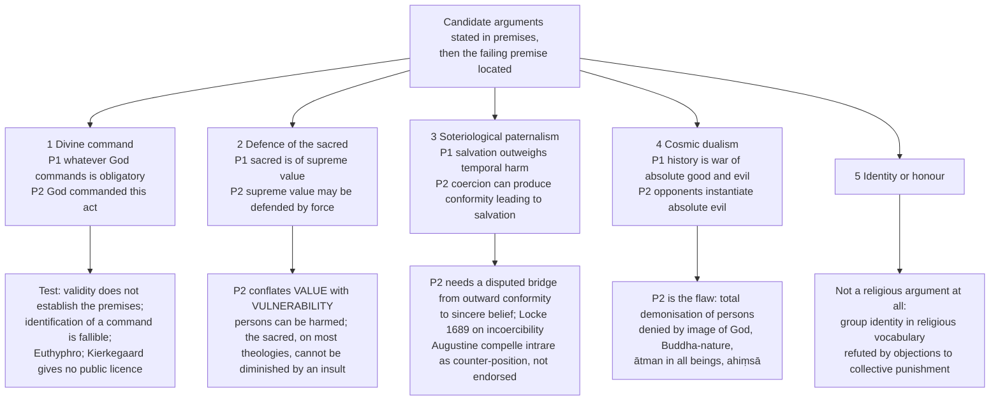

- **General rebuttals ✅:** (a) Euthyphro; (b) epistemic fallibility of revelation-claims; (c) Gandhi's means–end unity ('seed and tree'); (d) internal critique: *ahiṃsā*, Buddhist first precept, prophetic critique of sacrifice, dignity of the person.
- **What survives ⚠️:** a believer may frame defence of persons through religious premises, but must still defend necessity, discrimination and proportionality in terms others can scrutinise; the same protections can be justified without theistic premises.
- **Verdict:** 'Valid arguments can be formulated, but their claimed religious premises and moral bridges are contestable; a mere appeal to divine will does not publicly justify harm. The issue is not solved by asserting that no possible religious argument exists, nor by treating religious conviction as sufficient licence.'

### 11.3 Devotion, social morality and compatibility (2019 Q5(d), 2020 Q8(b)) ⚠️

- **Social morality is not automatically moral truth.** Shared law and custom can protect cooperation but can also entrench injustice. A devoted person's refusal of an accepted discriminatory custom (caste exclusion as an India-centred illustration) can look like going astray *from society* while being morally justified. Conversely, a practice defended as sacred can harm persons.
- **Strongest divergence argument ✅:** Kierkegaard's Abraham. It does not follow that *all* devotion suspends ethics: Gandhi's Truth and *ahiṃsā*, Buddhist compassion, Jain vows show religious lives organised by moral discipline.
- **Compatibility is not identity.** One clear counter-case defeats a *necessity* claim of incompatibility (2020).
- **Verdict:** a devoted way of life can conflict with *a given social code* for morally good or bad reasons; religious belief/practice and moral behaviour are **compatible but not guaranteed to coincide**.

### 11.4 Morality without religion; religion without morality; inseparability (2021 Q6(c), 2022 Q5(b), 2024 Q5(a)) ⚠️

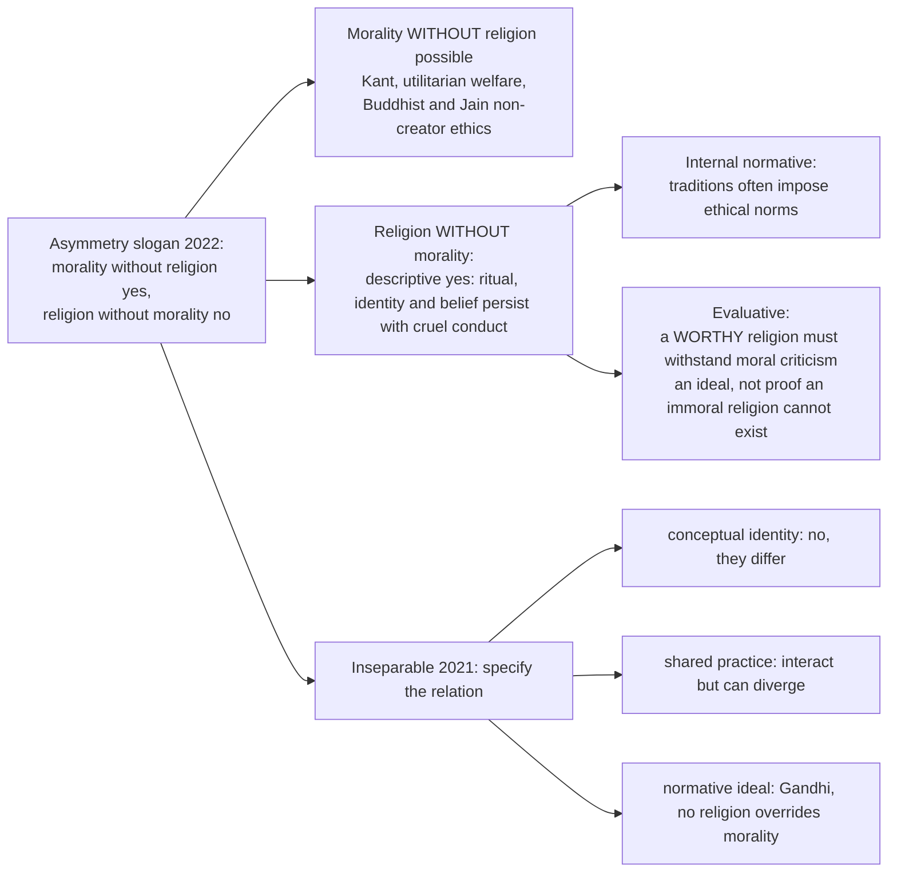

- **Answer discrimination ⚠️:** 2021 Q6(c) asks about **inseparability** (specify which relation); 2022 Q5(b) asks whether the two directions of an **asymmetry** hold; 2024 Q5(a) asks whether a **religion without morality can exist**. The same examples serve different conclusions.
- **Objection → reply ⚠️:** a theist says divine goodness grounds obligation even where non-believers act morally; reply: Euthyphro and non-theistic theories challenge that grounding separately. Conversely, a moral critique of a harmful tradition cannot be dismissed by redefining the tradition out of existence.
- **Asymmetry verdict:** morality is *constitutive* of what we are willing to call a (worthy) religion, whereas religion is at most *supportive* of morality; constitutive and supportive relations are not two degrees of one relation.

### 11.5 'Why be moral — all the time?' (2019 Q7(b)) ✅/⚠️

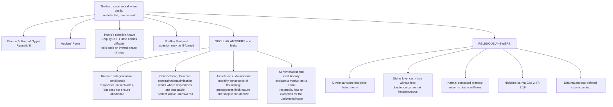

- **Assessment ⚠️:** separate **justification** (why a norm binds), **felt motivation** and **compliance**. Neither religious nor secular ethics guarantees compliance by every agent in an undetected, costly case.
- **Verdict:** 'The "all the time" qualifier exposes a real challenge to any ethic... Each must justify its grounds and explain its motivational limits; neither enjoys a demonstrated universal solution.'

### 11.6 Autonomy in conflict with religion as source (2026 Q6(b)) ✅/⚠️

1. **Define the clash ✅:** autonomy = a rational will gives itself universally valid law; heteronomy = external will, hoped-for reward or inclination.
2. **Sharpen with Euthyphro ✅:** command makes cruelty right → arbitrariness; goodness independently intelligible → reason must assess the purported command.
3. **Give the religious view its strongest reply ✅:** Adams (loving nature); natural law (divine ordering grasped by practical reason). Residual: meaning of 'loving', contested revelation, duty versus deference to authority.
4. **Separate sources ⚠️:** ground, evidence, formation, motivation, test (§2.4).
5. **Indian comparison with limits ✅:** Mīmāṃsā's authorless injunction avoids a personal commander, not the authority question; Buddhism / Jainism offer reasoned non-creator ethics; the Gītā holds role-duty and disciplined reflection in tension.

**15-mark spine:** define autonomy/heteronomy → what 'source' might mean → command/obedience conflict and both horns → Adams and natural law at their strongest → test the residue → Indian counterpoint → conclude that autonomy conflicts with **uncritical external moral legislation**, not with every possible religious grounding or religiously formed moral commitment.

### 11.7 Gandhi: 'God is Truth' to 'Truth is God' (2026 Q8(a) — primary owner) ✅/⚠️

> **Text base ✅.** *Young India*, 31 December 1931, pp. 427–28 (Gandhi explains the shift); *Young India*, 5 March 1925, p. 81; *An Autobiography*, Introduction.

> 'I would say with those who say God is Love, God is Love. But deep down in me I used to say that though God may be Love, God is Truth, above all… **But two years ago I went a step further and said that Truth is God.** You will see the fine distinction between the two statements.' — *Young India*, 31 Dec 1931

> [!WARNING]
> **Dating trap ❓.** The passage says he reached it 'two years ago' (≈1929). Do **not** write that the idea was invented in the December 1931 Lausanne address. Say: 'stated publicly in 1931, reached about two years earlier.'

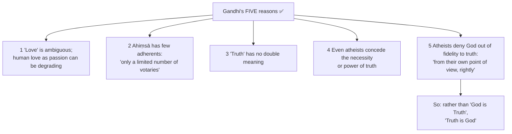

| | **'God is Truth'** | **'Truth is God'** |
|---|---|---|
| Grammatical role | **Predication**: God is the assumed subject; truth one attribute among Love, Light, Life | **Identification**: Truth is the subject; 'God' asserts its ultimacy |
| Epistemic start | Requires prior belief in a deity | Requires only acknowledgement of truth, which nobody denies |
| Who is admitted | Theists | Theists **and** the sincere atheist, scientist, sceptic |
| Practical test | Worship, creed, ritual, obedience | **Truthful living**: *satya* in thought, speech, act |
| Risk guarded against | — | Anthropomorphism, sectarian capture of 'God', creedal gate-keeping |
| Risk incurred | — | Apparent dissolution of God into an abstraction |
| Gandhi's gloss | — | 'God is Truth, but God is many other things also… Truth is not one of the many qualities that we name. It is the living embodiment of God' (*Harijan*, 25 May 1935, p. 115) |

> [!TIP]
> **Mnemonic — 'Subject-swap, not God-swap.'** Gandhi changes which term is the subject of the sentence, not whether the divine is real. Writing that he 'gave up God' fails the question.

**Religion–morality core (give most space) ✅/⚠️:**
1. **Morality constitutive of religion, not derived from it:** 'the essence of religion is morality' (*Autobiography*, Introduction).
2. **Religion subordinated to reason and morality as a test:** 'I reject any religious doctrine that does not appeal to reason and is in conflict with morality' (*Young India*, 21 Jul 1920, p. 4); 'there is no such thing as religion overriding morality' (*Young India*, 24 Nov 1921, p. 385); a man 'cannot be untruthful, cruel or incontinent and claim to have God on his side'.
3. **The exact inverse of DCT:** DCT tests morality by revelation; Gandhi tests revelation by morality; **Euthyphro's second horn embraced**.
4. **Means and ends:** 'seed and tree' (*Hind Swaraj* ch. XVI) → *satyāgraha*, not mere passive resistance.
5. **Service, not withdrawal:** 'I am endeavoring to see God through service of humanity…' (*Young India*, 4 Aug 1927).

**Atheist-inclusiveness argument ⚠️:** (1) the sincere atheist denies God because he believes truthfulness requires the denial; (2) that denial is allegiance to truth; (3) if Truth is God, allegiance to truth is allegiance to the divine under another description; (4) so the atheist of integrity shares the quest; (5) hence **moral sincerity, not creedal assent, is the criterion of religious standing**. Earlier, stronger formulation ✅: God 'is even the atheism of the atheist' (*Young India*, 5 Mar 1925, p. 81). Qualification: Gandhi does **not** endorse metaphysical atheism; he *re-describes* it.

**Fallibilism chain ⚠️:** Truth objective and absolute → no embodied person possesses it wholly → each acts on conscientious relative truth → the opponent may hold a portion I lack → to coerce him assumes an infallibility I do not have → persuasion, dialogue and **self-suffering** replace violence. **Violence is not merely unkind; it is an epistemic error.** Not relativism: relative truth is answerable to the Absolute.

**Pluralism corollary ✅:** all religions disclose truth and all contain error, so equal respect does not forbid criticism; duty is to reform one's own tradition first. Accurate label: **fallibilist religious pluralism**, not 'all religions are equally true'. (Routed to Religious Pluralism.)

**20-mark spine ⚠️:** the shift quoted and dated correctly → the five reasons → predication versus identification → **religion–morality core** → inclusiveness (five-step argument, trans-theistic) → fallibilism (table + chain, not relativism) → critical evaluation (objections 1–3 with replies; gained: universality, moral accountability of religion, non-coercion; conceded: thin metaphysics, devotional object displaced, conscience as proximate judge) → verdict. **15 marks:** drop the pluralism corollary and one objection. **10 marks:** statement with dating → two of five reasons → the two core quotations → atheist inclusiveness in a sentence → relative/absolute truth in a sentence → verdict.

**Verdict formula ⚠️:** 'The shift is not a retreat from theism but a relocation of the point of entry: by making Truth the subject and "God" the predicate, Gandhi makes moral truthfulness the test of religion rather than religion the source of morality. It buys universality and pays with a metaphysically thin conception of the divine and with conscience as the proximate, though not final, judge of relative truth.'

---

## 12. PYQ Routing Ledger (2018–2025; 2026 supplement)

> **Corpus signal.** ⚠️ 11 primary-owned parts of 112 in 2018–2025 (per-year 1/3/1/1/1/1/1/2), plus **2 in 2026** (13 of 126), including three distinct demands in 2019. Cross-links do not create duplicate ownership. The owner file has no pre-2018 PYQ table.

| Year | Q | Marks | Exact demand | Route |
|---|---|---:|---|---|
| 2018 | Q5(d) | 10 | Can one claim that there is an inter-relatedness between 'religiosity' and 'immorality'? Discuss. (printed word 'immorality' retained) | §11.1, §6.2 |
| 2019 | Q5(c) | 10 | Can there be a philosophical argument to support violence in the name of religion? Discuss. | §11.2 |
| 2019 | Q5(d) | 10 | Does a devoted commitment to a religious way of life make man go astray from social morality? Examine. | §11.3 |
| 2019 | Q7(b) | 15 | Secular ethics cannot fully resolve as to why one should be moral all the time. Examine. | §11.5 |
| 2020 | Q8(b) | 15 | Are religious beliefs and practices incompatible with moral behaviour? Discuss. | §11.3 |
| 2021 | Q6(c) | 15 | Do you consider that religion and morality are inseparable? Give reasons for your answer. | §11.4 |
| 2022 | Q5(b) | 10 | 'One can have morality without religion but not religion without morality.' Discuss. | §11.4 |
| 2023 | Q5(c) | 10 | Does religion influence the moral behaviour? Explain the interactive relation between religion and morality. | §6.1 |
| 2024 | Q5(a) | 10 | Can there be a religion without morality? Discuss. | §11.4 |
| 2025 | Q5(c) | 10 | Present an account of Nietzsche's criticism of religion and morality. | §3.2 |
| 2025 | Q8(b) | 15 | Is it necessary for the normative principles to bear reference to God in order to produce a feeling of obligation in a moral agent? Critically discuss. | §2.3 |
| **2026** | **Q6(b)** | **15** | How does the issue of moral autonomy conflict with conception of religion as a source of morality? Critically discuss. | §11.6 |
| **2026** | **Q8(a)** | **20** | Critically evaluate the shift in Gandhi's view from 'God is Truth' to 'Truth is God', in the context of interrelation between religion and morality. | §11.7 |

**Cross-owned (listed, not counted):** 2026 Q6(c) (*Does the idea of Religious Pluralism necessarily entail moral relativism?*), owned by Religious Pluralism; this topic carries the relativism half only.

**Doubled-owner discrimination (2026) ⚠️:** Religion and Morality appears twice with *different* demands (autonomy vs Gandhi); do not write the same answer twice.

---

## 13. Top 10 UPSC Exam Traps

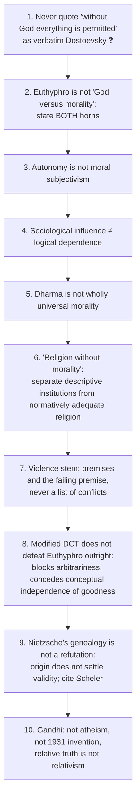

**The remaining ten traps recorded in the owner file (all given) ⚠️:**
11. Do not characterise any living community or adjudicate between faiths in just war / *jihād* / *dharma-yuddha*; compare criteria; name internal counter-traditions (Kauṭilya's *kūṭa-yuddha*; contested modern readings).
12. ❓ Do not assert the 'greater / lesser *jihād*' distinction as canonical; the supporting report is disputed by ḥadīth scholars.
13. *Dār al-islām* / *dār al-ḥarb* are juristic-historical constructs, not Qur'ānic.
14. Do not read the *Gītā* as a general theory of war: Kṛṣṇa's argument is *svadharma* in a narrative situation; Gandhi's allegorical reading is one influential interpretation, not the plain sense.
15. In the 2018 stem keep the printed 'immorality' and use intrinsic / extrinsic / quest; the verdict is *conditional ambivalence*, not a correlation.
16. In 'why be moral', separate **justification, motivation, conduct**; do not assume either side guarantees action.
17. Do not date 'Truth is God' to the Lausanne 1931 address (the text says 'two years ago', ≈1929).
18. Do not say Gandhi held all religions equally true; all contain truth **and** error, so equal respect permits criticism and self-reform.
19. Do not render *satya* as mere honesty: it is *sat*, ontological and moral at once.
20. Do not answer a religion-and-morality stem with a biography of the freedom movement: the core is the **subordination of religion to morality and reason**, and the fallibilism that follows.

---

## 14. Technical Vocabulary & IAST Bank

| Term | IAST / form | English gloss | Status |
|---|---|---|---|
| Divine command theory | — | Obligation constituted by God's command | ✅ |
| Modified DCT | Adams | Commands of a loving God; goodness by resemblance | ✅ |
| Divine motivation theory | Zagzebski | God's motives as ground of value | ✅ |
| Euthyphro dilemma | — | Pious because loved, or loved because pious | ✅ |
| Autonomy / heteronomy | — | Self-legislation vs external determination | ✅ |
| Categorical imperative | — | Kantian universal law | ✅ |
| Natural law | — | Objective goods under divine reason | ✅ |
| Justification vs motivation | — | Why a norm binds vs why one complies | ⚠️ |
| Ring of Gyges; Hobbes' Foole; sensible knave | — | The 'all the time' challenges | ✅ |
| Constrained maximisation | Gauthier | Disposition to keep agreements | ✅ |
| Eudaimonism | — | Morality constitutive of flourishing | ✅ |
| Moral licensing; scrupulosity | — | Over- and under-reading of observance | ⚠️ |
| Intrinsic / extrinsic / quest | Allport; Batson | Orientations of religiosity | ✅ |
| Teleological suspension of the ethical | Kierkegaard | Abraham's exceptional duty | ✅ |
| *Jus ad bellum / in bello / post bellum* | — | Resort to war / conduct / aftermath | ✅ |
| *Qitāl*; *jihād al-nafs* | — | Fighting; inner struggle (report disputed) | ✅ / ❓ |
| *Dharma-yuddha*; *kūṭa-yuddha* | dharmayuddha; kūṭayuddha | Righteous war; concealed / stratagem warfare | ✅ |
| *Sāma-dāna-bheda-daṇḍa* | sāma, dāna, bheda, daṇḍa | Graded political means | ✅ |
| *Compelle intrare* | — | 'Compel them to come in' (Luke 14:23) | ✅ |
| Dharma | dharma | Moral, social, ritual, soteriological order | ✅ |
| *Ṛta* | ṛta | Claimed cosmic order | ⚠️ |
| Karma | karma | Claimed link of action and consequence | ⚠️ |
| *Apūrva*; *adṛṣṭa* | apūrva; adṛṣṭa | Impersonal / theistically administered potency | ✅ / ⚠️ |
| *Ahiṃsā* | ahiṃsā | Non-injury | ✅ |
| *Aṇuvrata / mahāvrata* | aṇuvrata / mahāvrata | Lesser / great vows | ✅ |
| *Anekāntavāda* | anekāntavāda | Intellectual non-violence | ✅ |
| *Cetanā* | cetanā | Intention | ✅ |
| *Brahmavihāra* | mettā, karuṇā, muditā, upekkhā | Four immeasurables | ✅ |
| Ownerless suffering | Śāntideva | Suffering without a substantial owner | ✅ |
| *Niṣkāma-karma* | niṣkāma-karma | Action without desire for fruit | ✅ |
| *Codanā* | codanā | Vedic injunction | ✅ |
| *Klaibya* | klaibya | Unmanliness / impotence (Gītā 2.3) | ✅ |
| Slave morality; *ressentiment* | — | Reactive valuation | ✅ |
| Ascetic ideal; bad conscience | — | Genealogy II, III | ✅ |
| Revaluation; Übermensch; *amor fati*; eternal recurrence | — | Nietzsche's positive programme | ✅ |
| *Satya* / *sat* | satya / sat | Truth / that which is | ✅ |
| *Satyāgraha* | satyāgraha | Holding firmly to truth | ✅ |
| *Rāmanāma* | Rāmanāma | Gandhi's name of God, retained | ✅ |
| *Sarva-dharma-samabhāva* | — | Equal respect (owned by Pluralism) | ✅ |

---

## 15. Graded Verdict & Answer Architectures

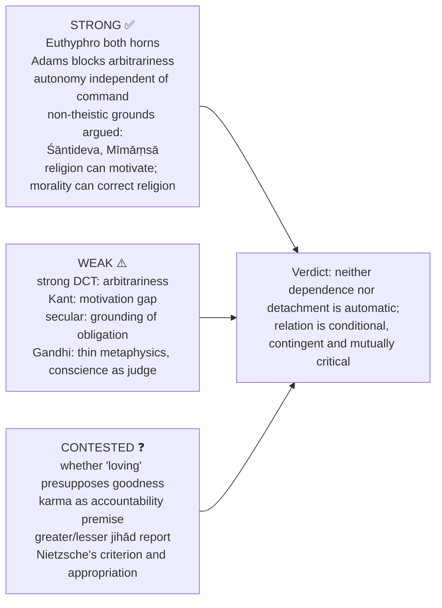

### 15.1 Graded verdict ladder ⚠️

| Band | What the script contains | Typical fault |
|---|---|---|
| **Weak (≈40%)** | 'Religion teaches morality'; DCT and Kant named | The four kinds of dependence merged |
| **Average (≈50%)** | Euthyphro with both horns; Kantian autonomy | Indian material limited to one line on dharma |
| **Good (≈60%)** | Grounding vs motivation separated; one objection answered | Modified DCT absent; non-theistic groundings asserted, not argued |
| **Strong (≈65–70%)** | Modified DCT and its residual objection; a real non-theistic grounding argued; interaction analysed | Verdict summarises rather than decides |
| **Top (≈70%+)** | All of the above plus a discriminating distinction (semantic/metaphysical/motivational; intrinsic vs extrinsic; justification vs motivation; restraint vs licence) plus a concession that costs the writer's own position something | — |

### 15.2 10-mark

```text
State dependence claim → Euthyphro/Kant discriminator → one Indian illustration →
distinguish grounding from motivation → verdict.
```

### 15.3 15-mark

```text
Frame obligation problem → strongest theistic account → autonomy/natural-law rival →
objection and reply → interaction analysis → defended conclusion.
```

### 15.4 20-mark

```text
Separate rightness, obligation and motivation → compare command, autonomy and dharma →
Euthyphro plus immoral-religion objections → replies → graded relational thesis.
```

### 15.5 Graded-verdict templates ⚠️

- **Dependence stem:** 'Morality is not **conceptually** dependent on religion: the Euthyphro shows that, and four independent non-theistic groundings confirm it. It may be **motivationally** and **historically** dependent for many agents, and those are different claims that a good answer keeps apart.'
- **Asymmetry stem:** 'The asymmetry holds, but for a reason the slogan hides: morality is *constitutive* of what we are willing to call a religion, whereas religion is at most *supportive* of morality.'
- **Violence stem:** 'A religious claim by itself licenses no harm: command-identification, sacred defence and coercive salvation each require separately defensible moral premises. Defence of persons remains subject to necessity, discrimination and proportionality.'

### 15.6 PYQ-mapped model-answer skeletons ⚠️

```text
2022 asymmetry (10m):  Intro: examine the asymmetry between the two directions.
  Body: religion WITHOUT morality — descriptively possible; normatively objectionable if it claims to transform life;
        morality WITHOUT religion — possible (Kant, secular ethics, humanism).
  Assess: moral teaching vs moral behaviour vs an external moral standard; an ethical code can itself be bad.
  Concl: defensible as a claim about WORTHY religion, not a definition of every actual religion.

2025 felt obligation (15m):  Intro: a FELT duty, not only validity.
  Body: divine command and covenant can evoke answerability; Euthyphro/interpretation still matter;
        Kantian respect, Buddhist compassion, Jain vows can evoke felt duty without God.
  Assess: validity vs experience vs action: God-reference neither necessary nor sufficient.
  Concl: religion can deepen felt obligation without monopolising its sources.

2019 violence (10m):  structure of justification; five candidate arguments in premises; failing premise; general rebuttals;
  Concl: a religious appeal alone does not justify harm; protection of persons must meet assessable constraints.

2019 why be moral (15m):  'all the time'; Gyges, Foole, knave, Bradley/Prichard; secular answers and limits; religious answers;
  separate justification from motivation; Concl: tests each theory's account of reasons and motivation.

2025 Nietzsche (10m):  two halves; God is dead; Genealogy I-III; Platonism for the people; positive programme;
  critique: genetic fallacy, no criterion, Scheler, appropriation; Indian: Gītā klaibya, Buddhism misread;
  Concl: the critique of morality outlives the programme that was to replace it.
```

### 15.7 Directive decoder ⚠️

| Directive | Examiner is buying | Structural consequence | Live example |
|---|---|---|---|
| **Can one claim that there is an inter-relatedness between A and B?** | A **conditional** verdict, with the condition named | Neither 'yes' nor 'no': say *under what conditions* | 2018 Q5(d) |
| **Can there be a philosophical argument to support X?** | Candidate arguments **in premises**, then the failing premise | Never a historical survey | 2019 Q5(c) |
| **Does X make man go astray from Y? Examine** | Test of a causal/normative claim | Distinguish disposition from system; intrinsic/extrinsic | 2019 Q5(d) |
| **[Claim]. Examine** | Fidelity to the claim's exact scope | 'All the time' is the operative phrase | 2019 Q7(b) |
| **Are A and B incompatible? Discuss** | An incompatibility claim tested | One counter-case defeats a *necessity* claim | 2020 Q8(b) |
| **Do you consider that A and B are inseparable? Give reasons** | A first-person verdict with ranked reasons | Separability shown by an actual system | 2021 Q6(c) |
| **'Quotation.' Discuss** | The asymmetry analysed in both directions | Test each direction separately | 2022 Q5(b) |
| **Does A influence B? Explain the interactive relation** | Influence **and** the interaction model | Causal influence ≠ logical dependence | 2023 Q5(c) |
| **Present an account of X's criticism of A and B** | Both objects and their connection in X's system | Nietzsche's two halves are one argument | 2025 Q5(c) |
| **Is it necessary for X to bear reference to Y…? Critically discuss** | A **necessity** claim tested | Distinguish grounding, epistemic access, motivation | 2025 Q8(b) |
| **How does autonomy conflict with religion as source?** | Which meaning of 'source' threatens self-legislation | Contrast external command with reason-endorsed duty; assess residual authority problem | 2026 Q6(b) |
| **Critically evaluate the shift… in the context of interrelation** | The *reason for the inversion* and its moral implications | Dated argument, moral test of religion, inclusive consequences, a serious objection | 2026 Q8(a) |

> [!TIP]
> **Rule.** Ask first *which* relation is asserted: conceptual dependence, epistemic dependence, motivational dependence, or sociological correlation. They have four different answers.

> [!TIP]
> **Safe formulations ⚠️.** 'God-reference may strengthen motivation without being necessary for a felt duty.' · 'Religion and morality are conceptually distinguishable, historically interactive and normatively mutually critical.' · 'Religious ethics must publicly defend constraints on force; sacred purpose by itself confers no licence.' · 'Different forms of religiosity can shape conduct in different directions.' · 'Gandhi inverts the dependence: religion is tested by morality and reason, not morality by religion.' · 'Fallibility about relative truth counts against coercion on Gandhi's view.'

---

## Link-outs (from the owner file)

Religion without God · Religious Pluralism · Problem of Evil · Notions of God · Soul, Immortality, Rebirth and Liberation · Paper I: Kant · Paper I: Mīmāṃsā · Paper I: Buddhism · Paper I: Jainism · Paper II: Humanism, Secularism and Multiculturalism · Philosophy of Religion PYQ Bank 2018–2025 · 2026 Paper II Section B PYQ Supplement.

## Sources

Plato, *Euthyphro*, *Republic* II; Kant, *Groundwork*, *Religion within the Bounds of Bare Reason*; R. M. Adams, *Finite and Infinite Goods*; L. Zagzebski, *Divine Motivation Theory*; W. Alston, 'Some Suggestions for Divine Command Theorists'; Nietzsche, *The Gay Science*, *On the Genealogy of Morality*, *Beyond Good and Evil*, *Thus Spoke Zarathustra*; M. Scheler, *Ressentiment*; Hume, *Enquiry Concerning the Principles of Morals*; F. H. Bradley, *Ethical Studies*; H. A. Prichard, 'Does Moral Philosophy Rest on a Mistake?'; D. Gauthier, *Morals by Agreement*; Aquinas, *ST* II-II q.40; M. Walzer, *Just and Unjust Wars*; J. Locke, *A Letter Concerning Toleration*; Śāntideva, *Bodhicaryāvatāra*; Kauṭilya, *Arthaśāstra*; *Mahābhārata*, *Śānti-parvan*; Allport and Batson on religious orientation; M. K. Gandhi, *Young India*, *Harijan*, *Hind Swaraj*, *An Autobiography*; Glyn Richards, 'Gandhi's Concept of Truth and the Advaita Tradition', *Religious Studies*; Wainwright (ed.), *Oxford Handbook of Philosophy of Religion*; John Hick, *Philosophy of Religion*; *Bhagavad Gītā*; Chatterjee & Datta; C. D. Sharma.
