# RELIGIOUS PLURALISM AND THE PROBLEM OF ABSOLUTE TRUTH — Examiner-Grade Mindmap

> **Syllabus (verbatim):** Religious Pluralism and the Problem of Absolute Truth.
> **Catalogue key:** `philosophy-paper-ii-philosophy-of-religion-09` · Paper II · Philosophy of Religion
> **Sources used:** `paper-2/philosophy-of-religion/Religious-Pluralism.md` (canonical owner, read in full) · `_advanced/Philosophy-of-Religion-Dossier.md` §9 and the promotion ledger (optional depth; read) · `paper-2/_PYQ-PhilosophyOfReligion-2018-2025.md` · `paper-2/_PYQ-PhilosophyOfReligion-2026-Supplement.md` · `paper-1/_themes/Pramana-across-schools.md` (the Jaina *anekāntavāda* derivation, the Śaṃkara/Rāmānuja objection and the perspectivism disanalogy) · `paper-1/_themes/Causation-across-schools.md` (the Jaina standpoint-relative realism line) · `paper-1/_themes/Critiques-of-metaphysics.md` (Carnap's Principle of Tolerance only). The other three `_themes/` files (`A-priori-a-posteriori-knowledge.md`, `Self-and-liberation-across-schools.md`, `Substance-across-western.md`) were searched for pluralism, Hick, *anekānta*, exclusivism, toleration and Vivekananda; they carry no pluralism passage, so they are not cited (`Substance-across-western.md` uses "pluralism" only for Leibniz's monads, which is a different sense).
> **Evidence key:** ✅ canonical doctrine / fact · ⚠️ analytical synthesis for exam use · ❓ contested / uncertain · 📰 dated current anchor only (none used)

> [!IMPORTANT]
> **Core thesis.** The printed clause owns **alethic, epistemic and soteriological theories of religious diversity**, the problem of absolute truth, and their implications for dialogue, tolerance and coexistence. Four axes must never be merged: **truth** (which claims are true), **salvation** (who is liberated), **epistemic access** (who can know, and with what confidence) and **political coexistence** (how we live together). Pluralism is not relativism; tolerance is a civic ethic that an exclusivist can also defend; belief in an Absolute (the Real / Brahman) is compatible with pluralism if truth-claims are held as partial and perspectival. ⚠️

> [!NOTE]
> **Adaptation.** The 15-module blueprint is written for single Indian schools. For this topic: Module 1 holds the ownership firewall, the three positions and the doxography of thinkers; Module 2 holds *epistemic access* (fallibilism, peer and deep disagreement); Module 3 holds the critical wings (Plantinga's defence of exclusivism, D'Costa's covert-exclusivism charge, the self-reference objection); Module 4 holds the inventory of what is ultimate and what is only a formulation; Module 5 holds the stand on the Real, creator/non-creator and soteriological ends; Module 6 holds the explanatory principles (conflict-history, religion as a unifier, grounds of toleration); Module 7 holds toleration, freedom and the moral-relativism test. The sources give **no *āstika/nāstika* classification and no *kāma/artha/dharma/mokṣa* hierarchy** for this topic, and neither is invented here. The owner file has **no pre-2018 PYQ table**, so none is given.

---

## 0. Master Overview

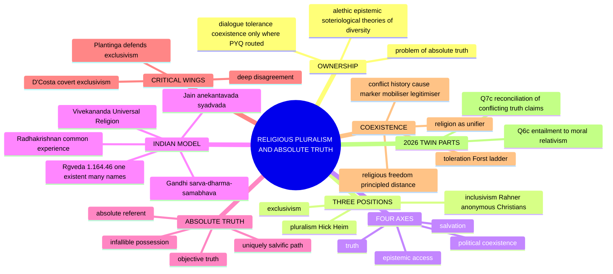

---

## 1. Identity, Lineage & Doxography

### 1.1 Ownership firewall ✅

| Owned here | Boundary (stays with another owner) |
|---|---|
| exclusivism, inclusivism, pluralism and particularist replies | full God-concepts → [Notions of God](../../upsc-ai-kit/knowledge/Philosophy/paper-2/philosophy-of-religion/Notions-of-God.md) |
| conflicting revelation and experience as diversity evidence | revelation authentication and experience-veridicality → their own owners |
| Hick's Real and conditioned manifestations | complete religious-experience and religious-language theories → those owners |
| tolerance, freedom and dialogue only where directly routed by PYQs | full secularism / multiculturalism and political rights → Socio-Political Philosophy |
| Indian many-sidedness, many-paths and equal-respect arguments | complete Jain, Vedānta and thinker doctrines → Paper I / other owners |
| missionary and identity costs of pluralist theories | descriptive history and evaluation of particular communities are outside scope |

> [!WARNING]
> Social tolerance, epistemic humility, alethic pluralism and soteriological pluralism are **different theses**. Peaceful coexistence neither proves that rival claims are true nor requires treating every religion as equally true. ⚠️

### 1.2 The three positions (E-I-P) ✅

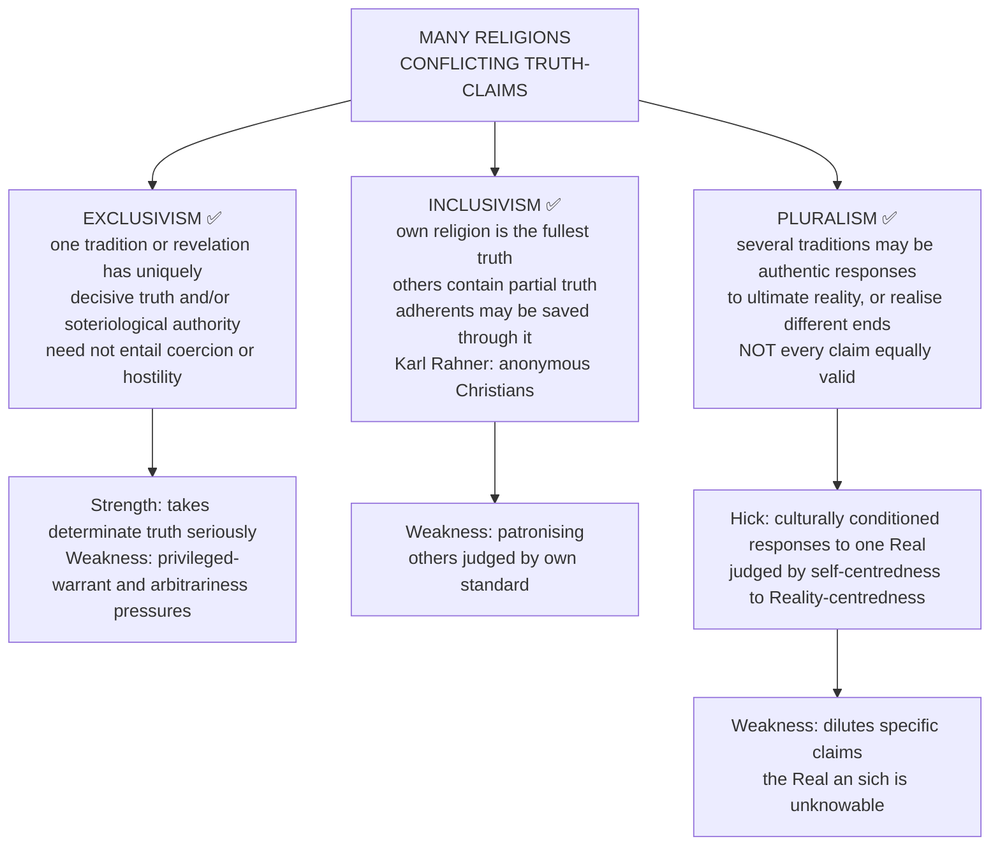

> [!TIP]
> **Mnemonic — E-I-P:** Exclusive (one norm), Inclusive (mine fulfils yours), Pluralist (several authentic paths / ends). Vivekananda offers a major Indian convergence model, but whether it is fully pluralist or neo-Vedāntically inclusivist **must be argued**. ✅/⚠️

- **Exclusivism ≠ intolerance.** An exclusivist may defend tolerance while denying equal truth. ✅
- **Inclusivism ≠ pluralism:** others are included on terms set by the privileged tradition. ✅

### 1.3 Doxography of positions and thinkers ✅/⚠️

| Thinker / tradition | Position | One-line content |
|---|---|---|
| **Cyprian of Carthage** (d. 258) | exclusivist tradition | standardly credited; own wording *salus extra ecclesiam non est* (*Epistle* 73) ⚠️ |
| **Karl Rahner** | inclusivism | "anonymous Christians" |
| **Alvin Plantinga** | exclusivism defended | "A Defense of Religious Exclusivism" |
| **John Hick** | identist pluralism | Copernican turn to the Real; *An Interpretation of Religion*; *God and the Universe of Faiths* |
| **S. Mark Heim** | differential pluralism | *Salvations: Truth and Difference in Religion* (1995); plural religious **ends** |
| **Raimon Panikkar, John Cobb** | pluralism by mutual transformation | dialogue changes both parties |
| **David Ray Griffin** | deep religious pluralism | process-based; plural ultimates (creativity, God, the cosmos) |
| **Gavin D'Costa** | critic of pluralism | pluralism is covert exclusivism |
| **Swami Vivekananda** | Universal Religion | valid paths for different temperaments; acceptance, not mere tolerance |
| **S. Radhakrishnan** | experiential unity | diverse interpretations of a common spiritual experience (*anubhava*) |
| **Gandhi** | equal respect + fallibilism | *sarva-dharma-samabhāva* |
| **Jainism** | many-sidedness | *anekāntavāda*, *nayavāda*, *syādvāda*, *saptabhaṅgī* |
| **Aśoka** | earliest verifiable state-level toleration argument | Rock Edict XII |
| **Akbar** | policy of *ṣulḥ-i kull* | *Ibādat Khāna* debates |

### 1.4 Source and quotation discipline ✅/⚠️

| Item | Status | Safe use |
|---|---|---|
| *Ekaṃ sad viprā bahudhā vadanti* | ✅ **Ṛgveda 1.164.46** (from the *asya vāmasya* riddle-hymn ascribed to Dīrghatamas) | Cite the reference, not "the Vedas". Its native subject is the **naming of Vedic deities** (Indra, Mitra, Varuṇa, Agni, the celestial Garutmān, Yama, Mātariśvan); its extension to inter-religious pluralism is a **nineteenth- and twentieth-century development** (Vivekananda, Radhakrishnan, Gandhi) and must be argued. Keep one transliteration form (*ekaṃ sat vipra bahudhā vadanti* is acceptable) |
| *Extra ecclesiam nulla salus* | ✅ later standard formula | Conciliar form in the medieval period (Lateran IV, 1215; *Unam Sanctam*, 1302; Council of Florence, 1442); Cyprian also writes one cannot have God as Father who does not have the Church as mother (*De Ecclesiae Catholicae Unitate* 6). **Vatican II** (*Lumen Gentium* 16, *Nostra Aetate*, 1965) moved the Roman Catholic position decisively toward inclusivism — citing the tag as the settled Christian view is a factual error |
| "Anonymous Christians" | ✅ Karl Rahner | standard inclusivist model |
| Hick's Real | ✅ "Transcategorial" is his own later term | |
| Aśoka's **Rock Edict XII** | ✅ verified inscription | do not disparage other sects; concord (*samavāya*) |
| *Ṣulḥ-i kull* | ✅ historical policy | not a philosophical doctrine — say so |
| Vivekananda, Chicago 1893 | ✅ Parliament of the World's Religions | "acceptance, not mere toleration" is his own emphasis |
| *Sarva-dharma-samabhāva* | ✅ modern formula | use as a summary of fallibilist equal respect, **not an unverified verbatim slogan** |
| Popper's paradox of tolerance | ✅ *The Open Society and Its Enemies*, note to ch. 7 | restricted to those who refuse rational argument and answer with violence |
| *Declaration Toward a Global Ethic* (1993) | ✅ Parliament of the World's Religions; drafted principally by Hans Küng | |
| Huntington's "clash of civilizations" | ⚠️ a thesis under sustained criticism | never cite as a finding |
| *Saptabhaṅgī* | ✅ seven-fold predication | a **logic of standpoints**, not the elephant parable |

---

## 2. Theory of Knowledge (Epistemology of Disagreement)

### 2.1 Four axes that must not be merged ⚠️

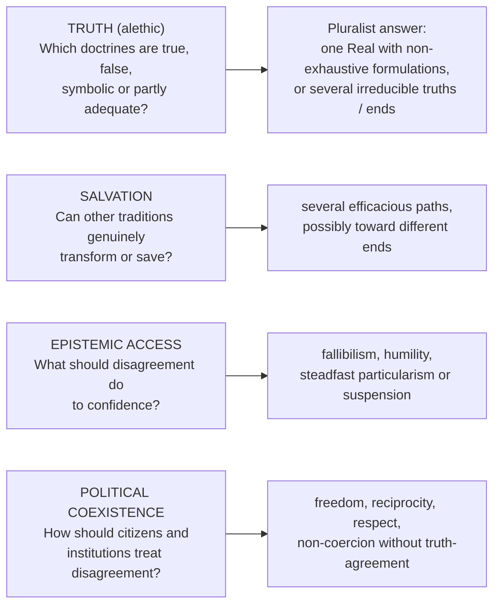

> [!WARNING]
> Pluralism **can** deny that all propositions are equally true, retain non-contradiction, and still reject one tradition's exhaustive monopoly. Conversely, tolerance can be defended by an exclusivist.

### 2.2 Peer disagreement ✅/⚠️

| Position | Thinkers | Claim |
|---|---|---|
| **Conciliationism / equal weight** | Richard Feldman, David Christensen | on discovering **peer** disagreement (an *epistemic peer* is roughly equal in evidence and reasoning ability) reduce confidence, often toward suspension |
| **Steadfastness** | Thomas Kelly; Peter van Inwagen ("it is not irrational to retain one's belief even when one cannot show the other is wrong") | one may retain one's belief, since one's own reasoning is part of one's evidence |
| **Independence principle** | — | assess the disagreement without relying on the reasoning under dispute; conciliationism needs it, steadfastness denies it |

### 2.3 Deep disagreement ✅/⚠️

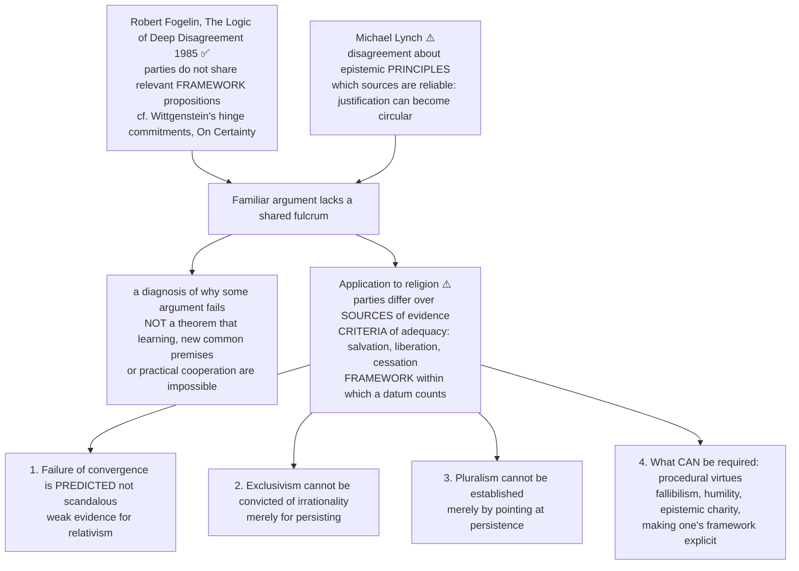

> [!TIP]
> **One-line control.** "Unresolvability is **epistemic**, not **alethic** — one party may still be right; what fails is our ability to demonstrate which."

### 2.4 The Indian epistemic resource: *anekāntavāda* as a derived conclusion ✅

*(from `Pramana-across-schools.md`; the owner gives the doctrine, the theme gives the derivation)*

1. Reality is ***ananta-dharmātmaka*** — every existent has infinitely many aspects.
2. Non-omniscient cognition is ***kṣāyopaśamika*** — it arises from partial destruction-cum-subsidence of knowledge-obscuring karma, so it is **constitutively partial**. Only ***kevala-jñāna*** grasps all aspects at once.
3. Every judgment short of omniscience is made *from a standpoint* — ***nayavāda***.
4. Absolutising such a standpoint is ***ekāntavāda*** (one-sidedness), which Jainism diagnoses as the shared error of all rival schools.
5. Every assertion must carry the operator ***syāt*** ("from a certain standpoint") — ***syādvāda / saptabhaṅgī***.

> [!TIP]
> *Jaina epistemology is the premise and anekāntavāda is the conclusion.* Syādvāda is not a logical gimmick; it is what a theory of partial, karmically-conditioned knowledge is obliged to say.

- **Framework-relativity marked inside the proposition:** *syāt* ("in a certain respect") makes standpoint explicit, so it is not left implicit — a genuine Indian contribution to the disagreement problem. ✅
- **Objection (Śaṃkara, and Rāmānuja after him):** a doctrine that qualifies every assertion cannot assert anything determinately, nor consistently assert itself. **Reply:** predicates are indexed to distinct standpoints (*dravya, kṣetra, kāla, bhāva* — substance, place, time, mode), so nothing is affirmed and denied *in the same respect*; syādvāda is applied reflexively to itself. ⚠️ **Residual force:** reflexive qualification looks like a loss of assertoric force.
- **Objection (hard contradictions):** some claims directly contradict on the same question. **Reply:** pluralism cannot dissolve every contradiction; it must distinguish literal conflict, symbolic language and different soteriological aims. ⚠️

### 2.5 A related framework-choice parallel ⚠️ *(from `Critiques-of-metaphysics.md`)*

Carnap's strongest version is not the meaninglessness verdict but the **Principle of Tolerance** (*Logical Syntax of Language*, 1934/1937, §17) and the **internal/external** distinction (1950): metaphysical disputes are **framework-choices misread as discoveries**. This explains irresolubility rather than merely condemning it. *Scope caution:* the theme applies this to metaphysical disputes, not to religious diversity; use only as a parallel for framework-relativity, and note that Quine dismantles it (see the Logical Positivism file).

---

## 3. Dialectical Wings & Sceptical Refinements

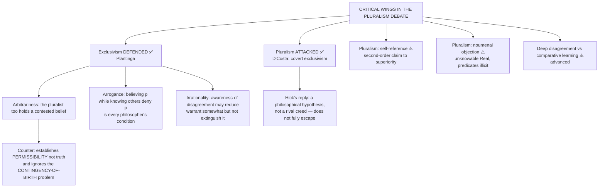

### 3.1 Plantinga's defence of exclusivism ✅

| Charge | Plantinga's reply |
|---|---|
| **Arbitrary** | the pluralist too holds a belief (no tradition is uniquely true) that the exclusivist rejects, so at the meta-level the pluralist is in exactly the same position |
| **Arrogant** | believing p while knowing others deny p is the ordinary condition of every philosopher, including the pluralist; if arrogance here, arrogance everywhere |
| **Irrational** | awareness of disagreement may reduce warrant somewhat but does not extinguish it |

⚠️ **Counter:** the reply establishes *permissibility*, not *truth*, and does not address the **contingency-of-birth** problem — one's tradition is overwhelmingly predicted by where one was born.

> [!WARNING]
> Do not present exclusivism only as bigotry. Plantinga's defence must be stated and then met with the contingency-of-birth objection. ⚠️

### 3.2 Hick's burdens ✅/⚠️

- **Noumenal objection:** if the Real is unknowable and beyond categories, even existence, causality and goodness appear illicitly predicated.
- **Self-referential / parity objection:** pluralism presents itself as a superior second-order account while criticising first-order superiority; exclusivists ask why Hick's meta-framework escapes the same contestability.
- **Identity / mission concern:** traditions may object that redescription as culturally limited appearances erases their self-understanding and weakens witness or mission. Dialogue requires hearing that objection, not declaring it solved.
- **D'Costa's charge** is the strongest single objection to Hick. ✅

### 3.3 Advanced debates (optional enrichment, §9 of the dossier) ⚠️

| Debate | Positions | Strongest extra objection → reply | Safe use |
|---|---|---|---|
| Hickian pluralism vs hard-incompatibility critique | Hick: valid responses to the Real; critics: contradictory truth-claims cannot all be true in the same sense | **Obj.:** the unknowable Real is too thin to ground determinate religions. **Reply:** a second-order hypothesis about transformation, not a new first-order creed, though revisionism remains a live charge | evaluative paragraph after E-I-P is laid out |
| Vedāntic universalism vs assimilation critique | Vivekananda and Radhakrishnan: converging paths; critics: absorbs others into a neo-Vedāntic frame | **Obj.:** "all paths" may covertly privilege Vedānta. **Reply:** convergence need not erase distinct practices, only deny monopoly over the Real | shows maturity in 2025-style answers |
| Deep disagreement vs comparative learning | traditions too conceptually different for neat synthesis vs disciplined mutual learning without forced sameness | **Obj.:** translation distorts self-understanding. **Reply:** comparison can preserve disagreement while identifying partial overlap, analogy or shared ethical stakes | one sentence in conclusion |
| *Anekāntavāda* vs relativism | standpoint-conditioned truth without "anything goes" | **Obj.:** if every claim is conditional, none has full authority. **Reply:** Jain logic regulates predication by standpoint and object-aspect; it disciplines absolutism rather than abolishing truth | Indian-context answers on absolute truth and conflict |

*What not to over-study (dossier):* comparative-religion sociology or global conflict commentary detached from philosophical positions. *Promotion trigger:* a future PYQ directly asking relativism, deep disagreement, or whether Vedāntic universalism is actually inclusivist — **the 2026 Q6(c) and the owner's §9.10–9.13 already carry the first two; the owner's §9.3 and the dossier row carry the third.**

---

## 4. Metaphysics & Ontology (what is ultimate; what is only a formulation)

### 4.1 Hick's Real ✅/⚠️

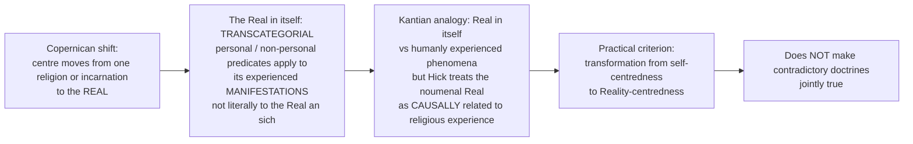

- **Argument (owner §9.2):** (1) diversity is persistent and often linked to birth context; (2) multiple traditions produce moral-spiritual transformation; (3) equal divine concern resists arbitrary exclusivism; (4) therefore one Real may be authentically experienced through different conceptual schemes. ✅
- **Presupposition ⚠️:** the Kantian appearance/reality distinction extends religiously; transformation is comparable across traditions.
- **Canonical example ✅:** the same ultimate experienced personally as God or non-personally as Absolute through different religious categories.

### 4.2 What is "absolute truth"? Four claims ⚠️ (2021 Q5(b), 2024 Q5(b), 2022 Q7(a))

| Distinction | Question to settle | Consequence |
|---|---|---|
| **Objective truth** | Is a proposition's truth independent of whether a group accepts it? | can hold without claiming any group has identified all true propositions |
| **An absolute referent** | Is there one unconditioned Reality, such as Brahman or Hick's Real? | ontological claim needing an argument; not interchangeable with an infallible description |
| **Infallible possession** | Can *my* scripture / interpretation exhaust truth without possible correction? | strong epistemic thesis, not entailed by objective truth or one ultimate |
| **Uniquely salvific path** | Does only one tradition bring liberation? | a further soteriological thesis, neither identical to nor proved by one referent |

> [!IMPORTANT]
> **Absolute truth without epistemic absolutism (owner §9.5):** one may affirm an absolute referent while denying that any finite formulation exhausts it. Ontological absolutism, epistemic fallibilism and political tolerance are **separate theses**. *Example:* nirguṇa Brahman as beyond exhaustive predication supports humility, while saguṇa forms structure real devotional paths. ✅/⚠️

### 4.3 Varieties of pluralism ✅

| Variety | One ultimate? | Content |
|---|---|---|
| Hick's identist | ✅ the Real | one Real, many culturally conditioned responses; soteriological test |
| Heim's differential | ❌ plural religious **ends** | communion, non-dual realisation and nirvāṇa are three destinations, not three descriptions of one; preserves self-understanding far better than Hick |
| Panikkar / Cobb | — | mutual transformation through dialogue |
| Griffin's deep religious pluralism | plural ultimates | creativity, God, the cosmos (process-based) |
| Vivekananda | ✅ Brahman / the divine | many valid paths; realisation |
| Radhakrishnan | ✅ spiritual Real | doctrinal interpretations of integral experience |
| Jain approach | ✅ many-sided reality | partial standpoints |

### 4.4 Indian ontological grounds ✅/⚠️

- **Advaita ground:** the one non-dual Brahman can support non-exhaustive formulations and multiple disciplines, but it does **not** follow without argument that traditions seeking personal communion, creator relation or cessation all have the same end. ⚠️
- **Nirguṇa / saguṇa** supplies a built-in **two-level semantics** (with *neti neti*) — see the parity bench in §8.2. ✅
- **Jain realism:** the aspects are *really in the object*; *syāt* is a **standpoint operator, not a third truth-value**; *avaktavya* is inexpressibility-in-one-utterance, not a truth-value gap (theme). ✅
- **Causation theme ✅:** *sadasatkāryavāda* is a **standpoint-relative realism** — a real substance bearing real successive modes → *anekāntavāda*, *nayavāda*, *syādvāda* — and a pluralist universe **with no creator**. (Do not confuse this metaphysical pluralism with religious pluralism.)

---

## 5. Rejection / Affirmation of Transcendent Realities

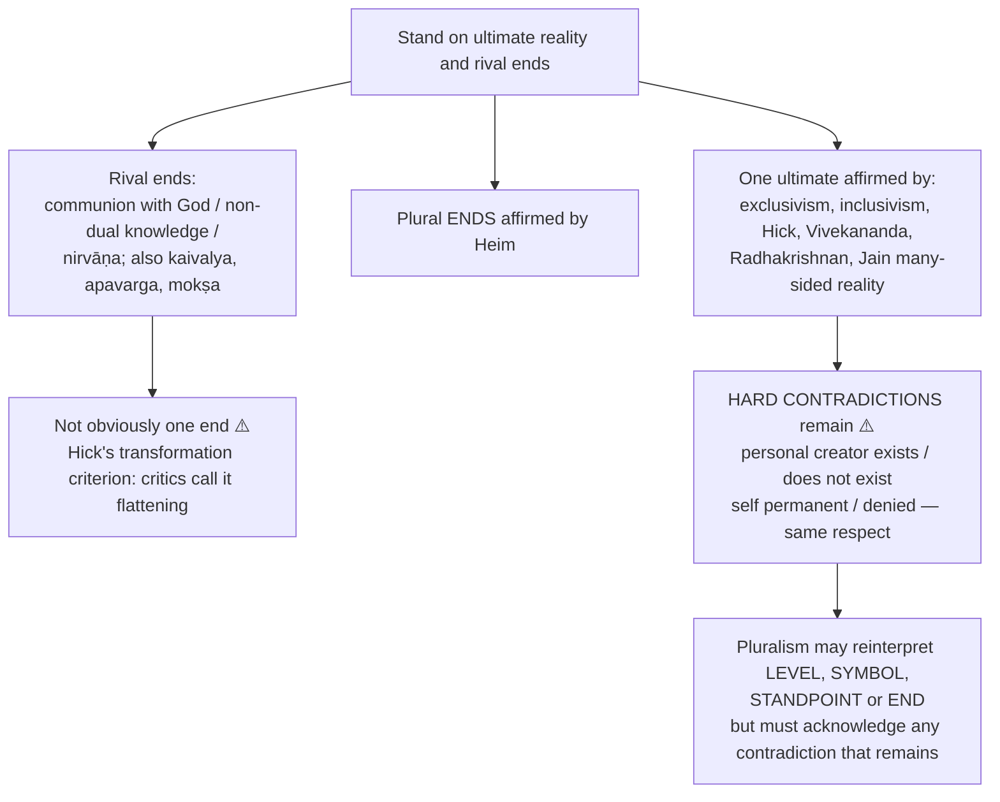

- **Hard-contradiction control ⚠️:** a personal creator cannot both exist and not exist in the same respect; the self cannot both be permanent and denied in the same sense. Different practices, images or ends are not automatically contradictions.
- **Sorting rule (owner §9.13):** ask whether rival claims are **literal factual assertions, analogies/symbols, standpoint-qualified predications, or different soteriological goals**. The mere existence of many traditions neither proves nor dissolves a contradiction. ⚠️
- **Salvific ends table (owner §6A):** Western resource — communion with God; Indian — *mokṣa, kaivalya, nirvāṇa, apavarga*. Heim's differential pluralism fits the Indian plurality better than Hick's. ⚠️
- **Vivekananda / Advaita limit:** a non-Vedāntin need not accept that her unique creator or distinct liberation goal is merely a path to Brahman. ⚠️
- **Agnosticism about identification is a live option**, not a disguised proof of pluralism: if we know only finite interpretations, how can a determinate Absolute be asserted? The Vedāntin may claim partial experience or disciplined negation; Hick may appeal to best-explanation; neither evades saying why *this* ultimate rather than another. ⚠️

---

## 6. Explanatory & Causal Principles

### 6.1 Is the history of religions the history of conflicts? (2020 Q5(c)) ⚠️

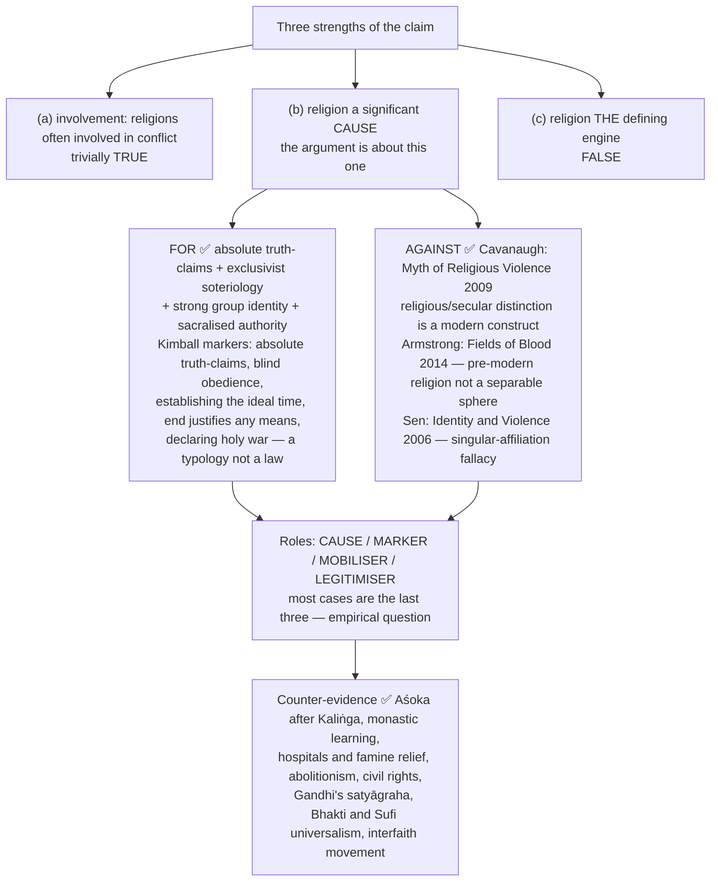

**Verdict:** "historically selective and conceptually confused" — selective because it counts conflict and not the reconciliation, charity and reform the same traditions produced; confused because "religion" is not a stable independent variable separable from politics, land and identity. **What is true is narrower:** exclusivist certainty joined to singular identity is dangerous. ⚠️

### 6.2 Is religion a uniting force in a globalising world? (2019 Q5(b)) ⚠️

| For ✅ | Against ⚠️ |
|---|---|
| Durkheim: integrative function, "collective effervescence", a *church* as moral community | Durkheim's integration is **in-group**: the same mechanism that unites also demarcates |
| universalist resources: *vasudhaiva kuṭumbakam*, Buddhist *brahmavihāras*, the image of God — possibility, not proof of equal standing | Huntington's clash thesis (heavily criticised by Sen and others for homogenising civilisations) |
| 1893 Parliament of the World's Religions; 1993 *Declaration Toward a Global Ethic* (Küng: no peace among nations without peace among religions, none among religions without dialogue) | globalisation **deterritorialises** religion — cosmopolitan and reactive-fundamentalist forms (Olivier Roy) |
| transnational relief and diaspora networks | religious identity instrumentalised by electoral and geopolitical actors |

**Synthesis — three conditions:** religion unites when (1) its ethics are **universalist** in scope, (2) its epistemology is **fallibilist** enough for dialogue, (3) its identity-function is **not politically monopolised**. *Verdict:* a **high-amplitude** force, not an intrinsically unifying one. ⚠️

### 6.3 Does pluralism cause conflict or destroy religious truth? (2023 Q8(b)) ⚠️

- **Two separate charges:** (i) inter-religious conflict; (ii) destruction of truth.
- **Reply to (ii):** pluralism need not deny truth — it **relocates** absoluteness in the transcendent Real and treats religions as culturally conditioned but genuine responses; coexistence need not mean "anything goes." ✅/⚠️
- **Reply to (i):** conflict is not caused by plurality alone; **power, identity and exclusivist certainty mediate it**; pluralism may relativise commitment, so test both charges. ⚠️

---

## 7. Ethics & Human Goals (toleration, freedom, moral relativism)

*(The source gives no puruṣārtha scheme for this topic; this module carries the coexistence ethics and the moral-relativism test.)*

### 7.1 Toleration: concept and paradox (2020 Q5(e)) ✅/⚠️

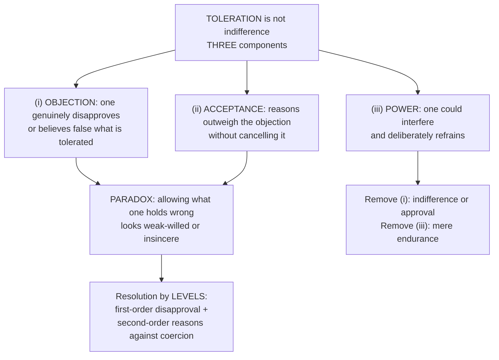

**Forst's four conceptions** (*Toleration in Conflict*) ✅

| Rung | Conception | Content |
|---|---|---|
| 1 | **Permission** | the powerful permit a minority to exist on sufferance |
| 2 | **Coexistence** | mutual, pragmatic, a modus vivendi to avoid conflict |
| 3 | **Respect** | reciprocal recognition as equal moral-political persons despite deep ethical disagreement |
| 4 | **Esteem** | positively valuing the other's beliefs as containing something worthwhile |

Only (3) and (4) are compatible with equal citizenship; (1) is what most historical "tolerance" actually was. ⚠️

| Western argument-stock ✅ | Indian argument-stock ✅ |
|---|---|
| **Locke** (*A Letter Concerning Toleration*, 1689): the magistrate has no commission over souls; **force cannot produce belief**, only profession; even if it could, coerced conformity would not save | **Aśoka's Rock Edict XII:** do not honour your own sect while disparaging others; whoever does so out of devotion to his sect injures his own sect more gravely; commends concord (*samavāya*) and listening to one another's dharma |
| **Mill** (*On Liberty*, 1859): harm principle; suppression robs us of truth or "the clearer perception of truth produced by its collision with error" | **Akbar's *ṣulḥ-i kull*** and the *Ibādat Khāna* debates |
| **Popper's paradox of tolerance:** a tolerant society must retain the right to refuse the intolerant — reserved for those who refuse rational argument and answer with violence | **Gandhi's *sarva-dharma-samabhāva*:** equal respect + fallibilism |
| **Rawls:** overlapping consensus on political principles | **Vivekananda (1893):** demands **acceptance, not merely toleration** — "toleration" still condescends |
| | **Jain *anekāntavāda*:** an epistemic resource; alone not a proof of political toleration. Constitutional expression: Articles 25–28 |

- **Objections ⚠️:** (1) toleration is second-best — respect and esteem are what a plural society needs, and toleration keeps the tolerator as judge → *reply:* correct about level 1, but the objection component makes toleration a **moral achievement** rather than indifference. (2) unlimited toleration is self-destructive (Popper) → *reply:* limits drawn by **harm and reciprocity**, not doctrinal content.
- **Verdict:** "Toleration is indispensable but insufficient. Indispensable because of the objection component; insufficient because of the power component — tolerance granted by the strong to the weak is permission, not equality." ⚠️

### 7.2 Religious freedom in a multireligious society (2021 Q5(c)) ✅/⚠️

| Bundle of rights ✅ |
|---|
| **conscience** (inner forum — inviolable) · **profess** · **practise** · **propagate** · **change or leave** · **freedom from** compelled observance · **associational** right of communities to order internal affairs |

- **Why defensible ✅:** (1) Locke's incoercibility; (2) autonomy in matters of ultimate concern; (3) epistemic — deep disagreement and fallibility; (4) social — enforced uniformity causes conflict.
- **Hard problems ⚠️:**
  1. **Practice / belief asymmetry** — inner forum strongest; practice can harm; Article 25 is subject to **public order, morality and health** (a jurisdiction-specific formula).
  2. **Propagation and conversion** — the principled line is **coercion and fraud**, not persuasion as such.
  3. **Internal minorities — Shachar's "paradox of multicultural vulnerability":** group rights can entrench dominant members' power over weaker members, typically women. *The single most examinable tension.*
  4. **State neutrality** — wall of separation vs **Bhargava's principled distance** (differential engagement guided by freedom and equality; permits reform such as temple-entry and abolition of untouchability).
  5. **"Essential religious practices" doctrine** — makes the state an arbiter of theology; note the tension, do not litigate cases.
- **Verdict:** possible, and more nearly *necessary* in a plural society; not possible is an unlimited or perfectly neutral version. The defensible position is **principled distance** with internal minorities treated as a standing cost. ⚠️

### 7.3 Pluralism and moral relativism: the entailment test (2026 Q6(c)) ✅/⚠️

> [!IMPORTANT]
> The printed word **"necessarily"** is decisive: test an *entailment*, do not merely describe pluralism.

| Dimension | Claim | Distinct question |
|---|---|---|
| **Religious pluralism** | several traditions may offer genuine paths, truths or encounters; Hick and Heim disagree about whether the end is one | which religious claims or paths are valid, and in what respect? |
| **Epistemic fallibilism** | no one holds an error-proof account of ultimate reality | who can know, and with what confidence? |
| **Moral relativism** | moral truth is constituted by the community's or framework's endorsement | is there a standard to criticise a harmful practice across traditions? |
| **Moral pluralism** | multiple objective goods or duties may conflict without a single algorithm | can genuine disagreement occur while some actions remain wrong? |

- **Countermodel — Hick ✅:** transformation from self-centredness to Reality-centredness lets one criticise egocentrism in **any** tradition by one standard. *Contested:* traditions may differ on its meaning; an individual's transformation does not vindicate a tradition's every institution.
- **Countermodel — Gandhi and Jain many-sidedness ✅:** equal respect joined to Truth and *ahiṃsā* and to the claim that religions contain error; *syādvāda* qualifies by standpoint without licensing "anything is right if locally approved." Shows the **logical possibility**, not that every tradition accepts that standard.
- **Strong objection ⚠️:** if a pluralist calls incompatible harmful and non-harmful prescriptions equally valid, moral criticism is lost; Heim's several ends yield no shared ethical rule. **Reply:** equal civic standing, possible efficacy of distinct paths and equality of *all* commands are different propositions; a pluralist must specify and defend a moral minimum.
- **Verdict:** **no entailment**; whether a particular pluralist theory can criticise an oppressive practice is a further substantive test. Moral grounds in full belong to Religion and Morality. ⚠️

---

## 8. Inter-School Comparative Matrices

### 8.1 Comparison of models ✅/⚠️

| Model | One ultimate? | Status of traditions | Criterion | Main objection |
|---|---|---|---|---|
| Exclusivism | ✅ yes | one uniquely true | revelation / orthodoxy | arbitrariness / intolerance |
| Inclusivism | ✅ yes | others partial / fulfilled | home-tradition norm | patronising assimilation |
| Hick | ✅ the Real | plural authentic responses | soteriological transformation | empty Real / revisionism |
| Vivekananda | ✅ Brahman / divine | many valid paths | realisation | neo-Vedāntic assimilation |
| Radhakrishnan | ✅ spiritual Real | doctrinal interpretations | integral experience | perennialist reduction |
| Jain approach | ✅ many-sided reality | partial standpoints | conditional predication | hard contradictions remain |
| Heim | ❌ plural **ends** | each attains its own real end | fidelity to self-understanding | gives up a single ultimate |
| Plantinga | ✅ yes | one uniquely true | warrant, not neutrality | contingency of birth |
| D'Costa | — | pluralism is covert exclusivism | self-consistency | diagnostic, not constructive |

Owner's shorter grid (§4): Exclusivism — one decisive truth or path, others may contain partial truths (Plantinga; qualified theological models); Hick — potentially authentic transformative responses to the Real, **not equally true propositions**; Vedāntic convergence — paths potentially converge on a **defended Vedāntic reading** (Vivekananda, Radhakrishnan); Anekāntavāda — qualified claims from limited standpoints, **not every claim automatically true**.

### 8.2 Parity bench — Indian and Western resources for the same problems ⚠️

| Problem | Western resource | Indian resource | Discriminating point |
|---|---|---|---|
| Rival truth-claims | Hick's transcategorial Real; Heim's plural ends | *Ekaṃ sad… bahudhā vadanti* (RV 1.164.46); Vivekananda's paths | The Vedic verse is about **names of deities**; the pluralist extension is modern |
| Framework-relativity of judgement | Fogelin's deep disagreement; Wittgenstein's hinges | *Anekāntavāda*, *nayavāda*, *syādvāda* | Jainism marks standpoint-relativity **inside** the proposition |
| Grounds of toleration | Locke (incoercibility), Mill (harm, epistemic), Rawls (overlapping consensus) | Aśoka RE XII; Akbar's *ṣulḥ-i kull*; Gandhi's *sarva-dharma-samabhāva* | Aśoka's is the earliest verifiable state-level argument |
| Tolerance vs acceptance | Forst's four conceptions | Vivekananda's explicit demand for **acceptance** over tolerance | Same conclusion by different routes |
| Ultimate reality vs its descriptions | Nirguṇa / apophatic theology; Hick's Real | Nirguṇa / saguṇa two levels; *neti neti* | Advaita has a **built-in** two-level semantics |
| Salvific ends | Communion with God | Mokṣa, kaivalya, nirvāṇa, apavarga | Heim's differential pluralism fits Indian plurality better than Hick's |

### 8.3 Vedāntic / Indian model in detail (2025 Q7(a)) ✅/⚠️

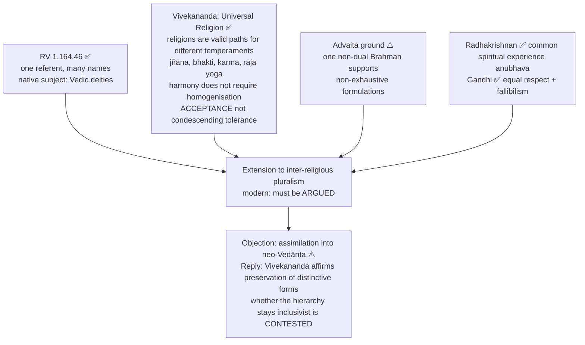

> [!WARNING]
> "All religions say the same thing" is **not** a safe formulation. The model may still be inclusivist if Vedānta supplies the final meta-framework or hierarchy.

---

## 9. Criticisms & Reconstructed Replies

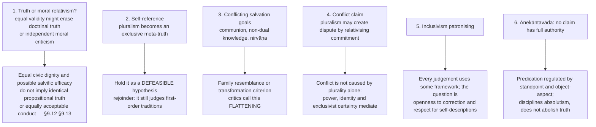

### 9.1 Reconciliation test (2026 Q7(c)) ✅/⚠️

1. **Specify a same-respect contradiction** (creator / no creator; permanent self / no permanent self).
2. **Hick's reconciliation in steps ✅:** (1) experience is conceptually shaped; (2) traditions give personal and non-personal phenomenological accounts; (3) posit the **Real in itself**, beyond such predicates, as shared source; (4) recognise several authentic culturally mediated paths, tested by transformation. ⚠️ This reconciles some *claims about contact with ultimacy*; it does **not** make "a personal creator exists" and "no personal creator exists" both literally true in the same respect — a first-order claim is **reinterpreted as concerning a manifestation**. *Objection:* the noumenal Real and common source are contestable; D'Costa's charge and the Real's causal unknowability remain.
3. **Indian alternatives, with boundaries ✅:** RV 1.164.46 names several **Vedic deities**; extending it to today's rival religions needs argument. Vivekananda unites disciplines under a Vedāntic end, but a non-Vedāntin need not accept it. Jain *anekāntavāda* resolves **apparent** contradictions if the standpoints really differ; "in respect A, p" and "in respect B, not-p" leaves a genuine same-respect contradiction unresolved.
4. **Heim ✅:** distinct salvific ends can be authentic *without* pretending communion and nirvāṇa describe one destination; costs a unified answer on whether contradictory **world-descriptions** can both be correct. Dialogue / mutual transformation can sustain cooperation even when reconciliation of propositions is unavailable.
5. **Remainder ⚠️:** some claims can be **qualified**, some **reinterpreted at a cost**, some must remain **incompatible** pending reasons. Political toleration is possible in all three cases and is not evidence that every doctrine is true.

---

## 10. Controlled Western Comparisons

| Comparator | Point of contact | Decisive disanalogy / guardrail |
|---|---|---|
| **Hick vs Kant** | appearance / reality distinction extended religiously | Hick treats the noumenal Real as **causally related** to religious experience (so noumenal objection: existence, causality, goodness illicitly predicated) |
| **Jain *anekāntavāda* vs perspectivism (Nietzsche) and many-valued logic** *(theme)* | many standpoints | Jainism is **realist** — aspects really in the object; perspectivism is typically anti-realist; *syāt* is a standpoint operator, **not** a third truth-value; *avaktavya* is inexpressibility in one utterance, not a truth-value gap |
| **Locke, Mill, Rawls, Popper** | grounds of toleration | Locke: incoercibility of belief; Mill: harm + epistemic; Rawls: overlapping consensus; Popper: limit restricted to those who answer argument with violence |
| **Forst** | the four-rung ladder | Vivekananda reaches "acceptance over tolerance" by a different route |
| **Fogelin / Wittgenstein's hinges** | deep disagreement | Jainism marks standpoint **inside** the proposition |
| **Carnap's Principle of Tolerance** *(theme)* | disputes as framework-choices | applies to metaphysics, not religious diversity; Quine dismantles it |
| **Durkheim / Huntington / Cavanaugh / Armstrong / Sen** | religion and social cohesion or conflict | Huntington is a thesis under sustained criticism; Cavanaugh and Sen dismantle "religion" as an isolable variable |

> [!WARNING]
> Western parallels are analogies, not historical influences. The pairings are those the owner file and the themes give; no further comparison is introduced here. ⚠️

---

## 11. Diagnostic Deep-Dives for High-Frequency Themes

### 11.1 Absolute truth and exclusivism (2021 Q5(b), 2022 Q7(a), 2024 Q5(b)) ⚠️

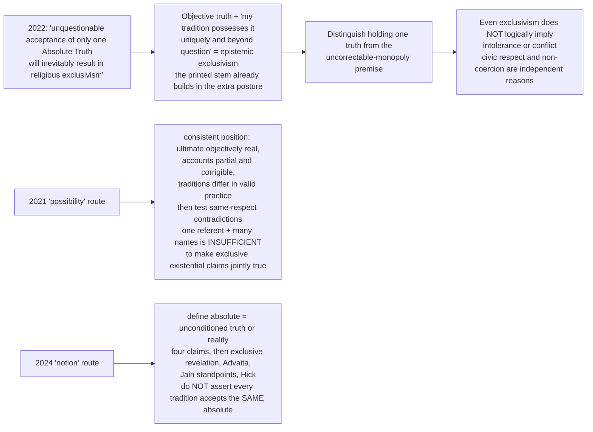

> [!TIP]
> **High-scoring line:** belief in an Absolute (Real / Brahman) is compatible with pluralism if truth-claims are held as *partial and perspectival* — this defuses the chain "absolute truth → exclusivism → conflict".

### 11.2 "Truth is one, yet people perceive differently" in the present Indian context (2018 Q6(b)) ⚠️

- **Text before extension ✅:** RV 1.164.46 concerns Vedic deities; Jain *naya* and *syāt* formalise perspectival qualification; Vivekananda's acceptance and Gandhi's equal regard extend a normative argument across communities. Distinguish *one metaphysical referent*, *many true facets*, and *equal civic rights* — the first does not establish the other two without added reasons.
- **Indian application ✅:** the Constitution's freedom of conscience and profession / practice / propagation (**Article 25**, subject to public order, morality and health) gives **equal legal standing** despite different ultimate claims; Aśoka's Rock Edict XII supplies the older dialogical ideal of listening and restraint in disparagement. Neither asserts that contradictory doctrines are simultaneously true. Tension remains between collective autonomy and internal dissent (§7.2).
- **Critical evaluation ⚠️:** an exclusivist who denies shared metaphysics can still accept civic equality; a Vedāntic pluralist can affirm one Truth while inadvertently subordinating another tradition's self-description; a sincere believer may reject a common destination and still converse without coercion. The maxim is most persuasive as a **fallibilist discipline and civic ethic**; as a universal metaphysical identity thesis it needs an argument and must confront creator/non-creator and self/no-self conflicts.

### 11.3 The central problem between pluralists and exclusivists (2019 Q7(a)) ⚠️

Route: owner §9.1 + §9.11 + §9.10. **Name the central problem in one sentence** (rival truth-claims with no shared fulcrum to settle them: is exclusivism rationally permissible, and is pluralism a covert exclusivism?), then unfold: Plantinga's defence and the contingency-of-birth counter; D'Costa's charge; deep disagreement as the reason convergence fails; the four pluralism varieties; the procedural virtues. *Verdict:* "The E-I-P triad is a map, not a verdict. Exclusivism is rationally permissible but epistemically uncomfortable; inclusivism is generous but judges others in terms they do not accept; and 'pluralism' names at least four positions, of which Hick's is the most exposed to D'Costa's charge and Heim's the most respectful of the traditions' own self-descriptions."

### 11.4 The 2026 twin parts: do not write the same answer twice ⚠️

| | **Q6(c) — entailment to moral relativism** | **Q7(c) — reconciliation of conflicting truth claims** |
|---|---|---|
| Spine | define religious pluralism vs moral relativism → formal necessity test → Hick's shared criterion → Gandhi / Jain countermodel → harmful-practice objection → separate religious status, equal citizenship and moral correctness | state a same-respect contradiction → Hick's Real / manifestations → test revisionary cost → compare Vedāntic, Jain and Heim → distinguish reconciliation of experience, salvation, propositions and coexistence |
| Verdict | **no necessary entailment**; a given theory still owes moral reasons | **partial reconciliation only**; literal incompatibilities can remain |
| Trap | substituting a truth-pluralism defence for the relativism test | declaring creator and no-creator both true in the same respect |

---

## 12. PYQ Routing Ledger (2018–2025; 2026 supplement)

> **Corpus signal:** 12 primary-owned parts in 2018–2025 (per year 2/2/2/2/1/1/1/1, out of 112) plus **2** in 2026 = **14** primary-owned parts. Cross-links do not create duplicate ownership.

| Year | Q | Marks | Exact demand | Map to |
|---|---|---:|---|---|
| 2018 | Q6(a) | 20 | Distinguish between Exclusivism, Inclusivism and Pluralism with regard to the conflicting truth-claims of different religions. | §1.2, §8.1 |
| 2018 | Q6(b) | 15 | "Truth is one, yet people perceive differently." Critically evaluate by considering the present Indian context. | §11.2, §8.3 |
| 2019 | Q5(b) | 10 | Is religion a uniting force for humanity in the globalizing world as of today? Discuss. | §6.2 |
| 2019 | Q7(a) | 20 | Expound and explain the central problem in the discussion between religious pluralists and religious exclusivists. | §11.3, §3, §2.3 |
| 2020 | Q5(c) | 10 | Is it acceptable that the History of Religions is the History of Conflicts? Discuss. | §6.1 |
| 2020 | Q5(e) | 10 | What is the importance of religious tolerance in a multicultural pluralistic society? Justify your answer. | §7.1 |
| 2021 | Q5(b) | 10 | Discuss the possibility of Absolute Truth in the context of religious pluralism. | §4.2, §11.1 |
| 2021 | Q5(c) | 10 | Is religious freedom possible in a multireligious society? Explain. | §7.2 |
| 2022 | Q7(a) | 20 | "An unquestionable acceptance of only one Absolute Truth will inevitably result in religious exclusivism." Discuss. | §11.1 |
| 2023 | Q8(b) | 15 | Does religious pluralism invite inter-religious conflicts and destroy the truth of religion? Discuss. | §6.3 |
| 2024 | Q5(b) | 10 | Write a note on the notion of absolute truth in the context of religion. | §4.2, §11.1 |
| 2025 | Q7(a) | 20 | How does the Vedāntic view of Religious Pluralism address the conflicting truth claims of different faiths? Answer with reference to Swami Vivekananda's view of Universal Religion. | §8.3 |
| **2026** | **Q6(c)** | **15** | Does the idea of Religious Pluralism necessarily entail moral relativism? Critically discuss. | §7.3, §11.4 |
| **2026** | **Q7(c)** | **15** | Can conflicting truth claims among religions be reconciled within the framework of religious pluralism? Critically discuss. | §9.1, §11.4 |

**Count check:** 12 (2018–2025) + 2 (2026) = **14** primary-owned parts; matches the owner file's "14 in the continuous 2018–2026 corpus", its 12-of-112 count, the 2018–2025 bank table (Religious Pluralism 2/2/2/2/1/1/1/1 = 12) and the 2026 supplement (Religious Pluralism: 2 — Q6(c), Q7(c)).

**Boundary notes (not counted):** 2026 **Q8(a)** (Gandhi, "God is Truth" → "Truth is God"; owned by Religion and Morality) — the supplement draws the boundary that *sarva-dharma-samabhāva* as an equal-respect thesis is Religious Pluralism while Truth-as-*sat* metaphysics is Notions of God. 2026 **Q5(e)** (Reason, Revelation and Faith) — the supplement lets this answer cross-link to Religious Pluralism "only if the answer needs the diversity-of-experience point". No cross-owned *question* is routed to this owner in the 2018–2025 bank. The owner file has no pre-2018 table.

---

## 13. Top 10 UPSC Exam Traps

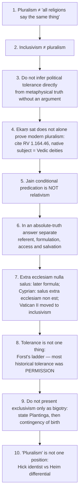

**Remaining recorded traps (owner §12):**

11. Popper's paradox is not a general licence to suppress — it targets those who refuse rational argument and answer with violence.
12. Religious freedom ≠ state indifference: contrast wall of separation with **Bhargava's principled distance**, and raise **internal minorities** (Shachar).
13. Do not answer the conflict-history question with a list of wars: distinguish **cause / marker / mobiliser / legitimiser**; cite Cavanaugh and Sen.
14. Cite **Huntington** as a thesis under sustained criticism, not a finding.
15. Do not say religious disagreement is "just relativism": Fogelin — unresolvability is *epistemic*, not *alethic*.
16. **2026 Q6(c):** do not substitute a defence of truth-pluralism for the requested **moral-relativism** entailment test; Hick's transformation criterion is an arguable countermodel, not a solved universal ethics.
17. **2026 Q7(c):** do not declare creator and no-creator claims both true in the **same respect**: distinguish qualified standpoint, revisionary reinterpretation and genuinely different ends.
18. *Ṣulḥ-i kull* is a historical policy, not a philosophical doctrine; *sarva-dharma-samabhāva* is a modern summary formula, not an unverified verbatim slogan.

---

## 14. Technical Vocabulary & IAST Bank

| English gloss | Term | Meaning | Status |
|---|---|---|---|
| exclusivism / inclusivism / pluralism | — | the E-I-P triad | ✅ |
| "outside the Church there is no salvation" | *extra ecclesiam nulla salus* | later standard formula; Cyprian: *salus extra ecclesiam non est* | ✅ |
| anonymous Christians | — | Rahner's inclusivist model | ✅ |
| the Real | — | Hick's transcategorial ultimate | ✅ |
| Copernican turn | — | centre shifts from one religion to the Real | ✅ |
| differential pluralism | — | Heim: plural religious ends | ✅ |
| deep religious pluralism | — | Griffin: plural ultimates | ✅ |
| the one existent the wise speak of in many ways | *ekaṃ sad viprā bahudhā vadanti* | RV 1.164.46 | ✅ |
| universal peace / reconciliation | *ṣulḥ-i kull* | Akbar's policy | ✅ |
| equal respect for all religions | *sarva-dharma-samabhāva* | Gandhi; modern summary formula | ✅/⚠️ |
| concord | *samavāya* | Aśoka RE XII | ✅ |
| many-sidedness | *anekāntavāda* | reality is many-sided | ✅ |
| standpoint doctrine | *nayavāda* | judgements from standpoints | ✅ |
| conditional predication | *syādvāda*; *saptabhaṅgī* | "in a certain respect" (*syāt*); seven-fold predication | ✅ |
| infinitely many aspects | *ananta-dharmātmaka* | Jain account of an existent | ✅ |
| partial-subsidence cognition | *kṣāyopaśamika* | non-omniscient knowledge | ✅ |
| omniscience | *kevala-jñāna* | grasps all aspects at once | ✅ |
| one-sidedness | *ekāntavāda* | absolutising a standpoint | ✅ |
| inexpressible | *avaktavya* | inexpressible in one utterance | ✅ |
| substance, place, time, mode | *dravya, kṣetra, kāla, bhāva* | indices of a standpoint | ✅ |
| attributeless / with attributes | *nirguṇa* / *saguṇa* | two-level semantics | ✅ |
| "not this, not this" | *neti neti* | apophatic strategy | ✅ |
| experience | *anubhava* | Radhakrishnan's common spiritual experience | ✅ |
| toleration (objection / acceptance / power) | — | three components | ✅ |
| paradox of toleration; paradox of tolerance | — | Popper restricts it | ✅ |
| permission / coexistence / respect / esteem | — | Forst's four conceptions | ✅ |
| overlapping consensus | — | Rawls | ✅ |
| principled distance | — | Bhargava's Indian secularism model | ✅ |
| paradox of multicultural vulnerability | — | Shachar: internal minorities | ✅ |
| essential religious practices | — | doctrine making the state an arbiter of theology | ⚠️ |
| cause / marker / mobiliser / legitimiser | — | roles of religion in conflict | ⚠️ |
| myth of religious violence | — | Cavanaugh | ✅ |
| singular-affiliation fallacy | — | Sen | ✅ |
| collective effervescence | — | Durkheim | ✅ |
| clash of civilizations | — | Huntington; thesis under criticism | ⚠️ |
| epistemic peer; conciliationism; steadfastness; independence principle | — | peer-disagreement vocabulary | ✅ |
| deep disagreement; framework / hinge propositions | — | Fogelin; Wittgenstein | ✅ |
| perennialism | — | reduction risk of Radhakrishnan's model | ⚠️ |

---

## 15. Graded Verdict & Answer Architectures

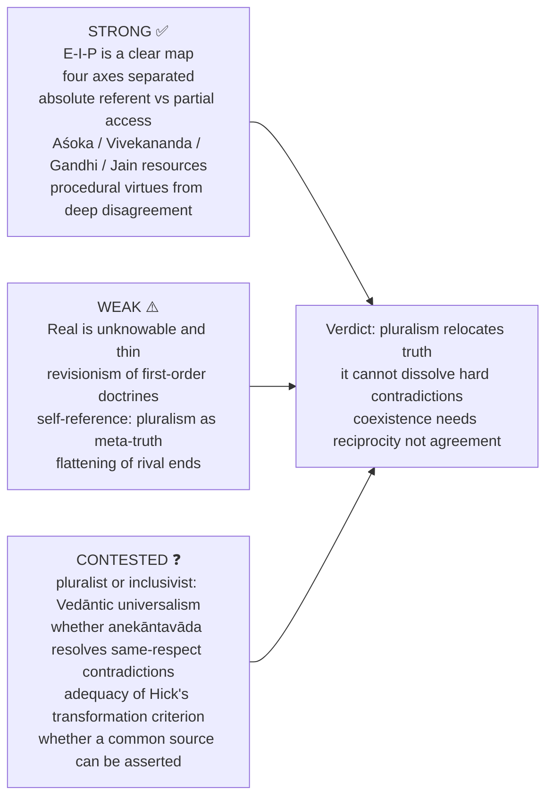

### 15.1 Graded verdict ladder ⚠️

| Band | What the script contains | Typical fault |
|---|---|---|
| **Weak (≈40%)** | "All religions lead to the same God"; E-I-P named | pluralism confused with "all religions say the same thing" |
| **Average (≈50%)** | E-I-P correctly distinguished; Hick and Vivekananda | exclusivism only as bigotry; no attribution discipline |
| **Good (≈60%)** | truth / salvation / access / coexistence separated; one objection answered | "pluralism" treated as a single position; conflict answered by anecdote |
| **Strong (≈65–70%)** | Plantinga's defence stated and met; RV 1.164.46 and Cyprian handled correctly; *anekāntavāda* used as a logic, not a parable | deep-disagreement layer absent |
| **Top (≈70%+)** | all the above + a discriminating distinction (Forst's ladder; Heim vs Hick; D'Costa's charge; epistemic vs alethic unresolvability) + explicit acknowledgement of hard contradictions pluralism cannot dissolve | — |

### 15.2 10-mark

```text
Define absolute truth / pluralism → one model → distinguish referent from access →
one objection → non-relativist verdict.
```
**Anchor:** "Pluralism need not deny absolute reality; it denies exhaustive possession of it by a finite perspective."

### 15.3 15-mark

```text
E-I-P classification → chosen thinker's argument and presupposition →
Indian / Western comparator → conflict / relativism objection and reply.
```
**Anchor:** "Hard contradiction must be routed, not rhetorically harmonised."

### 15.4 20-mark

```text
Frame conflicting truth-claims → strongest pluralist model →
absolute referent versus conditioned formulations → hard contradictions →
two objections / replies → graded conclusion on truth and coexistence.
```
**Anchor:** "Pluralism does not destroy religious truth; it relocates it. What it cannot do is dissolve hard contradictions — a personal creator either exists or does not — and a pluralism that pretends otherwise is rhetoric, not philosophy."

### 15.5 Graded-verdict templates ⚠️

- *Absolute-truth stem:* "Ontological unity does not itself entail an incorrigible human monopoly. The printed 2022 stem adds 'unquestionable acceptance of only one': ask whether it applies to objective reality or to a claimed exhaustive interpretation; the two readings have different consequences."
- *Coexistence stem:* "Political coexistence does not require agreement about truth, and does not follow from it either. It requires reciprocity, harm-limitation and the procedural virtues that deep disagreement makes obligatory."
- *Toleration:* "Toleration granted by the strong to the weak is permission, not equality."
- *Conflict:* "Religion is a high-amplitude social force whose direction is set by the scope of its ethics and the politics of its identity."
- *Deep disagreement:* "Unresolvability is epistemic, not alethic — deep disagreement explains persistence without vindicating any party."

### 15.6 PYQ-mapped skeletons ⚠️

**2025 Q7(a) — Vedāntic pluralism (20).** Intro: many religions, rival truth-claims → B1: E-I-P triad, locate Vedānta as pluralist → B2: RV 1.164.46's Vedic context and argued modern extension; Vivekananda — valid paths suited to temperaments, Vedāntic ground, acceptance not tolerance → Assess: vs Hick's transcategorial Real; objections to assimilating distinct ends and literal contradictions into Brahman; anekāntavāda handles only qualified standpoints → Conclude: a convergence proposal can support dialogue but does not make incompatible same-respect propositions jointly true or command another's assent.

**2022 Q7(a) — absolute truth → exclusivism (20).** Intro: does believing in absolute truth force exclusivism and conflict? → Body: if "absolute truth" = my propositions only → yes; but an absolute **referent** with partial **access** (anekāntavāda, Hick) breaks the link → Assess: the printed "unquestionable acceptance of only one" adds incorrigibility — test whether it attaches to Reality or to a unique exhaustive human formulation; even an exclusivist can respect others' freedom; humility alone cannot settle disagreement → Conclude: one can affirm an objective ultimate and plural access; a claimed infallible monopoly favours exclusivism but neither absolute truth nor exclusivism entails conflict.

**2020 Q5(e) — tolerance (10).** Define by the three components → paradox resolved by levels → Forst's ladder → Western grounds (Locke, Mill, Rawls, Popper) → Indian grounds (Aśoka RE XII, Akbar, Gandhi, Vivekananda's acceptance, anekāntavāda as epistemic ground) → "indispensable but insufficient".

**2020 Q5(c) — conflicts (10).** Three strengths of the claim → for (Kimball markers) → against (Cavanaugh, Armstrong, Sen) → cause / marker / mobiliser / legitimiser → counter-evidence → "historically selective and conceptually confused", conceding the narrower truth.

**2019 Q5(b) — uniting force (10).** Conditional answer, conditions stated up front → Durkheim, universalist ethics, 1893 / 1993 Parliaments, relief networks → in-group integration, Huntington (criticised), deterritorialisation, instrumentalisation → three conditions → "high-amplitude force, not intrinsically unifying".

### 15.7 Directive decoder ⚠️

| Directive | Examiner is buying | Structural consequence | Live example |
|---|---|---|---|
| **Distinguish A, B and C with regard to…** | three clean differentiae on **one** axis | fix the axis (truth? salvation? both?) before distinguishing | 2018 Q6(a) |
| **"Quotation." Critically evaluate by considering the present Indian context** | the quotation **plus** a live Indian application | do not omit the context clause — it carries marks | 2018 Q6(b) |
| **Is X a uniting force…? Discuss** | a conditional verdict with stated conditions | for / against / conditions / verdict | 2019 Q5(b) |
| **Expound and explain the CENTRAL problem between A and B** | the **single** issue at the heart | name it in one sentence, then unfold | 2019 Q7(a) |
| **Is it acceptable that…? Discuss** | test of a sweeping historical claim | grade the claim into versions; refute the strong one, concede the weak | 2020 Q5(c) |
| **What is the importance of X…? Justify** | importance argued, not asserted | define X properly first; the definition does the work | 2020 Q5(e) |
| **Discuss the possibility of X in the context of Y** | a **possibility** claim with the compatibility mechanism shown | absolute referent + perspectival access | 2021 Q5(b) |
| **Is X possible in a Y society? Explain** | feasibility, hard cases faced | practice/belief asymmetry; internal minorities | 2021 Q5(c) |
| **"Claim." Discuss** | the claim's **inference** tested, not its mood | ontological absolutism ≠ epistemic exclusivism | 2022 Q7(a) |
| **Does X invite A and destroy B? Discuss** | two allegations answered separately | conflict-generation and truth-destruction are different charges | 2023 Q8(b) |
| **How does [tradition]'s view address…? Answer with reference to [thinker]** | fidelity to the named thinker | Vivekananda's own theses, not generic Vedānta | 2025 Q7(a) |
| **Does X necessarily entail Y? Critically discuss** | countermodel to a purported logical entailment | define moral relativism separately; test Hick's criterion and its limits | 2026 Q6(c) |
| **Can conflicting claims be reconciled within X? Critically discuss** | a specific reconciliation mechanism and a remaining counterexample | same-respect contradiction, Hick's revision, Indian and differential alternatives, residual incompatibility | 2026 Q7(c) |

> [!TIP]
> **Rule:** in every question here, separate **truth**, **salvation**, **epistemic access** and **political coexistence**. Positions differ across these independently.

---

## Link-outs (from the owner file)

- Religious Language — the semantics that grounds this clause: if God-talk is analogical / symbolic and no formulation is exhaustive, non-competing reference across traditions becomes intelligible; if univocal-literal, exclusivism follows more readily
- Notions of God — nirguṇa / saguṇa as a two-level semantics; RV 1.164.46 also used there
- Religious Experience — the diversity defeater; Alston's competing doxastic practices
- Reason, Revelation and Faith — competing revelations and their authentication
- Religion and Morality — religious violence, just war and the ethics of coexistence
- Paper II: Humanism, Secularism and Multiculturalism — principled distance, group rights, internal minorities
- Paper I: Jainism — *anekāntavāda*, *nayavāda*, *syādvāda*, *saptabhaṅgī*
- Paper I: Vedānta
- Philosophy of Religion PYQ Bank, 2018–2025; 2026 Paper II Section B PYQ Supplement

## Sources

John Hick, *An Interpretation of Religion*, *God and the Universe of Faiths*; S. Mark Heim, *Salvations*; Gavin D'Costa on the pluralist paradigm; Alvin Plantinga, "A Defense of Religious Exclusivism"; Swami Vivekananda, Parliament of the World's Religions addresses and lectures on universal religion; S. Radhakrishnan, *The Hindu View of Life*; Locke, *A Letter Concerning Toleration*; Mill, *On Liberty*; Popper, *The Open Society and Its Enemies*; Rawls, *Political Liberalism*; Forst, *Toleration in Conflict*; Bhargava on principled distance; Shachar, *Multicultural Jurisdictions*; Cavanaugh, *The Myth of Religious Violence*; Armstrong, *Fields of Blood*; Sen, *Identity and Violence*; Fogelin, "The Logic of Deep Disagreement"; Wittgenstein, *On Certainty*; Aśokan inscriptions (Rock Edict XII); Chatterjee & Datta and C.D. Sharma on Jain many-sidedness; local searchable John Hick, *Philosophy of Religion* (print pp. 109–119), *Oxford Handbook of Philosophy of Religion* "Religious Diversity" (print pp. 392–417), Chatterjee–Datta (PDF pp. 109–118) as recorded in the owner file; the `_themes/` passages noted above.
