# NATURE OF RELIGIOUS LANGUAGE — Examiner-Grade Mindmap

> **Syllabus (verbatim):** Nature of Religious Language : Analogical and Symbolic; Cognitivist and Non-cognitive.
> **Catalogue key:** `philosophy-paper-ii-philosophy-of-religion-10` · Paper II · Philosophy of Religion (final topic, 40 of 40)
> **Sources used:** `paper-2/philosophy-of-religion/Religious-Language.md` (canonical owner, read in full) · `_advanced/Philosophy-of-Religion-Dossier.md` §10 and the promotion ledger (optional depth; read) · `paper-2/_PYQ-PhilosophyOfReligion-2018-2025.md` · `paper-2/_PYQ-PhilosophyOfReligion-2026-Supplement.md` · `paper-1/_themes/` (all six files searched; none has religious-language content, so none is cited) · `paper-1/western/Logical-Positivism.md` (verification passages only, as the owner's link-out for Ayer).
> **Evidence key:** ✅ canonical doctrine / fact · ⚠️ analytical synthesis for exam use · ❓ contested / uncertain · 📰 dated current anchor only

> [!IMPORTANT]
> **Core thesis.** Every question in this clause sits on one of two axes: **HOW** transcendent predicates signify (univocal / analogical / symbolic / negative / indicative) and **WHETHER** the utterance is truth-apt (a ten-point spectrum, not a binary). Analogy and symbol rescue *meaning*; the cognitive/non-cognitive debate is about *factual truth*. Meaningfulness does not entail empirical factuality. ⚠️

> [!NOTE]
> **Adaptation.** The 15-module blueprint is written for single Indian schools. For this topic: Module 1 holds the ownership firewall and the doxography of thinkers; Module 2 holds the *semantics and epistemology of God-talk* (HOW and WHETHER, verification, falsification); Module 3 holds the sceptical and critical wings (Ayer, Flew, fictionalism); Module 4 holds the semantic-mode inventory (the "ontology" of kinds of utterance); Module 5 holds the transcendent referent and its limits (Brahman, being-itself, ineffability); Module 6 holds explanatory grounds (causal participation, use in a form of life); Module 7 holds the moral and performative uses (the sources give no kāma/artha/dharma/mokṣa scheme for this topic). Where the sources give nothing for a slot, the module says so.

---

## 0. Master Overview

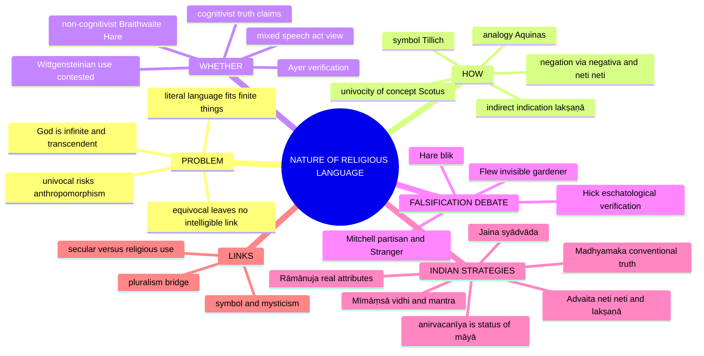

```text
   PROBLEM: literal language fits finite things; God is infinite/transcendent
   ┌──── HOW do we speak of God? ────┐   ┌── DOES it state FACTS? ──┐
   NEITHER literal NOR meaningless →     COGNITIVIST      NON-COGNITIVIST
   VIA MEDIA:                            "God exists" is    religious statements
   • ANALOGY (Aquinas)                   a truth-claim      express attitudes/
   • SYMBOL (Tillich)                    (realism)          intentions, NOT facts
   • NEGATION (via negativa / neti neti)  (Aquinas, Hick)   Braithwaite, Hare; Ayer rejects
   INDIAN: Brahman beyond objectifying speech (avācya, neti neti);
           anirvacanīya = status of MĀYĀ (sad-asad-vilakṣaṇa)
```

> [!TIP]
> **Mnemonic.** "HOW (Analogy / Symbol / Negation) × WHETHER (Cognitive / Non-cognitive)." Say in your opening which axis the question is on; several stems sit on both, and saying so is itself a mark.

---

## 1. Identity, Lineage & Doxography

### 1.1 Exact printed ownership and cross-topic firewall ✅

| Owned here | Boundary (stays elsewhere) |
|---|---|
| Univocal, equivocal, analogical, symbolic, metaphorical, mythical and negative modes | The independent nature and attributes of God → [Notions of God] |
| Verification, falsification and cognitive content of utterances | The broader Logical Positivist programme → Paper I |
| Language-game, grammar and form of life only as religious-language analysis | Later Wittgenstein's complete philosophy → Paper I |
| Performative, expressive, prescriptive and self-involving uses | Faith / revelation warrant → [Reason, Revelation and Faith] |
| Ineffability as a semantic problem | Phenomenology and object of experience → [Religious Experience] |
| Semantic conditions for plural reference | Full pluralism and absolute-truth theory → [Religious Pluralism] |
| Indian negation, indication and conditional predication | Complete Vedānta, Buddhist, Jain and Mīmāṃsā doctrines → Paper I owners |

⚠️ **Boundary applied in 2026.** The supplement keeps **Tillich's symbol theory** ("symbols participate in that to which they point") with this topic; Tillich's *faith as ultimate concern* (2026 Q5(c)) is owned by Reason, Revelation and Faith.

### 1.2 Doxography: who holds what ✅/⚠️/❓

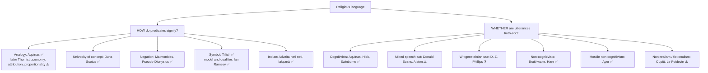

### 1.3 Quotation and attribution discipline ✅/⚠️/❓

| Item | Status | Safe use |
|---|---|---|
| Attribution / proportionality taxonomy | ⚠️ Later Thomist, especially Cajetanian, systematisation | Give the *res significata* / *modus significandi* pair; do not reduce divine goodness to causal attribution |
| "Healthy" example | ✅ Aquinas' own example of ordered predication | Illustrates *attribution*, not divine goodness directly |
| Univocity of being | ✅ Duns Scotus, *Ordinatio* I d.3 | **Semantic**, not ontological; intrinsic modes finite/infinite |
| "Univocity produced modern secularity" | ❓ Radical Orthodoxy (Milbank, Pickstock) | Cite as contested, never settled |
| Negations and attributes of action | ✅ Maimonides, *Guide for the Perplexed* I.50–60 | The Jewish *via negativa* |
| Cataphatic → apophatic ascent | ✅ Pseudo-Dionysius, *Mystical Theology* | Classical route from symbol to unknowing |
| Symbol participates; "God is being-itself" as the non-symbolic statement | ✅ Tillich, *Dynamics of Faith*; *Systematic Theology* | ⚠️ **Preserve the caution:** Tillich modified the exception in later work and its status is disputed |
| "The symbol gives rise to thought"; second naïveté | ✅ Paul Ricoeur, *The Symbolism of Evil* | |
| Model and qualifier; disclosure situation | ✅ Ian Ramsey, *Religious Language* (1957) | |
| Constative / performative; illocutionary force | ✅ J. L. Austin, *How to Do Things with Words* | Applied to religion by Evans |
| *The Logic of Self-Involvement* | ✅ Donald Evans (1963) | |
| Parable of the invisible gardener | ✅ Antony Flew (adapting John Wisdom), "Theology and Falsification" (1950–51) | "Death by a thousand qualifications" |
| *Blik*; paranoid student | ✅ R. M. Hare, same symposium | Unfalsifiable but not unimportant |
| Partisan and Stranger | ✅ Basil Mitchell, same symposium | Defeasible trust conceding counterevidence |
| Eschatological verification; celestial city | ✅ John Hick | Truth-apt now, confirmable later |
| Moral policy + stories | ✅ R. B. Braithwaite, *An Empiricist's View of the Nature of Religious Belief* (1955) | "God is love" = an agapeistic intention |
| Verification criterion | ✅ A. J. Ayer, *Language, Truth and Logic* | Note self-application problem |
| D. Z. Phillips as "non-cognitivist" | ❓ He rejected the label and the reductionism charge | Report the dispute; do not assert the label |
| Transcategorial Real; *personae* / *impersonae* | ✅ Hick, *An Interpretation of Religion* | Pluralism bridge is a **semantic** thesis |
| *Neti neti*; *yato vāco nivartante* | ✅ Bṛhadāraṇyaka 2.3.6; Taittirīya 2.9 | Give the references |
| *Bhāga-tyāga-lakṣaṇā* in "*tat tvam asi*" | ✅ Standard Advaita exegesis of Chāndogya 6.8.7 | The Indian analogue of analogy |
| *Anirvacanīya* | ✅ Technically the status of **māyā** (*sad-asad-vilakṣaṇa*) | Not a synonym for Brahman's ineffability |
| *Oṃkāra* and the soundless fourth | ✅ *Māṇḍūkya Upaniṣad* | Symbol leading beyond itself |
| *Sphoṭa* | ✅ Grammarian doctrine (Bhartṛhari) | Never attribute to Mīmāṃsā |

**Alston and Swinburne.** ✅ In the spectrum (§2.6) William Alston (*Divine Nature and Human Language*) and Swinburne (ordinary words with stretched senses) represent strong literal realism.

---

## 2. Theory of Knowledge (How God-talk signifies; whether it is truth-apt)

### 2.1 The problem ✅

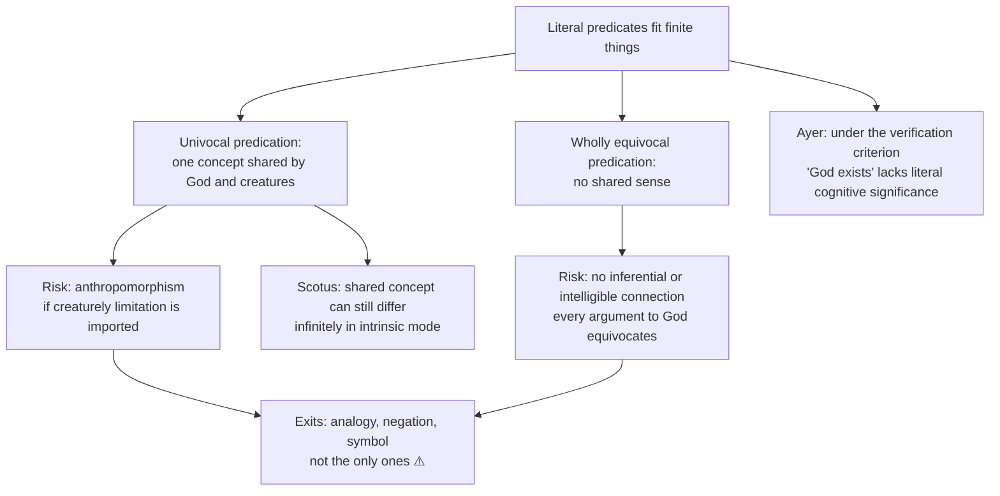

> [!WARNING]
> Ayer's claim is *not* that prayers are psychologically or practically meaningless. It is that, if no possible experience bears on "God exists", it lacks **literal cognitive / empirical significance**.

### 2.2 Aquinas: analogy ✅ (2024 Q5(e))

- **Doctrine.** Predicates such as "good" and "wise" apply to God neither in exactly the creaturely sense nor in a wholly unrelated sense, but **analogically**. They signify perfections present in God **essentially and eminently** (*Summa Theologiae* I q.13).
- **Argument.** (1) Creatures depend causally on God and display perfections; (2) effects resemble causes without matching their mode; (3) the ***res significata*** (thing signified) is predicated truly of God, while the ***modus significandi*** (creature-derived mode of signification) fails to represent the divine mode adequately.
- **Not cause-only.** Aquinas rejects reducing "God is good" to "God causes goodness": God causes goodness because God *is* good.
- **Later Thomist (esp. Cajetanian) systematisation ⚠️:** *analogy of attribution* ("healthy" belongs primarily to an animal, derivatively to medicine as cause or sign; ordered predication) and *analogy of proportionality* (goodness belongs to God according to the infinite divine mode as to a creature according to its finite mode). Not an unqualified fixed taxonomy by Aquinas himself.
- **Presupposition ⚠️:** causal participation warrants semantic continuity; pure perfections can be separated from creaturely limitation.
- **Objection → reply ⚠️:** without a univocal core analogy is indeterminate. Thomist reply: causal relation and ordered perfection terms supply content; critics still ask how it can be specified without prior knowledge of God.

### 2.3 Scotus vs Aquinas; Maimonides ✅/⚠️/❓

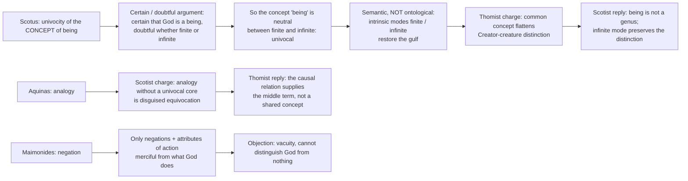

- ❓ Heidegger on **onto-theology** and Radical Orthodoxy (Milbank, Pickstock) trace modern secular metaphysics to the univocity move — a **contested** historical thesis; cite as contested.
- **Verdict formula ⚠️:** univocity secures **inference**, risks **anthropomorphism**; analogy secures **transcendence**, risks **indeterminacy**; negation secures **purity**, risks **vacuity**. Workable position: analogical predication with a univocal minimum for argument-terms and an apophatic limit on adequacy.

### 2.4 Tillich: symbol ✅ (2021 Q8(c), 2023 Q7(c), 2025 Q5(b))

- **Doctrine.** A **symbol** (unlike a **sign**) **participates** in the reality it points to and "opens up levels of reality otherwise closed"; symbols arise collectively and can die. "God" is not a being among beings but the **Ground of Being / Being-Itself**; taking symbols literally is **idolatry**.
- **Sign vs symbol.** A sign has conventional reference without participation; a symbol carries depth and transformative power. *Example:* a national flag participates in collective identity more deeply than a traffic sign; religious symbolism is stronger still.
- **Critique.** If every God-statement is symbolic, the referent becomes vague; Tillich's category of the **demonic** names a finite bearer claiming ultimacy for itself.

> [!WARNING]
> **Tillich caution.** Tillich holds "God is being-itself" is the one **non-symbolic** statement about God — but he **modified** this in later work and its status is disputed. Present it as his *contested exception*; a wholly symbolic theology also faces a self-reference problem (the claim that all God-talk is symbolic is itself a claim about God). Never report the exception as an untroubled doctrine. Do not call a Tillichian symbol a mere sign.

### 2.5 Negation and indirect indication ✅

- **Via negativa / neti neti.** Speak of God only by negation (not finite, not this, not that): Advaita and Christian mysticism (Pseudo-Dionysius).
- **Advaita ✅ ⚠️ (2025 Q8(c)).** Brahman is beyond objectifying speech — *avācya*, "*yato vāco nivartante*" (Taittirīya 2.9) — approached by *neti neti* (Bṛhadāraṇyaka 2.3.6) and *lakṣaṇā*. ***Anirvacanīya*** ("indeterminable") is the technical status of **māyā / avidyā and the world-appearance**: *sad-asad-vilakṣaṇa*, different from both real and unreal. That is a claim about **ontological category**, not about ineffability; Brahman is *sat*.
- **Language works eliminatively (*neti neti*) and indicatively (*lakṣaṇā*), never descriptively — and is itself sublated** once it has removed the error (the thorn-removing-a-thorn reply).
- **Canonical example.** In "That thou art", incompatible omniscient / finite connotations are set aside to indicate consciousness as the common import (*jahad-ajahal-lakṣaṇā* / *bhāga-tyāga-lakṣaṇā*, Chāndogya 6.8.7).
- **Objection → reply ⚠️:** if all predicates fail, teaching is self-defeating. Reply: language removes ignorance and is sublated after knowledge; the statement limits objectifying discourse rather than predicating an ordinary property.

### 2.6 WHETHER: the ten-point spectrum ✅/⚠️/❓ (2020 Q8(a), 2022 Q5(e))

> [!WARNING]
> The commonest structural error: treating cognitivism / non-cognitivism as two boxes. It is a **spectrum about truth-aptness and mode of reference**.

| # | Position | Truth-apt? | Mechanism | Representative |
|---:|---|---|---|---|
| 1 | Strong literal realism | ✅ Fully | Some predicates apply literally, not univocally in every respect | Alston; Swinburne |
| 2 | Analogical realism | ✅ Yes | Attribution / proportionality | Aquinas |
| 3 | Symbolic realism | ⚠️ Yes, symbolically | Participation; model-and-qualifier | Tillich; Ramsey |
| 4 | Eschatologically verified realism | ✅ Yes | Truth-apt now, confirmable later | Hick (celestial city) |
| 5 | Mixed speech-act views | ✅ In part | Assertion plus commissive / expressive force | Evans; Alston |
| 6 | Wittgensteinian "meaning is use" | ⚠️ Contested | Grammar internal to a form of life | D. Z. Phillips ❓ (denied being non-cognitivist / reductionist) |
| 7 | Moral-conative reduction | ❌ Not primarily | Declaration of a moral policy + stories | Braithwaite |
| 8 | Attitudinal / *blik* | ❌ Not fact-stating | Unfalsifiable basic world-picture | Hare |
| 9 | Non-realism / fictionalism | ❌ Not asserted | Practice retained without assertion | Cupitt; Le Poidevin |
| 10 | Hostile non-cognitivism | ❌ Meaningless | Verification criterion | Ayer |

- **"God exists" run through both accounts (2022 Q5(e)).** Cognitivist: a truth-claim, true or false, asserting a fact about reality (Aquinas, Hick, Swinburne). Non-cognitivist: expresses something else — intention (Braithwaite), *blik* (Hare), use in a form of life (Wittgensteinian), or has no literal cognitive significance (Ayer).
- **Two symmetrical standing objections ⚠️.** Against cognitivism: verification / falsification pressure and difficulty specifying the referent. Against non-cognitivism: **reductionism** — believers intend to assert something, and one cannot explain why anyone would adopt the moral policy *if* the stories are known false (Braithwaite's account "an atheist's account of religion").
- **Verdict formula ⚠️:** religious utterances are typically **assertoric, symbolic and performative at once**; the defensible position is a **mixed speech-act account** preserving the believer's realist intent (against Braithwaite), acknowledging analogical or symbolic mode (against crude literalism), and defeasible rather than decisively falsifiable (with Mitchell).

### 2.7 Verification, falsification, eschatological verification ✅

| Challenge | Content |
|---|---|
| **Ayer — verification** | Asks whether experience could establish or count probabilistically for a synthetic statement; the weaker criterion still excludes transcendent God-talk if no possible experience bears on it. Criterion faces **self-application** and **over-restriction** objections |
| **Flew — falsification** | What would count *against* the believer's assertion? Invisible gardener: cumulative qualifications preserve words while removing every evidential consequence |
| **Hare — *blik*** | Concedes non-factuality, preserves practical importance |
| **Mitchell — partisan** | Concedes adverse evidence while retaining defeasible trust |
| **Hick — celestial city** | Present truth-aptness with possible eschatological verification |

- Verification concerns possible confirmation; falsification concerns possible disconfirmation; eschatological verification claims future confirmation without present falsifiability.
- Meaningful but non-descriptive use does not establish factual truth; failure of empirical verification does not by itself show an utterance lacks every semantic or performative role.
- Objection → reply ⚠️: deferred verification is too cheap — it still shows strict verificationism is too narrow, especially as its own criterion is not empirically verifiable.

---

## 3. Dialectical Wings & Sceptical Refinements

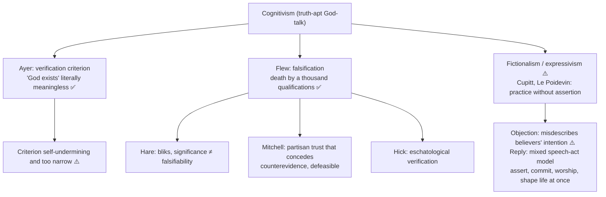

- **Optional advanced debates (dossier §10) ⚠️.** (1) *Analogy vs metaphorical realism* — Thomists defend structured analogical predication; metaphor-oriented approaches stress imaginative disclosure; objection: analogy too indeterminate; reply: causal participation and ordered perfection terms. (2) *Verification, falsification and eschatological verification* — objection: deferred verification is too cheap; reply above. (3) *Expressivism / fictionalism vs realism* — mention only as an optional modern extension after Braithwaite / Wittgenstein. (4) *Advaita's lakṣaṇā and apophatic strategy vs the self-reference worry* — objection: calling Brahman ineffable is itself a description; reply: therapeutic and eliminative use. "Very safe in 2025-style anirvacanīyatā answers."
- **Use rule ⚠️:** add **one** advanced move to a 15-marker, **one to two** to a 20-marker; sharpen evaluation, do not replace exposition. **Promotion trigger:** if UPSC directly asks falsification, eschatological verification, fictionalism or the semantics of *lakṣaṇā*. **What not to over-study:** late analytic philosophy-of-language debates, speech-act taxonomies, poetic theories of metaphor.
- **Sceptical wing inside the topic.** The sources identify Ayer's hostile non-cognitivism as the sceptical pressure and Flew's challenge as the evidential one; they give no separate sceptical school within religious-language theory.

### 3.1 Hare's *blik* and whether it defends meaningfulness ✅/⚠️ (2026 Q7(a), 20 marks)

1. **What Flew demands.** In "Theology and Falsification" (1950–51) Flew adapts John Wisdom's invisible gardener: successive qualifications protect the claim from every test. This is a *falsification* demand, not Ayer's *verification* demand. A scientific theory may survive one failed test without becoming unfalsifiable; the issue is **indefinite immunity**.
2. **Hare's counterexample.** A student convinced every don wants to murder him reads friendly encounters through that conviction; a pervasive framework for seeing events, practically consequential, is a ***blik***. ⚠️ This is an illustrative **pathological** case, not the thesis that all believers are paranoid.
3. **The move.** "Not falsifiable" does **not** imply "unimportant or without any meaning" if the *blik* structures interpretation and action. Hare distinguishes **sane and insane bliks**, but supplied no truth-condition or complete criterion of rational revision.
4. **What is rescued.** Hare rebuts the equation of **significance** with **falsifiability**, not the narrower charge that a factual claim fails to specify what would make it false. If the believer also asserts God exists independently of anyone's stance, the *blik* analysis does not preserve that assertion's full cognitive content; a *sane* blik does not show a supernatural proposition true.
5. **Mitchell's alternative.** The partisan trusts a mysterious **Stranger** while admitting the Stranger's apparently hostile conduct **counts against** trust. Preserves an assertoric claim better than Hare; still owes an account of how much adverse evidence should prompt revision. Hick's eschatological verification is a distinct cognitivist move.
6. **Objection → reply → limit.** Objection: if even an "insane" blik resists evidence, no way to tell revelation from delusion. Reply: compare coherence, conduct, responsiveness to people and consequences. Limit: no algorithm converts practical health into religious truth; the answer works for the **importance of outlook**, not as a full semantics for all creeds.

| View | What gives it force? | What happens to truth? | Test against Flew |
|---|---|---|---|
| Hare | Interpretive blik shaping a life | Factual assertion not secured | Unfalsifiability need not imply insignificance |
| Braithwaite | Intention to live by a moral policy and sustaining stories | Story need not be accepted as historically true | Explains conduct, not why a God-claim has evidential content |
| Mitchell | Trust despite admitted contrary evidence | Truth claim retained | Concedes evidential vulnerability; no instant decisive test |
| Hick | Journey toward a possible confirming end | Future truth condition | Possible verification, not current falsification |

**20-mark spine ⚠️:** Flew's gardener and the demand for counterevidence → define *blik*, tell student / dons accurately → argue from unfalsifiability to practical significance, distinguishing sane from insane → price in truth-aptness → contrast Mitchell and Hick → answer "whether successfully": yes against the claim of utter insignificance, only partly against the challenge to factual religious assertions.

---

## 4. Metaphysics & Ontology (inventory of semantic modes)

### 4.1 Semantic mode and speech function ⚠️

| Mode / use | What it does | Truth-aptness |
|---|---|---|
| Literal / univocal | Applies an ordinary concept in the same sense | Cognitive, but risks anthropomorphism |
| Analogical | Preserves ordered similarity through causal participation or proportion | Cognitive with qualified mode |
| Metaphorical | Transfers a pattern imaginatively without literal identity | May carry indirect cognitive insight |
| Symbolic | Mediates / participates in a depth of reality and transforms apprehension | Symbolic realism or non-cognitive use, depending on theory |
| Mythic / narrative | Organises identity, world and value through a story | May be realist, metaphorical or practice-guiding |
| Negative / apophatic | Denies creaturely limitations, blocks objectification | Cognitively restrictive; risks vacuity |
| Performative | Enacts a vow, blessing, confession, commitment or relation | Success-conditions differ from description; presuppositions may be truth-apt |
| Expressive / prescriptive | Expresses attitude or commits conduct | Primarily non-cognitive without being meaningless |

The same utterance can be assertoric, symbolic and performative at once. Classifying its primary force does not cancel every other force.

### 4.2 Comparison grid ⚠️

| Theory | Type | Claim | Thinker | Weakness |
|---|---|---|---|---|
| Analogy | cognitive | Proportional / attributive meaning | Aquinas | How to fix the proportion? |
| Symbol | cognitive-ish | Symbols participate in Being-Itself | Tillich | Referent vague |
| Via negativa / neti neti | limits speech | Only negation / indescribability | Dionysius, Advaita | Risks total silence |
| Moral-conative | non-cognitive | Expresses moral intention | Braithwaite | Loses realist meaning |
| Language-game / use | contested | Religious grammar and life-orienting use | Wittgenstein; later Wittgensteinians | Fideism if insulated; simple non-cognitivist label disputed |
| Verificationism | non-cog (hostile) | Meaningless | Ayer | Self-refuting principle |

### 4.3 Wittgensteinian use ✅/❓ (2023 Q5(d))

- *Lectures on Religious Belief* contrast belief in the Last Judgement with ordinary empirical prediction and show how it **orients a life**. Later Wittgensteinians formulate this through **language-game**, **grammar**, **form of life**; meaning is shown by use in worship, repentance, hope and conduct.
- ❓ Whether Wittgenstein is thereby a straightforward non-cognitivist is disputed; **D. Z. Phillips** resisted both reductionist and simple non-cognitivist readings.
- Objection → reply ⚠️: reduction to use or morality misdescribes believers who intend realist claims; a mixed account may retain truth-claim, grammar and performative force. Critic's charge: **fideism** if insulated; reply: internal grammar need not exclude external moral and epistemic criticism.

---

## 5. Rejection / Affirmation of Transcendent Realities (the transcendent referent and its limits)

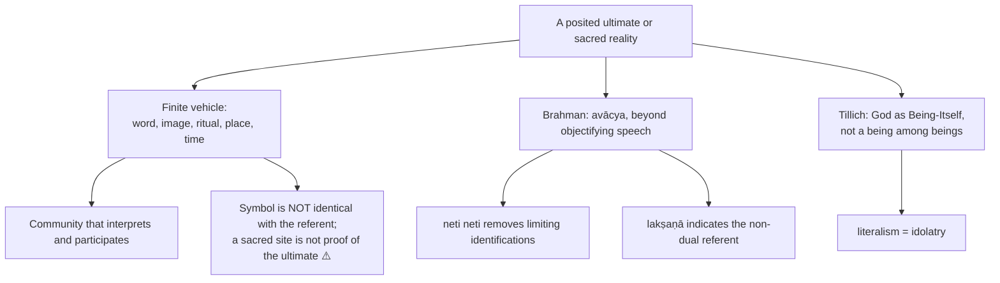

### 5.1 Symbol as transcendent referent mediating into the cultural, spatial and temporal world ✅/⚠️ (2018 Q8(c), 15 marks)

- **Separate relata.** (1) A posited ultimate or sacred reality; (2) a **finite vehicle** — word, image, ritual, place or time; (3) a **community** that interprets and participates.
- **Mechanism, not slogan.** On Tillich's account a symbol **participates** in what it indicates and discloses levels of reality and self that signs do not. Repeated ritual or sacred image situates participation in a community's **culture**; a sanctuary **spatially** focuses practice; a recurring festival or narrative structures **time**. **Eliade's hierophany** names a disclosure of the sacred through an ordinary finite thing. These are modes in which a tradition **claims** to mediate ultimacy, not independently verified supernatural events.
- **Direction of the stem.** Explain how an alleged transcendent referent is made *addressable* in culturally transmitted forms and located practices **without being exhausted by them**.
- **Objections and limits.** A conventional **sign** could organise a gathering, so social effects alone do not establish Tillichian participation; a symbol can be mistaken for the reality (**idolatry**); communities construe the same site or story differently; a nonbeliever may understand its use while doubting the referent. Do not infer existence from devotional intensity.
- **15-mark spine:** define referent, finite vehicle, interpreter → Tillich's participation versus mere sign → culture, space and time separately → Eliade → idolatry and unverifiable-referent objections → qualified significance, not a proof of God.

### 5.2 Does religious symbolism lead to mysticism? ✅/⚠️ (2019 Q6(a), 20 marks)

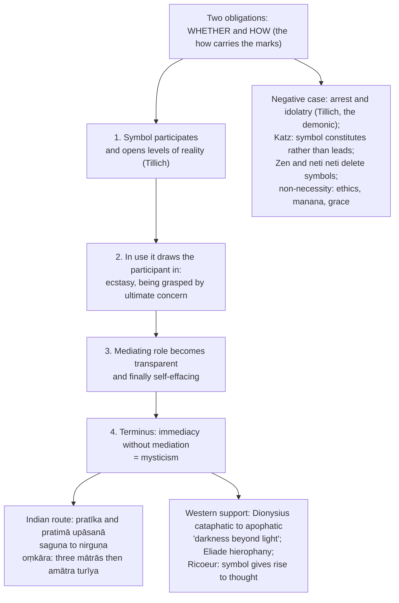

- **Indian detail ✅.** *Pratīka / pratimā upāsanā* is an authorised graded *sādhana*, ranked below and preparatory to direct realisation; *Māṇḍūkya Upaniṣad* treats *OM* with three *mātrās* matching waking, dream and deep sleep, and the **soundless fourth (*amātra*, *turīya*)** as the non-symbolic culmination; tantric *mantra*, *yantra*, *maṇḍala* are instrumental symbols to be internalised and dissolved; Sufi *ishārāt* function similarly.
- **Verdict formula ⚠️:** "Religious symbolism is a **normal but not a necessary** route to mysticism. It leads there when used as an instrument to be transcended — *pratīka* to *nirguṇa*, cataphatic to apophatic, *oṃkāra* to *turīya*; it obstructs when taken literally (Tillich's idolatry). On the constructivist view the relation is not sequential at all."
- **Trap:** do not say symbolism *necessarily* leads to mysticism.

---

## 6. Explanatory & Causal Principles (grounds of meaning)

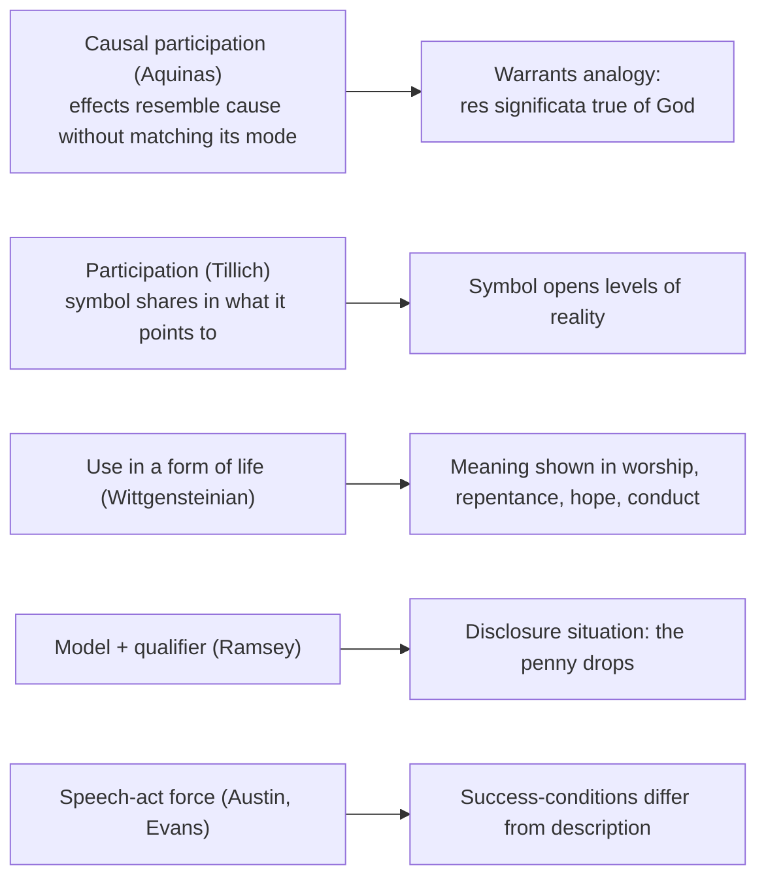

### 6.1 Secular vs religious use of language ✅/⚠️ (2018 Q5(a), 10 marks)

> [!WARNING]
> The difference is **not lexical** — religious discourse borrows ordinary words ("father", "light", "path", "see", "hear", "know"). It lies in **function, reference, logic and commitment**. Say so in the first two lines.

| Axis | Secular use | Religious use |
|---|---|---|
| Primary function | Describe, predict, instruct, inform | Worship, invoke, confess, bless, vow, consecrate, commit |
| Reference | Often empirical particulars, also abstract entities | May invoke a transcendent referent; can also describe ordinary events |
| Verification | Varies with empirical, moral, mathematical or performative use | Evidence may be contested, experiential, eschatological or unavailable |
| Logic | Negation, metaphor, paradox can occur | Negation, symbol, paradox especially important; contradiction still needs a defence |
| Self-involvement | May commit the speaker (promising) | Frequently self-involving (vow), but some claims are detachable |
| Community and register | Everyday use and specialist registers | Tradition-formed uses, sometimes liturgical; neither confined to one vocabulary |

- **Austin ✅.** Constative vs performative; locutionary / illocutionary / perlocutionary force. "I baptise you", "I take refuge in the Buddha", *saṃkalpa* at the start of a rite, a vow, a blessing are performatives with different success-conditions. **Donald Evans**, *The Logic of Self-Involvement* (1963): religious language is characteristically **self-involving** — it expresses attitudes, commits conduct, **constitutes** relationships. ⚠️ This does **not** make it non-cognitive: "I baptise" presupposes assertions.
- **Ramsey ✅.** Religious language takes an ordinary **model** ("father", "cause", "good") and applies a **qualifier** ("heavenly", "first", "infinitely") until the "penny drops" — a **disclosure situation** evoking discernment and commitment.
- **Indian material ✅.** Mantra is a paradigm of non-descriptive language: Mīmāṃsā treats mantras as **liturgical instruments** within an injunctive structure and gives ***vidhi*** priority in disclosing otherwise unknowable *dharma* (not: the whole *śāstra* is grammatically imperative). Mīmāṃsā's ***śabda-nityatva*** concerns the eternity of word / sound and the word–meaning relation; classical ***sphoṭa*** belongs principally to the grammarians (Bhartṛhari).
- **Continuity thesis ⚠️.** Religious language is parasitic on ordinary language, learned in ordinary contexts, subject to ordinary logic: a **stretched and re-purposed** use of a common instrument, not a separate instrument.
- **Verdict formula ⚠️:** "Compare *uses*, not disjoint vocabularies. A vow can be self-involving and a religious claim can refer to a transcendent reality; secular promises and abstract claims show neither feature belongs exclusively to religion."

### 6.2 Indian semantic strategies — bounded comparison ✅/⚠️

| Tradition | Primary semantic strategy | Control |
|---|---|---|
| Advaita | Negation (*neti neti*) and indirect indication (*lakṣaṇā*) remove incompatible objectifying senses | Brahman ineffable; world-appearance indeterminable (*anirvacanīya*) |
| Viśiṣṭādvaita / Rāmānuja | Scriptural predicates name real auspicious attributes of personal Brahman | Attributes not merely lower symbols to be discarded |
| Madhyamaka Buddhism | Conventional truth permits functional discourse; ultimate analysis denies intrinsic nature | Conventional meaning is not sheer falsehood or silence |
| Jainism | Many-sidedness and conditional predication (*anekāntavāda / syādvāda*) state a claim under a specified respect | Contradictory predicates not asserted unconditionally in the same respect |
| Mīmāṃsā | Injunction and mantra function within ritual disclosure; word–meaning relations treated as authoritative | Not every scriptural sentence grammatically imperative; *sphoṭa* is not a Mīmāṃsā doctrine |

These are structural comparisons, not claims that the schools share one theory of reference.

---

## 7. Ethics & Human Goals (moral and performative uses)

> [!NOTE]
> The sources give no kāma / artha / dharma / mokṣa scheme for this topic. This module carries only the moral-conative and commitment uses of religious language.

### 7.1 Braithwaite's moral-policy theory ✅/⚠️ (2018 Q7(b), 2021 Q8(a), 2024 Q8(a), 2026 Q5(d))

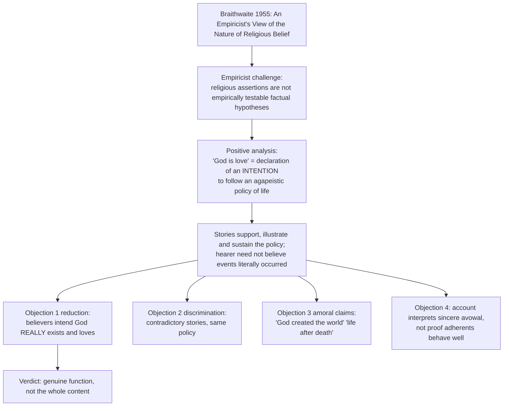

1. **Empiricist starting point.** Resists treating religious assertions as empirically testable hypotheses. ⚠️ The assumption that only an empirical proposition has cognitive meaning is independently challengeable, so explain his constructive response rather than repeat Ayer's dismissal as if Braithwaite agreed religious discourse has no use.
2. **Positive analysis.** To assert "God is love" is centrally to **declare an intention** (not a guarantee of behaviour) to follow an agapeistic policy. A theory of what religious assertions **mean / do**, not an observation that adherents never make realist claims.
3. **Why stories matter.** A moral rule alone does not capture the imaginative and communal formation a narrative provides; but a realist believer may treat particular events as constitutive, so calling every narrative dispensable in truth-value begs the question.
4. **Contrast neighbours.** Ayer: no *literal factual* meaning; Braithwaite: a **meaningful conative** interpretation. Hare's *blik* is a broad interpretive stance, **not** a declaration of a particular moral policy. Mitchell retains a **truth-apt** belief that recognises counterevidence. Later Wittgensteinian grammar cannot be equated to any one of these.
5. **2024 contradiction qualifier ⚠️.** A factual reading of "God is loving" confronted by suffering creates a serious **evidential** challenge, not an immediate formal contradiction without added premises about love, power and preventable evil. Ayer's criterion tests an *external* theory of meaning rather than deriving inconsistency from cognitivism. Braithwaite avoids the empirical challenge **by reclassifying** the utterance; whether that preserves what was asserted is the critical issue.

**Exam routes ⚠️.** 2018 Q7(b): moral intention → stories → two objections. 2021 Q8(a): define non-cognitivism generally, set Braithwaite apart from Ayer and Hare, assess. 2024 Q8(a) (10+10): first half cognitive vs conative truth-aptness; second half name and assess the *alleged* contradiction with Braithwaite. 2026 Q5(d): whole **nature** — empiricist premise → policy → stories → non-cognitive force → loss of assertoric intent, arbitrary narrative and amoral-statement objections → qualified verdict.

### 7.2 Performative and self-involving commitment ✅

See §6.1 (Austin, Evans). Vows, blessings, confession, *saṃkalpa* and refuge are commitments whose success-conditions differ from description, though their presuppositions may be truth-apt.

---

## 8. Inter-School Comparative Matrices

### 8.1 Inter-thinker / inter-school debates ✅/⚠️/❓

| Theory | Truth-apt? | Semantic mechanism | Strength | Risk |
|---|---|---|---|---|
| Aquinas | ✅ Yes | Analogy / causal participation | Realism without crude anthropomorphism | Indeterminacy |
| Tillich | ⚠️ Symbolically realist | Participation | Depth and transformation | Vague referent |
| Ayer | ❌ No factual meaning | Verification criterion | Evidential discipline | Criterion too narrow / self-problem |
| Braithwaite | ❌ Not primarily factual | Moral intention and story | Captures practice | Reductionism |
| Wittgensteinian | ⚠️ Meaning in use | Language-game / form of life | Context sensitivity | Fideism / insulation |
| Advaita | ✅ Indicative, non-literal | Negation and *lakṣaṇā* | Avoids objectifying Brahman | Self-reference / silence |
| Scotus | ✅ Yes | Univocal concept + intrinsic modes | Secures validity of inference to God | Alleged onto-theology ❓ |
| Maimonides | ⚠️ Only negations and attributes of action | *Via negativa* | Protects transcendence | Vacuity |
| Nyāya | ✅ Yes | Near-univocal predication of Īśvara's knowledge / will | Determinate, argument-friendly | Anthropomorphism; God as one *ātman* among selves |
| Mitchell | ✅ Yes | Defeasible trust conceding counterevidence | Answers Flew without vacuity | Boundary with unfalsifiability is fine |
| Hick | ✅ Yes | Eschatological verification; transcategorial Real | Bridges to pluralism | The Real risks emptiness |

### 8.2 Parity bench — the same exits, East and West ⚠️

| Exit | Western | Indian | Shared objection |
|---|---|---|---|
| **Univocity** | Duns Scotus | **Nyāya as a limited comparative heuristic** — determinate predication of Īśvara's knowledge and will | Anthropomorphism; comparison does not make Nyāya equivalent to Scotus's semantic univocity |
| **Analogy / indirect indication** | Aquinas; later Thomist taxonomy | **Advaita's *lakṣaṇā*** — *bhāga-tyāga* in *tat tvam asi* | Indeterminacy: how is the proportion or retained portion fixed? |
| **Negation** | Pseudo-Dionysius; Maimonides | *Neti neti*; *yato vāco nivartante* | Vacuity |
| **Symbol / participation** | Tillich; Ramsey's model-and-qualifier | *Pratīka* / *pratimā*; *oṃkāra* → *turīya* | Vague referent; risk of idolatry / arrest |
| **Performative / injunctive** | Austin, Evans | Mīmāṃsā *vidhi*; mantra as instrument | Does not by itself settle truth-aptness |

### 8.3 The pluralism bridge ⚠️ (cross-link to Religious Pluralism)

- **Thesis.** Positions on pluralism are **downstream of** positions on religious language: semantics → epistemic access → status of rival descriptions → exclusivism or pluralism.
- **If God-talk is univocal and literal:** descriptions are directly commensurable; where they conflict in the same respect, at most one is true. That is a **logical incompatibility**, not by itself one tradition's monopoly on truth or salvation (an exclusivist needs an additional premise).
- **If analogical, symbolic or apophatic:** no finite formulation need exhaust its referent; some descriptions **might** be partial or mode-relative. A claim of shared reference still needs metaphysical and evidential support.
- **Hick ✅:** the Real *an sich* is transcategorial, limiting literal predication; *personae* / *impersonae* are ways it is experienced. The hypothesis also makes metaphysical and soteriological claims; vacuity objection: how can the Real be identified, causally related or distinguished from nothing?
- **Indian resources ✅:** Advaita's two-level semantics (extension across independent traditions needs Vivekananda's further argument); Jaina *anekāntavāda / syādvāda* qualifies by standpoint (*naya*) and resolves **apparent** contradiction when respects differ, not same-respect contradiction; RV 1.164.46 — modern interreligious extension must be defended, not presumed.
- **Limit ⚠️:** non-literal semantics dissolves *some* apparent conflicts (personal vs impersonal description of the ultimate) and **cannot dissolve others** — existence-claims are not mode-relative (post-mortem survival; a creator). Route hard contradictions rather than harmonise them.
- **Verdict ⚠️:** "A semantic theory constrains *how* rival descriptions can be read; it does not settle which traditions are true or salvific."

---

## 9. Criticisms & Reconstructed Replies

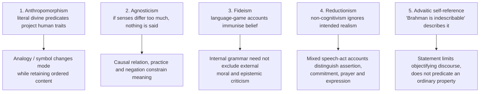

Further objection–reply pairs from the owner: Scotist "analogy is disguised equivocation" → Thomist "the causal relation is the middle term" (§2.3); Tillich "all symbolic is self-referential" (§2.4); verification criterion self-application (§2.7); Hare's sane / insane blik cannot supply truth-conditions (§3.1).

---

## 10. Controlled Western Comparisons

> [!WARNING]
> The owner file gives no stand-alone East–West guardrail table for this topic; it gives the parity bench (§8.2). Treat Indian–Western pairings as **structural comparisons, not claims that the schools share one theory of reference**; always state the disanalogy.

| Pairing (from the sources) | Point of contact | Decisive disanalogy |
|---|---|---|
| Scotus univocity ↔ Nyāya | Determinate predication of knowledge and will of Īśvara | Only a **limited comparative heuristic**; not Scotus's semantic univocity with intrinsic modes |
| Aquinas analogy ↔ Advaita *lakṣaṇā* | Neither literal nor arbitrary; *bhāga-tyāga* discards and retains | Structurally comparable, **not doctrinal identity** |
| Maimonides / Dionysius ↔ *neti neti* | Negation as the route | Both face vacuity; different systems |
| Tillich / Ramsey ↔ *pratīka* / *oṃkāra* | Symbol mediating beyond itself | Indian graded *sādhana* has a defined terminus (*turīya*) |
| Austin / Evans ↔ Mīmāṃsā *vidhi* / mantra | Non-descriptive function | *Vidhi* priority ≠ whole *śāstra* imperative |
| Ayer's verification ↔ (Paper I Logical Positivism) | Verification criterion | Owned by Paper I; here only the religious-language use |

---

## 11. Diagnostic Deep-Dives for High-Frequency Themes

### 11.1 "Does religious language carry cognitive content?" (2020 Q8(a), 20 marks) ⚠️

Spectrum, not binary (§2.6), then the verification / falsification pressure (§2.7); Mitchell's defeasible position is the one most defenders of cognitivism take: claims are **defeasible but not decisively falsifiable in this life**.

### 11.2 "God exists" through both accounts (2022 Q5(e)) ⚠️

Run the sentence explicitly through the cognitivist and non-cognitivist accounts (§2.6); name the specific non-cognitivist (Braithwaite / Hare / Ayer / Wittgensteinian) rather than lumping them.

### 11.3 Is religious language symbolic? (2025 Q5(b); 2021 Q8(c); 2023 Q7(c)) ⚠️

```text
Intro : literal language fails for the transcendent; Tillich's symbolic theory.
Body  : symbols (unlike mere signs) participate in what they point to; "God" signifies
        Being-Itself, not a being; literalism risks idolatry; Tillich's claim that
        "God is being-itself" alone is non-symbolic is later qualified and disputed.
Crit  : referent becomes vague; compare Aquinas' analogy (more determinate).
Concl : religious language is symbolic — pointing beyond itself to the Ground of Being.
```

### 11.4 Anirvacanīyatā (2025 Q8(c), 15 marks) ⚠️

Fix the two uses first (Brahman: *avācya* / non-objectifiable; māyā: *anirvacanīya* / *sad-asad-vilakṣaṇa*). Present as a thesis about **predication**: ordinary language classifies; what cannot be classified as real or unreal defeats classificatory speech; Brahman, non-objectifiable, defeats objectifying speech. Language works eliminatively and indicatively and is sublated (§2.5).

### 11.5 Applied current-research illustration 📰

⚠️ **Permitted use only.** Jintao Ma et al., "AI as Cultural Mediation: Agentic Sanskrit–English Translation with Linguistic Grounding" — poster in the ICML 2026 workshop *Culture x AI: Evaluating AI as a Cultural Technology*, 10 July 2026 (https://icml.cc/virtual/2026/74717, accessed 27 August 2026). It illustrates how literal word substitution can cause semantic drift in Sanskrit–English religious prose. It is **not doctrinal evidence** for analogy, symbolism, cognitivism or any Indian school.

---

## 12. PYQ Routing Ledger (2018–2025; 2026 supplement)

> Corpus signal: **14** primary-owned parts in 2018–2025 (per year 3/1/1/2/1/2/2/2) plus **2** in 2026 = **16** in the continuous corpus. Cross-links do not create duplicate ownership.

| Year | Q | Marks | Exact demand | Map to |
|---|---|---:|---|---|
| 2018 | Q5(a) | 10 | In what sense is the secular use of language different from the religious use of language? Discuss. | §6.1 |
| 2018 | Q7(b) | 15 | Critically examine Braithwaite's non-cognitive theory of religious language. | §7.1 |
| 2018 | Q8(c) | 15 | Explain the significance of religious symbols as transcendent referent that mediates into the cultural, spatial and temporal world. | §5.1 |
| 2019 | Q6(a) | 20 | Discuss whether and how does religious symbolism lead to mysticism. | §5.2 |
| 2020 | Q8(a) | 20 | Does religious language carry cognitive content? Elucidate in detail. | §2.6, §2.7, §11.1 |
| 2021 | Q8(a) | 20 | What is non-cognitive theory of religious language? Explain critically in the light of R. B. Braithwaite's views. | §2.6, §7.1 |
| 2021 | Q8(c) | 15 | Explain the symbolic nature of religious language with special reference to Paul Tillich. | §2.4 |
| 2022 | Q5(e) | 10 | Explain the difference between the cognitivist and non-cognitivist approaches to the religious language with reference to the statement — "God exists". | §2.6, §11.2 |
| 2023 | Q5(d) | 10 | Discuss Wittgenstein's view about the non-cognitive nature of religious language. | §4.3 |
| 2023 | Q7(c) | 15 | Explain the symbolic nature of religious language according to Tillich. | §2.4 |
| 2024 | Q5(e) | 10 | Explain the analogical nature of religious language. | §2.2, §2.3 |
| 2024 | Q8(a) | 20 (10+10) | Distinguish between cognitivist and non-cognitivist account of religious language. Does the cognitivist account lead to any contradiction? Answer with reference to the philosophical views of R. B. Braithwaite. | §2.6, §7.1 |
| 2025 | Q5(b) | 10 | Is religious language symbolic? Give reasons and justification in support of your answer. | §2.4, §11.3 |
| 2025 | Q8(c) | 15 | Discuss the Advaitic notion of indescribability (anirvacanīyatā) in the context of nature of religious language. | §2.5, §11.4 |
| **2026** | **Q5(d)** | **10** | Critically discuss the views of R. B. Braithwaite on the nature of religious language. | §7.1 |
| **2026** | **Q7(a)** | **20** | Analyse R. M. Hare's concept of 'blik' and assess whether it successfully defends the meaningfulness of religious language. | §3.1 |

**Total primary-owned: 16 (14 + 2).** The owner file records no pre-2018 table.

**Cross-owned (listed, not counted):** 2026 Q5(c) — Tillich's faith as ultimate concern (owned by Reason, Revelation and Faith; its symbol-theory line stays here).

**Directive decoder ⚠️**

| Directive | Examiner is buying | Structural consequence | Live example |
|---|---|---|---|
| In what sense is A different from B? | A *specified* respect of difference | Name the axes first (function, referent, logic, commitment) | 2018 Q5(a) |
| Critically examine [thinker]'s theory | Reconstruction **plus** evaluation | State the theory in its own terms before objecting | 2018 Q7(b) |
| Explain the significance of X as Y that mediates into… | The **mediation mechanism** | Participation (Tillich) + hierophany (Eliade) | 2018 Q8(c) |
| Discuss whether **and** how X leads to Y | Two deliverables; the "how" is harder | Route in steps; then the negative case | 2019 Q6(a) |
| Does X carry cognitive content? Elucidate in detail | A defended position on **truth-aptness** | Spectrum, then verification / falsification | 2020 Q8(a) |
| What is X? Explain critically in the light of [thinker] | Definition, thinker's version, critique | Braithwaite ≠ Ayer ≠ Wittgenstein | 2021 Q8(a) |
| Explain the difference… with reference to [a statement] | Distinction applied to **that sentence** | Run "God exists" through both accounts | 2022 Q5(e) |
| Distinguish A and B. Does A lead to any contradiction? | Two parts, second answered directly | Name the alleged contradiction, then adjudicate | 2024 Q8(a) (10+10 split) |
| Is X symbolic? Give reasons and justification | A yes/no with **reasons ranked** | Position first; Tillich's criteria; then caution | 2025 Q5(b) |
| Discuss X in the context of the nature of religious language | The doctrine **as a semantic thesis** | *Anirvacanīyatā* as a claim about predication | 2025 Q8(c) |
| Critically discuss [thinker]'s views on nature | Thinker's complete mechanism, tested | Empiricist premise, policy, stories, realist intent | 2026 Q5(d) |
| Analyse [concept] and assess whether it successfully defends meaningfulness | State *what kind* of meaning is saved | *Blik* → practical importance; test against Mitchell | 2026 Q7(a) |

---

## 13. Top 10 UPSC Exam Traps

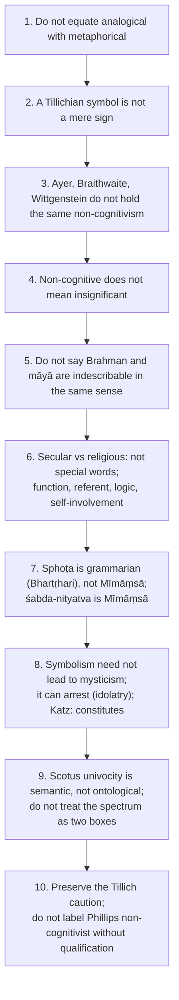

Further traps recorded by the owner: do not attribute every language-game reading directly to Wittgenstein without noting the later development; the Radical Orthodoxy "univocity caused secular modernity" thesis is contested ❓; non-literal semantics does not dissolve all interreligious conflict (route same-respect contradictions); Braithwaite's **intention** is not an assurance of good behaviour, and in 2024 Q8(a) verification failure does not by itself establish a *logical contradiction* in cognitivism; Hare's student / dons story is an **insane** blik example, not an equation of believers with the student, and significance ≠ truth-aptness; a symbol "mediating" the transcendent is not a proof the referent exists, and 2018 Q8(c) needs the cultural **and** spatial **and** temporal vehicle.

---

## 14. Technical Vocabulary & IAST Bank

| English gloss | Term | Meaning | Status |
|---|---|---|---|
| Thing signified / mode of signifying | *res significata* / *modus significandi* | Perfection truly predicated vs inadequate creaturely manner | ✅ |
| Analogy of attribution / proportionality | — | Later Thomist (Cajetanian) taxonomy | ⚠️ |
| Univocity of being | — | Scotus: concept common, intrinsic modes differ | ✅ |
| Via negativa | — | Speak only by negation; Maimonides, Dionysius | ✅ |
| Attributes of action | — | Maimonides: merciful from what God does | ✅ |
| Sign / symbol | — | Tillich: symbol participates; sign conventional | ✅ |
| Being-itself / Ground of Being | — | Tillich's God-term | ✅ |
| Idolatry / the demonic | — | Literalised symbol; finite bearer claiming ultimacy | ✅ |
| Model and qualifier; disclosure situation | — | Ramsey | ✅ |
| Constative / performative; illocutionary force | — | Austin | ✅ |
| Self-involving language | — | Evans | ✅ |
| Verification / falsification | — | Ayer / Flew | ✅ |
| Eschatological verification | — | Hick | ✅ |
| *Blik* | — | Hare's basic world-picture | ✅ |
| Partisan and Stranger | — | Mitchell | ✅ |
| Language-game; form of life | — | Later Wittgensteinian | ✅/❓ |
| Cataphatic / apophatic | — | Affirmative / negative theology | ✅ |
| Second naïveté | — | Ricoeur | ✅ |
| Transcategorial Real; *personae* / *impersonae* | — | Hick | ✅ |
| Indescribable / beyond speech | *avācya* | Brahman beyond objectifying speech | ✅ |
| Not this, not this | *neti neti* | Bṛhadāraṇyaka 2.3.6 | ✅ |
| "Whence words turn back" | *yato vāco nivartante* | Taittirīya 2.9 | ✅ |
| Indirect indication | *lakṣaṇā* | Indirect meaning when literal sense fails | ✅ |
| Discarding-and-retaining indication | *jahad-ajahal-lakṣaṇā* / *bhāga-tyāga-lakṣaṇā* | "That thou art", Chāndogya 6.8.7 | ✅ |
| Indeterminable | *anirvacanīya* / *anirvacanīyatā* | Status of māyā; *sad-asad-vilakṣaṇa* | ✅ |
| Symbol / image worship | *pratīka* / *pratimā* | Graded preparatory *upāsanā* | ✅ |
| The syllable OM; soundless fourth | *oṃkāra*; *amātra* / *turīya* | Māṇḍūkya | ✅ |
| Injunction | *vidhi* | Mīmāṃsā priority in disclosing *dharma* | ✅ |
| Eternity of word | *śabda-nityatva* | Mīmāṃsā | ✅ |
| Grammarian's word-whole | *sphoṭa* | Bhartṛhari (not Mīmāṃsā) | ✅ |
| Conditional predication | *anekāntavāda* / *syādvāda* / *saptabhaṅgī* | Jaina | ✅ |
| Standpoint | *naya* | Jaina | ✅ |
| Vow / resolve | *saṃkalpa* | Performative at a rite's start | ✅ |
| Real; unreal; neither | *sat*; *asat*; *sad-asad-vilakṣaṇa* | | ✅ |

---

## 15. Graded Verdict & Answer Architectures

### 15.1 Graded verdict ladder ⚠️

| Band | What the script contains | Typical fault |
|---|---|---|
| Weak (≈40%) | "Aquinas said analogy, Tillich said symbol, Ayer said meaningless" | HOW and WHETHER merged; no mechanism |
| Average (≈50%) | Analogy's two forms; symbol vs sign; cognitivism vs non-cognitivism | Non-cognitivists lumped; no Indian material |
| Good (≈60%) | Mechanism stated; one objection answered; *neti neti* / *lakṣaṇā* used | Spectrum treated as binary; Scotus absent |
| Strong (≈65–70%) | Spectrum placed accurately; Flew–Hare–Mitchell; Indian parity argued | Tillich's exception reported without its caution |
| Top (≈70%+) | All above + discriminating distinctions (*res significata* / *modus significandi*; semantic vs ontological univocity; Brahman's ineffability vs māyā's *anirvacanīyatā*; symbol vs sign vs model-and-qualifier) + the pluralism bridge | — |

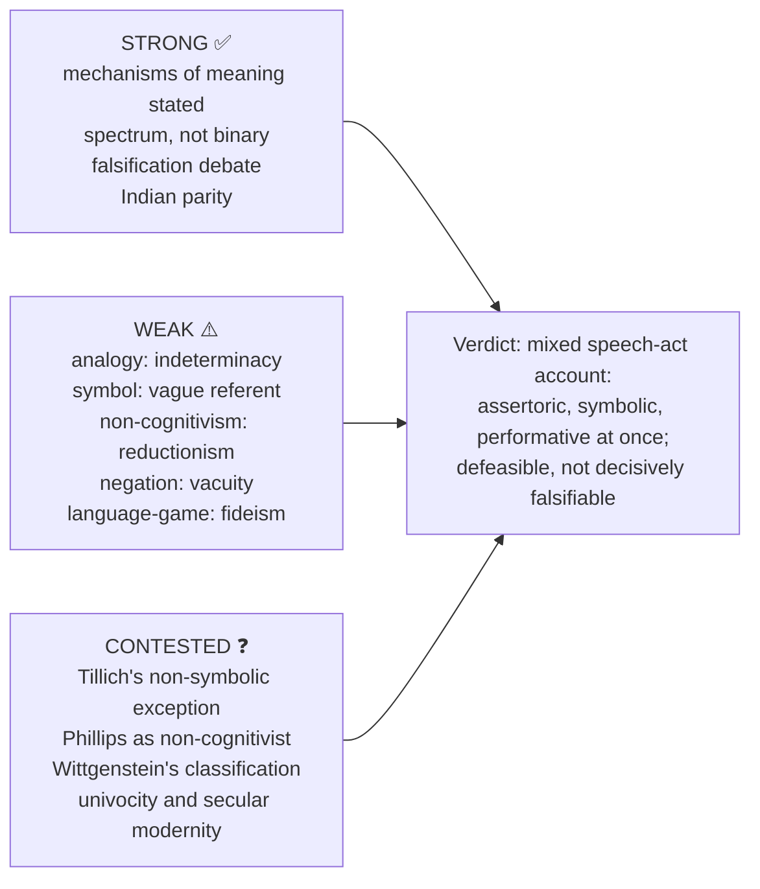

### 15.2 10-mark

```text
Define theory → mechanism of meaning → canonical example →
nearest contrast → one objection → verdict.
```
**Anchor:** "Univocity secures inference and risks anthropomorphism; analogy secures transcendence and risks indeterminacy; negation secures purity and risks vacuity."

### 15.3 15-mark

```text
Frame finite-language problem → doctrine's argument and presupposition →
example → critic and reply → Indian/Western comparison.
```
**Anchor:** "The central issue is not only whether God-talk is meaningful, but what mode of meaning fits transcendence."

### 15.4 20-mark

```text
Separate HOW from WHETHER → compare cognitive and non-cognitive families →
verification/falsification pressure → analogy/symbol/Advaita resources →
two objections and a mixed, defended conclusion.
```
**Anchor:** "Religious utterances can be simultaneously assertoric, symbolic and performative."

### 15.5 Graded-verdict templates ⚠️

- *HOW stem:* "The predicate applies neither in the creaturely sense nor in no sense at all. What secures the middle position is ___ (causal participation / participation-in-being / indirect indication), and its standing cost is indeterminacy — which is exactly what the univocity theorist exploits."
- *WHETHER stem:* "Religious utterances are assertoric, symbolic and performative at once. Non-cognitivism correctly identifies the practical force and incorrectly denies the assertoric intent; the defensible position is a mixed speech-act account with defeasible, non-decisively-falsifiable claims."
- *Advaita stem:* "*Anirvacanīyatā* is a thesis about **predication**, not a confession of ignorance: the world-appearance cannot be classified as either real or unreal, and Brahman is not an object of objectifying speech. Language then works **eliminatively** (*neti neti*) and **indicatively** (*lakṣaṇā*) rather than descriptively — and it is sublated once it has done its work."

### 15.6 PYQ-mapped skeletons ⚠️

```text
2024 Q8(a) 20m: Intro problem → B1 cognitivist (Aquinas, Hick) → B2 non-cognitivist
  (Braithwaite moral intention; Wittgenstein use; Hare blik; Ayer meaningless) → Assess:
  name the alleged contradiction: (a) loving God vs suffering needs an added premise;
  (b) clash with Ayer's rule depends on a contested rule, not an internal contradiction →
  Concl: assertoric + practical account preserves truth-aptness.

2018 Q5(a) 10m: Line 1: difference is NOT lexical, it is functional →
  axes: function, reference, verification, logic, self-involvement, register →
  tools: Austin, Evans, Ramsey → Indian: vidhi, mantra, lakṣaṇā, neti neti →
  Caution: parasitic on ordinary language → Concl: function, referent, logic, commitment.

2024 Q5(e) 10m: Intro dilemma → Aquinas' middle way (res significata / modus significandi;
  attribution and proportionality) → Contrast Scotus → Exchange → Third pole Maimonides →
  Indian: Nyāya heuristic, lakṣaṇā, neti neti → Concl: three goods and three risks.
```

### 15.7 Directive-level closing verdicts ⚠️

| Stem family | Closing verdict |
|---|---|
| HOW | Workable position: analogical predication with a univocal minimum for argument-terms and an apophatic limit on adequacy |
| WHETHER | Mixed speech-act account preserving realist intent, acknowledging analogical / symbolic mode, defeasible not decisively falsifiable |
| Hare (2026 Q7(a)) | Yes against utter insignificance; only partly against the challenge to factual religious assertions |
| Symbol → mysticism | Normal but not necessary route; used as an instrument to be transcended |
| Secular vs religious | Compare uses; religious language is a stretched, re-purposed use of a common instrument |

> [!TIP]
> **Safe formulations.** "How one speaks about God determines how many traditions one can regard as speaking about God." · "Religious utterances can be simultaneously assertoric, symbolic and performative."

---

## Link-outs (from the owner file)

- Religious Pluralism — bidirectional bridge (§8.3): univocal literalism pushes toward exclusivism; analogical / symbolic / apophatic semantics makes pluralism intelligible.
- Notions of God — divine simplicity and the *anirvacanīya* / *avācya* distinction.
- Religious Experience — ineffability, and whether an ineffable report can mean anything.
- Reason, Revelation and Faith — verification, evidentialism and the epistemic status of religious claims.
- Religion without God — non-realism and fictionalism versus non-cognitivism and error theory.
- Paper I: Logical Positivism (verification criterion); Later Wittgenstein (meaning as use, forms of life); Vedānta (*lakṣaṇā*, *neti neti*, *anirvacanīyatā*); Mīmāṃsā (*vidhi*, *śabda-nityatva*); Nyāya–Vaiśeṣika (near-univocal predication of Īśvara).
- Philosophy of Religion PYQ Bank 2018–2025; 2026 Paper II Section B PYQ Supplement.

## Sources

Thomas Aquinas, *Summa Theologiae* I q.13; John Duns Scotus, *Ordinatio* I d.3; Moses Maimonides, *Guide for the Perplexed* I.50–60; Pseudo-Dionysius, *The Mystical Theology*; Paul Ricoeur, *The Symbolism of Evil*; Paul Tillich, *Dynamics of Faith* and *Systematic Theology*; Ian Ramsey, *Religious Language*; J. L. Austin, *How to Do Things with Words*; Donald Evans, *The Logic of Self-Involvement*; A. J. Ayer, *Language, Truth and Logic*; R. B. Braithwaite, *An Empiricist's View of the Nature of Religious Belief*; the Flew–Hare–Mitchell symposium "Theology and Falsification"; William Alston, *Divine Nature and Human Language*; John Hick, *Philosophy of Religion* and *An Interpretation of Religion*; Advaita and Mīmāṃsā discussions in Radhakrishnan, Chatterjee & Datta, and C. D. Sharma. Local searchable references named in the owner file (Hick, *Philosophy of Religion*, print pp. 82–107; *Oxford Handbook of Philosophy of Religion*, "Religious Language", print pp. 220–244) are noted as the owner's sources, not re-read here.
