# SOCIAL AND POLITICAL IDEALS — Equality, Justice, Liberty — Examiner-Grade Mindmap

> **Syllabus (verbatim):** Social and Political ldeals : Equality, Justice, Liberty.
> **Catalogue key:** `philosophy-paper-ii-socio-political-philosophy-01` · Paper II · Section A · Socio-Political Philosophy
> **Sources used:** `paper-2/socio-political/Social-Political-Ideals.md` (canonical owner) · `_advanced/Socio-Political-Dossier.md` §1 (optional depth) · `paper-2/_PYQ-SocioPolitical-2018-2025.md` · `paper-2/_PYQ-SocioPolitical-2026-Supplement.md`.
> **Evidence key:** ✅ canonical · ⚠️ analytical synthesis · ❓ contested
> **Blueprint adaptation:** `MINDMAP_INSTRUCTIONS.md` is Indian-school oriented. For this topic the 16 module headings are kept, and each module's focus is adapted: Module 1 = thinkers and traditions; Module 2 = justificatory grounds; Module 3 = rival and critical wings; Module 4 = conceptual inventory; Module 5 = normative and legal bridges; Module 6 = explanatory principles; Module 7 = value aims. Where the sources give nothing for a module, the module says so.

> [!IMPORTANT]
> **Core thesis.** Liberty and equality are indispensable but each is indeterminate about *which* liberties and *which* equalities matter; justice is the architectonic ideal that disciplines and coordinates them. ⚠️ Minimum answer-formula: (1) define the ideal in its strongest form; (2) give the strongest objection or rival ideal; (3) state a reconciliatory verdict, usually through justice, fair opportunity or basic liberties.

---

## 0. Master Overview

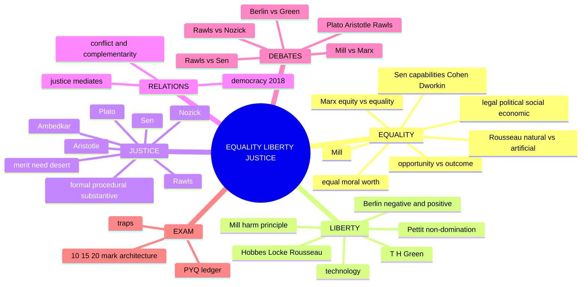

```text
                LIBERTY  <——— tension / complementarity ———>  EQUALITY
                   \                                           /
                    \            JUSTICE mediates             /
                     \   (due, fairness, entitlement,        /
                      \      capability, social dignity)    /
                       └──────────── normative centre ────┘
```

| Ideal | Core question | Canonical pivot | Danger if absolutised | UPSC use |
|---|---|---|---|---|
| **Equality** | In what sense are persons equal? | Equal moral worth; equal concern | Levelling sameness, neglect of merit, coercive uniformity | Legal / political / social / economic equality; opportunity vs outcome |
| **Liberty** | What may a person do without interference, and what capacities make her truly free? | Negative vs positive liberty | Licence, domination by the strong, paternal coercion | Berlin, Mill, Hobbes–Locke–Rousseau, Green |
| **Justice** | What is due to each, by what rule and procedure? | Fairness, procedure, due proportion, entitlement, capability | Fair-looking rules that preserve injustice; arbitrary imposed outcomes | Plato, Aristotle, Rawls, Nozick, Sen, Ambedkar |

**Working thesis ⚠️.** Liberty without limits can protect the already powerful; equality without discrimination among relevant differences becomes mechanical levelling; justice supplies the **criterion of adjudication**.

---

## 1. Identity, Lineage & Doxography (thinkers and traditions)

```mermaid
flowchart TD
  A["Social and political ideals<br/>Paper II Section A, syllabus item 1"] --> E["EQUALITY lineage"]
  A --> L["LIBERTY lineage"]
  A --> J["JUSTICE lineage"]
  E --> E1["Rousseau: natural vs artificial inequality ✅"]
  E --> E2["J. S. Mill: qualified liberal egalitarian ✅"]
  E --> E3["Marx: equality, equity, need ✅"]
  E --> E4["Sen and G. A. Cohen: equality of what? ✅"]
  E --> E5["Dworkin: equality of resources ✅"]
  L --> L1["Hobbes, Locke, Rousseau ✅"]
  L --> L2["Berlin: negative and positive ✅"]
  L --> L3["Mill: harm principle ✅"]
  L --> L4["T. H. Green: positive freedom ✅"]
  L --> L5["Pettit 1997 and Skinner 1998: non-domination ⚠️"]
  J --> J1["Plato: each does one's own work ✅"]
  J --> J2["Aristotle: distributive and corrective ✅"]
  J --> J3["Utilitarianism: aggregate welfare ✅"]
  J --> J4["Rawls: justice as fairness ✅"]
  J --> J5["Nozick: entitlement and minimal state ✅"]
  J --> J6["Sen: nīti and nyāya ✅"]
  J --> J7["Ambedkar: social democracy, fraternity ✅"]
```

### 1.1 Ownership boundary — what this file owns and what it routes away

| Concept | What this owner teaches | Belongs elsewhere |
|---|---|---|
| Citizenship and democracy | Equal civic standing, equal political liberty, the 2018 democracy bridge | Forms of Government |
| Rights and duties | Rights as protected claims; duties as correlative limit | Individual and State |
| Authority and legitimacy | Burden of justifying coercion; legal validity vs moral justification | Sovereignty; political obligation in Individual and State |
| Welfare | Aggregate welfare as the utilitarian criterion; enabling provision as a condition of effective liberty | Development and Social Progress |
| Recognition and social standing | Humiliation, stigma, second-class status as failures of social equality and justice | Taylor, Fraser, Honneth in Humanism–Secularism–Multiculturalism |
| Affirmative action | General compensatory principle only | Reservation policy, reverse discrimination, Indian caste record in Caste: Gandhi and Ambedkar §5A |

### 1.2 Individual and social dimensions

| Ideal | Individual dimension | Social / institutional dimension | Controlling warning |
|---|---|---|---|
| **Equality** | Equal moral worth; may demand equal concern | Laws, offices, resources and status must not reproduce arbitrary hierarchy | Equal worth ≠ identical treatment or outcome |
| **Liberty** | Protected sphere of choice, thought, self-direction | Background conditions and non-domination decide whether formal options are usable | Effective freedom must not become perfectionist coercion |
| **Justice** | Owed reasons, due treatment, rectification | Procedures, distributions, status relations publicly justifiable | Fair procedure and fair outcome are distinct; neither alone suffices |

---

## 2. Theory of Knowledge (justificatory grounds)

> The sources do not present a pramāṇa-style epistemology for this topic. Module 2 therefore records the **methods of justification** each theory uses.

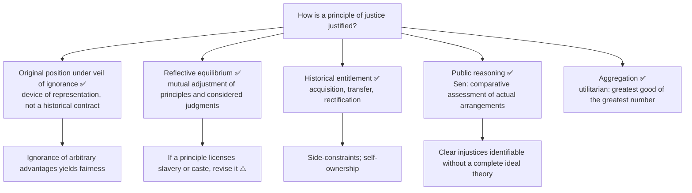

- **Reflective equilibrium ✅:** moral reasoning is revisable and coherentist; equilibrium is not mere compromise, it seeks principled fit. Objection: considered judgments may reflect bias. Reply: public reason, criticism and coherence-testing purge many distortions.
- **Original position ✅:** parties choose principles for the basic structure without knowing class, gender, race, natural talents, religion or conception of the good. Objection: too abstract and socially unencumbered. Reply: abstraction is methodological, a filter for morally arbitrary facts.
- **Legality vs legitimacy ⚠️:** legality identifies a rule's valid place in a legal system; legitimacy asks whether the exercise of authority is morally justified to those subject to it. Justice supplies the critical standpoint. "A law may be valid yet unjust" ✅.

---

## 3. Dialectical Wings & Critical Refinements

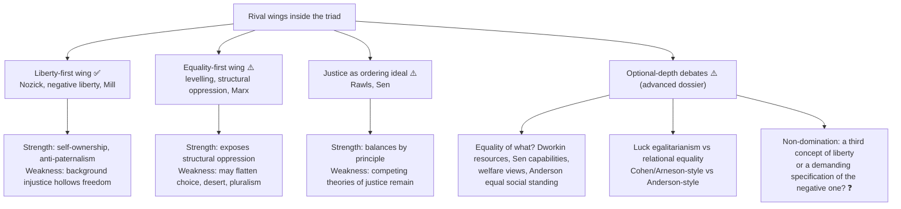

- **Luck vs relational equality (advanced):** a Cohen/Arneson-style view corrects brute luck; an Anderson-style view prioritises ending hierarchy and humiliation. Optional: do not replace Rawls, Nozick, Sen, Mill, Rousseau or Marx with secondary egalitarian literature.
- **Capability objection and reply (advanced):** capability language can be under-specified without one determinate distributive metric; reply: its strength is comparative public reasoning about which freedoms people can actually convert into lives they can lead.
- **Promotion trigger recorded ✅:** capability metric and republican non-domination were promoted to Core on 15 Aug 2026; still to promote if a PYQ asks directly: "equality of what?", luck egalitarianism, relational equality.

---

## 4. Metaphysics & Ontology (conceptual inventory)

### 4.1 EQUALITY — inventory

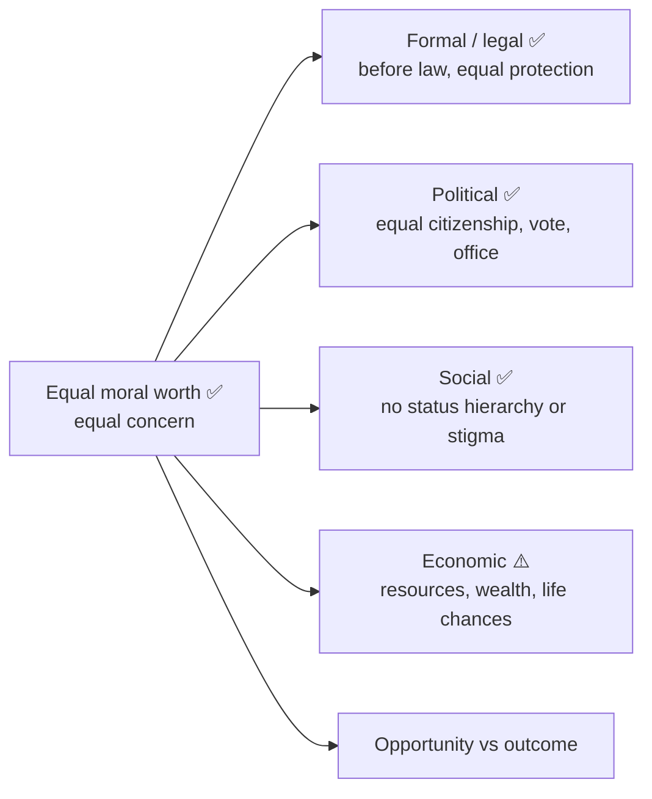

| Form | Secures | Main objection | Reply |
|---|---|---|---|
| **Formal / legal** ✅ | Rule against legal privilege | Paper equality in a deeply unequal society | Needs substantive opportunity |
| **Political** ✅ | Non-oligarchic public standing | Wealth distorts influence | Curb domination, widen participation |
| **Social** ✅ | Equal civic respect | Hard to secure by law alone | Social reform, education, fraternity |
| **Economic** ⚠️ | Fair background conditions | May weaken incentive or need coercive redistribution | Some redistribution protects fair freedom |

| Axis | Equality of opportunity | Equality of outcome |
|---|---|---|
| Core claim | Offices and advantages open on fair terms | Distribution should not leave large or unjust final disparities |
| Focus | Fair starting point | Fair social result |
| Objection | Starting-line fairness illusory if background inequality is severe | Levelling, paternalism, reduced autonomy |
| Best reply | Move from formal to **fair** equality of opportunity | Limit outcome concern to thresholds, needs or least advantaged |

- Equality of worth ≠ identity of talent, desire, capacity or outcome ✅.
- Natural difference does not by itself authorise domination ✅.

### 4.2 Rousseau: natural and artificial / moral inequality ✅ (2021 Q1(b))

| Kind | Content |
|---|---|
| **Natural / physical** | Differences of age, strength, health, intelligence |
| **Artificial / moral / political** | Established by convention: wealth, honour, power, dependence, social superiority |

Natural differences turn toxic when institutions convert them into durable domination and vanity; civil society, especially property and comparison, deepens dependence. Rousseau does **not** say all inequality is created by convention; the most oppressive forms are socially produced and maintained. Objection: romanticises nature. Reply: the distinction is diagnostic, not pastoral.

### 4.3 J. S. Mill on equality ✅ (2025 Q1(e)) — six salient features

1. Equal worth in moral accounting ✅ 2. Equality before law and citizenship ✅ 3. Women's equality (*The Subjection of Women*: subordination is a relic of domination, not nature) ✅ 4. Equality compatible with individuality ✅ 5. Hostility to custom-made hierarchy ✅ 6. Qualified economic concern ⚠️ (open to reforming property relations and labour conditions, not to coercive equalisation of all differences).

Distinction: equality of status and chance ≠ uniformity of life plan. Objection: too individualistic for structural economic inequality. Reply: within liberalism he radicalises equality by extending it to social relations, especially gender.

### 4.4 Marx: equality, equity, need ✅ (2022 Q2(c))

| Theme | Capitalist exchange | First phase of communist society | Higher phase |
|---|---|---|---|
| Distribution rule | Formally equivalent exchange among legal equals | Individual consumption tracks labour contributed after common deductions | According to need |
| Continuing limit | Class power shapes production and appropriation | Same labour standard applied to differently situated producers | Narrow horizon of equal right overcome |
| Moral defect / advance | Formal equality conceals class domination | Equal right remains a "right of inequality" | Unequal needs justify differentiated shares |

**Canonical formula ✅:** "From each according to his ability, to each according to his need."
**Equality** = same measure for all; **equity** = differentiated treatment responsive to need and actual condition. The "right of inequality" is aimed at the **first phase of communist society**; this is distinct from the criticism of formally equal capitalist exchange. Objection: need is vague and weakens incentive. Reply: it concerns a higher stage where alienated labour and scarcity are transformed, not a market-time salary rule.

### 4.5 "Equality of what?" — Sen, Cohen, Dworkin ✅/⚠️

| Thinker | Currency / focus | Distinction | Objection → reply |
|---|---|---|---|
| **Sen** | Capabilities: what persons are actually able to do and be | resources ≠ capabilities; possession ≠ effective freedom | Indeterminate list → Sen leaves room for public reasoning |
| **G. A. Cohen** | Welfare, opportunity for advantage, access to advantage, community-sensitive conditions | institutional justice vs egalitarian social ethos | Too demanding of virtue → shows institutional equality can be undermined by incentives and attitudes |
| **Dworkin** | Equality of resources, not welfare; brute luck vs option luck; auction and insurance thought experiments | luck vs choice | Hard to separate in practice → clarifies why egalitarianism need not equalise preference-satisfaction |

### 4.6 LIBERTY — inventory

| Dimension | Negative liberty | Positive liberty |
|---|---|---|
| Question | Within what area am I left alone? | Who governs me? By what self am I directed? |
| Sense | Freedom **from** interference ✅ | Freedom **to** be one's own master ✅ |
| Lineage | Hobbes, Locke, Mill, classical liberalism | Rousseau, Kantian autonomy, Hegel, Green |
| Value | Protection against coercion and paternalism | Self-mastery, rational agency, self-realisation |
| Berlin's warning | Too little positive concern may ignore incapacity | May justify coercing the "lower self" for the "real self" |

Liberty ≠ mere power; a tyrant has power, not a right to liberty ✅. Liberty theory concerns justified and unjustified constraints, not metaphysical limitlessness.

### 4.7 JUSTICE — inventory

| Form | Exact question | Failure if isolated |
|---|---|---|
| **Formal** ✅ | Are announced principles applied impartially to like cases? | An unjust principle can be applied consistently |
| **Procedural** ✅ | Is the decision produced by fair rules, hearing, publicity, impartiality, non-cheating? | Fair-looking procedure against grossly unequal background |
| **Substantive** ✅ | Are the principles, distribution and social relations themselves just? | Outcome imposed without due process becomes arbitrary |

| Dimension | What justice evaluates |
|---|---|
| Legal ✅ | Impartial administration and whether law itself answers to justice |
| Political ✅ | Equal citizenship, voice, participation, non-arbitrary public power |
| Socio-economic ✅ | Distribution of benefits, burdens, real opportunities |
| Recognition / status ⚠️ | Whether institutions reproduce stigma, humiliation, second-class standing |

**Reconstructed argument ⚠️:** a procedure can be impartial while starting positions are radically unequal; substantive correction without publicity, hearing and limits becomes arbitrary; so justice needs **fair procedure plus a defensible substantive criterion**.

---

## 5. Rejection / Affirmation of Transcendent Realities (normative and legal bridges)

> The sources contain no theological or metaphysical commitments for this topic; Module 5 records instead the **normative claims accepted or rejected** and the dated Indian legal illustrations the owner permits.

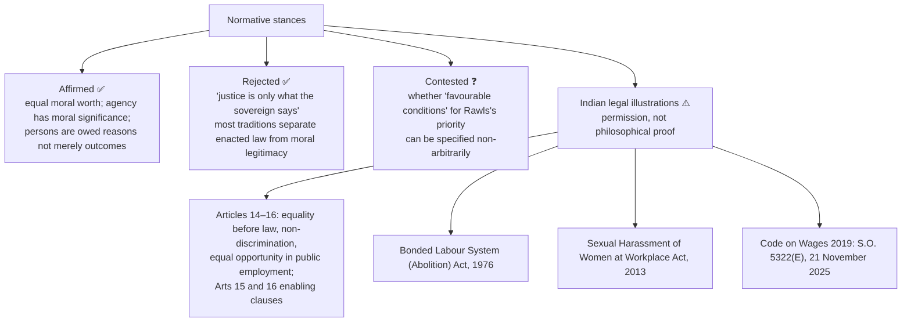

> [!WARNING]
> An enabling constitutional clause is a **permission**, not a philosophical justification; the argument must still be made on a criterion of §4.7/§6.3. Enactment or commencement is not implementation, and none of these shows domination has ended. Never name a present-day government, party or period as an empirical verdict.

---

## 6. Explanatory & Causal Principles

### 6.1 Why liberty and equality conflict and complement ⚠️ (2019 Q4(b), 2022 Q1(d), 2024 Q2(b))

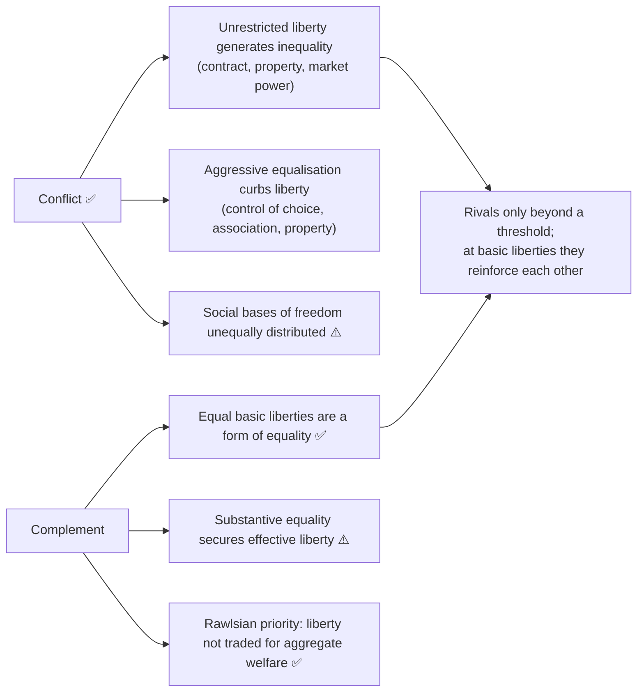

| Claim | Strong version | Counter | Balanced verdict |
|---|---|---|---|
| Liberty limits equality | Too much equalisation kills initiative | Without background equality, liberty is class privilege | Some inequalities may remain, only on fair terms |
| Equality limits liberty | Redistributive control invades private domain | Basic inequalities also coerce by dependence | Secure basic liberties for all before market advantage expands |
| Complementary | Equal civic standing sustains freedom | Breaks at higher distributive demands | Strongest at the level of rights and opportunities |

**2022 Q1(d), test the whole quoted claim ⚠️.** Accept the inequality risk of unbounded liberty; reject the *necessary* loss of freedom without specifying whose freedom and which measure. An order of equal basic liberties limits particular options (e.g. threatening another) yet may enlarge everyone's protected range; on the republican measure, non-arbitrary, publicly contestable rules can constitute freedom. Objection: "order" can cloak surveillance and paternalism; answer: equal standing, proportional restraints, due process, effective contestability.

### 6.2 Mill: harm principle ✅

Only legitimate reason for coercing a person against her will is to prevent **harm to others**. Self-regarding acts generally not coercively restrained; other-regarding acts may be regulated. Distinction: offence or disapproval ≠ harm. Objections: few acts are cleanly self-regarding; "harm" is contestable (moral corruption? dependency? public indecency?). Reply: a presumption for liberty placing the burden of proof on coercion; paternalism must remain exceptional. Grounds: individuality, experimentation and free discussion for truth and development; competent adults generally best judges of their own good.

### 6.3 Hobbes, Locke, Rousseau on liberty ✅

| Thinker | Liberty | Presupposition | Gain | Risk |
|---|---|---|---|---|
| **Hobbes** | Absence of external impediments; subjects free where law is silent | Security primary; fear defines the state of nature | Strong state ends civil war | Thin liberty subordinated to sovereign order |
| **Locke** | Not licence; freedom under known law preserving life, liberty, property | Natural rights pre-exist government | Constitutional limits and consent | Property-centred liberty may mask inequality |
| **Rousseau** | Obedience to a law prescribed to oneself as part of the general will | Freedom needs participation and moral autonomy | Citizens self-legislating | General will misread in majoritarian or authoritarian ways ("forced to be free") |

### 6.4 T. H. Green ✅

Liberty = the **positive power** to do or enjoy something worth doing or enjoying; tied to self-realisation. Mere non-interference is hollow where persons are crippled by ignorance, addiction, destitution or subordination. Strongest reading: enabling, not perfectionist. Example: education enlarges liberty by equipping agency.

### 6.5 Liberty in technological society ⚠️ (2020 Q1(a))

Technology expands knowledge, mobility, communication and choice, yet also enables state surveillance, corporate profiling, opaque algorithmic steering and exclusion of those without access. Negative liberty (obstruction), positive liberty (skills and resources to choose), and non-domination (unaccountable power over platforms, data, employment) each detect different harms. Convenience ≠ autonomy. Freedom is **possible, not automatic**: privacy safeguards, digital literacy, contestable automated decisions, limits on arbitrary public/private power.

### 6.6 Republican liberty as non-domination ⚠️ (Pettit 1997; Skinner 1998)

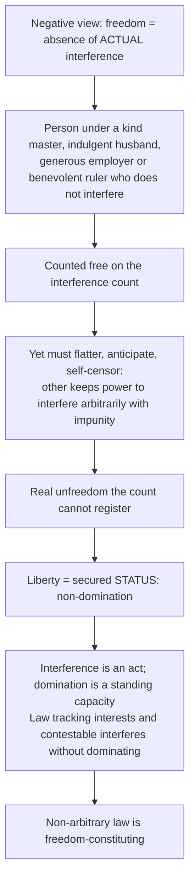

| Diagnostic | Negative | Positive | Non-domination |
|---|---|---|---|
| Freedom-destroying variable | External obstruction | Internal disorder, ignorance, want of enabling conditions | Another's arbitrary, unaccountable power |
| Un-interfered-with slave free? | ⚠️ yes, to that extent | ⚠️ contested | ⚠️ no, unfree as a slave |
| Is law a loss of freedom? | ⚠️ yes, needs justification | ⚠️ may enable | ⚠️ non-arbitrary law constitutes freedom |
| Institutional demand | Restrain the state | Develop capacities | Contestability, publicity, review, interest-tracking |

Roles: Pettit supplies the theory; Skinner the intellectual history. Do not quote either; no page or edition detail. Objections: (1) redundancy — reply: probability of interference is contingent; the point is the standing of the relation. (2) indeterminacy of "arbitrary" — reply: procedural specification, tracking avowable interests and effective contestation; residual indeterminacy should be conceded. Non-domination reframes the liberty–equality trade-off: material dependence *is* a source of domination, so some equalising measures **increase** freedom.

---

## 7. Ethics & Human Goals (value aims and distributive criteria)

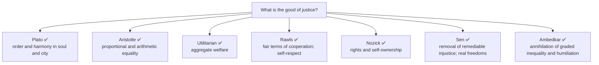

### 7.1 Plato ✅ (2024 Q1(a); 2019 Q1(a))

Justice = each part performs its proper function without usurping another's role, in **soul and city**: reason governs spirit and appetite; rulers rule, auxiliaries defend, producers provide. Presupposes natural functional differentiation. Not mere external distribution; inner and civic right-order. Objection: subordinates individuality to fixed hierarchy. Reply: aims at a norm of competence and organic harmony.

### 7.2 Aristotle ✅

| Type | Principle | Equality | Example | Objection |
|---|---|---|---|---|
| **Distributive** | Shares track relevant merit or contribution | **Proportional** | Offices or honours by relevant desert | Disputes over merit |
| **Corrective / rectificatory** | Restore balance after wrongful gain or loss | **Arithmetic** | Compensation, restitution, punishment | May ignore structural context |

Treating equals equally and unequals unequally is just only when the basis of comparison is relevant.

### 7.3 Merit, need and desert — the criteria problem ✅/⚠️

| Criterion | Formula | Best for | Strongest objection |
|---|---|---|---|
| **Need** | According to need | Subsistence, health care, basic education, disability support | Elastic, contested; incentive and responsibility |
| **Desert (moral)** | Effort, sacrifice, virtue | Honours, recognition, praise and blame | Effort unobservable and shaped by unchosen advantage |
| **Merit (qualification)** | Demonstrated competence for a role | Offices, admissions, appointments | Measured merit encodes prior access |
| **Contribution / entitlement** | Productive value or voluntary transfer | Wages, exchange, property titles | Price tracks scarcity and bargaining power |
| **Equal share** | Equally | Civil and political rights, one person–one vote | Flattens relevant difference elsewhere |
| **Compensation** | Unjustified prior loss | Rectification of wrongful harm and structural disadvantage | How far back, whose loss, who pays |

Justice is **pluralist about criteria but not arbitrary**; injustice is exporting a criterion out of its sphere (wealth buying political influence; caste rank governing access to office). **Merit vs desert:** desert backward-looking and moralised; merit forward-looking and functional. Rawlsian objection: talent, family advantage, even capacity for effort are morally arbitrary; Rawls's reply: desert cannot be the foundational principle but legitimate expectations within just institutions stand. Nozickian objection: any pattern requires continuous interference; reply: patterns need only be maintained at the level of background institutions, and Nozick's rectification still needs a criterion.

### 7.4 Corrective justice and the compensatory principle ⚠️

Aristotle's corrective justice is **transactional** (identifiable wrongdoer, victim, discrete transaction). Structural disadvantage meets none cleanly. Compensatory principle: systematic, legally sanctioned exclusion → continued depression of present capability → formal equality ratifies an unequal starting line → corrective justice generalised to structures requires positive measures → demanded **by** equality, not as an exception. Objections: costs on the innocent / group-membership — reply: present beneficiaries are **unjustly advantaged**, not guilty; no terminus — reply: it lapses when transmitted disadvantage ceases. The affirmative-action debate itself is routed to the Caste owner.

### 7.5 Utilitarian justice ✅

Institutions are just if they maximise overall welfare. **Aggregation objection:** may sacrifice individuals, minorities or the least advantaged. Reply: rule/indirect utilitarianism protects rights through stable rules; critics say protections stay contingent.

### 7.6 Rawls: justice as fairness ✅ (2019 Q1(a), 2023 Q1(a), 2026 Q1(a))

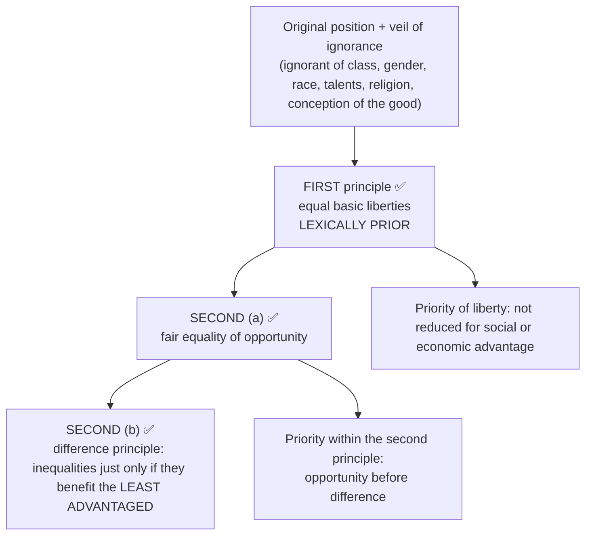

**Why the lexical order is necessary (2026 Q1(a)) ✅/⚠️ — seven moves:**

| # | Reason |
|---|---|
| 1 | Exclude aggregation: only a priority rule, not a weighting, blocks trading one person's liberty for a larger sum |
| 2 | Parties in the original position do not know their conception of the good, so they secure liberty first |
| 3 | Avoid intuitionism: balancing would make application depend on intuitions; lexical order is a public, checkable procedure |
| 4 | Self-respect is the most important primary good; liberties express equal citizenship |
| 5 | Priority is conditional on favourable conditions, not absolute in the abstract |
| 6 | Fair equality of opportunity precedes the difference principle, else inequalities benefit the least advantaged by closing careers (status hierarchy through the back door) |
| 7 | Stability and publicity ⚠️ |

| Axis | Utilitarian aggregation | Intuitionist balancing | Rawls's lexical order |
|---|---|---|---|
| Trade liberty for welfare? | ✅ yes if the sum rises | ⚠️ sometimes | ❌ no, under favourable conditions |
| Determinacy | High, unconstrained | Low | High and constrained |
| Minorities | Weak | Unpredictable | Strong |
| Self-respect | One good among others | Contextual | Most important primary good |
| Main objection | Permits sacrifice of persons | No decision procedure | Rigidity where the poor might prefer welfare to liberty |

Objections: rigidity (reply: favourable conditions; threshold imprecise ❓); abstraction/communitarian (veil is a device of representation); capability objection by Sen (challenges currency more than ordering). Basic liberties form a **scheme** adjustable against one another, not against economic gains. Rawls = deontological liberal egalitarianism ⚠️. Works cited by title and year: *A Theory of Justice* (1971; rev. 1999), *Political Liberalism* (1993).

### 7.7 Nozick ✅ (2021 Q1(a))

| Component | Content |
|---|---|
| Acquisition | How unowned things may be justly acquired |
| Transfer | Voluntary exchange, gift, transfer |
| Rectification | Correction of past injustice |

Patterned (end-state shape: equality, need, merit) vs **historical** (process). **Wilt Chamberlain** argument: free payments upset any pattern, so the new inequality is just if transfers were voluntary. Taxation for pattern maintenance partly appropriates labour. **Minimal state:** protection against force, theft, fraud, enforcement of contracts. Objection: starting distributions rarely clean; voluntariness undermined by power asymmetry and coercive necessity. Reply: rectification exists, though under-specified.

### 7.8 Sen: *The Idea of Justice* ✅ (2021 Q2(a))

| Concept | Content |
|---|---|
| **Nīti** | Correctness of institutions, rules, procedures |
| **Nyāya** | Realised justice: how people actually fare |
| **Comparative vs transcendental institutionalism** | "Which arrangement is more just?" ≠ "What is the perfectly just society?" |
| **Capability and public reasoning** | What people can actually be and do; democratic public reasoning |

Example: one can condemn famine, exclusion or preventable incapability without solving every problem of ideal design. Objection: comparison without an ideal lacks direction; reply: public reasoning and manifest injustice supply orientation.

### 7.9 Ambedkar as foil ✅

Political democracy is unstable without **social democracy** rooted in **liberty, equality and fraternity**. Formal rights are undermined where caste hierarchy denies equal social standing and fraternity. Constitutional form ≠ lived social democracy. Objection: social justice talk subordinates liberty to reformist control; reply: liberty without equal status and fraternity is empty for the oppressed.

### 7.10 Are liberty and equality inadequate without justice? ⚠️ (2025 Q4(a))

Liberty alone is under-specified (whose liberty, to do what, against whom?); equality alone is under-specified (status, rights, opportunity, welfare, resources, capabilities, outcome?); justice supplies the adjudicatory criteria (desert, fairness, entitlement, need, capability, rectification, public reason). Verdict: justice is the architectonic ideal.

---

## 8. Inter-School Comparative Matrices

### 8.1 Berlin vs Green

| Issue | Berlin | Green |
|---|---|---|
| Core anxiety | Coercion in the name of higher freedom | Formal liberty without real power to use it |
| Emphasis | Negative liberty | Positive freedom / self-realisation |
| Risk diagnosed | Authoritarian paternalism | Social abandonment, hollow freedom |
| Synthesis ⚠️ | Protected sphere against coercion | Enabling conditions without paternalistic control |

### 8.2 Rawls vs Nozick

| Issue | Rawls | Nozick |
|---|---|---|
| Starting point | Fair agreement among free and equal persons | Self-ownership, inviolable rights |
| Distribution | Inequalities only if they aid the least advantaged | No end-state pattern |
| State | More than minimal if needed for a just basic structure | Minimal state only |
| Critique of the other | Entitlement ignores fair background conditions | Patterned principles violate liberty |

### 8.3 Rawls vs Sen

| Issue | Rawls | Sen |
|---|---|---|
| Focus | Just basic structure, ideal principles | Comparative justice, remediable injustice |
| Metric | Primary goods | Capabilities |
| Method | Original position; institutional design | Public reasoning; actual outcomes |
| Criticism | — | Too transcendental / institution-focused |
| Rawlsian reply ⚠️ | Institutions are indispensable preconditions | — |

### 8.4 Mill vs Marx on equality

| Issue | Mill | Marx |
|---|---|---|
| Worry | Suppression of individuality; legal and social subordination | Class exploitation hidden by formal equality |
| Equality | Status, liberty, women's emancipation | Need-sensitive social transformation |
| Market society | Reformable liberal order | Structurally exploitative capitalism |
| Exam use ⚠️ | Defend equal status and individuality | Expose limits of merely formal equality |

### 8.5 Plato, Aristotle, Rawls

| Question | Plato | Aristotle | Rawls |
|---|---|---|---|
| What is justice? | Functional harmony | Proportion / rectification | Fair terms of cooperation |
| Unit | Soul and polis | Polis and transactions | Basic structure of society |
| Equality | Role-fitting order, not democratic equality | Proportional equality | Equal basic liberties + fair opportunity |

**2019 Q1(a) "how far":** Rawls continues Plato only in the broad sense that justice structures a well-ordered society (first virtue of the basic structure); he departs in method (contract behind a veil), equal citizenship and rejection of fixed functional hierarchy. Do not attribute Rawls's two principles or individual rights to Plato; do not call Rawls indifferent to social unity.

### 8.6 Procedural vs substantive justice

| Axis | Procedural | Substantive | Synthesis |
|---|---|---|---|
| Test | Fair rule or historical procedure followed? | Are principle, distribution, status relations just? | Fair process plus publicly defensible outcomes |
| Exemplar | Nozick's acquisition–transfer–rectification | Rawlsian fair background, capability, social equality | Procedure cannot cleanse unjust starting conditions |
| Objection | Background inequality hollows voluntary choice | Officials impose one contested pattern | Preserve due process, rights, contestability, minimums |

### 8.7 Are liberty and equality distinctive of democracy? (2018 Q2(a)) ⚠️

| Claim | Why distinguishing | Why insufficient |
|---|---|---|
| Political equality | Equal standing, vote, eligibility rule out hereditary rank | Franchise coexists with wealth-driven influence, caste exclusion |
| Basic liberty | Speech, association, conscience, opposition allow accountability | Economic liberties exist under non-democracies; majority power can silence minorities |
| Both together | Equal standing makes liberty everyone's right | Elections can still fail under domination or exclusion |

Verdict: distinctive **joint normative commitments**, not empirically guaranteed or sole defining institutional criteria. Ambedkar's social-democracy warning marks the Indian limit to formal equal voting. Detailed institutions belong to Forms of Government; the "pure democracy" Marxist critique to Political Ideologies.

---

## 9. Criticisms & Reconstructed Replies

```mermaid
flowchart TD
  K1["EQUALITY<br/>ignores natural difference"] --> L1["Political equality concerns status and treatment, not denial of difference"]
  K2["EQUALITY<br/>of outcome destroys incentive"] --> L2["Thresholds, fair opportunity, capability floors, least-advantaged gains"]
  K3["EQUALITY<br/>differential treatment violates equality"] --> L3["Equity can make equality substantive"]
  K4["LIBERTY<br/>negative serves the powerful"] --> L4["True if isolated; false with equal basic rights and anti-domination safeguards"]
  K5["LIBERTY<br/>positive invites paternalism"] --> L5["Real danger; enabling conditions need not dictate a life-plan"]
  K6["LIBERTY<br/>Mill's line unstable"] --> L6["Still a presumption that places the burden on coercion"]
  K7["JUSTICE<br/>Plato freezes hierarchy"] --> L7["Value lies in harmony and function, not class closure"]
  K8["JUSTICE<br/>Rawls too abstract"] --> L8["Abstraction is a fairness device"]
  K9["JUSTICE<br/>Nozick ignores structural injustice"] --> L9["Remains a warning against overreaching redistribution"]
  K10["JUSTICE<br/>Sen open-ended"] --> L10["Openness deliberate; suits plural societies"]
```

Additional pairs: Aristotle — merit is contestable (reply: proportionality shows justice is not flat arithmetic). Procedural justice — fair rules suffice (reply: procedures inherit unjust starting conditions). Substantive justice — may ignore due process (reply: defensible only through rights-bound, public, contestable procedures). Berlin's own critique: pure negative liberty ignores poverty, addiction, illiteracy, dependency (reply: his distinction need not deny social preconditions; it warns against totalising projects).

**Residual problems that survive replies ⚠️.** Berlin: positive-liberty paternalism; Rawls: favourable-conditions threshold ❓; Sen: under-determination; non-domination: "arbitrary"; compensation: over-inclusion and terminus; Nozick: acquisition and rectification are the weakest links.

---

## 10. Controlled Western Comparisons

> This topic is itself Western-derived; the sources supply internal cross-tradition anchors rather than a separate East–West table. Controlled comparisons recorded:

| Pair | Point of contact | Decisive disanalogy |
|---|---|---|
| **Plato — Rawls** | Justice as the organising excellence of a well-ordered society | Plato: functional classes, reason's rule; Rawls: free and equal persons choose principles behind a veil (2019 Q1(a)) |
| **Sen — Rawls** | Both concerned with justice and fair freedom | Transcendental institutionalism vs comparative realisation; primary goods vs capabilities (2021 Q2(a)) |
| **Ambedkar — liberal triad** | Liberty, equality, fraternity | Social democracy as precondition for political democracy; liberty hollow without equal status |
| **Nīti / nyāya (Sen)** | Indian terms used for institutions vs realised justice | Used as Sen's analytic pair, not as classical Indian-school doctrine ⚠️ |

> [!WARNING]
> Never attribute modern individual rights or Rawls's two principles to Plato. Keep Pettit (theory) and Skinner (history) separate; cite by title and year only.

---

## 11. Diagnostic Deep-Dives for High-Frequency Themes

### 11.1 Liberty–equality composite stems (2019 Q4(b), 2022 Q1(d), 2024 Q2(b), 2025 Q4(a), 2018 Q2(a))

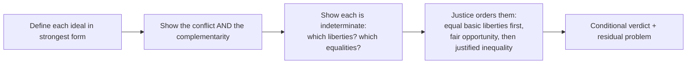

### 11.2 2026 Q3(c) — negative vs positive liberty (15 marks) ⚠️

Marks lie in: Berlin's "higher self" warning and authoritarian misuse; the reply that non-interference without capability is empty (Green); non-domination as the third option dissolving the binary.

### 11.3 2022 Q2(c) — equity vs equality in Marx ⚠️

Fix the formula; separate capitalist formal exchange from the first-phase "right of inequality"; define equality = same measure, equity = differentiated by need; objection and reply on need and incentive; do not defend the capitalist wage relation.

### 11.4 2020 Q1(a) — is liberty realizable in technological society? ⚠️

Three lenses (negative / positive / non-domination); do not infer autonomy from mere use of a platform, or impossibility of freedom from all coordination.

### 11.5 Directive decoder ⚠️

| Directive | Scored | Minimum structure | Failure mode |
|---|---|---|---|
| Discuss | Exposition plus one live tension | Doctrine → distinction → objection → verdict | Listing views |
| Explain | Internal logic | Statement → premises → distinction → example | Inserting unrequested criticism |
| Critically discuss / evaluate | The objection–reply layer | Doctrine → strongest objection → reply → residual → graded verdict | One-sided demolition |
| How far / to what extent | A degree judgment | Conditions under which it holds and fails | Yes/no answer |
| Compare / distinguish | Shared axes | 3–4 axes, then adjudicate | Two mini-essays |
| Is X an improvement upon Y? | Named criterion | Test → apply → concede what Y does better | Improvement without a standard |

---

## 12. PYQ Routing Ledger

> Primary-owned: **14** parts in 2018–2025 (of 112 socio-political parts) + **2** in the 2026 supplement = **16**. By year (owner ledger): 2018: 1 · 2019: 2 · 2020: 1 · 2021: 3 · 2022: 2 · 2023: 1 · 2024: 2 · 2025: 2.

| Year | Q | Marks | Exact demand | Map to |
|---|---|---:|---|---|
| 2018 | Q2(a) | 20 | How far can liberty and equality be considered as distinctive features of democracy ? Discuss. | §8.7 |
| 2019 | Q1(a) | 10 | How far do you think John Rawls is continuing with Plato's concept of justice? | §8.5, §7.1, §7.6 |
| 2019 | Q4(b) | 15 | Does liberty put limitations to equality? Discuss. | §6.1 |
| 2020 | Q1(a) | 10 | Is the concept of liberty realizable in the modern technological society? Explain. | §6.5 |
| 2021 | Q1(a) | 10 | Discuss critically the distributive theory of justice as propounded by R. Nozick. | §7.7 |
| 2021 | Q1(b) | 10 | How does Rousseau distinguish between natural and artificial inequality ? Explain. | §4.2 |
| 2021 | Q2(a) | 20 | Discuss whether Amartya Sen's idea of justice is an improvement upon Rawl's theory of justice. | §7.8, §8.3 |
| 2022 | Q1(d) | 10 | "Complete liberty may lead to inequality while order and restrictions imply a necessary loss of freedom." Critically discuss. | §6.1 |
| 2022 | Q2(c) | 15 | Explain the difference between the notion of equity and equality with reference to Marxian philosophy. | §4.4 |
| 2023 | Q1(a) | 10 | What is meant by justice as fairness? Explain Rawls' theory of justice. | §7.6 |
| 2024 | Q1(a) | 10 | Briefly discuss Plato's concept of justice. | §7.1 |
| 2024 | Q2(b) | 15 | Critically evaluate the concepts of liberty and equality as political ideals. | §6.1–§6.6 |
| 2025 | Q1(e) | 10 | Discuss the salient features of equality according to J.S. Mill. | §4.3 |
| 2025 | Q4(a) | 20 | How are both equality and liberty inadequate as social and political ideals without justice? Discuss. | §7.10 |
| 2026 | Q1(a) | 10 | Why does Rawls consider it necessary that the two principles of justice be applied in lexical order ? Explain. | §7.6 |
| 2026 | Q3(c) | 15 | Negative liberty seems to embody the idea of ultimate personal freedom, whereas positive liberty enables individuals to achieve their full potential. Discuss. | §4.6, §6.4, §6.6, §11.2 |

**Cross-owned (not counted here):** 2026 Q1(b), 10 marks — *Is Plato's vision of an ideal state compatible with the rights and liberties of individual citizens ? Discuss.* — primary owner Individual and State (§4.4B); this file is a bridge via Plato's justice (§7.1) and liberty (§6).

**Corpus pattern ⚠️:** Ideals rank second by ownership (14) behind Humanism–Secularism–Multiculturalism (16) in 2018–2025. Do not duplicate democracy questions owned by Forms of Government or Marxism questions owned by Political Ideologies; route by the demanded normative concept.

---

## 13. Top 10 UPSC Exam Traps

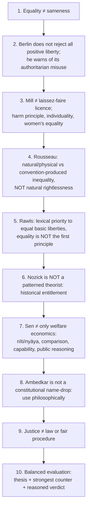

Extra pitfalls recorded: describing the two principles and stopping on 2026 Q1(a) (the stem asks **why** the order is necessary); calling Rawls's priority unconditional (holds under favourable conditions); treating lexical order as a tie-breaker (it is serial); forgetting the internal priority of fair opportunity over the difference principle; quoting Pettit or Skinner; naming a present-day government in an Indian illustration; treating an enabling clause (Arts 15, 16) as philosophical justification; collapsing merit and desert; at 10 marks attempting two thinkers or an Indian illustration unprompted.

---

## 14. Technical Vocabulary Bank

| English term | Gloss | Status |
|---|---|---|
| equal moral worth | Basis of equality; equal concern | ✅ |
| formal / legal equality | Before law; equal protection | ✅ |
| substantive equality | Equal real standing and opportunity | ⚠️ |
| equality of opportunity / outcome | Fair starting point / fair result | ✅ / ⚠️ |
| equity (need-sensitive distribution) | Differentiated treatment responsive to need | ⚠️ |
| natural vs moral inequality | Rousseau | ✅ |
| negative liberty / positive liberty | Freedom from / freedom to | ✅ |
| harm principle; self- / other-regarding | Mill | ✅ |
| self-realisation | Green | ✅ |
| non-domination; arbitrary interference; benevolent master; contestability | Pettit / Skinner | ⚠️ |
| distributive / corrective (rectificatory) justice | Aristotle | ✅ |
| proportional vs arithmetic equality | Aristotle | ✅ |
| formal / procedural / substantive justice | Taxonomy (Gauba-corroborated) | ✅ |
| recognition / status justice | Stigma, second-class standing | ⚠️ |
| merit, desert, need, contribution, equal share, compensation | Distributive criteria | ✅ |
| morally arbitrary advantage | Rawlsian objection to desert | ⚠️ |
| original position; veil of ignorance | Rawls | ✅ |
| equal basic liberties; fair equality of opportunity; difference principle | Rawls | ✅ |
| lexical (serial) order | First principle satisfied before the second applies | ✅ |
| reflective equilibrium | Principles and judgments adjust | ✅ |
| entitlement theory; patterned vs historical; minimal state | Nozick | ✅ |
| nīti / nyāya | Institutional correctness / realised justice | ✅ |
| capability approach; public reasoning | Sen | ✅ |
| compensatory principle; transmitted disadvantage | Structural corrective justice | ⚠️ |
| social justice; fraternity | Ambedkar | ✅ |
| brute luck / option luck | Dworkin | ✅ |

---

## 15. Graded Verdict & Answer Architectures

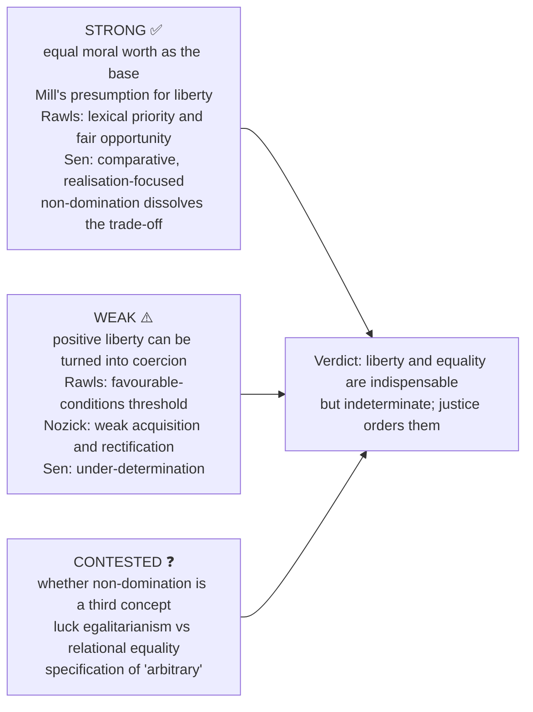

### 15.1 10-mark method (~150 words · 4 moves)

1. Exact doctrine in 2 lines using the technical term. 2. Argument spine: 4–5 numbered premises and one distinction. 3. One evidence unit and its limitation. 4. Graded verdict, not a summary.
**Anchor:** "Rawls does not abolish inequality; he civilises it by subjecting it to liberty, opportunity and the difference principle." ⚠️

### 15.2 15-mark method (~220 words · 6 moves)

1. Frame the axis of dispute. 2. Side A strongest, with presupposition. 3. Side B strongest, with the presupposition it denies. 4. One fully worked objection → reply pair. 5. Two evidence units from different families. 6. Conditional verdict naming when each side wins.
**Anchor:** "Complementarity is strongest at the level of rights and opportunities; beyond that, liberty and equality compete on fair terms." ⚠️

### 15.3 20-mark method (~300 words · 8 moves)

1. Provisional thesis using the stem's verb. 2. Concept map and criterion of assessment. 3. Strongest case for the proposition. 4. Strongest rival. 5. Two objection → reply chains ending in residual problems. 6. Comparative adjudication. 7. One dated Indian illustration, correctly classified, with the legal-status caution. 8. Graded verdict conceding something to the losing side.
**Anchor:** "Liberty and equality remain normatively incomplete unless justice decides their scope and priority." ⚠️

### 15.4 Selectable evidence bank (pick 1 at 10 marks, 2 at 15, 4–5 at 20)

| Unit | Claim → anchor → use → limit |
|---|---|
| E1 | Inequality is historical → Rousseau → 2021 Q1(b) → a genetic account does not justify a remedy |
| E2 | Equality ≠ equal shares → Aristotle's two justices → any equality stem → criterion unspecified |
| E3 | Criterion problem → criteria grid → equity / social-justice stems → sphere boundaries contested |
| E4 | Two poles of liberty → Berlin, Green → 2020 Q1(a), 2022 Q1(d), 2024 Q2(b) → "real self" coercion |
| E5 | Liberty as status → Pettit 1997, Skinner 1998 → dissolves the trade-off → "arbitrary" indeterminate; flag as a third family |
| E6 | Self- vs other-regarding → Mill → 2025 Q1(e) → boundary of "harm" |
| E7 | Justice as fairness → Rawls → 2019 Q1(a), 2023 Q1(a) → institutional focus can neglect realised freedom |
| E8 | Entitlement → Nozick → 2021 Q1(a) → acquisition and rectification weakest |
| E9 | Realisation → Sen → 2021 Q2(a) → comparison without ideal can under-determine |
| E10 | Equity as need-sensitivity → Marx's *Critique of the Gotha Programme* → 2022 Q2(c) → two-stage structure is a normative projection |
| E11 | Political liberty and social democracy → Ambedkar → democracy + equality stems → constitutional detail owned by Caste file |
| E12 | Compensatory principle → §7.4 → social-justice stems → terminus and over-inclusion |
| E13 | Procedure and substance → §4.7 taxonomy → composite justice answers → substantive correction must stay rights-bound |

### 15.5 Graded verdict formulas

- **Conditional:** "The claim holds where ⟨condition⟩, and fails where ⟨condition⟩; it is a matter of degree rather than kind."
- **Asymmetric:** "⟨Thinker A⟩'s diagnosis survives; the remedy does not."
- **Improvement:** "Judged by ⟨criterion⟩, ⟨A⟩ improves on ⟨B⟩; judged by ⟨rival criterion⟩, ⟨B⟩ retains the advantage."
- **Ordering:** "Liberty and equality are indispensable but each is indeterminate about which liberties and which equalities matter; justice orders their claims."
- **Reconstruction:** "The objection defeats the strong form but leaves the reconstructed form standing under ⟨constraint⟩."

> [!TIP]
> **Ready statements.** (1) Equality is best read as equal moral standing, not numerical sameness. (2) Formal equality without fair background conditions may stabilise privilege. (3) For Berlin the question is whether self-mastery can be politicised into coercion. (4) Mill's harm principle gives liberty a moral presumption yet permits regulation of injury to others. (5) Nozick asks how holdings arose, not whether they fit a pattern. (6) Sen reorients justice from perfect institutions to comparative reduction of manifest injustice. (7) Ambedkar reminds us political equality is fragile where social hierarchy denies fraternity. (8) Fair procedure is necessary but cannot vindicate an unjust principle, distribution or status order.

---

## Sources

O. P. Gauba, *An Introduction to Political Theory*; Bhargava and Acharya, *Political Theory: An Introduction*; *Socio-Political Philosophy*; Audi (ed.), *The Cambridge Dictionary of Philosophy*; Rawls, *A Theory of Justice*; Nozick, *Anarchy, State and Utopia*; Sen, *The Idea of Justice*; Berlin, *Two Concepts of Liberty*; Mill, *On Liberty* and *The Subjection of Women*; Aristotle, *Nicomachean Ethics* Book V and *Politics*; Pettit, *Republicanism* (1997) and Skinner, *Liberty before Liberalism* (1998), by title and year only; Marx, *Critique of the Gotha Programme*; advanced-dossier trail: Dworkin, *Sovereign Virtue*; G. A. Cohen, *Rescuing Justice and Equality*; Elizabeth Anderson, "What Is the Point of Equality?". Indian legal illustrations: Constitution of India Arts 14–16; Bonded Labour System (Abolition) Act 1976; Sexual Harassment of Women at Workplace Act 2013; Code on Wages commencement S.O. 5322(E), 21 Nov 2025 — dated illustrations only.
