# SOVEREIGNTY — Austin, Bodin, Laski, Kautilya — Examiner-Grade Mindmap

> **Syllabus (verbatim):** Sovereignty : Austin, Bodin, Laski, Kautilya.
> **Catalogue key:** `philosophy-paper-ii-socio-political-philosophy-02` · Paper II · Section A · Socio-Political Philosophy
> **Sources used:** `paper-2/socio-political/Sovereignty.md` (canonical owner) · `_advanced/Socio-Political-Dossier.md` §2 (optional depth) · `paper-2/_PYQ-SocioPolitical-2018-2025.md` · `paper-2/_PYQ-SocioPolitical-2026-Supplement.md`.
> **Evidence key:** ✅ canonical · ⚠️ analytical synthesis · ❓ contested
> **Blueprint adaptation:** `MINDMAP_INSTRUCTIONS.md` is Indian-school oriented. The 16 module headings are kept and each module's focus is adapted: Module 1 = thinkers and lineage; Module 2 = the conceptual and justificatory grounds of final authority (the sources contain no epistemology of sovereignty); Module 3 = rival and critical wings; Module 4 = conceptual inventory; Module 5 = normative, legal and constitutional bridges; Module 6 = explanatory principles; Module 7 = value aims of authority. Where the sources give nothing for a module, the module says so.

> [!IMPORTANT]
> **Core thesis.** The real dispute is not whether order needs authority, but whether that authority must be conceived as undivided, legally unlimited and morally self-justifying. Bodin and Austin answer yes or nearly yes; Laski answers no; Kautilya offers a duty-bound and strategic version. The modern debate is better framed as **how sovereignty is structured and limited**, not whether it exists. ⚠️

---

## 0. Master Overview

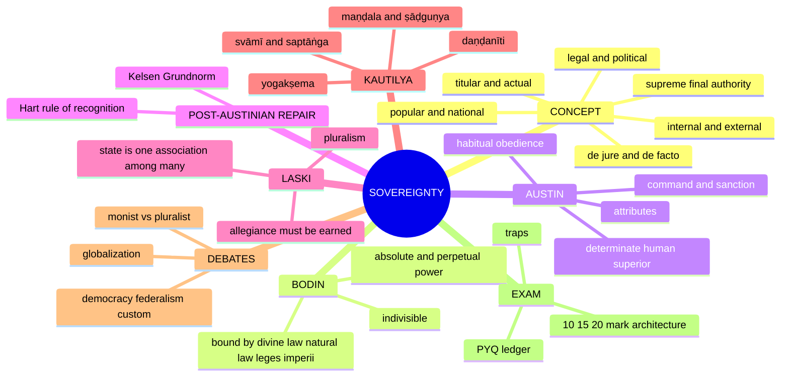

| Thinker | Core statement | Type | What limits it? | UPSC use-value |
|---|---|---|---|---|
| **Bodin** | Sovereignty is the **absolute and perpetual power** of the commonwealth ✅ | Classical monist, juristic-political | Divine law, natural law, fundamental laws of the realm (*leges imperii*) ✅ | Origin of the modern doctrine; absoluteness without pure arbitrariness |
| **Austin** | Sovereign is the **determinate human superior** habitually obeyed by the bulk of society and habitually obeying no one ✅ | Legal-monistic, command theory | Formally none within the legal order ✅ | Analytical/legal theory and its criticisms |
| **Laski** | State is **one association among many**; sovereignty cannot be absolute ✅ | Pluralist | Social plurality, morality, associational autonomy, practical limits ✅ | Critique of monism; defence of liberty |
| **Kautilya** | Sovereignty centred on the **svāmī**, but the state is an organism of seven limbs oriented to **yogakṣema** ✅ | Organic, welfare-oriented, strategic | Dharma, reason of state, welfare of subjects, institutional interdependence ✅ | Indigenous theory; *daṇḍanīti*, *maṇḍala*, modern relevance |

> [!TIP]
> **UPSC hinge.** Never treat the four thinkers as saying the same thing about supremacy; the paper repeatedly asks for exact differences. Bodin and Austin ask *who* is sovereign; Kelsen and Hart ask *what makes a norm valid*; Laski denies that any single answer is possible; Kautilya asks what the holder of authority is *for*.

---

## 1. Identity, Lineage & Doxography (thinkers and traditions)

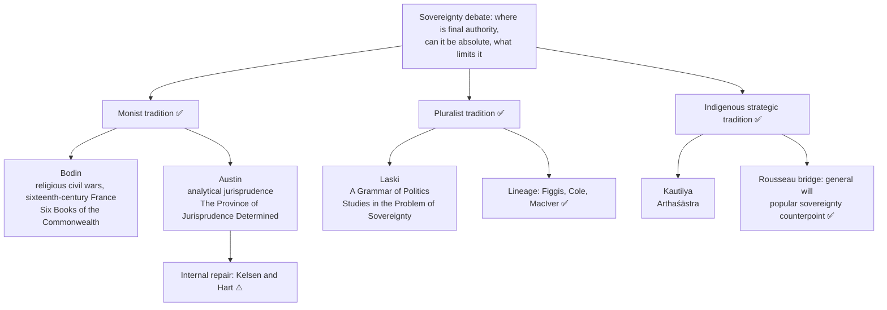

| Thinker / figure | Placement | Boundary |
|---|---|---|
| **Bodin** | First great systematic theorist of modern sovereignty ✅ | Not merely praising despotism; theorises state unity under civil conflict |
| **Austin** | Analytical jurisprudence; separates what law *is* from what it *ought to be* ✅ | Explains positive law, not moral legitimacy |
| **Kelsen** | *General Theory of Law and State*, first English edition **1945** (tr. Anders Wedberg) ✅ | ❌ Not 1961 |
| **Hart** | *The Concept of Law*, **1961** ✅ | Rejects, does not restate, the command model |
| **Laski** | Pluralist; early work attacked sovereignty as a legal fiction, mature work conceded its importance for state power while denying omnipotence ✅ | Neither "abolishes sovereignty" nor "accepts Austin"; not an anarchist |
| **J. N. Figgis** | Churches and other real associations expose danger of an absolute state allied with economic concentration ✅ | Group-personality and anti-absorption precursor |
| **G. D. H. Cole** | Forerunner of pluralism; functional/guild representation ✅ | Not a full guild-socialist theory |
| **R. M. MacIver** | Law and constitution, not a mysterious sovereign will, ground legitimate public force; state coordinates associations ✅ | Strongest sociological supplement; residual coordination role |
| **Hobbes** | Security-first absolutist bridge | Full social-contract theory owned by Individual and State |
| **Rousseau** | General will as popular-sovereignty counterpoint to Austin | Same |
| **Kautilya** | *Arthaśāstra* (Shamasastry / R. P. Kangle translations) | Neither simple absolutist nor liberal constitutionalist ⚠️ |
| **Maine** | Critic of Austin via the Ranjit Singh example ✅ | One case vs wider mismatch |
| **Dworkin** | Hard-cases objection to Hart | Owned by Individual and State §4A.4; name and route only |

**Ownership boundary ✅.** This owner teaches the concept and the four printed thinkers; Hobbes/Rousseau, rights and obligation, democracy, equality–justice–liberty, international institutions and Indian constitutional law enter only where they answer an owned sovereignty question.

**Source note ⚠️.** Kelsen/Hart module is a named-scholar reconstruction; no page, chapter, edition or verbatim wording is asserted for either.

---

## 2. Conceptual and Justificatory Grounds of Final Authority

> The owner file contains no epistemology of sovereignty. This module records the grounds on which each thinker justifies final authority.

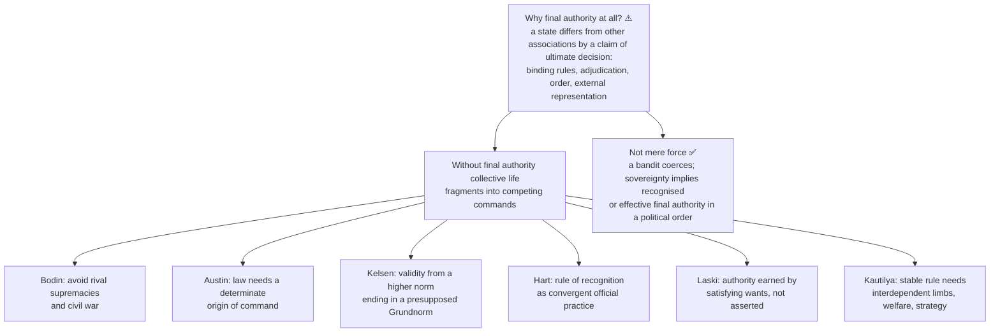

### 2.1 Bodin's justificatory chain ✅/⚠️

1. **Absolute** = not subject to any human superior within the commonwealth.
2. **Perpetual** = enduring, attached to office, not to a temporary magistrate or delegated official.
3. Pre-eminent mark: power to make and unmake law for all subjects in general without needing consent from a superior.
4. Presupposition ⚠️: law needs a source that is not legally derivative from another earthly authority.
5. Indivisible: shared supremacy is a contradiction; two final authorities make conflict insoluble. Division of **governmental functions** is possible; division of **sovereign title** is not.

### 2.2 Austin's justificatory chain ✅/⚠️

1. Aim: separate what law *is* from what it *ought* to be.
2. Law = command of a sovereign backed by **sanction** (command = expression of desire by a superior; sanction = the evil attached to non-compliance).
3. Positive law is distinguished from morality, custom and divine law as separate normative domains.
4. Presupposition ⚠️: every independent political society must have such an apex.

### 2.3 Kelsen's reconstructed argument ⚠️

1. A norm's validity cannot be derived from a fact ("is" does not yield "ought").
2. So validity derives from a further norm.
3. An infinite regress would leave nothing valid.
4. So the chain ends in a presupposed norm: the *Grundnorm*.
5. Law is a self-referring hierarchy of validity, distinct from both morality and brute power.

### 2.4 Hart's reconstructed argument ⚠️

1. A society with only primary rules suffers uncertainty, stasis, inefficiency.
2. Three secondary rules cure the three defects.
3. The union of primary and secondary rules distinguishes a legal system from social habits.
4. The rule of recognition **exists as a social fact**, in the convergent practice of officials, from an internal point of view.
5. So law rests neither on a commander's will (Austin) nor a presupposed norm (Kelsen) but on accepted official practice.

---

## 3. Dialectical Wings & Sceptical Refinements

> The sources record no sceptical wing in the sense used for Indian schools. The corresponding module here is the set of internal and external wings that attack absolute sovereignty.

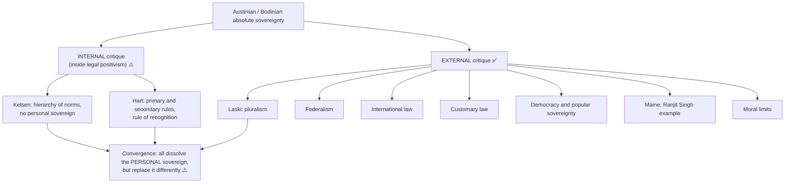

### 3.1 Why Austin needs repair (internal problems) ✅

| Problem | Content |
|---|---|
| **Succession** | Why is a new sovereign's first command law before any habit of obedience has formed? |
| **Persistence** | Why does a statute enacted centuries ago by a long-dead sovereign remain valid? |
| **Power-conferring** | Rules on making a valid will, contract, marriage confer facilities; a defective will is a nullity, not a sanction |

All three point the same way: legal authority is carried by **rules**, not by a commander's habits or person.

### 3.2 Kelsen: objections and replies ⚠️

| Objection | Reply |
|---|---|
| *Grundnorm* is a fiction doing Austin's work less honestly | Not a fact but a **transcendental-logical condition** of treating anything as valid law; theory stays positivist, since the basic norm confers validity not moral obligation ✅ |
| Cannot explain revolution | When a new order becomes **by and large effective**, jurists presuppose a new basic norm; efficacy is a *condition* of validity, not its *source*. Residual: this readmits the fact of power the theory excluded ⚠️ |

### 3.3 Hart: objections and replies ⚠️

| Objection | Reply |
|---|---|
| **Dworkin:** hard cases need principles that no pedigree test identifies | Positivists: bounded discretion at the penumbra; principles admissible through a richer rule of recognition. Dispute unresolved; state it as live. Do **not** develop Dworkin here ✅ |
| A rule of recognition cannot condemn a legally impeccable but morally monstrous regime | Separating validity from merit **preserves** criticism: calling an evil rule "valid" leaves the citizen free to say it ought not to be obeyed ✅ |

### 3.4 Austin's external criticisms (detail) ✅

| Criticism | Core point | Reply / residual |
|---|---|---|
| **Federalism** | Powers constitutionally distributed between union and states | Austin relocates finality to constitution-making authority; this often shifts rather than solves the problem ⚠️ |
| **International law** | Austin treats it as not truly law: no world sovereign, no habitual obedience | Critics: legal order can exist through reciprocity, consent, institutions and practice ⚠️ |
| **Customary law** | Arises from social practice before formal command; Austin explains it as tacitly adopted by the sovereign | Explanation is artificial ⚠️ |
| **Popular sovereignty / democracy** | "The people" are indeterminate, changing, institutionally mediated | Even if Parliament is the superior, it is constitutionally constrained, electorally dependent, politically shaped ⚠️ |
| **Maine's Ranjit Singh** | Actual authority may be personal, unstable, socially embedded, not fitting the clean formula ✅ | Not one odd case but the wider mismatch ⚠️ |
| **Law as command** | Many laws are enabling, permissive, procedural ✅ | Later jurisprudence shows power-conferring, constitutional and secondary rules ⚠️ |

---

## 4. Conceptual Inventory (Concept and Typology of Sovereignty)

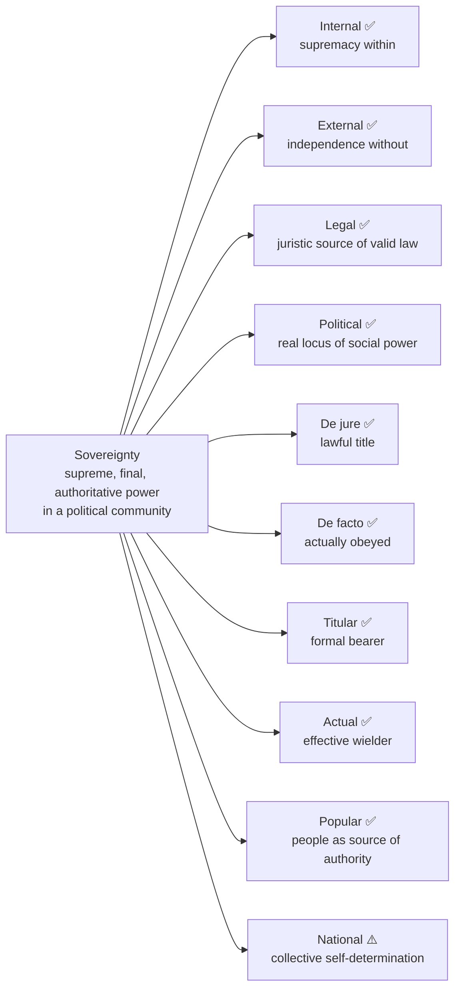

### 4.1 Typology table ✅

| Distinction | Meaning | Relevance |
|---|---|---|
| Internal | Supreme authority over persons and associations within the state | Central to Bodin, Austin, Laski, Kautilya |
| External | Independence from external control in the society of states | Kautilya's diplomacy; globalization |
| Legal | Authority recognised by law as competent to make law | Austin's angle |
| Political | Actual power behind legal institutions | Democratic and sociological analysis; Laski |
| De jure | Lawful in title and formal right | Constitutional analysis |
| De facto | Actually obeyed regardless of title | Revolution, coups, unstable orders |
| Titular | Authority formally vested in an office or symbol: Crown, ceremonial headship | Constitutional monarchies, parliamentary government |
| Actual | Authority effectively exercised: cabinet, party leadership, ruling coalition | Same |
| Popular | People in corporate capacity as source; government as agent | Problem: "the people" must be represented without reduction to a temporary majority |
| National | Collective self-determination and territorial independence | Nation, people and state may not coincide |

**Rousseau bridge ✅.** Sovereignty lies in the **general will**, a claim about the common good, not the numerical sum of private preferences; it remains with the people and is not identical with the government exercising power. **Controlling distinction ⚠️:** popular sovereignty answers *from whom does authority arise?*; national sovereignty answers *which people may govern itself?* Neither makes every majority decision morally sovereign. (Source control: O. P. Gauba pp. 189–193; Cambridge Dictionary self-determination entry p. 858.)

### 4.2 Classical attributes ✅

| Attribute | Exam-safe meaning | Required qualification |
|---|---|---|
| **Absoluteness** | No superior human law-maker legally commands the sovereign within the order | Does not prove moral infallibility or practical omnipotence |
| **Permanence / continuity** | Governments change while sovereignty continues with the state | Continuity while the state remains independent, not eternity |
| **Universality** | Jurisdiction extends across persons and associations in the territory | Immunities and autonomous spheres by constitutional or legal recognition |
| **Inalienability** | Cannot be transferred without the old state losing sovereign status; powers may be delegated | Delegation, devolution, treaty is not automatically alienation |
| **Indivisibility** | Classical theory requires one final legal source | Governmental competences may be distributed even if monists keep legal finality one |

Bodin supplies the defining pair **absolute and perpetual**; Austin the sharpest determinate-superior formulation; the five-part list is a standard consolidation of the monist tradition, not five claims uniquely invented by Austin or Bodin. **Continuity bridge ⚠️:** Austin's habit theory struggles with succession and persistence; Kelsen's norm-hierarchy and Hart's rules repair that without restoring a personal absolute sovereign.

### 4.3 Austin's attributes ✅

Determinate · Absolute · Indivisible · Illimitable · Inalienable. Austin's sovereign is **legal, final, supreme and unitary**; his indivisibility is a logical feature of his scheme, stricter than empirical reality.

### 4.4 Bodin's limits ✅

| Bound by | Meaning |
|---|---|
| **Divine law** | Sovereign cannot validly command what offends divine order |
| **Natural law** | Justice and basic right reason remain limits |
| ***Leges imperii*** | Constitutive laws of the realm structure sovereign office |

He is ***legibus solutus*** with respect to ordinary positive law, **not** with respect to divine/natural obligations. Private property is also listed among Bodin's constraints in the evidence bank (S1); arbitrary confiscation is commonly discussed as incompatible with his limiting framework ⚠️.

### 4.5 Kautilya: seven-limbed state (*saptāṅga* / *prakṛtis*) ✅

| Limb | Meaning | Function in sovereignty |
|---|---|---|
| **Svāmī** | Ruler/king | Headship, direction, decision |
| **Amātya** | Ministers/officials | Counsel, administration, execution |
| **Janapada** | Territory + people | Productive social base |
| **Durga** | Fortified capital / defence | Security and protection |
| **Kośa** | Treasury | Material basis of rule |
| **Daṇḍa** | Force / army / coercive power | Enforcement, punishment, defence |
| **Mitra** | Ally | External support |

The state is an organism; sovereignty is **systemic**, not merely personal. A ruler without *kośa* or *amātya* may possess title but not effective sovereignty ⚠️.

### 4.6 Kautilya: six-fold policy (*ṣāḍguṇya*) ✅

| Policy | Sense |
|---|---|
| **Sandhi** | Peace / treaty |
| **Vigraha** | Hostility / war |
| **Yāna** | Marching / preparation / expedition |
| **Āsana** | Staying quiet / remaining poised |
| **Saṃśraya** | Seeking shelter / alliance |
| **Dvaidhībhāva** | Dual policy / combination strategy |

### 4.7 Kautilya: *maṇḍala* positions (2026 Q2(a) route) ⚠️

*Vijigīṣu* (ruler pursuing security or advantage) · *ari* (immediate rival) · *mitra* (potential friend) · *madhyama* (sufficiently powerful intermediate ruler) · *udāsīna* (more remote ruler). These are **positions in a changing strategic field**, not permanent moral identities; availability of peace, confrontation, waiting, advance, shelter and dual policy depends on **relative capabilities and interests**, not geographic adjacency alone.

---

## 5. Normative, Legal and Constitutional Bridges

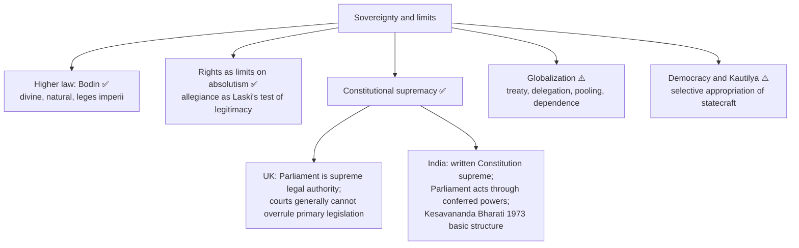

### 5.1 Parliamentary sovereignty vs constitutional supremacy ✅/⚠️

| Model | Legal location of finality | Judicial position | Philosophical use |
|---|---|---|---|
| **United Kingdom** ✅ | Parliament supreme legal authority; may make or unmake law; one Parliament cannot entrench ordinary law against a future one | Courts generally cannot overrule primary legislation | Strong modern approximation to legal sovereignty, qualified by political constraints, devolution, rights arrangements |
| **India** ✅/⚠️ | Written Constitution supreme; Parliament exercises constitutionally conferred ordinary and constituent powers (Article 368) | Judicial review enforces limits; *Kesavananda Bharati* (1973) limits amending power via basic-structure doctrine | Competence-distributed authority under constitutional supremacy, not UK-style parliamentary sovereignty |

> [!WARNING]
> Do not call India a system of parliamentary sovereignty. Parliamentary **government** ≠ parliamentary **sovereignty**. Courts enforce constitutional supremacy; they do not thereby become sovereign. *Kesavananda Bharati* is a **judgment** (not a statute or constitutional text) and is not proof that Austin, Kelsen or Hart is right. Do not describe any Indian institution as "the sovereign" in Austin's sense, and do not attribute a *Grundnorm* to a named document.

### 5.2 Indian application of Kelsen/Hart ⚠️

The Constitution of India is a written supreme instrument with rules of change (amendment procedure) and rules of adjudication (judicial hierarchy, writ jurisdiction): a textbook fit for Hart's secondary rules and Kelsen's norm-hierarchy. Federalism, judicial review and amendment together show authority that is **competence-distributed and rule-governed**, which Austin's determinate illimitable superior cannot accommodate.

### 5.3 Austin and democracy (2021 Q1(c)) ⚠️

- **Yes, narrowly:** a law-making body can be identified.
- **No, deeply:** democracy requires accountability, rights, limited government, which undermine Austin's absoluteness. Democratic authority is derivative, revisable and morally constrained, whereas Austin's sovereign is a legally unlimited superior.

### 5.4 Kautilya and democracy ⚠️

Exact monarchical form is not transferable; institutional interdependence, prudent force, treasury, strategic diplomacy and welfare-centred governance can be adapted. Applicability lies in principles of statecraft, not reproducing kingship; selective appropriation retains strategic realism, administrative discipline and welfare orientation while rejecting monarchical absolutism.

### 5.5 Sovereignty under globalization (2020 Q4(b)) ⚠️

| Mechanism | What happens | Sovereignty consequence |
|---|---|---|
| **Treaty commitment** ✅/⚠️ | State accepts binding rules via its treaty-making capacity | Self-limitation constrains future action without a global Austinian sovereign |
| **Delegation** | State authorises an institution for a defined function | Exercise moves outward; legal source and limits stay treaty-based |
| **Pooling** | States exercise a competence jointly via common voting or bargaining rules | Finality shared for the agreed field, not universally transferred |
| **Material dependence / conditionality** | Finance, markets, technology, security asymmetry narrows choices | Legal independence may survive while effective autonomy declines |

Thinker links: **Bodin** — external pressure does not negate need for a final internal authority; **Austin** — complicates the idea of an uncommanded superior; **Laski** — interdependence strengthens critique of absolute state supremacy; **Kautilya** — strategic-relational external sovereignty remains highly relevant. **Supranational caution:** not every international organisation is supranational, and even one is not automatically sovereign in Austin's sense; ask which competence, by what instrument, with what exit or review rule, and whether dependence makes consent unequal. Detailed institutions belong to International Relations. **Verdict:** reconfigured, constrained, pooled or negotiated, never "disappeared".

### 5.6 Advanced enrichment (optional, from the dossier) ⚠️

| Optional debate | Contending positions |
|---|---|
| Constituent vs constituted power | Authority in the people who found the order vs in the legal institutions operating within it |
| Monism vs legal pluralism | Finality of command vs dispersal across associations and institutions |
| Sovereignty under interdependence | "Weakens" vs "changes form" |
| Exception and emergency | Schmitt-style emphasis on decision in crisis vs norm-governed emergency power |

Strongest extra objection → reply: *Pluralist or dispersed sovereignty cannot explain who finally decides in crisis.* Reply: distinguish coordination authority from unlimited moral supremacy; modern constitutional orders need a final **procedure**, not an unanswerable sovereign will. Promotion trigger: promote if a PYQ asks constituent power, legal pluralism, emergency sovereignty or whether sovereignty is obsolete. Do not let these crowd out the four syllabus names. Source trail: Bodin, Austin, Laski, Kautilya, Hart, and Neil MacCormick, *Questioning Sovereignty*.

---

## 6. Explanatory Principles (how each thinker explains authority)

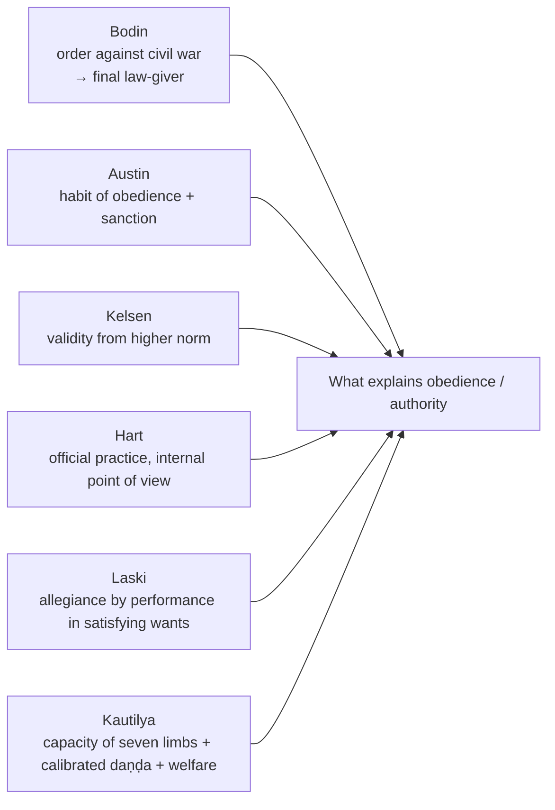

- **Hart's four strikes at Austin ⚠️:** (1) law as command ignores power-conferring rules (nullity ≠ sanction); (2) habit cannot explain continuity on succession or persistence of old statutes; (3) in a modern order the law-maker is constituted and limited by rules of change; (4) obligation ≠ threat: *being obliged* (gunman) vs *having an obligation* (internal point of view).
- **Hart's rule table ✅:** primary rules impose duties; **rule of recognition** cures *uncertainty*; **rules of change** cure *static character*; **rules of adjudication** cure *inefficiency*.
- **Internal/external point of view ✅:** an external observer records regularities; a participant treats the rule as a *reason* and ground for criticising deviation. Austin's "habit of obedience" captures only the external aspect.
- **Hart against Kelsen ⚠️:** Hart accepts an ultimate criterion of validity but denies it is a presupposed norm; it is **social fact**.
- **Kelsen's effect on sovereignty ⚠️:** dissolves the Austinian sovereign; sovereignty becomes an attribute of the **normative order**, the personification of its highest norm-creating competence.
- **Kautilya's calibrated coercion ✅:** without *daṇḍa* society falls into disorder; excessive *daṇḍa* breeds resentment and instability. *Daṇḍanīti* is ordered coercion, not blind terror. "Fear without welfare is self-defeating, while welfare without order is impossible" ⚠️.
- **Monist reply vs pluralist counter-reply:** monists — without a final sovereign, conflict between associations is insoluble; pluralists — legal finality does not eliminate conflict, it often suppresses legitimate diversity ⚠️.

---

## 7. Value Aims of Authority (ethics of rule)

> The owner file gives no kāma/artha/dharma/mokṣa scheme for this topic. The value aims it does give are listed below.

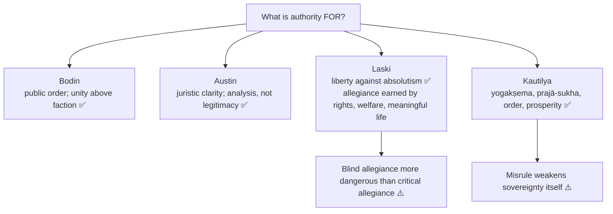

### 7.1 Kautilya's welfare orientation ✅/⚠️

The ruler's welfare is tied to the welfare of the people; durability depends on prosperity, security and justice in administration. Austin's sovereign is legally unlimited and not normatively constituted by welfare; Kautilya's ruler is measured by welfare consequences. Objection: welfare language masks *raison d'état*. Reply: his point is to combine prudence and welfare.

### 7.2 Laski's reasons against absolute sovereignty ✅

1. **Philosophically false:** no human institution is entitled to unlimited moral obedience.
2. **Politically dangerous:** legitimises tyranny and suppresses liberty.
3. **Sociologically unrealistic:** real societies distribute power among many groups.

Further: monistic sovereignty overrides dissenting associations, minority rights, local autonomies and conscience in the name of public supremacy; pluralism is a doctrine of liberty as much as sociology. Division is **not mere administrative decentralization**; it challenges the idea of one final unlimited will.

### 7.3 Bodin vs equality, justice and liberty (2022 Q2(a)) ⚠️

| Ideal | Strongest compatibility case | Where it fails or stays conditional |
|---|---|---|
| **Equality** | One law-giver can override feudal privilege and apply general laws across estates | No principle of equal political citizenship or independent check against discriminatory enactments |
| **Justice** | Stable administration, higher natural/divine law and protection of rightful property restrain caprice | Higher-law constraints cannot enforce a modern public test of fair distribution or impartial review against the law-giver |
| **Liberty** | Ending religious civil war makes secure ordinary activity possible | No guaranteed sphere of dissent or equal basic liberties against an authority supreme over positive law |

Verdict: **qualified compatibility**; Bodin is **historically foundational, normatively problematic**. Dividing the *exercise* of governmental functions need not divide ultimate legal *title*; unresolved: how an unreviewable final title stays genuinely limited in practice.

---

## 8. Inter-Thinker Comparative Matrices

### 8.1 Monist vs pluralist (2026 Q4(b) core anchor) ✅/⚠️

| Issue | Bodin | Austin | Laski | Kautilya |
|---|---|---|---|---|
| Location | Commonwealth's supreme law-giving authority ✅ | Determinate human superior ✅ | No single unlimited locus ✅ | Ruler as head within a seven-limbed state ✅ |
| Absolute? | Yes vs positive law, with higher-law limits ✅ | Yes in strict legal sense ✅ | No; false and dangerous ✅ | Strong but conditioned by dharma, welfare, prudence ✅ |
| Indivisible? | Yes ✅ | Yes ✅ | No; shared and distributed ✅ | Organically coordinated, not indivisible in Austin's sense ⚠️ |
| Associations | Secondary to sovereign unity ⚠️ | Subordinate to command ✅ | Real autonomy and loyalty ✅ | Institutions and allies are constitutive limbs ✅ |
| Main anxiety | Civil war and disorder ✅ | Juristic clarity ✅ | Liberty against absolutism ✅ | Survival, order, prosperity, strategy ✅ |
| Main weakness | Weak protections against concentration ⚠️ | Unrealistic for democracy, federalism, custom, international law ⚠️ | May understate coordinating role ⚠️ | Monarchical framework; elastic realism ⚠️ |

### 8.2 Six-thinker grid (Austin → Kelsen → Hart → Laski → Kautilya) ⚠️

| Axis | Bodin | Austin | Kelsen | Hart | Laski | Kautilya |
|---|---|---|---|---|---|---|
| Locus | Personal commonwealth-ordering power | Determinate human superior | Normative order itself | Accepted rule of recognition | Dispersed among associations | *Svāmī* within *saptāṅga* state |
| Source of validity | Perpetual absolute power to give law | Command + habitual obedience | Higher norm → *Grundnorm* | Convergent official practice | Moral allegiance earned by satisfying wants | *Dharma*, *daṇḍanīti*, duty to *yogakṣema* |
| Limited? | Divine/natural law, *leges imperii*, property | Legally illimitable | Only by the hierarchy's competence rules | By rules of change and adjudication | Must be, and empirically is | By duty, custom, welfare obligation |
| Command or rules? | Command | Command + sanction | Norms authorising norms | Primary + secondary rules | Plural sources of obligation | Authoritative direction plus duty |
| Cure for Austin | — | — | Continuity, persistence, hierarchy | Power-conferring law and obligation | Federalism and plurality | Duty-bound authority |

> [!WARNING]
> Kelsen, Hart and Laski each dissolve the personal absolute sovereign but disagree about what replaces it: a norm-hierarchy, a social practice, or a plurality of associations. Do not merge them into one "modern critique of Austin". Both Kelsen and Hart remain **positivists**: validity is still separated from moral merit.

### 8.3 Bodin vs Austin ✅

| Point | Bodin | Austin |
|---|---|---|
| Role | Founder of modern sovereignty | Most systematic legal analyst |
| Definition | Absolute and perpetual power of the commonwealth | Determinate human superior habitually obeyed by the bulk |
| Limits | Divine/natural law, *leges imperii* | No legal superior; moral limits outside the legal definition |
| Orientation | State-building amid civil war | Jurisprudential analysis of positive law |

### 8.4 Austin vs Kautilya (2019 Q3(a)) ✅

| Dimension | Austin | Kautilya |
|---|---|---|
| Nature of theory | Analytical jurisprudence | Statecraft and political realism |
| Locus | Determinate human superior | *Svāmī* as head within *saptāṅga* organism |
| Core relation | Command → obedience → sanction | Rule → administration → welfare → coercion → strategy |
| Limit | No legal superior; formally unlimited | Bound by **dharma**, prudence, **prajā-sukha / yogakṣema** |
| Law / order | Law as command backed by sanction | Order through *daṇḍanīti*, counsel, treasury, administration |
| External dimension | Underdeveloped except denial of true international law | Highly developed: *maṇḍala*, *ṣāḍguṇya* |
| State form | Centralised legal order | Monarchical but institutionally articulated |
| Conclusion | A narrow, legally determinate sovereign | An organic, welfare-oriented, strategic sovereign |

**Closing line:** Austin's sovereign is legally supreme because no superior commands it; Kautilya's ruler is politically central but normatively and functionally bound by dharma, welfare, ministers, treasury, force and allies. Asymmetry: Austin analyses the **form** of authority, Kautilya prescribes its **function**.

### 8.5 Bodin/Austin vs Laski ✅

Where Bodin and Austin insist on one final superior, Laski insists that society has many autonomous centres of authority; they privilege order and finality, he privileges liberty and associational plurality.

---

## 9. Criticisms & Reconstructed Replies

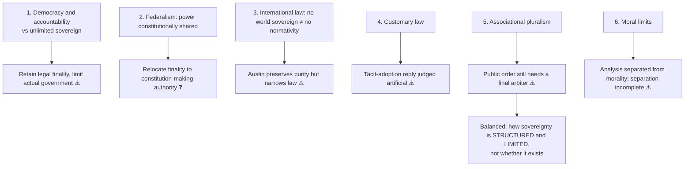

### 9.1 Objection → reply by thinker

| Thinker | Objection | Reply | Residual |
|---|---|---|---|
| Bodin | Absolute sovereignty negates rights | Absolute over positive law, bound by divine/natural law | Limits are vague, weaker than modern constitutional checks; still supreme but "not morally empty", not "Hobbes before Hobbes" ⚠️ |
| Bodin | Constitutional government shows power can be divided | Administrative distribution ≠ sharing final law-making | Federal and constitutional systems weaken rigid indivisibility ⚠️ |
| Bodin | Sacralises centralised monarchy | Lasting importance: modern state's language of permanent, impersonal authority | — |
| Austin | Reduces law to coercion | Austin privileges enforceability and source | Leaves out authority, procedure, acceptance ⚠️ |
| Austin | No determinate superior in modern democracies | Central criticism; works best for centralised legal orders | — |
| Laski | Many associations means disorder | Not erasing coordination but preventing monopolistic claim from swallowing civil freedom | — |
| Laski | Strong sovereignty needed for peace and reform | Unchecked strength may become the gravest threat to justice | — |
| Laski | Shared sovereignty is incoherent | The monistic concept itself misleads; political life has overlapping authorities | — |
| Laski | Conditional allegiance weakens unity | Blind allegiance more dangerous; durable unity rests on justice and service | — |
| Laski | Without a supreme state no public good | Public good secured by constitutional limitation, participation, balance | — |
| Kautilya | Merely premodern authoritarian | State not reducible to royal whim: seven limbs, welfare, strategic constraints | — |
| Kautilya | Monarch can ignore duty | Institutional vigilance, ministerial competence, discipline, reason of state tied to stability; misrule weakens sovereignty | — |
| Kautilya | Politics becomes fear | Fear without welfare is self-defeating | — |
| Kautilya | Cynical and amoral | Realistic but not normless; flexibility alongside duty toward order and welfare | — |
| Kautilya | Ancient categories cannot speak to modern states | Direct transposition impossible; conceptual adaptation fruitful | — |

### 9.2 Is Laski's pluralism satisfactory? (2018 Q2(b)) ⚠️

Name the test first. **Descriptive test** satisfied: families, unions, professional bodies and churches elicit allegiance not created by statute. **Normative test** satisfied: associational autonomy protects conscience from an unlimited state. **Against:** associations may dominate members; clashes over public health, taxation or defence need a binding arbiter, and "state as one association" does not say who settles conflicts. Laskian reply: the state has distinctive coordinating/coercive functions but must justify them constitutionally and by service. Monist rejoinder: this reintroduces **final decision** under another name. **Verdict:** satisfactory as a check on absolute sovereignty and a theory of socially conditioned allegiance, incomplete as a stand-alone account of ultimate adjudicative authority. Distinguish from the narrower 2023 question asking only **why** he rejects absoluteness.

### 9.3 Assessment of Laski ⚠️

Strongest as critic of absolute sovereignty and defender of liberty through social plurality; weak where emergencies, defence and redistribution need a stronger integrating authority than pure pluralism acknowledges.

---

## 10. Controlled Western Comparisons

> The owner file contains no East–West comparison table for this topic. The cross-tradition pairs it supplies are internal to the source and listed below; no outside parallel has been added.

| Pair | Contact | Disanalogy (as given in the source) |
|---|---|---|
| **Bodin vs Hobbes** | Both are monist absolutist bridges | Bodin is bound by divine/natural law and *leges imperii*, so he is "not simply Hobbes before Hobbes": supreme, but not morally empty ✅/⚠️ |
| **Austin vs Rousseau** | Both locate sovereignty, but differently | Rousseau: general will, popular sovereignty, not identical with the government; Austin: determinate human superior ✅ |
| **Austin vs Kautilya** | Both are strong-ruler theories | Austin: legal form; Kautilya: function, bound by dharma and welfare ✅ |
| **Bodin vs Kautilya** | Both address survival and order | Bodin stresses undivided internal supremacy; Kautilya adds the intelligence of survival among rival states ✅ |
| **Kelsen vs Hart** | Both reject the personal sovereign and stay positivist | Presupposed *Grundnorm* vs social fact of official practice ✅ |
| **Hart vs Dworkin** | Positivism vs principles | Route to Individual and State; unresolved dispute ✅ |

> [!WARNING]
> Do not read modern democracy into Kautilya, and do not transpose the *maṇḍala* model onto modern international law or democratic consent. Use it as a conditional diagnostic of power and security.

---

## 11. Diagnostic Deep-Dives for High-Frequency Themes

### 11.1 Kautilya's *maṇḍala* and the 2025 maxim (2025 Q2(c), 2026 Q2(a)) ⚠️

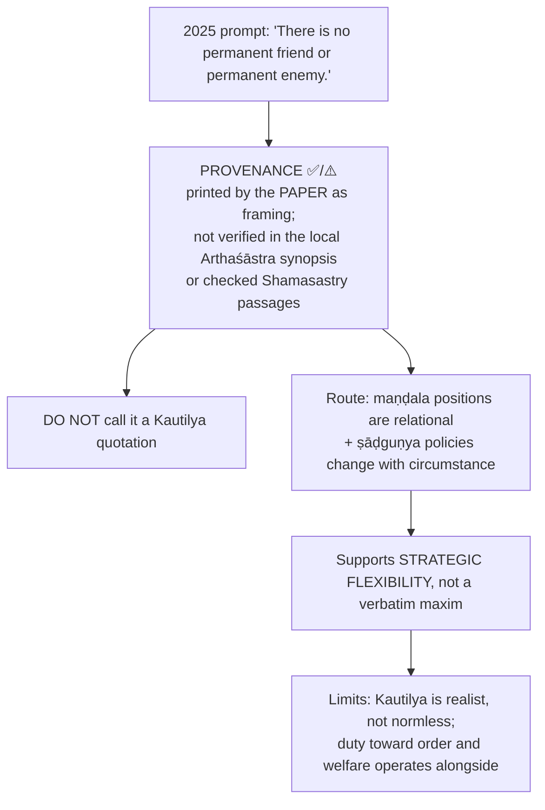

**2026 Q2(a) (Rajamandala and sovereignty) evaluation ⚠️:** the circle explains **effective external autonomy**, not who is a legally illimitable sovereign within a state. Unlike Bodin/Austin's undivided legal supremacy, an independent ruler may be **strategically constrained** and must use shifting relations to survive; the model anticipates a relational, capacity-sensitive analysis of power without predicting each friendship or supplying a theory of equal sovereign rights. Objection: a king-centred circle normalises war and cannot be imposed on modern law or consent. Reply: use as a conditional diagnostic; treat treaty obligations, accountability and welfare as independent constraints.

### 11.2 2024 Q4(b): the *Arthaśāstra*'s insights and modern relevance ⚠️

| Insight | Test it supplies |
|---|---|
| Seven limbs | A formal claim to rule fails without administrative ability, fiscal resources, social cooperation |
| Calibrated *daṇḍa* | Tests enforcement against public order and danger of excessive coercion |
| *Maṇḍala* and shifting policies | External capacity of a state amid unequal powers |
| *Yogakṣema* | Tests a ruler's performance against subjects' security and welfare |

Limits: constitutional rights, elected accountability and international commitments place restrictions absent from Kautilya's regime; survival and welfare do not guarantee equal citizenship. Adopt the diagnostic insight without transferring his source of legitimacy or monarchical form. Not approval of monarchical espionage or a universal licence to coerce.

### 11.3 Kautilya's sovereign: not Austinian absolutism ✅

The king is central but the state is not identical with his private will; he governs through counsel, prudence, discipline and regard for subjects' well-being. Kautilya is neither a simple absolutist nor a liberal constitutionalist: a **realist thinker of rule constrained by dharma and public welfare** ⚠️.

### 11.4 Austin and Bodin: not identical ✅

Bodin allows higher-law restraints; Austin's legal sovereign is formally unlimited. Bodin's absolute = supreme in the hierarchy of **positive** law, not arbitrary in every sense.

---

## 12. PYQ Routing Ledger

> **Corpus signal:** 11 primary-owned parts out of 112 in 2018–2025, plus **2** in the 2026 supplement = **13 verified Sovereignty parts**. No cross-owned Sovereignty parts are listed in either ledger. Thinker spread: Bodin (2020, 2022), Laski (2018, 2023), Austin (2019, 2021), Kautilya/Arthaśāstra (2018, 2019, 2021, 2024, 2025).

| Year | Q | Marks | Exact demand | Route |
|---|---|---:|---|---|
| 2018 | Q1(d) | 10 | Discuss Kautilya's concept of sovereignty in the light of 'Danda-neety'. | §4.5, §6 (calibrated *daṇḍa*) |
| 2018 | Q2(b) | 15 | Critically evaluate Laski's view on sovereignty as a satisfactory position in political theory. | §9.2, §9.3, §7.2 |
| 2019 | Q3(a) | 20 | Discuss how far does Austin's concept of sovereignty go along with Kautilya's concept of sovereignty. | §8.4 |
| 2020 | Q1(d) | 10 | Explain the importance of Bodin's theory of sovereignty. | §2.1, §4.4, §8.3 |
| 2020 | Q4(b) | 15 | State and explain the relevance of the doctrine of sovereignty in times of globalization. | §5.5 |
| 2021 | Q1(c) | 10 | Is Austin's theory of sovereignty compatible with democracy? Discuss. | §5.3, §3.4 |
| 2021 | Q3(c) | 15 | Discuss Kautilya's contribution regarding the concept of sovereignty. Is it applicable in a democratic form of government? Explain. | §4.5–4.7, §5.4 |
| 2022 | Q2(a) | 20 | What arguments does Bodin present to contend that sovereignty must be absolute, perpetual and undivided? Is Bodin's conception of sovereignty compatible with the social and political ideals of equality, justice and liberty? Critically discuss. | §2.1, §7.3 |
| 2023 | Q2(a) | 20 | Elucidate why the absolute nature of sovereignty was rejected by Laski. | §7.2, §9.2 |
| 2024 | Q4(b) | 15 | What insights does the Arthasastra offer with regard to the concept of sovereignty? Does it have any relevance in the modern times? Critically discuss. | §11.2 |
| 2025 | Q2(c) | 15 | 'There is no permanent friend or permanent enemy.' Discuss this statement in the light of Kautilya's view on Sovereignty. | §11.1 |
| 2026 | Q2(a) | 20 | Evaluate the importance of Kautilya's theory of Rajamandala in the context of sovereignty. | §4.7, §11.1 |
| 2026 | Q4(b) | 15 | Explain the contrast between the monistic and pluralistic approaches to sovereignty. | §8.1 (axes: locus, divisibility, source of obligation, treatment of associations, account of law) |

Count check: 11 (2018–2025) + 2 (2026) = **13**.

---

## 13. Top 10 UPSC Exam Traps

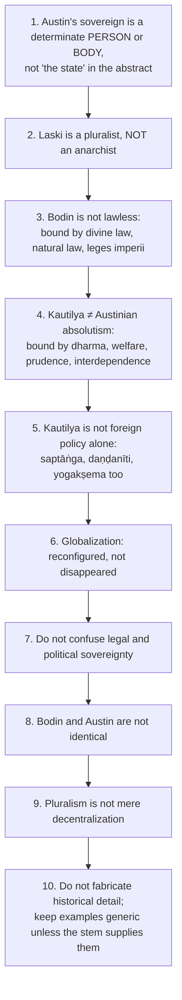

**Additional traps recorded in the owner file:**

| # | Trap |
|---|---|
| 11 | ❌ Do not date Kelsen's *General Theory of Law and State* to 1961; **1945** (first English edition). 1961 = Hart. If unsure, name the works in sequence without years |
| 12 | ❌ Hart is not a restatement of Austin; he rejects the command model |
| 13 | The *Grundnorm* is not a moral standard; it confers legal validity only |
| 14 | Do not merge Kelsen, Hart and Laski into one critique of Austin |
| 15 | Do not develop Dworkin in a sovereignty answer; name and route |
| 16 | Do not omit **permanence** and **universality** from the five classical attributes |
| 17 | Popular ≠ national sovereignty |
| 18 | India is not a system of parliamentary sovereignty |
| 19 | Do not present the 2025 maxim as a verified Kautilya quotation |

---

## 14. Technical Vocabulary & Terminology Bank

| English gloss | Term | Meaning | Status |
|---|---|---|---|
| Absolute and perpetual power | Bodin's definition | Supreme vs positive law, attached to office | ✅ |
| Fundamental laws of the realm | *leges imperii* | Constitutive laws structuring sovereign office | ✅ |
| Released from the laws | *legibus solutus* | Above ordinary positive law, not divine/natural | ✅ |
| Determinate human superior | Austin | Habitually obeyed by the bulk; obeys no one | ✅ |
| Command + sanction | Austin | Positive law | ✅ |
| Basic norm | *Grundnorm* | Presupposed apex of the hierarchy of norms | ✅ |
| Hierarchy / pyramid of norms | Kelsen | Validity from higher norm | ✅ |
| Primary / secondary rules | Hart | Duty-imposing / recognition, change, adjudication | ✅ |
| Rule of recognition | Hart | Exists as convergent official practice | ✅ |
| Internal point of view | Hart | Rule as a reason for conduct | ✅ |
| Being obliged vs having an obligation | Hart | Gunman vs rule-based | ✅ |
| Pluralism | Laski | State one association among many | ✅ |
| Associational autonomy | Laski | Real sites of personality and authority | ✅ |
| General will | Rousseau | Claim about the common good, not sum of preferences | ✅ |
| Seven-limbed state | *saptāṅga* / *prakṛtis* | *svāmī, amātya, janapada, durga, kośa, daṇḍa, mitra* | ✅ |
| Science of punishment / calibrated coercion | *daṇḍanīti* | Ordered enforcement | ✅ |
| Circle of states | *maṇḍala* | Relational strategic field | ✅ |
| Six-fold policy | *ṣāḍguṇya* | *sandhi, vigraha, yāna, āsana, saṃśraya, dvaidhībhāva* | ✅ |
| Security and welfare | *yogakṣema* | Orientation of Kautilyan sovereignty | ✅ |
| Subjects' happiness / welfare | *prajā-sukha* | Measure of the ruler | ✅ |
| Conqueror / rival / friend / intermediate / remote | *vijigīṣu / ari / mitra / madhyama / udāsīna* | *Maṇḍala* positions | ⚠️ |
| Delegated / pooled sovereignty | — | Globalization mechanisms | ⚠️ |
| Parliamentary sovereignty vs constitutional supremacy | — | UK vs India | ✅ |
| Competence-distributed authority | — | Rule-governed, limited competences | ⚠️ |
| Constituent vs constituted power; Schmitt-style exception | — | Optional enrichment | ⚠️ |

---

## 15. Graded Verdict & Answer Architectures

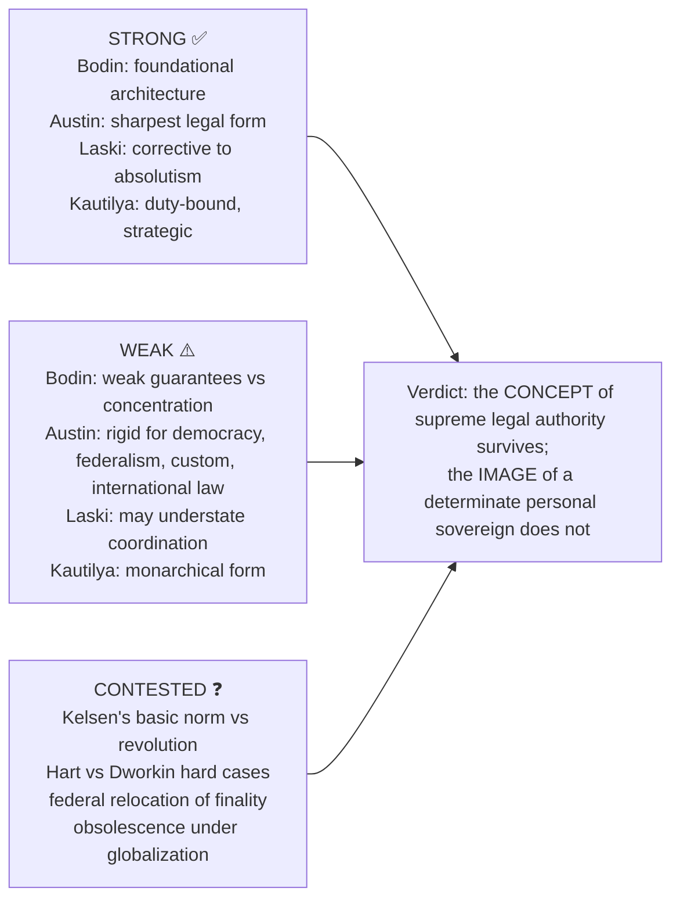

### 15.1 Directive decoder ⚠️

| Directive | What is scored | Move | Failure mode |
|---|---|---|---|
| Explain / Elucidate | Internal logic of one doctrine | Statement → attributes → one distinction → one example | Drifting into criticism |
| Discuss | Exposition plus one adjudicated tension | Doctrine → rival → objection → reply → verdict | Biography or context |
| Critically examine / evaluate | The objection–reply layer | Two objections, each with a reply and residual | Five criticisms, no reply |
| How far / To what extent | A degree judgement | Conditions of holding and failing | Bare yes/no |
| Compare / Distinguish | Shared axes in parallel | 4–5 axes, run both down each, adjudicate | Two sequential mini-essays |
| Comment on a quoted line | Locate line in its doctrine | Source doctrine → what line asserts → limit → verdict | Treating the quote as self-explanatory |
| Is X satisfactory? | Criterion named first | Name test → apply → concede rival | Verdict with no standard |

### 15.2 10-mark (~150 words, 5 moves) ⚠️

1. Exact doctrine in the thinker's vocabulary (*determinate human superior*, *absolute and perpetual power*, *saptāṅga*, *daṇḍanīti*, *Grundnorm*, *rule of recognition*).
2. Argument as 4–5 numbered premises.
3. One precision distinction (legal/political, de jure/de facto, monist/pluralist, primary/secondary rules).
4. One evidence unit with its limitation.
5. Graded verdict in 2 lines.

At 10 marks use **one** post-Austinian repair, fully worked; do not attempt the full Austin → Kelsen → Hart sequence.

### 15.3 15-mark (~220 words, 6 moves) ⚠️

1. Frame the dispute: does sovereignty name a person, a norm-hierarchy, an official practice or a plurality of allegiances? 2. Doctrine A with its presupposition. 3. Doctrine B as strongest rival. 4. One comparison table on 3–4 axes. 5. One worked objection → reply → residual. 6. Conditional verdict. For Kautilya stems the mark-bearing move is showing the sovereign is **strong but duty-bound**.

### 15.4 20-mark (~300 words, 8 moves) ⚠️

1. Provisional thesis using the stem's directive. 2. Concept map (internal/external, legal/political, de jure/de facto, monist/pluralist) in two lines. 3. Doctrine exposition in technical terms. 4. Explicit presuppositions. 5. **Internal critique first** (Kelsen, Hart), then **external** (Laski, federalism, custom, international law). 6. Reply on the doctrine's behalf ending in a residual problem. 7. One dated Indian illustration classified accurately (constitutional text, statute or judgment). 8. Graded verdict separating what survives from what does not. For "Austin vs Kautilya" run five axes (source of authority, limits, purpose of rule, treatment of law, external relations).

### 15.5 Evidence bank (Claim → Named anchor → Use → Limit) ⚠️

| # | Claim | Anchor | Use for | Limit |
|---|---|---|---|---|
| S1 | Absolute and perpetual, yet not lawless | Bodin | 2020, 2022 | "Absolute" vs "bound" tension should be conceded |
| S2 | Determinate human superior; law as command backed by sanction | Austin | 2021, 2019 | Cannot handle power-conferring rules, federalism, custom, international law |
| S3 | Validity from a higher norm, ending in *Grundnorm* | Kelsen, 1945 | Legal nature of sovereignty | Presupposed not proved; revolution forces efficacy back in |
| S4 | Primary and secondary rules; rule of recognition | Hart, 1961 | Strongest internal critique of Austin | Dworkin objection unresolved |
| S5 | Sovereignty divided and shared; allegiance competed for | Laski, *A Grammar of Politics* | 2018, 2023 | Under-explains coordination in emergency |
| S6 | Authority duty-bound and organic | Kautilya | 2018, 2024, 2019 | Prudential statecraft ≠ consent-based legitimacy |
| S7 | Interstate relations positional, not permanent | Kautilya, *maṇḍala*, *ṣāḍguṇya* | Quoted-line stems | Descriptive-strategic; no licence for amoral policy |
| S7A | 2025 maxim is prompt wording | 2025 Q2(c) | Quotation-comment stems | No verbatim Kautilyan authorship |
| S8 | Personal sovereign dissolves three ways | §8.2 grid | "Critically examine the theory of sovereignty" | Rivals, not allies |
| S9 | Authority is competence-distributed | Constitution of India; *Kesavananda Bharati* 1973 | Indian illustration | A judgment is not philosophical proof |
| S10 | Globalization reconfigures sovereignty | §5.5 | Contemporary relevance closers | Never "disappeared" |
| S11 | Parliamentary government ≠ parliamentary sovereignty | UK Parliament; Article 368; *Kesavananda Bharati* | Democracy / federalism | Courts do not become sovereign |

### 15.6 Ready verdict formulas ⚠️

- **Form-survives:** "The concept of a supreme legal authority survives every criticism examined; the image of a determinate personal sovereign does not."
- **Internal-repair:** "Austin is not refuted from outside so much as rebuilt from inside — Kelsen supplying a hierarchy of validity, Hart a structure of rules — so positivism is refined rather than abandoned."
- **Asymmetric:** "⟨Thinker⟩'s analysis of legal form is unmatched; his account of political reality is not."
- **Function-over-form (Kautilya):** "Kautilya's sovereign is strong precisely because he is duty-bound: authority is justified by *yogakṣema*, not by the absence of a legal superior."
- **Pluralist-limit (Laski):** "Laski's corrective is indispensable against absolutism, yet a polity that can never speak with one voice cannot discharge the coordinating task that made sovereignty necessary in the first place."
- **Degree:** "Sovereignty is illimitable in legal form, limited in political fact, and negotiated in international practice; the stem is therefore answerable only as a matter of degree."

### 15.7 Thinker closing lines ⚠️

- **Bodin:** historically indispensable for the language of final state authority, but its concentration of power sits uneasily with equality, justice and liberty in the modern democratic sense.
- **Austin:** clarifies legal form with unmatched precision, yet too rigid before constitutionalism, democracy, federalism, custom and international law.
- **Laski:** a powerful corrective to absolutism that protects liberty and social reality, though it may insufficiently explain the state's coordinating necessity in crisis.
- **Kautilya:** strong yet duty-bound, combining order, welfare and strategic prudence; more flexible than pure legal monism.
- **Kelsen:** purifies sovereignty of personality; supremacy lies in the presupposed apex of a hierarchy of validity, bought at the price of a basic norm that must be assumed.
- **Hart:** relocates ultimate authority to the convergent practice of officials, explaining obligation far better than habit, though Dworkin's hard-case problem remains.

> [!TIP]
> **Statement bank.** (1) Bodin transforms sovereignty into the permanent and supreme law-giving power of the commonwealth. (2) Austin sharpens sovereignty into a legal relation of command, obedience and sanction. (3) Laski dissolves monistic sovereignty into a plural social field of overlapping loyalties. (4) Kautilya embeds sovereignty in an organismic state whose headship is inseparable from welfare and strategy. (5) Modern constitutionalism limits sovereignty without eliminating the need for final public authority. (6) Globalization challenges the isolation of sovereignty, not the very existence of sovereign decision.

---

## Sources

O. P. Gauba, *An Introduction to Political Theory* (local PDF pp. 179–218); *Socio-Political Philosophy* compiled notes (pp. 55–67, no named author asserted); Rajeev Bhargava and Ashok Acharya, *Political Theory: An Introduction*; John Austin, *The Province of Jurisprudence Determined*; Jean Bodin, *Six Books of the Commonwealth*; Harold J. Laski, *A Grammar of Politics* and *Studies in the Problem of Sovereignty*; Kautilya, *Arthaśāstra* (Shamasastry / R. P. Kangle); Hans Kelsen, *General Theory of Law and State* (English ed. 1945, title and year only); H. L. A. Hart, *The Concept of Law* (1961, paraphrased only); *Kesavananda Bharati v. State of Kerala* (1973, judicial illustration only); UK Parliament sovereignty page; Constitution of India, Art. 368; Neil MacCormick, *Questioning Sovereignty* (dossier trail).
