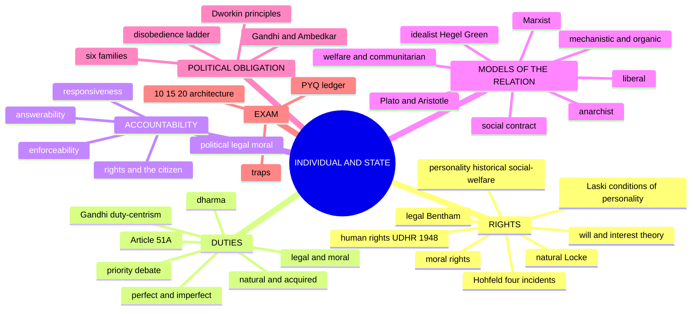
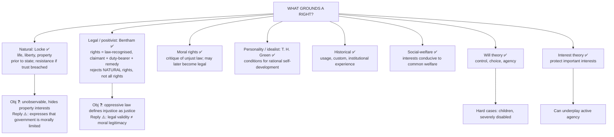
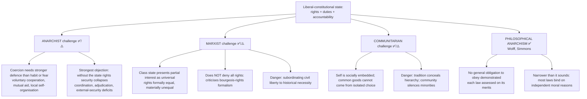
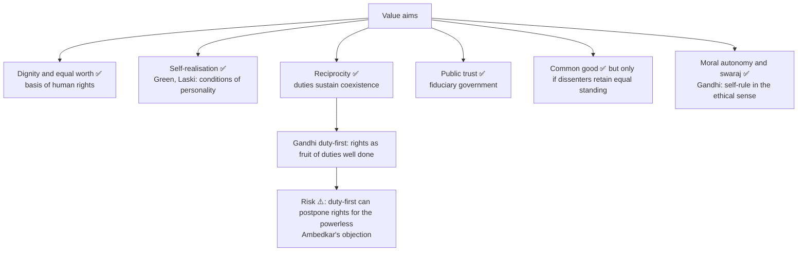
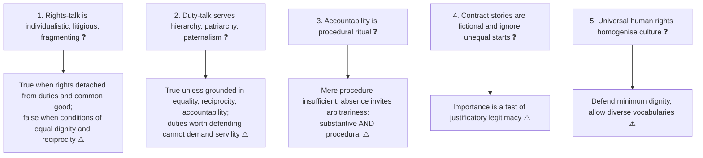
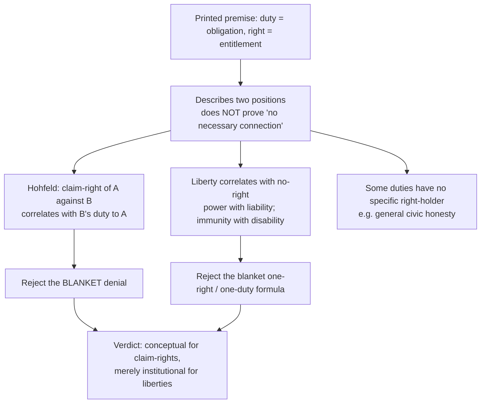
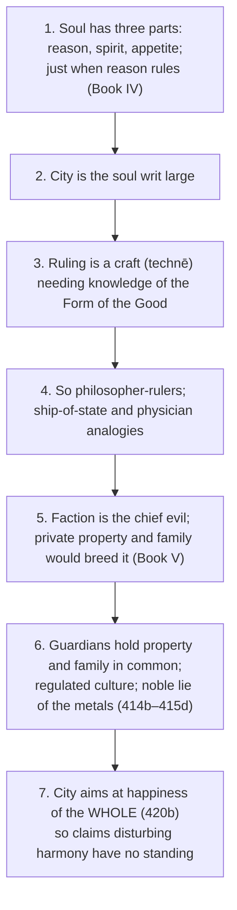
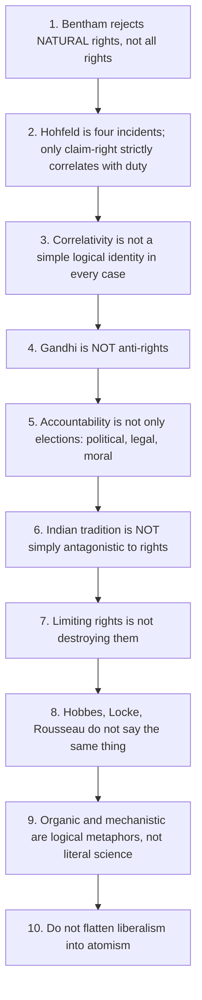
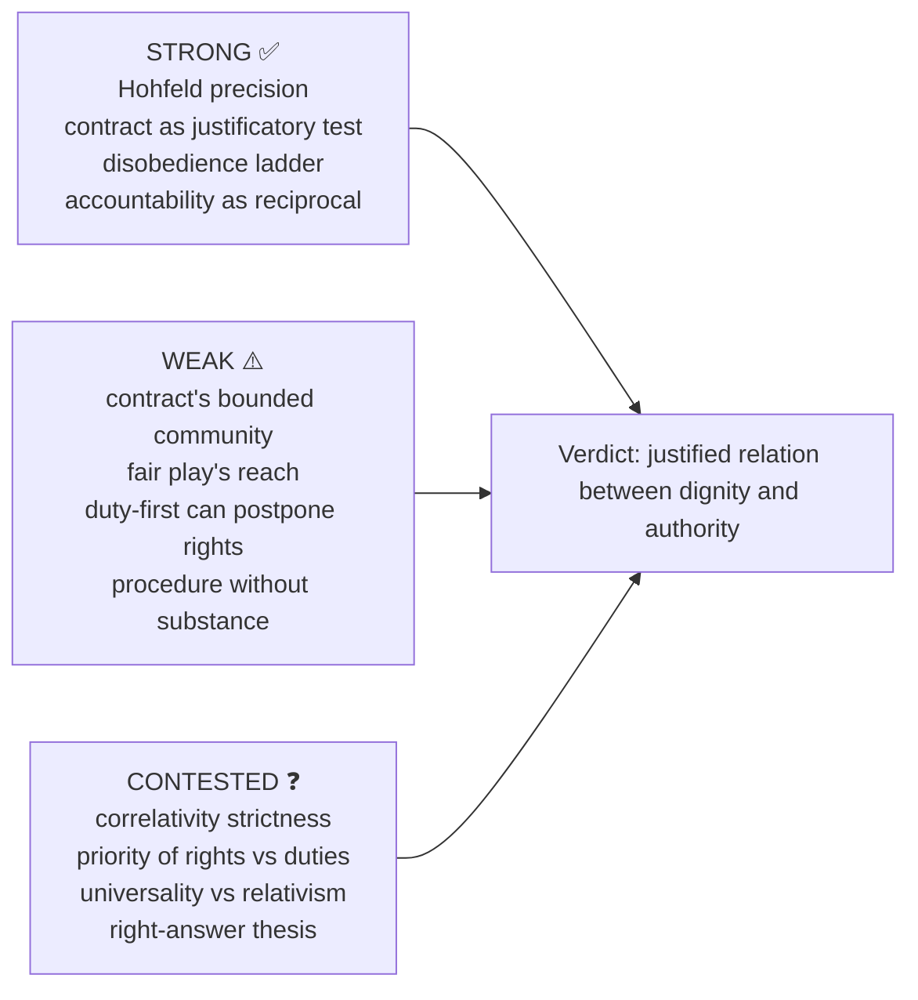

# INDIVIDUAL AND STATE — Rights, Duties and Accountability — Examiner-Grade Mindmap

> **Syllabus (verbatim):** Individual and State : Rights; Duties and Accountability.
> **Catalogue key:** `philosophy-paper-ii-socio-political-philosophy-03` · Paper II · Section A · Socio-Political Philosophy
> **Sources used:** `paper-2/socio-political/Individual-and-State.md` (canonical owner, read in full) · `_advanced/Socio-Political-Dossier.md` §3 and the promotion ledger (optional depth) · `paper-2/_PYQ-SocioPolitical-2018-2025.md` · `paper-2/_PYQ-SocioPolitical-2026-Supplement.md`.
> **Evidence key:** ✅ canonical · ⚠️ analytical synthesis · ❓ contested
> **Blueprint adaptation:** `MINDMAP_INSTRUCTIONS.md` is Indian-school oriented. The 16 module headings are kept and each module's focus is adapted: Module 1 = thinkers, traditions and the ownership boundary; Module 2 = the justificatory grounds of rights, duties and accountability (the sources contain no epistemology of the state); Module 3 = rival and critical wings; Module 4 = conceptual inventory; Module 5 = normative, legal and constitutional bridges; Module 6 = explanatory models of the individual–state relation; Module 7 = value aims. Where the sources give nothing for a module, the module says so.

> [!IMPORTANT]
> **Working thesis.** Rights protect individuality; duties sustain social order; accountability legitimises coercive power. Any one of the three without the other two is distorted: rights without limits may become licence, duties without rights may become subordination, and state power without accountability degenerates into domination. ✅/⚠️ **The relation asked about is how the state is justified *to* the individual, what the individual may claim *against* it, what she owes *through* social life, and why public power must stay answerable.**

---

## 0. Master Overview



```text
INDIVIDUAL–STATE RELATIONSHIP

Individual makes claims  ─────────────►  RIGHTS
Individual bears obligations ◄──────── DUTIES
State secures, limits, and structures both
                │
                ▼
        ACCOUNTABILITY OF POWER
   political · legal · moral answerability
```

| Core term | Minimal meaning | Key issue | UPSC use-value |
|---|---|---|---|
| **Rights** | justified claims, liberties, powers or immunities | natural, legal, moral, or interest-protecting? | Opens answers; concept-clearing |
| **Duties** | obligations owed to others, community, institutions | prior to, correlative to, or independent of rights? | Central to 2023 and 2025 |
| **Accountability** | answerability for exercise of power | why must the state justify coercion? | Links rights to institutions and legitimacy |
| **State** | organised public authority claiming binding power | protector, ethical whole, class instrument or coercive monopoly? | Opens contract, Marxist, anarchist debates |
| **Individual** | bearer of agency, dignity, interests, moral status | prior to the state or formed through institutions? | Compares liberal, idealist, Gandhian, Marxist lines |

---

## 1. Identity, Lineage & Doxography (thinkers, traditions, ownership boundary)

```mermaid
flowchart TD
  R0["Individual and State"] --> RT["RIGHTS thinkers"]
  R0 --> DT["DUTIES thinkers and traditions"]
  R0 --> AT["ACCOUNTABILITY: Laski, Mill, constitutional route"]
  R0 --> MT["MODEL thinkers"]
  R0 --> OT["OBLIGATION and DISOBEDIENCE thinkers"]
  RT --> RT1["Locke: natural rights, state as fiduciary trust"]
  RT --> RT2["Bentham: legal rights, 'nonsense upon stilts'"]
  RT --> RT3["Hohfeld: four incidents"]
  RT --> RT4["T. H. Green: personality / idealist ground"]
  RT --> RT5["Laski: rights as conditions of personality"]
  RT --> RT6["Kymlicka: external protections vs internal restrictions"]
  DT --> DT1["Gandhi: duty-centrism, swaraj"]
  DT --> DT2["dharma tradition: role, reciprocity, restraint"]
  DT --> DT3["Kant and Rawls labels: perfect / imperfect, natural / acquired"]
  MT --> MT1["Hobbes, Locke, Rousseau: contract"]
  MT --> MT2["Hegel and Green: idealist"]
  MT --> MT3["Plato and Aristotle"]
  MT --> MT4["Anarchists and Marx: challengers"]
  OT --> OT1["Hart, Rawls: fair play, natural duty"]
  OT --> OT2["Dworkin: principles, 1977"]
  OT --> OT3["Simmons: sceptic. Raz: service conception"]
  OT --> OT4["Thoreau 1849, Gandhi 1930, Ambedkar 1949"]
```



**Ownership boundary ✅ (what this owner teaches vs. routes elsewhere).**

| Bridge | Treated here | Full owner elsewhere |
|---|---|---|
| Sovereignty | Authority, legitimacy, duty to obey or resist | Austin, Bodin, Laski, Kautilya; Austin → Kelsen → Hart sequence → Sovereignty (§3A) |
| Political ideologies | Liberal, idealist, anarchist, Marxist, communitarian, welfare as relation-models | Full anarchism, Marxism, socialism → Political Ideologies |
| Forms of government | Constitutional-democratic checks, minority protection, dissent | Monarchy, theocracy, democracy as forms → Forms of Government |
| Social and political ideals | Negative/positive freedom, harm, common good as prerequisites | Full equality–justice–liberty theory → Social and Political Ideals |
| Multiculturalism and gender | Embedded self, individual–group reconciliation, public/private boundary | Full recognition theory and gendered private power → later owners |
| Crime and punishment | Sanction only as one accountability mechanism | Punishment theories → Crime and Punishment |

> [!WARNING]
> Do not route every use of "individual" here: ownership turns on rights, duties, accountability or the normative individual–state relation. 2015 Q1(c) (Laski's critique of sovereignty) and 2017 Q1(a) (freedom in relation to state sovereignty in anarchy) are owned by Sovereignty.

**Source controls ✅.** O. P. Gauba, *An Introduction to Political Theory* (local PDF pp. 220–300, 319–390; Laski definition p. 349; UDHR pp. 358–360); *Socio-Political Philosophy* (local compiled notes; no named author asserted). Page numbers are PDF pages, not original-work references. No page or verbatim wording is asserted for Locke, Hart, Rawls, Simmons, Raz, Dworkin, Thoreau, Gandhi, Ambedkar or Kymlicka.

---

## 2. Conceptual and Justificatory Grounds (rights, duties, accountability)

### 2.1 What is a right? ✅

A right is not merely a desire; it is a **justified claim, liberty, power, or immunity** recognised within a moral or legal order. Presupposes a standard of justification: nature, law, morality, utility, dignity, interest, autonomy, social recognition.

- **Need ≠ right.** **Liberty** = non-interference; **claim-right** requires correlative conduct. **Moral right** may exist without enforcement; **legal right** exists in an institutional order.
- Objection ❓: rights-talk is inflated. Reply: Hohfeld's analysis supplies discipline.

**Laski's definition ✅ (philosophical doctrine).** Rights are "those conditions of social life without which no man can seek, in general, to be himself at his best." Their priority is justificatory, not the claim that every legal remedy preceded government.

| Condition ✅ | What a claim must establish | Why it matters |
|---|---|---|
| **Common interest** | Justification beyond private appetite, compatible with like claims | Desire alone is not a right |
| **Social recognition** | Community recognises it as conducive to shared life | Rights are socially situated |
| **Political recognition** | State translates into law and protection | Legal specification and remedy make it effective |

> [!NOTE]
> ⚠️ The third condition explains an **effective legal right**, not the creation of all moral rights; otherwise an unrecognised claim against slavery could never criticise law. A prejudiced majority can refuse a justified claim. The three-condition formulation is controlled by *Socio-Political Philosophy* p. 68, **not** asserted as a quotation from Laski's *A Grammar of Politics*.

### 2.2 Grounds of rights — the theory map



| Ground | Strength | Objection → qualified reply ⚠️ |
|---|---|---|
| **Personality / idealist (Green)** | Explains why education and enabling institutions matter | Official may impose one 'best self' → enable capacities, preserve conscience and contestation |
| **Historical** | Explains variation and gradual growth | Customs can preserve slavery → history explains recognition, not justifies it |
| **Social-welfare** | Ties rights to shared well-being | Elite may define welfare at minorities' expense → require affected voice and equal dignity |

Will vs interest: will theory asks **who controls a duty**; interest theory asks **whose important interest justifies imposing the duty**. Many views are mixed.

### 2.3 Hohfeld's four incidents ✅

| Incident | Correlative | Opposite | Why it matters |
|---|---|---|---|
| **Claim-right** | duty | no-right | Strongest basis for rights–duties discussion |
| **Liberty / privilege** | no-right | duty | Freedom to act; not always a claim on others |
| **Power** | liability | disability | Ability to alter legal relations |
| **Immunity** | disability | liability | Protection against alteration by others |

"Right" is a cluster of juridical relations; free speech can include liberty to speak, a claim against censorship in certain contexts, and immunity from arbitrary power. A liberty does not impose a positive duty to help; a claim-right does.

### 2.4 Negative and positive rights ✅/⚠️

| Type | Demand | Illustration ⚠️ | Limit ⚠️ |
|---|---|---|---|
| **Negative** | Restraint from interference | Freedom from arbitrary censorship | Even non-interference needs courts and protection from private intimidation |
| **Positive** | Provision, protection, enabling action | Education, social security | Specify institutions, priorities, resources; avoid tutelage |

> [!WARNING]
> Negative rights do not mean **no state action**; positive rights do not mean **unlimited state control**. The same right may entail both.

### 2.5 What is a duty? ✅ Classification

A duty is an obligation to do, avoid, respect or support something owed to others, institutions, community or oneself. Duties may be legal, moral, civic, political, professional or spiritual.

| Classification ✅ | First type | Second type | Control ⚠️ |
|---|---|---|---|
| **Natural / acquired** | Owed without special undertaking | Arises from promise, office, action, relationship | Non-injury vs a doctor's duty to a patient |
| **Positive / negative** | Requires action, aid, provision | Requires restraint | A positive duty is still a duty |
| **Perfect / imperfect** (Kantian) | Strict, no latitude for convenience | Binding end with latitude on occasion and extent | Imperfect does **not** mean non-binding |
| **Legal / moral** | Specified in legal order, enforced | Grounded in ethical reason or conscience | A perfect moral duty is not automatically legally enforceable |
| **Subjective / objective** | What the agent sincerely takes as duty | What a valid norm or role demands | Sincerity cannot vindicate an unjust command |

Overlapping **axes**, not exclusive boxes. **Legal vs moral duty:** legal = law, constitution, enforced by courts and penalties (obeying valid law, paying taxes); moral = conscience, enforced by praise/blame (truthfulness, compassion). Some duties begin as moral and become legal; others should stay moral because coercion would be self-defeating.

**Duty, obligation, responsibility ⚠️.** Duty is the broad category; obligation often emphasises a binding relation created by promise, law, consent, office or membership; **political obligation** is the narrower claimed moral duty to obey one's own state's law *because it is law*. Responsibility may mean a role's tasks, causal involvement, or prospective care and answerability; it is not by itself proof of blame.

### 2.6 What is accountability? ✅

Those who exercise public power must **explain, justify and bear consequences** for their decisions. It is the bridge between authority and legitimacy; power without answerability is domination. More than efficiency: a state may be efficient yet unaccountable.

| Dimension | Exact demand | Failure if isolated |
|---|---|---|
| **Answerability** ✅ | Give information and publicly justify | Explanation without correction becomes ritual |
| **Enforceability / consequences** ✅ | Face review, remedy, sanction or removal | Punishment without reason-giving is arbitrary |
| **Responsiveness / correction** ⚠️ | Change conduct, repair harm, learn | Reactive correction may lack stable prospective rules |

---

## 3. Rival and Critical Wings (challengers to the liberal-constitutional relation)



- **Anarchism ✅:** Philosophical anarchism need not endorse chaos; it doubts political obligation or advocates decentralised association.
- **Marxism ✅:** presupposes that economic structure shapes legal and political forms; liberal rights can protect private property and formal equality while exploitation remains. Balanced line ⚠️: powerful critique of formalism; danger of subordinating liberties.
- **Laski's socialist correction ✅/⚠️:** equal civic standing is hollow when concentrated economic power decides whose claims can be exercised; but provision can coexist with suppression of expression. Defensible synthesis preserves civil liberty **and** social-economic conditions. Full Marxism → Political Ideologies.
- **Attribution discipline ⚠️.** **A. John Simmons** = canonical modern *sceptic*. **Joseph Raz** = *authority-based* service conception. ❌ Do not attribute the service conception to Simmons, or philosophical anarchism to Raz.
- **Dossier objection / reply (optional) ⚠️:** *Objection* — associative or duty-first accounts can legitimise inherited hierarchy by calling obedience "belonging." *Reply* — duties are defensible only when the association is consistent with equal dignity and public justification.

> [!NOTE]
> Source status: no sceptical wing *within* rights theory proper is given. The dossier's optional residue is philosophical anarchism's denial of any general obligation and the fair-play/consent priority dispute.

---

## 4. Conceptual Inventory

### 4.1 Mechanistic vs organic views ✅

| Axis | Mechanistic | Organic |
|---|---|---|
| Priority | Individual purposes prior to state | Political whole logically prior to the developed citizen |
| Origin | Artificial agreement, convention, instrument | Natural growth, history, ethical life |
| State's role | Protect prior rights, coordinate separate agents | Constitute conditions of good life and moral freedom |
| Paradigm names | Hobbes, Locke, contractarian liberalism | Aristotle (natural polis); Hegel (ethical state) |
| Rights | Strong rights **against** state intelligible | Rights mature **within** an ethical order |
| Risk | Atomism, private power, hollow formal freedom | Statism, fixed hierarchy, silencing conscience |

Logical structure, not literal biology or engineering. Qualified synthesis ⚠️: constitutional democracy is mechanistic in insisting institutions serve persons, organic in recognising agency and citizenship are socially formed.

### 4.2 Six images of the relationship ✅

| View | Individual and state | Freedom | Main danger |
|---|---|---|---|
| Mechanistic | Individuals prior; state an instrument | Protected sphere against interference | Atomism |
| Organic / ethical | Persons become human within the political whole | Participation in rational institutions | Absorption of conscience and rights |
| Welfare / positive liberal | State instrumental but removes social hindrances | Effective capacity plus non-interference | Paternalism, dependence |
| Marxist | Class state; expected to disappear with class domination | Emancipation from material domination | Under-protection of civil liberty |
| Anarchist | Coercive authority lacks demonstrated right to rule | Autonomous voluntary cooperation | Coordination, adjudication, external security |
| Communitarian | Self socially embedded | Situated autonomy | Conformity; suppression of dissent |

### 4.3 UDHR, indivisibility, generations ✅

The **Universal Declaration of Human Rights (UDHR), 1948**: preamble and **30 articles**; links freedom from fear with freedom from want; **Article 29** recognises duties to the community in which free and full development of personality is possible.

| Generation ✅ | Concern | Typical content | Dimension |
|---|---|---|---|
| **First** | Civil and political liberty | Life, conscience, expression, fair trial, participation | Protection against arbitrary power |
| **Second** | Economic, social, cultural conditions | Work, education, health, social security | Provision makes agency effective |
| **Third** | Solidarity, collective goods | Development, self-determination, environmental protection | Joint claims and collective action |

Principle ✅: rights are **interrelated, interdependent and indivisible**. Generations are **not a ranking** ⚠️.

### 4.4 Unalienable ≠ absolute ✅/⚠️ (2016 Q1(d))

**Unalienable / inalienable** = continuing moral standing that cannot validly be surrendered or extinguished by another's arbitrary will. **Absolute** = whether a right's exercise admits any limit. Different questions; a lawful restriction on movement does not remove dignity, due process or protection against degrading treatment. The stem's "**certain**" does not make every preference a fundamental right.

### 4.5 Individual and group rights ⚠️ (2014 Q4(a), 2015 Q1(d))

| Protection ⚠️ | Danger ⚠️ | Reconciliation test ⚠️ |
|---|---|---|
| **External protections** against majority domination | Identical treatment may conceal majority advantage | Does accommodation enlarge members' equal citizenship and options? |
| **Group autonomy** in shared practices | **Internal restrictions** silence dissent, subordinate women, block exit | Preserve basic rights, voice, dissent, meaningful exit, external remedy |
| **Collective claims** (development, self-determination, environment) | Spokesperson treated as whole community | Include vulnerable members and minorities within minorities |

Chain: individual dignity → cultural conditions of agency → justified accommodation → limits on internal domination → equal citizenship. External-protection / internal-restriction = **Kymlicka's** named doctrinal contribution. Residual: formal exit is insufficient where safety, livelihood or family dependence makes it unusable.

---

## 5. Normative, Legal and Constitutional Bridges

### 5.1 Indian constitutional illustrations ✅/⚠️

- **Articles 19(1)(a) and 19(1)(b)**: freedom of speech and expression; right to assemble peaceably and without arms, **subject to reasonable restrictions** under 19(2) and 19(3). They protect protest, **not law-breaking**.
- **Article 51A** (Fundamental Duties), inserted by the **Constitution (Forty-second Amendment) Act, 1976**; includes duty to abide by the Constitution and its institutions. **Non-justiciable** (not directly enforceable by courts); non-justiciability does not make it normatively empty.
- **Controlling caution ⚠️:** no provision, statute or judgment can settle the *philosophical* question of political obligation. Legal permission ≠ moral justification; legal prohibition ≠ moral refutation.
- ❌ Do not claim any Indian statute or judgment "recognises a right to civil disobedience."

**2013 Q1(b) — significance of citizens' duties ⚠️:** civic, educative and interpretive vocabulary (respect for constitutional institutions, plural coexistence, scientific temper, public property, environment). Frame as **responsible freedom**, not obedience as a precondition for rights; duties cannot override protected claims or excuse officials.

### 5.2 Free speech, judiciary, executive (2016 Q2(c)) ⚠️

Laski defends speech and criticism of government; Mill links expression with inquiry and development.


| Expression requires | Safeguard | Limit |
|---|---|---|
| Protection against retaliatory executive control | Decisional autonomy, impartial adjudication | Independence is not infallibility |
| Review and meaningful redress | Reasoned judgments, accessible proceedings | Delay, cost, deference can empty remedies |
| A court able to decide against government | Separation of core adjudicative and executive functions | Does not entail sealed-off branches |

Verdict ⚠️: genuine independence is a requirement of rights protection; "**complete separation**" is defensible only as freedom from executive direction in deciding cases, not hermetic isolation.

### 5.3 Political obligation: the six families ✅ (4A)

**Political obligation** = a *moral* duty to obey one's own state's law because it is law, not fear and not agreement with content.

| Not this | Because |
|---|---|
| Obedience out of fear | A gunman produces obedience: *being obliged*, not *having an obligation* |
| Agreement with the content | Then the law adds nothing to my reasons |
| Legal validity | Jurisprudence asks validity; whether it binds me morally is separate |

**Four test criteria ⚠️:** (1) **Generality** — binds all? (2) **Particularity** — binds me to *my own* state? (3) **Content-independence** — a reason to obey *because it is law*? (4) **Defeasibility** — what defeats it?

| Family ✅ | Core claim | Named anchor | Strongest objection |
|---|---|---|---|
| **Consent / contract** | Voluntary undertaking, express or tacit | Locke, Hobbes, Rousseau | Few expressly consent; tacit consent by residence is not voluntary |
| **Fair play** | Accepting scheme benefits creates a duty to bear a fair share | Hart, Rawls | Benefits of public order are non-excludable; unsolicited benefit creates no debt |
| **Natural duty of justice** | Support just institutions that apply to us | Rawls | Fails **particularity**: binds to any just state |
| **Associative / membership** | Obligations from constitutive identities | Dworkin's associative obligations; communitarians | Binds by membership however unjust |
| **Gratitude** | State supplies security and order | Classical and Indian duty frameworks | Some reciprocity, not general obedience; oppressive benefactor |
| **Anti-obligation** | No general obligation demonstrated | Wolff (autonomy); A. John Simmons | Cannot explain how legitimate authority differs from a private agency |

**Fair-play reconstruction ⚠️:** (1) society is a cooperative scheme with benefits (security, adjudication, infrastructure, public health); (2) produced because most bear burdens; (3) I accepted them; (4) taking benefit without burden = **free-riding**; (5) unfair; (6) so I owe compliance. Presupposes benefits *accepted*, not merely *received*, and a reasonably just scheme. Objection: premises 3 and 6 do not connect for a non-excludable good. Reply: restrict to knowingly accepted benefits and fair burdens; residual: that shrinks the argument to citizens who least need to be bound.

**Raz's service conception ✅:** authority is legitimate when its directives help subjects conform better to reasons that already apply; directives function as **pre-emptive / exclusionary** reasons.

### 5.4 Dworkin: principles, hard cases ✅ (1977)

*Taking Rights Seriously* (**1977**): against purely rules-based positivism; in **hard cases** judges reason from **principles**, part of the law though no pedigree test identifies them.

| | **Rules** | **Principles** |
|---|---|---|
| Application ✅ | All-or-nothing | Dimension of **weight** |
| Conflict ✅ | One rule invalid or excepted | Principles compete and are balanced |
| Authority ✅ | Pedigree: enacted, precedent | Moral-political argument for best justification |
| Role ✅ | Apply | Interpret and weigh |

Illustration ✅: no one may profit from his own wrong — denies a murderer the inheritance under a valid will; the rule of succession pointed one way, the principle overrode it without invalidating the rule. Presupposition ⚠️: a best interpretation exists (right-answer thesis). Hartian objection → reply: penumbra discretion vs litigants arguing about entitlements they claim already to possess; residual: right-answer thesis is hard under permanent disagreement. **Bridge ✅:** rights as "**trumps**" against collective goals ⇒ adjudication is a mode of holding the state accountable.

### 5.5 The disobedience ladder ✅

| Form | Aim | Publicity | Legality | Scope | Attitude to system |
|---|---|---|---|---|---|
| **Conscientious objection** | Avoid personal complicity | May be private | Seeks exemption; typically accepts penalty | Individual's own act | Accepts legitimacy |
| **Civil disobedience** | Persuade majority to change law or policy | **Essentially public** | Deliberate breach **accepting legal consequences** | A specific law or policy | Accepts legitimacy; appeals to its principles |
| **Resistance** | Obstruct a specific grave injustice | May be covert | Breaks law; may not accept penalty | Regime's particular acts | Denies legitimacy of those acts |
| **Revolution** | Replace the constitutional order | Organised, often armed | Rejects legal order wholesale | Whole system | Denies legitimacy |

**Defining features of civil disobedience ⚠️:** (i) publicity and appeal to shared principles; (ii) acceptance of the legal penalty. Non-violence is standardly a third condition; on the **Gandhian** account it is **constitutive** (means and ends inseparable).

**Reconstructed justification ⚠️:** (1) any general obligation is defeasible; (2) a law may be so unjust that compliance makes one complicit; (3) legal redress may be exhausted, blocked or unavailable; (4) open non-violent breach with penalty communicates the wrong without attacking law as such; (5) so civil disobedience is permissible, sometimes obligatory, within a substantially just order. Presupposes substantially just order and persuadable majority; where neither holds the argument shifts to resistance or revolution with a sharply rising burden.

| Illustration ✅ | Dated fact | Use / caution ⚠️ |
|---|---|---|
| **Thoreau**, *Civil Disobedience* | **1849** (first published as "Resistance to Civil Government") | Individual conscientious refusal, not organised mass action; not Gandhi's blueprint |
| **Gandhi, Salt Satyagraha** | March to Dandi began **March 1930**; salt law broken **6 April 1930** | Concept's structure: public, non-violent, aimed at a specific law, arrest accepted; not proof it is always justified |
| **Ambedkar, 'grammar of anarchy'** | Constituent Assembly concluding address, **25 November 1949** | Where constitutional methods exist, unconstitutional methods (satyagraha, non-cooperation, civil disobedience) are unjustified; attribute by occasion, do not extend the quotation |

**Gandhi–Ambedkar as philosophy ⚠️:** the dispute is the **availability condition** (premise 3). Gandhi presupposes no constitutional voice; Ambedkar presupposes there is one. Ambedkar's deeper worry ✅: extra-constitutional agitation in a caste-stratified society can be captured by dominant groups.

---

## 6. Explanatory Models of the Relation

### 6.1 Liberal view ✅

Individual morally prior; state instrumentally justified to secure rights, liberty, peaceful coexistence; legitimacy from consent, limitation, respect for agency. Classical liberalism privileges negative liberty; later liberalism admits welfare and positive conditions.

- **Negative freedom ✅:** protected sphere for competent adults. **Positive freedom ⚠️:** effective capacity to understand and pursue a life-plan.
- **Mill's harm principle ✅:** coercion of a competent adult is presumptively justified to prevent harm to *others*, not because officials judge a choice unwise.
- **Paternalism ✅:** interference for a person's own good. **Soft** checks whether the choice is informed and voluntary; **hard** overrides even a competent, voluntary choice.
- Objection ⚠️: the self/other boundary is porous; reply: harm is a **burden-of-proof test**.

| Question | Neutral / liberal | Perfectionist / communitarian | Control |
|---|---|---|---|
| May the state promote a good life? | Fair terms and basic rights, no comprehensive ideal | May cultivate genuine goods, virtues, capabilities | Must remain rights-bound and contestable |
| Protected private sphere? | Yes: conscience, association, family | 'Private' arrangements can reproduce dependency | Privacy cannot immunise harm or domination |
| Protection of minorities and dissent? | Equal rights, viewpoint freedom, neutrality | Shared goods sustain belonging | Common good legitimate only if dissenters retain equal standing |

Boundary ⚠️: 'the personal is political' is used only to expose private domination; gender theory remains with Gender Discrimination.

### 6.2 Idealist view ✅

Freedom matures within family, civil society and state; rights are conditions of self-realisation.

- **Hegel ✅/⚠️:** the rational state belongs to **ethical life** (family, civil society, political institutions); freedom becomes concrete through recognised rights and participation. **Not** the claim that every existing government is divine or entitled to total obedience.
- **T. H. Green ✅:** the state is a means to the common good, **not** an end absorbing persons; it removes remediable hindrances to self-realisation, leaving moral agency with citizens; political obligation is **conditional, not blind**.
- Strong objection ⚠️: once the state defines the rational or higher self, coercion can be presented as liberation. Reply: enabling action must be rights-bound, decentralised where possible, open to public challenge.

### 6.3 Welfare-state and communitarian positions ✅

| Position | Core insight | Limit |
|---|---|---|
| **Welfare / positive liberal** | Formal rights are hollow where poverty, illness, ignorance make choice unusable; social minimum and fair opportunity | Paternalism, administrative domination, dependency |
| **Communitarian** ✅/⚠️ | Persons embedded in histories and practices | Tradition conceals hierarchy; community silences minorities |

Liberal reply ⚠️: liberalism need not equal atomism; neutrality can protect fair cooperation among socially embedded persons. Communitarian rejoinder ⚠️: neutrality itself privileges an autonomous chooser and depends on solidarities rights cannot generate.

### 6.4 Social contract: origin and development ✅ (2024 Q1(b), 2021 Q4(c))

| Thinker | State of nature | Why contract? | Authority | Rights outcome |
|---|---|---|---|---|
| **Hobbes** | Insecurity, fear, conflict | Security and peace | Strong sovereign | Broad transfer for self-preservation |
| **Locke** | Relative freedom with inconveniences | Impartial protection of rights | Limited government; fiduciary trust | Natural rights retained |
| **Rousseau** | Freedom corrupted by inequality | Collective self-rule | General will | Civil freedom and moral autonomy |

- **Hobbes:** contract yields sovereign command for peace. **Locke:** contract creates limited authority for prior rights. **Rousseau:** contract transforms isolated persons into a people governed by the general will; association as collective self-legislation.
- ⚠️ A **development in the answer to legitimacy**, not one historical contract, nor a claim that each thinker copied the last. Ancient precursors distinguish rule by nature/divine title from rule by agreement; the worked-out theories appear when hereditary or theological entitlement must be justified to individuals.
- Objection ❓ no actual contract → reply ✅ normative, not historical: what terms free and equal persons could reasonably accept.

**Does contract adequately address human rights? ❓ (2021 Q4(c)).** Helps justify rights against arbitrary rule (Locke) and equality and self-legislation (Rousseau); but begins with a bounded political community and may leave open persons outside the contract, **future generations** and those lacking bargaining power; human rights aspire to universality beyond citizenship. Contract explains political legitimacy; human rights also need a theory of dignity, humanity or personhood. Verdict ⚠️: powerful but incomplete.

### 6.5 Plato and Aristotle between statism and individualism ⚠️ (2024 Q3(a))

| Axis | Plato | Aristotle | Judgment |
|---|---|---|---|
| Political whole | *Republic*: justice as functional harmony under philosopher-rule | Polis natural, exists for the good life | Both reject atomistic individualism |
| Unity / plurality | Guardians give up private property and family to prevent faction | Criticises excessive unity: a polis is a plurality | Aristotle preserves more plurality |
| Household / property | Private domain subordinated to political unity | Household and private property remain; use serves common purposes | Aristotle preserves an intermediate sphere |
| Individual good | Specified by proper function in the ordered city | Flourishing requires the polis; citizenship in a differentiated constitution | Aristotle relates rather than absorbs |
| Main limit | Hierarchy and philosopher-rule risk severe statism | Slavery, gender exclusion, restricted citizenship | Success is comparative, not liberal-democratic |

Verdict ⚠️: Aristotle steers a better middle (rejects excessive unity; preserves household, property, plurality, common good) but both are perfectionists; Aristotle's exclusions block an unqualified modern endorsement.

---

## 7. Value Aims of the Relation



### 7.1 Gandhi's duty-centrism ✅

Duty has conceptual priority in social ethics: rights become secure when persons discipline themselves through service, self-restraint, truthfulness. Presupposes freedom as **self-rule (swaraj)** in the ethical sense. Differs from hard legal positivism and atomistic liberalism; **neither anti-state in the simple sense nor pro-statist in the centralising sense** — moralised citizenship, decentralised responsibility. ❓ Objection: legitimises inequality → ⚠️ Reply: best reading ties duty to conscience, non-violence, mutuality, not inherited domination.

> [!WARNING]
> Gandhi is **not anti-rights**: he reorders the moral source of rights through duty; he does not deny them.

### 7.2 Dharma and the Indian tradition ⚠️ (2020 Q2(c))

Moral life framed through **dharma**, role-based obligation, reciprocity, self-restraint; the person is embedded in a web of relations. Duty ≠ mere obedience; at its strongest, responsibility, restraint and moral vocation. Risk: sacralising hierarchy; hence a contemporary synthesis combines duty-language with constitutional rights and moral equality. *Duty-first is not necessarily hierarchy-first.*

### 7.3 Priority: rights or duties? ❓ (2017 Q1(d), 2023 Q2(b))

| Position | Core claim | Merit | Risk |
|---|---|---|---|
| **Rights-first** | Protects person against coercion | Shields minorities and dissent | Atomised entitlement culture |
| **Duty-first** | Preserves order and reciprocity | Stresses social responsibility | Paternalism, conformity |
| **Balanced** | Mutually sustaining | Best fit for constitutional democracy | Needs institutional vigilance |

Criterion ⚠️: basic rights have **justificatory and institutional priority** against coercion; duties have **operational indispensability** and may have ethical priority in cultivating reciprocity. For a claim-right, right and correlative duty arise as **one relation**, not a temporal sequence. Accountability identifies who owes performance, to whom reasons are due, how failures are remedied; officials bear a heavier burden because of entrusted coercive power.

---

## 8. Inter-School Comparative Matrices

### 8.1 Locke vs Bentham ✅

| Issue | Locke | Bentham | Takeaway |
|---|---|---|---|
| Ground of rights | Natural and prior | Legal and utility-linked | Normative vs positivist |
| View of state | Trustee / protector | Institutional creator and enforcer of rights | Limited-state vs legal realism |
| Main danger | Tyranny violating rights | Metaphysical inflation of rights-talk | Both remain relevant |

### 8.2 Liberalism vs Gandhian duty-centrism ✅

| Issue | Liberal rights-first | Gandhian duty-first |
|---|---|---|
| Starting point | Entitlement, liberty, consent | Self-restraint, service, conscience |
| Fear | State encroachment | Egoistic social fragmentation |
| Strength | Protects dissent and minorities | Moralises citizenship and reciprocity |
| Weakness | May appear atomistic | May be appropriated for paternalism |

### 8.3 Liberalism vs Marxism ✅/⚠️

Rights are emancipatory protections or ideological masks? Liberalism: rights restrain power and secure independence. Marxism: formal equality can coexist with real domination. Balanced ⚠️: rights are indispensable, but meaningful exercise depends on material conditions.

### 8.4 State as protector vs suspect ✅

| School | Image of state |
|---|---|
| Social contract liberalism | Protector created by agreement |
| Idealism | Ethical institution enabling freedom |
| Anarchism | Coercive structure needing deep suspicion |
| Marxism | Class instrument in historical conditions |
| Gandhian thought | Morally necessary only in reduced, decentralised, restrained form |

### 8.5 Neutrality vs perfectionism; Plato vs Aristotle ✅

Neutralist: fair terms among rival life-plans. Perfectionist: public promotion of valuable capacities. Strongest synthesis: enabling conditions yes, coercive imposition of one comprehensive life no. Plato: nearer the statist pole; Aristotle retains polis and common good while protecting plurality, household, property — wins only comparatively and remains non-liberal by modern standards.

### 8.6 Universality vs cultural relativism ✅/❓/⚠️ (2018 Q4(a))

| Point | Universalist | Relativist | Balanced position ⚠️ |
|---|---|---|---|
| Ground of dignity | ✅ every human has equal worth | ❓ dignity is interpreted through culture | Core protections may be universal; institutional expression can vary |
| Rights language | ✅ common moral vocabulary | ❓ often historically Western in formulation | Universality of aspiration ≠ uniformity of articulation |
| Community vs individual | Rights protect person against oppression | Cultures may prioritise role and duty | Rights can be read relationally without losing dignity |

Statement ✅: certain rights belong to all human beings simply as human beings. Objection ❓ erases civilisational diversity → ⚠️ strongest form defends minimum dignity and protection from domination while allowing diverse vocabularies and pathways.

---

## 9. Criticisms & Reconstructed Replies



| Doctrine | Objection ❓ | Reply ⚠️ |
|---|---|---|
| Natural rights | Cannot be empirically shown; hide property interests | Express that government is morally limited |
| Legal positivism | Oppressive law defines injustice as justice | Legal validity ≠ moral legitimacy |
| Moral rights | Morality varies | Variation forces argument about dignity, suffering, reciprocity, agency |
| Hohfeld | Too technical | Many false debates come from ambiguous 'right' |
| Duty priority | Rights-first makes citizens irresponsible | Strengthen duty-conscious civic culture, do not reduce rights |
| Accountability | Sovereignty needs finality | Finality in decision; legitimacy still needs review and explanation |
| Electoral | Victory justifies everything | Democracy includes constitutional limits and checks |
| Legal | Legalism paralyses | Point is justified, reviewable power |
| Idealism | Glorifies state | Green: enabling conditions, not blind submission |
| Anarchism | Rights security collapses without state | Voluntary coordination; critics: large-scale justice needs enforceable institutions |
| Marxism | Underplays civil liberties | Powerful critique of formalism; danger of subordinating liberty |
| Limiting rights | State may erode rights stepwise | Accountability and judicially structured justification of restrictions |

**Whole-clause objections (4A.8) ⚠️.**
1. *If obligation is defeasible, every citizen is a private judge.* Reply: the ladder's conditions (publicity, non-violence, exhaustion of remedies, acceptance of penalty) are severe filters; Raz bounds authority by its function.
2. *(Simmons-type) No ground gives general obligation, so 'the duty to obey' is empty.* Reply ✅: the sceptic denies a **general, content-independent** obligation but most laws remain bound by independent reasons against harm, fraud, unfairness; the practical gap is smaller than the rhetoric.
3. *Associative and gratitude accounts dress submission as virtue.* Reply: both survive only **conditionally** (equal concern; benefactor not simultaneously oppressing).

---

## 10. Controlled Western Comparisons

> [!NOTE]
> The sources contain **no** East–West comparison table for this topic. This module carries only the cross-tradition pairs the sources actually draw.

| Pair | Contact | Disanalogy / limit |
|---|---|---|
| **Indian dharma/Gandhi vs Western liberal rights** | Both can secure the person (dharma indirectly via duties of non-harm, care, reciprocity) | Role-based obligation has been used to legitimise graded caste and gender hierarchy; dignity cannot depend solely on the good will of those assigned to protect; universal rights need an **equal claim** even when local role-order refuses it ⚠️ |
| **Thoreau vs Gandhi** | Both involve conscientious breach | Thoreau = individual withdrawal; Gandhi = public, non-violent, penalty-accepting campaign ⚠️ |
| **Gandhi vs Ambedkar** | Both address obedience and justice | Availability of constitutional channels; capture by dominant groups ⚠️ |
| **Plato vs rights-based constitutional state** | Both concern justice and the common good | Knowledge vs consent as title to rule; no external corrective mechanism ✅ (see 11.3) |
| **Universal rights vs cultural relativism** | Common aspiration | Language and institutions may differ ⚠️ |

> [!WARNING]
> Neither "India had modern human rights all along" nor "all duty-thinking is oppressive" answers the comparative question; the test is whether the duty practice protects **every person**, including critics of inherited roles.

---

## 11. Diagnostic Deep-Dives for High-Frequency Themes

### 11.1 2025 Q4(c): 'no necessary connection' between duties and rights ⚠️



Objection: rights can be moral claims with no named duty-bearer. Reply: an unenforced moral claim-right can still specify who ought to act; a mere aspiration with no assignable obligation needs further argument to be a claim-right. Legal remedy and moral correlativity are distinct.

### 11.2 2022 Q4(b): do unconditional rights lead to anarchy? ⚠️

'**Necessarily**' is the hinge. Distinguish (i) **unconditional moral status** (persons cannot lose basic standing by state whim) from (ii) **unlimited permission** to act regardless of others. (i) is not anarchic; (ii) creates conflicting claims with no joint rule. A state may coordinate mutually exercisable rights through public, proportionate, reviewable limits. Anarchist reply: voluntary cooperation; critic: how are persistent disputes and excluded minorities remedied? Statist objection: unconditional rights obstruct emergencies; reply: principled scope and justified limits yet no arbitrary override. **Conclusion:** unlimited *exercise* risks disorder; unconditional *dignity / protection against arbitrary power* does not logically entail anarchy. *Limiting rights ≠ nullifying them.*

### 11.3 2026 Q1(b): Plato's ideal state and rights and liberties ✅/⚠️

> **Stem:** Is Plato's vision of an ideal state compatible with the rights and liberties of individual citizens? Discuss. [10]

**Frame ⚠️.** Plato writes **before** the vocabulary of subjective individual rights; the question is **compatibility** (can a state built on functional harmony accommodate claims held *against* the political whole), not whether Plato denied a known doctrine. Convicting him of 'violating fundamental rights' is **anachronistic**. §6.5 settles statism–individualism (2024); this settles compatibility with rights (2026).

**Doctrine ✅.** *Kallipolis*: civic justice as **functional specialisation**, each doing the task suited to their nature (*Republic* 433a–b); three strata (producers, auxiliary guardians, philosopher-rulers); authority by **knowledge of the good**, not by consent, election, birth or wealth.



**Presuppositions.** ✅ objective, politically authoritative knowledge of the good; ✅ persons differ in aptitude (sex is not a relevant difference: qualified women may be guardians and rulers, 451c–457b, esp. 454b–456b); ⚠️ freedom is **rational self-mastery**; ⚠️ unity outranks plurality, so the burden of proof lies on the individual claim; ❓ consent adds nothing to legitimacy that knowledge has not supplied.

| Axis | Plato's kallipolis | Rights-based constitutional state | Decisive difference |
|---|---|---|---|
| Basis of status | Function by tested aptitude | Equal status as person | Capacity vs personhood |
| Title to rule | Knowledge of the good | Authorisation by the governed under limits | Knowledge vs consent |
| Freedom | Positive: reason over appetite | Primarily negative, plus positive conditions | May hold no liberty *against* the city |
| Occupation / mobility | Assigned; meddling is injustice | Free choice | A liberty Plato treats as disorder |
| Speech, art, enquiry | Regulated; poetry and music censored (Books II–III) | Presumption for expression | Without criticism ruler error is uncorrectable |
| Family and property | Abolished for guardians | Ordinarily protected | Private sphere subordinated to unity |
| Participation | None for producers | Voting, opposition, deliberation | No channel for the ruled to object |
| Truth and publicity | Founding myth permitted (414b–415d) | Public justification | Rights presuppose non-manipulated judgment |
| Women | Qualified women may rule (454b–456b) | Equal rights irrespective of sex | Radical on aptitude, silent on rights |
| **Remedy for ruler error** | Better education and selection | Elections, courts, free press, impeachment, review | **No external corrective mechanism**: sharpest structural objection |
| End of the state | Unity, virtue, justice as harmony | Rights, pluralism, fair coexistence | Good fixed in advance vs contested |

| # | Objection | Platonic reply | Residual problem |
|---|---|---|---|
| 1 | Paternalism | Medicine is not tyranny; rulers govern for the ruled ✅ | The patient may dismiss the physician; the ruled may not dismiss guardians ⚠️ |
| 2 | No correction of epistemic error | Education, testing, no private wealth ⚠️ | Reducing temptation ≠ institutionalising *detection*; censorship removes criticism ✅ |
| 3 | Suppression of conscience | Moral formation is unavoidable ⚠️ | Unavoidable formation ≠ legitimate *state monopoly* over it ✅ |
| 4 | Instrumentalising persons | Assigned life fulfils the person's own nature ✅ | Requires infallible ruler judgment and fulfilment decided *for* not *by* the person ⚠️ |
| 5 | Manufactured consent | Consent is not the criterion ❓ | Concedes the ideal state is not built on the terms that generate rights ⚠️ |
| 6 | Reasonable pluralism | Disagreement is ignorance ⚠️ | Available only if premise 3 is granted ✅ |

**Traps (this stem only).** ❌ 'Plato violated fundamental rights' → state the anachronism first. ❌ *Republic* as a constitutional blueprint → a normative construction answering 'what is justice?'. ❌ 'Plato was anti-women' → defect is absence of rights for **anyone**. ❌ Communism of property for the whole city → **guardian classes only**, a device against faction. ❌ Plato's 'freedom' = liberal liberty. ❌ Popper's 1945 'totalitarian' verdict as settled → a major twentieth-century reading, with the standard reply that rulers are meant to benefit the ruled. ❌ Confusing with 2024 Q3(a). ❌ Flat 'incompatible' → graded: **incompatible with rights as claims against the state; partly compatible with the interests those rights protect**.

**Answer spines.** *10 marks (~150 words):* fix terms (kallipolis; rights = claims against the whole) → structural verdict → evidence pair (433a–b; regulated culture and noble lie; guardian property/family; qualified women 454b–456b) → graded verdict. *15 marks (~220 words):* knowledge vs consent axis → Plato's case at its strongest → four rows (status, freedom, expression, error-correction) → worked Objection 2 → concede the real danger Plato identifies (rights regime without civic formation vulnerable to faction, manipulation, wealth) → conditional verdict. *20 marks (~300 words):* thesis in the stem's verb → locate the axis → premises 1–7 with presuppositions → chart compressed to six rows with error-correction last → two chains (paternalism; ruler error) → anachronism and Popper → **reconstruction move** (retain trained public leadership, merit-based selection, civic education; add rights, open criticism, judicial review, periodic authorisation, checks) → graded verdict.

Sources: Plato, *Republic* (433a–b; Book IV; Book V; 414b–415d; 420b; Books II–III); SEP "Plato's Ethics and Politics in the *Republic*"; Karl Popper, *The Open Society and Its Enemies* (**1945**). No modern state is named as an instance of the kallipolis.

### 11.4 2019 Q2(a): do rights make citizens accountable to the state? ⚠️

Rights do not make citizens accountable **to** the state in the sense of subordination; they locate citizens in a **reciprocal constitutional order**. Authoritarian reading: rights come with obedience. Democratic reading: mutual answerability. Indian illustration: Article 19 protects speech and peaceful assembly subject to authorised reasonable restrictions; Article 51A is non-justiciable, not an unrestricted demand for obedience. Objection: 'rights make citizens accountable' reverses the direction. Reply: the duty to respect others or lawful restrictions is **not earned by receiving a right**; the stronger conclusion is that rights **hold the state accountable** and protect the standing in which citizens also answer for lawful duties. No present-day incident is needed.

### 11.5 2020 Q2(c): is Indian tradition antagonistic to individual rights? ⚠️

Too sweeping. Dharma- or Gandhi-inspired obligation can secure the person indirectly (non-harm, care, reciprocity), yet role-based obligation has legitimised graded hierarchy. Human rights supply the criterion: an **equal claim** available even when the role-order refuses it. Modern Indian constitutional rights give an institutional idiom; the moral justification is dignity and equal standing, not simply a clause being enacted. Opponent: universal rights import alien individualism; reply: minimum protection need not demand uniform cultural language but must leave room for internal dissent and enforceable individual claims. The caste and gender histories remain with their printed owners.

### 11.6 Remaining routed stems — one-line keys ⚠️

- **2013 Q1(b):** §5.1 — civic and educative significance; non-justiciability ≠ normatively empty.
- **2014 Q4(a):** §4.5/8.6 — individual dignity as moral floor; collective claims and social conditions; qualified, non-atomistic account.
- **2015 Q1(b):** §5.5 — exceptional principled breach; democratic remedies, Gandhi–Ambedkar tension.
- **2015 Q1(d):** §4.5 — external protections vs internal restrictions; voice, dissent, exit, equal citizenship.
- **2016 Q1(d):** §4.4 — universal moral standing vs unlimited exercise.
- **2016 Q2(c):** §5.2 — impartial remedy; qualify 'complete separation'.
- **2017 Q1(d):** §7.3 — name the priority criterion; correlativity; answerability and remedy.

---

## 12. PYQ Routing Ledger

> **Corpus signal.** 9 primary-owned parts out of 112 in 2018–2025 (1 each year, 2 in 2024), plus **1** in the 2026 supplement = **10 verified parts in the 2018–2026 ledgers**. A further **7** pre-2018 parts (2013–2017) are recorded in the owner file §9.0 and listed separately below; they are **not** added to the 10. Cross-owned parts are listed after each table and **not counted**.

### 12.1 2018–2025 (bank)

| Year | Q | Marks | Exact demand | Route |
|---|---|---:|---|---|
| 2018 | Q4(a) | 20 | "Human rights and human dignity would no longer be the product of a particular culture, rather a common human aspiration for an ideal world." Discuss. | §4.3, §8.6 |
| 2019 | Q2(a) | 20 | Do rights make citizens accountable to the State? Argue in the context of the present Indian scenario. | §11.4, §5.1 |
| 2020 | Q2(c) | 15 | Is Indian tradition antagonistic to Individual Rights? Consider it by taking recourse to the doctrine of 'Human Rights'. | §11.5, §7.2 |
| 2021 | Q4(c) | 15 | Evaluate whether the social contract theory adequately addresses the different issues of human rights. | §6.4 |
| 2022 | Q4(b) | 15 | Does idea of unconditional rights necessarily lead to anarchy? Critically examine. | §11.2 |
| 2023 | Q2(b) | 15 | Do you agree that duty and accountability must be given priority over rights for the better functioning of a State? Justify your answer. | §7.3, §2.6 |
| 2024 | Q1(b) | 10 | Present a brief account of origin and development of Social Contract Theory. | §6.4 |
| 2024 | Q3(a) | 20 | Do you agree with the view that Aristotle was more successful than Plato in steering a middle course between 'Statism' and 'individualism'? Discuss with arguments. | §6.5, §8.5 |
| 2025 | Q4(c) | 15 | "Duties are of the nature of obligation while Rights are of the nature of entitlement. Therefore there is no necessary connection between the two." Do you agree with this statement? Give reasons and justification for your answer. | §11.1, §2.3 |

Count: **9**. Note ✅: the 2020 paper prints quotation marks around 'Human Rights'; they are retained here.

### 12.2 2026 supplement (official paper KVMS-B-PHL, Section A)

| Year | Q | Marks | Exact demand | Route |
|---|---|---:|---|---|
| 2026 | Q1(b) | 10 | Is Plato's vision of an ideal state compatible with the rights and liberties of individual citizens? Discuss. | §11.3 (owner §4.4B); supporting §2, §4.1, §4.2, §6.5 |

Count: **1**. **Cross-links to this owner, not counted:** 2026 Political Ideologies Q1(d) (Marxist critique of pure democracy) bridges to §3 (owner §4.6); 2026 Crime and Punishment Q1(e) (value-based education / corruption) bridges to §5.1 (owner §2.5).

### 12.3 Pre-2018 questions recorded in the owner (§9.0), primary-owned here — not in the 10

| Year | Q | Marks | Printed limit | Exact demand |
|---|---|---:|---|---|
| 2013 | Q1(b) | 10 | not more than 150 words | What is the significance of including duties of citizens in the Indian Constitution? |
| 2014 | Q4(a) | 20 | none | "All human rights are centred on individual rights." Discuss. |
| 2015 | Q1(b) | 10 | about 150 words | Is civil disobedience in a democratic State justifiable? Discuss. |
| 2015 | Q1(d) | 10 | about 150 words | How are individual and group rights reconciled in democracy? Explain. |
| 2016 | Q1(d) | 10 | about 150 words | Evaluate the statement that all human beings have certain unalienable rights. |
| 2016 | Q2(c) | 20 | none | "The right of free speech implies the genuine independence of the judiciary and its complete separation from the executive." Evaluate. |
| 2017 | Q1(d) | 10 | about 150 words | Out of rights and duties, which one is prior to the other? Discuss in the context of accountability. |

Count: **7** (separate). **Boundary:** 2015 Q1(c) and 2017 Q1(a) retain Sovereignty as owner.

---

## 13. Top 10 UPSC Exam Traps



All 16 traps recorded in the owner file:

1. Bentham rejected **natural** rights, not legal rights as such.
2. Do not reduce Hohfeld to one formula.
3. Do not treat correlativity as simple logical identity in every case.
4. Do not portray Gandhi as anti-rights.
5. Do not collapse accountability into elections.
6. Do not write that Indian tradition is simply antagonistic to individual rights.
7. Do not equate limitation with destruction of rights.
8. Do not answer contract questions as if Hobbes, Locke, Rousseau agree.
9. Organic / mechanistic are not literal science.
10. Do not flatten liberalism into atomism.
11. Hegel does not defend every actual state.
12. Positive freedom or welfare ≠ unlimited paternalism; Mill's harm principle keeps coercion for one's own good under special suspicion.
13. The private sphere is not non-political in every respect.
14. Aristotle is not a modern individualist.
15. Do not convict Plato of 'violating fundamental rights' (§11.3).
16. Do not confuse 2024 statism–individualism (§6.5) with 2026 rights-and-liberties (§11.3).

Additional cautions ⚠️: unalienable ≠ absolute (§4.4); Simmons = sceptic, Raz = service conception (§3); Thoreau ≠ Gandhi; Salt law broken 6 April 1930 (march began March 1930); Ambedkar's address is dated 25 November 1949; Art 51A inserted 1976 (42nd Amendment) and non-justiciable; no Indian statute or judgment 'recognises a right to civil disobedience'.

---

## 14. Technical Vocabulary & Terminology Bank

| English term | Meaning | Status |
|---|---|---|
| Claim-right / liberty (privilege) / power / immunity | Hohfeld's four incidents | ✅ |
| Correlativity | Claim-right ↔ duty | ✅ |
| Natural / legal / moral rights | Grounds of rights | ✅ |
| Will theory / interest theory | Control vs protected interests | ✅ |
| Negative / positive rights; negative / positive freedom | Restraint vs provision | ✅ |
| Dignity; reciprocity; self-realisation | Value aims | ✅ |
| Fiduciary government; public trust | Locke's trust model | ✅ |
| Rule of law | Law over mere power | ✅ |
| Moral autonomy | Self-legislation | ✅ |
| Answerability / enforceability / responsiveness | Dimensions of accountability | ✅ / ⚠️ |
| Natural / acquired; positive / negative; perfect / imperfect; legal / moral; subjective / objective duty | Duty axes | ✅ |
| Dharma | Role-based obligation, reciprocity, restraint | ✅/⚠️ |
| Swaraj | Self-rule in the ethical sense (Gandhi) | ✅ |
| Political obligation | Moral duty to obey one's own state's law because it is law | ✅ |
| Content-independence; generality; particularity; defeasibility | Test criteria | ⚠️ |
| Tacit consent; fair play; free-riding | Obligation vocabulary | ✅/⚠️ |
| Natural duty of justice; associative obligation; gratitude | Obligation families | ✅ |
| Philosophical anarchism | No general obligation demonstrated | ✅ |
| Service conception; pre-emptive reason | Raz | ✅ |
| Principles vs rules; hard cases; rights as trumps | Dworkin (1977) | ✅/⚠️ |
| Conscientious objection / civil disobedience / resistance / revolution | Disobedience ladder | ✅ |
| Acceptance of penalty | Defining feature of civil disobedience | ⚠️ |
| Grammar of anarchy | Ambedkar, 25 November 1949 | ✅ |
| Satyāgraha | Gandhian non-violent resistance (Salt Satyagraha, 1930) | ✅ |
| Organic / mechanistic state | Logical metaphors | ✅ |
| Statism / individualism | Poles of the relation | ✅ |
| Neutrality / perfectionism | State and the good life | ✅ |
| Harm principle; soft / hard paternalism | Mill; liberty limits | ✅ |
| Private / public boundary | Protected sphere vs domination | ✅/⚠️ |
| External protections / internal restrictions | Kymlicka | ⚠️ |
| Minorities within minorities; meaningful exit | Group-rights test | ⚠️ |
| Kallipolis; technē; noble lie; Form of the Good | Plato | ✅ |
| UDHR 1948 (30 articles); Art 29 | Human rights text | ✅ |
| Three generations of rights; indivisibility | Classification | ✅ |
| Articles 19(1)(a), 19(1)(b), 19(2), 19(3); 51A | Indian constitutional anchors | ✅ |
| Class domination | Marxist term | ✅ |

---

## 15. Graded Verdict & Answer Architectures



### 15.1 Directive decoder ⚠️

| Directive | Scored | Compulsory move | Failure mode |
|---|---|---|---|
| Explain / What is meant by | Internal logic of one concept | Definition → components → one distinction → one example | Evaluating when asked only to expound |
| Discuss | Exposition plus one adjudicated tension | Doctrine → rival → objection → reply → verdict | Four thinkers with no adjudication |
| Critically examine / evaluate | Objection–reply layer *is* the answer | Two objections, each with reply and **residual** | Criticism list with no defence |
| Are X and Y **necessarily** connected? | The modal word | Conceptual necessity vs institutional desirability; counter-example | 'Yes, they are related' |
| Should X have priority over Y? | A priority criterion | Name criterion → rank → concede to the loser | Asserting balance without a standard |
| Does X adequately address Y? | Adequacy relative to a benchmark | Fix benchmark → test → specific inadequacy | Vague praise or dismissal |
| Trace origin and development | Chronology plus conceptual movement | Hobbes → Locke → Rousseau, what each *changes* | Three biographies |

### 15.2 10-mark (~150 words, 4 moves, ~12 minutes) ⚠️

```text
1. Exact concept (2 lines): claim-right, liberty, power, immunity, content-independence, tacit consent, general will, civil disobedience.
2. Analytic components (4–5 lines): numbered premises or one Hohfeld move.
3. One evidence unit with its limitation.
4. Graded verdict (2 lines).
```
At 10 marks do not run all six obligation families or all four ladder rungs: one family or one contrast, fully worked.

### 15.3 15-mark (~220 words, 6 moves, ~18 minutes) ⚠️

```text
1. Frame the AXIS of dispute, not the topic.
2. Position A with its presupposition.
3. Position B as strongest rival, with the presupposition it denies.
4. One table: six families / rules-vs-principles / ladder / Hohfeld.
5. One worked objection → reply → residual problem.
6. Conditional verdict: when each side holds.
```
Rights-vs-duties stems: the mark-bearing move is the **correlativity analysis**.

### 15.4 20-mark (~300 words, 8 moves, ~25 minutes) ⚠️

```text
1. Provisional thesis in the stem's directive verb.
2. Conceptual map: define right / duty / accountability / obligation; state the criterion.
3. Strongest case for the proposition, as premises.
4. Strongest rival tradition (liberal, idealist, Gandhian, Marxist, anarchist) at its best.
5. Two objection → reply chains, each ending in a residual problem.
6. Disobedience ladder or obligation grid as analytical spine where relevant.
7. One dated Indian illustration, accurately classed (51A non-justiciable; legal status ≠ moral justification).
8. Graded verdict conceding something to the losing side.
```
Social-contract stems: Hobbes secures order by an irreversible transfer; Locke adds trust, limits and a right of resistance; Rousseau relocates sovereignty in the general will, making obedience self-legislation; then test against the human-rights benchmark (struggles with non-signatories, the incapable, future generations).

### 15.5 Evidence bank — Claim → Named anchor → Use → Limit ⚠️ (1 unit at 10, 2 at 15, 4–5 at 20)

| # | Claim | Anchor | Use | Limit |
|---|---|---|---|---|
| I1 | Rights precede the state; government is a forfeitable trust | Locke, *Two Treatises* | Origin and resistance | Theological and property premises need reconstruction |
| I2 | Rights are children of law; natural rights rhetorical | Bentham | 'What is a right'; foil to I1 | Cannot explain critical use of rights against law |
| I3 | 'A right' resolves into four incidents | Hohfeld, *Fundamental Legal Conceptions* | Correlativity stems | Analytic, not moral justification |
| I4 | Will theory vs interest theory | §2.2 | Children, animals, the incapable | Each mishandles a different hard case |
| I5 | Six grounds of obligation, each fails a test | §5.3; Simmons | 'Why obey' stems | Scepticism about a *general* obligation leaves most laws binding |
| I6 | Authority is a service | Raz | Best modern reply to anarchism | Instrumental: bounded by domains of improved conformity |
| I7 | Law contains principles; rights as trumps | Dworkin, *Taking Rights Seriously* (1977) | Rights as constraints; accountability | Right-answer thesis under disagreement |
| I8 | Disobedience is graded | §5.5 ladder | Any obedience/resistance stem | Real movements occupy several rungs |
| I9 | Civil disobedience is public, non-violent, penalty-accepting | Salt Satyagraha (March 1930; 6 April 1930) | Concept's structure | Illustration only |
| I10 | Conscience over majority | Thoreau (1849) | Conscientious refusal | Individual withdrawal, not mass campaign |
| I11 | Constitutional methods displace agitational ones | Ambedkar, 25 Nov 1949 | Counterweight to I9, I10 | Depends on channels being open to the group |
| I12 | Duty-centrism | Gandhi; dharma | Priority stems | Can postpone rights for the powerless |
| I13 | Duties in the Constitution are non-justiciable | Art 51A (42nd Amendment, 1976) | Indian illustration | Legal fact; proves no moral thesis |
| I14 | Organic vs mechanistic | Gauba pp. 220–225 | Direct relation answers | Both metaphors |
| I15 | Aristotle is a comparative middle | *Republic*; *Politics* I–II | 2024 Q3(a) | Slavery, gender exclusion |
| I16 | Harm and paternalism discipline state action | Mill; soft/hard paternalism | Autonomy stems | Porous self/other boundary |
| I17 | Neutrality vs perfectionism | Liberal–communitarian debate | Common-good, minority stems | Neutrality never value-free |

### 15.6 Ready verdict formulas ⚠️

- **Modal:** "Claim-rights are necessarily correlative to duties; liberties are not — so the connection is conceptual for one class of rights and merely institutional for another."
- **Conditional:** "The obligation holds where ⟨institutions are substantially just and channels genuinely open⟩ and lapses where they are not; the question is one of degree, not of kind."
- **Narrowed-scepticism:** "The sceptic defeats the claim to a *general, content-independent* duty of obedience, but not the claim that most particular laws are independently binding — so the practical distance between the sceptic and the traditionalist is small."
- **Ladder:** "Conscientious refusal, civil disobedience, resistance and revolution answer to progressively heavier burdens of justification; the stem is answered by locating the case on that ladder."
- **Reconciliation:** "A mature polity does not choose between rights and duties; it constitutionalises rights, cultivates duties and institutionalises accountability, since each without the others is unstable."
- **Dignity–authority:** "The individual is neither an atom outside society nor an expendable part of the state; the task of political philosophy is to specify a justified relation between dignity and authority."

### 15.7 Reusable statement lines ⚠️

- Rights are protections of personhood; duties are disciplines of coexistence; accountability is the ethics of public power. ✅
- A democratic state is justified not by mere command but by rights-protection and answerable authority. ✅
- The rights–duties relation is analytically distinguishable but normatively inseparable. ⚠️
- Gandhi's duty-centrism is not anti-rights; it is a critique of rights without moral self-restraint. ⚠️
- Human-rights universalism is strongest when defended as common human aspiration without denying cultural plurality. ⚠️
- Social contract theory secularises the origin of the state by grounding political obligation in the standpoint of individuals. ✅

---

## Sources

O. P. Gauba, *An Introduction to Political Theory* (local PDF pp. 220–300, 319–390; Laski p. 349, pp. 346–357; UDHR pp. 358–360); *Socio-Political Philosophy* (local compiled notes pp. 68–88, 129–132); verified 2013–2017 Philosophy Paper-II ledgers; held 2020 Paper-II (quotation marks around 'Human Rights'); Bhargava and Acharya; Harold J. Laski, *A Grammar of Politics*; Locke, *Two Treatises of Government*; Hobbes, *Leviathan*; Rousseau, *The Social Contract*; Hohfeld, *Fundamental Legal Conceptions*; Dworkin, *Taking Rights Seriously* (1977); A. John Simmons and Joseph Raz (positions only, no page or wording asserted); Hart and Rawls (named positions); Thoreau, *Civil Disobedience* (1849); Gandhi (Salt Satyagraha, 1930); Ambedkar, Constituent Assembly address (25 November 1949); Constitution of India, Articles 19 and 51A; Plato, *Republic*; SEP "Plato's Ethics and Politics in the *Republic*"; Popper, *The Open Society and Its Enemies* (1945); Aristotle, *Politics* I–II.

> ⚠️ Provenance: the political-obligation grid, Dworkin module and disobedience ladder are named-scholar reconstructions adapted into the owner file; no empirical claim is made about any Indian government, party or period.
