# FORMS OF GOVERNMENT — Monarchy, Theocracy and Democracy — Examiner-Grade Mindmap

> **Syllabus (verbatim):** Forms of Government : Monarchy; Theocracy and Democracy.
> **Catalogue key:** `philosophy-paper-ii-socio-political-philosophy-04` · Paper II · Section A · Socio-Political Philosophy
> **Sources used:** `paper-2/socio-political/Forms-of-Government.md` (canonical owner, read in full) · `_advanced/Socio-Political-Dossier.md` §4 (optional depth) · `paper-2/_PYQ-SocioPolitical-2018-2025.md` · `paper-2/_PYQ-SocioPolitical-2026-Supplement.md`.
> **Evidence key:** ✅ canonical · ⚠️ analytical synthesis · ❓ contested
> **Blueprint adaptation:** `MINDMAP_INSTRUCTIONS.md` is Indian-school oriented. The 16 module headings are kept and each module's focus is adapted: Module 1 = thinkers, traditions and the ownership boundary; Module 2 = the justificatory grounds of rule (legitimacy and the justification of democracy; the sources contain no epistemology of the state); Module 3 = rival and critical wings; Module 4 = conceptual inventory; Module 5 = normative, legal and constitutional bridges; Module 6 = explanatory models of regimes; Module 7 = value aims. Where the sources give nothing for a module, the module says so.

> [!IMPORTANT]
> **Working thesis.** The topic is not a bare institutional list. It is a conceptual debate on **who governs, by what title, for whose good, and under what moral limits**. Classification by number of rulers tells us *who decides*; classification by type of legitimacy tells us *why they are obeyed*; a complete assessment needs both. Democracy's superiority is not guaranteed wise decisions; it lies in equal standing, public justification and institutionalised correction of error. ⚠️

---

## 0. Master Overview

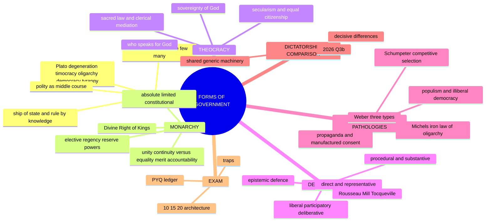

| Form | Basic meaning | Source of legitimacy | Main strength claimed | Main philosophical danger | UPSC hinge |
|---|---|---|---|---|---|
| **Monarchy** | rule of one | heredity, conquest, tradition, sometimes divine sanction | unity, continuity, decisiveness | arbitrariness, unaccountability, weak basis in equality | freedom, divine right, "above politics" |
| **Theocracy** | rule in the name of God or by religious authority | revelation, sacred law, clergy, divine sovereignty | moral unity, sacred order | suppression of conscience, pluralism and equal citizenship | secularism, validity in modern state |
| **Democracy** | rule of the people | consent, equality, participation, representation | accountability, liberty, self-rule | majoritarianism, manipulation, mediocrity, propaganda | minorities, deliberation, equality vs liberty |

```text
CLASSICAL FRAME

PLATO: decline of constitutions
Aristocracy / philosopher-rule
        ↓
    Timocracy
        ↓
    Oligarchy
        ↓
   Democracy
        ↓
    Tyranny

ARISTOTLE: number of rulers × end served
                COMMON GOOD        PRIVATE INTEREST
ONE             Monarchy           Tyranny
FEW             Aristocracy        Oligarchy
MANY            Polity             Democracy
```

> [!TIP]
> **Working key ✅.** Plato judges democracy primarily by the standard of **knowledge**; Aristotle judges constitutions by **number of rulers plus orientation to the common good**; modern UPSC answers connect classical analysis to constitutionalism, minority rights, propaganda, decentralisation and social justice.

---

## 1. Identity, Lineage & Doxography (thinkers, traditions, ownership boundary)

```mermaid
flowchart TD
  F0["Forms of Government"] --> CL["CLASSICAL thinkers"]
  F0 --> DM["DEMOCRATIC-THEORY anchors"]
  F0 --> AU["AUTHORITY and ELITE thinkers"]
  F0 --> PO["POPULISM debate"]
  F0 --> DI["DICTATORSHIP terms"]
  CL --> CL1["Plato: Republic Books VI and VIII<br/>philosopher-rule, ship analogy, degeneration"]
  CL --> CL2["Aristotle: Politics Books III-IV<br/>six-fold classification, polity, middle class"]
  DM --> DM1["Rousseau: popular sovereignty, limits of representation"]
  DM --> DM2["J. S. Mill: participation educates"]
  DM --> DM3["Tocqueville: tyranny of the majority, associations"]
  DM --> DM4["Habermas: deliberative legitimacy"]
  DM --> DM5["Ambedkar: political democracy needs social democracy"]
  AU --> AU1["Weber: traditional, charismatic, legal-rational"]
  AU --> AU2["Schumpeter: competitive struggle for the vote"]
  AU --> AU3["Michels 1911: iron law of oligarchy"]
  PO --> PO1["Mudde 2004: thin-centred ideology"]
  PO --> PO2["Muller 2016: exclusive moral representation"]
  PO --> PO3["Laclau 2005: logic of articulation"]
  DI --> DI1["Schmitt 1921: commissarial vs sovereign dictatorship"]
  DI --> DI2["Hailsham 1976: elective dictatorship"]
  DI --> DI3["Linz and Arendt: authoritarian vs totalitarian"]
```

**Ownership boundary ✅ (what this owner teaches vs. routes elsewhere).** This owner fully teaches monarchy, theocracy and democracy; other classifications enter only to locate, compare or evaluate those printed forms.

| Bridge | Treated here | Full owner elsewhere |
|---|---|---|
| Social and political ideals | Liberty, equality and justice as criteria of democratic rule | Social and Political Ideals |
| Sovereignty | Popular authorisation, divine title, legal location of governmental power | Austin, Bodin, Laski, Kautilya → Sovereignty |
| Individual and State | Rights, opposition, accountability, minority/dissent safeguards | Rights, duties, obligation, resistance → Individual and State |
| Political ideologies | Authoritarian, totalitarian, Marxist, populist forms only as regime/pathology comparisons | Full ideological doctrines → Political Ideologies |
| Constitutional Polity | Parliamentary/presidential, unitary/federal, separation/fusion as conceptual axes | Articles, offices, lists, cases, procedure → Polity |
| Secularism | Theocracy's compatibility with equal citizenship and conscience | Full secularism and multiculturalism → later owner |

> [!WARNING]
> The 2024 Q3(a) Aristotle–Plato statism/individualism question is a **secondary link only**; it is primarily owned by Individual and State. Forms of Government therefore has **no primary-owned part in 2024**.

**Provenance caution ⚠️.** The Weber, Schumpeter, Michels and populism modules are named-scholar reconstructions; no page, chapter, edition or verbatim wording is asserted, and **no empirical claim about any country, party, leader, government or period** is made. Answer contemporary stems at the level of criteria, not by naming actors.

**Source controls ✅.** O. P. Gauba, *An Introduction to Political Theory* (printed pp. 472–473 = PDF 491–492; 478–479 = 497–498; 490–493 = 509–512; 494–500 = 513–519; 519–520 = 538–539; PDF = printed + 19 for these ranges); anonymous local *Socio-Political Philosophy* compilation (PDF pp. 112–114 on spiritual democracy and the franchise judgment; pp. 115–116 on limited/elective monarchy, regency, reserve powers), whose arguments are the compilation's, not verified facts or verbatim Gandhi.

---

## 2. Conceptual and Justificatory Grounds (legitimacy and the case for each form)

### 2.1 Why classification first? ✅

Greek political philosophy treats forms of government as **moral-intellectual judgments** about the proper ordering of political life: who should rule, what qualifies rulers, and whether rule serves the common good or sectional interest. Without Plato and Aristotle, answers become descriptive and lose philosophical depth.

### 2.2 Plato: knowledge as the ground of rule ✅

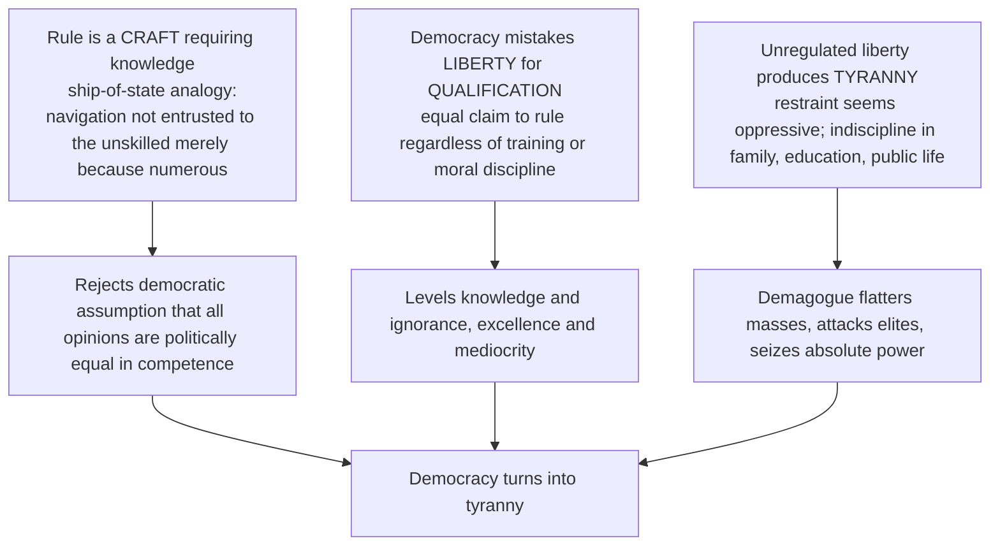

| Stage | Dominant value | Why it degenerates |
|---|---|---|
| **Timocracy** | honour, military spiritedness | honour yields to desire for wealth |
| **Oligarchy** | property and wealth | division between rich and poor destabilises order |
| **Democracy** | freedom and equality of desires | excessive liberty undermines discipline and authority |
| **Tyranny** | domination by one demagogue | democracy's disorder invites a strongman |

The point is normative, not merely historical: when the ordering principle of soul and city declines from reason to appetite, constitutions deteriorate correspondingly.

> [!WARNING]
> Plato's critique is **not** a defence of hereditary monarchy. It defends **rule by knowledge** and attacks uninformed mass rule.

### 2.3 Aristotle: two variables and the middle course ✅

- **Criteria:** (a) how many rule (one, few, many); (b) whether they govern for the common advantage or their private advantage.
- The good-many form is **polity**, not democracy; in classical usage democracy is the deviant rule of the poor many in their own interest.
- **Polity** = practical mixed constitution: rule of the many under law, moderated by property, virtue and civic participation, with a stabilising **middle class**.
- ⚠️ Against **statism**: does not absorb all value into one all-wise ruler. Against **individualism**: does not reduce politics to private pursuit. For **civic moderation**: embeds citizenship in lawful order directed to the common good.
- ⚠️ Strong line: Plato asks who ought *ideally* to rule; Aristotle asks what constitution can **sustain a good political life under real social conditions**.

### 2.4 Weber: the ground of obedience ✅/⚠️

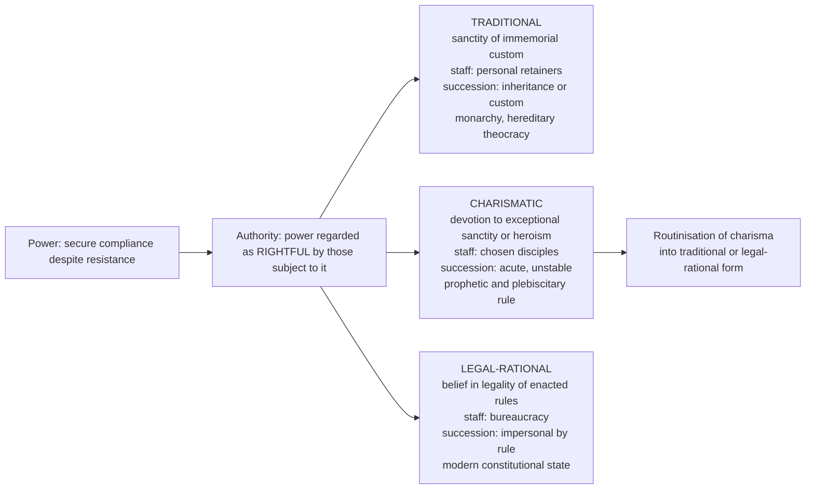

Reconstructed argument ⚠️: coercion alone imposes enforcement burdens (scale varies, no unlimited-cost law established); belief in rightfulness can reduce reliance on coercion; such beliefs take a limited number of forms; each generates its own administration and crisis; so regimes are best analysed by the **type of legitimacy claim**, not only the number of rulers.

> [!WARNING]
> Weber's legitimacy is **sociological belief, not normative justification**. Equating "legitimate" with "justified" is the commonest misuse of the typology. Weber's types are **ideal types** (analytical exaggerations), valuable for diagnosing which mixture a regime is.

**Cross-cutting ⚠️.** A monarchy may be traditional or charismatic; a theocracy typically joins traditional to charismatic; a democracy is normally legal-rational but can be captured by a plebiscitary-charismatic leader while retaining legal forms.

### 2.5 The case for and against each form (justificatory summary)

| Form | Strongest normative case | Strongest normative objection |
|---|---|---|
| **Monarchy** | Unity and continuity; decision and stability; "above politics" symbol in constitutional variants ✅/⚠️ | Equality objection (hereditary office), merit objection (birth ≠ wisdom), accountability objection (arbitrariness), freedom objection (only where law restrains the crown) |
| **Theocracy** | Moral unity and collective purpose; restraint on purely self-interested politics; stable ethical order from sacred obligation; higher law limits rulers' arrogance | Who speaks for God? No equal standing for citizens of other faiths or none; liberty of conscience compromised; dissent becomes impiety; clerical interpretive monopoly; difficult to adapt to modern rights discourse |
| **Democracy** | Equal standing, accountability, liberty, self-rule, peaceful correction of error | Ignorance, majority tyranny, propaganda, short-termism |

### 2.6 The justification of democracy ✅/⚠️

- **Epistemic defence ⚠️/✅:** against Plato's scepticism, diverse perspectives, open criticism and public contestation can improve collective judgment. The strongest form is *not* that all opinions are equally true but that democratic procedures allow **error-detection, revision and access to dispersed social knowledge**.
- **Deliberative defence ✅/⚠️ (Habermas):** legitimacy grows when laws emerge through communication under conditions approximating freedom, reciprocity and absence of domination. It deepens, not replaces, voting; a reply to propaganda, polarisation and shallow majoritarianism.
- **Developmental defence ⚠️ (Mill):** participation educates citizens and improves public character; but **participation does not automatically yield democratic or social progress** (❓/⚠️ source-critical qualification: unequal voice, exclusion and manipulation can frustrate its benefits).
- **Advanced menu ⚠️ (optional depth):** four justifications of why democracy is justified: equal-status; good-outcomes / epistemic; public-reason; collective-autonomy.

> [!NOTE]
> **Advanced residue (dossier §4).** Deliberative-vs-aggregative democracy was **promoted to Core on 15 Aug 2026**; optional residue is systemic/institutional designs of deliberation. Still optional unless a PYQ asks directly: **epistocracy**, **public reason as a named doctrine**, **republican (anti-domination) democracy**. Credible source trail: Plato, Aristotle, Mill, Habermas *Between Facts and Norms*, Urbinati *Democracy Disfigured*, Estlund *Democratic Authority*, Pettit *Republicanism*.

---

## 3. Rival and Critical Wings (challengers inside and outside democratic theory)

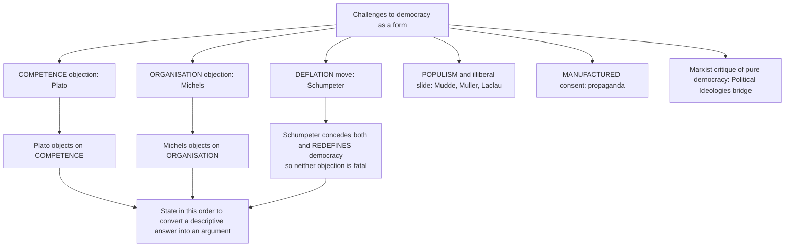

### 3.1 Schumpeter: democracy as competitive selection of leaders ✅/⚠️

1. The common good is not uniquely determinable (citizens disagree over ultimate ends).
2. No determinate "will of the people" exists; aggregate preferences are unstable and manufactured.
3. The ordinary citizen's grasp of remote political issues is weak.
4. So democracy cannot be defined by the content of outcomes.
5. It can be defined by a **method**: free competition among would-be leaders for the electorate's vote.
6. The people's function is to **produce a government**, not to govern.

- Strength ✅: empirically usable; distinguishes democracy from plebiscitary acclamation; identifies the minimum — an open, uncertain, repeatable contest.
- Objection (participatory/deliberative): deflationary; cannot tell a deliberative election from a well-managed one. Reply: a *minimum*, not a ceiling. Residual: treated as the whole definition it licenses hollow electoralism.
- Objection: if preferences are manufactured, elite competition manufactures them better. Reply: needs plural media, independent adjudication and opposition rights, a concession that the purely procedural definition is incomplete.

### 3.2 Michels: the organisational objection ✅/⚠️ (*Political Parties*, **1911**)

"Iron law of oligarchy": every large organisation, even one founded on democratic aims (socialist party, trade union), tends toward rule by a small leadership.

1. Large-scale organisation is indispensable for mass action.
2. It requires continuity, specialisation, technical competence, control of information.
3. These need a full-time expert leadership.
4. That leadership becomes irreplaceable, controls communication and develops interests in retaining position.
5. So oligarchy arises from organisational requirements, not bad faith ("who says organisation says oligarchy").

- Objection: organisations differ measurably (rules on term limits, internal elections, transparency alter outcomes). Reply: the defensible version is a **tendency**, not a law; a tendency resistible by design is no longer *iron*.
- Democratic-elitist reply: what matters is whether elite selection is **competitive and accountable**; this rescues democracy at the price of conceding Schumpeter's deflation.

### 3.3 Populism and the slide to illiberal democracy ✅/⚠️

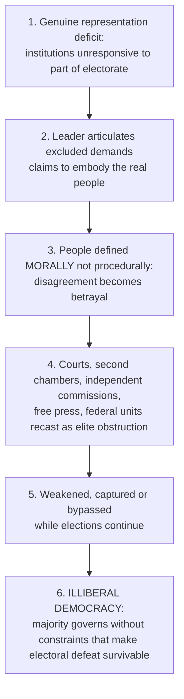

| Scholar | Account | Key point |
|---|---|---|
| **Mudde** — "The Populist Zeitgeist", *Government and Opposition* **2004** ✅ | Populism = **thin-centred ideology**: society into two homogeneous antagonistic camps, "the pure people" vs "the corrupt elite"; politics should express the *volonté générale* | Carries no full programme; attaches to a **host ideology** (left, right, nationalist, religious) |
| **Müller** — *What Is Populism?* **2016** ✅ | Distinguishing feature is **exclusive moral representation**: only the populist represents the real people; rivals are enemies | **Anti-elitism is compatible with democracy; anti-pluralism is not** |
| **Laclau** — *On Populist Reason* **2005** ⚠️ | Populism as **logic of articulation** linking disparate unsatisfied demands into a collective subject, "the people" | Potentially democratising where institutions exclude; dangerous where it forecloses plurality |

> [!WARNING]
> Do not present Mudde, Müller and Laclau as one settled definition; state the contest, then adopt a position with reasons.

**Controlling distinction ✅:** *majority rule* is a decision procedure; *constitutional democracy* is majority rule **plus** entrenched rights, independent adjudication and secured conditions for the next contest.

| Symptom | Democratic form retained | Substantive condition eroded |
|---|---|---|
| elections continue | ✅ periodic contest | ⚠️ fairness of contest: access, finance, media, adjudication |
| a majority governs | ✅ majority rule | ⚠️ limits on what a majority may do to minorities |
| courts function | ✅ judicial machinery | ⚠️ independence of appointment, tenure, enforcement |
| a press exists | ✅ formal freedom | ⚠️ plurality of ownership; absence of indirect pressure |
| opposition parties exist | ✅ multiparty form | ⚠️ realistic prospect of alternation in power |

Objections: "populism" is a smear by incumbents → concede; apply the Müller criterion (exclusive representation and denial of opposition's legitimacy, irrespective of programme). The argument protects unelected institutions against majorities → reply is temporal: limits protect the **conditions of future majorities**, including the losing side's ability to become one.

### 3.4 Propaganda and manufactured legitimacy ✅/⚠️

1. Democratic authorisation is valuable because it expresses citizens' judgment.
2. A judgment is the citizen's own only if formed with information access, exposure to rival argument and freedom from manipulation.
3. Concentrated communication power, agenda control, emotional saturation, repetition and targeted disinformation degrade all three.
4. Consent so produced is **manufactured**.
5. An election may confer legitimacy in Weber's sociological sense while failing to confer authorisation in the normative sense.
6. Democratic quality depends on the **conditions of opinion-formation**, not only on counting votes.

> [!IMPORTANT]
> **Regulator's dilemma ✅.** Content-based remedies (restricting false speech, platform control, licensing) hand the state power over public truth, the very power a propagandising state abuses. Defensible remedies are **structural**: plural ownership; transparency of political finance and paid political messaging; independent electoral adjudication; protected professional journalism; civic education; rights of reply.

### 3.5 Six recurring democratic pathologies ⚠️

| Pathology | Mechanism | Best institutional reply | Residual limit |
|---|---|---|---|
| **Tyranny of the majority** | Number converted into unlimited authority over minorities | Entrenched rights, independent review, federal or consociational protections | Checks can be portrayed as obstruction |
| **Elite capture / oligarchic drift** | Organisation, money, expertise, information concentrate influence | Competition, transparency, internal democracy, realistic alternation | Counter-elites may circulate without dispersing power |
| **Instability / short-termism** | Electoral incentives privilege immediate benefits and coalition survival | Legislative scrutiny, independent institutions, intergenerational duties | Insulation can weaken democratic control |
| **Populist anti-pluralism** | One leader/group claims exclusive moral representation | Protected opposition, plural media, fair future contest | "Populism" itself can be a partisan label |
| **Propaganda / manufactured consent** | Agenda control and manipulation degrade opinion-formation | Structural plurality, transparency, civic education, independent adjudication | Content regulation empowers the state over public truth |
| **Bureaucratic domination** | Expertise, files, continuity displace representative control | Reasons, review, legislative oversight, decentralisation, participation | Complex government cannot dispense with specialised administration |

**Graded verdict ⚠️:** democracy's comparative strength is not immunity from these pathologies but its capacity for peaceful exposure, contestation and correction. When opposition, rights and realistic alternation disappear, electoral form becomes insufficient.

---

## 4. Conceptual Inventory

### 4.1 Monarchy ✅

Monarchy vests the office of head of state in **one person**, usually by heredity (elective monarchies also exist). The monarch governs directly in an absolute monarchy; limited and constitutional arrangements constrain the crown to differing degrees, sometimes chiefly ceremonial but not necessarily powerless.

| Type | Character | Source of power | Accountability pattern | Verdict |
|---|---|---|---|---|
| **Absolute** | rules directly, concentrated authority | heredity, conquest, tradition, divine right | weak institutional accountability | efficient but normatively risky |
| **Limited** | retains governing powers subject to legal or customary restraints | monarchical title + limits on exercise | depends on enforcement of restraints | limitation matters but does not itself establish democratic rule |
| **Constitutional** | crown's powers constitutionally bounded; in democratic variants elected institutions govern | historic continuity + constitutional limitation | ministerial responsibility; retained crown powers need scrutiny | strongest democratic defence: limited, non-partisan headship |

**Separate axes ✅/⚠️ (not extra rival forms):**
- **Elective monarchy:** monarch selected by an electoral body; election of a crown does not itself establish universal franchise, representative government or democratic accountability.
- **Regency:** a regent exercises functions when the monarch is a minor, absent or incapacitated.
- **Reserve powers:** some constitutional crowns retain exceptional powers over appointment/dismissal of government, dissolution, assent (the local compilation mentions dismissal of a prime minister, refusal of dissolution, withholding assent). These are possibilities in particular arrangements, **not** powers of every constitutional monarch.
- The compilation's description of limited monarchy as an early pre-written-constitution stage is **not adopted** as universal: **limits**, not a written constitution, control the comparison.

**Divine Right of Kings ✅:** the monarch rules by God's will and is answerable primarily to God, not the people; historically strengthened absolutism by sacralising authority.

### 4.2 Theocracy ✅

Political authority claimed in the name of **God**, divine law or authorised interpreters of sacred truth; not merely a society influenced by religion, but a polity whose ultimate source of sovereignty is held to be divine rather than popular.

| Feature | Meaning |
|---|---|
| **Sovereignty of God** | final authority belongs to divine will, not the people |
| **Sacred law** | religious law guides or determines civil law |
| **Clerical mediation** | priests, jurists, clergy or religious elites interpret divine command |
| **Limited pluralism** | dissent constrained if it appears as theological deviance |
| **Fusion of religion and state** | political and religious legitimacy overlap |

Core claim: humans do not create ultimate norms; they receive them. Apparent advantage: places rulers under a higher law. Practical problem: **who speaks for God?** — human interpretation can mask ordinary power struggles.

### 4.3 Democracy ✅

Literally rule of the people; in modern thought also political equality, participation, accountability, public justification and some protection of rights.

| Type / model | Core claim | Strength | Limitation / pathology |
|---|---|---|---|
| **Direct** | citizens decide themselves | high participation, visible self-rule | hard to scale |
| **Representative** ✅ | citizens authorise agents for limited periods | scales democracy, specialised deliberation | distance, weak mandate control, elite capture |
| **Majoritarian** ✅/⚠️ | numerical majority decides under political equality | clear authorisation, decisiveness | tyranny of the majority |
| **Liberal** ✅ | majority rule bounded by rights, rule of law, opposition, independent review | electoral defeat survivable; protects dissent | safeguards may coexist with social exclusion or unequal influence |
| **Participatory** ✅ | citizens act beyond periodic voting | civic education, public character, local accountability | participation fatigue, unequal voice, over-mobilisation instability |
| **Deliberative** ✅/⚠️ | legitimacy needs public reason-giving | revisability, mutual justification, correction | demanding assumptions of time, equality, undistorted communication |
| **Procedural** | elections, competition, voting, rules | are rulers chosen fairly? | an unequal, exclusionary or manipulated polity can still hold elections |
| **Substantive** ⚠️ | justice, rights, inclusion, real equality | do people actually govern under fair social conditions? | |

**Representation models ⚠️:** **delegate** (follows constituents' instructions), **trustee** (independent judgment), **mandate** (authorises a stated party programme); **descriptive** representation (who representatives are) vs **substantive** (what they do for those represented).

**Bounded democratic anchors ✅/⚠️:**
- **Rousseau:** sovereignty remains with the people and cannot be fully replaced by elected agents; supplies the direct/participatory pole and the general-will danger where government falsely claims to embody the people.
- **J. S. Mill:** representative government's developmental education; competence-weighting proposals show democratic commitment can coexist with elitist residue.
- **Tocqueville:** associations, local self-government, a free press and habits of liberty resist **tyranny of the majority** and administrative centralisation.
- *Exam use:* Rousseau explains why representation is incomplete; Mill why participation educates; Tocqueville why majority rule needs social and institutional counterweights.

### 4.4 Constitutional and non-democratic regime families ✅/⚠️

| Family | Core criterion | Controlling distinction |
|---|---|---|
| **Constitutional government** ✅ | Limited powers under general law, rights, review, procedures of removal | A constitution in name is insufficient if limits cannot be enforced |
| **Absolute government** | Ruler or ruling body claims final power not institutionally answerable | Decisiveness does not supply legitimacy or error-correction |
| **Dictatorship** | Decision and coercive power concentrated without regular competitive accountability | May be personal, military, party-based or emergency in origin; the common feature is unanswerable concentration |
| **Authoritarianism** | Opposition, discussion and accountability sharply restricted; some social/institutional plurality may survive | Need not control every belief or social sphere (Gauba PDF p. 512 / printed p. 493 supplies the explicit account) |
| **Totalitarianism** | Ruling ideology and party-state seek comprehensive mobilisation and penetration of political and social life | More ambitious than ordinary dictatorship or authoritarian closure |

The authoritarian/totalitarian distinction is a standard comparative reconstruction associated with **Juan Linz** and **Hannah Arendt**; not a new printed syllabus limb. Detailed fascist/communist histories belong to Political Ideologies and World History.

### 4.5 Institutional and territorial design axes ✅/⚠️ (secondary; do not replace the printed three forms)

| Axis | First pole | Second pole | Trade-off |
|---|---|---|---|
| **Parliamentary / presidential** | **Fusion:** executive emerges from and remains responsible to the legislature | **Separation:** executive has separate mandate and fixed tenure | Responsibility and removability vs stability and possible deadlock/personalisation |
| **Unitary / federal** | Sub-units exercise delegated powers | Constituent units and centre hold constitutionally divided competences | Uniformity and decisiveness vs autonomy, diversity-management, check on concentration |
| **Fusion / separation of powers** | Personnel and functions overlap | Distinct competences, mutual checks | Coordination vs prevention of arbitrary concentration |
| **Centralisation / decentralisation** | Decisions concentrated at higher levels | Authority exercised near affected communities under subsidiarity | Uniform standards vs participation, local knowledge, accountability |

Accountability control: fusion need not mean absence of checks, nor separation perfect independence; the question is whether each organ can explain, contest and correct the others through workable **checks and balances** without paralysis.

---

## 5. Normative, Legal and Constitutional Bridges

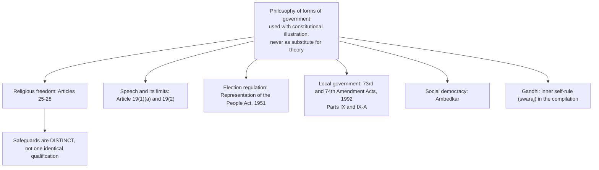

### 5.1 Articles 25–28 ✅ (Constitution of India, Part III; checked against Parliament Digital Library, *The Constitution of India (2024)*, printed pp. 14–15)

| Provision | Exact scope of safeguard | Qualification / trap |
|---|---|---|
| **Art. 25(1)–(2)** | All persons' freedom of conscience and free profession, practice and propagation of religion | Subject to **public order, morality, health and other provisions of Part III**; clause (2) preserves specified secular-activity regulation and social welfare/reform |
| **Art. 26** | Denominational rights to establish/maintain institutions, manage religious affairs, own/acquire property and administer it | Subject to **public order, morality and health**; property administration **in accordance with law** |
| **Art. 27** | No person compelled to pay taxes whose proceeds are **specifically appropriated** to expenses promoting or maintaining a particular religion or denomination | Not a blanket ban on every public expenditure touching religion; do not replace its specific-tax test with Art. 25's qualification |
| **Art. 28(1)** | No religious instruction in an institution **wholly maintained out of State funds** | Read with clause (2) exception |
| **Art. 28(2)** | Clause (1) does not apply to a State-administered institution established under an **endowment or trust requiring religious instruction** | Distinguish State administration and the founding terms |
| **Art. 28(3)** | A person attending a **State-recognised or State-aided** institution cannot be required to participate in religious instruction or attend worship there **without consent** (minor: **guardian consent**) | This attendance safeguard does not erase clause (1) |

> [!WARNING]
> The express public-order/morality/health qualifications belong to **Articles 25–26**, not indiscriminately to Articles 27–28. Constitutional provisions are legal facts, not proof of a philosophical thesis or of successful enforcement; no Indian government or period is characterised.

### 5.2 Speech, elections, local government ✅/⚠️

- **Article 19(1)(a)** guarantees freedom of speech and expression, **subject to reasonable restrictions** under **Article 19(2)** on specified grounds — a permissible zone of restriction, not a philosophical resolution of the propaganda dilemma.
- **Representation of the People Act, 1951** — enacted statute governing the conduct of elections, including corrupt practices and disqualifications. Enactment ≠ enforcement; a statute cannot establish that opinion-formation is in fact free.
- **Constitution (Seventy-third and Seventy-fourth Amendment) Acts, 1992** inserted **Parts IX and IX-A** for rural and urban local government — constitutional-status illustrations, not a claim that design alone guarantees participation.
- India combines parliamentary government with a holding-together federal structure under constitutional supremacy and judicial review.

### 5.3 Secularism and theocracy ✅/⚠️

- Secularism asks that the state not be founded on the supremacy of one religious truth for all citizens; in modern constitutional terms it protects **equal citizenship, liberty of conscience and peaceful coexistence** under plural faith.
- Theocracy stands in structural tension: privileges one sacred framework; constrains dissent and apostasy; makes citizenship asymmetrical; narrows the public basis of law from shared reason to sectarian authority. Especially sharp in diverse societies like India.
- ⚠️ This does **not** require hostility to religion: religious arguments may enter public life, but coercive institutions must not make citizenship depend on adherence to one faith.

### 5.4 Social cohesion and the Indian democratic ideal ⚠️

- Ambedkar's warning: **political equality** cannot long survive amid deep **social and economic inequality**; political democracy needs social democracy (cross-owner: Social-Political-Ideals §3.8).
- Compilation (PDF pp. 112–114): diagnoses weakened religious/moral commitment as a cause of democratic crisis; connects Gandhi's inner self-rule (swaraj) with self-discipline; criticises haste in introducing adult franchise. ⚠️ These are **the compilation's arguments and historical judgments**, not verified facts or verbatim Gandhi. Secular justifications of equal civic dignity exist, and imperfect civic education does not justify indefinite exclusion from the franchise.
- ❌ No exact "automatic democratic progress" quotation is attributed to either book (wording not located).

---

## 6. Explanatory Models of Regimes

### 6.1 Plato versus democratic self-government ⚠️

| Axis | Plato's objection | Democratic reply |
|---|---|---|
| Competence | rule requires knowledge, like navigation or medicine | expertise informs policy, but equal citizens retain authority over common purposes |
| Freedom | excessive freedom dissolves discipline, prepares tyranny | constitutional liberty is ordered by rights, law, accountability |
| Desire | demagogues manipulate appetites | plural media, opposition, deliberation, review can expose manipulation |
| Unity | faction fragments the city | legitimate plurality preferable to enforced unity |

**Verdict:** Plato identifies real pathologies (propaganda, ignorance, leadership selection); his remedy, rule by a philosophically trained guardian class, underestimates the danger of unaccountable expertise and the moral equality of citizens.

### 6.2 Aristotle's polity and modern constitutional democracy ✅/⚠️

Polity mixes oligarchic and democratic elements and relies on a broad middle class; modern constitutional democracy combines popular authorisation with limits, institutions, rights and checks. **Not identity:** Aristotle excluded many residents from citizenship; modern democracy claims universal equal citizenship. Lasting insight: stable government avoids both rule by wealth alone and rule by an unrestrained numerical majority.

### 6.3 Monarchy versus democracy ⚠️

| Question | Monarchical answer | Democratic answer |
|---|---|---|
| Why obey? | continuity, tradition, unity, divine/hereditary title | equal citizenship, public authorisation |
| Who corrects error? | prudent ruler, counsel, customary restraint | opposition, elections, courts, public criticism |
| Main strength | decisiveness and continuity | accountability and peaceful correction |
| Main danger | arbitrariness and succession failure | demagoguery, short-termism, majoritarianism |

### 6.4 Divine Right as the bridge between monarchy and theocracy ✅/⚠️

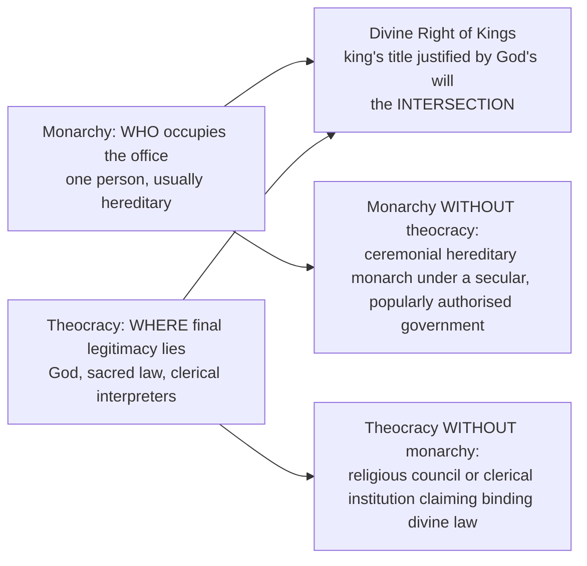

⚠️ Formula: **Divine right makes monarchy theologically legitimated; theocracy makes theology politically constitutive.** The concepts track different axes, so neither entails the other.

### 6.5 Expertise without technocracy ⚠️

1. Complex administration requires specialised knowledge. 2. Expertise does not decide value-conflicts; it clarifies consequences and feasible means. 3. Democratic institutions must authorise goals, demand reasons and hold experts accountable. 4. Balanced model: **expertise under democratic control**, not expertise replaced by polling nor democracy replaced by experts. (Advanced objection/reply: epistemic defences can slide into rule by experts; reply keeps expertise advisory and contestable while preserving equal standing in authorising power.)

---

## 7. Value Aims of the Forms

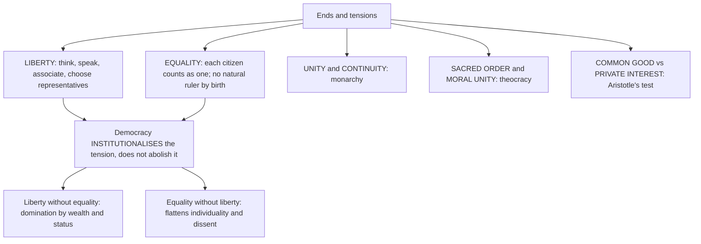

- **Distinctiveness ✅/⚠️:** liberty and equality are not unique to democracy in formal statement; democracy alone institutionalises **equal authorisation** of rule and **peaceful replacement** of rulers.
- **Minority protection ✅:** democracy without rights becomes majoritarianism; citizenship needs equal moral standing, not merely counting heads; plural societies need safeguards for language, religion, culture and dissent. Achievements: legal guarantees, representation, judicial review, civil liberties, protection of dissent and association, constitutional accommodation. Limits: social prejudice outlasting formal equality; electoral incentives encouraging majoritarian rhetoric; minorities tolerated formally but excluded substantively. Success depends on constitutional culture, social equality and institutional independence.
- **Error-correction ⚠️:** the final comparison axis that most often decides the verdict and is most often omitted.
- No kāma/artha/dharma/mokṣa scheme applies here; the sources frame value aims as liberty, equality, common good, unity and moral order.

---

## 8. Inter-School Comparative Matrices

### 8.1 Three printed forms on fixed axes ⚠️ (compare rule: source of authority · Weber legitimacy · succession or selection · accountability · relation to law · treatment of dissent · equality of citizenship · error-correction)

| Axis | Monarchy | Theocracy | Democracy |
|---|---|---|---|
| Source of authority | heredity, conquest, tradition, sometimes divine sanction | God, revelation, sacred law, clergy | consent, equality, participation, representation |
| Weber type ⚠️ | traditional (may be charismatic) | typically traditional joined to charismatic | normally legal-rational (can be captured by plebiscitary charisma) |
| Succession / selection | usually dynastic; elective exceptions | by religious authority or office (axis is separate from monarchy) | electoral, periodic, rule-governed |
| Accountability | weak (absolute); ministerial responsibility (democratic constitutional variants) | to divine law as interpreted, shielded from ordinary criticism | electoral, legal, judicial, public |
| Relation to law | variable; bounded in constitutional forms | sacred law guides or determines civil law | rule of law, rights, review |
| Treatment of dissent | usually weak protection; protected in democratic variants | constrained as theological deviance | protected; institutionalised opposition |
| Equality of citizenship | hereditary inequality of status | asymmetrical where belief differs | equal standing (ideal) |
| Error-correction | ruler's own prudence, counsel | interpretive authority; hard to challenge | elections, review, free press, opposition |

### 8.2 Aristotle's six forms ✅

| Number | Right form (common good) | Deviant form (private interest) |
|---|---|---|
| One | **Monarchy** | **Tyranny** |
| Few | **Aristocracy** | **Oligarchy** |
| Many | **Polity** | **Democracy** (deviant sense) |

### 8.3 Plato vs Aristotle on forms ⚠️

| Axis | Plato | Aristotle |
|---|---|---|
| Standard | **knowledge** | **number of rulers + orientation to common good** |
| Ideal | philosopher-rule, true aristocracy of knowledge | mixed constitution (polity) sustainable under real conditions |
| Democracy | second-worst; slides into tyranny through unrestricted liberty | deviant rule of the poor many in their own interest (polity is the good-many form) |
| Method | degeneration sequence | classification by two variables |

### 8.4 Monarchy, democracy and dictatorship: shared features (the concession) ⚠️

| Shared feature | In monarchy | In democracy | In dictatorship | Why it proves little |
|---|---|---|---|---|
| Binding authoritative decisions | royal command and council | legislation and executive order | decree | all rule requires finality |
| Coercive enforcement | royal officers | police and courts under law | security apparatus | coercion differs in *authorisation*, not presence |
| Bureaucracy | household and revenue administration | permanent civil service | party-state or personal apparatus | Weberian legal-rational administration serves any master |
| Executive concentration | strongest in absolute rule | cabinet and leader dominance possible | total | democracies limit it by tenure and review |
| Emergency powers | prerogative | constitutionally regulated emergency | permanent exception | test is whether the exception is time-bound and justiciable |
| Legitimating narrative | tradition, sometimes divine right | popular mandate | ideology, personality, manufactured consent | Weber's legitimacy is belief, not justification |
| Symbolism and ceremony | crown and ritual | flag, constitution, oath | cult of the leader | symbolism substitutes for accountability only in the last |
| Succession mechanism | usually dynastic; elective exceptions | electoral rule | often personalised, uncertain | a *rule* of succession makes power impersonal |

### 8.5 Decisive differences (the refutation) ⚠️

| Axis | Constitutional democracy | Absolute monarchy | Constitutional monarchy | Dictatorship |
|---|---|---|---|---|
| **Source of office** | competitive public authorisation | usually heredity and tradition | usually hereditary crown; elective exceptions; elected government in democratic variants | seizure, personal dominance, controlled selection |
| **Weber legitimacy** | legal-rational | traditional | traditional symbol + legal-rational government | charismatic or coercive, often retaining legal-rational forms |
| **Accountability** | electoral, legal, judicial, public | limited, customary or personal | ministerial responsibility in democratic variants; crown bounded by law/convention | none effective |
| **Contestability** | institutionalised opposition | usually weak | protected in democratic variants | suppressed |
| **Rights** | protected and justiciable | dependent on monarch or custom | constitutional guarantees; enforcement assessed | routinely subordinated |
| **Limits on power** | legislature, courts, federalism, civil society | variable, unenforceable | constitutional; retained/reserve powers need scrutiny | ineffective or absent |
| **Succession** | rule-governed, periodic, peaceful | usually dynastic | rule-governed crown succession | frequently uncertain and violent |
| **Error correction** | elections, review, free press, opposition | ruler's own prudence | ordinary democratic machinery where operative | none from below |
| **Relation to dictatorship** | a degeneration *risk*, resisted by design | short conceptual distance | depends on effective limits, not ceremonial status alone | the type itself |

### 8.6 Liberal democracy and cohesion (2018) ⚠️

Liberal democracy combines competitive popular authorisation with **equal individual liberty, rule of law and limits on government**. Rights alone may coexist with caste stigma, religious mistrust, unequal access to public voice. Indian constitutional answer: equal standing and conscience joined to **fraternity, social equality and publicly justified institutions**.

---

## 9. Criticisms & Reconstructed Replies

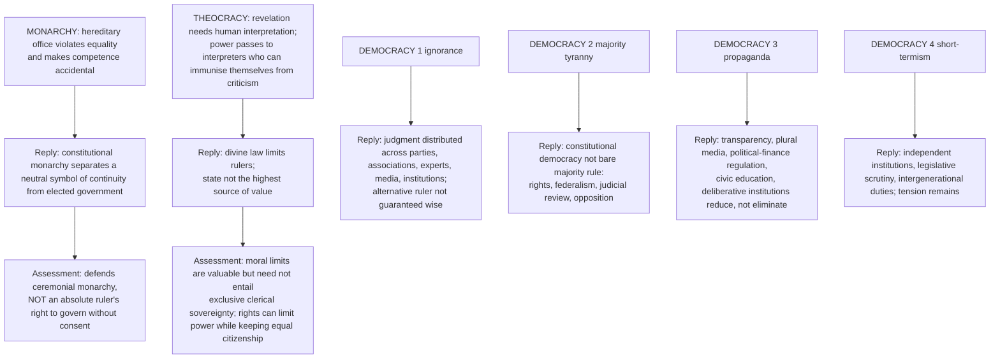

### 9.1 Objection chains on the dictatorship stem ⚠️ (objection → reply → residual)

| Objection | Reply | Residual problem |
|---|---|---|
| **Equivalence:** all coerce, tax, imprison and propagandise; democracy dresses domination in consent | ✅ conflates *presence* of coercion with its **authorisation and revisability**; can those subject to power withdraw it without violence? | Presupposes authorisation is genuine, which propaganda and capture can defeat (§3.4) |
| **Constitutional-monarchy:** grouping monarchy with dictatorship is crude; a ceremonial monarch does not direct government | Correct for that variant, but constitutional monarchy is not exhausted by ceremonial headship; proximity to unaccountable power is strongest in **absolute** monarchy; assess actual constraints and reserve powers | Hereditary headship retains unequal public status; reserve powers raise accountable-exercise questions; elective recruitment alone solves neither |
| **Elected-dictator:** a leader with a majority, weak courts, compliant press exercises dictatorial power while formally democratic | ✅ conceded; the form/substance distinction; elections necessary but insufficient | Diagnosis easier than remedy; counter-majoritarian correctives need their own accountability |
| **Efficiency:** concentrated authority decides faster | Decisiveness magnifies error where criticism is suppressed; speed is a benefit only where correction remains possible | ✅ Democracies do pay real coordination and delay costs: the price of revisability |

### 9.2 Source-critical limits ❓/⚠️

- Participation **can** develop civic capacities; it does not automatically yield progress.
- Weber's definition of legitimacy as belief lets propaganda-induced acceptance count; a **normative** theory (consent, accountability, contestability) must supplement it.
- Whether a personalised emergency regime is a distinct type or a stage of decay is ❓ contested (Schmitt's commissarial vs sovereign dictatorship marks the dispute).

---

## 10. Controlled Western Comparisons (and cross-tradition pairs the sources give)

The sources contain **no East–West comparison table** for this topic. The topic's own scholarship is Western-classical and Western-modern; only the following cross-pairs are source-given.

| Pair | Point of contact | Decisive disanalogy |
|---|---|---|
| **Aristotle's polity ↔ modern constitutional democracy** ⚠️ | Both mix oligarchic and democratic elements; middle class; limits and checks | Aristotle excluded many residents from citizenship; modern democracy claims universal equal citizenship |
| **Plato ↔ democratic self-government** ⚠️ | Both attend to leadership selection and manipulation | Plato's guardian remedy lacks consent and external correction |
| **Plato / Michels / Schumpeter** ⚠️ | Competence → organisation → redefinition | Schumpeter makes neither objection fatal by redefining democracy as a method |
| **Rousseau ↔ representative democracy** ✅/⚠️ | Popular sovereignty as the direct/participatory pole | General-will danger where government falsely claims to embody the people |
| **Mill ↔ Plato** ⚠️ | Both think about competence | Mill's competence-weighting shows elitist residue yet keeps participation as education |
| **Divine Right ↔ theocracy** ✅ | Theological legitimation | Divine right sacralises kingship; theocracy places sovereignty directly in God or religious law |
| **Mudde ↔ Müller ↔ Laclau** ⚠️ | Rival definitions of populism | Thin ideology vs anti-pluralism vs logic of articulation — state the contest |
| **Gandhi's swaraj ↔ participatory democracy** ⚠️ (compilation) | Inner self-rule linked to self-discipline and obligations to others | The compilation's argument; moral discipline does not prove religious belief is necessary for democracy |

> [!WARNING]
> No present-day country, government, leader, party or period is characterised as a dictatorship, populism or degenerating democracy; the Roman dictator was a **temporary constitutional emergency office**, so "dictatorship" needs a stipulated modern definition.

---

## 11. Diagnostic Deep-Dives for High-Frequency Themes

### 11.1 2026 Q3(b): "monarchy and democracy both share common features with dictatorship" (15 marks) ⚠️

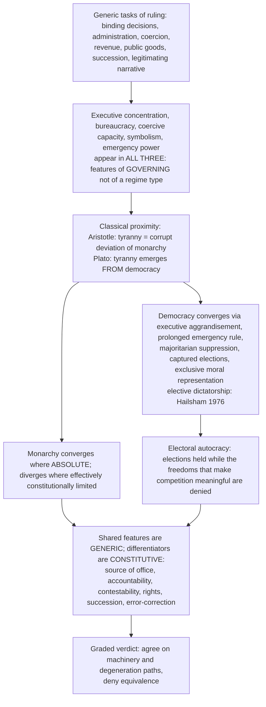

- **Verdict:** the stem is **functionally true and normatively false**.
- **Presuppositions:** regime types are defined by the **conditions of holding and losing power**, not by tasks performed; functional similarity is not moral equivalence; regimes can be hybrid and drift; ❓ personalised emergency regime — distinct type or stage of decay (**Schmitt, *Die Diktatur*, 1921**).
- **Roman origin ✅:** the Roman dictator was a temporary constitutional emergency magistracy.
- **15-mark spine:** (1) split the stem; (2) concession (5 lines); (3) refutation on four axes: source of office, accountability, contestability, error-correction (6 lines); (4) worked elected-dictator objection → reply → residual; (5) constitutional-monarchy qualification; (6) graded verdict. **10 marks:** concession in two lines → three shared generic features → three decisive differences → absolute/constitutional split → verdict. **20 marks:** add the Weber grid, commissarial/sovereign distinction ❓, form/substance analysis, manufactured-consent mechanism, Roman origin, closing criterion paragraph naming error-correction.
- **Bridge:** Political Ideologies §2.10 (the Marxist objection that the democracy–dictatorship contrast is class-conditioned) — cite, do not re-teach.

> [!WARNING]
> Traps on this stem: agreeing outright because "all states use force"; rejecting outright because democracy is good; treating monarchy as one thing; equating dictatorship/authoritarianism/totalitarianism; naming a present-day regime; treating "dictatorship" as self-defining; ending without a criterion.

### 11.2 2019 Q1(b): theocracy's status in the modern secular state ⚠️

- If "theocracy" means binding public law derives its final authority from a privileged revelation or its authorised interpreters, it cannot be the **constitutional source** of rule in a secular state committed to equal citizenship.
- This does **not** mean religious citizens, communities or ethical arguments disappear from public life; freedom of conscience and participation remain protected, subject to the same publicly reviewable limits.
- Defender: sacred authority checks a morally unrestrained secular majority → reply: rights and contestable law can constrain a majority **without** granting one faith political supremacy.
- Three residual relevances ⚠️: a historical form of legitimacy; a living challenge to secular constitutionalism; a reminder that states face claims of conscience, sacred law and religious identity.
- **Judgment:** at best residual or contested status, not a governing norm. Do not confuse a **religious contribution to politics** with **theocratic title to govern**.

### 11.3 2025 Q4(b): Can theocracy be a valid form of government? (15 marks) ⚠️

- **Fix the criterion first:** consent, accountability, equal citizenship, error-correction.
- For: moral unity and collective purpose; restraint on self-interested politics; stable ethical order from sacred obligation. Against: no equal standing for different faiths or none; liberty of conscience compromised; dissent as impiety; clerical interpretive monopoly; difficult adaptation to rights discourse.
- ✅ Conclusion: theocracy may claim internal validity for believers, but as a **general form of government in a plural modern society** it fails equal citizenship, public reason and accountability.
- **Mark-bearing move:** distinguish **religiously informed public reasoning** (compatible with constitutional democracy) from **theocratic sovereignty**.

### 11.4 2022 Q4(c): Are monarchy and theocracy necessarily related? (Divine Right) ⚠️

- Refute necessity in **both directions**: monarchy without theocracy; theocracy without monarchy; Divine Right is the **intersection**.
- Objection: a monarch claiming divine title is already theocratic. Reply: ask whether religious law/interpreters actually constitute and govern public authority, or whether the title is symbolic legitimation within an otherwise distinct legal system.
- Axes: **who occupies the office** vs **where final legitimacy is said to lie**.

### 11.5 2021 Q1(d): Does monarchy leave room for individual freedom? ⚠️

| For | Against |
|---|---|
| constitutional monarchy may coexist with civil liberties, representative government, rule of law | absolute monarchy subordinates subjects to personal rule |
| a symbolic monarch need not threaten freedom | even symbolic monarchy carries inherited hierarchy and unequal civic status |
| | modern freedom needs accountability, rights, equal citizenship, none arising from heredity as such |

**Balanced conclusion ✅:** monarchy coexists with individual freedom only when constitutionalised and politically limited; as a principle of rule it does not ground freedom.

### 11.6 2023 Q1(e): If monarchs are above politics, can monarchy be systematic? ⚠️

- On the **constitutional, symbolic-neutrality reading**, a systematic form needs defined roles, continuity and limits; constitutional monarchy defines the non-partisan role by conventions while elected institutions govern.
- Reservations: "above politics" means above **party conflict**, not above constitutional accountability; unaccountable monarchy slides toward arbitrary rule.
- ⚠️ Not a universal definition: an absolute monarchy may also have organised succession, administration and predictable rules; organisation alone establishes neither accountability nor legitimacy; "only a symbolic crown can be systematic" is contestable.

### 11.7 2025 Q1(d): Plato's critique of democracy (10 marks) ⚠️

Target (rule driven by unrestricted desire and unexamined opinion) → spine (equality of unequal competences → excessive liberty → demagoguery → tyranny) → evidence unit with its limit → **asymmetric verdict**: the diagnosis of demagoguery and leadership-selection survives; the guardian remedy fails for want of consent and external accountability. Mind the two-step Plato trap: not a defence of monarchy.

### 11.8 2018 Q1(a) / 2020 Q1(b): liberal democracy, cohesion and minorities ⚠️

- Define liberal democracy: popular rule with constitutional limits, rights, rule of law, minority protection; majority governs **without converting number into unrestricted power**.
- Rights alone ≠ cohesion; Indian answer: fraternity, social equality, publicly justified institutions; Ambedkar illustrates (not proof that cohesion has been achieved).
- Objection: cohesion can demand conformity and suppress minority difference. Reply: defensible solidarity is **rights-bound and plural**.
- ⚠️ Verdict: deeper social trust and equal status help sustain rights, **not replace or outrank** them; do not claim liberalism's rights cause discord.
- 2020: "how far" → degree judgment; achievements vs limits; success depends on constitutional culture, social equality, institutional independence.

### 11.9 2022 Q4(a) / 2023 Q4(b): propaganda and challenges to democracy ⚠️

- **20-mark propaganda:** manufactured-consent mechanism (§3.4) → regulator's dilemma → structural remedies → one dated Indian illustration (Art. 19(1)(a)/19(2); RPA 1951) classified accurately → graded **dilemma verdict**: democracy survives propaganda through contestable institutions rather than censorship.
- **15-mark challenges:** run the six-pathology table (§3.5) with institutional replies and residual limits; add Plato–Michels–Schumpeter sequence; verdict on peaceful exposure and correction.
- Do not describe any Indian actor as populist, illiberal or propagandist.

---

## 12. PYQ Routing Ledger

> **Corpus signal.** 10 primary-owned parts out of 112 in 2018–2025 (2024: none; 2022 and 2025: 2 each; 2023: 2), plus **1** in the 2026 supplement = **11 verified parts in the 2018–2026 ledgers**. The owner file records **no pre-2018** parts for this topic. Cross-owned and cross-linked parts are listed after the tables and **not counted**.

### 12.1 2018–2025 (bank)

| Year | Q | Marks | Exact demand | Route |
|---|---|---:|---|---|
| 2018 | Q1(a) | 10 | What is meant by liberal democracy? Does it require deeper principles for social cohesion to balance its own strong affirmation of individual rights? Give reasons from the Indian context. | §11.8, §8.6 |
| 2019 | Q1(b) | 10 | Discuss the status of theocracy in the modern secular state. | §11.2, §5.3 |
| 2020 | Q1(b) | 10 | How far do the liberal democracies safeguard the interests of minorities? Evaluate critically. | §11.8, §7 |
| 2021 | Q1(d) | 10 | Does monarchy as a form of government leave room for individual freedom? Explain. | §11.5 |
| 2022 | Q4(a) | 20 | Discuss propaganda as a challenge to democratic form of government. | §3.4, §11.9 |
| 2022 | Q4(c) | 15 | Are monarchy and theocracy necessarily related? Discuss with reference to the theory of Divine Right. | §6.4, §11.4 |
| 2023 | Q1(e) | 10 | If monarchs are above politics, can monarchy be a systematic form of government? Discuss. | §11.6 |
| 2023 | Q4(b) | 15 | Explain the challenges faced by a democratic state and the ways to overcome them. | §3.5, §11.9 |
| 2025 | Q1(d) | 10 | Comment on Plato's critique of Democracy. | §2.2, §11.7 |
| 2025 | Q4(b) | 15 | Can Theocracy be accepted as a valid form of Government? Give reasons and justification in support of your answer. | §11.3 |

Count: **10**. Year distribution: 2018 (1), 2019 (1), 2020 (1), 2021 (1), 2022 (2), 2023 (2), 2024 (0), 2025 (2).

### 12.2 2026 supplement (official paper, Section A)

| Year | Q | Marks | Exact demand | Route |
|---|---|---:|---|---|
| 2026 | Q3(b) | 15 | "The two antagonistic state structures — monarchy and democracy, both share some common features with dictatorship." Do you agree with this view? Give reasons and justifications for your answer. | §11.1; supporting §2.2, §4.1, §3.3, §3.5, §8.4–8.5 |

Count: **1**.

### 12.3 Cross-links to this owner, not counted

| Where | Part | What bridges here |
|---|---|---|
| 2024 Q3(a) (20) | Aristotle vs Plato on 'Statism' and 'individualism' — primary owner **Individual and State** | §2.3 (polity as middle course) |
| 2026 Q1(d) (10) | "On what grounds does Marxism criticize pure democracy?" — primary owner **Political Ideologies** | §4.3 procedural vs substantive democracy |
| 2026 Crime and Punishment (value-based education / corruption part) | primary owner Crime and Punishment | §3.4 civic education against manipulation |

### 12.4 Pre-2018 parts

The owner file records none for Forms of Government; no table is supplied.

---

## 13. Top 10 UPSC Exam Traps

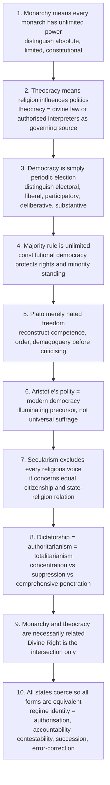

Further traps recorded in the owner ✅/⚠️:
- Parliamentary means democratic, presidential means authoritarian — both can be either; the distinction concerns executive–legislative relation and tenure.
- Federalism or decentralisation is democracy by itself — still needs rights, accountability, contestation.
- Separation of powers means no interaction — modern systems combine differentiated competence with checks.
- Majority rule exhausts democracy — liberal democracy adds minority rights, opposition, rule of law, conditions for alternation.
- Bureaucracy is neutral expertise — can become unaccountable domination.
- Expertise and democracy are opposites — the issue is authorisation and accountability of expertise.
- Judging the monarchy–dictatorship claim without splitting monarchy.
- Treating "dictatorship" as self-defining (Roman emergency magistracy).
- Equating Weber's "legitimate" with "justified" (§2.4).
- Presenting Mudde, Müller, Laclau as one settled definition (§3.3).
- Applying Articles 25–26's qualifications to Articles 27–28 (§5.1).
- Naming present-day countries, leaders or parties; asserting an exact "automatic democratic progress" quotation (not located).

---

## 14. Technical Vocabulary & Terminology Bank

| Term | Meaning | Status |
|---|---|---|
| Monarchy | one-person headship; absolute, limited, constitutional | ✅ |
| Elective monarchy / regency / reserve powers | separate axes of recruitment, substitution, retained powers | ✅/⚠️ |
| Divine Right of Kings | ruler answerable to God, not people | ✅ |
| Theocracy | sovereignty of God; sacred law; clerical mediation | ✅ |
| Democracy (direct / representative) | rule of the people | ✅ |
| Procedural vs substantive democracy | fair authorisation vs actual social conditions of equal freedom | ✅/⚠️ |
| Majoritarian / liberal / participatory / deliberative | five democratic models | ✅/⚠️ |
| Delegate / trustee / mandate | representation models | ⚠️ |
| Descriptive vs substantive representation | who vs what | ⚠️ |
| Timocracy · oligarchy · tyranny · aristocracy · polity | Plato's and Aristotle's forms | ✅ |
| Ship-of-state analogy | rule as craft | ✅ |
| Power vs authority | compliance despite resistance vs rightful power | ✅ |
| Traditional / charismatic / legal-rational | Weber's three pure types | ✅ |
| Ideal type | analytical exaggeration | ✅ |
| Routinisation of charisma | conversion into traditional or legal-rational form | ✅ |
| Bureaucracy | offices, jurisdictions, files, qualification | ✅ |
| Competitive struggle for the vote | Schumpeter's democracy | ✅ |
| Democratic elitism | competitive and accountable elite selection | ⚠️ |
| Iron law of oligarchy | Michels 1911 | ✅ |
| Thin-centred ideology | Mudde 2004 | ✅ |
| Pure people vs corrupt elite | populist divide | ✅ |
| Exclusive moral representation / anti-pluralism | Müller 2016 | ✅ |
| Logic of articulation | Laclau 2005 | ⚠️ |
| Illiberal democracy | elections without constraints protecting minorities | ✅/⚠️ |
| Manufactured consent | opinion-formation degraded | ⚠️ |
| Regulator's dilemma | content remedies empower the state over public truth | ✅ |
| Electoral autocracy | multiparty elections without meaningful freedoms | ✅ |
| Elective dictatorship | Hailsham 1976 | ⚠️ |
| Commissarial vs sovereign dictatorship | Schmitt 1921 | ❓ |
| Dictatorship / authoritarianism / totalitarianism | concentration / suppression / comprehensive penetration | ✅/⚠️ |
| Tyranny of the majority · elite capture · bureaucratic domination | pathologies | ✅ |
| Constitutional supremacy · decentralisation · subsidiarity | design vocabulary | ✅ |
| Epistocracy · public reason · republican anti-domination | optional advanced debates | ⚠️ |

---

## 15. Graded Verdict & Answer Architectures

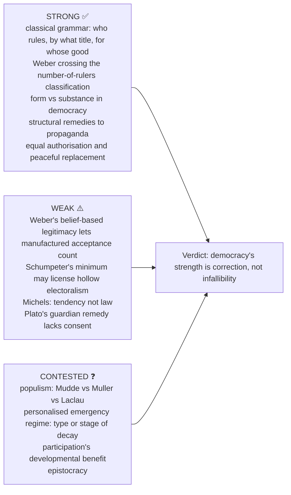

### 15.1 Directive decoder ⚠️

| Directive | What is scored | Compulsory move | Failure mode |
|---|---|---|---|
| **Comment on** | compressed adjudicated position | claim → argument → one objection → verdict | drifting into description |
| **Discuss** | exposition plus one adjudicated tension | doctrine → rival → objection → reply → verdict | three disconnected paragraphs |
| **Critically examine / evaluate** | the objection–reply layer | two objections, each with reply and residual problem | criticism list with no defence |
| **Can X be accepted / Is X valid?** | criterion of validity named first | fix the test → apply → verdict | assertion with no standard |
| **Does X leave room for Y?** | conceptual compatibility | what X entails, what Y requires, can they co-exist | historical examples in place of argument |
| **How far are X and Y distinctive features of Z?** | degree plus distinctiveness | show what Z has that rivals lack; concede what rivals secure | proving Z has X and Y only |
| **Compare / Distinguish** | parallel axes | 5–6 axes, all forms down each, then adjudicate | sequential mini-essays |

### 15.2 10-mark (~150 words · 4 moves · ~12 min)

```text
1 Exact target (2 lines): what the doctrine attacks or defends.
2 Argument spine (4–5 lines), numbered premises, technical vocabulary
  (degeneration cycle, polity as middle course, legal-rational authority, thin-centred ideology).
3 One evidence unit with its limitation.
4 Graded verdict (2 lines), typically asymmetric.
```
**Anchor (asymmetric verdict):** "Plato's diagnosis of demagoguery and defective leadership-selection survives; his authoritarian remedy does not, because it supplies no mechanism of consent or of correcting the guardians' own error."

### 15.3 15-mark (~220 words · 6 moves · ~18 min)

```text
1 Frame the AXIS OF DISPUTE, not the topic.
2 Strongest case FOR, stated charitably.
3 Strongest case AGAINST, on the same axes.
4 One table: six-fold classification, authority typology or form/substance grid.
5 One fully worked objection → reply → residual problem.
6 Conditional verdict naming what survives and under what constraint.
```
**Anchor (criterion verdict, theocracy):** "Judged by consent, equal citizenship and revisability, theocracy is normatively defective; judged by moral limitation of the ruler, it identifies a real deficiency in purely procedural politics. Religious ethics may enrich public reason; theocratic sovereignty cannot satisfy equal citizenship."

### 15.4 20-mark (~300 words · 8 moves · ~25 min)

```text
1 Provisional thesis using the stem's directive verb.
2 Classificatory placement on BOTH the classical grid and the Weberian legitimacy grid.
3 Strongest case for, as premises with presupposition stated.
4 Strongest rival, in its best form.
5 Two objection → reply chains, each ending in a residual problem.
6 Form/substance analysis (democracy health) OR routinisation analysis (succession, stability).
7 One dated Indian illustration, accurately classified (provision / statute / judgment), no actor characterised.
8 Graded verdict conceding something to the losing side.
```
**Anchor (dilemma verdict, propaganda):** "Democracy survives propaganda through contestable institutions rather than through censorship, because every content-based remedy hands the state precisely the power over public truth that a propagandising state abuses."

### 15.5 Selectable evidence bank (1 unit at 10, 2 at 15, 4–5 at 20) ⚠️

| Unit | Claim | Named anchor | Limitation |
|---|---|---|---|
| F1 | Regimes degenerate in a determinate order | Plato's degeneration and critique of democracy | Guardian remedy lacks consent/external correction; presupposes an unavailable epistemic elite |
| F2 | Classification needs two variables | Aristotle's six-fold | "Common interest" not self-specifying |
| F3 | Stability lies in the middle | Aristotle's polity | Sociological claim, not a demonstration of justice |
| F4 | Authority rests on type of legitimacy claimed | Weber | Sociological belief ≠ normative justification |
| F5 | Charisma must routinise or die | Weber | Describes a mechanism, not a normative test |
| F6 | Democracy is a method, not an outcome | Schumpeter | Deflationary; needs supplementary conditions |
| F7 | Organisation breeds oligarchy | Michels 1911 | A resistible tendency, not an iron law |
| F8 | Populism is thin-centred | Mudde 2004 | Minimal definition; does not settle democratic status |
| F9 | Danger is anti-pluralism not anti-elitism | Müller 2016 | Rival: Laclau 2005 |
| F10 | Form can survive while substance erodes | illiberal-democracy grid | Diagnostic; applied to no actual country |
| F11 | Consent can be manufactured | Weber + propaganda mechanism | The remedy empowers the state: regulator's dilemma |
| F12 | Deliberation, not only aggregation | Habermas | Demanding; vulnerable to communicative distortion |
| F13 | Sovereignty of God as political claim | theocracy; divine-right bridge | Defect is interpretation monopoly and unequal citizenship, not religiosity |
| F14 | Constitutional religious freedom and distinct safeguards | Articles 25–28 | Legal facts, not proof of a thesis; no actor characterised |
| F15 | Institutional form has independent trade-offs | design axes §4.5 | No axis proves a regime democratic |
| F16 | Majority rule needs counterweights | Tocqueville | Counter-majoritarian bodies need their own accountability |
| F17 | Representation models rival | delegate / trustee / mandate | None guarantees descriptive or substantive representation |
| F18 | Non-democratic forms differ in reach | Linz / Arendt | Real regimes mix and change |

### 15.6 Graded verdict formulas ⚠️

- **Distinctiveness:** "Liberty and equality are not unique to democracy in their formal statement, but democracy alone institutionalises the *equal authorisation* of rule and the *peaceful replacement* of rulers — that is where its distinctiveness lies."
- **Form/substance:** "The regime retains democratic form; the question is whether it retains the conditions — fair contest, protected minority, independent adjudication, realistic alternation — that make the form worth having."
- **Cross-typology:** "Classification by number of rulers tells us who decides; classification by type of legitimacy tells us why they are obeyed. A complete assessment of any form requires both."

> [!TIP]
> **Exam-ready thesis.** Democracy's superiority is not guaranteed wise decisions; it lies in equal standing, public justification and institutionalised correction of error. For theocracy stems, the mark-bearing move is the line between religiously informed public reasoning and theocratic sovereignty. For propaganda stems, state the regulator's dilemma.

> [!NOTE]
> Optional depth (dossier §4): do not over-study election technology, current-party tactics or global regime typologies, and do not let democracy theory erase monarchy and theocracy, both repeatedly asked. India-centric safe use: public reasoning, minority inclusion, media manipulation, federal diversity and institutional checks as **analytic** examples, not event-driven ones.

---

## Sources

Plato, *Republic* (Books VI, VIII); Aristotle, *Politics* (Books III–IV); O. P. Gauba, *An Introduction to Political Theory* (local PDF; page ranges as in §1); *Socio-Political Philosophy* (anonymous local compilation, PDF pp. 90–121; controls at 112–114, 115–116); Rajeev Bhargava and Ashok Acharya, *Political Theory: An Introduction*; B. R. Ambedkar, *States and Minorities* and Constituent Assembly interventions; Constitution of India (Articles 25–28 checked against Parliament Digital Library, *The Constitution of India (2024)*, printed pp. 14–15, retrieved 6 October 2026, the identified 2024 edition, not a claim of verifying every later amendment); Max Weber (power, authority, legitimacy; by position only); Alexis de Tocqueville, *Democracy in America*; J. S. Mill, *Considerations on Representative Government*; Rousseau, *The Social Contract*; Juan Linz and Hannah Arendt, *The Origins of Totalitarianism*; Joseph Schumpeter, *Capitalism, Socialism and Democracy* (by title only); Robert Michels, *Political Parties* (1911); Cas Mudde, "The Populist Zeitgeist" (2004); Jan-Werner Müller, *What Is Populism?* (2016); Ernesto Laclau, *On Populist Reason* (2005); Carl Schmitt, *Die Diktatur* (1921; contested analytic distinction, no endorsement); Lord Hailsham, "elective dictatorship" (1976; named term only); Britannica entries "Monarchy", "Constitutional monarchy", "Dictatorship"; Stanford Encyclopedia of Philosophy, "Democracy" §1; Our World in Data, "Democracy" (V-Dem electoral autocracy/democracy distinction); Representation of the People Act, 1951 (India Code); Habermas *Between Facts and Norms*, Urbinati *Democracy Disfigured*, Estlund *Democratic Authority*, Pettit *Republicanism* (advanced dossier trail); UPSC Civil Services (Main) Philosophy Optional Paper II, 2018–2026, via the local PYQ ledgers.
