# POLITICAL IDEOLOGIES — Anarchism; Marxism and Socialism — Examiner-Grade Mindmap

> **Syllabus (verbatim):** Political Ideologies: Anarchism; Marxism and Socialism.
> **Catalogue key:** `philosophy-paper-ii-socio-political-philosophy-05` · Paper II · Section A · Socio-Political Philosophy
> **Sources used:** `paper-2/socio-political/Political-Ideologies.md` (canonical owner, read in full) · `_advanced/Socio-Political-Dossier.md` §5 (optional depth) · `paper-2/_PYQ-SocioPolitical-2018-2025.md` · `paper-2/_PYQ-SocioPolitical-2026-Supplement.md`.
> **Evidence key:** ✅ canonical · ⚠️ analytical synthesis · ❓ contested
> **Blueprint adaptation:** `MINDMAP_INSTRUCTIONS.md` is Indian-school oriented. The 16 module headings are kept and each module's focus is adapted: Module 1 = ownership boundary, thinkers and lineages; Module 2 = the epistemic/justificatory grounds each ideology uses (burden of proof on authority; materialist method; ideology critique); Module 3 = rival and revisionist wings (neo-Marxism; anarchist families); Module 4 = conceptual inventory; Module 5 = stance on state, transcendent and normative claims (ideology, state, revolution, Indian constitutional bridge); Module 6 = explanatory/causal principles; Module 7 = value aims (freedom, equality, justice). Where the sources give nothing for a module, the module says so.

> [!IMPORTANT]
> **Working thesis.** The clause tests rival diagnoses of domination and rival routes to a free, equal order. The recurrent axes are **authority, property, class, revolution, state and freedom**. Anarchism answers *authority*; socialism answers *socially uncontrolled property and production*; Marxism gives the systematic answer *class relations generated by the mode of production*. ⚠️

---

## 0. Master Overview

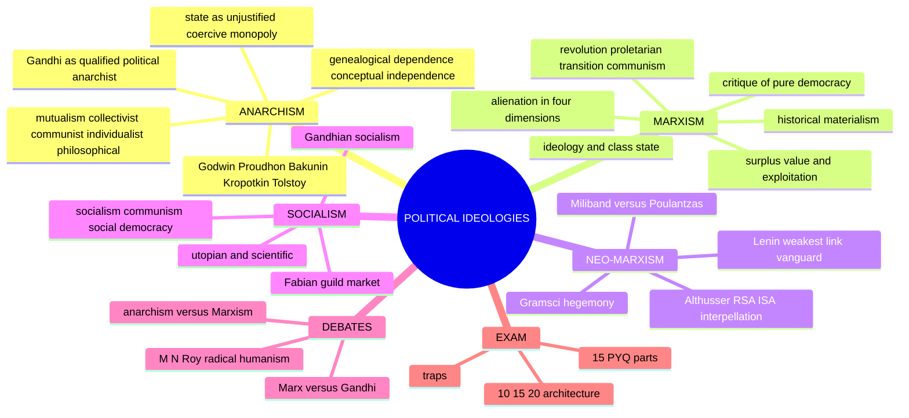

```text
CAPITALISM / HIERARCHY / COERCION
             │
   ┌─────────┼──────────────────┐
ANARCHISM  SOCIALISM         MARXISM
authority  social ownership  historical materialism
itself is  + social welfare   + class struggle
suspect    through several    + proletarian revolution
   │       possible routes          │
abolish    democratic /       transitional proletarian
the state  Fabian / guild /   rule → classless,
and other  Gandhian / Marxist stateless communism
hierarchies
```

---

## 1. Identity, Lineage & Ownership Boundary

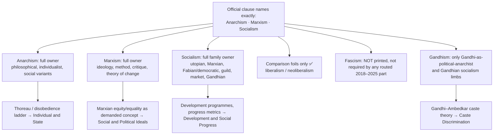

| Family | Status | Boundary |
|---|---|---|
| Anarchism | Full owner | Political obligation and the full civil-disobedience ladder remain with Individual and State |
| Marxism | Full owner | Marxian equity/equality remains with Social and Political Ideals |
| Socialism | Full family owner | Development programmes remain with Development and Social Progress |
| Liberalism / neoliberalism | Comparison foil only | Full variants not imported |
| Fascism | Not printed | No false equivalence with Marxism/socialism/anarchism |
| Gandhism | Only directly tested limbs | Caste theory with Caste file |

**What is a political ideology? ✅** A connected, action-guiding structure with six parts: (1) a description of person, society and existing power; (2) a diagnosis of domination or injustice; (3) an evaluation through freedom, equality and justice; (4) a view of property, authority and the state; (5) a strategy of reform, revolution or institutional replacement; (6) a regulative picture of the order sought. ⚠️ This differs from the critical Marxist meaning of *ideology* as a socially rooted framework through which historical relations appear natural, universal or inevitable.

**Thinker lineage inside anarchism**

| Thinker | Status | Contribution |
|---|---|---|
| **William Godwin** | ⚠️ | Rational, educative criticism of government; cooperation expected to grow as coercion recedes; *Enquiry Concerning Political Justice* (**1793**) |
| **Proudhon** | ✅ | Mutualism, possession and reciprocal exchange against exploitative property; *What Is Property?* (**1840**) |
| **Bakunin** | ✅ | Collectivist and revolutionary anarchism; concentrated revolutionary authority risks a new ruling stratum |
| **Kropotkin** | ✅ | Anarchist communism and mutual aid; *The Conquest of Bread* (**1892**), *Mutual Aid* (**1902**) |
| **Leo Tolstoy** | ⚠️ | Christian-pacifist refusal of violence and state coercion; influence on Gandhi, not identical with Gandhi's mass politics and constructive programme |
| **Stirner** | ✅ | Individualist tradition; *The Ego and Its Own* (**1844**) |
| **R. P. Wolff** | ✅ | Autonomy-versus-authority argument; *In Defense of Anarchism* (**1970**) |

---

## 2. Theory of Justification (what each ideology treats as its grounds)

### 2.1 Anarchist argument against the state ✅

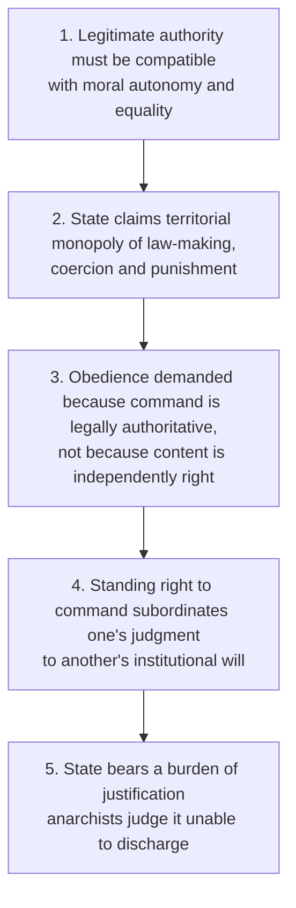

- **Bakunin ✅** — corruption thesis: concentrated power deforms both ruler and ruled.
- **Proudhon ✅** — property as institutional power of appropriation and dependence.
- **Kropotkin ✅** — cooperation and mutual aid are genuine sources of order, not exceptions to competition.
- **Presuppositions:** capacity for cooperation and reciprocal aid ✅; coordination does not logically require a sovereign centre ✅; conflict is intensified by hierarchical institutions ⚠️; authority must justify itself function by function ⚠️.

### 2.2 Marxist method: dialectical and historical materialism ✅


| Element | Meaning | Exam use |
|---|---|---|
| Productive forces | labour-power, knowledge, tools, technology | capacity to produce |
| Relations of production | ownership, control, class relations | who commands and appropriates |
| Mode of production | unity of forces and relations | feudalism, capitalism |
| Base / superstructure | economic structure related to law, politics, ideology | relation, **not** a mechanical one-way switch |
| Class struggle | conflict from opposed structural interests | motor of transformation |

> [!WARNING]
> ❓ "Thesis–antithesis–synthesis" is later textbook shorthand, not Marx's own fixed three-step law. Marx takes contradiction from Hegel but rejects the primacy of self-developing Idea. The stronger criticism of historical materialism is a **tendency toward economic reductionism**, not a crude claim Marx never qualified.

### 2.3 Socialist argument ✅

1. Productive capacities are socially inherited and cooperatively exercised.
2. Private control of indispensable productive assets gives some persons power over others' work and life chances.
3. Market outcomes do not automatically track need, desert or equal freedom.
4. So ownership and production must answer to social purposes and democratic justification.

*Presupposition ⚠️:* economic power is political in effect; freedom requires more than non-interference by the state.

### 2.4 Shared comparison axes

| Axis | Anarchism | Marxism | Socialism (family) |
|---|---|---|---|
| Person | Autonomous cooperative agent exposed to hierarchy | Social producer formed within class relations | Interdependent person entitled to freedom and security |
| Society | Voluntary federations, communes, mutual aid | Structured by modes of production and class struggle | Cooperative order subjecting economic power to social purpose |
| State | Presumptively illegitimate coercive hierarchy | Class-state, transformed in transition, ultimately superseded | Decentralised association to democratic welfare/public institutions |
| Property | Rejects property where it creates domination; variants differ | Private ownership of means of production structures exploitation | Public, cooperative, guild, worker or mixed |
| Freedom | Non-domination without standing command | Collective control, non-alienated self-development | Effective freedom with social security and democratic control |
| Equality / justice | Equal standing against hierarchy | End of exploitation; formal equality insufficient | Equality of status, opportunity, provision without sameness |
| Change | Prefigurative practice, federation, direct action | Class struggle, praxis, revolutionary transition | Utopian example, parliamentary reform, planning, markets or revolution |

---

## 3. Dialectical Wings & Revisionist Refinements

### 3.1 Anarchist strands ✅

| Strand | Property | Preferred order | Emphasis |
|---|---|---|---|
| Mutualism | possession and exchange without exploitative property | contracts, workers' associations | reciprocity; Proudhon |
| Collectivist anarchism | collective control of productive resources | federated producer communities | Bakunin |
| Anarcho-communism | common ownership, distribution by need | communes, mutual aid | Kropotkin |
| Individualist anarchism | strong personal sovereignty; market views vary | voluntary association | autonomy; Thoreauvian resistance |
| Philosophical anarchism | no automatic duty to obey the state | critical allegiance may coexist with institutions | legitimacy, not insurrection |

**Taxonomic control:** individualist and social anarchisms disagree over property and coordination but converge in rejecting an unearned standing right to command.

**Internal family comparison**

| Question | Liberal/individualist | Socialist anarchism |
|---|---|---|
| Primary evil | coercion of the individual | class and property hierarchy |
| Liberty | freedom from interference | freedom enabled by equal social conditions |
| Property | often defended via voluntary exchange | criticised as concentrated domination |
| Unit of order | contracts, voluntary associations | communes, syndicates, federations, mutual aid |
| Main danger | collectivist absorption of individuality | market and property power recreating hierarchy |
| Names | Godwin, Stirner, Tucker, Wolff | Proudhon, Bakunin, Kropotkin |

### 3.2 Classical → neo-Marxism ✅/⚠️

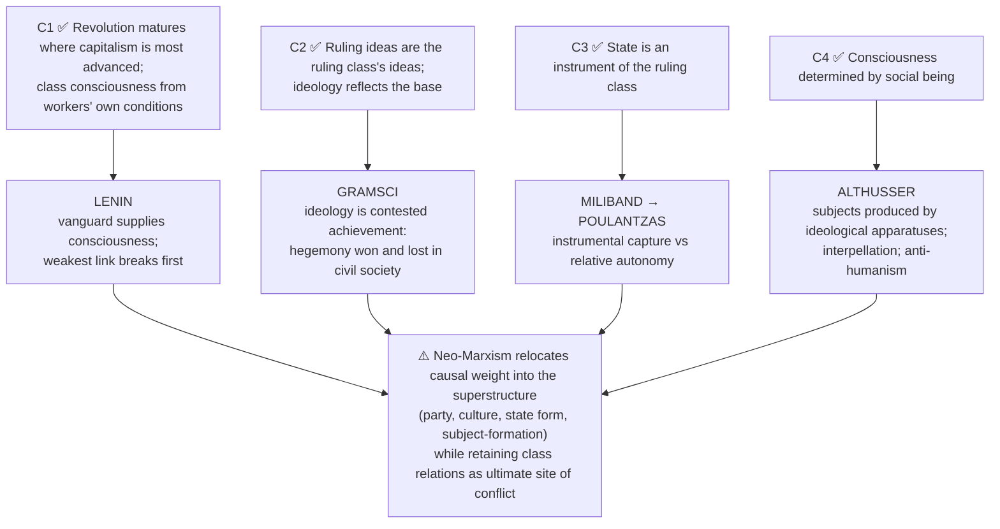

**Humanist vs structural Marxism ⚠️**

| Family | Focus | Vocabulary | Risk |
|---|---|---|---|
| Humanist | alienation, praxis, species-being, self-emancipation | young Marx | relies on a contested universal human essence |
| Structural | relations, apparatuses, structures producing subjects | Althusser; overdetermination, ISAs, interpellation | drains agency and responsibility |

*Best synthesis ⚠️:* a Marxist ideology needs both structural explanation of power and an account of agents whose self-emancipation could transform it.

**Lenin ✅** — (1) imperialism as highest stage of capitalism: monopoly capital exports capital; superprofits from colonial exploitation allow concessions to a stratum of workers; capitalism becomes a global system; the chain breaks at the **weakest link**. (2) **Vanguard party**: spontaneous struggle yields only **trade-union consciousness**; revolutionary consciousness is brought from outside by professional revolutionaries under **democratic centralism** (free discussion before decision, unity of action after).

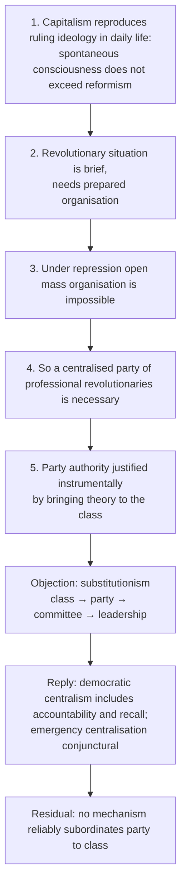

Anarchist objection: this vindicates Bakunin's warning. Marxist counter: abolishing organisation disperses power unaccountably. Presented as genuinely unresolved.

**Gramsci ✅**

| Sphere | Mode of rule | Institutions | Term |
|---|---|---|---|
| Political society | direct domination through force and law | state apparatus, army, police, courts, administration | *dominio* — coercion |
| Civil society | leadership through consent | school, family, church, press, associations, popular culture | *egemonia* — hegemony |

Argument ⚠️: coercion alone unstable; subordinate groups consent as assumptions appear as common sense; consent maintained via civil-society institutions staffed by **organic intellectuals**; civil society is the principal terrain of struggle; so a **war of manoeuvre** (frontal seizure) fails in the West and a **war of position** (building **counter-hegemony**) is required. Reply to closed-circle objection: **contradictory consciousness** (inherited common sense plus "good sense" from practical experience). Residual: no independent test distinguishing hegemony from ordinary agreement. Warning: concept can license culturalism; war of position is preparatory, not a substitute for transforming property relations.

**Althusser ✅**

| | Repressive State Apparatus (RSA) | Ideological State Apparatuses (ISAs) |
|---|---|---|
| Number | one, unified, public | plural, largely private |
| Instances | government, administration, army, police, courts, prisons | school, family, religion, law, parties, trade unions, communications, culture |
| Mode | by violence, secondarily ideology | by ideology, secondarily repression |
| Function | secures political conditions of reproduction | reproduces relations of production, above all through the **school** |

**Interpellation:** ideology "hails" individuals as subjects; ideology is a **material practice**, not a mistaken belief. Objection: resistance becomes unintelligible; reply: plurality of ISAs, **overdetermination**; residual thin agency. Objection: calling family and church "State" stretches the concept; Gramsci's civil-society vocabulary avoids the strain.

> [!TIP]
> **Gramsci vs Althusser.** Gramsci: civil society is a *terrain of contest* where hegemony can be lost and counter-hegemony built (more room for agency and strategy). Althusser: ISAs are primarily *mechanisms of reproduction* (explains stability, struggles with change). Do not merge them.

**Miliband (1969) vs Poulantzas (1973) ✅**

| Axis | Miliband | Poulantzas |
|---|---|---|
| Method | empirical-sociological | structural |
| State is | instrument held by a class | arena condensing class forces |
| Autonomy | minimal; apparent autonomy is disguised capture | real but **relative**, functional for capital |
| Explains | personnel networks, lobbying | welfare concessions, regulation against particular capitalists |
| Weakness | cannot explain action against individual capitalists | functionalism |

Miliband's three mechanisms: **social composition**, **structural leverage**, **positional interest**. Poulantzas: capital divided into fractions, none trusted to legislate for long-run reproduction, state must act against particular capitalists and appear to represent "the people". ⚠️ Internal limit: stretched far enough, autonomy becomes the pluralist state; it must stay *relative*.

### 3.3 Socialist varieties ✅

| Variant | Method | Ownership / control | Distinctive claim |
|---|---|---|---|
| Utopian | exemplary communities, moral reform | cooperative | Owen, Fourier, Saint-Simon diagnose competition before Marx |
| Marxian | class struggle, revolutionary transition | social ownership | socialism as a transition beyond capitalism |
| Fabian / democratic | gradual parliamentary reform | public, cooperative, regulated sectors | democracy and welfare can socialise power |
| Guild | occupational self-government | producer guilds | opposes both capitalism and bureaucratic statism |
| Market | markets within social ownership | worker/public ownership | separates markets from capitalist ownership |
| Gandhian | non-violence, trusteeship, decentralisation | moral restraint, village economy | equality without class violence or centralist industrialism |

*Utopian / scientific ✅/⚠️:* "utopian" is polemical, not proof of impracticability; "scientific" names explanatory ambition, not predictive certainty.

---

## 4. Conceptual Inventory

### 4.1 Anarchy vs anarchism ✅

| Term | Meaning | Test |
|---|---|---|
| Anarchy | absence or collapse of effective rule | may mean disorder |
| Anarchism | normative critique of domination | proposes non-coercive order |
| Civil disobedience | principled breach of particular laws | need not reject the state |
| Libertarian minimal state | state restricted to protection | anarchism rejects even this monopoly |

### 4.2 Alienation ✅ (*Economic and Philosophic Manuscripts of 1844*)

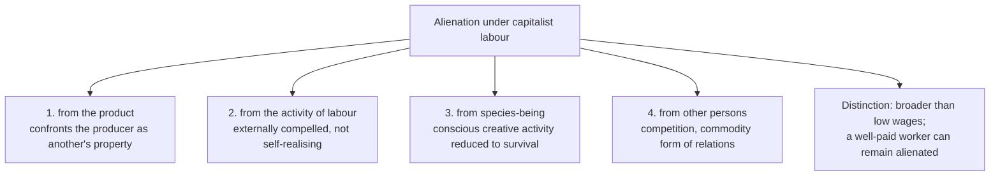

Objection: species-being assumes a universal human essence. Reply ⚠️: minimal reconstruction — meaningful agency, recognition, control over central activities.

### 4.3 Exploitation and surplus value ✅

Capital buys labour-power by a formally free contract; value produced in the working day can exceed the value of wages; the remainder is **surplus value**. Argument: workers lack independent access to means of production → must sell labour-power → capitalist controls process and product → competition compels accumulation → exploitation is **structural**, not an employer's cruelty. Distinction ✅: exploitation concerns social relation of production; inequality concerns distribution of holdings; redistribution may reduce inequality while leaving exploitative control intact.

### 4.4 Equality, equity, freedom ✅

| Concept | Question | Marxian concern |
|---|---|---|
| Formal equality | Is the same rule applied? | may conceal unequal productive power |
| Substantive equality | Can persons actually develop and participate? | requires altered social conditions |
| Equity | What differential provision is justified by need? | avoids treating unlike conditions identically |
| Freedom | Freedom from whom, for what? | non-domination plus self-development |

Lower phase of communist society: distribution by contribution (retains a "bourgeois" measure); higher phase: distribution by need (*Critique of the Gotha Programme*).

### 4.5 Socialism, communism, social democracy ✅

| Axis | Socialism (family) | Communism (higher phase) | Social democracy |
|---|---|---|---|
| Property | social control in varied forms | common control; classes abolished | private property retained but regulated |
| State | may remain democratic and active | political state loses class function | welfare-regulatory state |
| Distribution | contribution, need or mixed | according to need | tax-transfer plus public services |
| Method | revolutionary or gradual | reached through transition | constitutional reform |

> [!WARNING]
> Socialism ≠ communism. In Marxist vocabulary socialism is often the transitional lower phase; in wider theory it names the whole family. Nationalisation ≠ socialisation.

---

## 5. Stance on State, Revolution and Normative/Constitutional Bridges

### 5.1 Ideology and the state (Marxism) ✅

Ideology is **not merely a lie**: a socially rooted framework through which relations appear natural. The modern state secures general conditions of the capitalist order while presenting itself as universal; ⚠️ not every state act directly benefits every capitalist; relative autonomy is compatible with structural class function.

### 5.2 Revolution, proletarian transition, communism ✅

Capitalism socialises production while retaining private appropriation; with organised struggle this makes revolutionary transformation possible. **Dictatorship of the proletariat** = transitional political supremacy of the working class, not itself a licence for permanent one-party dictatorship. **Communism** = projected classless order where political state as instrument of class domination is unnecessary. Marx gives no detailed blueprint of communist institutions ✅.

### 5.3 Marxist critique of "pure democracy" (2026 Q1(d)) ✅

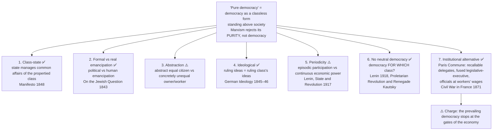

| Axis | Liberal self-description | Marxist re-description |
|---|---|---|
| Equality | one person, one vote | equal votes, unequal capacity to set agendas, fund politics, shape opinion |
| State | neutral arbiter | condensation of class power |
| Freedom | non-interference via rights | freedom to sell labour under structural compulsion is unfree |
| Representation | periodic authorisation | episodic consent vs continuous economic power |
| Rights | universal guarantees | rights of the abstract citizen compatible with exploitation |
| Public opinion | free formation | ruling ideas reproduced by owners of mental production |
| Remedy | extend suffrage, protect rights | change property relations; Commune-type delegation, recall |

Objections: (1) liberty objection — strongest; Commune model lacks guarantees for dissent, minorities, succession; (2) autonomy objection — answered by Poulantzas's relative autonomy and Gramsci's hegemony, but relative autonomy weakens the original thesis; (3) class-identification objection — critique survives as critique of **capture, agenda-setting and manufactured consent**, converging with non-Marxist democratic theory.

### 5.4 Marxism and individual freedom (2018 Q3(b)) ⚠️

Compatible if freedom means conscience, dissent, association, choice of work; Marxism rejects only an unrestricted right to control productive assets regardless of dependence. Affirmative case: formally free wage contracts → dependence (§4.3) → alienation (§4.2) → democratic control could **increase** effective agency. Counter: a transitional party-state may monopolise work and speech. Conditions: protected civil liberties, plural worker organisation, contestable decisions, enforceable checks on administration. **Verdict:** logical compatibility possible; institutional realisation neither automatic nor proven by nationalisation.

### 5.5 Gandhi as qualified political anarchist (2019 Q1(c)) ✅/⚠️

| For the label | Against the label |
|---|---|
| Ethical *swarāj* begins with mastery of desire, non-violence, local self-government | Organised mass campaigns; negotiated institutional change; treated the state as a present reality |
| Decentralised village republics; state reduced to a minimum | Non-violent discipline is not Bakunin's insurrection |
| Transferring rulers does not secure freedom | Trusteeship does not abolish economic hierarchy by decree |

Formula ⚠️: **Gandhi is a moral and decentralist anarchist in ideal, but a pragmatic reformer in political method.** Residual: can voluntary restraint limit power where the powerful refuse it?

### 5.6 Gandhian socialism (2021 Q3(b)) ✅/⚠️

Elements: **non-possession, trusteeship, bread labour, decentralised production, village self-rule (*swarāj*), welfare of all (*sarvodaya*)**, with *ahimsa* (means consistent with ends). Rejects both unrestricted capitalism and violent centralised collectivism. Objection: trusteeship voluntary, may preserve unequal ownership; local communities may reproduce caste/gender domination; village scale cannot supply every complex good. Qualified reply: accountable rights-protecting local institutions, cooperation across scales, enforceable limits. Survives as an ethical and decentralist corrective, not a complete substitute.

### 5.7 Indian constitutional bridge (legal-status caution) ⚠️

Directive Principles (Part IV), including Articles 38, 39 and 43 on minimising inequalities of income, status and opportunity and on distribution of material resources, are **non-justiciable**. Their presence is a legal fact; it neither proves the Indian state is relatively autonomous nor an instrument of any class. ❌ Do not use any Indian statute, scheme or judgment as evidence that a Marxist thesis is true or false. Ambedkar's argument that caste is sustained by a sanctified belief-system parallels the Gramscian consent question, but ❌ do not attribute either's vocabulary to the other.

---

## 6. Explanatory & Causal Principles

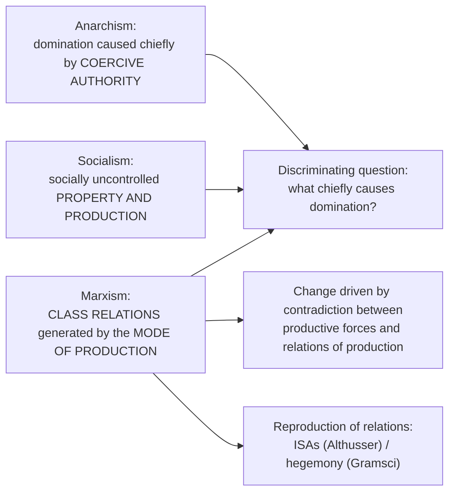

**2023 Q3(a) — historical materialism and social change ⚠️.** Change is mediated by organisation and institutions, **not mechanically scheduled** by a technology. India-facing analytical question only: do new forms of contract and work shift bargaining power while social hierarchies constrain access to assets? Objection: class-first model underexplains caste, gender, religion. Reply: specify their independent mechanisms and their interaction with production. Verdict: useful for material conditions and contestation of change; one-way or inevitable-development reading does not survive.

**Anarchist natural order ✅.** Anarchism does **not** claim every person is benevolent; the claim is institutional: order may emerge from reciprocity, custom, association and horizontal coordination without a final coercive superior. Examples ⚠️ (village assemblies, worker cooperatives, mutual-aid networks, federations) show limited capacities, not that a complex society can eliminate all public authority.

**Anarchist objections and replies**

| Objection | Reply | Status |
|---|---|---|
| Security dilemma: private power and predation | State itself organised war and repression; federated defence need not reproduce sovereignty | ✅ |
| Scale and public goods | Anarchism rejects centralised domination, not coordination; delegated, recallable, federated administration | ⚠️ |
| Optimistic anthropology | Need only deny that coercive hierarchy is the unique remedy | ✅ |
| Hidden authority: expertise, status, economic power return | Serious internal challenge; scrutinise domination inside associations | ⚠️ |

**2018 Q2(c) / 2023 Q1(b) — "all states always and everywhere illegitimate" ⚠️.** Stronger than a heavy burden of proof. Philosophical anarchist denies a general content-independent duty to obey but may accept decisions justified by content, consent or fair procedure; revolutionary anarchist holds the territorial coercive monopoly structurally creates domination. Objection: a rights-protecting, contestable authority can check private violence. Reply: constitutional limits reduce coercion but may not make a non-consenting person's subjection voluntary, and can leave economic power untouched. Residual: denying legitimacy to *every* possible limited state needs showing no checks could suffice. Verdict: endorse the **test of domination** without its exceptionless conclusion.

**2021 Q3(a) — can authority disappear completely? ⚠️** Distinguish (a) an unaccountable sovereign's standing right to command, (b) binding collectively authorised rules, (c) specialist coordination under a specific, recallable mandate. Anarchism can reject (a) and keep (c); whether society can dispense with (b) is disputed (persistent aggressors, enforcement across associations, free-riding may demand a final adjudicator).

---

## 7. Value Aims: Freedom, Equality, Justice

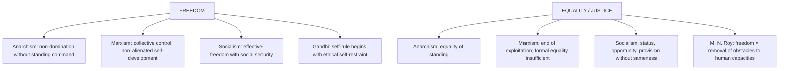

**M. N. Roy's radical-humanist criticism ✅/⚠️.** Rejects subordination of the individual to class, party or historical necessity; freedom is the progressive removal of obstacles to unfolding human capacities; dictatorship cannot reliably serve emancipation. ⚠️ Internal Indian bridge: retain Marx's critique of exploitation, reject economic determinism and party absolutism, restore individual reason and ethical autonomy.

Equality at the cost of excellence? Reply: socialism need not demand identical outcomes; defends a social minimum, fair opportunity and limits on domination while permitting differentiated reward.

---

## 8. Inter-School Comparative Matrices

### 8.1 Anarchism vs Marxism ✅

| Axis | Anarchism | Marxism |
|---|---|---|
| Primary domination | authority and hierarchy | class relation rooted in production |
| State | abolish or supersede without transitional sovereignty | working class uses transitional political power |
| Organisation | federation, autonomy, voluntary association | class party/organisation; interpretations vary |
| Fear | revolution reproduces a new state elite | premature abolition leaves capitalist power intact |

### 8.2 Marx vs Gandhi ✅

| Axis | Marx | Gandhi |
|---|---|---|
| Root problem | class exploitation, alienated production | greed, violence, modern industrial civilisation |
| Method | class struggle; revolution | *satyāgraha*, trusteeship, constructive work |
| Scale | socialised large-scale production can be emancipatory | decentralised, need-oriented production |
| Means–ends | revolutionary coercion debated within Marxism | means prefigure ends |
| Freedom | collective control enables self-development | self-rule begins with ethical self-restraint |

### 8.3 Marx vs democratic socialists ⚠️

Marxism doubts a state embedded in capitalist property can be peacefully converted; democratic socialism argues suffrage, unions, constitutional rights and public institutions can progressively socialise economic power. **Balanced verdict:** reform can civilise capitalism, but remains vulnerable where ownership and investment decisions are insulated from democratic control.

### 8.4 Is anarchism independent? (2026 Q1(c)) ✅/⚠️

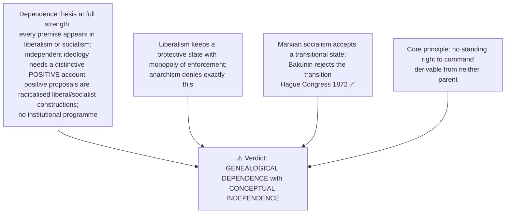

| Root | Inherited | Anarchist radicalisation | Breaking point |
|---|---|---|---|
| Liberal | Moral autonomy | Wolff: duty of autonomy incompatible with a claimed right to command | liberalism reconciles autonomy with legal obligation |
| Liberal | Consent | must be actual, revocable, continuous | liberalism accepts tacit/hypothetical consent |
| Liberal | Private judgment | Godwin 1793: government supplants private judgment | Godwin expects coercion to recede by reason, not insurrection |
| Liberal | Right of resistance | Locke at the edge of anarchism | Locke keeps the state as trustee |
| Liberal | Self-development | Stirner, individualist tradition | divergence over property |
| Socialist | Critique of property | Proudhon 1840 | rejects both state ownership and capitalist property |
| Socialist | Class analysis | Bakunin: state is organised class rule even in workers' hands | Marx accepts a transitional class state |
| Socialist | Common provision | Kropotkin 1892, 1902 | rejects central planning as much as market domination |
| Socialist | Solidarity | mutual aid | socialism institutionalises via the state; anarchism via federation |
| Socialist | Revolution | direct action, federated self-management, no vanguard | transition is the decisive split |

**Master chart — liberalism, socialism, anarchism**

| Axis | Liberalism | Socialism (statist/Marxian) | Anarchism |
|---|---|---|---|
| Primary evil | arbitrary interference | exploitation, class domination | domination as such, political *and* economic |
| State | necessary, limited, constitutional | instrument to be captured, used, withered | illegitimate in principle; no transitional exception |
| Liberty | non-interference within rights | freedom via equal social conditions | non-domination without a sovereign centre |
| Property | basic institution | social/common, often state-mediated | mutualist possession or common access |
| Order without command | law with monopoly enforcement | planned coordination via public power | contract, association, federation, custom, mutual aid |
| Equality | before the law, of opportunity | substantive material | equality of standing |
| Transition | constitutional reform | revolution plus transitional state | prefiguration |
| Danger | formal freedom with real dependence | new bureaucratic ruling stratum | informal hierarchies, failures of scale |

---

## 9. Criticisms & Reconstructed Replies

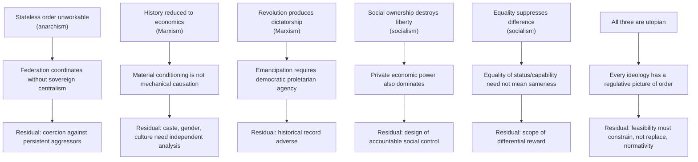

**Marxism: objections and replies**

| Objection | Reply |
|---|---|
| Economic determinism | Culture, caste, religion, gender, nationalism have relative autonomy; ✅ later Marxists add hegemony and social reproduction |
| Failed prediction (revolution not first in advanced capitalism) | ⚠️ explanatory framework, not infallible timetable; imperialism, welfare compromise, political organisation |
| Authoritarian outcome | ⚠️ strongest historical objection; build constitutional liberty, plural organisation, accountability into transition |
| Class reductionism | ⚠️ class necessary but insufficient in India; anti-caste and feminist analyses identify distinct mechanisms |

**Socialism: objections and replies**

| Objection | Reply |
|---|---|
| Incentive and information problem | Market socialism, decentralised planning, cooperative governance separate social ownership from command bureaucracy |
| Bureaucratic domination | ✅ requires democratic control, workplace participation; nationalisation ≠ socialisation |
| Conflict with liberty | ⚠️ capitalism also structures dependence; which institutions make power answerable while protecting civil liberties |
| Equality at the cost of excellence | social minimum, fair opportunity, limits on domination |

**Marxism and later communist regimes ⚠️.** Separate (1) Marx's diagnosis, (2) later transitional arguments, (3) institutional record of one-party/bureaucratic/coercive regimes. History is relevant to the promised **withering away**, but does not by itself refute every Marxian category; repeating emancipatory intention does not answer the historical objection.

**Dossier strongest extra objection (advanced) ⚠️.** *Objection:* Marxism over-reduces domination to class and misses caste, patriarchy. *Reply:* powerful where it diagnoses exploitation and commodity power, but in India needs Ambedkarite and feminist supplementation; "diagnostic alliance, not explanatory monopoly."

---

## 10. Controlled Western / Cross-Tradition Comparisons

The sources provide no East–West comparison table for this topic. They give only the internal pairs below; nothing is added from outside.

| Pair | Point of contact | Decisive disanalogy |
|---|---|---|
| Godwin / Locke / Stirner / Wolff (liberal roots) vs Proudhon / Bakunin / Kropotkin (socialist roots) | Both reject an unearned standing right to command | Property and coordination (see §8.4) |
| Tolstoy vs Gandhi | Refusal of violence and state coercion; Tolstoy a Gandhi influence | Gandhi's organised mass politics and constructive programme differ ⚠️ |
| Marx vs Hegel | Contradiction drives development | Marx rejects primacy of self-developing Idea; materialist transformation ✅ |
| Gramsci vs Ambedkar | Hierarchy sustained by belief/consent, not force alone | ❌ Do not attribute either's vocabulary to the other; locate the ultimate mechanism differently |
| Marx vs Roy | Critique of exploitation | Roy rejects economic determinism and party absolutism |
| Liberalism (foil) | Autonomy, consent, protective state | Comparison foil only; not an owned ideology |

---

## 11. Diagnostic Deep-Dives for High-Frequency Themes

### 11.1 "Will the pandemic lead to anarchism?" (2020 Q1(e)) ⚠️

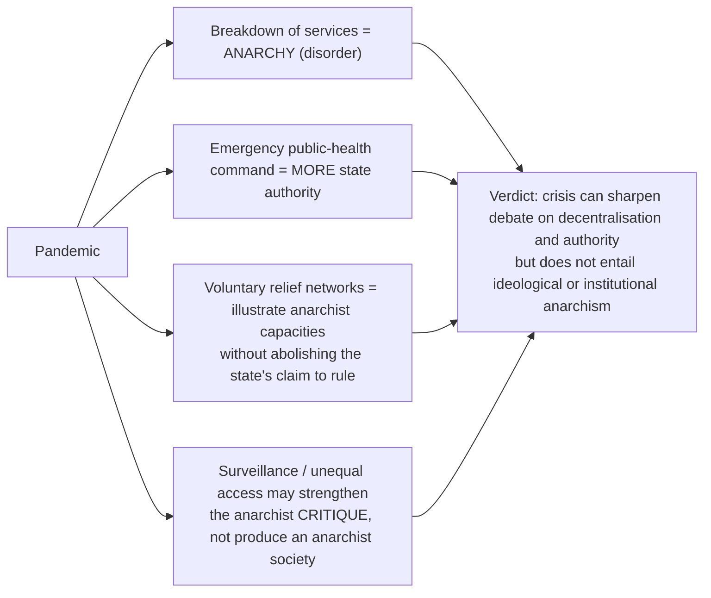

Objection: mutual aid proves states dispensable. Reply: local cooperation shows one capacity, not universal provision, cross-region coordination or just adjudication under scarcity.

### 11.2 Future / relevance of Marxism (2019 Q3(c), 2020 Q2(b), 2025 Q2(b)) ⚠️

Three-column judgment: **durable diagnosis** (wage dependence, unequal productive control, commodification, ideological agenda-setting persist under free markets) · **disputed historical forecast** (revolutionary transition not a demonstrated law) · **institutionally conditional remedy** (must defend plural freedoms, agency, feasible coordination). To **evaluate** as ideology, add its positive emancipatory aim, the case for workplace freedom, and the liberty/authoritarianism objection. Do not answer with a verdict on any country.

### 11.3 Socialism vs communism (2024 Q1(e)) ✅

Use §4.5 table; define sense used at the outset (boundaries historically fluid).

### 11.4 Alienation (2024 Q1(d)) ✅

Use §4.2; mark-bearing move: distinction from low wages; add species-being objection and verdict on diagnostic reach in contemporary work.

---

## 12. PYQ Routing Ledger

> Corpus signal: **13 primary-owned parts** out of 112 in 2018–2025 (none in 2022: its Marxian equity/equality part belongs to Ideals); plus **2 primary-owned** in the 2026 supplement = **15 parts**. The owner file has no pre-2018 table for this topic.

| Year | Q | Marks | Exact demand | Map to |
|---|---|---:|---|---|
| 2018 | Q2(c) | 15 | Do you subscribe to the political ideology of Anarchists ? Justify your answer. | §2.1, §6 |
| 2018 | Q3(b) | 15 | Are Marxian Socialism and individual freedom consistent ? Discuss critically. | §5.4 |
| 2019 | Q1(c) | 10 | Evaluate Mahatma Gandhi as a political anarchist. | §5.5 |
| 2019 | Q3(c) | 15 | What do you consider to be the future of Marxism in the context of the prevalent free-market economy? | §11.2 |
| 2020 | Q1(e) | 10 | Do you think that the prevailing pandemic will lead to anarchism in society? Discuss. | §11.1 |
| 2020 | Q2(b) | 15 | How far is Marxism as a philosophical doctrine relevant in the present context? Justify your answer. | §11.2 |
| 2021 | Q3(a) | 20 | Discuss anarchism as a political ideology. Is it possible to dispense with political authority completely? Give reasons for your answer. | §2.1, §3.1, §6 |
| 2021 | Q3(b) | 15 | Discuss the distinctive features of Gandhian Socialism and its contemporary relevance. | §5.6 |
| 2023 | Q1(b) | 10 | Critically examine the anarchist's view that "all States always and everywhere are illegitimate and unjust." | §6 |
| 2023 | Q3(a) | 20 | Explain Historical Materialism and discuss its relevance in the context of social development and change. | §2.2, §6 |
| 2024 | Q1(d) | 10 | Present an exposition of the concept of alienation as propounded by Marx. | §4.2 |
| 2024 | Q1(e) | 10 | Compare socialism and communism as two distinct political ideologies. | §4.5 |
| 2025 | Q2(b) | 15 | Evaluate Marxism as a Political Ideology. | §11.2, §3.2 |
| 2026 | Q1(c) | 10 | Anarchism is not an independent political ideology in itself, rather it is inspired by liberalism on the one hand and socialism on the other. Analyze. | §8.4 |
| 2026 | Q1(d) | 10 | On what grounds does Marxism criticize pure democracy ? | §5.3 |

**Cross-owned (listed, not counted):**

| Year | Q | Marks | Demand | Primary owner |
|---|---|---:|---|---|
| 2022 | Q2(c) | 15 | Explain the difference between the notion of equity and equality with reference to Marxian philosophy. | Social and Political Ideals |
| 2022 | Q4(b) | 15 | Does idea of unconditional rights necessarily lead to anarchy? Critically examine. | Individual and State |
| 2019 | Q1(e) | 10 | Can gender equality be realised within a socialist regime? Analyse. | Gender Discrimination |

Pattern insight from the PYQ bank: Marxism has been asked from four angles — political ideology (2025), alienation (2024), historical materialism (2023), equity vs equality (2022).

---

## 13. Top 10 UPSC Exam Traps

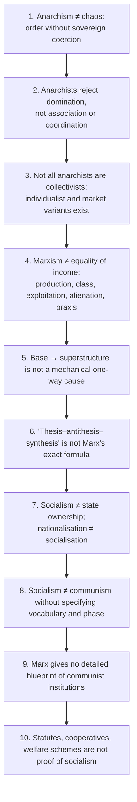

Further traps recorded in the owner file:
11. Do not import liberalism, neoliberalism or fascism as printed ideologies; they are foils only.
12. Do not omit Godwin and Tolstoy when a strand/thinker taxonomy is asked; keep Proudhon, Bakunin, Kropotkin central.
13. Utopian ≠ foolish; scientific ≠ infallible.
14. Do not merge humanist and structural Marxism.
15. Later communist regimes are neither irrelevant to Marxism nor identical with Marx's theory.
16. Do not answer the "inspired by liberalism and socialism" stem with a flat yes/no: genealogical dependence with conceptual independence (§8.4); do not make Godwin a revolutionary or Locke an anarchist; do not treat anarchism as extreme liberalism or stateless socialism.
17. "Pure democracy" is a polemical term attacked by Lenin by name in **1918**; the target is class-conditioned parliamentarism, not popular rule; do not collapse Marx into Lenin; include the constructive Commune half.
18. At 10 marks do not run the classical-to-neo trajectory; do not run Gramsci and Althusser together; Poulantzas's autonomy must stay *relative*.
19. Do not answer a pandemic stem with "pandemic → anarchism" (§11.1) and do not treat Gandhi as a simple Bakuninite anarchist.
20. Do not turn the answer into Soviet/Chinese political history (dossier risk note).

---

## 14. Technical Vocabulary & Terminology Bank

| English-first term | Original / technical form | Meaning | Status |
|---|---|---|---|
| Anarchism | — | Normative critique of domination; no unearned standing right to command | ✅ |
| Mutual aid | — | Cooperation as a social resource (Kropotkin) | ✅ |
| Philosophical anarchism | — | No general content-independent duty to obey | ✅ |
| Historical materialism | — | Forces, relations, class structure, superstructure | ✅ |
| Mode of production | — | Unity of productive forces and relations | ✅ |
| Alienation | Marx 1844 | From product, activity, species-being, other persons | ✅ |
| Surplus value | — | Value produced beyond the value of wages | ✅ |
| Dictatorship of the proletariat | — | Transitional working-class supremacy | ✅ |
| Weakest link | Lenin | Chain breaks where contradictions are unevenly concentrated | ✅ |
| Vanguard party; democratic centralism | Lenin | Professional revolutionaries; discussion then unity of action | ✅ |
| Trade-union consciousness | Lenin | What spontaneous struggle yields | ✅ |
| Substitutionism | — | Class → party → committee → leadership | ⚠️ |
| Hegemony | *egemonia* (Gramsci) | Leadership by consent through civil society | ✅ |
| Political society vs civil society | *dominio* / *egemonia* | Coercion vs consent | ✅ |
| Organic intellectuals; war of position; war of manoeuvre; counter-hegemony; contradictory consciousness | Gramsci | See §3.2 | ✅/⚠️ |
| Repressive / Ideological State Apparatuses (RSA / ISA) | Althusser | Violence-first vs ideology-first | ✅ |
| Interpellation; overdetermination | Althusser | Hailing subjects; multiple contradictions | ✅ |
| Instrumentalism; relative autonomy; condensation of class forces | Miliband; Poulantzas | See §3.2 | ✅ |
| Swarāj; satyāgraha; sarvodaya | Gandhi | Self-rule; truth-force; welfare of all | ✅ |
| Trusteeship; bread labour; non-possession | Gandhi | Wealth as social responsibility; dignity of productive work | ✅ |
| Ahimsa | Gandhi | Non-violence; means prefigure ends | ✅ |
| Radical humanism | M. N. Roy | Freedom as removal of obstacles to human capacities | ✅ |
| Nationalisation vs socialisation | — | State ownership ≠ control by society | ✅ |
| Dossier-only: analytic vs orthodox Marxism; market socialism; class reduction vs plural domination; institutional anarchism | — | Optional enrichment | ⚠️ |

---

## 15. Graded Verdict & Answer Architectures

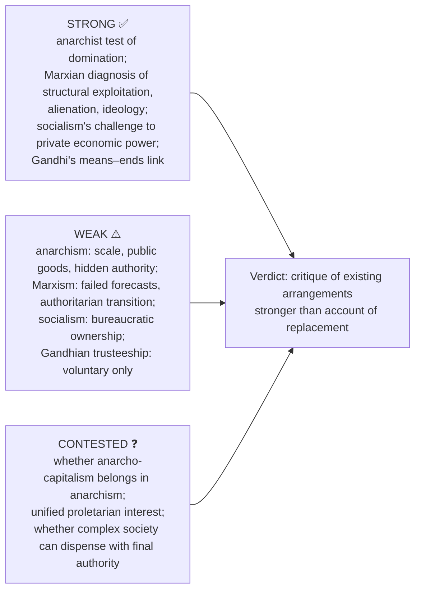

### 15.1 Directive decoder

| Directive | Scored | Structural move | Failure |
|---|---|---|---|
| Explain / Elucidate | internal logic of one doctrine | statement → premises → distinction → example | inserting criticism at cost of exposition |
| Discuss | exposition plus one adjudicated tension | doctrine → rival → objection → reply → verdict | narrating history of a movement |
| Critically examine / evaluate | objection–reply layer *is* the answer | two objections each with reply and **residual** problem | listing failures of communist states as refutation |
| Is X still relevant? | diagnostic vs predictive vs institutional | what it still explains → failed to predict → what survives → verdict | contemporary examples instead of argument |
| Compare / Distinguish | shared axes in parallel | fix 3–4 axes, run both, adjudicate | two sequential summaries |
| Comment on a quoted line | locate line in its doctrine first | source doctrine → assertion → limit → verdict | treating quote as self-explanatory |

### 15.2 10-mark (~150 words, 4 moves)

```text
1. Exact doctrine (2 lines) in technical vocabulary.
2. Mechanism (4–5 lines) as numbered premises, a causal chain.
3. One evidence unit with its limitation.
4. Graded verdict (2 lines).
Do NOT run the classical-to-neo trajectory at 10 marks.
```
**Worked 2026 Q1(c) spine:** concede genealogical debt (autonomy, consent, private judgment from liberalism; anti-property, anti-class, mutual aid from socialism) → name both lineages (Godwin–Stirner–Wolff; Proudhon–Bakunin–Kropotkin) → deny the conclusion (liberalism keeps a protective state; Marxian socialism a transitional one) → "inspired by both, reducible to neither."
**Worked 2026 Q1(d) spine:** define "pure democracy" → four grounds (class state; political vs human emancipation; ruling ideas; episodic consent vs continuous economic power) → anchor texts (*On the Jewish Question* 1843, *Manifesto* 1848, *Civil War in France* 1871, Lenin 1918) → Commune as constructive half, verdict on capture and agenda-setting.
**Worked alienation spine:** define → four dimensions → distinction from low wages → species-being objection → verdict.

### 15.3 15-mark (~220 words, 6 moves)

```text
1. Frame the problem (authority, class power, property, freedom, ideology).
2. Doctrine with argument and presupposition.
3. Internal rival first (Lenin, Gramsci, Poulantzas, Bernstein), then external.
4. One table (four revisions, Gramsci's spheres, RSA/ISA, Miliband/Poulantzas).
5. One worked objection → reply → residual problem.
6. Conditional verdict separating analytical survival from institutional failure.
```

### 15.4 20-mark (strictly within 250 words, 8 moves)

```text
1. Provisional thesis using the stem's directive verb.
2. Locate the doctrine historically.
3. Full internal argument in technical vocabulary.
4. Classical → neo trajectory (name which claim is revised and why).
5. Strongest external rival (anarchist, liberal, social-democratic, Gandhian).
6. Two objection → reply chains, each ending in a residual problem.
7. One conceptually controlled Indian illustration, never proof by statute.
8. Graded verdict: diagnosis vs prediction vs institutional record.
```

### 15.5 Verdict formulas ⚠️ (adapt, never reproduce mechanically)

- **Diagnosis/remedy split:** the analysis of concentration, exploitation, ideological reproduction retains force; the institutional remedy, an unaccountable transitional state, does not, and the theory supplies no internal safeguard against it.
- **Relocation:** neo-Marxism does not abandon the materialist mechanism; it relocates causal weight into party, culture, state form and subject-formation, so the tradition is refined rather than refuted.
- **Necessary-not-sufficient:** class analysis is necessary but insufficient in India; caste and gender operate through status, endogamy and social reproduction.
- **Bounded autonomy:** the capitalist state must be granted autonomy to explain what it does, and denied unlimited autonomy to remain a Marxist state.
- **Means–ends:** a doctrine that postpones liberty to secure equality cannot deliver the freedom it promises.
- **Asymmetric:** the doctrine's critique of existing arrangements is stronger than its account of what should replace them.

### 15.6 Reusable statement lines

- ✅ Anarchism is not the absence of order but the refusal to identify order with sovereign command.
- ✅ Marxism interprets capitalism as a social relation of production, not merely an unequal distribution of income.
- ⚠️ The enduring Marxian insight is that formally free exchange can coexist with structurally unequal power.
- ✅ Socialism is a family of doctrines; Marxism is one revolutionary and materialist member.
- ⚠️ Nationalisation without democratic participation may replace private domination with bureaucratic domination.
- ⚠️ Gandhi and Marx converge against exploitation but divide over violence, industrial scale and the moral relation of means to ends.

### 15.7 Evidence units P1–P16 (Claim → Named anchor → Limitation; 1 unit at 10 marks, 2 at 15, 4–5 at 20)

| # | Claim | Anchor | Limit |
|---|---|---|---|
| P1 | State is an instrument of class rule; withers once classes are abolished | Marx–Engels, *Manifesto* | contradicted by welfare/regulatory action against particular capitalists (§3.2 Poulantzas) |
| P2 | History moves by contradiction between forces and relations of production | Marx, Preface to *Contribution to the Critique of Political Economy* | base–superstructure not mechanical |
| P3 | Labour estranged in four dimensions | *Economic and Philosophic Manuscripts of 1844* | rests on normative human nature that Althusser rejects |
| P4 | Exploitation structural; surplus value | Marx's theory of surplus value | labour theory of value contested; argue the structural point |
| P5 | Weakest link; consciousness from outside; vanguard | Lenin | substitutionism unanswered |
| P6 | Rule by consent via civil society; war of position | Gramsci | no independent test of hegemony |
| P7 | Subjects produced by ISAs | Althusser | explains stability better than change |
| P8 | Capitalist state relatively autonomous | Poulantzas 1973 vs Miliband 1969 | autonomy must remain relative |
| P9 | Property is origin of domination; state its guarantor | Proudhon, Bakunin, Kropotkin | no account of large-scale coordination, defence, rights |
| P10 | Means determine ends; trusteeship | Gandhi | voluntary; Ambedkar's objection to reliance on dominant groups' conscience |
| P11 | Socialism ≠ communism ≠ social democracy | §4.5 | boundaries historically fluid |
| P12 | Equity ≠ equality; contribution then need | Marx, *Critique of the Gotha Programme* | normative projection, not a law |
| P13 | Anarchism has distinct thinker-strands | Godwin, Proudhon, Bakunin, Kropotkin, Tolstoy | strands disagree on property, revolution, religion |
| P14 | Utopian vs scientific socialism | Owen, Fourier, Saint-Simon; Marx–Engels | labels polemical |
| P15 | Marxism is theory, project and historical inheritance | §9 | authoritarianism remains an objection |
| P16 | Relevance is criterion-specific | §11.2 | relevance ≠ predictive/institutional success |

> [!NOTE]
> Link-outs from the owner file: Social and Political Ideals · Individual and State · Forms of Government · Development and Social Progress · Caste Discrimination: Gandhi and Ambedkar · Hegel · Religion without God. Ownership routing: Weber, Schumpeter, Michels, populism → Forms of Government §4A; recognition vs redistribution → Humanism, Secularism, Multiculturalism §3A; ecological critique and degrowth → Development and Social Progress §5A; Marxist and socialist feminism → Gender Discrimination §5.3A.

---

## Sources

O. P. Gauba, *An Introduction to Political Theory*; local compiled notes PDF *Socio-Political Philosophy*; Marx, *Economic and Philosophic Manuscripts of 1844*, *Preface to A Contribution to the Critique of Political Economy*, *Critique of the Gotha Programme*, *On the Jewish Question* (1843), *The Civil War in France* (1871); Marx and Engels, *Manifesto* (1848), *The German Ideology* (1845–46); Engels, *Socialism: Utopian and Scientific*; Proudhon, *What Is Property?* (1840); Bakunin, *Statism and Anarchy*; Kropotkin, *The Conquest of Bread* (1892), *Mutual Aid* (1902); Godwin (1793); Stirner (1844); Wolff (1970); Lenin, *Imperialism*, *What Is To Be Done?*, *The State and Revolution* (1917), *The Proletarian Revolution and the Renegade Kautsky* (1918); Gramsci, *Prison Notebooks*; Althusser, "Ideology and Ideological State Apparatuses"; Miliband (1969); Poulantzas (1973); Gandhi, *Hind Swaraj*; M. N. Roy; Constitution of India Part IV (non-justiciable); dossier trail: G. A. Cohen, *Karl Marx's Theory of History*; Jon Elster, *Making Sense of Marx*. All named-scholar reconstructions cite title/year/position only; no page, edition or verbatim wording is asserted.
