# HUMANISM; SECULARISM; MULTICULTURALISM — Examiner-Grade Mindmap

> **Syllabus (verbatim):** Humanism; Secularism; Multi-culturalism.
> **Catalogue key:** `philosophy-paper-ii-socio-political-philosophy-06` · Paper II · Section A · Socio-Political Philosophy
> **Sources used:** `paper-2/socio-political/Humanism-Secularism-Multiculturalism.md` (canonical owner, read in full) · `_advanced/Socio-Political-Dossier.md` §6 and promotion ledger (optional depth) · `paper-2/_PYQ-SocioPolitical-2018-2025.md` · `paper-2/_PYQ-SocioPolitical-2026-Supplement.md`.
> **Evidence key:** ✅ canonical · ⚠️ analytical synthesis · ❓ contested
> **Blueprint adaptation:** `MINDMAP_INSTRUCTIONS.md` is Indian-school oriented. The 16 module headings are kept; each module's focus is adapted to this clause. Module 1 = ownership boundary, thinkers and lineages; Module 2 = the justificatory argument of each limb (the sources give no *pramāṇa*-style epistemology); Module 3 = internal debates and refinements; Module 4 = conceptual inventory; Module 5 = stance on the state, religion and constitutional bridges (the sources give no transcendent-reality ontology); Module 6 = causal and explanatory chains; Module 7 = value aims; Module 10 = cross-tradition pairs (the sources give no East–West table, only the internal pairs shown there).

> [!IMPORTANT]
> **Master thesis ⚠️.** Humanism without pluralism can become homogenising; pluralism without a humanist floor can excuse oppression; secularism mediates by protecting conscience while making public power answerable to equal citizenship. The clause's recurring problem is how **universal dignity** can coexist with **religious and cultural plurality**.

---

## 0. Master Overview

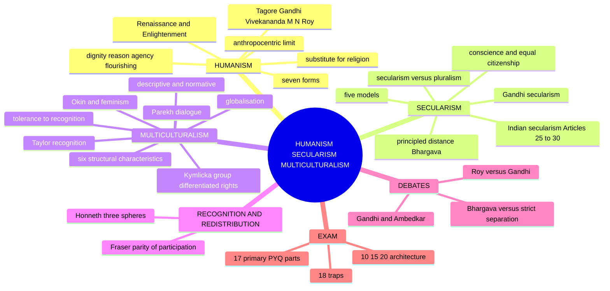

```text
HUMANISM                       SECULARISM                       MULTICULTURALISM
dignity · reason · agency      conscience · non-establishment   recognition · accommodation
· flourishing                  · principled distance            · minority rights · dialogue
      │ universal moral floor         │ regulates religious plurality        │
      ▼                               ▼                                      ▼
      └───────────────►  equal citizenship  ◄──────────────────────────────┘
                              limit: no culture may immunise domination from criticism
```

---

## 1. Identity, Lineage & Ownership Boundary

### 1.1 Exact printed ownership and firewall ✅

| Limb | Full ownership here | Boundary (owned elsewhere) |
|---|---|---|
| **Humanism** | dignity, reason, agency, flourishing, forms, Indian humanists, religion-substitute question | Legal rights/duties → Individual and State; Marxism as ideology → Political Ideologies |
| **Secularism** | state–religion principles, conscience, non-establishment, models, Gandhi's democratic secularism | Truth of religion, religious pluralism, religion–morality → Philosophy of Religion |
| **Multiculturalism** | diversity, recognition, accommodation, cultural membership, group-differentiated rights, internal limits | Gender and caste doctrines → Gender Discrimination; Caste Discrimination |

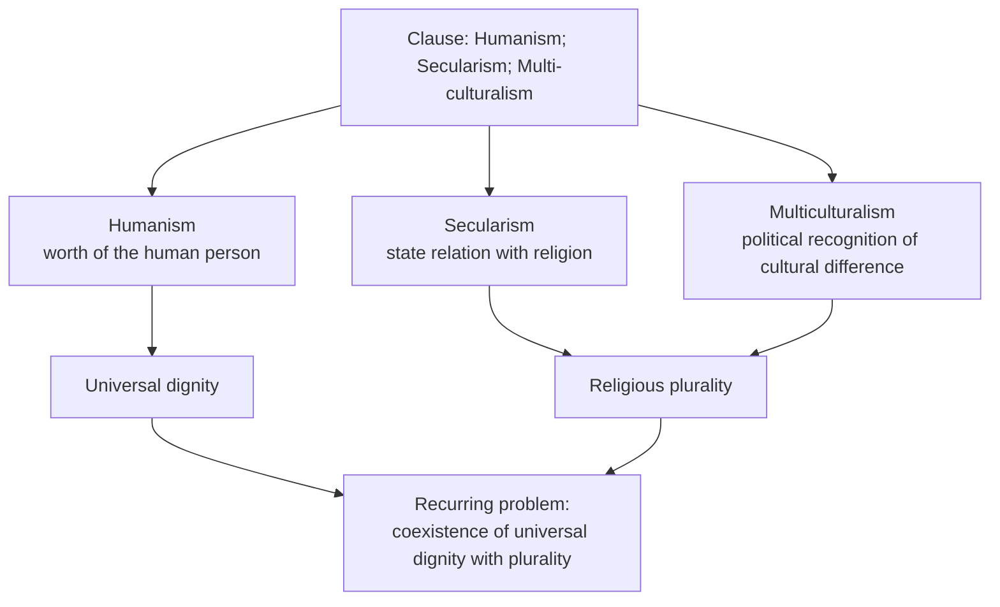

### 1.2 Named-thinker control ✅

| Thinker | Role in this owner |
|---|---|
| Gandhi, Tagore | **Directly demanded** by routed PYQs |
| M. N. Roy, Bhargava, Taylor, Kymlicka, Parekh, Okin | Execute indispensable standard distinctions |
| Ambedkar | Bounded constitutional-morality and anti-hierarchy bridge |
| Vivekananda | Linked divine potential of the person with service to humanity |
| Fraser, Honneth | Recognition/redistribution debate, promoted to Core on 15 Aug 2026 (§3A of owner) |
| Nehru, Rawls | **Not** independent routed demands in 2018–2025; wider theories **not** imported |
| Sartre (existential humanism) | Defensible comparison only; neither printed nor independently routed |

### 1.3 Cross-owner cross-links ⚠️

Forms of Government (theocracy, democracy, secular legitimacy) · Individual and State (human rights, conscience, equal citizenship) · Gender Discrimination (multicultural recognition vs internal patriarchy) · Caste: Gandhi and Ambedkar (secular democracy, fraternity) · Development and Social Progress (universal development; anthropocentric–biocentric–ecocentric spectrum in its §5A) · Religion without God · Religious Pluralism · Religion and Morality.

---

## 2. Theory of Justification (what each limb treats as its grounds)

### 2.1 The argument for humanism ✅

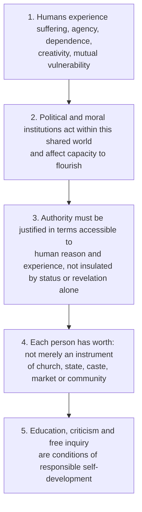

**Presuppositions:** ✅ persons possess capacities for reflection and self-correction; ✅ human life has value not exhausted by inherited rank; ⚠️ common humanity can ground criticism across cultural boundaries without erasing difference.

### 2.2 The core argument for secularism ✅

1. ✅ Citizens reasonably disagree about religion and the ultimate good.
2. Coercive state power applies to all.
3. If political status depends on adherence to one faith, dissenters become unequal citizens.
4. If religious communities are wholly immune from public norms, internal domination may go unchallenged.
5. Therefore a secular order protects conscience, refuses religious qualification for citizenship, and regulates intervention by publicly justifiable principles.

**Presupposition ⚠️:** political legitimacy must be intelligible to citizens who do not share a single theology.

**Public-reason control ⚠️:** used in a minimal political sense, the shared justification of coercive law; **not** a full importation of Rawls. The test is whether citizens are addressed as equals, not whether every speaker uses secular vocabulary.

### 2.3 The argument from recognition (Taylor) ✅

1. Equal dignity requires more than formally identical treatment.
2. Supposedly neutral institutions may embody majority language and history.
3. Minorities bear unequal costs of assimilation.
4. Public recognition can therefore be required for equal membership.

Ground: identity is **dialogically formed**; persistent misrecognition harms by presenting a group as inferior or invisible. Objection: recognition freezes fluid identities and empowers community elites. Reply ⚠️: recognition must be revisable, internally democratic, compatible with individual exit and dissent.

### 2.4 Kymlicka's argument ✅

Individual autonomy depends on access to a **societal culture** that supplies meaningful options; liberal equality may therefore support minority rights. Defends **external protections**; suspicious of **internal restrictions** that violate individual liberty.

### 2.5 Tagore's argument ✅

The isolated ego is incomplete; creative self-expression presupposes language, relation and a shared world; therefore universal humanity is a dimension of fulfilled personhood, not an external abstraction. Sources: *The Religion of Man*; *Nationalism*.

### 2.6 Gandhi's secularism argument ✅

1. Religions contain partial human apprehensions of truth.
2. Coercion in religion violates conscience.
3. Humility toward one's own faith supports respect for others.
4. Democracy requires non-violence and equal civic fellowship.
5. Therefore public religion must be ethical and non-sectarian.

---

## 3. Dialectical Wings & Refinements

### 3.1 Recognition and redistribution: two grammars ✅/⚠️

| | **Redistribution grammar** | **Recognition grammar** |
|---|---|---|
| Injustice is ✅ | maldistribution: exploitation, deprivation, economic marginalisation | misrecognition: status subordination, stigma, disrespect, cultural devaluation |
| Located in ✅ | economic structure | institutionalised patterns of cultural value |
| Collectivity ✅ | a class (position in production) | a status group (esteem and standing) |
| Remedy ✅ | redistribute resources, restructure division of labour | revalue the disrespected identity, or transform value patterns |
| Paradigm case ✅ | the exploited worker | the stigmatised or despised group |
| Risk if used alone ⚠️ | **economism**: stigma as mere reflex of poverty | **culturalism**: celebrates identity, leaves material hierarchy intact |

⚠️ The remedies can pull against each other: redistribution often needs to *dissolve* the group as a category; recognition often needs to *affirm* its distinctness. Naming this tension is the most valuable move on any culture-and-inequality stem.

### 3.2 Fraser vs Honneth ✅/⚠️

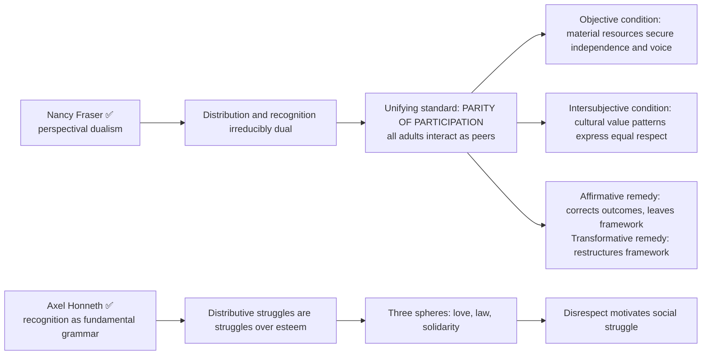

| Honneth sphere | Mode | Self-relation | Disrespect |
|---|---|---|---|
| **Love / close relations** ✅ | affective care | basic self-confidence | violation of bodily integrity; abuse |
| **Law / rights** ✅ | recognised as morally responsible person with equal rights | self-respect | denial of rights; exclusion from legal standing |
| **Solidarity / achievement** ✅ | esteem within a community of value | self-esteem | denigration; devaluing a way of life or work |

| Axis | Fraser | Honneth |
|---|---|---|
| Status of grammars | irreducibly dual, one standard | recognition foundational; distribution derivative |
| Locus of injustice | value patterns **and** economic structure | denied recognition in several idioms |
| Standard | parity of participation (institutional, status-based) | undistorted self-realisation across three spheres |
| Strength | keeps economic structure visible | explains moral *motivation* of struggle |
| Weakness ⚠️ | thinner account of why misrecognition wounds | risks psychologising political economy; impersonal markets |

**Objection chains ⚠️:**
- *To Fraser:* an institutional criterion cannot explain the depth of contempt. *Reply:* justice concerns institutionalised relations, not psychological states; residual: under-theorised harm.
- *To Honneth:* impersonal mechanisms (automation, capital flight, price movements) devastate groups without withheld esteem. *Reply:* what counts as productive contribution is culturally instituted; residual: "recognition" stretches until it explains less.
- *To both:* may license affirming group identities as they stand. *Reply ✅:* the affirmative/transformative distinction; what is owed is transformation of value patterns, including standing **within** the group.

⚠️ **Adjudication line:** recognition and redistribution are **analytically distinct and practically entangled**. Asserting that "both are important" takes no position.

**Placement ⚠️:** Taylor supplies the premise; Kymlicka the institutional form; Fraser's transformative criterion gives the reason internal restrictions must be refused; Parekh's dialogue presupposes participants who can speak as peers; Ambedkar is the Indian anchor (graded status as a mechanism distinct from, though entangled with, economic deprivation) but is **owned** by the Caste file.

### 3.3 Parekh and interculturalism ✅/⚠️

Parekh rejects both cultural monism and uncritical relativism: cultures are internally plural and learn through dialogue; none is self-sufficient, yet criticism must attend to context and voice. Helps avoid the false choice between assimilation and sealed cultural islands.

**Advanced (optional) ⚠️:** multiculturalism vs interculturalism: stable group recognition and differentiated rights vs deeper dialogic exchange across communities; a refinement after Taylor/Kymlicka/Parekh are secure.

### 3.4 Okin and the feminist challenge ✅

Group rights may protect patriarchal practices inside minorities. Questions: *who speaks for the culture, and who bears the cost of preserving it?* Multicultural reply: cultures are internally contested, not owned by male elites; minority women need protection from external racism **and** freedom from internal domination; representation, voice, exit and reform beat forced assimilation.

### 3.5 Posthuman challenge (optional, advanced) ⚠️

Human-centred dignity remains basic; rival view warns against anthropocentrism and domination over nature, animals and technology. **Not required by the corpus**; do not add unless the core triad is secure. Still to promote if a PYQ asks it directly: principled distance as a standalone demand, interculturalism, or posthuman criticism of humanism.

---

## 4. Conceptual Inventory

### 4.1 Forms of humanism ✅

| Form | Ground of dignity | View of religion | Risk |
|---|---|---|---|
| Classical / cultural | cultivated reason, civic virtue, classical learning | compatible with several metaphysical settings | idealises an exclusive educated citizen |
| Renaissance | cultivated human capacities | often Christian | elitist cultivation |
| Enlightenment | reason, autonomy, universal personhood | critical / tolerant | abstract universalism |
| Secular / naturalistic / scientific | naturalistic inquiry and human welfare | rejects supernatural authority | scientism |
| Religious | divine or spiritual worth expressed through service | religion can deepen human concern | paternalism |
| Marxist | creative social species-being; overcoming alienation | religion read through material suffering | contested within Marxism |
| Radical Humanism (M. N. Roy) | sovereignty of the rational individual | secular | underestimates structural power |

**What humanism is not:** ≠ atheism (religious humanisms exist); ≠ egoistic individualism; ≠ "humans may do anything" (dignity joined to responsibility); ≠ Protagorean relativism.

**Renaissance and Enlightenment ✅.** Renaissance: classical learning, rhetoric, history, human agency. Enlightenment: radicalised the demand that beliefs and institutions answer to reason, criticism and public justification. ⚠️ Qualification: humanism is not created from nothing by eighteenth-century Europe; Stoic cosmopolitanism, religious traditions, Bhakti-Sufi egalitarian impulses and Indian reform traditions also contribute.

### 4.2 Humanism in relation to rights, science, religion, community ✅

| Relation | Contribution | Limit |
|---|---|---|
| Human rights | moral status from which legal entitlements can be argued | rights need institutions and remedies |
| Science | protects inquiry from epistemic monopoly; revisability | cannot derive every value |
| Religion | may reject supernatural authority or reinterpret faith via service | not simply anti-religion |
| Community | language, care, relation as conditions of agency | cannot cancel member's dignity or dissent |

### 4.3 Secularism vs neighbouring terms ✅

| Term | Meaning |
|---|---|
| Secularisation | sociological decline or transformation of religious authority |
| Atheism | belief that God does not exist |
| Religious toleration | permission to dissent; may coexist with an established religion |
| **Secularism** | political principles governing public power and religious freedom |
| Religious pluralism | fact and/or value of multiple religions |

### 4.4 Models of secularism ✅

| Model | Central device | Strength | Risk |
|---|---|---|---|
| Strict separation | institutional distance | guards against establishment | may ignore social inequality among religions |
| Assertive public secularity (*laïcité*) | strong public-institutional secularity | common civic identity | can burden visible minorities |
| Non-establishment + free exercise | no established religion; practice protected | dual protection | boundary disputes |
| Equal respect | state does not rank faiths | fits plural society | indiscriminate appeasement |
| **Principled distance** | context-sensitive engagement or disengagement by liberty, equality, anti-domination | addresses inter- and intra-religious domination | discretion may be inconsistent or partisan |

### 4.5 Multiculturalism: dimensions and structure ✅

| Dimension | Question | Example |
|---|---|---|
| Descriptive | Are several cultural, linguistic, religious communities present? | India's linguistic and religious diversity |
| Normative | What recognition or accommodation is just? | language rights, minority institutions, exemptions |
| Institutional | Through which legal and political forms? | federalism, cultural rights, representation |
| Critical | When does recognition protect domination within groups? | gender or caste hierarchy defended as tradition |

**Six structural characteristics of a multicultural nation ⚠️ (2020 Q3(b)):**

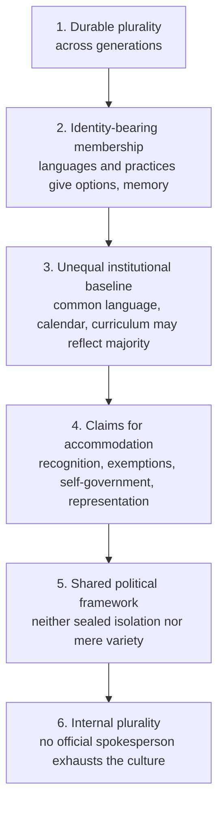

A country becomes **normatively** multicultural when it treats these facts as questions of equal membership and public justification, not as population data.

### 4.6 Kymlicka's three minority-right types ✅/⚠️

| Type | Function | Main limit |
|---|---|---|
| Self-government rights | decision-making space for territorially concentrated national minorities or Indigenous peoples | authority constrained by members' basic rights |
| Polyethnic / accommodation rights | exemptions or support reduce cost of participation | must not become internal restriction |
| Special representation rights | correct persistent exclusion from common decision-making | must stay accountable; avoid freezing one elite as the group voice |

⚠️ These classify institutions; the **external-protection / internal-restriction** distinction is the normative test across them. Do not collapse the two.

### 4.7 Responses to diversity ✅/⚠️

| Response | Core meaning | Limitation |
|---|---|---|
| Tolerance | restrains coercion against what one disapproves | can preserve hierarchy of permission |
| Coexistence | peaceful shared life | may leave unequal standing |
| Accommodation | adjusts common rule to reduce unequal cultural burden | exemptions need a rights-based limit |
| Recognition | affirms equal standing, corrects invisibility or stigma | may essentialise or empower elites |
| Integration | common citizenship without cultural erasure | slides into assimilation if majority alone defines the common |
| Assimilation | minorities abandon distinctive practices | treats majority culture as neutral |

---

## 5. Stance on State, Religion & Constitutional Bridges

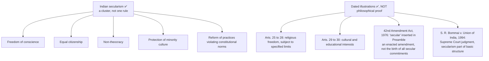

⚠️ These illustrate institutionalisation; the philosophical justification rests on conscience, equality and non-domination.

### 5.1 Personal law, minority rights, reform, public reason ⚠️

| Question | Secular concern | Controlling principle |
|---|---|---|
| Minority religious/cultural protection | uniform rules may expose minorities to majority power | external protection and equal civic membership |
| Personal-law accommodation | may preserve conscience and cultural membership | defeasible where it entrenches internal domination |
| Social reform | absolute non-intervention immunises hierarchy | intervention needs liberty, equality, anti-domination reasons |
| Religious reasons in public life | excluding all religiously framed reasons burdens believers | coercive law must be justifiable to citizens who do not share one theology |

### 5.2 India as multicultural polity (illustrations, not proof) ✅/⚠️

- ✅ Linguistic federalism and multiple official-language arrangements.
- ✅ Articles 29–30 protect specified cultural and educational interests.
- ✅ Personal-law pluralism: accommodation, but disputes over gender equality.
- ⚠️ Scheduled and tribal self-government arrangements: differentiated institutional recognition.

### 5.3 Recognition remedies in the Constitution ✅/⚠️

- ✅ **Articles 15 and 17:** prohibit discrimination on grounds including religion, race, caste, sex, place of birth; **abolish untouchability**. ⚠️ Article 17 is the clearest constitutional example of a **recognition** remedy (a status injury, not a distributive shortfall); reservation under Articles 15 and 16 combines recognition with distribution. Do not claim the Constitution adopts Fraser's or Honneth's theory.
- ✅ Articles 29–30 are best read as **external protections** in Kymlicka's sense; they do not settle the internal-restriction question.
- ⚠️ **Controlling caution:** a constitutional article is a dated legal fact. ❌ Do not describe any Indian community, government or period as an instance of misrecognition or hegemony.

### 5.4 Gandhi's secularism ✅

Does not expel religion from public life; religion as ethical truth and self-purification disciplines politics; all faiths deserve equal moral regard. Objection: religious vocabulary can privilege majoritarian symbols and exclude non-believers. Reply ⚠️: Gandhi's equal-conscience principle resists this, but Bhargava's institutional secularism supplies safeguards personal virtue cannot.

---

## 6. Explanatory & Causal Principles

### 6.1 How the Enlightenment paves the way for humanism ✅ (2022 Q1(a), 2024 Q2(a))

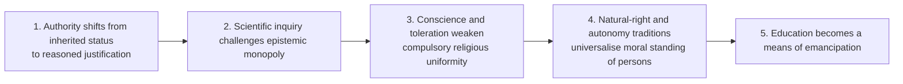

### 6.2 Globalisation and multiculturalism: two directions ⚠️ (2018 Q3(a))

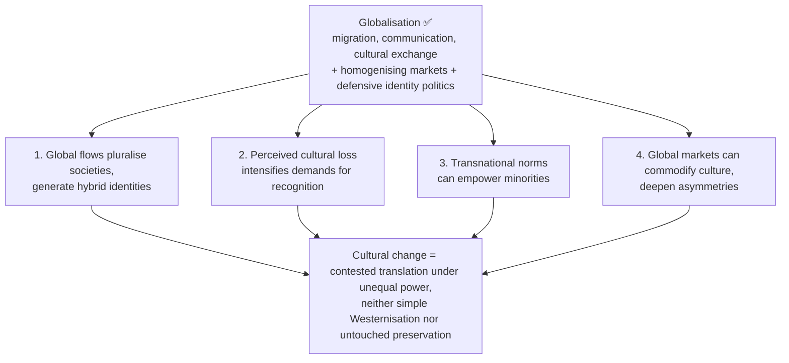

Answer mechanism ⚠️: migration, digital communication and trade multiply encounters; people borrow selectively and form hybrids. The same networks can amplify dominant languages and commodify minority symbols, prompting protection or revival. Multicultural institutions (language accommodation) can make cross-border exchange less coercive; transnational rights claims can alter what counts as fair recognition. Objection: contact automatically yields tolerant diversity. Reply: contact under unequal resources can sharpen exclusion; ask *who controls representation, who bears assimilation costs, whether members may reinterpret inherited practices*. A numerical increase in diversity is not a normative commitment to multiculturalism.

### 6.3 From tolerance to multicultural membership ⚠️ (2024 Q4(c))

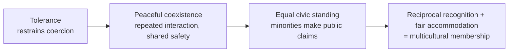

Tolerance and coexistence are **enabling but insufficient**; the claim is not that diversity has a single historical origin. Objection: toleration leaves the majority in control. Reply: replace revocable permission with secure rights, mutual criticism and voice within each culture.

**Social-cohesion verdict ⚠️:** multiculturalism strengthens cohesion where differentiated protection removes the price of assimilation and all members retain common rights, voice and participation; it weakens cohesion where identities are frozen, group elites monopolise representation, or common institutions cease to be mutually justifiable.

### 6.4 Pluralism vs secularism ✅/⚠️

**Plurality** = presence of several religions. **Pluralism** may add affirming their right to coexist. **Secularism** specifies how coercive public power acts amid diversity. Related, not identical: a homogeneous society may still need secular protection for dissenters and non-believers; a plural society can remain non-secular if one religion enjoys political supremacy; secularism converts coexistence into norms of conscience and equal citizenship.

---

## 7. Value Aims: Dignity, Conscience, Equal Membership

| Limb | Value supplied | Characteristic excess | Corrective by the triad |
|---|---|---|---|
| Humanism | universal dignity, responsible agency | abstract "human" erases historical difference | multicultural recognition makes universality difference-sensitive |
| Secularism | fair terms of citizenship amid religious disagreement | formal neutrality conceals majority privilege | principled distance examines inter- and intra-religious domination |
| Multiculturalism | recognition, accommodation, cultural membership | group claims shelter hierarchy or fragment common standing | human dignity and secular citizenship limit internal restrictions |

**Three recurrent tensions ⚠️:**
1. Universal dignity vs cultural difference: no demand for uniform identity; no suspension of bodily integrity, voice or equality.
2. Secular citizenship vs religious membership: conscience protects belief and non-belief; coercive power needs reasons compatible with equal civic standing.
3. Recognition vs common citizenship: differentiated rights justified where they remove majority-created burdens or vulnerability, not where they establish permanent political rank.

**Executable synthesis ⚠️:** human dignity is the moral floor; secular citizenship supplies the terms of public power; multicultural recognition supplies the context-sensitive policy form. The triad holds only where state and community power remain rights-bound, publicly justifiable and open to dissent and revision.

### 7.1 Which form of humanism is relevant now? (2018 Q3(c)) ⚠️

| Test | Required feature | Why |
|---|---|---|
| Universal floor | equal dignity of every person | permits criticism of caste, exclusion, instrumentalisation |
| Epistemic method | reason, science, revisable inquiry | resists inherited or ideological monopoly |
| Social conception | persons formed through relation and community | avoids atomistic individualism |
| Difference-sensitivity | gender, caste, culture, historical voice correct the abstract "human" | prevents a dominant experience posing as universal |
| Ecological limit | flourishing interdependent with living systems | restrains anthropocentric mastery |

**Graded verdict ⚠️:** a **critical, plural and ecological humanism**: naturalistic in method, universal in dignity, relational in personhood, self-correcting under feminist, anti-caste, postcolonial and ecological criticism. Not a new canonical "school" but an argued synthesis.

### 7.2 Indian humanists ✅

- **Tagore:** person in creative relation with universal humanity, not isolated individualism or narrow nationalism.
- **Gandhi:** service grounded in unity and equal worth of life; religious, ethical, practical rather than secular-naturalist; test of public action = effect on the most vulnerable; non-violence and moral regeneration indispensable.
- **Vivekananda:** divine potential of the person linked with service to humanity.
- **M. N. Roy:** rational, morally autonomous individual above party, class and state; freedom = progressive removal of restraints on human potential; democracy participatory and ethically grounded, not merely electoral.

| Tagore: apparent opposition | Tagorean mediation |
|---|---|
| individual / universal | individuality fulfils itself through relation, creativity, sympathy |
| reason / spirituality | critical intelligence and spiritual depth need not exclude each other |
| East / West | reciprocal learning, not imitation or chauvinism |
| freedom / community | community nourishes freedom when not coercive |
| finite / infinite | reaching beyond ego through art, love, participation in a larger life |

---

## 8. Inter-School Comparative Matrices

### 8.1 Roy vs Gandhi on humanism ✅

| Axis | M. N. Roy | Gandhi |
|---|---|---|
| Ground | naturalistic reason, individual autonomy | spiritual unity, truth, non-violence |
| Religion | rejects supernatural authority | religion can ethically discipline politics |
| Politics | organised participatory democracy | self-rule (*swarāj*), constructive work, decentralisation |
| Common point | no collective idol may extinguish the person | same, via conscience and non-violence |

### 8.2 Bhargava vs strict separation ✅

Strict separation treats distance as uniform; principled distance treats it as justified and context-sensitive. The former guards institutional clarity; the latter better addresses unequal religious power but risks discretionary inconsistency. Principled distance: the state may **abstain** to protect autonomy or **intervene** to secure equal citizenship and reform oppressive practices.

### 8.3 Taylor/Kymlicka vs liberal uniformity ✅/⚠️

Uniform-rights liberalism asks the state to ignore group identity; recognition theorists reply that majority language, calendar and institutions are never culturally empty. ⚠️ The liberal rejoinder is strongest where group rights threaten individual dissent.

### 8.4 Tagore vs narrow nationalism ✅/⚠️

Tagore fears the mechanically organised nation can subordinate living persons and civilisational exchange to collective power. ⚠️ His universalism is not rootlessness: one enters universality through creative culture, not by erasing it.

### 8.5 Gandhi and Ambedkar on secular democracy ✅/⚠️

| | Gandhi | Ambedkar |
|---|---|---|
| Ground of democratic fellowship | ethical religion, equal regard, transformed hearts | constitutional morality; liberty, equality, fraternity; institutional protection against graded hierarchy |

⚠️ Complementary only if moral fellowship is joined to enforceable rights; without structure Gandhi risks paternalism, without fraternity constitutional form can stay socially hollow.

### 8.6 Can humanism substitute for religion? (2021 Q2(c)) ⚠️

| Function often supplied by religion | Can humanism supply it? | Residual issue |
|---|---|---|
| Moral orientation | substantially: suffering, reciprocity, dignity, responsibility | disagreement over an ultimate foundation |
| Public ethic | yes: common humanity and reason justify equal civic standing | abstract reason must learn from cultural and historical experience |
| Community and solidarity | partly: associations, education, service | inherited ritual and belonging may not be replaceable |
| Meaning, transcendence, existential consolation | only partly and for some persons | secular humanism does not reproduce every religious horizon |

**Indian-context argument ⚠️:** in a deeply religious plural society, a humanism demanding irreligion would violate the equal conscience later protected by secularism. Gandhi and Vivekananda show human concern and faith can reinforce each other; Roy shows an ethical humanism can be naturalistic. **Verdict:** humanism can substitute for religion's ethical and civic role, not necessarily its communal, meaning-conferring or transcendent role; best defended as a universal floor compatible with, and critical of, plural religious consciences.

---

## 9. Criticisms & Reconstructed Replies

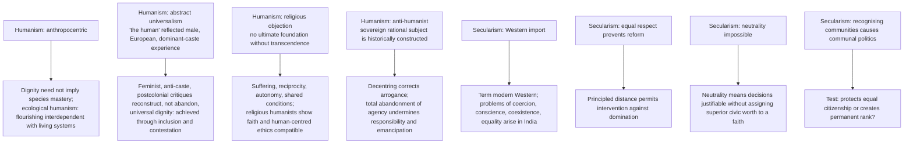

### 9.1 Four recurrent public objections to secularism ✅/⚠️

| Objection | Reply |
|---|---|
| "Secularism is anti-religious" | ✅ protects religious as well as non-religious conscience; denies the state a mandate to certify theological truth; restrains political establishment, not faith |
| Majoritarianism: majority symbols look culturally neutral; formal equality becomes pressure to assimilate | ⚠️ non-establishment and equal citizenship require majority institutions to face the same scrutiny |
| "Minorityism" / selective appeasement: community-specific protection used without general principle, shielding elites or internal hierarchy | ⚠️ protection justified against vulnerability, not permanent immunity; same liberty, equality, anti-domination criteria across cases |
| "Acceptance of all religions" (2023 formulation) | safe only if it means **equal civic respect and freedom of conscience**; a secular state need not affirm every religion as theologically true and must equally protect non-belief |

### 9.2 Objections to multiculturalism ✅/⚠️

| Objection | Reply | Remaining danger |
|---|---|---|
| Relativism | human dignity, bodily integrity, voice, non-domination as cross-cultural standards; interpretation dialogical | |
| Fragmentation | fair recognition can deepen allegiance by removing the demand to assimilate | |
| Essentialism | rights protect persons and evolving practices, not an authorised version of culture | |
| Majority invisibility | exposes the asymmetry; majority institutions face the same scrutiny | |
| Minorities within minorities (women, dissenters, lower-status members, converts) | external protection **plus** internal voice, exit, representation, reform; recognising a culture ≠ recognising an elite's unrestricted jurisdiction | formal exit is not always meaningful where family and livelihood are at stake |

### 9.3 Summary table ✅

| Criticism | Best reply | Remaining danger |
|---|---|---|
| humanism is anthropocentric | reconstruct dignity ecologically | human interests may still dominate |
| secularism is anti-religious | protects conscience, including religious | state practice may become selective |
| strict neutrality ignores inequality | principled distance | discretion and partisanship |
| multiculturalism fragments citizenship | recognition can make citizenship genuinely equal | elite capture of group voice |
| universal rights impose one culture | universality via contestation and translation | abstract standards may ignore context |

### 9.4 The anthropocentrism limit ✅/⚠️ (§3A.6 of owner)

Every doctrine here takes the **human** as unit of moral concern. Objection: humanism can positively license domination by making rational agency the sole ground of moral status.

| Reply (ascending strength) | Content | Note |
|---|---|---|
| 1. Instrumental | ecological destruction harms humans, so protect ecosystems | weakest; preserves anthropocentrism |
| 2. Relational | flourishing is **constituted** by relations with living systems | ecological care internal to dignity |
| 3. Extensional | capacity to fare well or badly is not confined to humans | concedes the *name* "humanism" no longer fits |

Unresolved residue: either reconstruct humanism ecologically and abandon the species-centred criterion, or keep it and accept a limit it cannot argue away. The full spectrum (anthropocentric–biocentric–ecocentric, shallow/deep ecology, intergenerational justice) is owned by Development and Social Progress §5A: name the limit here and route.

---

## 10. Controlled Cross-Tradition Comparisons

> [!NOTE]
> The sources give **no** East–West comparison table for this topic and name Nehru, Rawls and Sartre only as bounded or excluded comparators. This module therefore carries only the internal cross-tradition pairs the owner states.

| Pair | Point of contact | Decisive distinction |
|---|---|---|
| Roy and Gandhi | no collective idol may extinguish the person | naturalistic reason vs spiritual unity and non-violence |
| Tagore and Ambedkar/Marx | Tagore supplies an ethic of relation and anti-nationalism | sympathy alone cannot dissolve structures; Ambedkar and Marx expose them |
| Gandhi and Bhargava | religion as ethical discipline of politics | Bhargava supplies institutional safeguards virtue cannot |
| Taylor/Kymlicka and liberal uniformity | equal dignity | recognise group identity vs ignore it |
| Fraser and Honneth | recognition matters | dual dimensions vs foundational recognition |
| Kymlicka and Okin | group rights for cultural membership | Okin: they may protect patriarchy inside minorities |
| Sartre (bounded) | freedom, responsibility, self-making | neither printed nor independently routed; must not displace forms needed for actual PYQs |

> [!WARNING]
> Nehru and Rawls: wider theories **not** imported. Public reason is used only in the minimal political sense (§2.2).

---

## 11. Diagnostic Deep-Dives for High-Frequency Themes

### 11.1 Does secularism require complete separation? (2020 Q1(c)) ⚠️

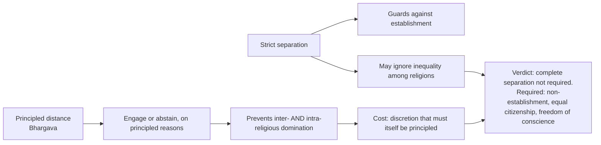

### 11.2 Is secularism necessarily related to religious pluralism? (2025 Q1(c)) ⚠️

Distinguish plurality, pluralism, secularism (§6.4). Not necessarily related: homogeneous society can need secular protection; plural society can be non-secular if one religion is politically supreme. Secularism turns coexistence into norms. The Philosophy of Religion owner (Religious Pluralism) handles truth-claims; here keep to state principle.

### 11.3 Secularism as "acceptance of all religions" (2023 Q4(c)) ⚠️

Secularism is **not** rejection of religion, but "acceptance" must mean equal civic respect and freedom of conscience, including non-belief; not theological endorsement; not immunity from reform.

### 11.4 Gandhi on secularism as foundation of democracy (2024 Q2(c)) ⚠️

Spine: ethical, non-sectarian public religion (§2.6) → equal moral regard of faiths → objection (majoritarian symbols) → Bhargava's safeguards → Ambedkar's constitutional morality as the enforceable complement.

### 11.5 Group rights vs individual rights (2026 Q2(c)) ⚠️

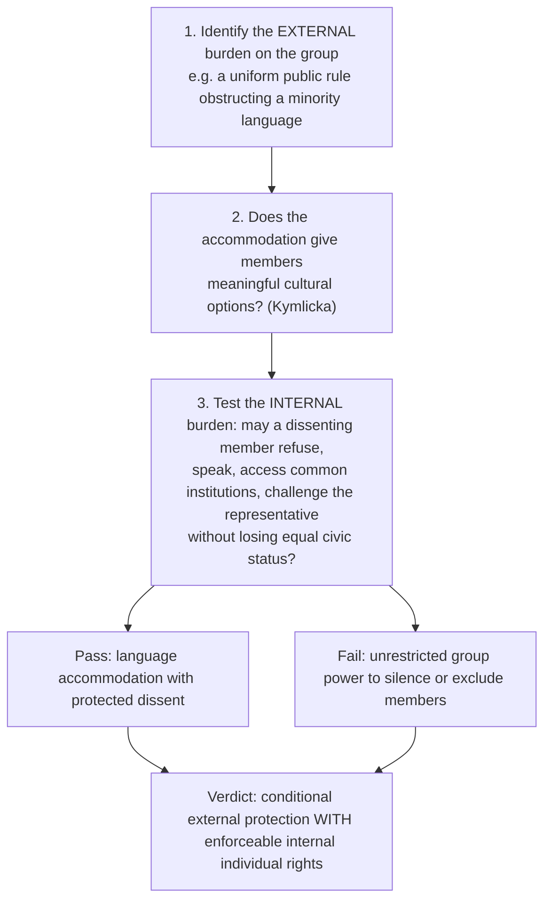

Challenges (demand decode): the internal-minorities problem, exit costs, the external/internal boundary, risk of essentialising cultures, and the adjudication principle adopted. Objection: state review imposes majority values. Reply: publicly contestable standards of equal participation, including minority members' voices; scrutinise majority institutions equally. Residual: formal exit is not always meaningful; material independence is needed.

### 11.6 Challenges of a multicultural society, India (2023 Q1(d)) ⚠️

Shared institutions must protect linguistic and religious minorities without making the majority's language or conventions the invisible default; personal-law accommodation can shield unequal treatment **within** a group; recognition can privilege a community spokesperson over women, dissenters or converts. Articles 29–30 illustrate constitutional protection, not that every accommodation is justified. Objection: a common civic standard disguises assimilation. Reply: apply equal-dignity, voice and non-domination to the majority's institutions too; let members contest their own practice. Unresolved: fair representation and remedies without isolating communities or imposing uniformity.

### 11.7 Indian cultural identity and multiculturalism (2018 Q1(b)) ⚠️

Evidence-bank route H17: integration ≠ assimilation; common citizenship while differentiated protection removes the price of cultural erasure; group representation must stay internally accountable.

---

## 12. PYQ Routing Ledger

> **Corpus signal:** this is the largest socio-political owner: **16 of 112** parts across 2018–2025 (per-year pattern 3, 1, 2, 1, 2, 2, 3, 2), plus **1** in the 2026 supplement = **17 primary-owned parts**. The local Paper II corpus is continuous 2018–2025. Cross-links do not create duplicate ownership. No pre-2018 table exists in the owner file.

| Year | Q | Marks | Exact demand | Map to |
|---|---|---:|---|---|
| 2018 | Q1(b) | 10 | Do you subscribe to the view that Indian cultural identity needs to integrate the principles of multi-culturalism and respect for the dignity of each person? Justify your answer. | §11.7, §4.7 |
| 2018 | Q3(a) | 20 | What do you understand by multi-culturalism ? How are globalization and multi-culturalism related ? How does their relationship affect cultural changes ? | §4.5, §6.2 |
| 2018 | Q3(c) | 15 | What form of humanism do you approve as relevant in the present day context ? Discuss in detail. | §7.1, §4.1 |
| 2019 | Q2(b) | 15 | What are the descriptive and normative perspectives on ideas of multiculturalism? | §4.5 |
| 2020 | Q1(c) | 10 | Do you think that secularism requires complete separation of religion and state? Discuss. | §11.1, §4.4 |
| 2020 | Q3(b) | 15 | What do you understand by multiculturalism? Explain the structural characteristics that make a nation multicultural. | §4.5 |
| 2021 | Q2(c) | 15 | Can humanism be a substitute for religion? Explain and evaluate in the context of the present Indian society. | §8.6 |
| 2022 | Q1(a) | 10 | Discuss the role of enlightenment movement in the rise of humanism. | §6.1 |
| 2022 | Q3(c) | 15 | Critically analyze the descriptive and normative aspects of multiculturalism. | §4.5, §3 |
| 2023 | Q1(d) | 10 | Critically examine the challenges faced by a multicultural society with reference to India. | §11.6 |
| 2023 | Q4(c) | 15 | Secularism is not a rejection of religion but acceptance of all religions. Discuss. | §11.3, §9.1 |
| 2024 | Q2(a) | 20 | Delineate the central tenets of Humanism. How does advent of enlightenment in Europe pave the way for Humanism? Discuss. | §2.1, §6.1, §4.1 |
| 2024 | Q2(c) | 15 | Present an exposition of Gandhi's views on secularism as one of the foundational principles of democracy. | §11.4, §5.4 |
| 2024 | Q4(c) | 15 | Discuss the role of ethical principles of tolerance and coexistence for the rise of multicultural societies. | §6.3 |
| 2025 | Q1(c) | 10 | Is the idea of secularism necessarily related to the idea of religious pluralism? Discuss. | §11.2, §6.4 |
| 2025 | Q3(b) | 15 | How does the reconciliation of opposites take place in the Humanism of Tagore? Evaluate. | §7.2, §2.5 |
| 2026 | Q2(c) | 15 | Examine the challenges faced by a multicultural society in creating a harmonious balance between group rights and individual rights. | §11.5, §4.6, §3.2 |

**Count check:** 16 rows for 2018–2025 + 1 row for 2026 = **17**. Year totals 2018–2025: 3 / 1 / 2 / 1 / 2 / 2 / 3 / 2 = 16 ✓.

### 12.1 Cross-owned parts that touch secularism (listed, not counted)

| Year | Q | Marks | Exact demand | Primary owner |
|---|---|---:|---|---|
| 2019 | Q1(b) | 10 | Discuss the status of theocracy in the modern secular state. | Forms of Government |
| 2019 | Q4(a) | 20 | Examine whether there is any difference between the views of Mahatma Gandhi and Dr. Babasaheb Ambedkar on the philosophical foundations of secular democracy. | Caste: Gandhi and Ambedkar |

**Cross-paper bridges ⚠️ (ledger notes):** Secularism ↔ Religious Pluralism (Paper II Section B item 9; 2025 Q1(c) links them); Humanism ↔ Religion without God (Section B item 7). **Pattern:** secularism stems recur (religious pluralism 2025, Gandhi's secularism 2024, "acceptance of all religions" 2023), always with an applied or Indian twist.

---

## 13. Top Exam Traps (18 recorded)

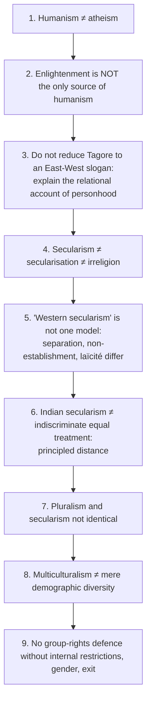

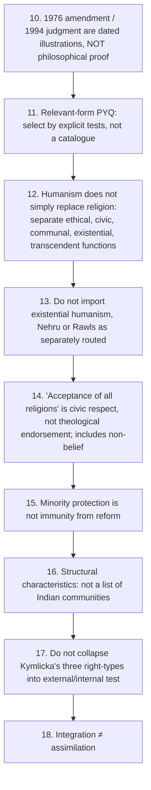

Additional cautions recorded: ❌ do not describe any Indian community, government or period as an instance of misrecognition or hegemony (§5.3); do not merge secularism, pluralism and multiculturalism (state principle vs truth-position vs cultural-recognition policy); do not turn answers into current-affairs incident lists; do not add posthumanism unless the core triad is secure; do not say "both are important" without adjudicating recognition vs redistribution.

---

## 14. Technical Vocabulary & Terminology Bank

| Term | Gloss | Status |
|---|---|---|
| Humanism | dignity, reason, agency, flourishing as central standards | ✅ |
| Radical Humanism | M. N. Roy: sovereignty of the rational individual | ✅ |
| Species-being | Marxist humanism: creative social nature | ✅ |
| Anthropocentrism / anti-anthropocentrism | human-as-sole-ground-of-status / its critique | ✅/⚠️ |
| Secularism | political principles governing public power and religious freedom | ✅ |
| Secularisation | sociological decline or transformation of religious authority | ✅ |
| Non-establishment; free exercise | state establishes no religion; practice protected | ✅ |
| *Laïcité* | assertive public secularity | ✅ |
| Principled distance | context-sensitive engagement/abstention by liberty, equality, anti-domination (Bhargava) | ✅ |
| Inter- / intra-religious domination | between communities / within one community | ✅/⚠️ |
| Public reason (minimal sense) | shared justification of coercive law | ⚠️ |
| Majoritarianism; minorityism | majority symbols as neutral; selective appeasement | ⚠️ |
| Multiculturalism | fact of diversity + normative claim for recognition | ✅ |
| Societal culture | culture supplying meaningful options (Kymlicka) | ✅ |
| External protections / internal restrictions | shielding minority from majority / constraining members | ✅ |
| Self-government; polyethnic; special representation rights | Kymlicka's three types | ✅/⚠️ |
| Misrecognition; dialogical identity | Taylor | ✅ |
| Maldistribution; economism; culturalism | Fraser's grammars and risks | ✅/⚠️ |
| Parity of participation | peers; objective + intersubjective conditions | ✅ |
| Affirmative / transformative remedy | outcomes vs framework | ✅ |
| Spheres of recognition | love, rights, solidarity (Honneth) | ✅ |
| Self-confidence; self-respect; self-esteem | corresponding self-relations | ✅ |
| Essentialism | cultures as homogeneous and timeless | ✅ |
| Hybridity | blended identities through global flows | ⚠️ |
| Tolerance / coexistence / accommodation / recognition / integration / assimilation | diversity-response ladder | ✅/⚠️ |
| *Swarāj* | Gandhi's self-rule | ✅ |
| Constitutional morality | Ambedkar's ground of democratic fellowship | ✅ |

---

## 15. Graded Verdict & Answer Architectures

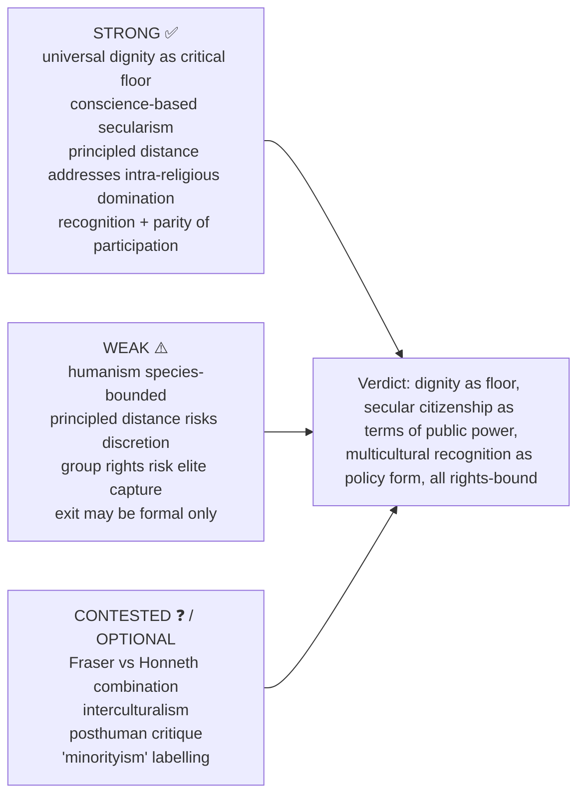

### 15.1 Directive decoder ⚠️

| Directive | Scored | Compulsory move | Failure mode |
|---|---|---|---|
| Explain / Elucidate | internal logic of one doctrine | definition → distinguish nearby term → argument → example | celebrating the value |
| Discuss | exposition + one adjudicated tension | doctrine → rival model → objection → reply → verdict | listing thinkers |
| Critically examine / evaluate | objection–reply layer is the answer | two objections each with reply and residual | rhetorical endorsement of pluralism |
| Is X compatible with Y? | conceptual entailment | what X entails → what Y requires → collision → resolution or limit | citing coexistence examples |
| How far / to what extent | a degree judgment | conditions of holding / failing | evasive balance |
| Comment on a thinker | locate in debate before judging | claim → what it opposes → limit → verdict | biography |

**Standing rule ⚠️:** these doctrines invite celebratory writing. Every stem is answered by **specifying limits**, not affirming values.

### 15.2 10-mark (~150 words, 4 moves, ~12 min)

```text
1. Define; distinguish from nearest confusable term (2 lines).
2. Argument in 3-4 linked steps (4-5 lines).
3. One evidence unit + one Indian illustration labelled as illustration, not proof.
4. Graded verdict (2 lines).
```

### 15.3 15-mark (~220 words, 6 moves, ~18 min)

```text
1. Frame the tension (universal vs difference / religion vs state / recognition vs redistribution).
2. Doctrine with argument and presupposition.
3. Strongest rival model (strict separation vs principled distance; Taylor/Kymlicka vs liberal uniformity; Fraser vs Honneth).
4. One table (secularism models / two grammars / Fraser-Honneth).
5. One worked objection -> reply -> residual problem.
6. Conditional verdict naming the constraint under which the doctrine survives.
```

### 15.4 20-mark (~300 words, 8 moves, ~25 min)

```text
1. Provisional thesis using the stem's directive verb.
2. Locate the concept historically and normatively (2 lines).
3. Full doctrine with internal distinctions.
4. Strongest rival model at its best.
5. Two objection -> reply chains, each ending in a residual problem.
6. Recognition/redistribution axis where culture joins inequality (highest-yield addition).
7. One dated Indian constitutional or judicial illustration, accurately classified; legal status is not philosophical proof.
8. Graded verdict preserving universal dignity while limiting both state and community power.
```

### 15.5 Stem-specific spines ⚠️

- **Tagore:** opposites table → relational argument → nationalism/power objection → Ambedkarite supplement → verdict.
- **Secular democracy:** Gandhi's ethical fellowship → Ambedkar's constitutional morality → Bhargava's institutional mediation.
- **Multiculturalism and gender:** Taylor's premise → Kymlicka's external/internal criterion → Okin's objection → Fraser's affirmative/transformative reply → verdict on internal restrictions.
- **Humanism at 20 marks:** doctrine → forms (Renaissance, Enlightenment, radical, ecological) → Indian statements (Tagore, Gandhi, Roy) → abstract-universalism objection with caste and gender supplement → anthropocentrism limit stated as a limit → verdict.

### 15.6 Graded verdict formulas (adapt; never reproduce mechanically) ⚠️

- **Limit-specifying:** "The doctrine secures ⟨equal dignity / equal citizenship / equal standing⟩, but only within a species boundary and only where ⟨named institutional condition⟩ holds; its value lies in what it excludes as much as in what it affirms."
- **Two-dimension:** "Recognition and redistribution are analytically distinct and practically entangled: misrecognition frequently causes and is reinforced by maldistribution, so a remedy addressing only one will under-perform."
- **Model-choice:** "Judged by the prevention of intra-religious as well as inter-religious domination, principled distance is superior to strict separation — at the cost of a discretion that must itself be principled and reviewable."
- **Internal-limit:** "Group rights are defensible as external protections and indefensible as internal restrictions; recognition owed to a community is not endorsement of the community's treatment of its own members."
- **Asymmetric:** "⟨Thinker⟩'s diagnosis of the injury is compelling; the institutional remedy requires the supplement that ⟨rival⟩ supplies."
- **Reconstruction:** "The objection defeats the doctrine in its abstract universalist form and leaves it standing in its dialogical, difference-sensitive reconstruction."

### 15.7 Selectable evidence bank (1 unit at 10 marks, 2 at 15, 4–5 at 20) ⚠️

| Unit | Claim → Named anchor | Limit |
|---|---|---|
| H1 | Dignity grounded in humanity itself → humanist tradition; Kantian dignity | anthropocentric by construction |
| H2 | Freedom materially and morally grounded → M. N. Roy | institutional design sketched, not worked out |
| H3 | Unity through relation, not uniformity → Tagore, *The Religion of Man*; *Nationalism* | Ambedkar: spiritual unity without dismantling graded status leaves hierarchy |
| H4 | Secularism is about the state's relation to religion, not belief → §2.1–2.3 | models differ on non-establishment in practice |
| H5 | Principled distance → Bhargava | discretion must specify who judges and on what principle |
| H6 | Misrecognition is a real injury → Taylor, "The Politics of Recognition" | shows recognition matters, not how far claims extend |
| H7 | External protections yes, internal restrictions no → Kymlicka, *Multicultural Citizenship* | boundary contested in practice |
| H8 | Cultures internally plural, mutually revisable → Parekh, *Rethinking Multiculturalism* | dialogue presupposes peers |
| H9 | Two irreducible dimensions of justice → Fraser | thinner account of why contempt wounds |
| H10 | Recognition the deeper grammar → Honneth | psychologises impersonal economic mechanisms |
| H11 | Affirmative remedies can entrench → Fraser | transformation slower, harder |
| H12 | Untouchability abolished → Art. 17; Arts. 29–30 | dated legal facts, not theory proof |
| H13 | Every doctrine here species-bounded → §3A.6 | ecological reconstruction gives up the species-centred criterion |
| H14 | Humanism a partial substitute for religion → §1.8 | functional division analytical |
| H15 | A multicultural nation has a structure → §3.2A | no list yields automatic policy |
| H16 | Equal acceptance is civic, not theological → §2.7 | equal respect still permits principled reform |
| H17 | Integration differs from assimilation → §3.9 | representation must stay internally accountable |

### 15.8 Reusable statement lines ✅/⚠️

- ✅ Humanism relocates authority toward human reason and dignity without necessarily denying every religious horizon.
- ⚠️ Tagore's universalism fulfils, rather than abolishes, concrete individuality through creative relation.
- ✅ Secularism is a doctrine of public power, not a sociological prediction that religion will disappear.
- ⚠️ Pluralism describes or values diversity; secularism disciplines the state's coercive relation to it.
- ✅ Principled distance permits both engagement and abstention, but only for publicly defensible reasons.
- ⚠️ Multicultural equality sometimes requires differentiated treatment because formally uniform institutions may embody majority culture.
- ⚠️ Recognition becomes unjust when it converts community authority into immunity from the claims of vulnerable members.

> [!TIP]
> **Dossier objection/reply.** *Objection:* group-differentiated rights may empower community elites and trap internal dissenters, especially women and lower-status members. *Reply:* the most defensible multiculturalism protects external vulnerability of groups while refusing internal coercion; recognition is legitimate only under equal citizenship and revisable public reason. **India-safe use:** linguistic, religious and cultural diversity, school symbols, minority protections, public funding — only to show the difference between plural social fact, secular state principle and multicultural recognition policy.

> [!NOTE]
> **Provenance (§3A).** The recognition/redistribution and anthropocentrism-limit modules are named-scholar reconstructions; no page, chapter, edition or verbatim wording is asserted for Fraser, Honneth, Taylor, Kymlicka or Parekh, and Honneth's *The Struggle for Recognition* is cited by title only. No empirical claim is made about any Indian community, government or period.

---

## Sources

Local course source *Socio-Political Philosophy* (Humanism, Secularism and Multiculturalism sections); O. P. Gauba, *An Introduction to Political Theory* (bounded taxonomy); Rajeev Bhargava on Indian secularism and "principled distance" ("What Is Secularism For?"); Tagore, *The Religion of Man*, *Nationalism*; M. N. Roy on Radical Humanism; M. K. Gandhi, *Hind Swaraj* and writings on religion, tolerance, *swarāj*; Charles Taylor, "The Politics of Recognition"; Will Kymlicka, *Multicultural Citizenship*; Bhikhu Parekh, *Rethinking Multiculturalism*; Susan Moller Okin, "Is Multiculturalism Bad for Women?"; Nancy Fraser (by position only); Axel Honneth, *The Struggle for Recognition* (title only); Martha Nussbaum, *The New Religious Intolerance* (advanced dossier trail); Constitution of India, Preamble and Articles 14–17, 25–30; *S. R. Bommai v. Union of India* (1994) as dated illustration only.
