# CRIME AND PUNISHMENT — Examiner-Grade Mindmap

> **Syllabus (verbatim):** Crime and Punishment : Corruption, Mass Violence, Genocide, Capital Punishment.
> **Catalogue key:** `philosophy-paper-ii-socio-political-philosophy-07` · Paper II · Section A · Socio-Political Philosophy
> **Sources used:** `paper-2/socio-political/Crime-and-Punishment.md` (canonical owner, read in full) · `_advanced/Socio-Political-Dossier.md` §7 (optional depth) · `paper-2/_PYQ-SocioPolitical-2018-2025.md` · `paper-2/_PYQ-SocioPolitical-2026-Supplement.md`.
> **Evidence key:** ✅ canonical · ⚠️ analytical synthesis · ❓ contested / empirical
> **Blueprint adaptation:** `MINDMAP_INSTRUCTIONS.md` is Indian-school oriented. The 16 module headings are kept; each module's focus is adapted to this clause. Module 1 = ownership boundary, thinkers and lineages; Module 2 = the justificatory argument of punishment (the sources give no *pramāṇa*-style epistemology); Module 3 = internal debates and refinements (expressive, communicative, restorative, disciplinary); Module 4 = conceptual inventory of the four named applications; Module 5 = stance on the state's coercive authority, rights and Indian legal bridges (the sources give no transcendent-reality ontology); Module 6 = causal and explanatory chains; Module 7 = value aims; Module 10 = cross-tradition pairs (the sources give no East–West table, only the internal pairs shown there).

> [!IMPORTANT]
> **Master distinction ⚠️.** Punishment is not justified merely because conduct is abhorrent. A theory must explain **who may punish, for what purpose, within what limits, and under what conditions of responsibility and fair procedure**. The clause asks what makes public wrongdoing morally distinctive, how individual and collective responsibility should be assigned, and when punishment by the state is justified.

---

## 0. Master Overview

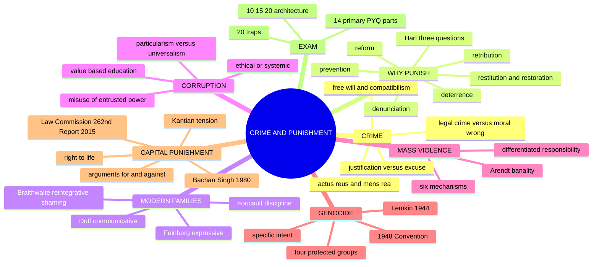

```text
WRONGDOING
   ├── CORRUPTION: office + entrusted power → partial/private use
   ├── MASS VIOLENCE: organised or cascading violence against many
   └── GENOCIDE: specified acts + intent to destroy a protected group
                         │
                         ▼
WHY PUNISH?
   retribution · deterrence · prevention · reform · restoration
                         │
                         ▼
CAPITAL PUNISHMENT = irreversible test case
desert/security claims ↔ dignity, fallibility, equality and reform
```

---

## 1. Ownership Boundary, Thinkers & Lineages

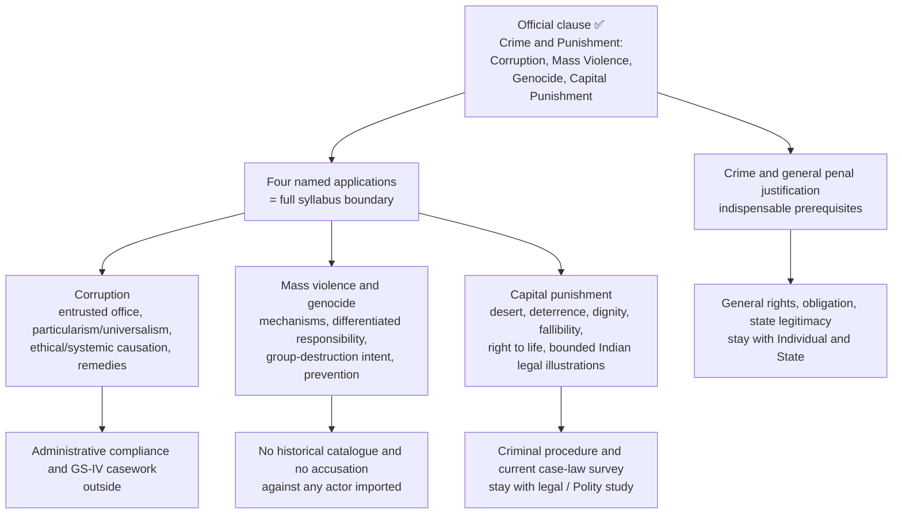

**Thinker control ✅.** Kant, Hegel, Bentham, Beccaria, Hart, Feinberg, Duff, Foucault, Braithwaite, Arendt and Lemkin execute owned distinctions. **Gandhi and Rawls** are not independently demanded by the routed 2018–2025 corpus and are **not** imported as decoration (trap 17).

| Thinker / source | Owned contribution | Used for |
|---|---|---|
| **Kant**, *The Metaphysics of Morals* | Punishment answers to culpable act, never merely social utility; offender as end; murder famously demanding death | Retributivism; capital-punishment tension |
| **Hegel**, *Philosophy of Right* | Crime annuls right; punishment annuls the annulment; negation of the crime's wrongful claim | Depth on retributivism |
| **Bentham**; **Beccaria**, *On Crimes and Punishments* | All punishment an evil justified only by preventing greater evil; certainty and promptness over severity | Deterrence |
| **H. L. A. Hart** | Separation of general justifying aim from principles of liability and severity | Three-question grid |
| **Joel Feinberg**, "The Expressive Function of Punishment" | Condemnation distinguishes punishment from penalty | Expressive theory |
| **R. A. Duff**, *Punishment, Communication, and Community* | Communicative secular penance; standing to punish | Communicative theory |
| **Michel Foucault**, *Discipline and Punish* (**1975** French; **1977** English) | Spectacle → discipline; panopticism; docile bodies; delinquency | Critical paragraph |
| **John Braithwaite**, *Crime, Shame and Reintegration* | Stigmatising versus reintegrative shaming | Restorative mechanism |
| **Hannah Arendt**, *Eichmann in Jerusalem* | Banality of evil | Mass violence |
| **Raphael Lemkin**, *Axis Rule in Occupied Europe* (**1944**) | Coined *genocide* (Greek *genos* + Latin *-cide*) | Genocide concept |
| **Robert Klitgaard**, *Controlling Corruption* (**1988**) | Monopoly + discretion − accountability | Corruption (§2.8 of owner) |
| **Aristotle**, *Nicomachean Ethics* Book II | Virtue by habituation; particular bonds | Education and corruption; loyalty vs impartiality |

> [!NOTE]
> **Provenance ⚠️.** Feinberg, Duff, Foucault, Braithwaite, Lemkin, Hart and Arendt sections are named-scholar reconstructions: no page, chapter, edition or verbatim wording is asserted. **No country, community, party, government, movement, technology, programme or historical episode is named** as an instance of mass violence, genocide, communal violence, pogrom, panopticism or surveillance. Answer at the level of **criteria**.

---

## 2. Justificatory Argument: Crime and the Grounds of Punishment

### 2.1 Crime: legal and moral concepts ✅

| Concept | Question | Limitation |
|---|---|---|
| **Legal positivist** | What has the law prohibited? | Validity does not prove moral justice |
| **Moral** | What wrongful harm or violation occurred? | Disagreement and vagueness |
| **Sociological** | Which norms and power relations define deviance? | May weaken legal certainty |

Legal crime = conduct prohibited and punishable by a valid criminal law. Moral wrong = violation of a justified ethical norm. They overlap but are not identical: an unjust law may criminalise innocent conduct; grave moral wrongs may escape legal definition. ⚠️ Criminalisation itself needs justification through harm, rights, public wrong, culpability and proportionality.

### 2.2 Elements and defences as philosophical prerequisites ✅/⚠️

| Element | Philosophical function | Control |
|---|---|---|
| External act or omission (***actus reus***) | Links liability to conduct, not thought alone | Omission needs a relevant duty |
| Fault element (***mens rea***) | Grades answerability: intention, knowledge, recklessness, negligence | Punishment must track attributable culpability |
| Causation and harm | Connects agency to the public wrong | Causal contribution alone is insufficient |
| Legality and fair notice | Prevents retrospective or indeterminate condemnation | Validity still ≠ moral justice |

- **Justification** claims the act was permissible (e.g. necessary proportionate defence against unjust threat). **Excuse** concedes wrong but denies or reduces blame (duress, serious incapacity).
- Mental incapacity enters only through competence, control and excuse; no clinical diagnosis or legal test is asserted.
- **Fault ladder:** intention · knowledge · recklessness · negligence · accident.

### 2.3 Conditions of responsible punishment ✅

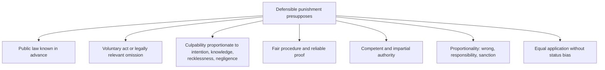

Responsibility ≠ causal contribution: a person may contribute causally without sufficient knowledge or control; an official can be responsible for culpable omission.

### 2.4 Free will, determinism and criminal responsibility ⚠️

| Position | Penal implication | Difficulty |
|---|---|---|
| **Libertarian freedom** | Desert needs genuine alternative possibilities | Hard to reconcile with causal explanation |
| **Hard determinism** | Basic desert undermined; protection and rehabilitation replace blame | Risks treating persons only as dangerous objects |
| **Compatibilism** | Responsibility = reasons-responsive control without metaphysical exemption from causation | Must separate constrained agency from ordinary causation |

**Working penal standard ⚠️:** responsibility need not prove metaphysical free will. It requires that the accused could understand relevant reasons, control conduct to an adequate degree, and act without responsibility-defeating coercion or incapacity. Determinism may mitigate or redirect punishment without erasing the distinctions among intentional, reckless, negligent and accidental conduct.

### 2.5 Theories of punishment ✅

| Theory | Doctrine | Direction | Central test | Main danger |
|---|---|---|---|---|
| **Retributive** | Culpable wrongdoing deserves a proportionate response | Backward | Desert | Vengeance / excess |
| **Deterrent** | Penalty reduces future offending | Forward | Expected prevention | Using offender as a means |
| **Preventive / incapacitative** | Restrain a dangerous offender | Forward | Necessity and risk | Indefinite or discriminatory confinement |
| **Reformative / rehabilitative** | Transform capacities and conditions for lawful agency | Forward | Reintegration | Paternalism; neglect of victims |
| **Restitution / restorative** | Restitution returns value or repairs loss; restorative adds accountable participation of victim, offender, community | Relational | Acknowledgement, repair, reintegration | Unequal bargaining; unsuitable for some crimes |
| **Denunciatory / expressive** | Publicly condemn the wrong and affirm the norm | Backward / public | Authoritative censure | Hard treatment still needs separate justification |

### 2.6 Normative logics ⚠️

| Logic | Central question | Typical theories | Non-negotiable objection |
|---|---|---|---|
| **Deontological** | What is owed because of culpable wrong and equal agency? | Retribution, desert, rights, proportionality | Deserved suffering still needs a public institutional purpose |
| **Consequentialist** | Which response prevents future harm at least justified cost? | Deterrence, prevention, rehabilitation | Utility alone can target innocents or permit excessive severity |
| **Relational / communicative** | What condemns, addresses and repairs while retaining membership? | Expressive, communicative, restorative | Coercion, standing, unequal bargaining |

A defensible **mixed theory** may be consequentialist about the institution's general aim while using guilt, desert and rights as deontological constraints on liability and amount.

### 2.7 Hart's three questions that must be separated ✅/⚠️

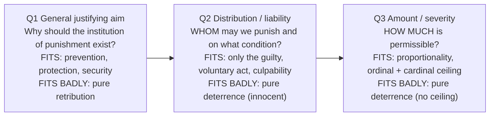

**Reconstructed argument ⚠️:** (1) an institution can be justified by general benefit while its applications are governed by an independent principle of fairness; (2) this is ordinary in institutional reasoning (a promise-keeping practice vs who is bound by a particular promise); (3) crime prevention supplies an aim (Q1); (4) desert and culpability supply a side-constraint on liability and severity (Q2, Q3); (5) so the strongest position is a **mixed / two-level theory**: consequentialist in aim, retributivist in constraint.

> [!TIP]
> **Payoff.** The "punishing the innocent" objection is an objection to deterrence **at Q2**, not Q1; the "why should the state inflict suffering" objection is an objection to retributivism **at Q1**. An answer treating retribution and deterrence as rival answers to one question cannot make either point. Hart's separation does not imply Hart endorses every mixed theory built from it.

### 2.8 Retributivism: Kant and Hegel ✅

1. Crime asserts a maxim incompatible with equal right. 2. Imputable agency makes the offender answerable. 3. A proportionate legal response publicly denies the wrongful maxim. 4. Punishment therefore expresses respect for right, not private revenge.

- **Kant:** answer to culpable act; treating a person only as an instrument of deterrence violates rational agency.
- **Hegel:** negation of the crime's wrongful claim; restores right while taking the offender seriously as responsible.
- **Objection:** suffering does not undo suffering; desert alone cannot show why the state should add pain. **Reply ✅:** modern retributivism can be **limiting** — no punishment without desert, none beyond it. ⚠️ Still needs an account of humane institutions.

### 2.9 Deterrence ✅

- **Specific** deterrence addresses the offender; **general** deterrence addresses others.
- **Presuppositions:** persons respond to perceived costs; sanctions known and sufficiently certain; preventive benefits exceed direct and collateral harms; less harmful alternatives inadequate.
- **Objection:** may justify punishing an innocent. **Reply:** rule-utilitarian constraints (reliable guilt, legality, due process). ⚠️ Critics: rights should constrain utility independently.

### 2.10 Reformative theory and dignity ✅

1. Persons are more than their worst act. 2. Responsible agency can be impaired and rebuilt. 3. A humane state reduces wrongdoing through capability, not degradation. 4. Punishment should preserve a route back to membership.

Objection: compulsory "treatment" can pathologise dissent and become indefinite. Reply: bounded by proportionality, consent where possible, review and rights. Reform is **not leniency**; it remains compatible with responsibility and proportionate restraint.

### 2.11 Proportionality and juveniles ✅/⚠️

- **Ordinal proportionality** ranks penalties by seriousness; **cardinal proportionality** asks how severe the whole scale may be.
- Juvenile moral assessment distinguishes: seriousness of harm; intention and understanding; developmental capacity and susceptibility to influence; prospects of reform; procedural reliability.
- The nature of the crime is relevant but **not conclusive**; reduced and developing agency can alter culpability even where harm is grave. Integrate offence-centred and offender-centred perspectives.

---

## 3. Internal Debates & Refinements: Expressive, Communicative, Restorative, Disciplinary

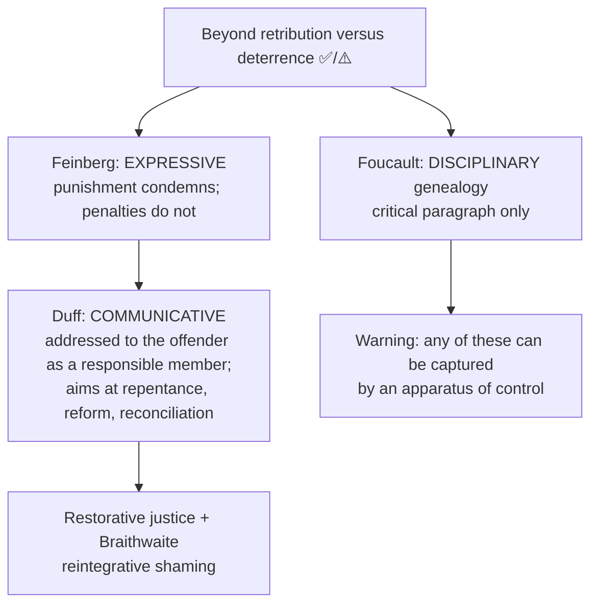

### 3.1 Feinberg: expressive condemnation ✅/⚠️

1. Penalties and punishments both impose hard treatment. 2. We still distinguish them sharply (nobody regards a parking fine as a stain on character). 3. The difference is not severity. 4. It lies in symbolic significance: punishment carries authoritative disapproval. 5. So condemnation is part of the **concept** of punishment.

- **Explains ✅:** why wrongful conviction is a distinct grave wrong even if compensated; why the *form* of punishment matters (degrading punishments objectionable independently of severity); why acquittal is **vindication**; why victims often want the offence publicly named.
- **Objection:** denunciation without hard treatment would suffice. **Reply:** hard treatment makes the condemnation credible and non-cheap. Residual: hard treatment becomes instrumental to expression.

### 3.2 Duff: communication and secular penance ✅/⚠️

| | Expressive (Feinberg) | Communicative (Duff) |
|---|---|---|
| Direction | One-way: society expresses condemnation | Two-way: an address that invites a response |
| Offender treated as | Object of judgment | Rational participant capable of answering |
| Aim | Authoritative denunciation | Repentance, reform, reconciliation |
| Hard treatment | Vehicle making condemnation credible | **Secular penance**: a burden focusing attention on the wrong |

- Argument: citizens owe one another an account; a trial is **calling to account**; the offender remains a member; a burden undergone can give repentance public form.
- **Presupposition ⚠️:** the community has **standing** to call this offender to account, which requires it has not itself denied him the conditions of citizenship.
- **Standing objection:** a state that has excluded, impoverished and discriminated lacks standing. **Reply ✅:** Duff accepts this as a genuine limit — **the legitimacy of punishment is conditional on the justice of the order that imposes it.** Deploy this rather than "poverty causes crime": it is an argument about standing, not causation.
- **Illiberalism objection:** the state may regulate conduct, not seek conversion. Reply: the communication **invites** rather than compels; refusal attracts no further penalty. Residual: a burden imposed by force is a strange invitation.

### 3.3 Foucault: discipline, panopticism and the caveat ✅/⚠️

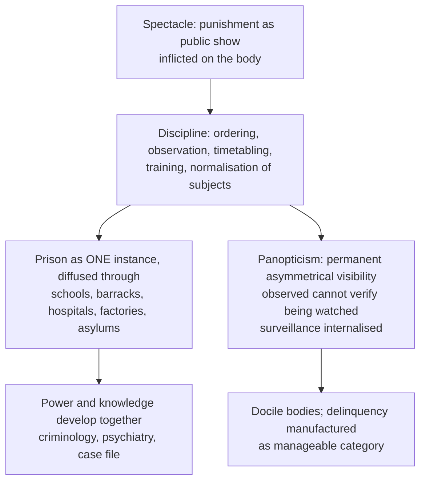

- Argument: the shift is usually narrated as humanitarian progress, but it changed the **target** (body → soul, conduct, habits) and **technique** (occasional terror → continuous supervision); the prison's persistent failure to reduce reoffending is **functional**, sustaining an identifiable delinquent population.
- Power lies in the *possibility* of observation, not its actuality, which economises on force.
- ⚠️ **Compulsory caveat:** Foucault gives a **genealogy of penal power**, not a theory of when punishment is justified. (1) ❌ Do not say punishment is *unjustified* per Foucault. (2) ⚠️ The functional claim is **contested** and stronger than the evidence strictly supports; present as thesis. (3) ❌ Do not attach panopticism to any named contemporary technology, database, programme or government.
- Objection: if power constitutes subjects, critique loses normative standing. Reply: resistance is co-extensive with power; make contingent arrangements visible. Residual: absence of a stated normative criterion is genuine.
- **Best use ✅:** the critical paragraph; strongest showing how *reformative* rhetoric can coexist with intensified control (a qualification of §2.10).

### 3.4 Restorative justice and Braithwaite ✅/⚠️

| Axis | Retributive / conventional | Restorative |
|---|---|---|
| Crime is | Breach of law, offence against the state | Harm to persons and relationships |
| Central question | Which law, who, what deserved? | Who was hurt, what do they need, whose obligation to repair? |
| Victim | Witness for prosecution | Central participant with standing |
| Offender | Object of proceedings; incentivised to deny | Active participant, acknowledges and repairs |
| Outcome | Proportionate hard treatment | Reparation, apology, restitution, changed conduct, reintegration |
| Community | Represented by the state | Direct stakeholder |

- **Braithwaite:** **stigmatising shaming** condemns the *offender*, severs bonds, offers no route back, pushes toward criminal subcultures, is **criminogenic**; **reintegrative shaming** condemns the *act* while sustaining respect for the person, within continuing care, ended by forgiveness and reacceptance.
- Argument: informal disapproval regulates more powerfully than formal sanction; it works only if the offender is not permanently cast out.
- **Presupposition ⚠️:** the offender values inclusion and the community will reaccept — plainly fails for already-excluded groups (the theory's most serious limit).
- **Answers the grid:** Q1 repair and restoration; Q2 liability still needs an admitted or proved voluntary wrong (no bypass of guilt); Q3 measure is what repair requires, where the proportionality objection bites.
- **Objections ⚠️:** (a) proportionality varies with victim temperament → reply: restoration within upper and lower **limits set by desert**; residual: retributive framework remains outer constraint. (b) Power imbalance (domestic violence, caste atrocity, powerful vs weak) → strongest objection, not fully answerable; **conditionally appropriate** (voluntariness, prior safety, skilled facilitation, screening out entrenched domination); ❌ never universal. (c) Public wrong disappears → Feinberg and Duff: restoration must **supplement, not replace** authoritative condemnation for serious offences.
- **Synthesis ⚠️:** desert fixes the **limits**, condemnation supplies the **meaning**, communication supplies the **address**, restoration supplies the **repair**, Foucault supplies the standing **warning**.

---

## 4. Conceptual Inventory: The Four Named Applications

### 4.1 Corruption ✅

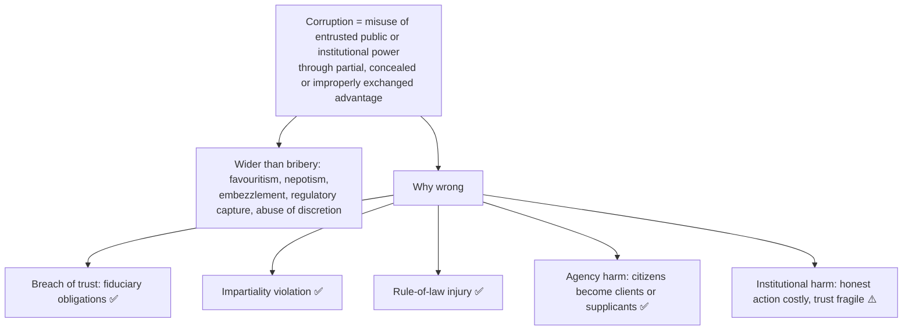

**Particularistic vs universalistic ✅.** Particularistic norms give special weight to family, caste, friendship, patronage; universalistic norms require impartial public criteria. Corruption occurs when a legitimate particular loyalty is acted upon **in a role governed by universal public standards**. Solution ⚠️: not abolishing loyalty but role boundaries, conflict-of-interest rules and recusal. (Aristotle: particular bonds matter but cannot make public office private property.)

### 4.2 Mass violence ✅

Large-scale violence against populations through organised coercion, collective mobilisation or cascading participation; wider than genocide.

| Mechanism | Content |
|---|---|
| Dehumanisation ✅ | Victims as contaminants, threats, non-persons |
| Moral exclusion ✅ | Ordinary restraints withdrawn from out-group |
| Diffusion of responsibility ✅ | Each treats agency as fragmented |
| Obedience and bureaucracy ✅ | Harm routinised as role-performance |
| Polarisation and propaganda ✅ | Ambiguity and dissent suppressed |
| Security dilemma ⚠️ | Pre-emption read as necessary self-defence |

### 4.3 Genocide ✅

- **Definition:** Convention on the Prevention and Punishment of the Crime of Genocide (**1948**): specified acts committed with **intent to destroy, in whole or in part, a national, ethnical, racial or religious group, as such**. Entered into force **1951**.
- **Lemkin ⚠️:** coined *genocide* in *Axis Rule in Occupied Europe* (**1944**); not mass killing but a **coordinated plan of different actions aiming at the destruction of the essential foundations of the life of a group**, targeting political and social institutions, culture, language, national feeling, religion, economic existence, personal security, liberty, health, dignity — killing one method among several.
- **Precision:** the Convention is **narrower** than Lemkin; **political groups are not protected** categories. ❌ Do not say the Convention adopts Lemkin in full; do not extend the four categories.

| Concept | Distinctive feature |
|---|---|
| **Mass violence** | Scale and collective pattern; no single fixed legal intent requirement |
| **Genocide** | Special intent to destroy a protected group, wholly or partly |
| **Crimes against humanity** | Specified acts as part of a widespread or systematic attack against a civilian population |
| **War crime** | Serious violation connected to armed conflict |

UPSC test: not every massacre is legally genocide; the specific destructive intent matters.

### 4.4 Capital punishment ✅

The state's intentional execution of a convicted offender; the hardest case because punishment becomes **irreversible** and eliminates the subject whose responsibility, reform and rights ground penal theory.

---

## 5. Stance on State Coercion, Rights & Indian Legal Bridges

### 5.1 Capital punishment: arguments for and against

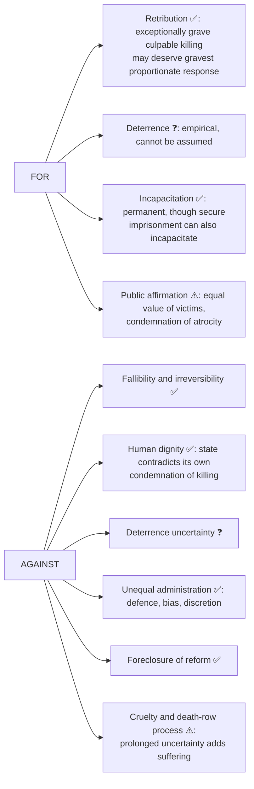

### 5.2 Kantian tension ✅/⚠️

Kantian retributivism supports punishment by desert and famously treats murder as demanding death; yet the wider commitment to persons as ends intensifies concern about procedural certainty and instrumental deterrence. ⚠️ A Kantian abolitionist cannot simply cite dignity; the argument must show why equal respect forbids execution **even where guilt and desert are established**.

### 5.3 Is the right to life absolute? ✅/⚠️

1. Immediate defence responds to a present unjust threat. 2. Execution follows custody and adjudication. 3. Less final means of incapacitation exist. 4. So limits on the right in defence do not automatically justify capital punishment.

A right can be fundamental without being exceptionless (self-defence, necessity, proportionate force against ongoing threat). Strongest abolitionist conclusion ⚠️: **deliberate irreversible killing after control is established fails necessity under conditions of fallibility and alternative protection** — not "all rights are absolute".

### 5.4 Indian legal illustrations — classify correctly ✅

| Item | Status | Use |
|---|---|---|
| ***Bachan Singh v. State of Punjab*** (**1980**) | **Supreme Court judgment**; retained capital punishment; formulated the **"rarest of rare"** limitation | Not legislation |
| **Law Commission of India, Report No. 262, *The Death Penalty*** (**2015**) | **Official advisory report**, not legislation or judgment; recommended abolition for ordinary crimes, excluding specified terrorism-related and war contexts | Not enacted law |
| **Prevention of Corruption Act, 1988** (amended **2018**) | **Enacted criminal-law framework** | Corruption |
| **Lokpal and Lokayuktas Act, 2013** | **Institutional accountability framework** | Corruption |

⚠️ These illustrate India's legal compromise; they do not settle the moral debate or establish deterrent effect or that corruption is ethically solved. A judgment, report or statute is a dated legal fact, never a philosophical proof.

### 5.5 Proportionality, social justice, deterrence ⚠️

- **Proportionality:** seriousness is necessary but not sufficient; culpability, mitigation, consistency and alternatives matter.
- **Social justice:** a penalty administered through unequal conditions can magnify injustice even if the rule is neutral.
- **Deterrence:** separate empirical effectiveness from moral permissibility; an effective deterrent may still violate rights, an ineffective one loses its utilitarian basis.

### 5.6 Genocide and responsibility ✅/⚠️

- "Following orders" does not erase agency where an order is manifestly criminal; command responsibility, bureaucratic contribution and propaganda raise different questions; role never automatically cancels judgment.
- ⚠️ **Denial** continues the wrong by attacking memory, testimony and survivors' standing; yet legal guilt stays individualised, not inherited.
- **Prevention ✅:** independent information, protection of dissent, universal civic status, accountability for command, refusal of dehumanising categories. ⚠️ Education and memory matter, but exhortation without institutional checks is inadequate.

---

## 6. Causal & Explanatory Chains

### 6.1 Corruption: ethical or systemic? ⚠️

| Ethical diagnosis | Systemic diagnosis |
|---|---|
| Greed, dishonesty, weak integrity | Opacity, monopoly, excessive discretion, impunity |
| Character and choice | Incentives and institutional equilibrium |
| Remedy: moral education, professional ethos | Remedy: transparency, audit, competition, accountability |

**Best position:** corruption is an ethical act within a systemic ecology; structure influences opportunity and cost but does not erase agency; heroic virtue cannot substitute for sound institutions.

### 6.2 Regimes and corruption ✅/⚠️

No regime is automatically immune: autocracy may conceal corruption through weak scrutiny; democracy may expose it yet generate patronage, campaign-finance and capture risks. Regime type affects information, accountability and competition; outcomes also depend on institutional design, inequality and norms of office. Regimes condition the **form, visibility and incentives** of corruption, not its inevitability; disclosure can raise *observed* cases while making abuse riskier; do not label a country or count allegations as convictions.

### 6.3 Is corruption a form of mass violence? ⚠️

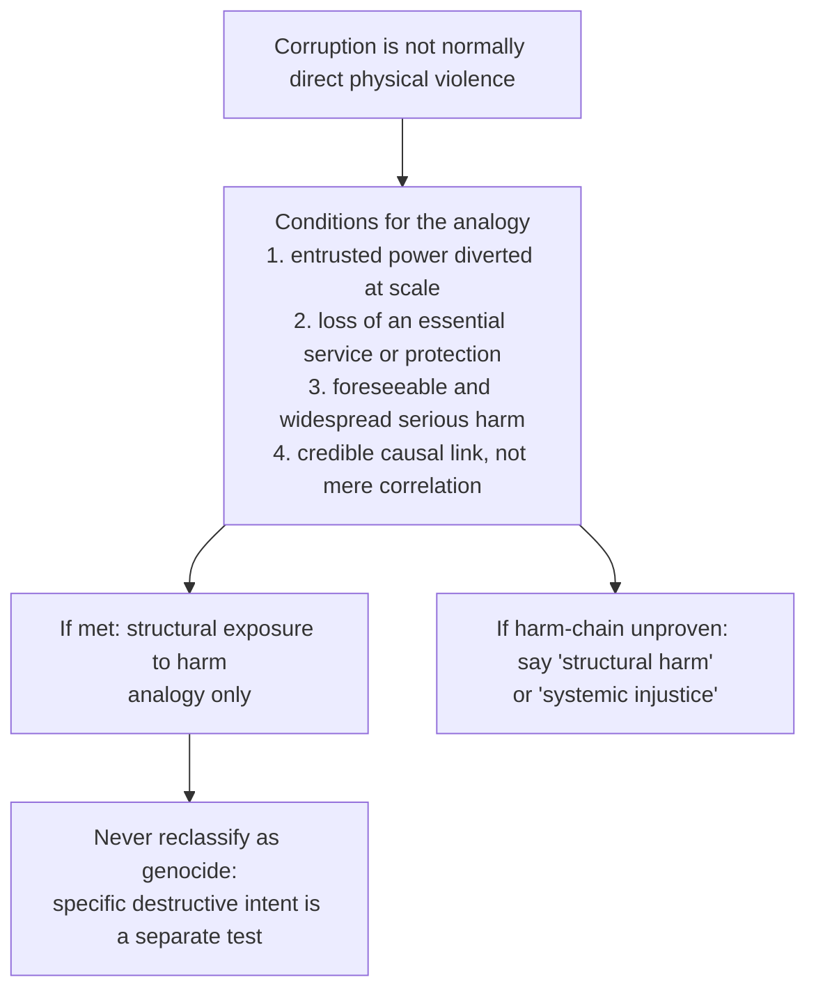

For: diffuse victims, cumulative harm, invisible causal chains, abuse of institutional power. Against: conceptual inflation erases the distinctive agency and intent of physical mass violence.

### 6.4 Arendt and responsibility in mass violence ✅/⚠️

- **Arendt:** "banality of evil" — extraordinary wrongdoing performed through clichés, careerism and failure of judgment, not demonic depth. **Presupposition:** responsibility requires reflective judgment, not role conformity. Objection: understates ideology and hatred. Reply ✅: Arendt does not deny enormity; warns that ordinary institutional obedience becomes a vehicle. ⚠️ Banality concerns *psychology* of perpetration, **not degree of guilt**; say so or it reads as excuse.
- **Collective and individual responsibility:**

| Position | Strength | Danger |
|---|---|---|
| Only individuals responsible | Preserves personal culpability | Ignores institutions and command structures |
| Groups collectively responsible | Captures organised agency, inherited benefit | Punishes by membership |
| **Differentiated responsibility** | Assigns liability by role, knowledge, capacity, contribution | Factually demanding |

Differentiated view (strongest ⚠️): leaders, planners, direct perpetrators, enablers, bystanders and resisters do not bear identical responsibility.

### 6.5 Five kinds of "collective responsibility" ⚠️

| Kind | Claim | Defensible? | Attaches to |
|---|---|---|---|
| **Criminal guilt** ✅ | This person planned, ordered, incited or committed | ✅ paradigm case | Individuals only |
| **Organisational liability** ✅ | A body with decision procedures and chain of command | ✅ where genuine agency | Institutions, commands, parties |
| **Political responsibility** ✅ | Members of a polity answer for acts in their name | ⚠️ partly: duties of reparation, memory, reform, **not guilt** | Citizens collectively |
| **Moral responsibility for omission** ✅ | Bystanders who could have acted at acceptable cost | ⚠️ graded by knowledge, capacity, risk | Individuals, by role |
| **Metaphysical / inherited guilt** ❌ | Guilty by ancestry or membership | ❌ **no**: the very logic that generates atrocity | Rejected |

**Controlling rule:** guilt is individual; **responsibility** admits collective forms. Political responsibility never becomes criminal guilt by membership.

### 6.6 Religiously framed violence: three distinctions ⚠️

1. **Doctrine vs mobilisation** — texts and a movement's political use are different objects; examine organisation, incentive, leadership, impunity, prior grievance. ❌ Do not derive violence from a religion; do not exonerate a movement by a peaceful text.
2. **Communal violence, pogrom, genocide** — differ in structure, not scale: reciprocal communal conflict; one-sided attack with official acquiescence; destruction of a group *as such* with specific intent. Loose use of "genocide" weakens the concept.
3. **Identity as target vs identity as motive** — victims may be selected by religious identity for instrumental reasons (land, votes, markets, labour); remedies differ.

**Answer discipline:** no community, country, party, government, movement or episode is named; answer at the level of criteria.

---

## 7. Value Aims: Dignity, Proportionality, Social Justice, Reform

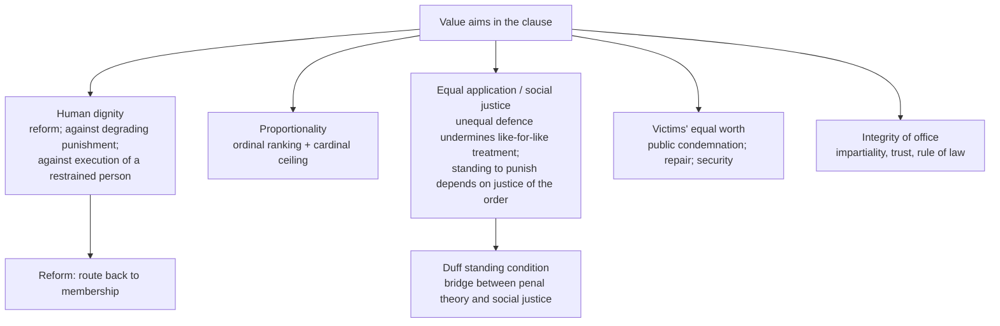

### 7.1 Value-based education as an anti-corruption mechanism (2026 Q1(e), owner §2.8) ✅/⚠️

- **Definition ✅:** formation of character, judgment and practical competence around publicly defensible values — honesty, impartiality, accountability, dignity, public service.
- **Argument:** corruption needs **opportunity, incentive and willingness**. Institutional reform attacks opportunity and incentive (Klitgaard: corruption tends to occur where **monopoly + discretion − accountability** is high, *Controlling Corruption*, 1988). No rule system is self-applying, so administrators' disposition matters; dispositions are formed (Aristotle: virtue by habituation, *Nicomachean Ethics* Book II).

| # | Mechanism | Content |
|---|---|---|
| a | **Moral cognition** | Recognise conflicts of interest, nepotism, normalised petty corruption as wrongs |
| b | **Moral motivation** | Internalise integrity beyond fear of detection |
| c | **Practical competence** | Rehearse gift, procurement, recruitment, political-pressure dilemmas: disclosure, recusal, refusal |
| d | **Norm correction** | Dislodge "everyone is corrupt" (self-fulfilling equilibrium) |
| e | **Civic agency** | Use transparency laws, audits, grievance mechanisms, social accountability |
| f | **Professional identity** | Integrity constitutive of being a civil servant, teacher, engineer, doctor, auditor |

- Support ✅: UNODC treats anti-corruption as a whole-of-society response, education raising knowledge of effects, fostering rejection, building skills to resist pressure; **UN Convention against Corruption (2003)** Article 13 (public education programmes, incl. school and university curricula) and Article 7 (training and integrity programmes for public officials). ⚠️ National Education Policy, 2020, only as a dated Indian policy document; no claim about implementation or effects.
- **Thesis: complementarity.** Education creates the **moral demand**; institutional reform alters **opportunity and incentive**. Each alone predictably fails.

| Axis | Value-based education | Institutional / legal reform |
|---|---|---|
| Target | Willingness, judgment, norms | Opportunity, incentive, detection, cost |
| Diagnosis | Ethical | Systemic |
| Mechanism | Habituation, deliberation, dilemma practice, role formation | Transparency, audit, recusal rules, prosecution, competition |
| Time horizon | Slow, generational | Faster, reversible |
| Typical failure | Knowledge–action gap; hypocrisy where the institution is corrupt | Rule-evasion, ritual compliance, regulator capture |

**Objections → replies:** (1) knowledge–action gap → practical, rehearsed refusal plus whistle-blower protection; residual: courage under retaliation cannot be guaranteed by curriculum. (2) **hidden curriculum** (opaque admissions, capitation fees) → the school's own transparency is part of the pedagogy; strongest practical objection. (3) indoctrination risk → public-reason values, critical deliberation; boundary contested ❓. (4) individualisation error → conceded; education necessary, not sufficient; where corruption is a **collective-action equilibrium**, cohort-level norm change is needed. (5) moralism → dilemma-based, experiential teaching, not preaching.

---

## 8. Inter-Thinker / Inter-School Comparative Matrices

### 8.1 Kant vs Bentham ✅

| Axis | Kantian retribution | Benthamite deterrence |
|---|---|---|
| Why punish? | Desert for culpable wrong | Prevent future harm |
| Temporal direction | Backward | Forward |
| Limit | Proportional guilt | Utility and least-cost prevention |
| Main danger | Sanctified suffering | Instrumentalising persons |

### 8.2 Retribution vs reform ⚠️

Retribution protects agency by refusing to treat the offender as a patient only; reform protects dignity by refusing to freeze the person in the past act. A mixed theory can set desert as an **upper limit** and pursue humane reform within it.

### 8.3 Expressive vs communicative vs restorative vs disciplinary

| Axis | Feinberg expressive | Duff communicative | Braithwaite / restorative | Foucault disciplinary |
|---|---|---|---|---|
| Question answered | What distinguishes punishment from penalty? | How does punishment address a citizen? | How is harm repaired and the offender reintegrated? | How does penal power operate? |
| Type | Conceptual / justificatory | Justificatory | Justificatory + regulatory mechanism | Genealogical, **not** normative |
| Key limit | Hard treatment needs separate justification | Standing of the polity; force vs invitation | Power imbalance; proportionality; excluded groups | No stated normative criterion; functional claim contested |

### 8.4 Genocide vs related categories — see table in §4.3.

### 8.5 Arguments on capital punishment mapped to theory

| Theory | Position on death penalty | Characteristic difficulty |
|---|---|---|
| Retributive (deontological) | Exceptionally grave culpable killing may deserve it | Kantian dignity tension; fallibility; needs public purpose for deserved suffering |
| Deterrent (consequential) | Defensible only if extra preventive effect over secure imprisonment is shown | Empirical uncertainty; may violate rights even if effective; no ceiling without desert constraint |
| Reformative | Opposes: forecloses moral transformation | Victim justice and security may be understated |
| Rights / dignity | Opposes: irreversible killing of a restrained person | Must show why equal respect forbids execution even where desert is established |

---

## 9. Criticisms & Reconstructed Replies

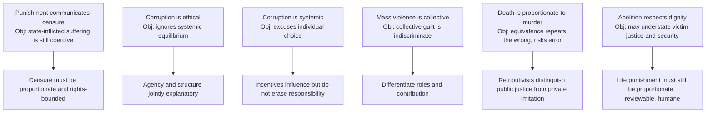

| Theory | Strongest objection | Reply | Residual problem ⚠️ |
|---|---|---|---|
| Retribution | Suffering does not undo suffering; why should the state add pain? | Limiting retributivism: no punishment without desert, none beyond it | Needs account of humane institutions |
| Deterrence | May punish the innocent | Rule-utilitarian constraints; due process | Rights should constrain utility independently |
| Reform | Pathologises dissent; indefinite | Bounded by proportionality, consent, review | Neglect of victims; Foucault: control under reformative rhetoric |
| Expressive | Symbolic denunciation would suffice | Hard treatment makes condemnation credible | Hard treatment becomes instrumental |
| Communicative | Illiberal; polity lacks standing | Invitation not compulsion; standing as limit | Burden imposed by force is a strange invitation |
| Restorative | Proportionality varies; power imbalance; public wrong lost | Desert-set band; conditional appropriateness; supplement not replace | Retributive framework remains outer constraint |
| Death penalty | Fallibility, inequality | Acknowledge harm; ask whether a less final penalty can protect and censure | Retributive claim not defeated merely by inequality |

**Dossier-level residue (optional ⚠️).** Whether censure-communication can be *coercively* delivered without collapsing into hard treatment justified on other grounds; whether restorative practice scales to grave and mass crimes and how it interacts with victim inequality; collective / command responsibility in mass violence; abolition vs limited retention. **Strongest additional objection → reply:** restorative or communicative models can underplay the seriousness of grave wrongs and fail victims who need public denunciation → the best restorative view is not anti-censure; it preserves condemnation while refusing vengeance as sole mode of justice. **Promotion triggers still pending:** transitional justice; collective / command responsibility.

---

## 10. Controlled Cross-Tradition Pairs (internal; no East–West table in the sources)

| Pair | Point of contact | Decisive distinction |
|---|---|---|
| **Kant ↔ Hegel** | Both retributive | Kant: desert, offender as end; Hegel: punishment as negation of the crime's wrongful claim and the offender's own right; abstract, no measure of severity |
| **Kant / Hegel ↔ Bentham / Beccaria** | Both justify state punishment | Backward-looking desert vs forward-looking prevention |
| **Feinberg ↔ Duff** | Both stress meaning | One-way condemnation vs two-way address inviting response |
| **Foucault ↔ reformative theory** | Both concern transformation of offenders | Foucault: genealogy showing reform can coexist with intensified control; not a justification |
| **Arendt ↔ "monster" theories of evil** | Both explain atrocity | Monster theories place atrocity outside ordinary humanity; Arendt warns bureaucracy and thoughtlessness enable ordinary participation; ⚠️ not exclusive: ideological hatred and routinised obedience can reinforce each other |
| **Aristotle ↔ corruption** | Particular bonds matter | Cannot justify using public office as private property; role-differentiation |
| **Lemkin ↔ 1948 Convention** | Same concept | Convention narrower; four protected groups; no political groups |
| **Capital punishment ↔ Problem of Evil / value of life** | Ethical framing overlaps (PYQ bank cross-theme) | Linked in owner: moral evil and responsibility |

> [!WARNING]
> Do not import **Gandhi or Rawls** into penal theory without a stem-specific reason (trap 17). The sources provide no non-Indian/Indian comparison table for this topic and none is invented here.

---

## 11. Diagnostic Deep-Dives for High-Frequency Themes

### 11.1 Capital punishment mark-bearing sequence ⚠️

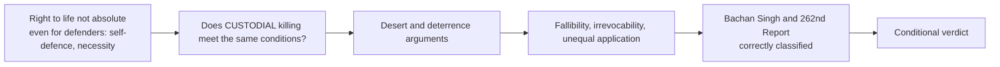

### 11.2 Effective deterrent? (2024 Q3(b)) ⚠️

To accept the death penalty *as a deterrent* one must show an additional preventive effect **over a feasible alternative** such as secure long-term imprisonment, with attention to perceived punishment and certainty of detection. Severity alone does not establish that effect. Even if shown, proportionality, irreversibility and unequal administration remain independent constraints. Uncertainty about deterrence does not by itself refute a **desert** argument. Burden on the deterrence defender.

### 11.3 Capital punishment and social justice (2019 Q4(c)) ⚠️

Identical death sentences can conceal unequal quality of defence, fact-finding, mitigation and discretion; irreversible error or status bias undermines like-for-like treatment; unequal conditions weaken the **state's standing** to impose an irrevocable penalty. Objection: justice to victims requires a severe response. Reply: acknowledge harm and proportionate responsibility; ask whether a less final penalty can protect and express censure. **Conditional verdict:** it weakens social justice where fair and consistent administration cannot be secured; the retributive claim is a distinct argument not defeated merely by noting social inequality.

### 11.4 Retribution and human rights (2020 Q3(c)) ⚠️

Retribution is **not inherently** a denial of rights: culpability, fair trial, no punishment of innocents and a proportionate ceiling protect persons from being used merely as deterrent examples. Strongest objection: "desert" used to license degrading or excessive treatment, ignoring unequal access to defence, or denying all possibility of reform. Reply: limiting retributivism treats the offender as an accountable rights-holder; rights constrain the **form** and **amount**. Residual: even deserved hard treatment needs public justification; irreversible execution may violate dignity despite proportionate desert. Distinguish a principle of **liability and limit** from any claim that a particular severe punishment automatically passes the rights test.

### 11.5 Juvenile proportionality (2023 Q4(a)) ⚠️

A grave offence sets the **ordinal** need to take harm seriously (including victims' claims) but does not alone fix desert or the **cardinal** limit; a juvenile's understanding, control, susceptibility to coercion and capacity for change affect culpability independently of harm. Objection: age-mitigation trivialises victims' injuries. Reply: name the full gravity of the wrong while individualising responsibility and retaining a path to reform. **Verdict:** nature of the crime must be considered, but "severity proportional to crime" needs qualification by blameworthiness, procedure and humane limits; not automatic adult-equivalent punishment.

### 11.6 Corruption and mass violence (2019 Q1(d)) — see §6.3. Corruption and regimes (2020 Q4(c)) — see §6.2. Measures in Indian democracy (2018 Q1(e)) ⚠️

Combine the 1988/2018 and 2013 statutes with reasons: transparent selection/procurement reduces hidden discretion; disclosure and recusal enforce the boundary between loyalty and office; independent audit and accessible grievance channels make wrongdoing contestable; credible fair enforcement changes impunity; protected reporting and civic education address fear and normalisation. Objection: multiplying bodies adds discretion and performative compliance. Reply: reviewable decisions, oversight of the overseer, complainant protection, due process for the accused. "Eradicate" is an aspiration, not a verified forecast.

### 11.7 Directive decoder ⚠️

| Directive | Scored | Compulsory move | Failure mode |
|---|---|---|---|
| Explain / Elucidate | Internal logic of one theory | Statement → premises → key distinction → example | Moralising |
| Discuss | Exposition + one adjudicated tension | Theory → rival → objection → reply → verdict | Catalogue with no adjudication |
| Critically examine / evaluate | The objection–reply layer is the answer | Two objections, each with reply and residual | Emotive denunciation |
| Is X justified? | Separate the three justifying questions | Q1 → Q2 → Q3 → verdict | One answer to three questions |
| Should X be abolished / retained? | Criterion must be named | Fix test (desert, deterrence, dignity, fallibility, equal application) → apply → verdict | Position asserted, both sides listed |
| Is X a form of Y? | Conceptual test for Y stated first | Y's necessary conditions → test X → verdict incl. partial fit | Analogy without test |
| Do you agree that… | Commitment, qualified | State qualified position at outset, then defend | Survey with no position |

---

## 12. PYQ Routing Ledger (2018–2025, plus 2026)

> Corpus signal: **12 primary-owned parts out of 112** (2018–2025; per-year 1/2/2/1/2/1/1/2) plus **2 in 2026** = **14 verified primary-owned parts**. Genocide has no direct owned question in the held cycle but remains a syllabus obligation. Year headings below were checked against the year section of each ledger line.

| Year | Q | Marks | Exact demand | Map to |
|---|---|---:|---|---|
| 2018 | Q1(e) | 10 | What measures do you suggest to eradicate corruption in Indian democracy? | §11.6, §5.4 |
| 2019 | Q1(d) | 10 | Is corruption not a form of mass violence? Discuss. | §6.3 |
| 2019 | Q4(c) | 15 | Does capital punishment weaken the doctrine of social justice? Discuss. | §11.3 |
| 2020 | Q3(c) | 15 | Do you think that retributive theory of punishment is against human rights? Discuss. | §11.4 |
| 2020 | Q4(c) | 15 | How far do the social and political regimes condition corrupt practices in a nation-state? Discuss. | §6.2 |
| 2021 | Q2(b) | 15 | Explain the reformative theory of punishment and discuss whether this is in tune with human dignity. | §2.10 |
| 2022 | Q1(c) | 10 | Is corruption a systemic issue or an ethical issue? Give your critical comments. | §6.1 |
| 2022 | Q1(e) | 10 | What are the moral justifications of capital punishment? Discuss. | §5.1, §8.5 |
| 2023 | Q4(a) | 20 | "Severity of punishment should be proportionate to the seriousness of the crime." Do you agree that while punishing a juvenile, the nature of the crime should be considered? Justify your answer. | §11.5, §2.11 |
| 2024 | Q3(b) | 15 | On what grounds would you accept or reject the idea of capital punishment as an effective deterrent? Discuss. | §11.2 |
| 2025 | Q1(a) | 10 | "Corrupt practices reveal an inherent tension between particularistic and universalistic normative standards." Do you agree with this statement? Give reasons and justification for your answer. | §4.1 |
| 2025 | Q3(a) | 20 | Can one's right to life be absolute? Answer with reference to the idea of Capital Punishment. | §5.3, §11.1 |
| 2026 | Q1(e) | 10 | How does value based education address the problem of corruption? | §7.1 |
| 2026 | Q3(a) | 20 | Retributivism presents a deontological justification for capital punishment, whereas deterrence presents a consequential justification for it. Explain. | §2.6, §2.8, §2.9, §5 |

**2026 Q3(a) decode:** *Explain* a stated contrast; keep the two logics separate (desert and proportionality vs aggregate prevention), show how each applies to the death penalty, then state each one's characteristic difficulty (Kantian dignity tension for retribution; empirical uncertainty and rights-violation for deterrence).

**Pre-2018 PYQ table:** the owner file contains none. **Cross-owned parts:** none are recorded against this topic in the two PYQ ledgers consulted. Question-type signal in the bank: statement/quote critique is dominant; capital punishment cross-theme with Problem of Evil / value of life.

---

## 13. Top Exam Traps

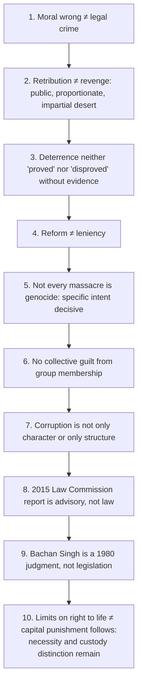

Further traps recorded in the owner: **11** do not punish thought alone (act/omission + fault + causation under fair notice); **12** do not merge justification and excuse; **13** responsibility ≠ causal contribution alone; **14** determinism is not automatic acquittal, metaphysical freedom is not a courtroom fact (use the compatibilist test); **15** do not merge restitution and restorative justice; **16** denunciation does not alone justify hard treatment; **17** do not import Gandhi or Rawls without a stem-specific reason; **18** value-based education is not a "values essay": name the six mechanisms; **19** education is not a sufficient remedy; **20** "value-based" must not slide into sectarian moral instruction.

Additional precision flags: Convention ≠ Lemkin in full, and **political groups are not protected** (§4.3); Foucault is genealogy, not justification, and panopticism must not be attached to any named technology (§3.3); restorative justice is not universally applicable (§3.4); banality of evil ≠ reduced guilt (§6.4); name no country, community or episode (§6.6).

---

## 14. Technical Vocabulary Bank

| English term | Technical term / source | Meaning | Status |
|---|---|---|---|
| External act or omission | *actus reus* | Conduct basis of liability | ✅ |
| Fault element | *mens rea* | Intention, knowledge, recklessness, negligence | ✅ |
| Justification / excuse | — | Permissible act vs blame-reducing wrong | ✅ |
| Compatibilism / reasons-responsive control | — | Responsibility without causal exemption | ⚠️ |
| General justifying aim · distribution/liability · amount/severity | Hart | Three questions | ⚠️ |
| Side-constraint · mixed theory | — | Desert limits a prevention-aimed institution | ⚠️ |
| Ordinal / cardinal proportionality | — | Rank vs scale ceiling | ✅ |
| Specific / general deterrence | — | Offender vs others | ✅ |
| Expressive function · condemnation vs penalty | Feinberg | Meaning distinguishing punishment | ✅ |
| Communicative punishment · secular penance · standing to punish · calling to account | Duff | Address to offender as citizen | ✅/⚠️ |
| Discipline · panopticism · docile bodies · delinquency | Foucault | Genealogy of penal power | ⚠️ |
| Restitution vs restorative justice | — | Outcome vs participatory process | ✅ |
| Reintegrative vs stigmatising shaming | Braithwaite | Shame the act vs the person | ✅ |
| Fiduciary office · particularism · universalism | — | Corruption concepts | ✅ |
| Monopoly + discretion − accountability | Klitgaard | Corruption formula | ✅ |
| Structural harm | — | Safer than "mass violence" where harm-chain unproven | ⚠️ |
| Dehumanisation · moral exclusion · diffusion of responsibility · security dilemma | — | Mass-violence mechanisms | ✅/⚠️ |
| Banality of evil · thoughtlessness | Arendt | Atrocity via unreflective role-performance | ✅ |
| Differentiated responsibility | — | Role-based liability | ⚠️ |
| Genocide | Lemkin 1944; Convention 1948 (in force 1951) | Intent to destroy a protected group as such | ✅ |
| Crimes against humanity · war crime | — | Distinct categories | ✅ |
| Irreversibility · fallibility · mitigation | — | Capital-punishment concepts | ✅ |
| Rarest of rare | *Bachan Singh* (1980) | Judicial limitation | ✅ |

---

## 15. Graded Verdict & Answer Architectures

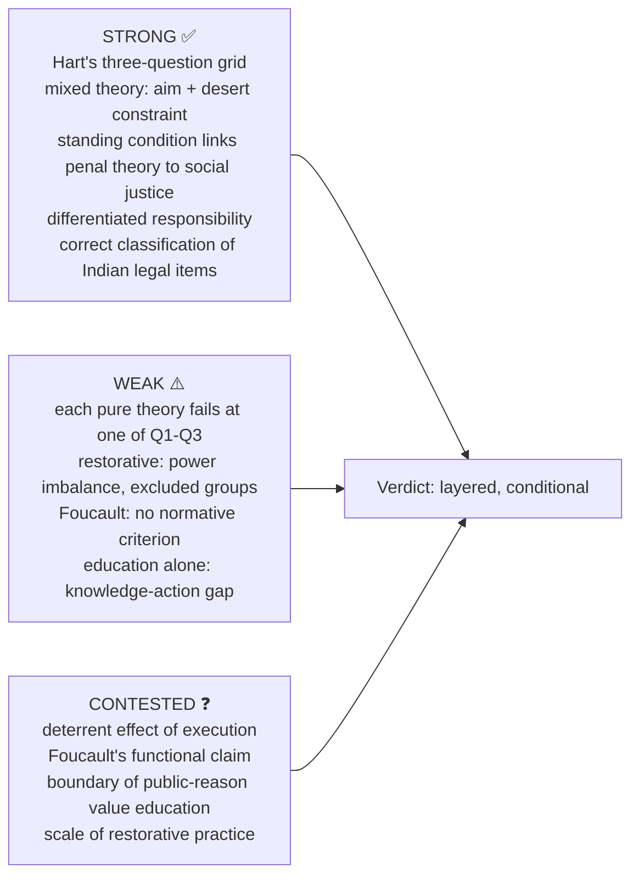

### 15.1 10-mark (~150 words, 4 moves)

```text
1. Precise concept (2 lines) in technical vocabulary.
2. Argument (4-5 lines) as numbered premises + the one distinction the stem turns on.
3. One evidence unit with its limitation.
4. Graded verdict (2 lines): the controlling principle, not a summary.
```
At 10 marks run **one theory or one distinction**, fully worked; not the full catalogue.

### 15.2 15-mark (~220 words, 6 moves)

```text
1. Identify the penal purpose or institutional wrong at issue.
2. Relevant theory with argument and presupposition.
3. Strongest rival, on the same one of Q1/Q2/Q3.
4. One table (three questions / retributive vs restorative / kinds of collective responsibility / expressive vs communicative).
5. One worked objection -> reply -> residual problem.
6. Verdict separating philosophical validity from implementation and from empirical effect.
```

### 15.3 20-mark (~300 words, 8 moves)

```text
1. State what makes the case difficult (desert vs consequence vs dignity).
2. Separate Q1, Q2, Q3.
3. Competing theories in strongest form.
4. Rights, dignity, culpability, proportionality applied.
5. Two objection->reply chains (one on fallibility, differentiated responsibility, or standing).
6. Critical qualification: Foucault (with caveat) or Duff's standing, in the critical paragraph only.
7. One classified Indian legal illustration: statute / Law Commission report / judgment.
8. Graded verdict naming the conditions under which it holds.
```

### 15.4 Evidence bank (Claim → anchor → limit)

| ID | Claim | Anchor | Limit |
|---|---|---|---|
| C1 | Punishment deserved; offender an end | Kant | Weak at Q1 |
| C2 | Punishment annuls the annulment of right | Hegel | Abstract; no severity measure |
| C3 | All punishment an evil; prevent greater evil | Bentham; Beccaria | Unconstrained at Q2/Q3 without desert |
| C4 | Aim and distribution separate | Hart grid | Presupposes aim and application can come apart |
| C5 | Punishment condemns; penalties do not | Feinberg | Hard treatment needs separate justification |
| C6 | Punishment addresses offender as citizen | Duff | Force vs invitation |
| C7 | Modern punishment disciplines | Foucault 1975/1977 | Genealogy, contested functional claim |
| C8 | Crime harms persons; repair is the response | Restorative justice | Power imbalance |
| C9 | Shame the act, not the person | Braithwaite | Fails for excluded groups |
| C10 | Two dimensions of proportionality | Owner §1.7 | Cardinal anchor harder |
| C11 | Evil can be banal | Arendt | Not reduced guilt |
| C12 | Guilt individual; responsibility collective forms | §6.5 grid | Political responsibility contested |
| C13 | Genocide = destruction of group as such | Lemkin; 1948 Convention | Convention narrower; name no episode |
| C14 | Corruption betrays entrusted role | Owner §2 | Mass-violence analogy partial |
| C15 | Indian items correctly classified | *Bachan Singh* 1980; Report 262 (2015); 1988/2018 Act; 2013 Act | Legal fact, not proof |
| C16-C19 | Elements/defences; compatibilist test; normative logics; restitution ≠ restoration | Owner §§1.1A–1.3A, 1A.5 | Philosophical prerequisites only |

### 15.5 Graded verdict formulas (adapt; do not reproduce mechanically)

> [!TIP]
> **Layered:** "Desert fixes the limits, condemnation supplies the meaning, communication supplies the address to the offender, and restoration supplies the repair; the classical opposition between retribution and reform is therefore a false alternative."
>
> **Question-separating:** "The institution is justified by prevention; its application is constrained by desert. The stem's apparent dilemma dissolves once the general justifying aim is distinguished from the principle of liability."
>
> **Fallibility:** "Even granting the desert argument, an irrevocable penalty administered by a fallible and unequally applied process cannot satisfy the very principle of proportionate desert that is offered to justify it."
>
> **Standing:** "The legitimacy of punishment is conditional on the justice of the order that imposes it: a polity that has denied a person the conditions of citizenship has weakened its standing to call him to account."
>
> **Conditional appropriateness:** "Restorative process is justified where participation is genuinely voluntary, safety is secured and no entrenched domination is present; it is not a general substitute for public condemnation of grave wrongs."
>
> **Differentiated responsibility:** "Leaders, planners, direct perpetrators, enablers, bystanders and resisters do not bear identical responsibility; guilt remains individual, while political responsibility grounds duties of reparation, memory and institutional reform."
>
> **Critical qualification:** "Reformative language is not self-validating: a regime can intensify control while describing itself as rehabilitative, which is why the aims of a penal institution must be assessed by its techniques and not only by its stated purposes."

### 15.6 Reusable statement lines

- ✅ Criminal law is not self-justifying; coercive punishment requires legality, culpability, proportionality and fair procedure.
- ⚠️ Corruption is an ethical choice nested in a systemic opportunity structure.
- ⚠️ Particular loyalty becomes corruption when it occupies a public role governed by impartial criteria.
- ✅ Mass violence diffuses action but does not dissolve responsibility.
- ✅ Genocide is distinguished not by numbers alone but by the intent to destroy a protected group.
- ⚠️ Capital punishment concentrates the deepest penal tensions: desert versus dignity, security versus fallibility, finality versus reform.
- ⚠️ The right-to-life issue is best framed through necessity after custody, not by asserting that every right is exceptionless.

---

## Sources

Local compiled notes PDF *Socio-Political Philosophy* (searchable pp. 160–168; no named author asserted); O. P. Gauba, *An Introduction to Political Theory*; Kant, *The Metaphysics of Morals*; Hegel, *Philosophy of Right*; Bentham, *An Introduction to the Principles of Morals and Legislation*; Beccaria, *On Crimes and Punishments*; Arendt, *Eichmann in Jerusalem* and *The Origins of Totalitarianism*; Convention on the Prevention and Punishment of the Crime of Genocide (1948); Law Commission of India Report No. 262 (2015); *Bachan Singh v. State of Punjab* (1980); Prevention of Corruption Act 1988 (amended 2018) and Lokpal and Lokayuktas Act 2013; Feinberg, "The Expressive Function of Punishment"; Duff, *Punishment, Communication, and Community*; Foucault, *Discipline and Punish* (1975/1977); Braithwaite, *Crime, Shame and Reintegration*; Lemkin, *Axis Rule in Occupied Europe* (1944); H. L. A. Hart (justifying aim vs liability/severity; advanced dossier cites *Punishment and Responsibility*); UNODC Education page and GRACE module series; UN Convention against Corruption (2003) Arts 7 and 13; Klitgaard, *Controlling Corruption* (1988); Aristotle, *Nicomachean Ethics* Book II. All as cited in the owner file; no page, edition or verbatim wording asserted.
