# DEVELOPMENT AND SOCIAL PROGRESS — Examiner-Grade Mindmap

> **Syllabus (verbatim):** Development and Social Progress.
> **Catalogue key:** `philosophy-paper-ii-socio-political-philosophy-08` · Paper II · Section A · Socio-Political Philosophy
> **Sources used:** `paper-2/socio-political/Development-Social-Progress.md` (canonical owner, read in full) · `_advanced/Socio-Political-Dossier.md` §8 (optional depth) · `paper-2/_PYQ-SocioPolitical-2018-2025.md` · `paper-2/_PYQ-SocioPolitical-2026-Supplement.md`.
> **Evidence key:** ✅ canonical · ⚠️ analytical synthesis · ❓ contested / empirical
> **Blueprint adaptation:** `MINDMAP_INSTRUCTIONS.md` is Indian-school oriented. The 16 module headings are kept; each module's focus is adapted to this clause. Module 1 = ownership boundary, thinkers and lineages; Module 2 = the justificatory argument (what is development, how it is measured and what makes change *progress*; the sources give no *pramāṇa*-style epistemology); Module 3 = internal debates and refinements (economistic, modernisation, dependency, post-development); Module 4 = conceptual inventory (measures, capabilities, participation, democracy, technology, skill, tribal values); Module 5 = ecological standing and Indian legal bridges (the sources give no transcendent-reality ontology); Module 6 = causal chains; Module 7 = value aims; Module 10 = cross-tradition pairs (the sources give no East–West comparison table, only the internal pairs shown there).

> [!IMPORTANT]
> **Master thesis ⚠️.** Growth can finance development, but only capabilities, justice, participation and ecological limits can convert material change into social progress. The clause tests the difference between **economic growth, structural development, human capability and morally justified social progress**.

---

## 0. Master Overview

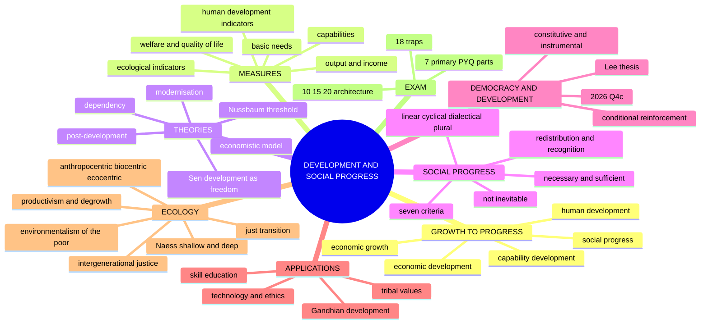

```text
ECONOMIC GROWTH
more output / income
        │ possible means, not final end
        ▼
DEVELOPMENT
structural change + health + education + capabilities + institutions
        │ must pass normative tests
        ▼
SOCIAL PROGRESS
freedom · justice · equality · dignity · participation · sustainability

FAILURE MODES:
growth without distribution · development without consent
technology without ethics · welfare without agency · progress as forced assimilation
```

---

## 1. Ownership Boundary, Thinkers & Lineages

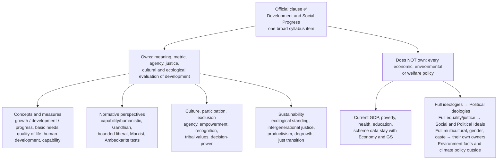

| Thinker / source | Owned contribution | Used for |
|---|---|---|
| **Mahbub ul Haq**; UNDP | Human-development approach: longevity, knowledge, decent material standard | Growth ≠ well-being; 10-mark distinction stems |
| **Amartya Sen**, *Development as Freedom* (**1999**), *Commodities and Capabilities* | Development as expansion of substantive freedom; functioning, capability, agency, adaptive preferences; famine-prevention argument | Every development stem; democracy–development |
| **Martha Nussbaum**, *Creating Capabilities*, *Women and Human Development* | Central capabilities list; dignity threshold as constitutional minimum | Rights-adjacent stems; Sen–Nussbaum contrast |
| **M. K. Gandhi**, *Hind Swaraj* | Welfare of all (*sarvodaya*), self-rule (*swarāj*), trusteeship, dignity of labour, restraint of wants | 2020 Q2(a) |
| **B. R. Ambedkar** | Village can institutionalise caste exclusion; constitutional rights, social democracy | Compulsory objection to Gandhi's village |
| **Dependency** approaches; **post-development** critics | Underdevelopment produced by unequal incorporation; authority to define others as deficient | Critique of modernisation |
| **Arne Naess** (**1973**) | Shallow vs deep ecology | Ecological depth |
| **Guha and Martinez-Alier**, *Varieties of Environmentalism* (**1997**) | Environmentalism of the poor | Tribal / environment stems |
| **Brundtland Report**, *Our Common Future* (**1987**) | Sustainable development; intergenerational duty (paraphrase only) | Intergenerational justice |
| **Lipset** (**1959**); **Przeworski and Limongi** (**1997**) | Modernisation thesis; survival-not-emergence correction | 2026 Q4(c) |
| **Acemoglu, Naidu, Restrepo, Robinson** (**2019**); **WDR 2017**; **UNDP HDR 2002**; **UN Declaration on the Right to Development (1986)** | Empirical, governance and participation anchors | 2026 Q4(c) |

> [!NOTE]
> **Provenance ⚠️.** The §5A ecological module is a named-scholar reconstruction: no page, chapter, edition or verbatim wording is asserted for Naess, Guha, Martinez-Alier or Brundtland. **No** environmental datum, target, figure, project, company, movement, region or country is named as an instance of democratic or authoritarian development or of ecological success/failure. Answer at the level of **criteria**.

**Advanced sources named in the dossier (optional trail):** Ivan Illich, *Tools for Conviviality*; Wolfgang Sachs (ed.), *The Development Dictionary*; Arturo Escobar, *Encountering Development*; Denis Goulet, *The Cruel Choice*.

---

## 2. Justificatory Argument: What Is Development and What Makes It Progress

### 2.1 Doctrine statements ✅

- **Development:** a process of enlarging and securing people's effective capacities to live lives they have reason to value, through economic, social, political and institutional transformation. Two dimensions: **descriptive** (change in production, technology, institutions, social relations) and **normative** (judgment that the change improves lives).
- **Social progress:** justified improvement in the quality of social relations, institutions and human lives, assessed through freedom, equality, justice, dignity, participation, security and sustainability. **Teleological in a weak sense**: judging change as progress is judging movement toward a better condition; it does **not** require an automatic law of history.

### 2.2 Growth, development, progress ✅

| Concept | Primary measure | Question | Failure |
|---|---|---|---|
| **Economic growth** | aggregate or per-capita output/income | is more being produced? | ignores distribution and externalities |
| **Economic development** | structural and qualitative economic change | are productivity and opportunities changing? | may remain economistic |
| **Human development** | health, knowledge, material command | are basic human options expanding? | aggregate indicators conceal inequality |
| **Capability development** | substantive freedoms to be and do | what can persons actually achieve? | measurement and selection problems |
| **Social progress** | justified improvement in relations and institutions | is society becoming freer, fairer, sustainable? | values are contested |

**Discriminating test ⚠️:** if income rises while preventable unfreedom, humiliation or ecological destruction intensifies, there may be growth without social progress.

### 2.3 Measures: what each treats as the good and what it hides ✅/⚠️

| Measure family | Informational space | What it adds | What it can hide |
|---|---|---|---|
| Output/income | aggregate or per-capita production, command over goods | resource capacity | distribution, unpaid work, externalities |
| Basic needs | nutrition, shelter, health, sanitation, elementary education | deprivation threshold | voice, choice, quality above threshold |
| Welfare / quality of life | security, health, work, environment, experienced well-being | lived conditions | adaptive preferences, unequal power |
| Human-development indicators | longevity, knowledge, material command | people rather than output | within-group inequality, political freedom |
| Capabilities | real opportunities for valued beings and doings | conversion, freedom, agency | selection and measurement disagreement |
| Social-progress indicators | equality, dignity, participation, security, institutions | relations and public value | aggregation across contested dimensions |
| Ecological indicators | stocks, sinks, resilience, irreversibility, future options | biophysical and intergenerational limits | distribution of adjustment burdens |

⚠️ A composite index is evidence within one evaluative space, not a complete theory of the good society. No current figure is required for the philosophical argument.

### 2.4 Sen: development as freedom ✅

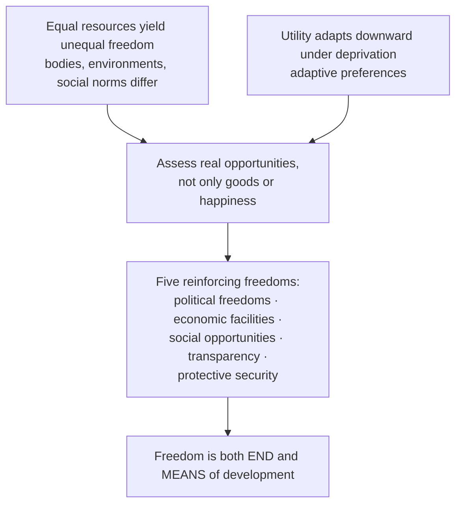

| Term | Meaning |
|---|---|
| **Functioning** | achieved being or doing: being nourished, moving freely, participating |
| **Capability** | real opportunity to achieve alternative functionings |
| **Resource** | means whose value depends on conversion conditions |
| **Utility** | satisfaction; may adapt downward under deprivation |
| **Agency** | ability to pursue goals one has reason to value, including goals beyond personal welfare |

Presupposition: persons are agents, not passive recipients of welfare.

### 2.5 Nussbaum's threshold ✅

Justice requires each person to reach a threshold of central capabilities compatible with dignity. **Sen–Nussbaum:** Sen resists a single final canonical list and stresses public reasoning; Nussbaum defends a specified list and threshold as a constitutional-political minimum. Objection (one conception of life imposed) → reply: capabilities protect **opportunities, not compulsory functionings**; specification stays open to democratic interpretation. ⚠️ Sen avoids paternalistic closure; Nussbaum better resists societies that publicly reason within oppressive adaptive preferences.

### 2.6 Is progress inevitable? ✅

Enlightenment and nineteenth-century theories linked reason, science or social evolution with cumulative progress; twentieth-century war, genocide and ecological crisis challenge any automatic inference from knowledge or technology to moral improvement. **Argument:** (1) technology enlarges capacities for care and destruction; (2) institutions distribute its control and risks; (3) moral learning can be reversed; (4) so progress needs agency, conflict, institutions and judgment.

| Conception | Core claim | Strength | Failure |
|---|---|---|---|
| Linear / cumulative | reason, knowledge, productive capacity generate movement toward better | explains learning and institutional accumulation | mistakes capacity for moral improvement; one route for universal sequence |
| Cyclical | societies rise, stabilise, decline | resists complacent inevitability | fatalism; understates reform |
| Dialectical / conflictual | contradiction and struggle transform institutions | explains conflict and discontinuity | may impose single historical direction |
| Plural / non-linear | several partly incommensurable goods, multiple paths | respects culture, contingency, reversibility | relativism; loss of common standards |

⚠️ **Controlling position:** progress is directional only after valued ends are stated, and plural only within a universal floor of dignity, freedom from severe deprivation, equal civic standing and ecological responsibility.

### 2.7 Criteria of social progress ✅

| Criterion | Question |
|---|---|
| **Freedom** | real options and voice? |
| **Equality** | status and opportunity less structured by domination? |
| **Justice** | benefits, burdens, procedures defensible? |
| **Dignity** | protection from humiliation and exclusion? |
| **Participation** | do affected people shape decisions? |
| **Sustainability** | future and ecological conditions preserved? |
| **Fraternity / solidarity** | can citizens relate as social equals? |

⚠️ No single aggregate number settles all dimensions; public reasoning is part of progress, not merely a method of measuring it.

### 2.8 Necessary and sufficient conditions (2024 Q3(c)) ⚠️

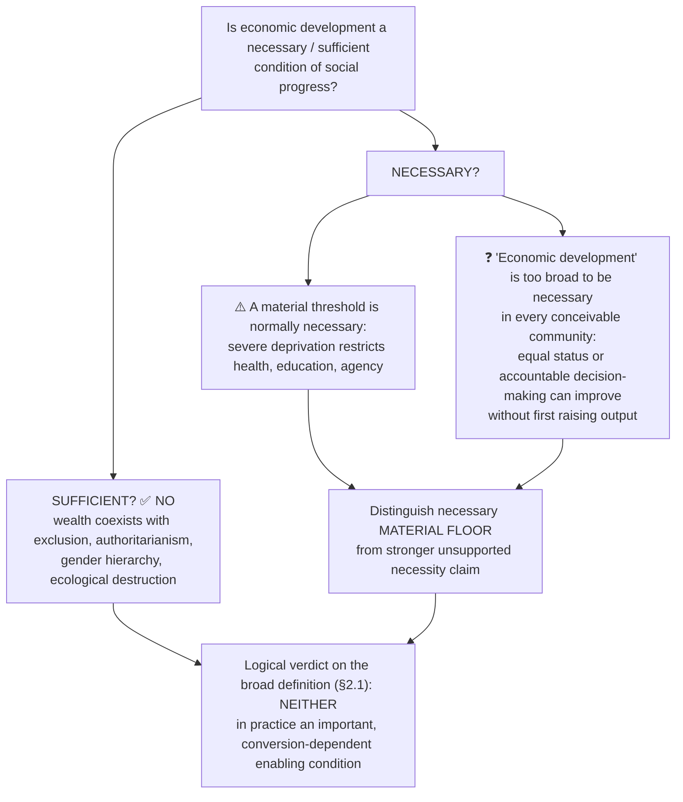

Objection: can improvements last amid severe deprivation? Reply: adequate *material capabilities* are normally indispensable to sustaining health and agency, but that does not show that economic development in the growth/industrialisation sense must **precede every** advance in social relations.

### 2.9 Distribution and recognition ✅

Progress requires **redistribution** of resources **and recognition** of equal status. Material provision without respect becomes paternalism; recognition without resources becomes symbolic. ⚠️ In India, caste, gender and tribal status show growth may not automatically alter inherited social power.

---

## 3. Internal Debates & Refinements

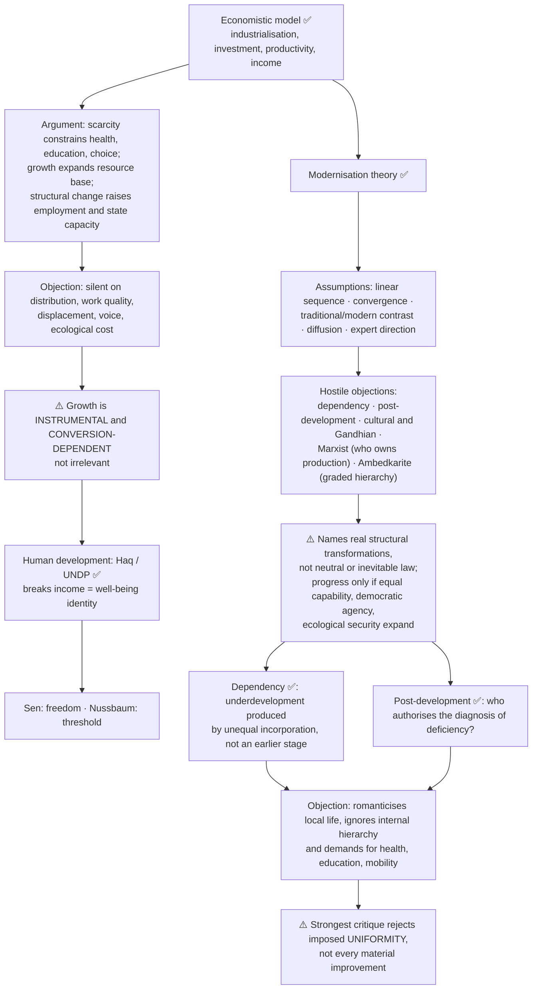

**Optional dossier residue ⚠️.** Four optional debates: (1) capability vs resource/welfare metrics; (2) degrowth and productivism critique (**promoted to Core on 15 Aug 2026**, §5A.3; optional residue = the stronger *post-development* claim that "development" as a category should be abandoned altogether); (3) technology as instrumentally neutral vs embodying social power; (4) Gandhi vs Ambedkar on modernity. **Promotion trigger still open:** full post-development anti-institutionalism or a standalone Gandhi-vs-Ambedkar development comparison, if a PYQ asks directly.
**Additional objection → reply (dossier):** post-development critique romanticises locality and leaves the poor without large-scale infrastructure, mobility, rights → its strongest form need not reject roads, health or schooling; it warns against top-down models treating people as objects of growth rather than agents of self-directed flourishing.

---

## 4. Conceptual Inventory: Participation, Democracy, Technology, Skill, Gandhian and Tribal Applications

### 4.1 Participation to empowerment ladder ⚠️

| Level | What affected persons possess | Limitation |
|---|---|---|
| Information | notice and intelligible reasons | one-way disclosure is not voice |
| Consultation | opportunity to express preferences and knowledge | decision-makers may ignore it |
| Participation | continuing role in design, implementation, review | local elites can monopolise representation |
| Co-decision | shared authority over alternatives and conditions | needs clear responsibility and rights safeguards |
| Empowerment | durable capability and institutional power to shape options, resources, rules | cannot be inferred from attendance or nominal representation |

Participation is instrumental (information, accountability) **and constitutive** (voice is part of a developed life). Empowerment = control over conditions of action, including capacity to dissent, exit, organise, demand reasons. Objection: consultation delays urgent projects and lets local elites veto → reply: inclusive design, reasons, representation, review.

### 4.2 Democracy and development (2026 Q4(c)) ✅/⚠️

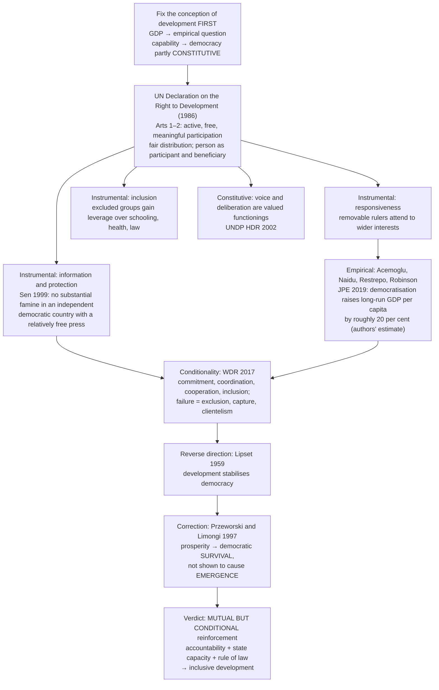

| Axis | Democracy promotes | Democracy hinders (authoritarian efficiency / **Lee thesis**) | Conditional reinforcement (owner) |
|---|---|---|---|
| Development defined as | freedoms, capabilities, distribution | growth, infrastructure, industrial catch-up | material base *plus* agency |
| Core mechanism | accountability, information, inclusion, deliberation | insulation from populist pressure; rapid decision; long horizons | accountability + capacity + rule of law |
| Dissent | corrective feedback | delay and obstruction | corrective, but needs institutions to convert into policy |
| Catastrophe prevention | ✅ famine-prevention (Sen 1999) | suppressed information risks unreported disaster | information plus responsive capacity |
| Distribution | inclusion raises the claims of the excluded | growth first, distribution later | part of the definition, not a sequel |
| Evidence | ✅ 2019 JPE estimate; human-development indices | selected rapid-industrialisation episodes | cross-national evidence read with capacity and sequencing |
| Time horizon | errors recoverable | decisive but errors uncorrectable | revisability is a developmental asset |
| Characteristic failure | short-termism, polarisation, populist consumption | unaccountable error, repression, no exit | captured democracy or capable autocracy both fall short |
| Verdict | promotes | hinders | promotes **conditionally** |

**Four objection → reply → residual chains:**

| Objection | Reply | Residual problem |
|---|---|---|
| 1. Authoritarian efficiency | ⚠️ decisiveness magnifies error because criticism is suppressed; comparison draws on selected successes | ✅ democratic bargaining does impose coordination and delay costs; it buys revisability, not costlessness |
| 2. Majoritarian populism | ⚠️ argument for constitutional rights, independent institutions, deliberative design, not against popular authorisation | ⚠️ counter-majoritarian institutions need their own accountability |
| 3. Measurement | ✅ conceded; argument runs on capability and HD criteria, econometrics supporting not decisive | ⚠️ multidimensional criterion harder to falsify |
| 4. Reverse causation | ✅ 1997 correction: survival, not emergence; 2019 study targets democratisation → income | ❓ causal identification contested; state the contest |

Presuppositions: development is multidimensional; institutions, not regime labels, do the causal work; averages conceal distribution; ❓ whether short electoral horizons bias policy against long-gestation investment is contested.

### 4.3 Technology and ethical progress (2019 Q2(c)) ⚠️

| Optimist case | Critical case |
|---|---|
| communication widens knowledge and sympathy | surveillance and manipulation intensify domination |
| medicine reduces suffering | access can remain unequal |
| productivity reduces drudgery | automation displaces and deskills |
| transparency tools aid accountability | information systems reproduce bias |

**Capacity to act ≠ willingness to act well.** Technology gives *better means*, not improved moral judgment, respect for persons or incentives. Objection (greater knowledge of consequences makes society ethical) → reply: knowledge may be necessary, not sufficient where incentives, power and prejudice favour harm. Technology can *enable* ethical progress through inclusive access, civic education, deliberation, accountability, but does not *entail* it. D14 limit: technology reshapes the moral problems that arise, so the relation is not simply null.

### 4.4 Skill education (2023 Q2(c)) ⚠️

Argument: capability needs effective means; relevant skills improve conversion of education into work and agency; productive participation enlarges contribution and bargaining power. **Limits:** skills without decent work create frustrated capability; narrow employability displaces critical, civic, humanistic education; unequal access reproduces hierarchy; rapidly changing technology obsoletes training. Counting certificates confuses an educational input with a capability outcome. Reply to "marketable skills sideline liberal learning": integrate vocational competence with critical inquiry, rights-awareness, opportunities to retrain; judge outcomes for excluded groups, not aggregate placement. **Verdict:** a **conditional contribution**, not an autonomous engine of social progress.

### 4.5 Gandhian social development (2020 Q2(a)) ✅

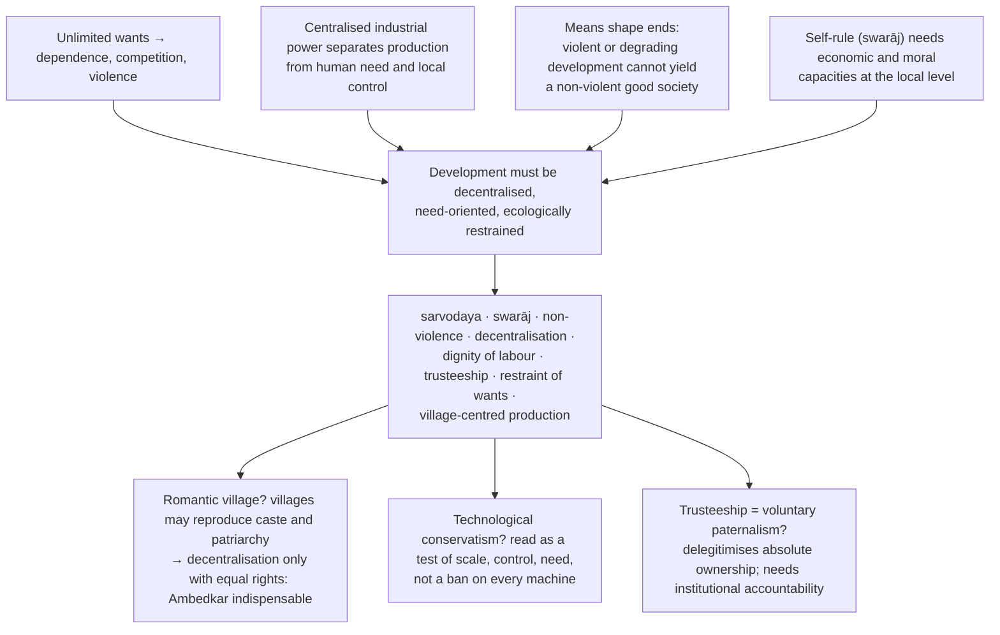

Presuppositions: moral self-limitation is politically relevant; small-scale association can sustain participation; work has ethical and community value beyond income; change can proceed by non-violent conversion and constructive action.

### 4.6 Development and tribal values (2025 Q3(c)) ✅/⚠️

The conflict is **not** modernity vs tradition in the abstract: it concerns who defines benefit; who bears cost and risk; whether land is only a commodity or also identity and relation; whose knowledge counts; whether consent and self-government are real. ⚠️ Tribal communities are internally diverse; avoid romantic generalisation.

**Reconciliation model (7 steps):** (1) begin with equal citizenship and cultural recognition; (2) assess capabilities gained **and destroyed**; (3) informed, inclusive participation; (4) recognise individual and community rights without freezing culture; (5) fair distribution of benefits, burdens, decision-power; (6) preserve exit, dissent, gender justice within communities; (7) prefer reversible, ecologically sustainable options under grave uncertainty. **Verdict:** reconcilable only when communities are **agents** of development, not obstacles or objects.

---

## 5. Ecological Standing & Indian Legal Bridges

### 5.1 Sustainable development ✅

Present improvement that does not destroy the ecological conditions and options of future persons. Bases: intergenerational justice; precaution under irreversible risk; limits to substituting money for ecological systems; duties toward vulnerable populations; possible intrinsic value of non-human life. Objection: vague, legitimises "green" growth → reply ⚠️: specify thresholds, distribution, participation, non-substitutable limits.

### 5.2 Three orientations: what has moral standing? ✅

| Orientation | Who counts | Why nature is protected | Weakness |
|---|---|---|---|
| **Anthropocentric** | humans only | instrumental: resource, life-support, amenity, heritage | protects only what humans need or value |
| **Biocentric** | all individual living beings | inherent worth independent of use | no principled adjudication between organisms; cannot protect species or system as such |
| **Ecocentric** | ecological wholes: species, habitats, ecosystems | integrity, stability, resilience of systems | subordinates individuals to the whole |

**Discriminating question ⚠️:** would it be wrong to destroy a wilderness no human will ever see? Anthropocentric: no; biocentric and ecocentric: yes, for different reasons. ❌ Do not adopt strong ecocentrism casually (eco-authoritarian risk; conflicts with capability framework). Defensible position: **strong non-instrumental anthropocentrism supplemented by duties of stewardship**, stated and defended.

### 5.3 Naess: shallow and deep ecology (1973) ✅/⚠️

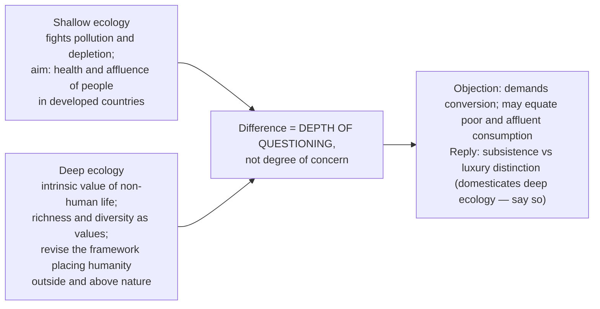

Second objection (intrinsic value needs a valuing subject) → reply: confuses *source* of a judgment with its *object*; residual: intrinsic value asserted, not demonstrated.

### 5.4 Productivism and degrowth ✅/⚠️

**Productivism:** assumption, shared across opposed ideologies, that expanding production is the master objective — applies to industrial socialism as much as capitalism.
**Degrowth argument (6 steps):** (1) economy embedded in finite biophysical sinks and stocks; (2) efficiency gains offset by expanded output, so relative decoupling has not delivered absolute reduction at needed scale; (3) beyond a threshold more output adds little to health, longevity, education, well-being in affluent societies; (4) permanent aggregate growth neither feasible nor necessary for already-affluent economies; (5) aim = planned reduction of energy and material throughput, provisioning reorganised around sufficiency, care, shorter working time, equality; (6) burden falls on high-consuming economies and classes, **not** societies below the deprivation threshold.
Weakest link: can a non-growing economy maintain employment, services, stability? Replies: work-time reduction, job guarantees, universal basic services, redistribution; residual: no demonstrated managed contraction at scale. Correct form is **asymmetric — contraction and convergence**. ❌ Never prescribe degrowth for a society below the deprivation threshold. Sen's capability approach gives a non-ecological route to the same conclusion.

### 5.5 Intergenerational justice ✅/⚠️

Present generations owe duties of **justice**, not mere benevolence, to those not yet born: not to foreclose their capacity to meet their own needs and live lives they have reason to value (Brundtland 1987 — paraphrase, never quote).
Three problems: **(1) non-identity** — different policies produce different people; response: impersonal principles (quality of lives lived) or ground in value of the resource base; **(2) motivation and reciprocity** — future people cannot reciprocate, vote or sanction, so mutual-advantage contractarianism struggles; **(3) discounting** — **pure time preference** counts interests for less merely because later, as arbitrary as counting for less because farther away.
Indeterminacy reply: specify the duty as **preserving options and avoiding irreversibility**; uncertainty argues for precaution, not inaction.

### 5.6 Environmentalism of the poor (Guha and Martinez-Alier, 1997) ✅/⚠️

Environmentalism in the global South is typically a struggle over **livelihood** (forests, water, grazing, fisheries, clean air), not a post-material concern for wilderness. Environment and development are the **same question** for such communities; "environment vs development" is a framing available to those whose subsistence is not at stake. The real question is **distributive**: who gains, who bears risk, who decides, on what terms. Objection (romanticises the poor) → reply: it concerns the *structure of conflict*, not ecological virtue; **secure rights** convert dependence into stewardship.

### 5.7 Eco-authoritarian risk and just transition ⚠️

Risk argument: limits are hard and breach is irreversible; democracy is slow and short-horizoned; so insulate decisions. **Four replies, ascending:** (1) epistemic — dispersed local knowledge; (2) compliance — imposed measures are evaded and reversed; (3) record — insulation has not produced restraint, and suppressing dissent removes early-warning feedback; (4) **distributive (decisive)** — **just transition** conditions restructuring on livelihood guarantees, retraining, compensation, participation. Verdict: the ecological case strengthens, not weakens, the case for participation.

### 5.8 Binding to tribal development ⚠️

| Question from §4.6 | Ecological answer | Where |
|---|---|---|
| Who defines benefit? | environmentalism of the poor | §5.6 |
| Who bears cost and risk? | distributive core of ecological conflict | §5.6 |
| Is land only a commodity? | treating land as resource is a **position**, not a default | §5.2 |
| Whose knowledge counts? | epistemic reply to eco-authoritarianism | §5.7 |
| Are consent and self-government real? | just transition makes prior participation a condition | §5.7 |
| What is owed beyond the present? | preserve options, avoid irreversible loss | §5.5 |
| Is the growth objective examinable? | productivism critique | §5.4 |

**Four-test conclusion ⚠️ (mark-bearing on tribal stems):** (i) capabilities gained **and destroyed** both counted; (ii) cost-bearers participate in the **decision**, not merely the compensation; (iii) irreversible ecological and cultural loss attracts a **precautionary presumption against**; (iv) adjustment burden is not shifted onto those least able to bear it.

### 5.9 Indian legal illustrations (correct classification) ✅/⚠️

| Item | Classification | Caution |
|---|---|---|
| Provisions of the Panchayats (Extension to the Scheduled Areas) Act, **1996** (PESA) | **Enacted statute**; adapted panchayat arrangements for Scheduled Areas; role for Gram Sabha | enactment ≠ notification, implementation or capability expansion |
| Scheduled Tribes and Other Traditional Forest Dwellers (Recognition of Forest Rights) Act, **2006** (FRA) | **Enacted rights-recognition statute**; individual and community forest rights | recognition ≠ notification, recording, effective exercise |
| *Orissa Mining Corporation v. Ministry of Environment & Forest* (**2013**) | **Supreme Court judgment**; Gram Sabha consideration of community and religious claims (Niyamgiri context) | a judgment is not proof of reconciliation |
| **Article 48A** (DPSP) and **Article 51A(g)** (Fundamental Duty) | Constitutional provisions on protecting environment, forests, wildlife | **non-justiciable**: commitment, not outcome |

❌ Do not cite any statute, judgment, scheme, target or figure as proof that a philosophical position is correct; do not name any project, company, movement or region.

---

## 6. Causal & Explanatory Chains

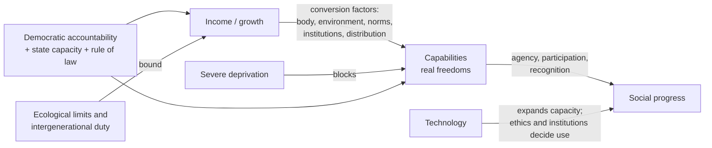

| Chain | Mechanism | Defeater |
|---|---|---|
| Growth → welfare | productive expansion → resources → public goods | no distribution; displacement; ecological cost |
| Education / skill → development | skills → better conversion into work and agency | no decent work; obsolescence; unequal access |
| Democracy → development | accountability, information, inclusion, deliberation | capture, clientelism, no state capacity |
| Development → democracy | education, capacity, associational life | 1997 correction: supports survival, emergence not shown |
| Technology → ethics | better means, transparency | surveillance, bias, distance from responsibility |
| Participation → durable policy | knowledge, compliance, legitimacy | elite capture; delay |

---

## 7. Value Aims

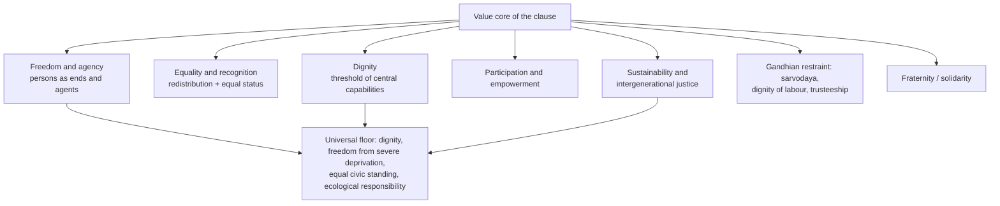

The sources give no kāma/artha/dharma/mokṣa analysis for this topic.

### 7.1 Bounded perspective map ⚠️ (evaluation criteria, not five complete ideologies)

| Perspective | Developmental focus | Characteristic warning | Ownership control |
|---|---|---|---|
| Liberal / welfare | resources, opportunity, rights, public goods, choice | formal opportunity may coexist with unequal conversion | comparison only |
| Marxist | production, class power, alienation, control of surplus | growth can reproduce exploitation | comparison only |
| Humanistic / capability | each person as end and agent | beneficiaries counted while agency denied | full owner here (Sen/Nussbaum, HD theory) |
| Gandhian | need, non-violence, local self-rule, dignity of labour, restraint | scale and multiplied wants centralise domination | direct owner through 2020 PYQ |
| Ambedkarite bridge | constitutional rights, social democracy, mobility, destruction of graded hierarchy | a village or growth strategy is not progress if caste power survives | bounded bridge |

---

## 8. Inter-School Comparative Matrices

### 8.1 Growth model vs capability approach ✅

| Axis | Growth-centred | Capability |
|---|---|---|
| Unit | output/income | substantive opportunity |
| Person | consumer or factor of production | agent |
| Inequality | distribution after growth | conversion and freedom central |
| Democracy | possibly instrumental | instrumental and constitutive |

### 8.2 Pairs of thinkers ✅/⚠️

| Pair | Contrast | Synthesis |
|---|---|---|
| **Sen vs Nussbaum** | evaluative space and public reasoning vs list and dignity threshold | Sen avoids paternalism; Nussbaum resists oppressive adaptive preferences |
| **Gandhi vs industrial modernisation** | scale, productivity, mastery over scarcity vs centralised power, multiplied wants, degraded labour or nature | ⚠️ adopt technology selectively by capability, decentralised control, ecological cost, non-domination |
| **Gandhi vs Ambedkar on the village** | village as school of swarāj vs village as institutionalised caste exclusion | ⚠️ local self-government progressive only with constitutional rights, mobility, anti-caste safeguards |
| **Modernisation vs post-development** | transformation of institutions and capacity vs imposed standards and expert domination | ⚠️ plural development under universal constraints of dignity, capability, non-domination |
| **Growth-first vs degrowth** | permanent growth as objective vs contraction and convergence | asymmetric: contract where far above threshold, expand where far below |

---

## 9. Criticisms & Reconstructed Replies

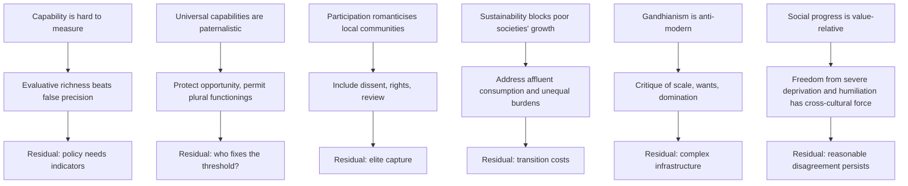

**Other chains in the owner:** romantic village → equal rights + Ambedkar; technological conservatism → test of scale; trusteeship as paternalism → institutional accountability; post-development romanticism → rejects uniformity, not improvement; deep ecology conversion demand → subsistence vs luxury; degrowth harms the poor → work-time reduction, guarantees, redistribution (residual conceded).

---

## 10. Cross-Tradition Pairs (internal only)

The sources give no East–West comparison table for this topic. The pairs the sources do give:

| Pair | Point |
|---|---|
| Sen ↔ Gandhi | Both resist output-as-end; Sen through capability and agency, Gandhi through need, restraint and self-rule. Neither is reduced to the other in the sources |
| Sen's capability ↔ degrowth | Capability approach gives a **non-ecological** route to the same conclusion about limits of growth (§5.4) |
| Gandhi ↔ Ambedkar | Self-governing village vs constitutional rights and social democracy |
| Modernisation ↔ dependency / post-development | Stages and diffusion vs produced underdevelopment and imposed deficiency |
| Lipset (1959) ↔ Przeworski and Limongi (1997) | Development supports democracy → correction to survival, not emergence |

> [!WARNING]
> Do not import full liberalism, Marxism or Ambedkar's caste theory; use only the development criterion and route the full doctrine to its owner.

---

## 11. Diagnostic Deep-Dives for High-Frequency Themes

### 11.1 Economic development: necessary, sufficient, both or neither? (2024 Q3(c)) → §2.8
### 11.2 Does economic development alone lead to human development and social progress? (2022 Q3(a))


### 11.3 Democracy and development (2026 Q4(c)) → §4.2
### 11.4 Tribal reconciliation (2025 Q3(c)) → §4.6, §5.8
### 11.5 Technology and ethical standards (2019 Q2(c)) → §4.3

---

## 12. PYQ Routing Ledger

> Corpus signal: **6 primary-owned question-parts out of 112** in 2018–2025 (no owned question in 2018 or 2021), plus **1** in the 2026 supplement = **7 primary-owned parts**. Year-wise 2018–2025 counts: 0 / 1 / 1 / 0 / 1 / 1 / 1 / 1.

| Year | Q | Marks | Exact demand | Route |
|---|---|---:|---|---|
| 2019 | Q2(c) | 15 | Does technological development lead to progress in the ethical standards of the society? Explain. | §4.3 |
| 2020 | Q2(a) | 20 | State and examine the Gandhian concept of social development. | §4.5 |
| 2022 | Q3(a) | 20 | Do you agree that economic development does not on its own lead to human development and social progress? Give reasons and justifications for your answer. | §11.2, §2.2–§2.9 |
| 2023 | Q2(c) | 15 | In the present scenario, will the emphasis on skill education enhance development? Evaluate. | §4.4 |
| 2024 | Q3(c) | 10+5=15 | Is economic development a necessary condition, sufficient condition, both or neither, in order to achieve social progress? Give reasons and justifications for your answer. | §2.8 |
| 2025 | Q3(c) | 15 | Is it possible to reconcile the concept of development with tribal values to bring social and economic progress? Discuss. | §4.6, §5.8 |
| 2026 | Q4(c) | 15 | Examine the relationship between democracy and development. Does democracy promote or hinder development ? | §4.2 |

**Cross-owned / adjacent (listed, not counted):**

| Year | Q | Marks | Demand | Primary owner |
|---|---|---:|---|---|
| 2023 | Q3(a) | 20 | Explain Historical Materialism and discuss its relevance in the context of social development and change. | Political Ideologies |
| 2026 | (Crime and Punishment, value-based education) | — | Education/corruption part; the 2026 supplement cross-links *to* Development §3.2 (education and capability) | Crime and Punishment |

**Pre-2018 parts:** none recorded in the owner file.

---

## 13. Top Exam Traps (18 in owner)

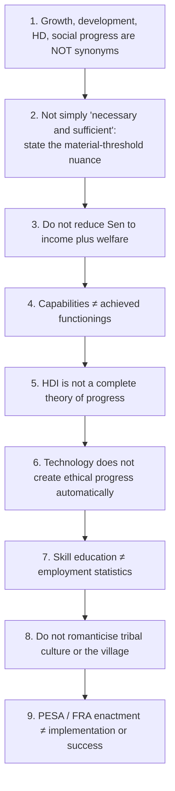

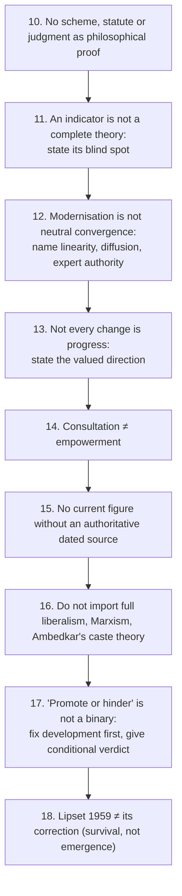

**2026 Q4(c) stem-specific traps:** answering with GDP alone; presenting authoritarian efficiency as obviously false (state it at full strength first); naming a present-day country as proof either way (❌ argue by mechanism); using Sen's famine argument as a universal guarantee (it concerns famine prevention under a free press); ignoring state capacity (WDR 2017); forgetting the constitutive claim.
**Ecology traps ⚠️:** adopting strong ecocentrism casually; applying degrowth uniformly to a society below the deprivation threshold; reproducing Brundtland verbatim; naming any project, company, movement or region.

---

## 14. Technical Vocabulary Bank

| Term | Meaning | Status |
|---|---|---|
| Functioning / capability | achieved being-doing / real opportunity | ✅ |
| Conversion factors | body, environment, norms that convert resources to freedom | ✅ |
| Agency | pursuing goals one has reason to value | ✅ |
| Adaptive preferences | utility adapts downward under deprivation | ✅ |
| Welfare of all (*sarvodaya*) | Gandhian aim | ✅ |
| Self-rule (*swarāj*) | Gandhian self-rule | ✅ |
| Trusteeship | owners as trustees; delegitimises absolute ownership | ✅ |
| Dignity of labour | Gandhian | ✅ |
| Structural transformation | change in production and institutions | ✅ |
| Modernisation: linear sequence, convergence, diffusion, expert direction | five assumptions | ✅ |
| Dependency; post-development | critiques of modernisation | ✅ |
| Redistribution and recognition | paired requirements | ✅ |
| Information → consultation → participation → co-decision → empowerment | agency ladder | ⚠️ |
| Lee thesis / authoritarian efficiency | rival to democracy-promotes-development | ✅ |
| Constitutive vs instrumental | two roles of participation | ✅/⚠️ |
| Anthropocentric / biocentric / ecocentric; moral considerability | moral-standing spectrum | ✅ |
| Shallow vs deep ecology | Naess 1973 | ✅ |
| Productivism; degrowth; throughput; sufficiency | growth critique | ✅/⚠️ |
| Contraction and convergence | asymmetric degrowth | ✅ |
| Subsistence vs luxury consumption | burden-sharing distinction | ⚠️ |
| Intergenerational justice; non-identity problem; pure time preference | future duties | ✅/⚠️ |
| Precaution and irreversibility | preserve options | ⚠️ |
| Environmentalism of the poor | livelihood struggle | ✅ |
| Ecological distribution conflict; eco-authoritarianism; just transition | ecology and participation | ⚠️ |
| Non-justiciable | Art 48A, Art 51A(g) | ✅ |

---

## 15. Graded Verdict & Answer Architectures

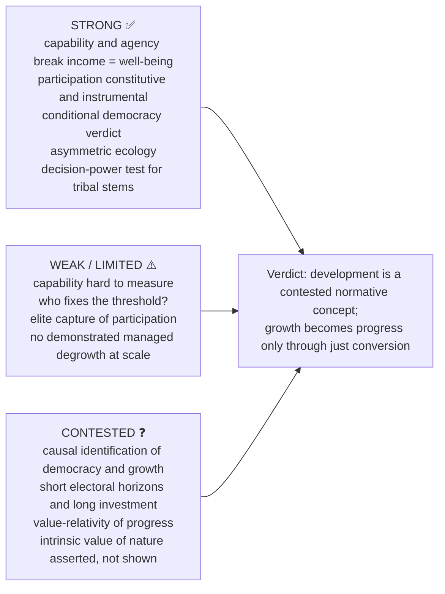

### 15.1 Directive decoder ⚠️

| Directive | Scored | Compulsory move | Failure |
|---|---|---|---|
| **Explain** | internal logic of one conception | definition → components → distinction from neighbouring term → example | listing indicators |
| **Discuss** | exposition plus adjudicated tension | conception → rival → objection → reply → verdict | describing schemes and statistics |
| **Evaluate** | judgment against stated standard | name standard → apply → concede counter-case → verdict | balanced description, no standard |
| **Necessary / sufficient / both / neither?** | modal terms handled separately | test necessity → test sufficiency → state which holds → verdict | "it is important" |
| **Do you agree that…** | commitment compulsory | qualified position first → reasons → counter-case → restate | survey of both sides |
| **Is it possible to reconcile X with Y?** | conditions of reconciliation | what each requires → collision → conditions under which both are satisfiable | wish-list |
| **Does X lead to Y?** | mechanism and defeater | mechanism → what breaks it → verdict on the conditional | assertion of correlation |

### 15.2 10-mark (~150 words, 4 moves)

```text
1. Distinguish the paired terms (growth, economic development, human development,
   capability, social progress) using the grid.
2. One causal or normative relation, as a mechanism with conversion conditions.
3. One failure mode + one evidence unit with its limitation.
4. Graded verdict in the stem's own modal terms.
```
Do not attempt Sen, Nussbaum, Gandhi and ecology together: one relation, fully worked.

### 15.3 15-mark (~220 words, 6 moves)

```text
1. State which conception of development is in dispute.
2. Exposition with presupposition.
3. The question-specific issue (skill, technology, tribe, ecology, democracy) worked through the conception.
4. One table (concept grid, Sen's terms, three ecological orientations, or §5.8 binding grid).
5. One worked objection → reply → residual problem.
6. Explicit graded judgment in the stem's modal vocabulary.
```
For necessary/sufficient stems: run the tests separately; growth without capability expansion defeats sufficiency; severe deprivation blocking health, education, voice supports a threshold necessity.

### 15.4 20-mark (~300 words, 8 moves)

```text
1. Provisional thesis: development is a contested normative concept.
2. Sequence: economistic → human development → capability → social progress.
3. Strongest rival model (dependency, post-development, Gandhian, ecological).
4. Two objection → reply chains, each ending in a residual problem.
5. Ecological layer: orientation → productivism → intergenerational → environmentalism of the poor.
6. Distributive reframing: who defines benefit, who bears cost, who decides.
7. One dated Indian illustration, correctly classified (statute / judgment / non-justiciable provision).
8. Graded verdict separating means, conversion conditions, final values.
```

### 15.5 Stem-specific spines

- **Gandhian development:** sarvodaya → swarāj → trusteeship → village → anti-industrial critique → Ambedkarite objection → reconstructed decentralisation under equal rights → verdict.
- **Skill education:** capability rather than employability → what skill secures and cannot → obsolescence and work-quality → critical citizenship and dignity of labour → conditional verdict.
- **Tribal reconciliation:** environmentalism of the poor reframes as distributive → four tests → PESA / FRA / Niyamgiri correctly classified → verdict on agency.
- **Democracy and development (15 marks, ~220 words):** define development (cite 1986 Declaration) → constitutive claim → instrumental channels (responsiveness; information and famine prevention, Sen 1999; inclusion; 2019 JPE estimate) → hindrance case at full strength (authoritarian efficiency, short horizons, populist consumption, Lee thesis) → conditionality (accountability + capacity + rule of law; capture, clientelism, exclusion) → graded verdict. 10 marks: definition → one constitutive line → two instrumental channels → efficiency objection → conditional verdict. 20 marks: add Lipset / Przeworski–Limongi correction, five-axis chart, two objection chains, distribution link and empowerment ladder, institutional conditions.

### 15.6 Graded verdict formulas (adapt, never reproduce mechanically)

- **Modal:** "Economic development is a threshold-level necessary condition and is clearly not a sufficient one: severe material deprivation blocks health, education and voice, while rising output has repeatedly coexisted with intensified unfreedom, humiliation and ecological loss."
- **Conversion:** "Growth becomes progress only through just conversion into capability, dignity and sustainable institutions; the conversion conditions, not the output figure, are where the normative question lies."
- **Agency:** "Development treats persons inadequately when it counts them as beneficiaries but not as agents; participation is both instrumentally useful and constitutive of the end."
- **Reconciliation (tribal):** "Development is reconcilable with tribal values only where communities are agents rather than objects — where capabilities destroyed are counted alongside those gained, participation extends to the decision and not only to the compensation, irreversible losses attract a precautionary presumption, and adjustment costs are not shifted onto the least able to bear them."
- **Asymmetric ecology:** "The ecological limit binds affluent consumption far more tightly than it binds subsistence; a uniform prescription of restraint mistakes an argument about the distribution of ecological burdens for an argument against material improvement as such."
- **Instrument:** "Technology expands the range of what can be done and thereby enlarges the domain of moral choice; it supplies no criterion for choosing, so ethical progress depends on institutions and values rather than on technical capacity."
- **Contested concept:** "Social progress is normative and multidimensional rather than an automatic law of history; the stem is answerable only after the conception of development it assumes has been made explicit."

### 15.7 Reusable statement lines

✅ Income is a means of development; capability measures what the means enable. ⚠️ Growth becomes progress only through just conversion into freedom, dignity and sustainable institutions. ⚠️ Technology expands power; ethics and institutions determine whether that power is progressive. ⚠️ Participation is both instrumentally useful and constitutive of development. ⚠️ Development compatible with tribal dignity must alter not only compensation but decision-power.

### 15.8 Evidence bank (Claim → Named anchor → Use for → Limit), 1 unit at 10 marks, 2 at 15, 4–5 at 20

| Unit | Claim | Anchor | Limit |
|---|---|---|---|
| D1 | Growth is a means whose value depends on conversion | Sen | measurement, selection of capabilities |
| D2 | Utility adapts downward under deprivation | Sen: adaptive preferences | paternalism risk |
| D3 | Justice needs a threshold of central capabilities | Nussbaum | imposes one conception of the good; capability ≠ compulsory functioning |
| D4 | Human development is not income | Haq; UNDP | indices conceal distribution, gender, disability, ecology |
| D5 | Underdevelopment can be produced | dependency approaches | can understate domestic factors |
| D6 | Who authorises the diagnosis? | post-development | romanticises the local |
| D7 | Sarvodaya, restraint of wants, trusteeship | Gandhi | Ambedkar's village objection compulsory |
| D8 | Moral standing is the prior question | §5.2 | strong ecocentrism subordinates individuals |
| D9 | Depth of questioning, not degree of concern | Naess (1973) | subsistence vs luxury must be drawn |
| D10 | Permanent aggregate growth not a coherent universal objective | productivism / degrowth | apply asymmetrically |
| D11 | Duties run to those not yet born | Brundtland (1987) paraphrase | non-identity; pure time preference |
| D12 | Environmentalism of the poor | Guha and Martinez-Alier (1997) | structure of conflict, not virtue |
| D13 | Participation is a condition of durable ecological policy | §5.7 | timing where a threshold is imminent |
| D14 | Technology expands power without supplying ends | §4.3 | reshapes moral problems, not null |
| D15 | Indian illustrations correctly classified | PESA 1996; FRA 2006; Orissa Mining 2013; Arts 48A, 51A(g) | none proves reconciliation or correctness |
| D16 | Indicators disclose and conceal | §2.3 | no composite settles weights |
| D17 | Modernisation is a theory, not inevitability | §3 | real structural change ≠ one universal route |
| D18 | Progress is directional but plural | §2.6 | pluralism needs a universal floor |
| D19 | Empowerment exceeds consultation | §4.1 | local power needs rights, representation, review |

---

## Link-outs named in the owner

Social and Political Ideals (justice, equality, liberty as criteria) · Political Ideologies (Marxian, socialist, Gandhian alternatives) · Humanism, Secularism and Multiculturalism (universal dignity, plurality) · Gender Discrimination (empowerment as capability) · Caste: Gandhi and Ambedkar (village, caste, social democracy) · Individual and State (participation, rights, accountability) · Crime and Punishment §2.5, §2.8 (corruption as obstacle; value-based education) · Forms of Government §4.3, §4A.4 (procedural/substantive democracy and pathologies).

## Sources

Local compiled notes PDF, *Socio-Political Philosophy*, searchable pp. 169–186 (no named author asserted); O. P. Gauba, *An Introduction to Political Theory*; Sen, *Development as Freedom* and *Commodities and Capabilities*; Nussbaum, *Creating Capabilities* and *Women and Human Development*; Mahbub ul Haq, *Reflections on Human Development*; Gandhi, *Hind Swaraj*; Ambedkar on caste, democracy and the village; PESA 1996 and FRA 2006 (India Code); *Orissa Mining Corporation v. Ministry of Environment & Forest* (2013); Naess (1973); Brundtland Report (1987, paraphrased); Guha and Martinez-Alier (1997); Constitution of India Arts 48A, 51A(g); UN Declaration on the Right to Development (1986) Arts 1–2; Acemoglu, Naidu, Restrepo and Robinson, "Democracy Does Cause Growth", *JPE* (2019); World Bank WDR 2017; UNDP HDR 2002; Lipset (1959); Przeworski and Limongi (1997). Dossier trail: Illich; Sachs (ed.), *The Development Dictionary*; Escobar; Goulet.
