# GENDER DISCRIMINATION — Examiner-Grade Mindmap

> **Syllabus (verbatim):** Gender Discrimination : Female Foeticide, Land and Property Rights; Empowerment.
> **Catalogue key:** `philosophy-paper-ii-socio-political-philosophy-09` · Paper II · Section A · Socio-Political Philosophy
> **Sources used:** `paper-2/socio-political/Gender-Discrimination.md` (canonical owner, read in full) · `_advanced/Socio-Political-Dossier.md` §9 (optional depth) · `paper-2/_PYQ-SocioPolitical-2018-2025.md` · `paper-2/_PYQ-SocioPolitical-2026-Supplement.md`.
> **Evidence key:** ✅ canonical · ⚠️ analytical synthesis · ❓ contested / empirical · ❌ trap / limit
> **Blueprint adaptation:** `MINDMAP_INSTRUCTIONS.md` is Indian-school oriented. The 16 module headings are kept; each module's focus is adapted to this clause. Module 1 = ownership boundary, thinkers and lineages; Module 2 = the justificatory argument (sex/gender, construction and structure; the sources give no *pramāṇa*-style epistemology); Module 3 = internal debates and refinements (feminist diagnoses, performativity, care/justice, category stability); Module 4 = conceptual inventory of the three printed applications (female foeticide, land and property, empowerment); Module 5 = normative and Indian legal bridges (the sources give no transcendent-reality ontology); Module 6 = causal chains; Module 7 = value aims; Module 10 = cross-tradition pairs (the sources give no East–West comparison table, only the internal pairs shown there).

> [!IMPORTANT]
> **Master thesis ⚠️.** Gender discrimination is reproduced by norms and institutions, not by biology alone; therefore legal equality is necessary but must be converted into effective control, capability and voice.

---

## 0. Master Overview

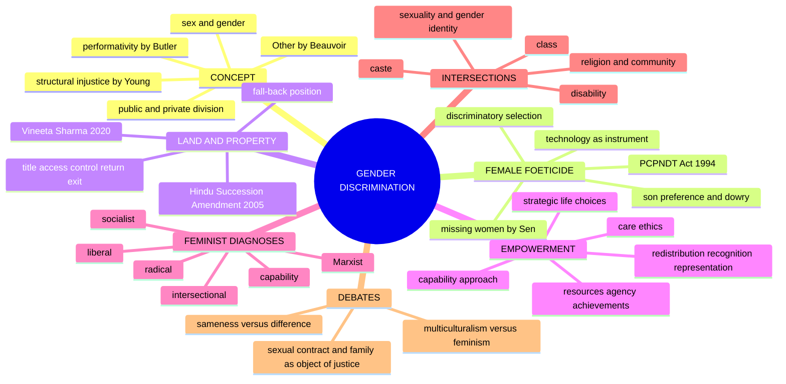

```text
SEXED BODY + SOCIAL INTERPRETATION
              │
              ▼
GENDER ORDER: roles · norms · division of labour · authority · inheritance
      │                 │                    │
      ▼                 ▼                    ▼
FEMALE FOETICIDE   UNEQUAL PROPERTY      DISEMPOWERMENT
devaluation of     title / control /      weak voice, mobility,
female life        inheritance gaps       bodily and political agency
      └─────────────────┬──────────────────┘
                        ▼
EMPOWERMENT: resources + capabilities + agency + recognition + institutional power
```

---

## 1. Ownership Boundary, Thinkers & Lineages

### 1.1 Printed clause and firewall ✅

| Content | Ownership here | Boundary |
|---|---|---|
| Gender discrimination | sex/gender, hierarchy, structural power, equality/difference and feminist diagnoses | Full equality theory remains with Social and Political Ideals |
| Female foeticide | discriminatory selection, bodily agency, technology and social valuation | General abortion doctrine, medical detail and harmful description remain outside |
| Land/property | title, access, control, return, security and bargaining power | Detailed succession/property law remains with legal/Polity study |
| Empowerment | resources, agency, achievement, capability, recognition, representation | Development owns the general capability framework; this file owns its gendered conversion |
| Intersectional bridges | caste, class, religion/community, disability, sexuality/gender identity where they alter the mechanism | Full caste and multicultural doctrines keep separate owners |

The conceptual owner is broader than women-only biology, while the three printed applications are specifically centred on discrimination against women.

### 1.2 Thinker control ✅/⚠️

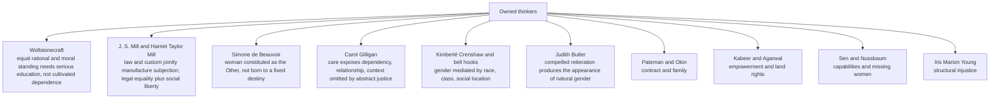

> [!NOTE]
> Friedan, Firestone, psychoanalytic feminism and ecofeminism are **not** independently routed by the 2018–2025 corpus and are not imported as a generic list. This table anchors approaches; it does not replace the mechanism, objection and reply required by the stem.

---

## 2. Justificatory Argument: What Is Gender and Why Is Inequality Not Biologically Entailed

> The sources give no *pramāṇa*-style epistemology. The module records the justificatory argument for the constructionist claim and its objections.

### 2.1 Doctrine and sex/gender distinction ✅

**Gender discrimination:** the unjust differential valuation, opportunity, burden or authority assigned to persons through socially organised meanings attached to sex and gender.

| Concept | Basic meaning | Qualification |
|---|---|---|
| **Sex** | bodily and reproductive characteristics | biological variation is more complex than a rigid social binary |
| **Gender** | socially produced roles, expectations and identities | embodied experience and social interpretation interact |
| **Gender hierarchy** | patterned ranking of masculinised and feminised roles | not every difference is discriminatory; unjust subordination is the issue |

### 2.2 Construction argument ✅

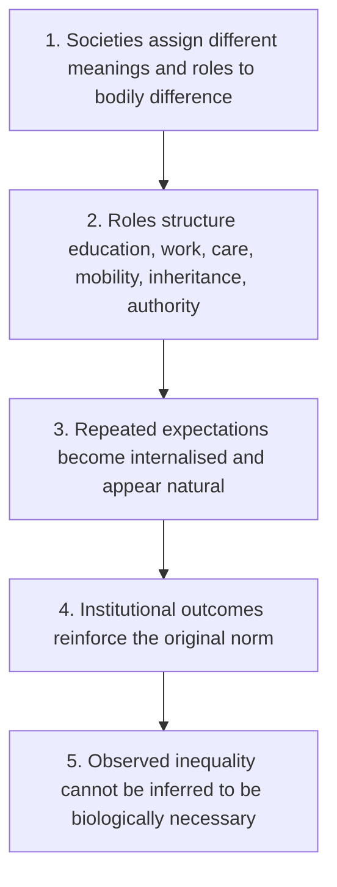

- **Presupposition:** social practices can shape preferences, capacities and self-conception.
- Beauvoir: one "becomes" a woman; femininity is a social position and project, not a destiny mechanically deduced from anatomy; woman is the **Other** relative to a male norm.
- **Cultural category ✅:** cultural does not mean imaginary or freely chosen; norms are embodied through family, language, labour, law, media and sanctions. **Socially constructed does not mean easily changed** (money, citizenship and caste are constructed yet exercise real power).

### 2.3 Objections and replies ✅/⚠️

| Objection | Reply |
|---|---|
| Biological-difference: some role differences reflect reproduction | Biological facts do not determine who controls property, whose work is valued or who has authority; social conclusions need independent justification |
| Choice: unequal outcomes reflect preferences | Preferences may be **adaptive**, formed under dependency, sanction and restricted options; respect for choice requires conditions of genuine capability |
| Reverse discrimination: targeted measures violate equality ⚠️ | Remedial differentiation is justified where it dismantles status hierarchy and expands equal citizenship; it must be proportionate and reviewable |

### 2.4 Equality: formal, substantive, relational ✅

| Type | Meaning |
|---|---|
| Formal equality | same rule |
| Substantive equality | attention to unequal starting positions, social burdens and effective outcomes |
| Relational equality | citizens meet without domination, stigma or servility |

Equality need not mean identical treatment: pregnancy, unpaid care, inherited exclusion and violence may require differentiated support.

### 2.5 Sameness / difference dilemma ⚠️

| Strategy | Claim | Risk |
|---|---|---|
| Sameness | one sex-neutral rule because women and men are equal persons | the male life-pattern may remain the hidden norm |
| Difference / accommodation | recognise pregnancy, care burdens, inherited exclusion | difference may be essentialised and used to reassign women to traditional roles |
| Substantive / transformative equality | ask whether rules alter capability, status and power | requires contested judgments about disadvantage and remedy |

Differential treatment is justified where it removes a socially produced burden and enlarges equal standing without fixing a permanent gender essence.

### 2.6 Structural injustice and the public/private division ⚠️

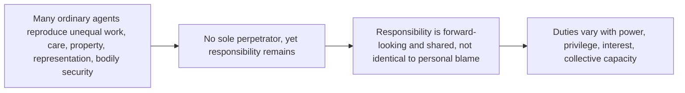

- **Iris Marion Young's social-connection model.** Objection: diffuse responsibility lets everyone blame the system. Reply: distinguish backward-looking blame for one's acts from forward-looking duties to reform processes one helps sustain; specify by role and power.
- **Public/private:** the household is a protected sphere of intimacy but not an immunity zone for domination; care burdens, control of income, bodily decision-making and family violence shape access to education, work, property and representation.

---

## 3. Internal Debates & Refinements

### 3.1 Main feminist diagnoses ✅

| Approach | Primary source of oppression | Remedy | Standard objection |
|---|---|---|---|
| **Liberal feminism** | unequal rights and opportunity | legal equality, education, access | underestimates family and structure |
| **Marxist feminism** | private property and class exploitation | transform production and property | patriarchy not reducible to class |
| **Socialist feminism** | interaction of capitalism and patriarchy | alter production and social reproduction | explanatory complexity |
| **Radical feminism** | patriarchy and control of sexuality/body | transform power and gender relations | may universalise women's experience |
| **Intersectional feminism** | intersecting caste, class, race, gender and other powers | context-sensitive anti-domination | categories can multiply without clear priority |
| **Capability feminism** | deprivation of real opportunities and bodily integrity | secure threshold capabilities and agency | list/measurement disputes |

### 3.2 Marxist versus socialist feminism — keep separate ❌/✅

| Axis | **Marxist feminism** | **Socialist feminism** |
|---|---|---|
| Origin of subordination | emergence of private property and class society; functional to the property-owning family | **interaction** of two systems, capitalism and patriarchy, each with its own logic |
| Status of patriarchy | derivative: a form of class oppression | **autonomous**: predates capitalism, would survive its abolition |
| Site of analysis | production; exclusion from social production, confinement to the private household | production **and** social reproduction: domestic labour, sexuality, childbearing, care |
| Remedy | abolish private property, socialise domestic labour, draw women into social production | transform property relations **and** the sexual division of labour, family, sexuality, organisation of care |
| Weakness ⚠️ | cannot explain male dominance persisting in avowedly socialist economies and non-capitalist societies | specifying how two systems interact without collapsing one or merely juxtaposing |

- **Dual systems** ⚠️: capitalism explains *class*, patriarchy explains *gender*; entangled, neither reducible. Strongest evidence for autonomy ✅: male dominance across radically different modes of production and where private property in the means of production was abolished.
- **Radical feminism** ✅: patriarchy is **primary**, operating through control of sexuality, reproduction, the body and violence; weakness ⚠️: universalising a particular experience, which intersectional analysis corrects.

### 3.3 Butler: gender as performative ⚠️

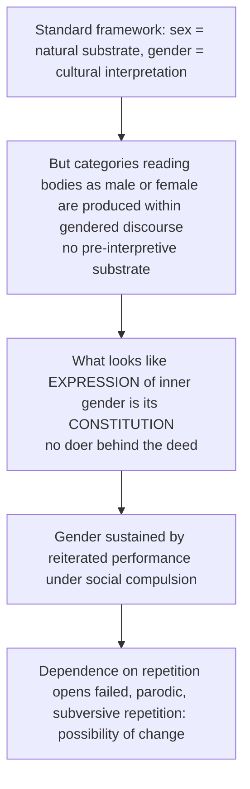

*Gender Trouble*, **1990**. Presupposition: identity categories are effects of discursive and social practices, not preconditions.

> [!WARNING]
> Three compulsory cautions: (1) not the textbook sex/gender distinction; it **contests** that distinction. (2) Butler does **not** deny bodies exist; the claim is about how their meaning and categorisation are produced. (3) "Performative" ≠ a costume freely chosen; it is compelled reiteration within a normative order.

| Exchange | Content |
|---|---|
| Objection (category problem) | if "woman" is wholly an effect of discourse, feminism loses its stable subject; mobilisation, anti-discrimination law and measurement presuppose a determinate category |
| Reply (strategic essentialism) ⚠️ | political claims can use provisionally and strategically stabilised categories while accepting historical construction; legal sex-discrimination categories work pragmatically so |
| Residual ⚠️ | a category adopted for leverage tends to harden into a description and to marginalise those it fits badly; present as **live and contested** |

*Use:* depth marker for gender-as-cultural-category and sex/gender stems; **not** required for empowerment, property or foeticide stems.

### 3.4 Category scope and trans-inclusive conceptual care ✅/⚠️

- Distinguish bodily sex characteristics, assigned classification, gender identity, gender expression, social role.
- Transgender, non-binary and gender-nonconforming persons may face discrimination through the same mechanisms of enforced role, stigma and institutional exclusion.
- Printed applications remain focused on women; inclusive care **extends the account of gender hierarchy without erasing sex-specific discrimination** in reproduction, property, care and violence. No claim about identity from anatomy, dress or role.
- "Women" as a strategically necessary political and legal category, kept internally diverse, historically constructed and open to those affected by misogyny and feminised subordination: a working criterion, not a settled resolution.

### 3.5 Care ethics: the Gilligan intervention ⚠️

*In a Different Voice*, **1982**: dominant accounts of moral development, framed around abstract rules, rights and impartial justice, registered women's moral reasoning as deficient; she identified an **ethic of care** organised around responsibility, relationship, context and maintenance of connection.

| | **Ethic of justice** | **Ethic of care** |
|---|---|---|
| Moral question | what is fair? whose right prevails? | who is vulnerable, what does this relationship require? |
| Self conceived as | separate, equal, rights-bearing | connected, interdependent, situated |
| Reasoning mode | abstraction from particulars, application of principle | attention to particulars, narrative, context |
| Failure mode | indifference; formalism ignoring need | self-effacement; absorption into others' needs |

- **Why it matters here:** (1) exposes the unpaid care economy as a political question, since care work constrains education, employment, mobility, office; (2) vocabulary for dependency (infancy, illness, disability, old age) that contract- and rights-based theories handle badly; (3) time is a resource, unequal care depletes it, so caring obligations structurally constrain agency.
- **Objection (essentialism)** → **Reply:** the defensible version treats care as arising from **socially assigned position and experience**, not nature; a critique of how moral theory was constructed, not of female psychology. **Residual ⚠️:** the empirical claim that orientations divide by gender is contested; the reply substantially reduces the original thesis. Pair with Butler if the stem concerns difference and equality.
- **Objection:** care without justice leaves domination inside relationships unexamined → **Reply ✅:** complementary; justice limits care from becoming self-erasure, care keeps justice from formalism.
- Advanced residue ⚠️: whether care is a *rival* moral theory or a corrective *emphasis* inside justice reasoning.

### 3.6 Pateman and Okin: the contract and the family ⚠️

| | **Carole Pateman**, *The Sexual Contract*, **1988** | **Susan Moller Okin**, *Justice, Gender, and the Family*, **1989** |
|---|---|---|
| Claim | classical social-contract theory presupposes a prior **sexual contract** securing men's access to women's bodies and labour | theories of justice, Rawls's above all, treat the family as a pre-political given rather than an institution justice must examine |
| Evidence | contract narratives are silent on the marriage contract and the domestic subordination that makes male civic equality practicable | unequal domestic burden restricts women's access to the primary goods (time, income, position, self-respect); family is where a sense of justice is first learned |
| Significance | challenges the contractarian account of political obligation (Individual and State §4.3) as not gender-neutral | extends justice from state and market into the household; "private sphere" becomes an object of justice |
| Limit | ❌ interpretive reconstruction of theory's silences, **not** a historical event | risks over-extending justice into every intimate relationship; most syntheses retain some family autonomy |

**Connect:** Pateman attacks the **foundation**; Okin works **within** the liberal framework to extend it.

---

## 4. Conceptual Inventory: The Three Printed Applications

### 4.1 Female foeticide ✅/⚠️

**Definition ✅.** Sex-selective termination of a pregnancy because the foetus is identified or presumed female. The wrong addressed is discriminatory selection rooted in the devaluation of daughters.

| Issue | Philosophical question |
|---|---|
| abortion generally | moral status, bodily autonomy, state coercion |
| sex-selective abortion | discriminatory reason for selection and social pattern |
| prenatal diagnostic technology | legitimate medical use versus discriminatory misuse |
| female infanticide | killing after birth; legally and conceptually distinct |

⚠️ Opposition must not erase women's bodily autonomy or equate every abortion with sex discrimination; the target is a patriarchal choice-structure.

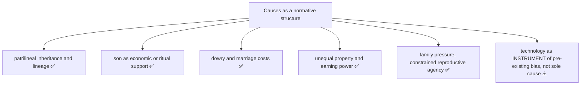

**Moral argument:** (1) sex selection treats female status as a reason for exclusion from birth; (2) repeated decisions create a social meaning that daughters are less worthy; (3) women may decide under coercive family and economic conditions; (4) the wrong includes discriminatory valuation **and** constrained agency; (5) reform must address norms, property, security and accountability, not technology alone.

- **Sen, "missing women" ✅:** excess female mortality and demographic absence from unequal care and social valuation: discrimination operates across birth, nutrition, health, survival. ❌ Do not invent or reproduce a number without a verified source and date.
- **Social imbalance ⚠️:** distorted sex composition can intensify trafficking, coerced marriage and violence, but consequences are not the primary reason it is wrong; dignity denied is. Avoid the consequentialist trap ("society needs women" re-instrumentalises women).

### 4.2 Land and property rights ✅/⚠️

**Definition ✅.** Legally recognised claims to inherit, own, use, control, manage, transfer and benefit from property on equal terms.

- **Capability argument:** resources affect security, shelter, livelihood, bargaining power → independent property reduces dependence → control can improve ability to exit violence and take part in decisions → property is a capability-conversion resource, not merely an asset.
- **Recognition argument:** equal inheritance marks daughters as full members rather than temporary dependants.

**Five levels (Bina Agarwal, *A Field of One's Own*, 1994)** ⚠️ — paraphrase, no page references:

| Level | Question | Why title alone fails |
|---|---|---|
| **Legal title** ✅ | is her name recognised in law or record? | law may be amended while records, custom, family practice are not |
| **Access / use** ✅ | can she actually use the land or asset? | blocked by distance, safety, seclusion norms, male kin |
| **Control** ✅ | can she decide cropping, leasing, sale, investment? | decision-power follows household authority, not title record |
| **Return** ✅ | does she receive income and benefit? | proceeds may be pooled and allocated by others |
| **Exit / security** ✅ | can the asset protect her against abandonment or violence? | the level at which land converts into **bargaining power** |

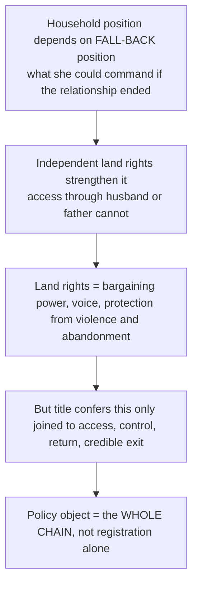

Presupposition ⚠️: intra-household allocation is a site of bargaining, not unified altruistic decision.

### 4.3 Empowerment ✅/⚠️

**Definition ✅.** Expansion of resources, capabilities, agency, recognition and institutional influence through which women can make and act upon significant choices.

| Dimension of power | Meaning |
|---|---|
| power over | domination or control of others |
| power to | capacity to act and achieve |
| power with | collective organisation and solidarity |
| power within | self-respect and critical consciousness |

Empowerment enlarges the latter three while constraining unjust "power over".

**Naila Kabeer's framework ⚠️** (cite by name; paraphrase): empowerment = expansion of the ability to make **strategic life choices** where that ability was previously denied.

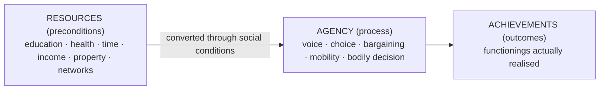

- Measurement errors: **resource-counting** (enrolment, accounts, transfers, scheme coverage = preconditions only) and **outcome-counting** (outcomes can rise with no growth in her own agency: better provision, not empowerment).
- **Decisive component = agency**, specifically the presence of **alternatives** and the cost of exercising them.
- **Strategic versus secondary choices:** strategic = marriage, childbearing, whether and where to work, movement, control over one's body; expanded consumer choice in an unchanged structure is not empowerment.
- Presupposition: agency is individual **and** collective.
- Objection (paternalism: analyst decides what is real empowerment) → Reply: assess the conditions under which a choice was available, not observer approval; residual: judging genuine alternatives needs interpretation.

**Capability approach ✅:** Sen — real freedoms; Nussbaum — bodily health, bodily integrity, practical reason, affiliation, control over one's environment. **Adaptive-preference problem:** reported satisfaction under restricted horizons. **Paternalism problem** → secure capabilities, information and exit while respecting plural chosen functionings.

### 4.4 Redistribution, recognition and representation ⚠️

| Dimension | Gendered wrong | Required remedy | Failure if isolated |
|---|---|---|---|
| Redistribution | unequal income, property, time, care burden, material security | resources, services, property/control, fair division of labour | may leave stigma, voice, hierarchy intact |
| Recognition | devaluation, stereotyping, humiliation; feminised work treated as lesser | equal status, transformed cultural value | may become symbolic without resources |
| Representation | exclusion from agenda-setting, interpretation, authoritative decision | voice, presence, organisation, accountable power | presence alone may not change policy or internal hierarchy |

**Synthesis:** empowerment requires all three. Representation without agency = tokenism; recognition without redistribution celebrates identity while preserving dependence; resources without voice become paternalistic provision.

---

## 5. Normative and Indian Legal Bridges

> The sources give no transcendent-reality ontology. The module records the legal, constitutional and cultural bridges the owner states, each with status and date.

### 5.1 Dated Indian instruments, correctly classified ✅

| Instrument | Status | What it does | What it does NOT establish |
|---|---|---|---|
| Pre-Conception and Pre-Natal Diagnostic Techniques (Prohibition of Sex Selection) Act, **1994** | enacted regulatory and penal statute, expanded by amendment to cover pre-conception sex selection | regulates supply and signalling | does not alone change son preference; needs property, care and status reform |
| *Beti Bachao Beti Padhao*, **2015** | administrative Union programme launched 2015 | an initiative | not a constitutional right, not proof of changed norms |
| Hindu Succession (Amendment) Act, **2005** | enacted amendment: daughters in a Mitakshara joint family get coparcenary status by birth on statutory terms | entitlement in law | not possession, control, return or exit |
| *Vineeta Sharma v. Rakesh Sharma*, **2020** | Supreme Court judgment clarifying the amended right, including that the father's being alive at commencement was not required | judicial clarification | waiver pressure, informal partition, record practice and fear of family rupture can still weaken conversion |
| Constitution (One Hundred and Sixth Amendment) Act, **2023** | enacted constitutional amendment commonly associated with women's reservation in Lok Sabha and State Legislative Assemblies; Gazette notification S.O. 1922(E) brought it into force on **16 April 2026** | reservation provisions | linked to a post-Act census-based delimitation sequence under Article 334A; seat-level operation pending as checked on **3 September 2026**; enactment ≠ immediate completed implementation; representation ≠ substantive empowerment |

> [!WARNING]
> Enactment, notification, enforcement and social implementation are distinct. Each instrument is a dated legal fact, never philosophical proof.

### 5.2 Personal law, culture and equality ✅

- Property regimes differ across communities and customary systems; the conflict is between cultural autonomy, gender equality and individual choice.
- **Multicultural dilemma:** protection of a minority from majority domination may coexist with restrictions on women within the group.
- **Answer:** preserve cultural voice but require internal participation, equal citizenship, reform and women's ability to contest authorised interpretations.

### 5.3 Intersectional mediation ✅/⚠️

| Axis | How it can alter gender discrimination |
|---|---|
| Caste | endogamy, labour, property, status, control of marriage/sexuality |
| Class | exposure to insecure work, unpaid labour, services, bargaining resources |
| Religion / community | minority vulnerability may coexist with internal authority and personal-law disputes |
| Disability | dependency arrangements, accessibility, substituted decision-making can intensify control |
| Sexuality and gender identity | compulsory heterosexuality, stigma, gender policing affect recognition and bodily/public freedom |

- Intersectionality does **not** add disadvantages like arithmetic; it asks how institutions produce a **distinct mechanism** at the intersection.
- In India, anti-caste analysis changes the account of how gender order is reproduced ⚠️ (caste doctrine owned by Caste Discrimination: Gandhi and Ambedkar).
- Objection: proliferating identities fragments a common subject. Reply ⚠️: common claims to dignity and equality remain; build coalition without treating the most privileged experience as universal. **hooks** = margin-to-centre warning; **Crenshaw** = intersectional method.

---

## 6. Causal & Explanatory Chains

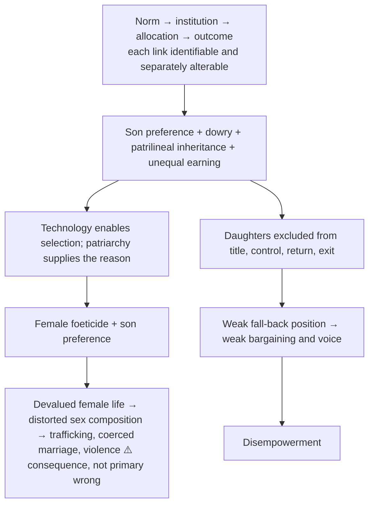

### 6.1 Empowerment and female foeticide pathway ⚠️

1. property, education and income alter the perceived status of daughters;
2. bodily and household agency reduces coercive reproductive decisions;
3. public voice challenges discriminatory norms;
4. social security reduces instrumental preference for sons;
5. so empowerment attacks underlying conditions, not merely the diagnostic act.

### 6.2 Foeticide objections and replies ✅

| Objection | Reply |
|---|---|
| Autonomy: prohibition may police pregnant women | primary regulatory focus on discriminatory diagnostic and commercial practices, coercive family structures and providers, while protecting women's health and agency |
| Technology: ultrasound causes the problem | technology enables selection but does not create the preference; the same technology has legitimate diagnostic uses |
| Outcome: balancing sex composition is sufficient justification | dignity and non-discrimination are prior; demographic balance is a consequence, not the foundation |

### 6.3 Equality ↔ empowerment relation ✅

- equality without agency can be merely formal;
- agency without structural equality can become exceptional individual success;
- empowerment links rights to actual control and collective transformation.

---

## 7. Value Aims

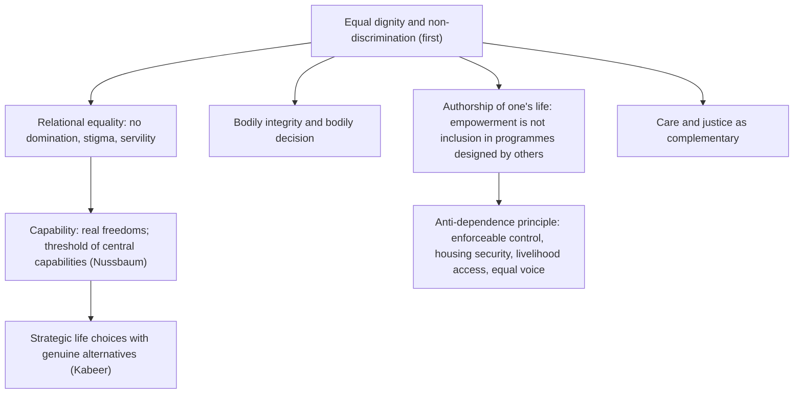

- **Anti-dependence principle** ⚠️: whatever the property form (private, joint, collective, social), women need enforceable control, housing security, livelihood access, equal voice.
- The wrong of foeticide lies **first** in discriminatory valuation, not demographic consequence.
- Property empowers when title is converted into use, control, return and security.

---

## 8. Inter-School Comparative Matrices

### 8.1 Feminist-approach comparison (compact) ✅

| Axis | Liberal | Marxist | Socialist | Radical | Intersectional | Capability |
|---|---|---|---|---|---|---|
| Root of oppression | unequal rights, opportunity | private property, class | capitalism × patriarchy | patriarchy, sexuality, body | intersecting caste, class, race, gender | deprivation of real opportunities and bodily integrity |
| Remedy | legal equality, education, access | transform production and property | alter production **and** social reproduction | transform power and gender relations | context-sensitive anti-domination | secure threshold capabilities and agency |
| Weakness | underrates family and structure | patriarchy not reducible to class | explanatory complexity | universalises experience | categories multiply | list and measurement disputes |

### 8.2 Justice vs care (see §3.5) and Pateman vs Okin (see §3.6)

### 8.3 Beauvoir vs biological essentialism ✅

Essentialism infers social role from sex; Beauvoir argues institutions make woman the subordinate Other. ⚠️ Contemporary theory adds that embodiment matters without dictating hierarchy.

### 8.4 Liberal vs radical feminism ✅

Liberal: equal rights within reformed institutions. Radical: sexuality, family and everyday power may reproduce patriarchy after formal equality. ⚠️ Synthesis: enforceable rights plus transformation of private and cultural power.

### 8.5 Sen/Nussbaum vs resource equality ✅

Equal resources do not yield equal freedom where conversion conditions differ; capability asks what women can actually do and be.

### 8.6 Multiculturalism vs feminism ✅

Group recognition can protect minorities from external domination while shielding internal gender hierarchy; the strongest resolution protects culture through the voice of all members, not elite authority.

### 8.7 Caste and gender ✅

"Women" are not a homogeneous class; caste endogamy, sexual control, labour and property shape gender differently.

---

## 9. Criticisms & Reconstructed Replies

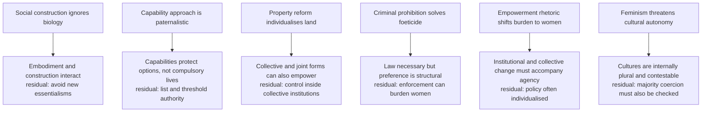

### 9.1 Further objection–reply chains ✅/⚠️

| Objection | Reply | Residual |
|---|---|---|
| Family solidarity: equal claims fragment family land | Excluding daughters buys consolidation with unequal status; neutral rules can address fragmentation without sex discrimination | — |
| Legal reform is enough | Rights are necessary resources; capability depends on awareness, records, control, credit, safety, social legitimacy | — |
| Property is capitalist | Even under social ownership women need enforceable control, housing security, livelihood access, equal voice | form varies, anti-dependence principle remains |
| Title ≠ control, so legal campaign is misdirected | A secure enforceable claim is normally necessary to protect **independent** access against arbitrary withdrawal; joint or collective holdings can also secure claims if women exercise actual enforceable decision power | intervening conditions slower, more diffuse, harder to legislate |
| Agarwal analysis is economistic | Exit/security level incorporates the non-economic function of land as protection and standing | — |
| Diffuse structural responsibility | Blame vs forward-looking responsibility | role and power must be specified |
| Proliferating identities fragment | Common dignity and equality claims; coalition without privileged universal | — |

---

## 10. Cross-Tradition Pairs (internal only)

> The sources give no East–West comparison table for this topic. Only the internal pairs the owner states are recorded.

| Pair | Point of contact | Decisive distinction |
|---|---|---|
| Wollstonecraft ↔ Mill and Taylor Mill | equal standing needs education / law and custom jointly produce subjection | Wollstonecraft stresses cultivated dependence; the Mills join legal equality to social liberty (formal vs substantive) |
| Beauvoir ↔ Butler | gender constructed | Beauvoir: one *becomes* woman; Butler **contests** the sex/gender split itself: compelled reiteration |
| Gilligan ↔ Butler | difference and essentialism | pair them when the stem concerns difference and equality |
| Pateman ↔ Okin | the contract and the family | foundational challenge vs internal reform |
| Marxist ↔ Socialist ↔ Radical feminism | root of subordination | derivative / dual systems / primary |
| Sen/Nussbaum ↔ Agarwal/Kabeer | capability, property, agency | capability frames; Agarwal supplies the property conversion chain; Kabeer supplies the agency chain |
| Feminism ↔ multiculturalism | group recognition | protect culture through voice of all members; same test applies to majority institutions (Okin, Kymlicka internal/external criterion; objection: can depict minority cultures as uniquely patriarchal) |
| Gender ↔ caste | endogamy and sexual control | Ambedkar's endogamy analysis; caste doctrine owned by Caste Discrimination: Gandhi and Ambedkar |

---

## 11. Diagnostic Deep-Dives for High-Frequency Themes

### 11.1 2026 Q2(b): land and property rights — necessary, sufficient or both? ⚠️

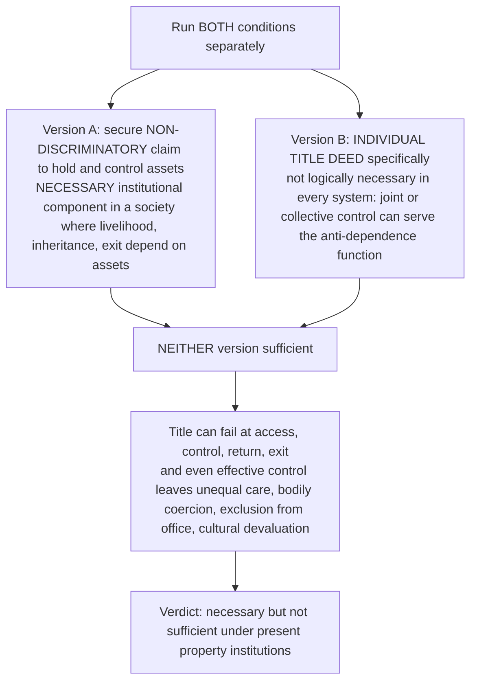

Objection: property alone should transform bargaining and recognition. Reply: important gains, not proof every sphere of equality follows. ❌ Do not present individual private title as a universal logical prerequisite or legal enactment as evidence of achieved equality.

### 11.2 2024 Q4(a): equality as a precondition vs completed goal ⚠️

Equal civic and bodily standing is a **normative and institutional prerequisite** for empowerment (otherwise resources and choices can be removed at will). But *fully realised* gender equality cannot be required **before** anyone is empowered: greater agency helps dismantle unequal norms. Formal rights → resources and safe alternatives → agency over strategic choices → achievements and collective reform: **a reciprocal process, not one-way chronology**. Objection: targeted support might enable agency amid unequal law. Reply: exceptional gains ≠ stable equality of power. ❌ Never answer the first 10 marks with "equality has already been achieved".

### 11.3 2018 Q4(c): feminism — equality or empowerment? ⚠️

Equality = the standard (no inferior status, rights, life chances by gender). Empowerment = process and part of the end (resources and agency to remake rules). Objection: formal liberal equality leaves household authority, care and property untouched → substantive and relational equality need effective power. Reverse objection: empowerment as exceptional individual success leaves the hierarchy → collective and institutional change must change who sets the terms of choice. **Verdict:** feminism is an ideology of **equality through empowerment and empowerment for equal standing**.

### 11.4 2020 Q4(a): can empowerment *eliminate* discrimination? ⚠️

Mechanism: independent resources let a person refuse some unequal bargains; collective organisation challenges public rules. Limit: income without control, unpaid care still carried, exceptional success leaves group stereotypes and institutional exclusion intact. Objection: enough agents of change → norms disappear. Reply: not automatic; opportunities, care responsibilities, legal remedies and men's institutional power must change. **Verdict:** empowerment is a driver and part of equality, not a stand-alone sufficient cause. Test "eliminate" versus "reduce".

### 11.5 2019 Q1(e): gender equality within a socialist regime? ⚠️

Socialising productive property reduces some economic dependence and widens access to work, care provision, resources. Inference to *gender* equality fails if men retain authority over household labour, bodily decisions, political leadership or interpretation of communal property. Marxist feminism (class/property) vs socialist feminism (autonomous patriarchy and social reproduction). Objection: socialism removes patriarchy's economic base. Reply: equality still needs enforceable individual claims, fair division of care, voice in workplaces, families and public bodies. Gender equality **can** be realised within socialism, but socialism as an ownership label neither entails nor measures it.

### 11.6 Other recurring stems

- **2018 Q4(b), 2021 Q4(b), 2023 Q3(c), 2024 Q4(a) second part (foeticide):** distinguish sex-selection from abortion rights at the outset → preference structure → missing-women argument → PCPNDT Act 1994 as a dated statute → wrong is discriminatory devaluation, not only demographic imbalance → verdict. 2021 Q4(b) tests "technology only?": technology enables, patriarchy supplies the reason.
- **2022 Q3(b), 2019 Q3(b), 2025 Q1(b) (construction):** §2 chain; Beauvoir; optional Butler with the category-stability exchange; do not make sex "purely natural" and gender "purely artificial".
- **2021 Q1(e), 2023 Q1(c), 2026 Q2(b) (property):** Agarwal's five levels → 2005 amendment and *Vineeta Sharma* correctly classified → conversion failures → personal-law tension → verdict on title versus control.

---

## 12. PYQ Routing Ledger

> Corpus signal: **12** primary-owned parts out of 112 in 2018–2025 (2/2/1/2/1/2/1/1 per year 2018–2025), continuous corpus 2018–2025. 2026 supplement adds **1** (Q2(b)). **Total 13.** The owner file and both ledgers record no pre-2018 parts for this topic. No cross-owned parts are recorded for this topic in either ledger.

| Year | Q | Marks | Exact demand | Core route |
|---|---|---:|---|---|
| 2018 | Q4(b) | 15 | How do you evaluate gender discrimination in the context of female foeticide ? | §4.1, §6 |
| 2018 | Q4(c) | 15 | Is feminism an ideology for empowerment or for equality ? Discuss. | §11.3 |
| 2019 | Q1(e) | 10 | Can gender equality be realised within a socialist regime? Analyse. | §11.5, §3.2 |
| 2019 | Q3(b) | 15 | Consider critically that gender discrimination is a rather man-made concept but not naturally endowed. | §2 |
| 2020 | Q4(a) | 20 | Do you agree that empowering women can eliminate gender discrimination? Discuss. | §11.4 |
| 2021 | Q1(e) | 10 | How far can land and property rights be effective in empowerment of women? Explain. | §4.2 |
| 2021 | Q4(b) | 15 | What are the main causes of female foeticide in India? Is it the result of demonic application of technology only? Discuss. | §4.1, §6.2 |
| 2022 | Q3(b) | 15 | Discuss gender as a cultural category as opposed to sex as a biological category. | §2, §3.3 |
| 2023 | Q1(c) | 10 | Do you agree that the rights concerning land and property have empowered women? Discuss. | §4.2, §5.1 |
| 2023 | Q3(c) | 15 | How does gender discrimination lead to female foeticide and social imbalance? Discuss. | §4.1 |
| 2024 | Q4(a) | 10+10=20 | Discuss gender equality as a necessary condition to achieve empowerment of women. Also examine the role of women empowerment in curbing the menace of female foeticide. | §11.2, §6.1 |
| 2025 | Q1(b) | 10 | How does gender as a social construct affect individuals' opportunities, rights, and access to resources? Critically discuss. | §2, §2.6 |
| 2026 | Q2(b) | 15 | Does providing land and property rights to women constitute a necessary condition or a sufficient condition or both for ensuring social equality among the genders? Discuss. | §11.1, §4.2 |

**Count check: 12 (2018–2025) + 1 (2026) = 13 primary-owned parts.**

### 12.1 Recurrence signal ⚠️

Older papers require feminism as empowerment/equality, gender under socialism, the constructed character of discrimination, empowerment's limits, property rights and technology in female foeticide. Related adjacent hits: the 2026 Caste Q4(a) stem (social endosmosis) touches caste–class–gender through its own owner; it is not a Gender part.

---

## 13. Top Exam Traps (23 in owner)

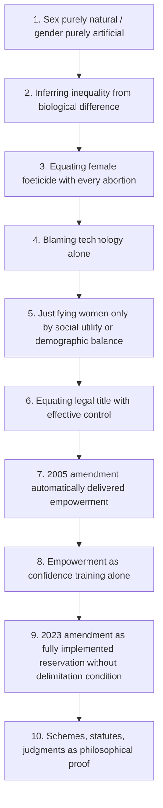

1. Do not say sex is "purely natural" and gender "purely artificial"; explain interaction while rejecting deterministic hierarchy.
2. Do not infer inequality from biological difference.
3. Do not equate female foeticide with every abortion.
4. Do not blame technology alone; it enables a pre-existing discriminatory preference.
5. Do not justify women only through social utility or demographic balance; begin with dignity.
6. Do not equate legal title with effective property control.
7. Do not say the 2005 amendment automatically delivered empowerment.
8. Do not treat empowerment as confidence training alone; include resources, agency, institutions.
9. Do not describe the 2023 constitutional amendment as fully implemented reservation without the delimitation condition.
10. Do not use schemes, statutes or judgments as philosophical proof; state legal/administrative status and date.
11. ❌ Do not present Butler's performativity as the standard sex/gender distinction; it contests it; Butler does not deny bodies exist; pair with category-stability objection and strategic-essentialism reply.
12. ❌ Do not conflate Marxist and socialist feminism (derivative vs autonomous patriarchy).
13. ✅ Credit Naila Kabeer (resources–agency–achievements) and Bina Agarwal (ownership–control–benefit) by name.
14. ⚠️ Do not measure empowerment by resources or outcomes alone; the decisive component is agency and alternatives.
15. ⚠️ Do not use care ethics without the essentialism objection; state the socially-positioned reading and mark as contested.
16. ❌ Do not present Pateman's sexual contract as a historical event.
17. ⚠️ Do not overstate the reach of any statute or judgment (2005 amendment, *Vineeta Sharma* 2020 settle coparcenary entitlement, not possession, control, return, exit).
18. Do not treat women as a homogeneous class; trace the mechanism through caste, class, community, disability, sexuality/gender identity.
19. Do not make anatomy, dress or role a proxy for gender identity; keep sex-specific disadvantage visible.
20. Do not resolve the sameness/difference dilemma by slogan; test whether treatment removes a burden or entrenches an essence.
21. Do not collapse redistribution, recognition, representation.
22. Do not confuse structural responsibility with collective guilt; shared forward-looking duties graded by power and role.
23. Do not import Friedan, Firestone, psychoanalytic feminism or ecofeminism as a generic list.

Dossier additional guard: do not make the answer a law list; do not reduce gender to biology or empowerment to job access alone; do not overload imported theory before the syllabus triad is complete. ❌ Do not invent or reproduce any figure, ratio or survey statistic.

---

## 14. Technical Vocabulary Bank

| Term | Meaning | Status |
|---|---|---|
| sex / gender | bodily-reproductive characteristics / socially produced roles, expectations, identities | ✅ |
| Other (Beauvoir) | woman defined against a male norm | ✅ |
| gender hierarchy | patterned ranking of masculinised and feminised roles | ✅ |
| performativity; reiteration; no doer behind the deed | Butler's account of gender as compelled stylised repetition | ⚠️ |
| category stability; strategic essentialism | the objection and the provisional-category reply | ⚠️ |
| patriarchy | system of male dominance; derivative, autonomous or primary by school | ✅ |
| dual systems | capitalism + patriarchy as interacting systems (socialist feminism) | ⚠️ |
| social reproduction | domestic labour, sexuality, childbearing, care | ✅ |
| substantive / formal / relational equality | see §2.4 | ✅ |
| adaptive preference | reported satisfaction shaped by restricted options | ✅ |
| intersectionality | distinct mechanism at the junction of caste, class, community, disability, sexuality | ✅ |
| structural injustice; social connection; blame vs responsibility | Young | ⚠️ |
| ethic of care; justice and care as complementary | Gilligan | ⚠️ |
| sexual contract | Pateman: interpretive reconstruction, not an event | ⚠️ |
| family as an object of justice | Okin | ⚠️ |
| son preference; discriminatory selection | female foeticide vocabulary | ✅ |
| missing women | Sen's demographic-deficit lens | ✅ |
| title / access / control / return / exit | Agarwal's five levels | ⚠️ |
| fall-back position; intra-household bargaining | Agarwal | ⚠️ |
| coparcenary | status conferred on daughters by the 2005 amendment | ✅ |
| resources–agency–achievements; strategic life choices; availability of alternatives | Kabeer | ⚠️ |
| power over / to / with / within | dimensions of power | ✅ |
| capability; bodily integrity; bodily health; practical reason; affiliation; control over one's environment | Sen; Nussbaum | ✅ |
| redistribution / recognition / representation | justice dimensions | ⚠️ |
| sameness / difference dilemma; transformative equality | §2.5 | ⚠️ |
| internal restriction | multiculturalism-and-gender term | ✅ |

---

## 15. Graded Verdict & Answer Architectures

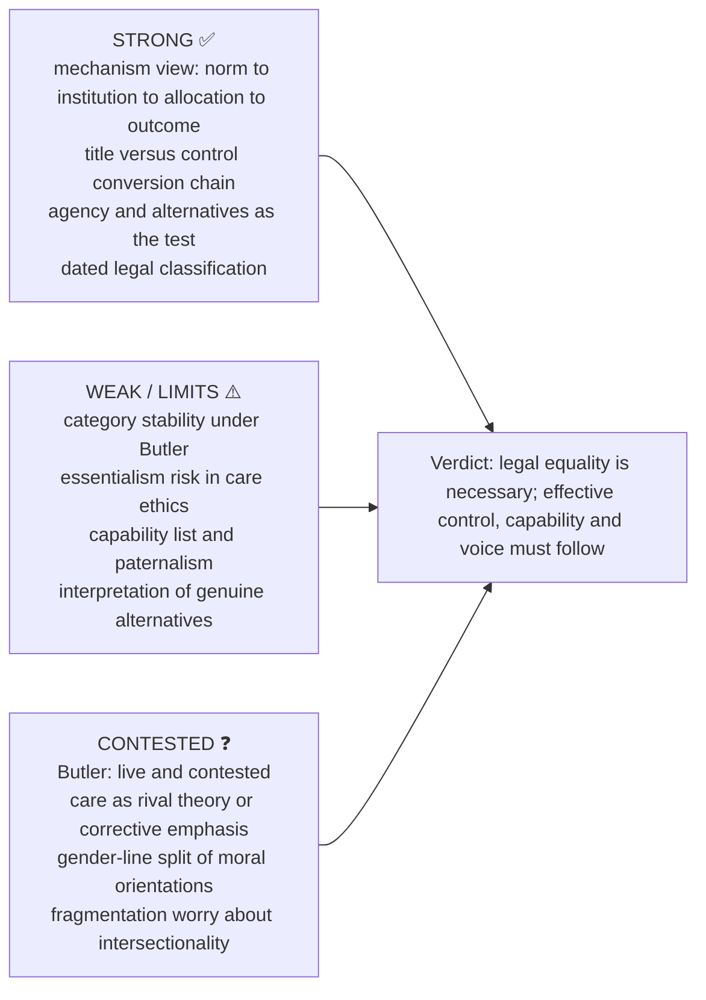

### 15.1 Directive decoder — the verb fixes the structure ⚠️

| Directive | What is scored | Compulsory move | Failure mode |
|---|---|---|---|
| Explain | internal logic of one concept | definition → components → distinction from nearest confusable term → example | describing the problem instead of analysing the concept |
| Discuss | exposition plus one adjudicated tension | diagnosis → rival diagnosis → objection → reply → verdict | listing feminisms with no adjudication |
| Critically examine / evaluate | the objection–reply layer is the answer | two objections, each with reply and residual | indignation instead of argument |
| Can X eliminate Y? | the mechanism linking X to Y, then its test | mechanism → what it reaches → what it cannot → conditional verdict | asserting empowerment solves everything |
| How far / to what extent | a degree judgment | conditions of holding and failing | survey with no commitment |
| Suggest measures | reasons, not a scheme list | principle → mechanism → objection → qualified proposal | naming statutes as arguments |
| Comment on a thinker's claim | locate the claim in its debate first | claim → what it contests → limit → verdict | reverent restatement |

Standing rule: every claim about Indian law carries its **status and date** and the conversion caveat.

### 15.2 10-mark (~150 words, 4 moves)

```text
1. Define and distinguish (2 lines): sex/gender, discrimination/difference, foeticide/abortion, title/control, equality/empowerment.
2. Mechanism (4-5 lines): norm -> institution -> unequal outcome, with named intervening conditions.
3. One evidence unit with its limitation.
4. Graded verdict (2 lines) answering the stem's own modal question.
```
> ❌ At 10 marks do not attempt Butler, Kabeer, Agarwal and care ethics together. One framework, fully worked.

### 15.3 15-mark (~220 words, 6 moves)

```text
1. Identify the discriminatory structure (distributive, recognitive or denial of agency).
2. Theory: Beauvoir, feminist-diagnoses grid or capability framework, with presupposition.
3. Clause-specific mechanism with one dated Indian illustration.
4. One table: diagnoses / five land levels / resources-agency-achievements / justice-care / Marxist-socialist.
5. One worked objection -> reply -> residual problem.
6. Graded conclusion: formal change versus effective control.
```

### 15.4 20-mark (~300 words, 8 moves)

```text
1. Provisional thesis: hierarchy is socially reproduced, not biologically entailed, using the stem's directive verb.
2. Conceptual layer: equality, capability, empowerment with the strategic-choice criterion.
3. Application: foeticide, property or representation with accurate legal status.
4. Rival diagnosis in its best form.
5. Two objection -> reply chains, each with a residual problem.
6. Conversion analysis: title to control, or resource to agency (carry the most space).
7. One dated Indian illustration with its condition.
8. Graded verdict: empowerment as individual and collective authorship; name the structural residue.
```
> ⚠️ On "can empowerment eliminate…" stems, build the mechanism, then find its limit; conclude with necessary/insufficient, not affirmation.

### 15.5 Evidence bank G1–G20 (Claim → Named → Use → Limit) ✅/⚠️

| # | Claim | Named | Use for | Limit |
|---|---|---|---|---|
| G1 | womanhood socially and historically constituted; woman is the Other | Beauvoir, *The Second Sex* | every sex/gender stem | existentialist framework can understate material and institutional constraint |
| G2 | gender is performative | Butler, *Gender Trouble* (1990) | cultural-category stems; depth marker | pair with category-stability and strategic essentialism; contested |
| G3 | discrimination is a mechanism, not an attitude | owner §1.5, §2.3 | any "causes" stem | mechanisms differ by clause |
| G4 | missing-women deficit | Sen | foeticide | cite structure; no invented figures |
| G5 | title is not control | Agarwal, *A Field of One's Own* (1994) | property stems | title remains the necessary anchor |
| G6 | land is bargaining power | Agarwal | turns property answer into political philosophy | presupposes bargaining model |
| G7 | empowerment = expansion of strategic choice | Kabeer | every empowerment stem | judging genuine alternatives needs interpretation |
| G8 | adaptive preference defeats satisfaction measures | Sen; Nussbaum | survey-based claims | overriding preference requires an argument |
| G9 | threshold of central capabilities | Nussbaum, *Women and Human Development* | dignity-grounded stems | fixed list attracts imposition charge |
| G10 | care is a political question | Gilligan, *In a Different Voice* (1982) | work, family, representation | essentialism risk; pair with justice |
| G11 | contract rests on prior subordination | Pateman (1988) | foundational critique | interpretive reconstruction, not an event |
| G12 | family is an object of justice | Okin (1989) | extending justice into household | over-extension risk |
| G13 | patriarchy derivative, autonomous or primary | §3.2 grid | feminist-perspectives stems | state which you rely on |
| G14 | culture cannot shield internal subordination | Okin, "Is Multiculturalism Bad for Women?"; Kymlicka external/internal criterion | multiculturalism-and-gender | can depict minority cultures as uniquely patriarchal; same test for majority institutions |
| G15 | caste and gender jointly reproduced | Ambedkar's endogamy analysis; intersectional framing | the Indian anchor in 20-markers | caste doctrine owned elsewhere; name the mechanism and route |
| G16 | Indian legal instruments, correctly classified | PCPNDT 1994; HSA Amendment 2005; *Vineeta Sharma* 2020; 106th Amendment 2023 | Indian paragraph | none establishes possession, control or completed implementation |
| G17 | structural injustice without one sole author | Young | 2025 construct/opportunity/resource stem | shared responsibility must not erase personal blame |
| G18 | sameness/difference dilemma | §2.5 | feminism as equality/empowerment, substantive equality | remedial distinction must be proportionate and revisable |
| G19 | three dimensions of justice | §4.4 | property, empowerment, representation | bridge only; recognition theory owned elsewhere |
| G20 | intersectionality changes the mechanism | Crenshaw; bell hooks | heterogeneous-category qualification | coalition still needs common dignity claims |

### 15.6 Graded verdict formulas (adapt; never reproduce mechanically) ⚠️

- **Conversion:** "Legal entitlement is the necessary anchor and not the sufficient condition: what converts title into power is access, control, return and a credible exit, and it is at those levels that reform has been weakest."
- **Necessary-not-sufficient:** "Empowerment expands agency and bargaining power and is therefore indispensable; it cannot by itself eliminate discrimination sustained by others' norms, by institutional design and by intra-household allocation that no individual can renegotiate alone."
- **Agency:** "An improvement in outcomes achieved without any expansion of a woman's own strategic choice is better provision, not empowerment; the presence of alternatives, and the cost of exercising them, is the test."
- **Structure:** "Discrimination against women is not an aggregate of prejudiced individuals but a structure of norms, institutions and allocations, which is why remedies aimed only at attitudes under-perform."
- **Contested thesis:** "The performativity thesis dissolves the naturalness of gender at the cost of the stable subject feminism mobilises; the exchange between anti-essentialism and strategic essentialism is live, and an answer should hold both rather than resolve it by fiat."
- **Complementarity:** "Care supplies the attentiveness that prevents justice from becoming formalism, and justice supplies the limits that prevent care from becoming self-erasure; neither orientation is complete alone."
- **Status:** "The instrument is enacted and its scope is settled; whether it has altered possession, control or standing is a separate question, and the philosophical claim must be argued rather than inferred from the statute."

### 15.7 Reusable statement lines ✅/⚠️

- Social construction does not make gender unreal; it explains how institutions make hierarchy appear natural.
- The wrong of female foeticide lies first in discriminatory valuation, not merely in demographic consequence.
- Technology supplies the means of selection; patriarchy supplies the reason.
- Property empowers when title is converted into use, control, return and security.
- Formal equality opens the door; capability determines whether one can pass through it.
- Empowerment concerns the authorship of one's life, not merely inclusion in programmes designed by others.
- Gender justice in India must analyse caste, class and community as intersecting structures, not decorative variables.

### 15.8 Stem-specific spines ⚠️

- **Empowerment and discrimination (2024 pattern):** equality as enabling structure → three dimensions of §4.3 with agency decisive → causal link to the specific harm → autonomy and legal-conversion limits → institutional and normative conclusion.
- **Property:** Agarwal's five levels → 2005 amendment and *Vineeta Sharma* correctly classified → waiver pressure, informal partition, record practice → personal-law and equality tension → verdict on title versus control.
- **Foeticide:** sex-selection versus abortion at the outset → preference structure → missing-women argument → PCPNDT Act 1994 as a dated statute → why discriminatory devaluation is the wrong → verdict.

> [!TIP]
> **Dossier use (optional depth, ⚠️).** Care ethics, intersectionality and adaptive preference were promoted to Core on 15 Aug 2026. Still optional if a PYQ asks directly: Young-style structural injustice and the blame/responsibility split. India-centric safe use in 15/20-markers: unpaid care work, inheritance in practice, dowry-linked son preference, local political representation, education and bodily autonomy, only to show how norms, institutions and resources interact; keep "empowerment" tied to agency, not slogan. Capability vs property-based empowerment: formal asset rights matter, but control, agency and conversion conditions matter more than title alone.

---

## Link-outs named in the owner

Social and Political Ideals (formal, substantive and relational equality) · Development and Social Progress (capability, agency, adaptive preference) · Humanism, Secularism and Multiculturalism (dignity and the multiculturalism–feminism debate; recognition/redistribution owner §3A) · Caste Discrimination: Gandhi and Ambedkar (endogamy, intersectional hierarchy) · Individual and State (rights, duties, accountability; Pateman challenge to §4.3) · Political Ideologies (liberal, Marxist, socialist accounts of emancipation).

## Sources

Local compiled notes PDF, *Socio-Political Philosophy*, searchable pp. 188–197 (no named author asserted); O. P. Gauba, *An Introduction to Political Theory*; Mary Wollstonecraft, *A Vindication of the Rights of Woman*; J. S. Mill and Harriet Taylor Mill; Simone de Beauvoir, *The Second Sex*; Amartya Sen, "More Than 100 Million Women Are Missing"; Martha C. Nussbaum, *Women and Human Development*; Kimberlé Crenshaw; bell hooks, *Feminist Theory: From Margin to Center*; Susan Moller Okin, *Justice, Gender, and the Family* and "Is Multiculturalism Bad for Women?"; B. R. Ambedkar on caste and endogamy; PCPNDT Act 1994; Hindu Succession Act 1956 as amended 2005 (s. 6); *Vineeta Sharma v. Rakesh Sharma* (2020); Constitution (106th Amendment) Act 2023 with Gazette S.O. 1922(E), 16 April 2026; Judith Butler, *Gender Trouble* (1990); Carole Pateman, *The Sexual Contract* (1988); Carol Gilligan, *In a Different Voice* (1982); Naila Kabeer; Bina Agarwal, *A Field of One's Own* (1994). Advanced trail (dossier §9): Iris Marion Young, *Responsibility for Justice*; Uma Chakravarti, *Gendering Caste*.

> ⚠️ **Provenance note.** Named-scholar sections are reconstructions adapted into the owner file. No page, chapter, edition or verbatim wording is asserted for Butler, Young, Pateman, Okin, Gilligan, Kabeer, Agarwal, Crenshaw or hooks, and no figure, ratio, survey result or dated statistic is asserted for any year, State or region.
