# CASTE DISCRIMINATION: GANDHI AND AMBEDKAR — Examiner-Grade Mindmap

> **Syllabus (verbatim):** Caste Discrimination : Gandhi and Ambedkar.
> **Catalogue key:** `philosophy-paper-ii-socio-political-philosophy-10` · Paper II · Section A · Socio-Political Philosophy
> **Sources used:** `paper-2/socio-political/Caste-Gandhi-Ambedkar.md` (canonical owner, read in full) · `_advanced/Socio-Political-Dossier.md` §10 (optional depth) · `paper-2/_PYQ-SocioPolitical-2018-2025.md` · `paper-2/_PYQ-SocioPolitical-2026-Supplement.md`.
> **Evidence key:** ✅ canonical · ⚠️ analytical synthesis · ❓ contested / empirical · ❌ trap / limit
> **Blueprint adaptation:** `MINDMAP_INSTRUCTIONS.md` is Indian-school oriented. The 16 module headings (0–15) are kept; each module's focus is adapted to this clause. Module 1 = ownership boundary and concepts; Module 2 = justificatory arguments (no *pramāṇa* epistemology in the sources); Module 3 = internal debates and refinements (Gandhi's evolving position; Ambedkar's endosmosis); Module 4 = conceptual inventory of the two programmes; Module 5 = normative and Indian legal bridges (no transcendent-reality ontology in the sources); Module 7 = value aims; Module 10 = internal cross-tradition pairs only (the sources carry no East–West table).

> [!IMPORTANT]
> **Master thesis ⚠️.** Gandhi moralises the responsibility of the privileged; Ambedkar politicises the agency of the oppressed. The defensible synthesis is **Ambedkarite in structure and rights, Gandhian only where moral transformation serves — not substitutes for — annihilation of caste**. Convergence of ends is not equivalence of diagnosis, method or power.

---

## 0. Master Overview

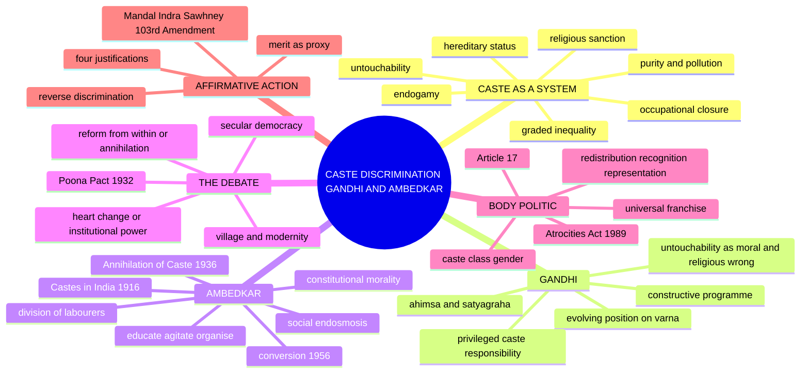

---

## 1. Ownership Boundary, Concepts & Lineages

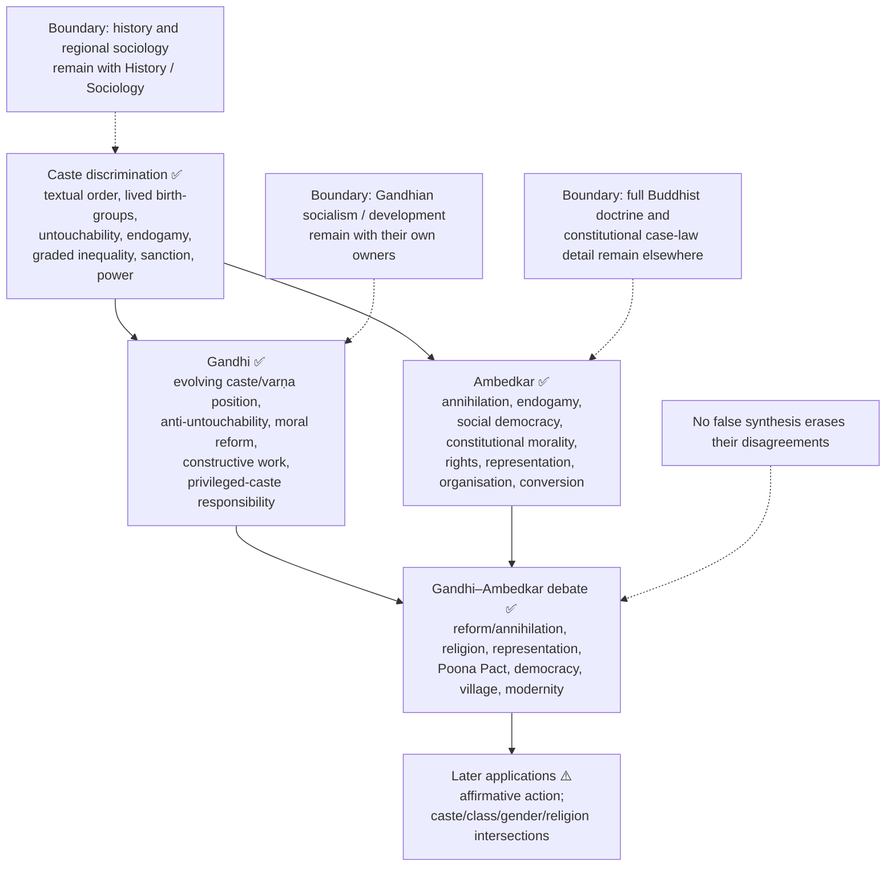

### 1.1 Four terms — do not equate them ✅

| Term | Basic meaning | UPSC caution |
|---|---|---|
| **Textual fourfold order (*varṇa*)** | Normative classification in Brahmanical texts | Not identical with lived caste |
| **Lived endogamous birth-group (*jāti*)** | Birth-based social group, often locally organised | Thousands of groups, regional variation |
| **Caste system** | Institutional order linking birth, endogamy, status, occupation, social closure | Not merely division of labour |
| **Untouchability** | Practices imposing extreme exclusion and stigma on designated groups | Symptom and intensification of caste hierarchy |

⚠️ Avoid describing caste as a single unchanged institution across all of Indian history. The philosophical target is the justification and reproduction of **birth-based graded inequality**.

### 1.2 Mechanisms of caste discrimination (2024 Q1(c)) ✅/⚠️

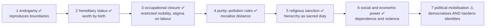

**How the factors reinforce one another ⚠️.** Endogamy transmits group membership; hereditary status and purity rules assign rank; occupational closure and unequal assets make exit costly; social boycott or violence punish dissent; religious sanction presents the arrangement as duty. Formal prohibition removes a legal permission, not these mutually reinforcing incentives and sanctions. Distinguish the **mechanism** that reproduces a boundary, the **justification** that legitimises it, and the **power** that enforces it; regional forms and agency vary.

### 1.3 Ambedkar's decisive conceptual moves ✅

| Move | Content |
|---|---|
| **Not division of labour** | Caste is **division of labourers**: it ranks workers, fixes occupation by birth, prevents free association |
| **Graded inequality** | Not a binary of two homogeneous classes; groups are subordinated to some and claim superiority over others → graded hierarchy obstructs solidarity because each level has a stake in distinction from those below |
| **Caste and democracy** | Equal votes coexist with unequal status and social power; electoral competition may convert caste into patronage and bloc mobilisation |

⚠️ Caste in the body politic is ambivalent: democratic assertion by oppressed groups is not equivalent to caste supremacy, but representation alone does not annihilate status hierarchy.

---

## 2. Justificatory Arguments

> The sources give no *pramāṇa*-style epistemology for this topic. This module records the argument-chains by which each thinker justifies his diagnosis and remedy, with presuppositions and objections.

### 2.1 Gandhi's argument against untouchability ✅

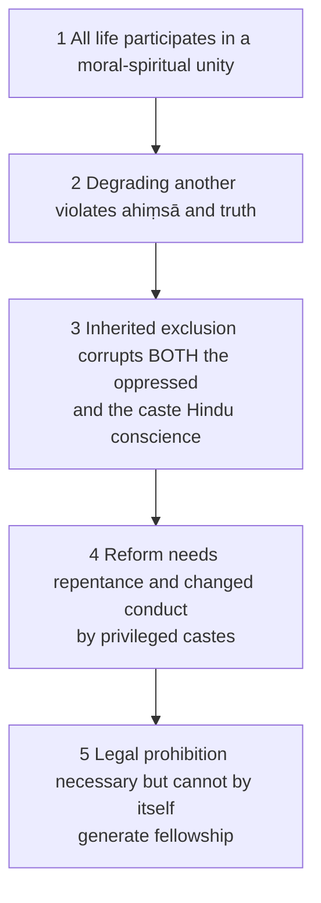

- **Method ✅:** change of heart and self-purification · non-violent truth-force (*satyāgraha*) · constructive programme (education, sanitation, common service, village work) · religious reinterpretation from within Hindu life · non-violence and persuasion rather than class war · trusteeship and economic reform.
- **Presuppositions ⚠️:** religious traditions contain resources for self-criticism; privileged persons can be morally transformed; means must embody the equal fellowship sought; unity should not be bought by coercive hatred.
- **K5 anchor:** untouchability is a sin against humanity and religion itself, to be expiated by the practising community through penance, service and self-purification. *Limit ⚠️:* places the initiative with the dominant group's conscience — Ambedkar's central objection.

### 2.2 Ambedkar's argument: endogamy → annihilation ✅

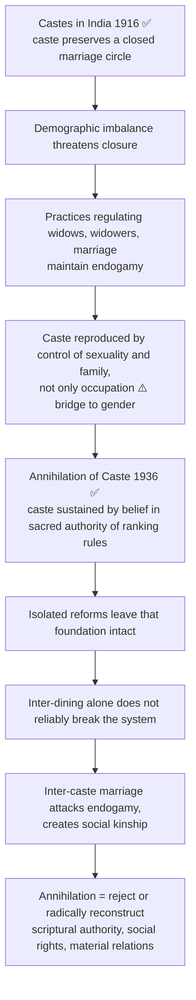

### 2.3 Ambedkar's rights argument (constitutional morality) ✅

1. Caste is enforced through social power, not merely private prejudice.
2. Victims need rights and remedies independent of dominant goodwill.
3. Political representation lets subordinated groups speak for themselves.
4. Constitutional morality restrains inherited social authority.
5. Democracy must become a mode of associated living, not only periodic voting.

**K9 ⚠️:** the form of administration can be perverted without changing the text, so a diffused commitment to constitutional norms must be cultivated; the text names a condition without specifying how it is produced.

### 2.4 Liberty, equality, fraternity ✅

| Missing element | Result |
|---|---|
| Liberty without equality | Domination |
| Equality without liberty | Suppressed individuality |
| Both without fraternity | No social disposition to recognise others as equals |

✅ Fraternity is not sentimentality; it is the social basis of democracy.

### 2.5 Objections to Gandhi, with Gandhian replies ✅/⚠️

| Objection | Reply | Residue |
|---|---|---|
| **Paternalism:** reformers speak for the oppressed and rename them without transferring power | Moral responsibility of oppressors is indispensable | Objection stands unless oppressed communities have autonomous voice and leadership |
| **Structural:** change of heart leaves property, representation and institutional exclusion intact | Constructive programme and satyāgraha are social practices, not private sentiment | Enforceable rights are still required |
| **Varṇa:** hereditary duty reproduces caste even without declared superiority | Later trajectory weakens birth hierarchy | Early defences remain a genuine theoretical liability |
| **Religious reform preserves authority that sustains caste** | Distinguishes living ethical religion from unjust accretions | Ambedkar: the authority structure itself must be broken |

### 2.6 Objections to Ambedkar, with replies ✅

| Objection | Reply |
|---|---|
| **Legalism:** law cannot abolish social attitudes | Ambedkar never relies on law alone; law changes power, protects action, enables movements |
| **Fragmentation:** separate organisation divides national unity | Unity built on silence of the oppressed is domination; equal representation conditions legitimate common life |
| **Religious hostility:** rejecting scriptural authority attacks believers | Target is authority insofar as it sanctifies graded inequality; freedom of belief cannot entail power to impose civic disability |

---

## 3. Internal Debates & Refinements

### 3.1 Gandhi's evolving position (periodise!) ✅/⚠️

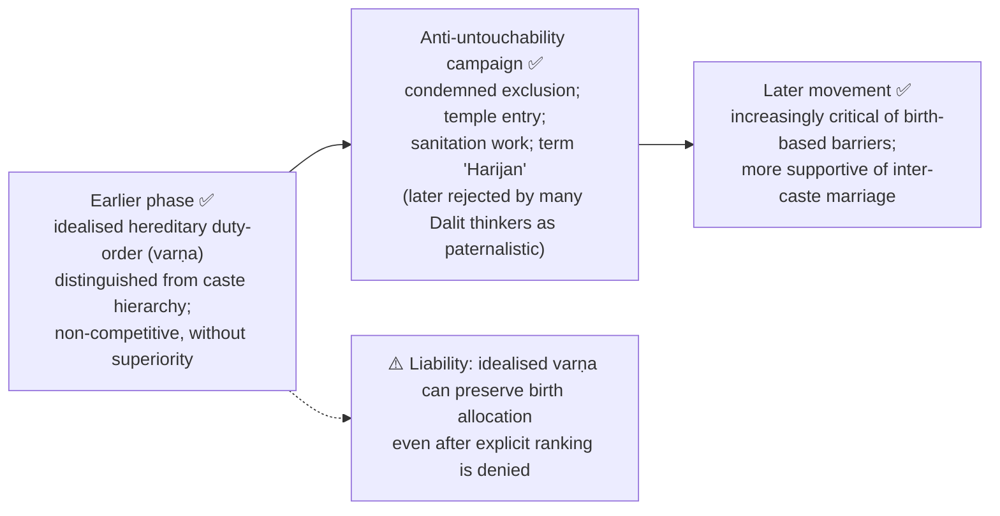

⚠️ **Periodisation control:** a trajectory reconstructed across writings and practice, not one date or sentence that cleanly replaced earlier commitments. Later opposition to birth barriers must be stated together with, not used to erase, the liability of earlier hereditary-duty arguments.

### 3.2 Gandhi and caste's survival across alternative identities (2018 Q1(c)) ⚠️

- National, religious, occupational or civic identities can coexist with endogamy, inherited status and exclusion rather than displacing them.
- Gandhi would challenge caste Hindus to enact equal fellowship in worship, work and shared public life; a new label does not transform conscience or everyday treatment.
- His campaign, constructive work and later support for inter-caste marriage test conduct, not a mere profession of national unity.
- **Objection:** appeals to unity can demand that the oppressed give up separate political voice before the powerful give up privilege. **Reply and limit:** self-purification puts the burden on the privileged, but is defensible only alongside independent rights and representation (Poona Pact objection).
- ⚠️ Neither the continuing presence nor the disappearance of any specific caste practice is established by the philosophical claim alone.

### 3.3 Social endosmosis (2026 Q4(a)) ✅/⚠️

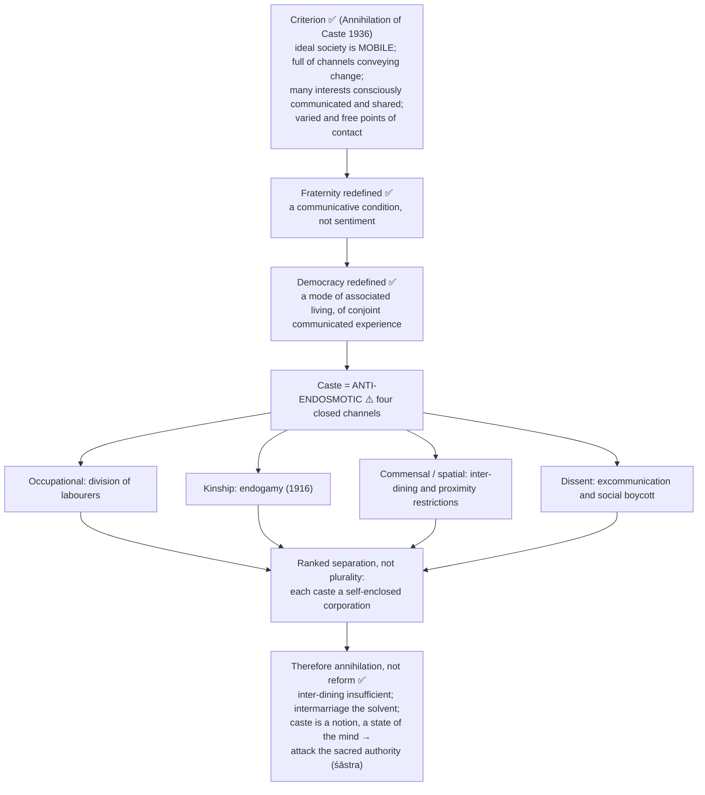

**Four levels of attack ⚠️:** spatial · occupational · affective-kinship · epistemic-institutional (rejection of sacred authority; constitutional morality and rights). A good answer names all four.

| Axis | Mere contact | Tolerance | Recognition of difference | **Social endosmosis** |
|---|---|---|---|---|
| Requires | Proximity | Non-interference | Public affirmation of a group's identity | Free, varied, two-way diffusion of experience and interest |
| Hierarchy ruled out? | ❌ no | ❌ no (tolerate from above) | ⚠️ not necessarily | ✅ yes, by definition |
| Direction | Incidental | One-way forbearance | One-way acknowledgement | Reciprocal |
| Group boundaries | Left intact | Left intact, respected | Strengthened, valorised | Made **permeable**, not abolished by decree |
| Characteristic failure | Segregation in shared space | Coexistence without communication | Hardening of categories | Assimilation, if permeability read as erasure |
| Relation to democracy | None | Civic minimum | Claim on institutions | ✅ Constitutive: democracy *is* associated living |

| Axis | Assimilationism | Separatist essentialism | Porous solidarity (endosmosis) ⚠️ |
|---|---|---|---|
| Diagnosis | Difference itself is the problem | Contact with dominant group is the problem | **Closed** difference is the problem |
| Remedy | Absorb minority into majority norm | Insulate group, maintain boundaries | Open channels while retaining group self-respect |
| Risk | Erases weaker culture | Freezes categories | May underestimate need for protective boundaries in transition |
| Ambedkar | ❌ rejected (self-respect, separate safeguards, conversion) | ❌ rejected (caste is the disease) | ✅ implied position, with safeguards |

**Contemporary relevance — identity and the politics of difference ⚠️:** (1) identity politics claims justice needs public recognition of oppression-formed groups; Ambedkar anticipates this by demanding identity-conscious safeguards because formal equality left caste power untouched. (2) Endosmosis supplies the internal test: mobilisation is justified insofar as it opens channels (access, voice, mobility, association) and suspect insofar as it hardens membranes. (3) Reservation = identity-conscious *means* to an anti-caste *end*, one channel-opener among education, organisation, constitutional morality and cultural change, not annihilation itself. (4) ❓ Risk that mobilisation reifies the categories it politicises; Ambedkar's answer: caste consciousness can be a transitional instrument of self-respect while the goal remains fraternity. (5) Test at the caste–class–gender intersection, not the group average. (6) Neither purely recognitive nor purely redistributive: requires both material access and status equality.

| Objection to endosmosis | Reply | Residue |
|---|---|---|
| 1 Contact is not enough | The criterion is *free and varied* contact with shared interests | Needs an independent equality standard |
| 2 Inter-marriage is intrusive | Diagnostic, not coercive: remove prohibitions and stigma | ❓ Thin line between removing prohibition and prescribing conduct |
| 3 Fraternity talk obscures oppression | Paired with constitutional morality, rights, safeguards, organisation: fraternity the end, power the means | Ordering: fraternity demanded before equal power burdens the subordinated |
| 4 Permeability threatens minority cultures | Defined as *reciprocal*; one-way absorption is assimilation | Reciprocity needs institutional protection, reintroducing limited boundaries |
| 5 Conversion creates a new boundary | Target is sacralised ranking, not religious identity | ❓ Whether a new community reproduces a boundary — state, do not resolve |

### 3.4 Education, organisation, self-respect; conversion ✅/⚠️

- **Educate, agitate, organise** ✅: education enlarges critical agency; organisation converts scattered suffering into political voice; agitation challenges unjust power. ⚠️ An integrated politics of emancipation and representation, **not** individual self-help. *Limit (K17):* organisation without democratic internal accountability can reproduce hierarchy.
- **Conversion to Buddhism, 1956** ✅: *Navayāna*, an ethical reconstruction around reason, compassion, equality and fraternity; ⚠️ both personal freedom of conscience and collective social critique, not a change of ritual label.

### 3.5 Ambedkar's social change in independent India (2020 Q3(a)) ✅/⚠️

| Element | Content |
|---|---|
| Pre-independence base | Diagnosis of graded inequality, endogamy, autonomous safeguards informed later work — do not date all arguments to the later period |
| Roles ✅ | Chair of Drafting Committee; first Law Minister |
| Institutional basis ✅ | Equal citizenship, enforceable rights, political representation, limits on social-majority power |
| Article 17 ✅ | Abolishes untouchability — an institutional change, not proof the practice ended |
| Hindu Code Bill | Women's legal standing; its contested legislative fate must not be described as if he single-handedly enacted it |
| Programme | Education, agitation, organisation, constitutional morality — power and public voice, not passive welfare |
| 1956 conversion | Collective challenge to caste-sanctioning religion |

⚠️ **Examine, not list.** Rights can protect dissent and representation can contest exclusion, but neither alone defeats endogamy, stigma or economic dependence. Distinguish **ideas**, **institutional roles**, **enacted provisions** and **observed outcomes**.

### 3.6 Optional debates (advanced dossier) ⚠️

| Optional debate | Contending positions |
|---|---|
| Moral reform vs structural reconstruction | Gandhian heart-change vs Ambedkarite legal, political, social restructuring |
| Caste as status hierarchy vs labour order | Ritual/status closure vs property, labour and material domination |
| Constitutional morality vs social fraternity | Institutions can discipline hierarchy vs law alone cannot create fraternity |
| Ambedkar beyond Marx / Marx beyond Ambedkar | Class analysis of exploitation vs caste's autonomous social psychology and political structure |

*Strongest additional objection → reply:* Ambedkarite institutional remedies risk legalism if everyday caste consciousness persists → Ambedkar's framework is not mere legalism: constitutional morality needs social pedagogy, fraternity, representation and transformed self-respect; law is necessary precisely because moral reform alone proved unreliable. *Safe use at 15/20 marks:* at most one dossier item, keep Gandhi and Ambedkar as the controlling frame; do not turn into movement chronology or policy statistics.

---

## 4. Conceptual Inventory: The Debate in Full

### 4.1 Gandhi–Ambedkar structured comparison (2025 Q2(a)) ✅

| Axis | Gandhi | Ambedkar |
|---|---|---|
| Primary evil | Untouchability and moral degradation; later wider caste barriers | Caste itself as graded inequality |
| Early hereditary duty-order (*varṇa*) | Idealised duty/division without rank | Birth-based division intrinsically unjust |
| Root mechanism | Corrupted religion, prejudice, loss of conscience | Endogamy, scripture, social closure, power |
| Agent of reform | Transformed caste Hindu conscience plus oppressed participation | Oppressed people's autonomous organisation and representation |
| Method | Non-violence, self-purification, constructive work, reform | Rights, law, education, organisation, representation, inter-marriage |
| Religion | Reform from within | Reject caste-sanctioning authority; conversion |
| Democracy | Ethical fellowship and *swarāj* | Constitutional morality and social democracy |
| Main risk | Paternalism and structural insufficiency | Legal/institutional reform without social fraternity |

> [!WARNING]
> A two-biography answer underperforms regardless of content. Fix 5–6 axes, run both thinkers down each, then adjudicate.

### 4.2 Poona Pact (1932) ✅

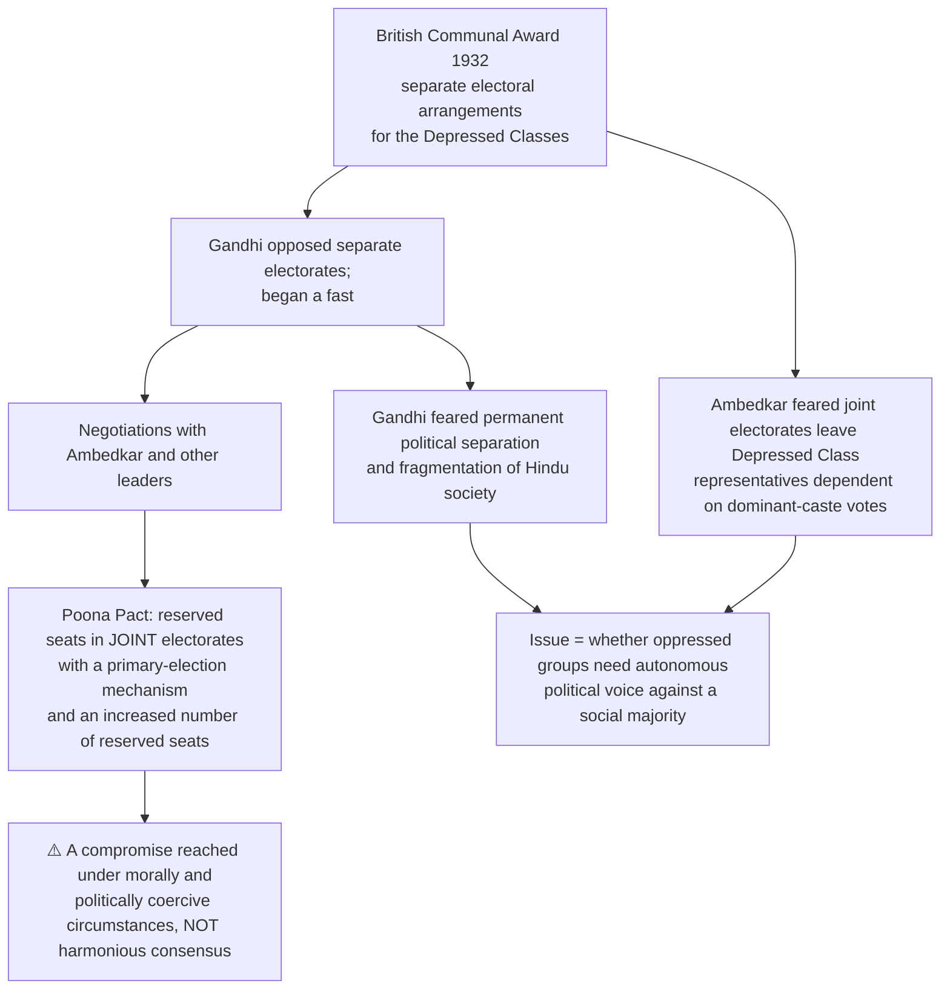

**K7 limit:** interpret the principle at stake (chosen by the group alone or by a joint electorate); ❌ assert no figures or negotiating detail beyond what is stated.

### 4.3 Reform from within vs annihilation; heart-change vs institutional power ✅/⚠️

- Gandhi asks whether a tradition can purify itself through its deepest ethical resources; Ambedkar asks whether those resources can overcome an authority structure that repeatedly sanctifies hierarchy.
- **Assessment:** internal reform can mobilise adherents and reduce defensive backlash; annihilation identifies the need to destroy hereditary rank and transfer power. Reform is defensible only if it accepts the non-negotiable end of birth-based hierarchy.
- Not an either/or: institutions without changed norms may be evaded; heart-change without rights makes justice depend on benevolence; democratic emancipation requires enforceable equality, autonomous voice and transformed everyday relations.

### 4.4 Secular democracy (2019 Q4(a)) ✅/⚠️

| Axis | Gandhi | Ambedkar | Decisive question |
|---|---|---|---|
| Source of public ethics | Truth, non-violence, equal respect across faiths; religion can motivate self-restraint | Equal liberty of conscience and citizenship must not depend on religious authority | Who decides when a practice denies equal standing? |
| Religion and reform | Reinterpret a tradition's ethical core; change believers' conduct | Reject authority that sanctifies caste; conversion a possible exit | Can a caste-sanctioning text remain authoritative? |
| Democracy | Fellowship, moral responsibility, self-rule from below | Constitutional safeguards plus fraternity and social democracy | Are equal votes meaningful without social equality? |
| Minority within a community | Appeal to privileged majority's conscience | Secure the subordinated group's independent rights and voice | Who can represent a person against her own community's hierarchy? |

⚠️ **Similarity:** neither requires absence of religious motivation; both oppose untouchability. **Difference:** Gandhian equal regard can coexist with reform *inside* inherited traditions; Ambedkar insists freedom of conscience and equal civic status protect the right to reject a tradition's caste-sanctioning authority. Neither caricature: Gandhi need not oppose constitutional protection; Ambedkar need not oppose religion (conversion is the counterexample). **Verdict:** moral pluralism can support secular democracy, but equal rights and autonomous representation set its non-negotiable floor. General secularism models belong to Humanism, Secularism and Multiculturalism.

### 4.5 Village, community and modernity ⚠️

Gandhi: decentralised community as possible school of responsibility, meaningful labour and self-rule. Ambedkar: the actual village can concentrate caste authority, dependency and exclusion. The test is whether scale, technology and community enlarge mobility, equal status, constitutional rights and exit from inherited occupation; neither scale is emancipatory without anti-caste power.

### 4.6 Convergence without false equivalence (K18) ⚠️

| Genuine convergence | Irreducible disagreement |
|---|---|
| Untouchability is morally indefensible | Whether caste itself, or its degraded form, is the primary disease |
| Equal human worth and fellowship matter | Whether hereditary duty-order can be purified |
| Political freedom without social reform is incomplete | Whether reform can rely on dominant-caste conscience |
| Institutions and social conduct must both change | Whether oppressed groups need autonomous electoral safeguards |
| Violence cannot found stable equality | Whether exit from caste-sanctioning religion is necessary |

### 4.7 Final evaluative position ⚠️

Ambedkar: the more adequate diagnosis of caste as structure, the stronger theory of representation, the clearer rejection of hereditary hierarchy. Gandhi: locates responsibility among privileged castes, connects means and ends, insists law must enter social character.

---

## 5. Normative and Indian Legal Bridges

> The sources give no transcendent-reality ontology. This module records the constitutional, statutory and judicial bridges the owner states, each with **type and date**.

### 5.1 Constitutional and statutory illustrations ✅

| Instrument | Type | Scope |
|---|---|---|
| **Article 17** | Constitutional rule | Abolishes untouchability and forbids its practice; not a statement that the practice has disappeared |
| Constitutional provisions for representation and affirmative action | Institutional response | Justified as remedial equality and effective citizenship |
| **SC/ST (Prevention of Atrocities) Act, 1989** (in force **1990**) | Enacted penal and protective statute | Dated statutory illustration |

> [!WARNING]
> **Four stages.** Enactment, notification, enforcement and social transformation are different; none may be inferred from another without evidence.

### 5.2 Affirmative action: the Indian legal record (precise scope) ✅/⚠️

| Instrument | Type | State exactly |
|---|---|---|
| **Mandal Commission** (Second Backward Classes Commission, chair B. P. Mandal) | Commission report | Appointed **1979**; report **1980**; recommends, does not enact; government action on OBC reservation in central government services followed in **1990** |
| ***Indra Sawhney v. Union of India*** | Supreme Court judgment, nine-judge bench, **1992** | Upheld OBC reservation in central government services under Article 16(4); directed **creamy-layer exclusion**; reservation ordinarily not to exceed **50 per cent**, save in extraordinary situations. ❌ No holding about later amendments, categories or percentages |
| **Constitution (103rd Amendment) Act, 2019** | Enacted, **enabling** constitutional amendment | Inserted **Article 15(6)** and **Article 16(6)**: special provision, including reservation up to **ten per cent**, for **economically weaker sections other than classes already covered**, in educational institutions (including private, aided or unaided, other than minority institutions under Article 30(1)) and appointments |
| ***Janhit Abhiyan v. Union of India*** | Supreme Court judgment, **2022** | Upheld validity of the 103rd Amendment by a majority |

⚠️ A commission recommends; an amendment enables; a judgment interprets and binds; a statute enacts. None establishes that a philosophical justification is correct or that social transformation has occurred.

⚠️ **Philosophical significance of the 2019 amendment (K14):** it introduces an **economic** criterion into a framework built on **social and educational** backwardness, reopening the foundational question — is the wrong being remedied *deprivation* or *ascriptive exclusion*? On compensatory or anti-domination grounds, economic criteria alone cannot capture caste disadvantage (humiliation, exclusion, denial of standing); on a purely distributive ground an economic criterion is coherent and arguably more precise. Make the argument without endorsing or condemning the amendment.

### 5.3 Body politic, universal franchise (2022 Q1(b)) ✅/⚠️

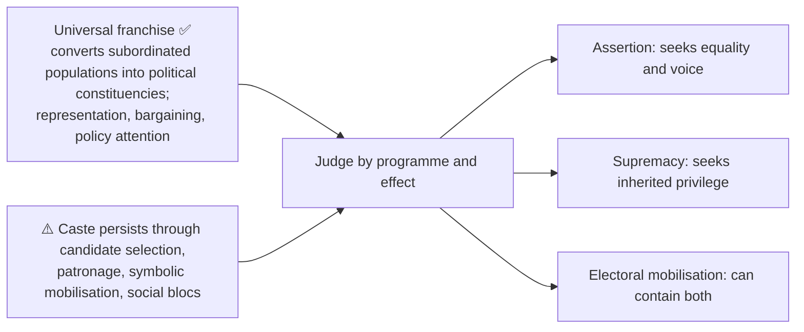

---

## 6. Causal & Explanatory Chains

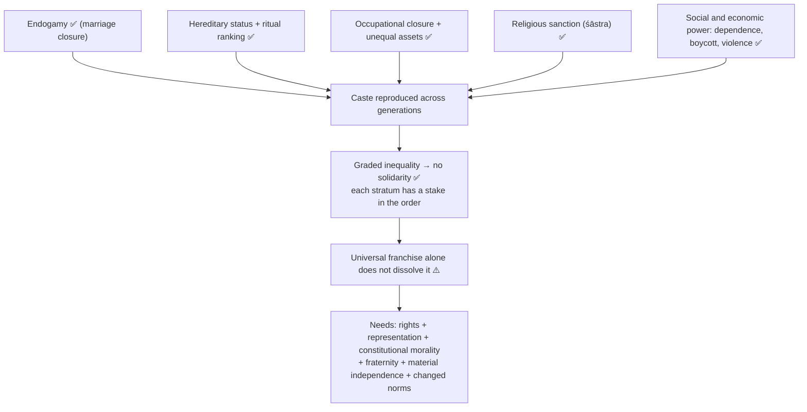

### 6.1 Caste, class, gender ✅/⚠️

Caste interacts with control of land, labour and education but is **not reducible to class**. Endogamy and sexual regulation make gender central to caste reproduction. ⚠️ Dalit women's experience challenges any analysis that adds caste and gender as separate burdens after first treating each in isolation (route the gender doctrine to Gender Discrimination).

| Dimension | Caste mechanism | Required response |
|---|---|---|
| Redistribution | Unequal land, labour, education, networks, material security | Resources and institutional access |
| Recognition / status | Stigma, purity/pollution, humiliation, graded worth | Repudiation of inherited rank; equal standing |
| Representation | Others speak for subordinated groups or control access | Autonomous voice and political safeguards |
| Religion | Hierarchy presented as sacred authority | Freedom of conscience plus rejection of civic disability |
| Gender | Endogamy regulates marriage, sexuality, property | Joint anti-caste and gender analysis |
| Class | Exploitation interacts with, but does not exhaust, status closure | Material analysis without reducing caste to class |

⚠️ Identity assertion by oppressed castes can be a route to recognition and representation rather than a defence of hierarchy. Identity without redistribution leaves material power intact; redistribution without recognition preserves humiliation.

### 6.2 Four justifications for affirmative action ✅/⚠️

| Justification | Core claim | Terminates when | Vulnerable to |
|---|---|---|---|
| **Compensatory / rectificatory** | Rectify a historically identifiable, legally sanctioned exclusion whose effects are transmitted | Transmitted disadvantage no longer operates | "Why should present individuals pay?"; over-inclusion |
| **Distributive / equal-opportunity** | Formal equality from today ratifies an unequal starting line | Disadvantage in access is removed | "Why group markers, not individual disadvantage?" |
| **Representational / democratic** | Institutions excluding whole groups lack legitimacy; presence a condition of functioning democracy | Institutions genuinely representative | "Does presence secure interest-representation?"; elite capture |
| **Anti-domination / recognitive** | Breaks a monopoly of social power; repudiates ascription of inferiority | Rank-based valuation ceases to organise social life | "How is standing measured?" |

⚠️ **Best join (state explicitly):** compensatory in ground, distributive in mechanism, representational in institutional justification, anti-domination in ultimate aim. Do not run the four together.

**Compensatory argument reconstructed ⚠️:** systematic, institutional, religiously and legally sanctioned exclusion → group-directed (by birth, not conduct) → effects transmitted (wealth, land, occupation, schooling, language, networks, health, confidence) → removing the formal bar leaves transmitted disadvantage and ratifies results as fair competition → remedy must reach the transmission mechanism and be group-directed → required **by** equality, not a departure from it. *Presupposition:* disadvantage can be traced reliably enough to justify a group-directed remedy — a factual premise to argue, not assume.

---

## 7. Value Aims

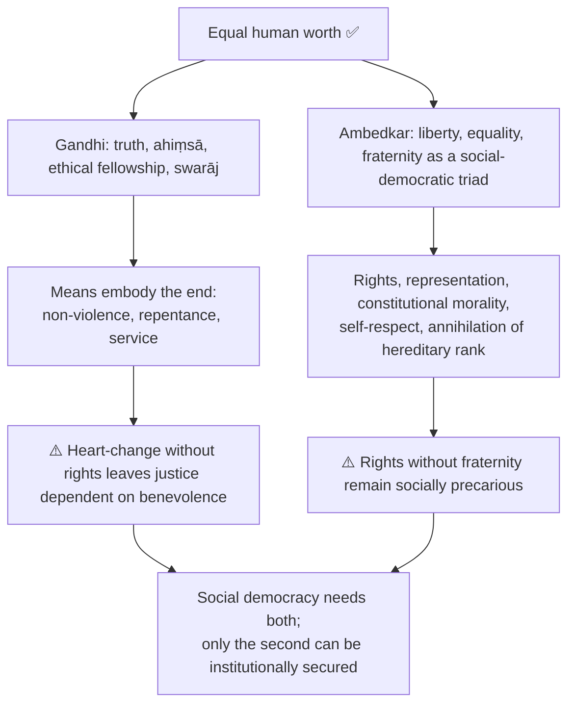

### 7.1 Ambedkar beyond reservation (K15) ✅

> [!WARNING]
> The most damaging error: presenting Ambedkar as a theorist of reservation. Reservation is a **safeguard** within his programme, by his own account an insufficient one.

| Element | Claim | Why it exceeds reservation |
|---|---|---|
| Annihilation, not adjustment | Destroy the authority of the śāstras that sanction caste | Reservation redistributes positions inside a hierarchy it does not dissolve |
| Endogamy as mechanism | Inter-caste marriage attacks the reproductive mechanism | No quota touches the marriage circle |
| Constitutional morality | Form of administration can be perverted without altering the text | A legal safeguard is inert without sustaining disposition |
| Social democracy | Political democracy on graded social order is unstable ("one person one vote, one vote one value" contradiction against unequal social worth) | Representation alone leaves the contradiction |
| Fraternity | Least attended, most necessary principle | Cannot be legislated; no quota produces it |
| Educate, agitate, organise | Self-respect, organisation, independent political capacity | Reservation without capacity is benefit received, not power held |
| Conversion | Exit from a religious order sanctifying hierarchy; Navayāna | Places the remedy outside the state |
| State-directed economic power | Reorganise landholding and industry to break dependence (*States and Minorities*) | Political safeguards do not touch economic dependence |

⚠️ **One-line thesis:** reservation addresses **access to positions**; annihilation of caste addresses the **valuation of persons**, and only the second can produce social democracy. Select two or three elements and develop them rather than listing all eight.

---

## 8. Inter-School Comparative Matrices

### 8.1 Gandhi, Ambedkar and rival frameworks ✅/⚠️

| Pair | Contrast |
|---|---|
| **Ambedkar vs Marx** ✅ | Shared concern with exploitation and structural power; Ambedkar rejects reducing caste to class and distrusts violent dictatorship |
| **Ambedkar vs liberal formal equality** ✅ | Formal equality prohibits explicit discrimination; social democracy asks whether inherited power and stigma prevent equal standing in fact. ⚠️ Reservations and safeguards are instruments of substantive and representative equality, though their design stays open to democratic evaluation |
| **Gandhi vs liberal rights** ✅ | Gandhi: duties, self-restraint, transformed relations; liberalism: enforceable individual claims. ⚠️ Anti-caste struggle needs both: duty cannot replace the victim's right; rights need respecting practices |
| **Ambedkar and Buddhism** ✅ | Navayāna: ethical-social practice of liberty, equality, fraternity, compassion, against a religion of immutable rank; not collapsed into classical doctrinal exegesis |

### 8.2 Ambedkar and Marx in detail ✅

| Axis | Marxian emphasis | Ambedkarite emphasis |
|---|---|---|
| Hierarchy | Ownership and class relation | Caste status, endogamy, religion and class |
| Agency | Proletarian class | Oppressed castes through rights and organisation |
| Method | Revolutionary transformation | Constitutional democracy plus social struggle |
| Ideal | Classless society | Social democracy of liberty, equality, fraternity |

⚠️ An economic revolution that leaves the valuation of persons intact will reproduce hierarchy in a new form; an adequate Indian materialism must incorporate caste as an independent but interacting structure.

---

## 9. Criticisms & Reconstructed Replies

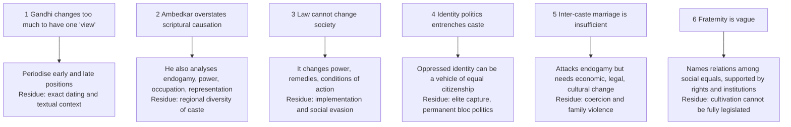

### 9.1 Reverse-discrimination objection and reply (K10–K12) ⚠️/✅

**Objection at full strength:** (1) justice treats persons as individuals, not group bearers; (2) selection tracks qualification; (3) reservation allocates by ascriptive membership; (4) the excluded individual is personally innocent; (5) so reservation inflicts a fresh injustice and reproduces allocation by birth-group.

| Reply move | Content |
|---|---|
| 1 Symmetry | The unreserved baseline is not neutral; the comparison is between two group-inflected systems, only one candid |
| 2 Merit distinction (K11) ✅ | *Merit* is functional capacity; *desert* is moral. Exam performance is a **proxy** whose reliability varies with access to coaching, nutrition, language, schooling. Contest the measure, not the value |
| 3 Advantage, not guilt (K12) | No guilt attributed; present individuals are unjustly advantaged by a continuing distribution |
| 4 Group harm, group remedy | The group marker is a reliable index of transmitted disadvantage, not a moral category |
| 5 Residue conceded | (i) **over-inclusion** — benefits the already-advantaged within the group; (ii) cost falls unevenly on those near the margin |

**Stigma objection → reply ⚠️:** preferential treatment stigmatises beneficiaries → stigma tracks the prior assumption that the baseline measured worth; Ambedkar's structural answer: representation is claimed as **right and power**, not a concession. Residual: where the presumption persists the policy bears a social cost it cannot itself remove.

**Creamy layer ✅/⚠️:** the internal filter answering the over-inclusion residue; strengthens the distributive justification, weakens the purely representational one (a group's political representation is not obviously served by excluding its advanced members).

---

## 10. Cross-Tradition Pairs (internal only)

> The sources give no East–West comparison table for this topic. Only the internal pairs the owner states appear below; no Western thinker is imported.

| Pair | Point of contact | Decisive disanalogy |
|---|---|---|
| Gandhi — Ambedkar | Untouchability indefensible; social reform needed; violence cannot found equality | Caste vs its corruption; hereditary duty-order; reliance on dominant conscience; autonomous safeguards; religious exit |
| Ambedkar — Marx | Exploitation and structural power | Caste is graded status with religious sanction, not class; constitutional means vs revolution |
| Ambedkar — Buddhism (Navayāna) | Equality, fraternity, compassion | Not classical doctrinal exegesis; full Buddhist doctrine owned elsewhere |
| Gandhi — liberal rights | Moral seriousness about persons | Duties vs enforceable claims |

---

## 11. Diagnostic Deep-Dives for High-Frequency Themes

### 11.1 Directive decoder ✅

| Directive | What is scored | Compulsory move | Failure mode |
|---|---|---|---|
| Explain / Elucidate | Internal logic of one thinker | Doctrine → mechanism → distinction → example | Narrating biography or the Poona Pact as story |
| Discuss | Exposition plus one adjudicated tension | Position → rival → objection → reply → verdict | Two biographies side by side |
| Critically examine / evaluate | The objection–reply layer is the answer | Two objections each with reply and residue | Denouncing caste instead of analysis |
| Compare / Contrast | Shared axes in parallel | 5–6 axes, both down each, adjudicate | Sequential mini-essays |
| Is X justified? | Justification must be named and selected | Choose among four grounds → defend → meet reverse-discrimination → verdict | Asserting justification with no ground |
| How far / to what extent | Degree judgment | Conditions of holding and failing | Evasive balance |
| Do you agree | Qualified commitment | Qualified position → defence → strongest counter → restated position | A survey of views |

### 11.2 Selectable evidence bank (K1–K20): claim → anchor → limit ⚠️

| Unit | Claim | Limit |
|---|---|---|
| K1 | Caste is closure by endogamy (*Castes in India* 1916) | Origin account is one hypothesis; use the *mechanism* |
| K2 | Graded inequality: ascending reverence, descending contempt | Describes an obstacle, not the remedy |
| K3 | Division of labourers, not of labour | Pair with K2 for the ritual/purity dimension |
| K4 | Destroy the sanction, not just the practice (*AoC* 1936) | State's competence over belief is limited → conversion, constitutional morality |
| K5 | Untouchability a sin against humanity and religion (Gandhi) | Initiative rests with dominant conscience |
| K6 | Heart-change vs institutional power | Both halves needed |
| K7 | Poona Pact interpreted | Interpret principle; assert no figures |
| K8 | Political democracy requires social democracy | Normative diagnosis, not institutional design |
| K9 | Constitutional morality is not automatic | Names a condition without how it is produced |
| K10 | Four justifications for affirmative action | Not fully consistent (creamy layer) |
| K11 | Contest the measure of merit | Does not fix how far correction should go |
| K12 | Advantage, not guilt | Two residues to concede |
| K13 | Indian legal record correctly typed | Never state a holding more broadly than its terms |
| K14 | Economic criterion reopens deprivation vs ascriptive exclusion | No endorsement or condemnation |
| K15 | Ambedkar is not a theorist of reservation | Select 2–3 elements |
| K16 | Caste, class, gender jointly reproduced | Not the sum of two burdens |
| K17 | Educate, agitate, organise is a power programme | Internal accountability |
| K18 | Convergence ≠ equivalence | State structural priority |
| K19 | Neither village nor modernity inherently emancipatory | Test does not pick one scale |
| K20 | Material, status and political dimensions | Allied theories remain with their owners |

Use 1 unit at 10 marks, 2 at 15, 4–5 at 20.

---

## 12. PYQ Routing Ledger

> Corpus signal: **9** primary-owned parts out of 112 in 2018–2025 (per year 2018–2025: 1/1/1/1/2/1/1/1). The 2026 supplement adds **1** (Q4(a)). **Total 10.** The owner file has no pre-2018 table.

| Year | Q | Marks | Exact demand | Route in owner |
|---|---|---:|---|---|
| 2018 | Q1(c) | 10 | It is said that the traditional hold of caste-based groups on Indian social behaviour has survived all attempts to build alternate identities. Discuss in the light of M. K. Gandhi. | §3.2 |
| 2019 | Q4(a) | 20 | Examine whether there is any difference between the views of Mahatma Gandhi and Dr. Babasaheb Ambedkar on the philosophical foundations of secular democracy. | §4.4 |
| 2020 | Q3(a) | 20 | State and examine B.R. Ambedkar's contribution towards social changes in Independent India. | §3.5 |
| 2021 | Q4(a) | 20 | Discuss the views of Dr. B.R. Ambedkar regarding caste-discrimination in Indian society. What are the measures suggested by him for its elimination? Explain. | §2.2–2.4, §3.4, §7.1 |
| 2022 | Q1(b) | 10 | In the age of individualism and universal franchise, what role does caste play in body-politic? Discuss. | §5.3, §6.1 |
| 2022 | Q2(b) | 15 | Critically evaluate Gandhi's views on eradication of caste discrimination. | §2.1, §2.5, §3.1 |
| 2023 | Q3(b) | 15 | Critically analyse the social and political significance of Ambedkar's notion of annihilation of caste. | §2.2, §3.3, §7.1 |
| 2024 | Q1(c) | 10 | Discuss the main factors responsible for caste discrimination. | §1.2 |
| 2025 | Q2(a) | 20 | Present a detailed account of the debate between Gandhi and Ambedkar on the issue of caste discrimination. | §4.1–4.6 |
| 2026 | Q4(a) | 20 | How has Ambedkar applied the concept of 'Social Endosmosis' for annihilation of castes. Evaluate its relevance for contemporary debates on identity and the politics of difference. | §3.3 |

**Cross-owned, listed but not counted** (Gandhi-related parts primarily owned elsewhere):

| Year | Q | Marks | Demand | Primary owner |
|---|---|---:|---|---|
| 2019 | Q1(c) | 10 | Evaluate Mahatma Gandhi as a political anarchist. | Political Ideologies |
| 2020 | Q2(a) | 20 | State and examine the Gandhian concept of social development. | Development and Social Progress |
| 2021 | Q3(b) | 15 | Discuss the distinctive features of Gandhian Socialism and its contemporary relevance. | Political Ideologies |
| 2024 | Q2(c) | 15 | Present an exposition of Gandhi's views on secularism as one of the foundational principles of democracy. | Humanism, Secularism and Multiculturalism |

**Pattern ⚠️:** Gandhi vs Ambedkar is the most sustained named Indian reform debate (20-marker 2025, 15-marker 2022, factor-analysis 10-marker 2024, annihilation 2023); 2026 adds the endosmosis route.

---

## 13. Top Exam Traps (23 in owner)

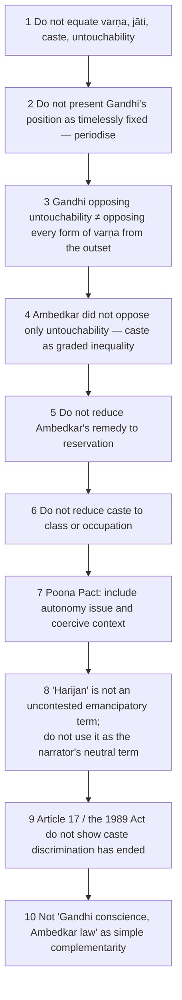

**Traps 11–23 recorded in the owner:** 11 do not flatten Gandhi into one timeless position (early hereditary duty-order, anti-untouchability action, later anti-birth-barrier movement) · 12 identify "Harijan" as Gandhi's historical usage with the contemporary caution · 13 do not reduce Ambedkar to reservation or constitutional drafting (include annihilation, endogamy, social democracy, fraternity, organisation, conversion) · 14 educate–agitate–organise is not self-help · 15 Poona Pact: autonomous-representation question and coercive context · 16 do not romanticise either village or central modernity · 17 do not collapse caste into class or add caste and gender arithmetically · 18 oppressed-caste identity assertion ≠ defence of hereditary supremacy · 19 redistribution, recognition and representation are not substitutes · 20 convergence must not erase the structural priority of annihilation and autonomous rights · 21 do not translate "social endosmosis" as mixing, contact or tolerance · 22 do not answer the two-demand endosmosis stem with only the caste half · 23 do not treat identity-based mobilisation as simply vindicated or simply reified — apply the channel-opening vs membrane-hardening test.

**Endosmosis-stem traps ❌ → ✅:** biological metaphor for "mixing" → quote the content (channels, shared interests, free varied contact) · equating with tolerance or diversity → caste already has diversity without endosmosis · omitting the identity half → one-demand answer capped · separating endosmosis from fraternity and democracy → the chain is the spine · reducing annihilation to inter-dining → *AoC* treats it as insufficient · ignoring the sacred-authority level · presenting reservation as annihilation · dropping gender · naming present-day parties or episodes → argue at the level of criteria.

**Legal-record traps ❌:** never use a judgment or amendment as philosophical proof; never state a legal proposition more broadly than its terms; do not describe the 103rd Amendment as creating reservation directly (it is enabling); do not state the ten per cent as an addition to a fixed total without noting it operates for classes **other than** those already covered; every Indian legal reference must carry type and date, followed by the four-stage reminder.

---

## 14. Technical Vocabulary Bank

| English gloss | Term | Meaning | Status |
|---|---|---|---|
| Textual fourfold order | *varṇa* | Normative classification in Brahmanical texts | ✅ |
| Lived endogamous birth-group | *jāti* | Birth-based local social group | ✅ |
| Untouchability | — | Extreme exclusion and stigma | ✅ |
| Non-violence | *ahiṃsā* | Gandhi's ground against degradation | ✅ |
| Truth-force | *satyāgraha* | Non-violent resistance to unjust practice | ✅ |
| Self-rule | *swarāj* | Gandhi: ethical fellowship | ✅ |
| New vehicle (Buddhism) | *Navayāna* | Ambedkar's ethical-social reconstruction | ✅ |
| Scripture / sacred authority | *śāstra* | Authority licensing caste; the ultimate target in *AoC* | ✅ |
| Endogamy | — | Enforced marriage boundary; central mechanism | ✅ |
| Division of labourers | — | Caste ranks workers, not just tasks | ✅ |
| Graded inequality | — | Ascending reverence, descending contempt | ✅ |
| Social endosmosis | — | Mobility, channels of conveyance, shared interests, varied free contact | ✅ |
| Associated living | — | Democracy as conjoint communicated experience | ✅ |
| Constitutional morality | — | Diffused public commitment to constitutional norms | ✅ |
| Social democracy | — | Liberty, equality, fraternity as a way of life | ✅ |
| Fraternity | — | Social basis of democracy | ✅ |
| Educate, agitate, organise | — | Integrated power programme | ✅ |
| Poona Pact | 1932 | Reserved seats in joint electorates | ✅ |
| Creamy layer | — | Internal filter in *Indra Sawhney* | ✅ |
| Transmitted disadvantage / merit as proxy / advantage not guilt / over-inclusion | — | Affirmative-action vocabulary | ⚠️ |
| Redistribution / recognition / representation | — | Distinct, entangled remedies | ⚠️ |
| Intersectionality | — | Caste–class–gender not additive | ⚠️ |

---

## 15. Graded Verdict & Answer Architectures

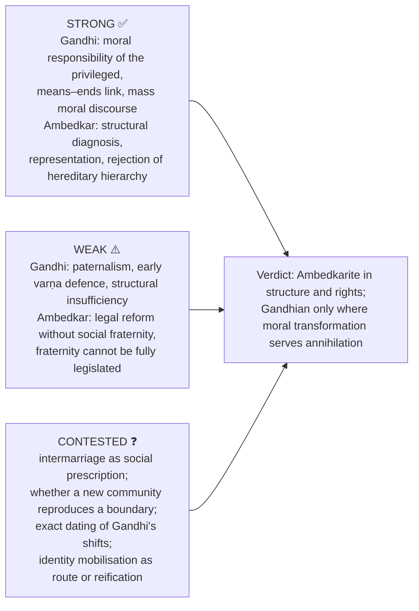

### 15.1 10-mark (~150 words)

```text
1 Define caste precisely: graded, birth-based social closure sustained by endogamy
  — not "division of labour", not merely "stratification" (2 lines).
2 Mechanism: endogamy + hereditary status + ritual ranking + sanction + resources (4–5 lines).
3 One evidence unit with its limitation.
4 Graded verdict (2 lines) answering the stem directly.
```
❌ At 10 marks do not attempt both thinkers plus reservation. One doctrine or one contrast, fully worked.

### 15.2 15-mark (~220 words)

```text
1 Identify the axis: reform-from-within vs annihilation / heart-change vs institutional power / representation vs fraternity.
2 Thinker's doctrine, argument and METHOD (where they diverge, routinely omitted).
3 Strongest rival objection, given fairly.
4 One table: §4.1 grid, four justifications, or beyond-reservation grid.
5 One correctly typed constitutional or statutory illustration, status stated.
6 Explicit verdict: what it achieves and where it fails.
```

### 15.3 20-mark (~300 words)

```text
1 Shared target (untouchability) and rival diagnoses in one sentence each.
2 Axis 1: nature and root of caste (varṇa ideal vs graded inequality with sanction).
3 Axis 2: agent and method (conscience, penance, constructive work vs law, representation, organisation, constitutional morality).
4 Axis 3: religion, representation, democracy — Poona Pact INTERPRETED, not narrated.
5 Two objection→reply chains, each ending in a residue (paternalism vs Gandhi; legalism vs Ambedkar).
6 Reservation argument if the stem reaches it: named justification → reverse-discrimination → conceded residue.
7 One dated, correctly typed Indian illustration with the four-stage caution.
8 Graded verdict on present relevance, conceding what each secured that the other did not.
```

### 15.4 Stem-specific spines

- **2026 endosmosis (20):** define endosmosis in Ambedkar's markers (3 lines) → chain endosmosis = fraternity = democracy (2) → apply to caste: four closed channels (6) → remedies: intermarriage, sacred authority, constitutional morality (4) → identity politics, channel-opening vs membrane-hardening test, reservation as means, intersection caution (6) → two objections with replies (4) → verdict (3).
- **Reservation stems:** name the justification → compensatory or representational argument → objection at strongest → merit-proxy and advantage-not-guilt replies → concede over-inclusion and uneven incidence → *Indra Sawhney* and 103rd Amendment correctly typed → verdict.
- **Ambedkar stems:** graded inequality and endogamy as mechanism → annihilation rather than reform → constitutional morality and social democracy → beyond-reservation grid → Marx contrast stated precisely → political vs social democracy.

### 15.5 Verdict formulas (adapt, never reproduce mechanically) ⚠️

> [!TIP]
> **Adjudicating:** "Gandhi's method reached the conscience of the dominant, which law cannot compel; Ambedkar's reached the structure of power, which conscience cannot be relied upon to surrender. Social democracy requires both, but only the second can be institutionally secured."
>
> **Asymmetric:** "The moral condemnation of untouchability is common ground; the disagreement is whether caste itself is the disease or its corruption — and on that question the reform-from-within position cannot explain why the hierarchy survives every reform of its outward practice."
>
> **Selected-ground (reservation):** "Judged as a compensatory measure the policy answers a group-inflicted harm with a group-directed remedy; judged as a representational measure it answers a deficit of legitimacy. The reverse-discrimination objection defeats neither, though it leaves standing the genuine residues of over-inclusion and uneven incidence."
>
> **Merit:** "Reservation does not abandon merit; it contests the reliability of the proxy by which merit has been measured, and a refined proxy is a more accurate pursuit of the same value."
>
> **Beyond-safeguard:** "Reservation addresses access to positions; annihilation of caste addresses the valuation of persons. Constitutional safeguards without constitutional morality, fraternity and economic independence remain formal — which is Ambedkar's own diagnosis, not a criticism of him."
>
> **Four-stage:** "The instrument is enacted and its scope is settled in law; whether it has altered social standing is a separate question, since enactment, notification, enforcement and social transformation are four distinct stages and none may be inferred from another."

**Reusable statement lines ✅/⚠️:** caste is not merely a division of work but a hereditary division and ranking of workers · graded inequality impedes solidarity because domination is distributed through a ladder, not a binary · heart-change without rights leaves justice dependent on benevolence; rights without fraternity remain socially precarious · endogamy reveals that control of marriage and gender is constitutive of caste reproduction · political assertion by oppressed castes is not morally equivalent to defence of hereditary supremacy · constitutional morality requires citizens and institutions to place equal civic status above inherited social authority.

---

## Link-outs named in the owner

Social and Political Ideals · Individual and State · Humanism, Secularism and Multiculturalism · Gender Discrimination · Political Ideologies · Development and Social Progress · Buddhism (paper-1) · Philosophy in other answers.

## Sources

Owner file sources: B. R. Ambedkar, *Castes in India* (1916), *Annihilation of Caste* (1936), *Who Were the Shudras?*, *The Untouchables*, *States and Minorities*, Constituent Assembly interventions; M. K. Gandhi, *Hind Swaraj*, *Young India*, *Harijan*, collected writings; Eleanor Zelliot; Valerian Rodrigues (ed.), *The Essential Writings of B. R. Ambedkar*; O. P. Gauba; Constitution of India (Articles 14–17); SC/ST (Prevention of Atrocities) Act 1989; Mandal Commission report; *Indra Sawhney v. Union of India* (1992); Constitution (103rd Amendment) Act 2019; *Janhit Abhiyan v. Union of India* (2022); Stanford Encyclopedia of Philosophy, "Identity Politics" (§3.3 contemporary half only). Dossier trail: Jaffrelot, Zelliot, Teltumbde, Rege.

> ⚠️ **Provenance note.** Ambedkar's endosmosis formulations are paraphrased in substance; key terms are used as terms of art and no extended verbatim passage is reproduced. The affirmative-action module is a philosophical reconstruction; constitutional article numbers, case law and policy detail belong to Polity and Social-Justice and appear here only as dated illustration with type and status stated. No contemporary party, movement, leader, community or episode is named.
