# PLATO AND ARISTOTLE — Examiner-Grade Mindmap

> **Syllabus (verbatim):** Plato and Aristotle : Ideas; Substance; Form and Matter; Causation; Actuality and Potentiality.
> **Catalogue key:** `philosophy-paper-i-western-philosophy-01` · Paper I · Western Philosophy (Section A)
> **Sources used:** `paper-1/western/Plato-Aristotle.md` (canonical owner, read in full) · `_advanced/Western-Philosophy-Dossier.md` §1 (optional depth) · `paper-1/_PYQ-Western-Philosophy-2018-2025.md` · `paper-1/_PYQ-Western-Philosophy-2026.md`. The `_themes/` files and `01_Plato-and-Aristotle_Complete-Topic-Package.md` were **not** used.
> **Evidence key:** ✅ canonical doctrine · ⚠️ analytical synthesis · ❓ contested / uncertain · ❌ trap
> **Adaptation note:** the 15-module blueprint is Indian-school oriented. Here Module 1 = textual map and lineage; Module 2 = theory of knowledge; Module 3 = internal critiques and refinements; Module 4 = metaphysics; Module 5 = ultimate principle (Good / Demiurge / Unmoved Mover); Module 7 = value orientation. The sources give little for 5-as-transcendent-rejection and 7, so those modules say so.

> [!IMPORTANT]
> **Core thesis.** Plato supplies the metaphysical *problem* (the reality of universals; the relation of knowledge to being); Aristotle supplies the rival *solution* (immanent form, hylomorphism, four causes, potentiality-actuality). The examiner's favourite pivot is the **contrast** between their conceptions of Form. **"Plato Points UP ☝️, Aristotle Points HERE 👇."** ⚠️

---

## 0. Master Overview

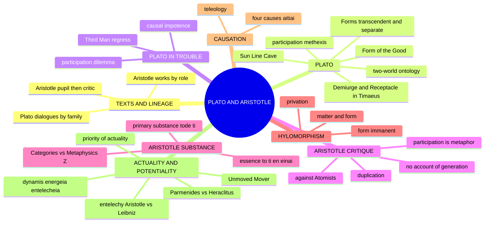

---

## 1. Identity, Lineage & Textual Map

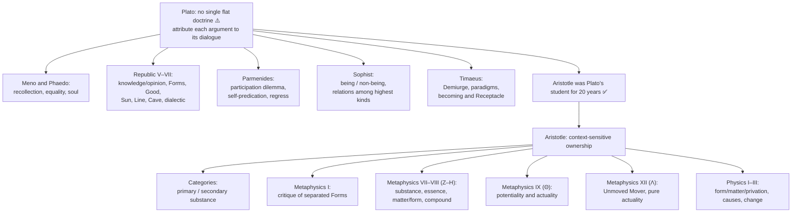

- ❓ Dialogue chronology and developmental interpretation remain disputed. Do not write that every dialogue teaches one unchanged "two-world theory."
- ✅ Aristotle's "substance" answers different questions in the *Categories* and the *Metaphysics*; do not silently flatten them.
- Citation discipline ✅: Plato by **Stephanus** numbers (*Republic* 507a–509c Sun, 509d–511e Line, 514a–517a Cave; *Phaedo* 74a–75d, 72e–77a; *Meno* 80d–86c; *Parmenides* 131a–c, 132a–b); Aristotle by **Bekker** numbers (*Categories* 2a11; *Metaphysics* I.9 (990b), I.6, Z.3, Z.13, Z.17, Λ.7; *Physics* II.3; *De Anima* II.1). Metaphysics books cited by Roman numeral **or** Greek letter (VII = Z, VIII = H, XII = Λ).
- Ownership boundary ⚠️: Plato's tripartite soul, justice, philosopher-ruler, critique of democracy, and Aristotle's soul-faculties, virtue, flourishing, politics, syllogistic are **not** owner limbs here unless a comparison or PYQ opens them.

---

## 2. Theory of Knowledge (Epistemology)

### 2.1 Plato: Sun, Line and Cave as ONE argument ✅

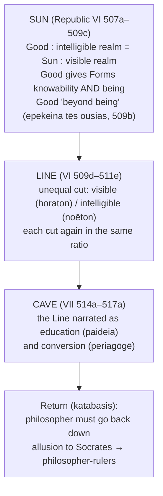

Plato insists (517a–b) the Cave must be applied as a whole to what preceded. Answering with the Cave alone loses the epistemology; with the Line alone loses the political conclusion.

### 2.2 The Divided Line ✅

| Segment | State of mind | Objects | Method |
|---|---|---|---|
| **D** | **Eikasia** — imagination / conjecture | Images: shadows, reflections | Passive taking of images for originals |
| **C** | **Pistis** — belief | Visible things themselves | Ordinary perception and trust |
| **B** | **Dianoia** — thought | Mathematical objects | Uses visible things as images; argues **downward from hypotheses**, does not ascend to a first principle |
| **A** | **Noēsis** — intellection (*nous*) | The Forms, culminating in the Good | **Dialectic**: treats hypotheses as steps up; ascends to an unhypothetical first principle (*archē anhypothetos*); descends using no images |

- **D + C = doxa (opinion); B + A = epistēmē (knowledge).** Mnemonic **E-P-D-N** = Images · Things · Mathematicals · Forms.
- **Most examinable point ⚠️:** *dianoia* vs *noēsis* is not difficulty of subject matter but the **direction of argument** and the **use of images**.
- ❓ Aside: by Plato's own ratio instruction the two middle segments C and B are equal in length; commentators disagree whether significant.

### 2.3 The Cave mapped onto the Line ✅

| Stage in the Cave | Line segment |
|---|---|
| Prisoners chained, seeing shadows cast by a fire | Eikasia |
| Released prisoner sees the fire and carried artefacts | Pistis |
| Dragged up into daylight; first bears only shadows and reflections in water | Dianoia |
| Then the things themselves; stars and moon; finally the Sun itself | Noēsis, culminating in the Good |

Two features the Line lacks ⚠️: (1) **pain and compulsion**: education turns an organ of vision the soul already has, together with the whole soul; (2) **the return**: ridicule and possible death ("if they could lay hands on him"), a transparent allusion to Socrates ✅.

### 2.4 Presuppositions of the triad ⚠️

| # | Presupposition |
|---|---|
| P1 | Degrees of reality correlate with degrees of cognitive clarity: being and knowing are one scale |
| P2 | The object determines the faculty (*Republic* V 476e–480a) |
| P3 | There is an unhypothetical first principle; otherwise the ascent has no terminus |
| P4 | The soul already has the capacity for noēsis (hence recollection); education turns, does not create |

| Objection | Reply | Residual |
|---|---|---|
| The Line conflates kinds with degrees; "more real" is incoherent | "More real" = more self-identically and unqualifiedly what it is (stick long and short; the Long itself never) | Aristotle rejects (*Met.* I.9): being is said in many ways, not degrees |
| Mathematical objects sit awkwardly in the middle | Aristotle reports (*Met.* I.6) Plato posited *ta metaxu* (intermediates) | ❓ Not in the dialogues: **flag as testimony, not text** |
| Knowing the Good need not qualify one to rule | Only one who has seen the paradigm can order a city by it | Popper, *The Open Society and Its Enemies* (1945): principal target; widely regarded as a polemic |

### 2.5 Arguments FOR the Forms ⚠️

| Argument | Structure | Source |
|---|---|---|
| **One-over-Many** (*hen epi pollōn*) | Many beautiful things share a character → one "Beautiful itself" → a Form | *Republic* V; *Parmenides* 132a |
| **Argument from Knowledge** | Knowledge needs an unchanging object; sensible world in flux; so objects of knowledge are non-sensible universals | *Republic* V–VII; cf. *Theaetetus* |
| **Opposites / Relativity** | A stick is longer than X and shorter than Y; the Large itself is never small | *Phaedo* 74a–75d |
| **Recollection** (*anamnēsis*) | We recognise equality despite never encountering perfect equality → soul knew Equality before birth | *Phaedo* 72e–77a; *Meno* 80d–86c |

Recollection is one route to knowledge, **not** Plato's complete epistemology.

### 2.6 Worked PYQ: "There is a red chair" (2021 Q1(a)) ✅

1. A particular chair has derivative, changing reality.
2. It is intelligible as a chair by participation (**methexis**) in the Form of Chair.
3. It is red by participation in Redness; one particular can participate in several Forms without Forms becoming physical parts.
4. Sense gives belief about this chair; knowledge concerns the stable Forms by which "chair" and "red" are intelligible.
5. ⚠️ Difficulty: "participates" names the relation but does not explain its mechanism.

❌ Do not treat the Form of Red as a red object elsewhere, or as a shared mental concept (that is conceptualism, which Plato rejects).

### 2.7 Aristotle: knowledge as knowledge of causes ✅

- To *know* a thing is to give its four "becauses" (§6).
- Knowledge begins from sensible particulars and reaches universal form/causes; essences are known through **definition of the species**, not acquaintance with a separate paradigm (P4 of §3.6).
- Science is of the universal **as predicated of and realised in** individuals; the individual remains the primary being.
- Immanent form may explain organisation but seems unable to secure Plato's standard of unchanging knowledge; Aristotle replies form is intelligible and stable in definition without existing in a second world ❓.

---

## 3. Dialectical Wings, Internal Critiques & Refinements

*(No sceptical wing exists in the sources; this module carries Plato's self-criticism, Aristotle's critique and the optional-depth interpretive disputes.)*

### 3.1 Problems internal to the Theory of Forms ✅

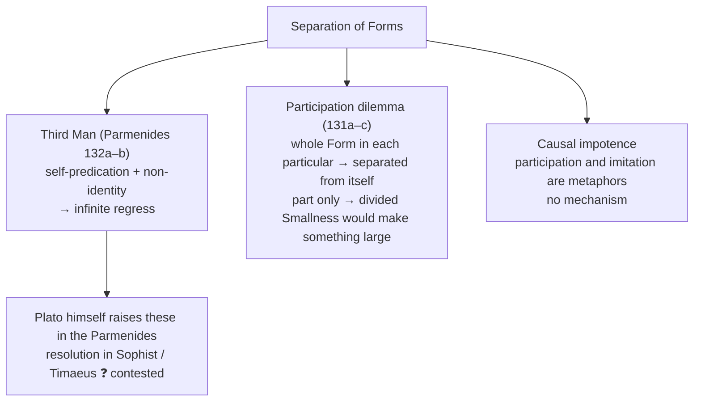

- Third Man provenance ⚠️: the **argument** is at *Parmenides* 132a–b (example: largeness); the **name** comes from Aristotle's reports (*Met.* 990b17, 1039a2). Write: "the regress Plato states at *Parmenides* 132a–b, known from Aristotle's reports as the Third Man."
- Possible Platonic reply ❓: the Form of Large is not *large* in the same sense a mountain is (denying self-predication).

### 3.2 Aristotle's critique of separated Forms ✅ (*Met.* I.9, XIII.4–5)

| Objection | Kernel |
|---|---|
| Third Man regress | Self-predication + separation → regress of explanatory Forms |
| Duplication | Forms merely double the things to be explained ("equal in number to, or not fewer than") |
| Participation is a metaphor | "Sharing in" names no mechanism: "empty words and poetical metaphors" |
| Causal impotence | Changeless separated Forms cannot be efficient causes of change |
| No account of generation | Forms are silent on coming-to-be and passing-away |
| Essence must be of that very thing | An essence apart from what it is the essence of cannot make this thing what it is |
| Substance objection | Nothing predicable of many can be the individual substance of each |

Aristotle's fix ⚠️: **keep the Form but immanentise it**. He is **not** simply anti-Platonic: he keeps form, essence, intelligibility and a hierarchy of actuality; the quarrel is **where form is** and **what it explains**.

| Plato's possible reply ❓ | |
|---|---|
| Causal impotence | *Timaeus* Demiurge orders becoming by Forms as paradigms: efficient-like factor, not creation from nothing |
| Duplication | Forms are not a second set; they are what makes things intelligible |

### 3.3 Optional depth (advanced dossier) ❓/⚠️

| Module | Issue | Competing readings | Extra objection → counter-reply | Safe use |
|---|---|---|---|---|
| **Third Man after the stock regress** | Does it refute all Forms or only a self-predicative, separate version? | Vlastos-style logical regress; Fine-style restricted reading; developmental reading (later Plato revises) | Obj.: deny self-predication and the regress weakens. Reply: Aristotle's deeper pressure survives, since participation still lacks a non-metaphorical relation | One evaluative line: the regress is strongest against one formulation, but the explanatory gap remains the real problem |
| **Focal meaning of being** | How one science of being qua being if being is said in many ways? | *pros hen* / focal reading; stronger ontological-primacy reading | Obj.: if not a genus, metaphysics loses unity. Reply: unity need not be generic; focal / analogical reference to substance suffices | Sharpening sentence in a substance answer |
| **Individual vs species form** | Is form the essence of *this* individual or the species-structure grasped by science? | Individual-form; species-form; mixed | Obj.: individual forms undermine science. Reply: universal object of science vs form as identity-principle of the individual | One line when differentiating Plato's transcendent Form from Aristotle's immanent form |

What not to over-study ⚠️: every premise of *Parmenides*; *Metaphysics* book-order controversies; Z–H textual minutiae. Source trail: Plato *Republic*, *Phaedo*, *Parmenides*, *Sophist*; Aristotle *Metaphysics* I, Z–H; Vlastos; Fine; Kosman; Wedin.

---

## 4. Metaphysics & Ontology

### 4.1 Plato: two-world ontology ✅

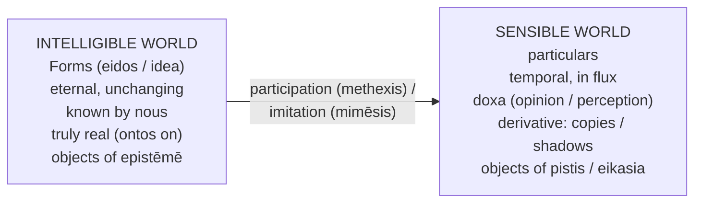

- Forms are eternal, immutable, non-material, self-identical universals, separate from particulars. "Intelligible realm" is structural, not another physical location.
- Form of the Good = "sun of the intelligible realm"; gives other Forms being and knowability.
- **Substance for Plato ⚠️:** true *ousia* = the Form; the truly real is the universal. Exact inversion of Aristotle.
- **"Ideas are timeless and spaceless" (2025 Q1(a)) ✅:** occupy no location, undergo no temporal change, not "in" space; hence cannot be generated or destroyed. Derive from doctrine: non-sensible and self-identical ⇒ no location, no parts ⇒ not in space; no generation, no destruction ⇒ not in time ⇒ knowable but not perceivable.

> [!WARNING]
> "Plato denies the reality of the physical world" is **wrong**: he grants derivative reality (copies, not illusions), unlike an illusionist such as Advaita māyāvāda.

### 4.2 Aristotle: substance (*ousia*) ✅

| Context | Substance is… |
|---|---|
| ***Categories*** | **Primary substance** = concrete individual (*tode ti*, "a this"), ultimate subject of predication. **Secondary substance** = species and genus, said *of* primary |
| ***Metaphysics* Z** | **Form / essence** (*eidos*, *to ti ēn einai*) has priority; substance = form–matter compound (*synolon*), but form makes the thing what it is |

**Metaphysics Z.3: four candidates**

| Candidate | Verdict |
|---|---|
| Substratum (*hypokeimenon*): (a) matter, (b) form, (c) compound | (a) **rejected** (stripped of predicates, not a "this", not separable); (b), (c) remain |
| Essence (*to ti ēn einai*) | **Accepted** (Z.4–6, Z.17) |
| Universal | **Rejected** (Z.13: "no universal is a substance") |
| Genus | **Rejected** |

**Categories / Metaphysics tension: four readings (name at least two) ✅**

| # | Reading | Status |
|---|---|---|
| 1 | **Different questions**: *Categories* asks "what things are substances?" (logical-linguistic criterion); Z asks "what is the substance *of* a thing?" (causal-explanatory criterion) | ⚠️ **Safest exam line** |
| 2 | Developmentalist (Jaeger): *Categories* early, later changed | ❓ chronology disputed |
| 3 | Individual forms (Frede–Patzig): form is *this* soul; Z.13 leaves form untouched | ❓ |
| 4 | Universal forms (Owen): genuine aporia unresolved | ❓ |

**Z.17 ✅:** substance sought as a **cause**: not "what is this?" but "**why is this matter a house?**": the form. Substance is an explanatory principle, not merely a bearer of properties.

**Executable verdict:** "The *Categories* identifies the substances; the *Metaphysics* identifies substance-hood. The individual remains what exists in the primary way, but what accounts for its being the individual it is, is its form. The tension is real only if 'substance' must have a single sense, which Aristotle denies, since being is 'said in many ways.'"

- ❓ Whether substantial form is numerically individual or species-level remains disputed; safe claim: form is the immanent essence and explanatory principle of the concrete composite.
- ⚠️ **Prime matter** (*prōtē hylē*): limiting posit, never exists independently; how fully Aristotle commits to one featureless prime matter is disputed.
- ✅ The Unmoved Mover is pure form/actuality without matter, but not the substantial form of every sensible thing.

### 4.3 Substance and the ten categories ✅

| Category | Example |
|---|---|
| Substance | Socrates |
| Quantity | six feet tall |
| Quality | pale |
| Relation | taller than Simmias |
| Place | in the Lyceum |
| Time | yesterday |
| Position | sitting |
| State / having | armed, shod |
| Action | cuts |
| Being affected | is cut |

Change of accidents = alteration; change of substance = generation / destruction. The categories are modes of predication/being, **not** ten physical components inside a substance ⚠️.

### 4.4 Hylomorphism ✅

| Component | Role | Bronze statue | Wooden table |
|---|---|---|---|
| Matter (*hylē*) | substratum, "out of which" | bronze | wood |
| Form (*morphē*) | structure / essence / actuality | shape of Hermes | functional design of a table |

- Matter is relative: bronze is matter relative to the statue, but itself a form imposed on copper and tin. Matter = potential; form = actual.
- Strongest hylomorphic cases are living natural substances (form as internal principle of activity and development) ⚠️.
- **2025 Q1(b) ✅:** "everything in the empirical world is matter + form" applies to **sensible substances**, not to accidents apart, mathematical abstractions or the immaterial Unmoved Mover.
- ❌ Matter and form are not two independently existing objects joined mechanically; they are correlative principles of one substance.
- ⚠️ In substantial change the prior substantial form does not persist as the identity of the new substance; an underlying material potential acquires a new substantial form. Persistence of the same form belongs to accidental change.
- Priority ✅: form is prior to matter in definition and knowability. ❌ Priority is **not** temporal precedence of form over every material process.

### 4.5 Form: Plato vs Aristotle (2024 Q1(a): this table IS the skeleton) ✅

| Feature | Plato | Aristotle |
|---|---|---|
| Location | separate realm | *in* the particular |
| Relation to particular | paradigm → copy (mimēsis) | essence internal to the composite |
| Explanatory role | "because it imitates the Form" | "because its matter is organised thus" |
| Status of universal | separate Form truly real | species/genus secondary substances in *Categories*; Z.13 denies a universal predicated of many is substance |
| Causation | Forms as paradigms; *Timaeus* adds Demiurge and Receptacle | immanent formal and final causes in a four-cause analysis |

Axis: **separated paradigm vs immanent essence**; then consequences for causality, generation, universals, what counts as substance. ❌ Two parallel summaries.

### 4.6 Idea–world consistency (2018 Q4(b)) ✅/❓

- Plato needs particulars to depend on Forms for being and intelligibility; Aristotle argues a separate Form cannot explain internal constitution or change.
- Participation links one Form to many; Aristotle: an additional relation or exemplar threatens regress and leaves motion unexplained; immanent form makes the substance the unified bearer of matter and intelligible structure.
- ⚠️ Issue is not whether universals are thinkable but whether **separation** is explanatory; distinguish transcendence of Form from universality of predication.
- ❓ Objection → reply: immanent form may not secure unchanging knowledge; Aristotle: form is stable in definition.

---

## 5. Ultimate Principles: Good, Demiurge, Unmoved Mover

*(The sources give no "rejection of transcendent realities" as such; this module covers each thinker's highest principle.)*

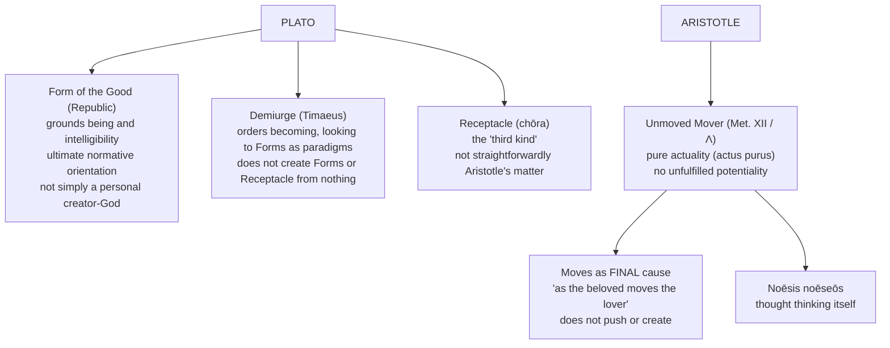

> [!WARNING]
> Do not equate the Form of the Good with the Demiurge without qualification; their relation across dialogues is interpretively contested ❓. The Unmoved Mover is **not** an efficient cause.

- Why Aristotle keeps God ⚠️: pure actuality completes the actuality/potentiality and causal system, not a general philosophy-of-religion survey.
- Objections → replies ✅: *can a final cause explain physical motion?* (Neoplatonists; Aquinas adjusts) → the cosmos is a system of desire oriented toward the divine; sublunary efficient causes mediate.
- Cross-paper link: Aristotle's Unmoved Mover → Aquinas's cosmological argument (Proofs for God).

---

## 6. Explanatory & Causal Principles

### 6.1 The four causes (*aitiai*) ✅

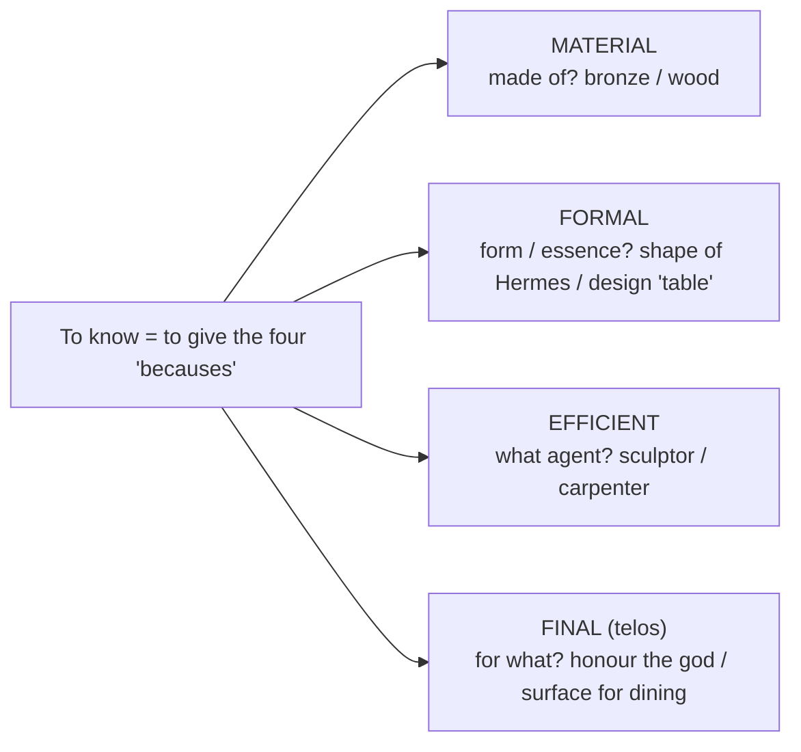

- ⚠️ *aitia* means **explanatory factor**, not "cause" in the modern efficient sense; translating it flatly is the source of the misreading of four causes as four pushes.
- ❌ Four causes are four **aspects of explanation**, not four events or four temporal stages; they can be simultaneous. Use **one** worked example throughout.
- Teleology ✅: final cause has special priority; "Nature does nothing in vain" (maxim; *De Caelo*, *Politics*, *De Partibus Animalium*); seed grows into a tree for the sake of the tree's complete actuality; in natural substances formal, efficient and final causes often **coincide** (form of oak is organising principle and end). ⚠️ This does not make material and efficient explanation dispensable, nor imply conscious planning.

### 6.2 Change: form, matter, privation ✅

- Coming-to-be needs an underlying subject, an acquired form and the prior **privation** (*sterēsis*): a not-yet-musical person becomes musical.
- Accidental change preserves the substance; substantial generation / destruction concerns the substance itself through a new substantial form.
- ⚠️ Matter/form/privation explain the **structure** of change; potentiality/actuality explain its **modal transition**; four causes explain **why** this determinate process occurs.

### 6.3 Developmental changes in substance (2019 Q2(b)) ⚠️

1. **Matter**: potential for receiving new form. 2. **Efficient cause** initiates. 3. **Telos**: the new form the substance is on its way to becoming. 4. **Formal cause** specifies what it becomes. Change = actualisation of matter's potentiality under the direction of the final cause.

### 6.4 Identity and causes as processes (2022 Q2(b)) ✅

1. Identity is supplied by substantial form / essence. 2. Matter supplies determinate capacities, not a second complete identity. 3. Efficient causation initiates; final causation identifies the completed actuality. 4. Accidental change: same substantial form persists; substantial generation: a new form constitutes a new substance. 5. Identity and process are consonant: form is the principle of intelligibility and, in natural development, the actuality toward which potential matter moves.

- ⚠️ Objection: defining the process by its completed form reads the end back into the beginning. ✅ Reply: a potentiality is a capacity of a determinate material under determinate conditions, not a guarantee of completion.
- ⚠️ Verdict: integrates identity and becoming better than a static essence theory, but depends on accepting internal teleology.

### 6.5 Plato's causal resources vs Aristotle's ✅

| Plato context | Explanatory role | Limitation |
|---|---|---|
| Forms in *Phaedo* | beautiful because of Beauty, equal because of Equality | formal explanation, no mechanism of motion |
| Form of the Good, *Republic* | grounds being and intelligibility; normative orientation | not simply a personal creator |
| Demiurge, *Timaeus* | orders becoming by paradigms | crafts order; does not create Forms or Receptacle |
| Receptacle (*chōra*) | the "third kind" | not identical to Aristotle's matter |

Aristotle's criticism: not that Plato names no other factor, but that **separated Forms themselves** do not internally explain motion, generation or organisation. Cross-thread: Aristotle's four causes vs Hume vs Kant vs Indian satkāryavāda (theme file, not read here).

### 6.6 Actuality and potentiality (*dynamis* / *energeia* / *entelecheia*) ✅

- **Potentiality**: capacity to become what it is not yet (wood → table; acorn → oak). **Actuality**: fulfilment. **Change** = "the actualisation of the potential *as* potential" (*Physics* III.1, 201a10).
- **2021 Q1(b) wooden table:** block of wood = *dynamis* → carpenter works = process (*kinēsis*) → finished table = *energeia/entelecheia*. "Potentiality is indefinable": *dynamis* cannot be defined independently of *energeia*; actuality is conceptually prior.

**Priority of actuality (2020 Q1(a)) ✅**

| Sense | Claim |
|---|---|
| Definition / logos | to define "potentially F" you must understand what it is to be actually F |
| Time (species level) | actual oak precedes the acorn (only an oak produces acorns) |
| Substance / nature | the end is what becoming is for; the *raison d'être* of the potentiality |

Note: priority of form over matter and actuality over potentiality is explanatory, definitional and teleological ❌ not temporal.

**Being and becoming (2023 Q2(b)) ✅**

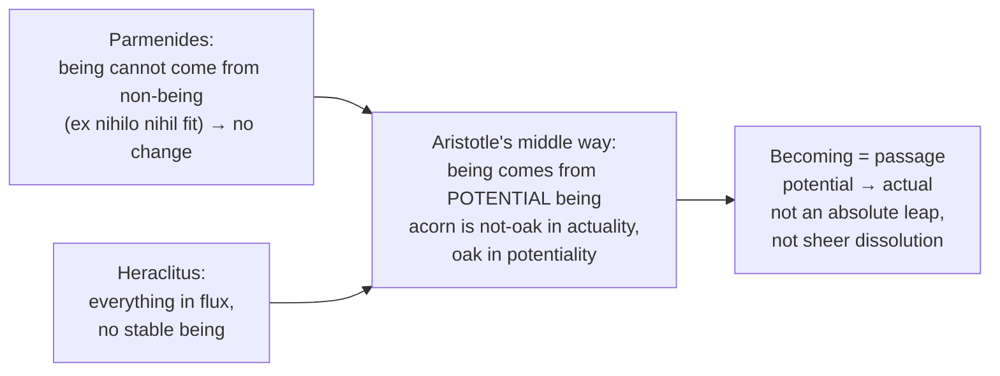

Limitation: depends on teleology; modern physics manages without final causes.

### 6.7 Entelechy: Aristotle vs Leibniz (2026 Q1(d)) ✅

| Axis | Aristotle | Leibniz |
|---|---|---|
| "Entelechy" names | **actuality / realisation**: a state or mode of being | **a substance**: each created simple substance (monad) |
| Category | correlative principle within a compound | fundamental individual being |
| Matter | form **of** matter; substance = compound | monads immaterial, non-composite; matter phenomenal |
| Soul | **first actuality of an organic body** (*De Anima* II.1, 412a20–28) | soul-like monads with distinct perception and memory (*Monadology* §19) |
| Bodies | genuine hylomorphic compounds, real *per se* unities | aggregates / well-founded phenomena |
| Source of activity | nature as internal principle of motion and rest; external efficient causes also operate | purely internal: perception → appetition; "monads have no windows" |
| Causal relations | real interaction among substances | none; **pre-established harmony** |
| Plurality | many substances, matter-involving | infinitely many simples, no two alike (identity of indiscernibles) |

- **First vs second actuality** ✅: first = possessing a capacity (sleeping geometer who knows geometry); second = exercising it (contemplating).
- Leibniz, *Monadology* §18: "one could give the name entelechies to all simple substances or created monads, for they have in themselves a certain perfection (*echousi to enteles*) and a self-sufficiency (*autarkeia*)…"
- **Continuity ✅:** both reject passive, externally driven substance and explain unity by an intrinsic principle of activity. **Discontinuity ✅:** Aristotle's entelechy is what a substance *has or is in act*; Leibniz's is what a substance *is*. Aristotle immanentises form in the compound; Leibniz substantialises it and reduces the compound to phenomena.
- ⚠️ Leibniz's relation to scholastic substantial forms changed across his career: "appropriating and transforming," never merely repeating.
- ❓ Aristotle's active intellect (*De Anima* III.5) is contested; do not use as settled doctrine.
- Translate by function: *actuality* (change), *realisation / completeness* (teleology), *being-at-work-staying-itself* (continuing activity).
- Leibniz half cross-owned: `Rationalism.md` §2.3.

---

## 7. Ethics & Human Goals (Puruṣārthas)

*(The sources give no puruṣārtha-style or value analysis for this topic; ethics, politics and the Good-as-value are outside the printed owner limbs.)*

- ✅ The Form of the Good carries an "ultimate normative orientation" in the *Republic*; the owner's verdict bank lists **objectivity of value** among the three problems the Forms are posited to solve (with the unity of the many and knowledge amid flux).
- ⚠️ Plato's tripartite soul, justice, philosopher-ruler, education, critique of democracy, and Aristotle's virtue, flourishing, contemplation, political animal and constitutions belong to ethics/political philosophy unless used briefly (e.g. the Cave's return).
- Cross-paper: Plato's critique of democracy (*Republic* VIII) → Paper II Forms of Government; Aristotle's natural-teleological politics → Paper II state/individual.

---

## 8. Inter-School Comparative Matrices

### 8.1 Plato vs Aristotle ⚠️

| Axis | Plato | Aristotle |
|---|---|---|
| Location of Form | transcendent | immanent |
| What is most real | universal Form | individual substance (*tode ti*) |
| Knowledge | rational / dialectical grasp of Forms; recollection supports | begins from sensible particulars, reaches universal form/causes |
| Change | sensible becoming vs stable Forms; later cosmology adds ordered becoming | central task (potency → act) |
| Causation | paradigms; Good; Demiurge/Receptacle | four causes; internal teleology |
| Highest principle | Form of the Good; Demiurge (not simply identical) | Unmoved Mover (pure actuality, final cause) |
| Universal | separate Form truly real | secondary substances in *Categories*; no predicated universal is substance (Z.13) |
| Matter | Receptacle / "third kind" | correlative potential principle |

### 8.2 Atomists vs Plato vs Aristotle (2026 Q2(a), 20 marks) ✅

| Axis | Atomists | Plato | Aristotle |
|---|---|---|---|
| Ultimate reality | indivisible bodies + void | separate changeless Forms | concrete individual substance (matter + immanent form) |
| Where form is | effectively absent (shape, order, position) | separated | **in** the compound |
| Causes | material, efficient | formal, paradigmatic | **all four** |
| Change | rearrangement of unchanged units | difficult | potentiality → actuality, with privation |
| Unity of living thing | aggregate | participation | soul as first actuality of an organic body |
| Knowledge | of arrangements | of Forms, away from sensibles | of essences **in** sensibles, via definition |
| Characteristic failure | explains too little | explains in the wrong place | ❓ owes fuller account of how immanent form individuates |

**Verdict line ✅:** "The Atomists keep the particulars and lose the form; Plato keeps the form and loses the particulars; Aristotle keeps both by putting the form **inside** the particular."

### 8.3 Fundamental problem of metaphysics ✅

- Metaphysics studies "being qua being" (*Met.* IV.1); first philosophy: first causes and principles.
- "Being" is said in many ways (substance, quality, quantity, relation, potentiality, actuality, truth) with **focal reference** (*pros hen*) to substance; so "what is being?" reduces to "**what is substance (*ousia*)?**" (VII.1).
- **Constraint on any answer:** (i) preserve the reality of the individual sensible thing; (ii) make it intelligible (a determinate essence); (iii) explain change and generation without violating "nothing comes from nothing."
- Answer: hylomorphic compound; form = essence and actuality; change = potentiality → actuality; four causes complete explanation.
- Mnemonic: **ONE question, TWO failures, FOUR causes.**

### 8.4 Against the Atomists (Leucippus, Democritus) ✅

Their position first: indivisible bodies (*atoma*) differing in shape, order, position, moving in void; their strength is explaining change while keeping fundamental beings permanent.

| # | Aristotle's objection | Kernel |
|---|---|---|
| 1 | Explanatory incompleteness | only material and efficient causes; no formal (why organised whole, not heap) or final (what for) |
| 2 | Unexplained motion | always-having-moved is not a principle of motion |
| 3 | Continuity | extended yet absolutely indivisible body is problematic (answer: *potential* infinite divisibility) |
| 4 | Qualitative / substantial change | rearrangement explains alteration of aggregates, not generation of a new substance |
| 5 | Chance versus nature | goal-directed organisation "always or for the most part" (eye for seeing, root for absorbing) is not collision |
| 6 | Unity of the composite | a heap is an aggregate, not a *tode ti* |

⚠️ Fair-play: Aristotle does not deny matter is a real principle nor that mechanical interaction occurs; his charge is **reductionism**: mistaking a partial cause for the whole. ❌ "Aristotle refuted atomism scientifically" is wrong: objections are metaphysical/explanatory.

### 8.5 Links to other threads ⚠️

- Sāṃkhya satkāryavāda (effect pre-exists in cause) parallels Aristotle's potentiality; Nyāya's atomistic creation + God as efficient cause compared with the Unmoved Mover (link-outs). Kant's categories and critique of dogmatic metaphysics (both Platonic and Aristotelian); Rationalism continues the substance thread.

---

## 9. Criticisms & Reconstructed Replies

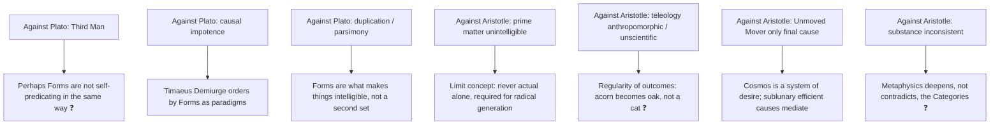

### 9.1 Objection → reply ledger on Aristotle ✅/⚠️/❓

| Objection | Reply | Verdict |
|---|---|---|
| ❌ Immanent form is the Platonic Form relocated | Location is exactly the issue: immanent form is the essence and actuality of this compound, so can be its formal and final cause | ⚠️ Strong, but presses toward particularised forms |
| ❌ Teleology pre-scientific; modern science vindicated Atomists | Targets are explanatory completeness and organic unity, not micro-constituents; functional explanation indispensable in biology | ❓ Concede historically, defend conceptually |
| ❌ Prime matter as obscure as participation | Limiting notion required by substantial change, never encountered bare | ⚠️ Admitted difficulty |
| ❌ If universals are not substances, how is science possible? | Science is of the universal as predicated of and realised in individuals | ✅ Standard |

### 9.2 Presuppositions of Aristotle's answer ⚠️

P1 Explanation is causal and plural (four irreducible "whys"). P2 Focal meaning: being is neither univocal nor merely equivocal. P3 Nature is teleological (regularity "always or for the most part" indicates ends immanent in natures, not external design). P4 Essences are knowable through definition of the species.

### 9.3 Ledger: Entelechy objections ✅

| Objection | Reply | Verdict |
|---|---|---|
| ❌ Leibniz merely renames substantial forms | Monad is simple, immaterial, mirrors the universe, does not inform matter; only the name and theme are inherited | ✅ Decisive |
| ❌ Aristotle's entelechy obscure: soul a thing or a state? | First/second actuality: soul is a state of capacity-possession of an organic body | ⚠️ Works except active intellect |
| ❌ Windowless monads make interaction unintelligible | Global harmony explanation | ❓ Economy vs cost |

### 9.4 Graded verdict highlights ⚠️

- **Forms:** Plato is his own best critic: *Parmenides* states the Third Man and participation dilemma more sharply than Aristotle; the theory fails from internal incompatibility of two demands (separate hence stable; explanatory hence involved).
- **Line / Cave:** the epistemology can be accepted without the politics; Plato thought it could not; the inference from having seen the Good to entitlement to rule is the weakest link (Popper).
- **Aristotle's critique:** succeeds against separation and inherits Plato's hardest problem (Z.13 vs universality of intelligibility): transformed into the medieval problem of universals.

---

## 10. Controlled Comparisons

*(The sources give no East–West comparison table for this topic; the comparisons below are those the sources themselves record.)*

| Pair | Point of contact | Decisive disanalogy |
|---|---|---|
| **Aristotle ↔ Leibniz** (entelechy) | Both reject passive substance; intrinsic principle of activity | Actuality vs substance; immanent form vs immaterial simple (§6.7) |
| **Plato ↔ Advaita māyāvāda** | Both distinguish levels of reality | Plato grants derivative reality (copies, not illusions); not an illusionist |
| **Aristotle potentiality ↔ Sāṃkhya satkāryavāda** | Effect prefigured in cause | Parallel flagged in link-outs; not developed in the owner file |
| **Aristotle's Unmoved Mover ↔ Nyāya God as efficient cause** | Highest principle in a causal system | Unmoved Mover is a **final** cause, not efficient and not creator |
| **Aristotle's four causes ↔ Hume ↔ Kant ↔ satkāryavāda** | Causation thread | Theme file `Causation-across-schools.md` not read here |
| **Plato's Divided Line ↔ Popper's critique** | Epistemic→political inference | Popper's *The Open Society and Its Enemies*, Vol. I (1945) is a polemic contested by Plato scholars |

> [!WARNING]
> These are analogies from the owner file's link-outs, not historical influences. Keep to one or two lines after the main answer.

---

## 11. Diagnostic Deep-Dives for High-Frequency Themes

### 11.1 Categories vs Metaphysics on substance

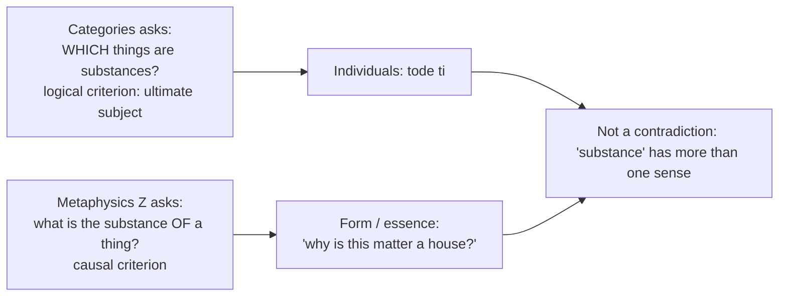

### 11.2 Directive decoder ⚠️

| Directive | Obligation | Fatal error |
|---|---|---|
| **Elucidate** ("Ideas are timeless and spaceless") | Derive the property from the doctrine | Restating "Forms are eternal" |
| **Explain the Allegory of the Cave** | Map onto the Line; include the return | Retelling with no epistemology or politics |
| **Differentiate conceptions of form** | One axis, run consistently | Two parallel summaries |
| **Examine Aristotle's critique** | Reconstruct each objection as an argument, then Plato's replies | Listing without replies |
| **Discuss the four causes** | Four different "whys" about one thing, one example | Four definitions, four examples |
| **Actuality and potentiality: discuss** | Show it solves Parmenides on change; priority; Unmoved Mover | Defining the terms |
| **Comment on substance** | Address Categories vs Metaphysics | Only "primary substance = individual" |
| **Critically evaluate / Do you agree?** | A ruling in line 1 | Balanced description |

### 11.3 Answer spine for 2026 Q2(a) ⚠️

```text
Frame : Being said in many ways → "what is substance?" Any answer must save the individual,
        its intelligibility, and change.
Body A: Aristotle's apparatus first: hylomorphism, essence/form, four causes, potency/act.
Body B: Against the Atomists (six objections).
Body C: Against Plato (six arguments).
Synth : middle-path table (form inside the particular).
Qualif: he retains Plato's demand for intelligible form; status of immanent form contested.
Close : "Aristotle's metaphysics is the attempt to make form do explanatory work without
        leaving the thing it explains."
```

---

## 12. PYQ Routing Ledger

> Corpus signal: **12 primary-owned parts** out of 112 Western parts in 2018–2025 (at least one in every year; per-year 1/2/1/2/2/1/1/2) plus **2 primary-owned 2026 parts** = **14 primary-owned**. No pre-2018 or cross-owned-to-another-owner parts are recorded in the sources for this topic.

### 2018–2025

| Year | Q | Marks | Exact demand | Map to |
|---|---|---:|---|---|
| 2018 | Q4(b) | 15 | Is the relation between the Idea and the World as discussed by Plato logically consistent? Discuss Aristotle's views regarding this and also give arguments in favour of your answer. | §4.6, §3.1–3.2 |
| 2019 | Q1(a) | 10 | What does Plato want to prove by his 'Allegory of Cave'? | §2.1–2.3 |
| 2019 | Q2(b) | 15 | What are the reasons for developmental changes in substance according to Aristotle? Discuss. | §6.3 |
| 2020 | Q1(a) | 10 | How does Aristotle argue for the priority of Form over Matter and Actuality over Potentiality? Critically discuss. | §4.4, §6.6 |
| 2021 | Q1(a) | 10 | "There is a red chair." How would Plato explain this statement with the use of his theory of forms? Examine. | §2.6 |
| 2021 | Q1(b) | 10 | "Potentiality is indefinable" according to Aristotle. Explain the relationship between potentiality and actuality with reference to the above philosophical position by taking the example of a "wooden table". | §6.6 |
| 2022 | Q1(a) | 10 | How does Plato use the theory of forms to establish the relation between epistemology and metaphysics? Discuss. | §2.1–2.4 |
| 2022 | Q2(b) | 15 | Is Aristotle's view of nature of identity in consonance with his metaphysical view of causes as processes? Discuss giving suitable examples. | §6.4 |
| 2023 | Q2(b) | 15 | Present an exposition of Aristotle's distinction between actuality and potentiality. Does it provide a solution to the problem of being and becoming as presented in ancient Greek philosophy? Discuss with suitable examples. | §6.6 |
| 2024 | Q1(a) | 10 | Differentiate between Plato's and Aristotle's conceptions of form. | §4.5 |
| 2025 | Q1(a) | 10 | "Ideas are timeless and spaceless." Elucidate this statement with reference to Plato. | §4.1 |
| 2025 | Q1(b) | 10 | "In the empirical world, everything is a compound of Matter and Form." Evaluate this statement with reference to Aristotle. | §4.4 |

### 2026 (Section A)

| Year | Q | Marks | Exact demand | Map to |
|---|---|---:|---|---|
| 2026 | Q1(d) | 10 | Compare and contrast the notion of entelechy as presented in Aristotle's and Leibniz's philosophy. | §6.7 (Leibniz half cross-owned: `Rationalism.md` §2.3) |
| 2026 | Q2(a) | 20 | What, according to Aristotle, is the fundamental problem of metaphysics? Discuss this in relation with Aristotle's account of the essence of the world, where he rejects the views of both the Atomists and Plato. | §8.2–8.4, §11.3 |

**Marks tally:** 2018–2025 = four 15-mark parts (2018 Q4(b), 2019 Q2(b), 2022 Q2(b), 2023 Q2(b)) and eight 10-mark parts; 2026 = 10 + 20 = 30 marks (matches the 2026 ledger's "2 parts, 30 marks").

---

## 13. Top Exam Traps

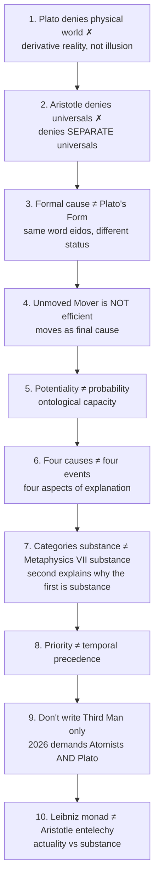

Other ❌ recorded: Forms are not "concepts in the mind"; Aristotle did not "reject forms" (rejects *separated* forms); soul is not an immaterial substance inside the body; Leibnizian bodies are well-founded phenomena, not composite substances; most monadic perceptions are *petites perceptions*; Aristotle did not "refute atomism scientifically"; "being qua being" is not a study of a super-entity; "man is a rational animal" is a scholastic formula (*animal rationale*), not a sentence of the *Categories* or *Metaphysics*; the Third Man **name** is from Aristotle; Plato's *ta metaxu* are on Aristotle's testimony.

---

## 14. Technical Vocabulary Bank

| English gloss | Greek (transliterated) | Meaning / use | Status |
|---|---|---|---|
| Form / Idea | *eidos* / *idea* | Plato transcendent; Aristotle immanent | ✅ |
| Participation | *methexis* | Particular's relation to Form | ✅ |
| Imitation | *mimēsis* | Particular copies the paradigm | ✅ |
| Being / substance | *ousia* | Plato: the Form; Aristotle: see §4.2 | ✅ |
| "A this" | *tode ti* | Primary substance | ✅ |
| Essence ("what-it-was-to-be") | *to ti ēn einai* | Z substance | ✅ |
| Substratum | *hypokeimenon* | Z.3 candidate | ✅ |
| Compound | *synolon* | Matter–form whole | ✅ |
| Matter / form | *hylē* / *morphē* | Hylomorphism | ✅ |
| Potentiality / actuality | *dynamis* / *energeia* | Change | ✅ |
| Full realisation / entelechy | *entelecheia* | "being-at-work-staying-itself" | ✅ |
| Pure actuality | *actus purus* | Unmoved Mover (Latin scholastic) | ✅ |
| Cause / explanatory factor | *aitia* | Four causes | ✅ |
| Privation | *sterēsis* | Third principle of change | ✅ |
| Prime matter | *prōtē hylē* | Limiting posit | ⚠️ |
| Imagination / belief / thought / intellection | *eikasia*, *pistis*, *dianoia*, *noēsis* | Divided Line states | ✅ |
| Opinion / knowledge | *doxa* / *epistēmē* | D+C / B+A | ✅ |
| Beyond being | *epekeina tēs ousias* | Good (*Rep.* 509b) | ✅ |
| Unhypothetical first principle | *archē anhypothetos* | Dialectic's terminus | ✅ |
| One-over-many | *hen epi pollōn* | Argument for Forms | ✅ |
| Recollection | *anamnēsis* | *Meno*, *Phaedo* | ✅ |
| Education / turning around | *paideia* / *periagōgē* | Cave | ✅ |
| Descent / return | *katabasis* | Cave return | ✅ |
| Separation | *chōrismos* | Aristotle's target | ✅ |
| Receptacle | *chōra* | *Timaeus* "third kind" | ✅ |
| Intermediates | *ta metaxu* | Plato's mathematicals | ❓ |
| Focal reference | *pros hen* | Many senses of being | ✅ |
| Thought thinking itself | *noēsis noēseōs* | God's activity | ✅ |

---

## 15. Graded Verdict & Answer Architectures

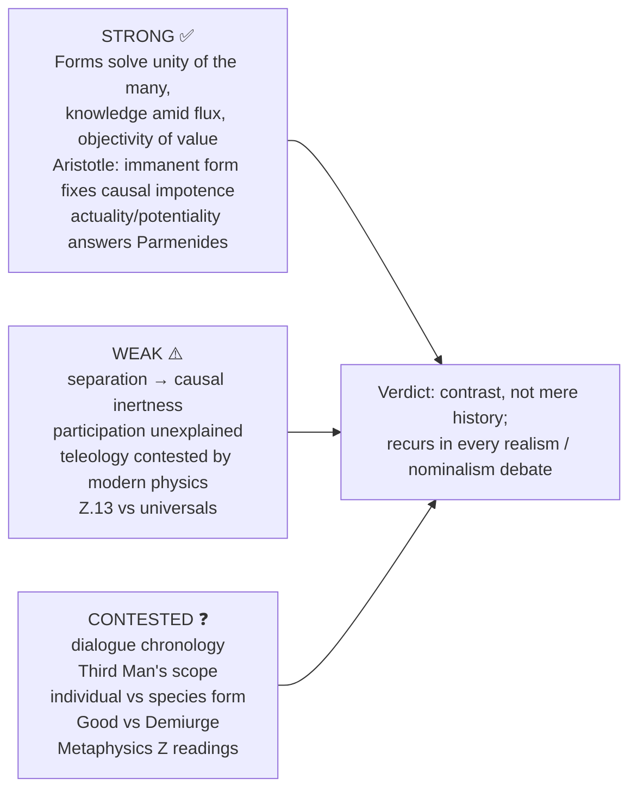

### 15.1 10-mark: "Ideas are timeless and spaceless" (2025)

```text
L1   : Forms are non-material universals independent of the sensible world: no location, no change.
Body : (i) eternal: uncreated, indestructible; (ii) non-spatial: no magnitude, shape, position;
       (iii) hence objects of epistēmē; (iv) contrast: particulars temporal, spatial, changeable → doxa.
Eval : grounds the epistemology–metaphysics link but invites the separation problem.
Close: the Two-World consequence.
```

### 15.2 15-mark: "Does actuality–potentiality solve being and becoming?" (2023)

```text
Frame : Parmenides (no change) vs Heraclitus (flux).
A: dynamis/energeia; change = actualisation of potential qua potential; acorn not-oak in act, oak in potency.
B: worked example; priority of actuality (definition, time, substance); Unmoved Mover.
Assess: solves Parmenides; accommodates Heraclitus; limit: depends on teleology.
Close : yes — the most influential account of change in Western philosophy.
```

### 15.3 20-mark: Plato's vs Aristotle's metaphysics of Form with critique

```text
Frame : both use eidos; Aristotle inherits and transforms.
A: Plato: transcendent Forms; arguments; participation; two worlds.
B: Aristotle: immanent Forms; Third Man; hylomorphism; substance = composite.
C: consequences for knowledge, causation, God, change.
Assess: immanentism more explanatory (no regress, real causation) but loses the insight that
        intelligibility may require something beyond the particular.
Close : not merely historical; recurs in every realism/nominalism debate.
```

**Anchor sentences ✅:** "Aristotle's metaphysics is the attempt to make form do explanatory work without leaving the thing it explains." · "The Atomists keep the particulars and lose the form; Plato keeps the form and loses the particulars; Aristotle keeps both by putting the form **inside** the particular." · "The Categories identifies the substances; the Metaphysics identifies substance-hood." · "Aristotle's entelechy is what a substance *has or is in act*; Leibniz's entelechy is what a substance *is*."

**Further 10/15/20 verdicts from the owner file ⚠️:**

| Sub-topic | One-line verdict |
|---|---|
| Hylomorphism | Single scheme for artefacts, organisms, change, definition and soul; correlative notions cannot be defined independently (virtuous circle or empty pairing?) |
| Four causes | Final cause = directedness toward a mature form, not purposes in nature's mind; modern biology expelled it from physics and retained it in function-talk |
| Actuality/potentiality | Most productive invention; "potentiality" defined by the actuality it becomes, so it illuminates but cannot predict, which distinguishes it from mechanical philosophy |

---

## Sources

Stace, *A Critical History of Greek Philosophy*; Masih, *A Critical History of Western Philosophy*; Copleston, *A History of Philosophy* Vol. I; Kenny, *A New History of Western Philosophy* Vol. I; Warburton, *Philosophy: The Classics*. Primary: Plato, *Republic*, *Phaedo*, *Parmenides*, *Timaeus*; Aristotle, *Categories*, *Metaphysics* (esp. VII–IX), *Physics* III, *De Anima*. Anchors cited in owner file: SEP *Aristotle's Metaphysics*, *Ancient Atomism*, *Aristotle's Psychology*, *Leibniz's Philosophy of Mind*; IEP *Leibniz: Metaphysics*. Optional depth: Vlastos, Fine, Kosman, Wedin.
