# RATIONALISM (Descartes, Spinoza, Leibniz) — Examiner-Grade Mindmap

> **Syllabus (verbatim):** Rationalism (Descartes, Spinoza, Leibniz); Cartesian Method and Certain Knowledge; Substance; God; Mind-Body Dualism; Determinism and Freedom.
> **Catalogue key:** `philosophy-paper-i-western-philosophy-02` · Paper I · Western Philosophy (Section A)
> **Sources used:** `paper-1/western/Rationalism.md` (canonical owner, read in full: Part I doctrine, Part II learning session, solved workbook, MCQ loops, register notes) · `_advanced/Western-Philosophy-Dossier.md` §2 (optional depth) · `paper-1/_PYQ-Western-Philosophy-2018-2025.md` · `paper-1/_PYQ-Western-Philosophy-2026.md` · `paper-1/_themes/Substance-across-western.md` · `paper-1/_themes/A-priori-a-posteriori-knowledge.md` · `paper-1/_themes/Self-and-liberation-across-schools.md` (§5A) · `paper-1/_themes/Critiques-of-metaphysics.md` (Strawson entry). `Causation-across-schools.md` and `Pramana-across-schools.md` contain no Descartes/Spinoza/Leibniz material and were not used.
> **Evidence key:** ✅ canonical doctrine · ⚠️ analytical synthesis · ❓ contested / uncertain · ❌ trap
> **Adaptation note:** the 15-module blueprint is Indian-school oriented. Here Module 1 = textual map and lineage; Module 2 = theory of knowledge; Module 3 = internal critiques and refinements; Module 4 = substance metaphysics and mind-body; Module 5 = God (the ultimate principle); Module 6 = causation, sufficient reason and necessity; Module 7 = freedom and value orientation. Where the sources give nothing for a module, it says so.

> [!IMPORTANT]
> **Core thesis.** Method shared; substance criterion diverges; God and freedom follow the substance choice. Rationalism is not the claim that sense is useless; it is the claim that sense-experience cannot by itself yield necessity, universality or an indubitable foundation. ✅

---

## 0. Master Overview

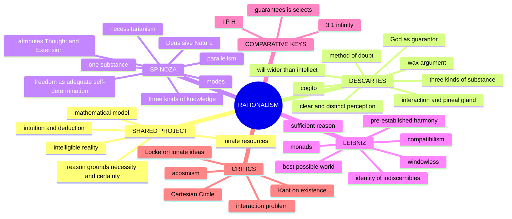

---

## 1. Identity, Lineage & Textual Map

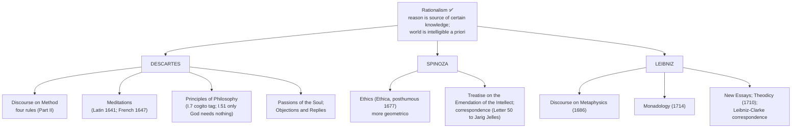

| Thinker | Primary source ownership | Methodological centre |
|---|---|---|
| **Descartes** | *Discourse on Method*; *Meditations*; *Principles of Philosophy*; *Passions of the Soul*; Objections/Replies | methodic doubt, intellectual intuition, deduction, foundational reconstruction |
| **Spinoza** | *Ethics*; *Treatise on the Emendation of the Intellect*; correspondence | definitions/axioms and geometric demonstration of one necessary immanent order |
| **Leibniz** | *Discourse on Metaphysics*; *New Essays*; *Monadology*; *Theodicy*; Leibniz–Clarke correspondence | sufficient reason, complete concepts, possible worlds, simple substances |

- ✅ The rationalists do not reject experience as useless; they deny that sense-experience by itself can ground necessity, universality or an indubitable first principle.
- ✅ Their unity lies in confidence that reality has an intelligible rational structure; their incompatible substance counts show that a shared method does not mechanically yield one metaphysics.
- ⚠️ Descartes' finite substances, Spinoza's one substance and Leibniz's monads answer different revisions of inherited "substance"; always name the operative criterion.
- **Translation / provenance discipline ✅:**

| Text | Safe practice |
|---|---|
| Descartes, *Meditations* | Wording differs between Cottingham–Stoothoff–Murdoch (CSM, CUP 1984; scholarly default) and Haldane–Ross (1911). *Solius mentis inspectio* = "purely mental scrutiny" (CSM) / "inspection of the mind" (Haldane–Ross); write "*inspectio mentis* — rendered 'purely mental scrutiny' in CSM" or paraphrase |
| *Cogito, ergo sum* | Latin tag appears in the *Discourse* (1637; French *je pense, donc je suis*) and *Principles* I.7. ❌ Do not attribute the Latin tag to the *Meditations*, which runs "I am, I exist, is necessarily true whenever it is put forward by me or conceived in my mind" |
| Spinoza, *Ethics* | Curley (*Collected Works*, Princeton 1985) standard; Elwes (1883), White–Stirling older. Cite by structural reference (*Eth.* I, Def. 7; I, P15; II, P7; II, P40S2; V, P32C), not page |
| *Omnis determinatio est negatio* | ⚠️ exact Latin formula is **not** in the *Ethics*; Spinoza writes *determinatio negatio est* in **Letter 50 to Jarig Jelles (2 June 1674)**; the universalised slogan is **Hegel's** |
| *Deus sive Natura* | *Eth.* IV, Preface, and IV, P4 Dem. |
| Leibniz, *Monadology* (1714) | Latta (1898); Ariew–Garber (Hackett 1989). "Monads have no windows" = standard rendering of §7 (*Les Monades n'ont point de fenêtres*) |
| "Best of all possible worlds" | *Theodicy* (1710); *Monadology* §§53–55; Leibniz's own *le meilleur des mondes possibles*; Voltaire's *Candide* (1759) satirises it as *tout est au mieux* |
| "Incline without necessitating" | *Theodicy*; Leibniz–Clarke; standard rendering of *incliner sans nécessiter* |

> [!WARNING]
> "Ghost in the machine" is **Ryle's** hostile coinage (*The Concept of Mind*, 1949), not Descartes'.

**Optional-enrichment boundary ⚠️.** Descartes' detailed physiology, passions and scientific cosmology; Spinoza's full political, biblical-critical and affect taxonomy; Leibniz's space/time relationalism, calculus disputes and full theodicy are optional unless a PYQ asks. Locke and Kant belong to later owners and appear here only as targeted objections.

---

## 2. Theory of Knowledge (Epistemology)

### 2.1 Basic tenets of Rationalism (2025 Q2(a)) ⚠️

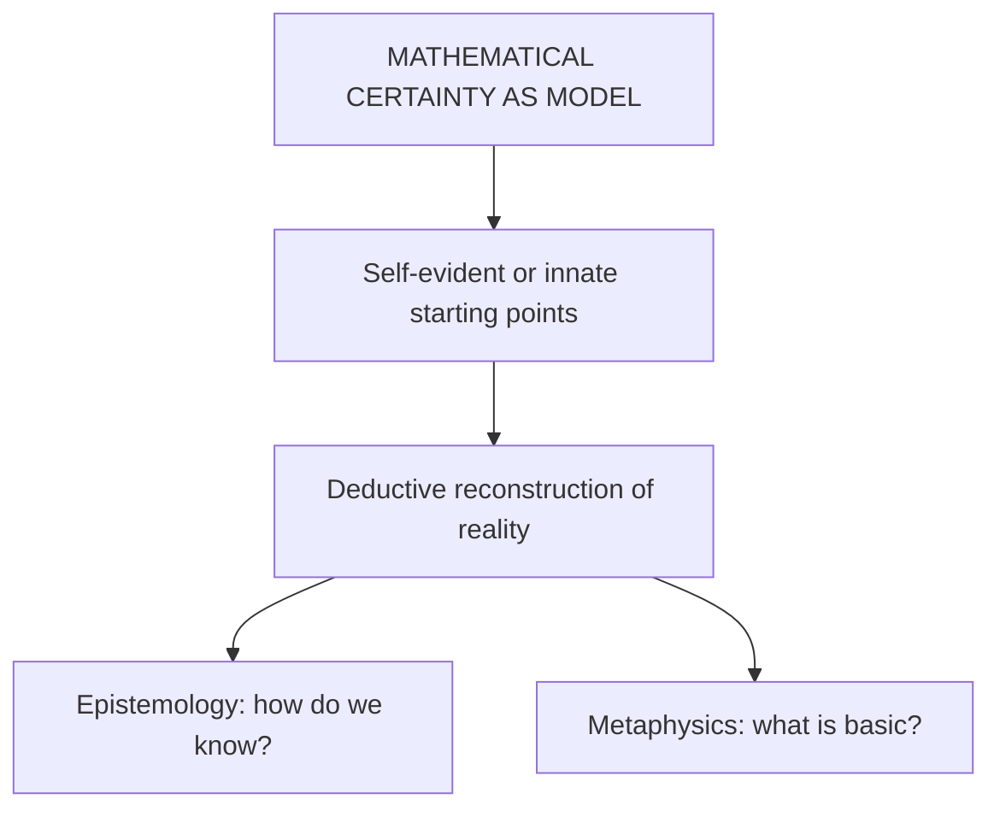

| Tenet | Content |
|---|---|
| **Innate cognitive resources** | Some concepts/principles are native capacities or structures of intellect, not copies from sensation |
| **Reason as ground of necessity** | Experience may occasion thought; intellect supplies the warrant for necessity, universality, first principles |
| **Intuition and deduction** | Descartes: clear intellectual intuition and ordered deduction; Spinoza: geometric presentation; Leibniz: identities, sufficient reasons, complete concepts |
| **Intelligibility of reality** | The real is the rational |
| **Substance metaphysics** | Reality explained through substance(s), attributes and modes |

- ❌ Rationalism is not the claim that all sensory beliefs are false or that every truth is consciously present at birth.
- **A priori box ⚠️ (theme file).** Rationalists: certain knowledge is a priori, modelled on mathematics; Leibniz's **truths of reason** (necessary, a priori) vs **truths of fact** (contingent, a posteriori). The whole epistemic duel is whether the **synthetic a priori** cell exists: rationalists loosely yes; empiricists no; Kant yes; positivists no; Quine erases the grid.

### 2.2 Descartes: method of doubt ✅

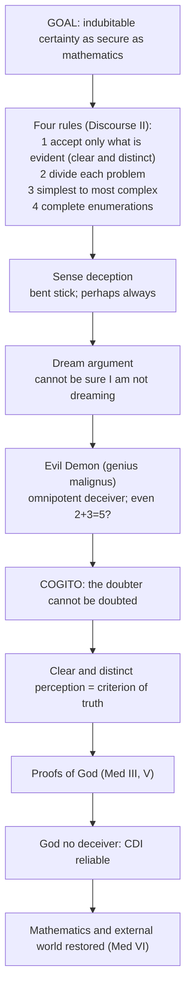

- Doubt is methodic and temporary, an instrument not Descartes' final position ✅.
- **Cogito ✅:** "I am, I exist" is true whenever put forward or conceived; present-tense and performative. Not a syllogism (no suppressed major premise); an immediate intuition. It is the **Archimedean point**.
- ⚠️ Cogito establishes thinking existence, not yet an enduring immaterial substance, diachronic identity or a complete theory of mind. The thinking thing (*res cogitans*) is developed through the rest of Meditation II and the later real-distinction argument.
- Self-knowledge is immediate and error-free about existence; world-knowledge is mediate, via ideas whose reliability needs God's veracity first (2022 Q4(b)) ✅.

### 2.3 The wax argument (*Meditation* II) ✅

Printed subterms: *cera*; *inspectio mentis*; *sensus* vs *imaginatio* vs *intellectus*; *flexibile et mutabile*; *res extensa*; Meditation II sub-title "The nature of the human mind, and how it is better known than the body."

| Step | Content |
|---|---|
| 1 | Fresh wax: taste of honey, scent of flowers, colour, shape, size, hardness, coldness, sound when rapped |
| 2 | Near fire every item is destroyed or replaced |
| 3 | Yet I judge it the same wax |
| 4 | So what wax *is* is not identical to any listed sensible quality |
| 5 | Nor imagination: heat gives indefinitely many shapes/sizes; images cannot run through them (*flexibile et mutabile*) |
| 6 | So wax is grasped as extended, flexible, changeable by intellect alone (*inspectio mentis*) |
| 7 | Every perception of a body is also a perception of the perceiving mind, and more certain |
| 8 | So (a) bodies known by understanding not sense; (b) mind is *notior* than body |

- **Paired case ✅:** "hats and coats": from a window I say I see men; strictly I see hats and coats and judge men underneath: seeing is judging.
- **Presuppositions ⚠️:** P1 substance/attribute metaphysics already assumed (a bearer through total qualitative replacement); P2 sense exhausted by the catalogue; P3 imagination is image-bound and finite while intellect is not; P4 perception is self-intimating.

| Objection | Source | Reply | Residual |
|---|---|---|---|
| "Extended stuff" is an abstraction from repeated sense | Gassendi, *Fifth Objections* | The empiricist must name the sensory item registering identity; none exists | ❓ concept shown not an image, not that knowledge is a priori |
| Without sensible qualities nothing remains to be known | Berkeley, *Principles* §§9–11 | Extension is the mode of being of every sensible quality | ❓ presupposes what Berkeley denies |
| Step 7 conflates certainty with content | ⚠️ analytic reconstruction | Needs only epistemic priority | read "better known" as "more indubitable" |

- **Closes:** 10m: wax shows that *if* bodies are known they are known by intellect and self-knowledge is epistemically prior. 15/20m: Meditation II already installs extension as essence of body, so the dualism of Meditation VI is partly presupposed.
- ❌ The wax argument does not prove that bodies exist; Meditation VI's world-proof depends on divine veracity.

### 2.4 Restoring the external world (2019 Q1(d)) ✅


- ⚠️ Secures bodies and extension more strongly than the literal accuracy of every colour, size or distance; intellect and cross-checking correct sensory error.
- ❓ Inherits the Cartesian Circle.

### 2.5 Innate ideas and Locke (2023 Q2(c)) ✅

- Three classes: **adventitious** (from outside), **factitious** (voluntarily constructed), **innate** (native to rational nature). Innate = dispositions or native capacities, not explicit infant propositions; "seeds of knowledge" activated on occasion.
- Work done: ideas of thought, God, infinity, basic mathematical structures; the idea of an infinite perfect being grounds the trademark argument.

| Locke's objection | Cartesian reply | Residual force |
|---|---|---|
| No universal assent: children and those lacking concepts do not affirm alleged innate principles | Innateness is dispositional, not continuous assent | Disposition must be specified without making every learnable truth innate |
| An unknown principle cannot be "in the mind" | Native capacities can operate before reflective recognition | Risks shifting to an uncontroversial capacity to learn |
| Sensation and reflection supply all ideas (white paper) | Finite experience cannot yield the positive idea of infinity or necessary mathematical warrant | Locke can reconstruct infinity by repetition/negation and necessity by abstraction |

- Verdict: Locke defeats crude occurrent innatism more securely than dispositional innatism; the empiricist must still explain necessity and universality.
- Close-neighbour cross-link ⚠️: rationalist intuition (*intuitus/deductio*; Spinoza's *scientia intuitiva*) is **not** Locke's intuitive knowledge (immediate perception that two ideas agree or disagree); owner: `Empiricism.md` §1.1 (2026 Q1(b)).

### 2.6 Spinoza's three kinds of knowledge (*Ethics* II, P40S2) ✅

Printed subterms: *imaginatio/opinio*; *experientia vaga*; *ex signis*; *ratio*; *notiones communes*; *scientia intuitiva*; *idea adaequata* vs *inadaequata*; *sub specie aeternitatis*; *amor Dei intellectualis*.

| Kind | Name | Source | Adequacy | Status |
|---|---|---|---|---|
| First | *Imaginatio/opinio* | (a) vague experience via senses; (b) hearsay, words, memory | Inadequate, mutilated, confused | "only cause of falsity" (II, P41) |
| Second | *Ratio* | Common notions and adequate ideas of properties (equally in part and whole) | Adequate | Necessarily true (II, P41) |
| Third | *Scientia intuitiva* | From adequate idea of formal essence of certain attributes of God to adequate knowledge of essence of things | Adequate, grasped in a single act | Highest (V, P25) |

- **Fourth proportional ✅:** merchant (rule from signs/vague experience: first kind) · mathematician (demonstrates from proportionals, Euclid VII.19: second kind) · seer (sees 6 at a glance from 1, 2, 3: third kind). Mnemonic **M-M-S**.
- **Knowledge = freedom (7 steps) ⚠️:** everything follows from God's nature → an adequate idea is understood through its cause → bondage is determination by external causes (inadequate ideas) → freedom is determination by one's own nature (I, Def. 7) → adequate ideas are the mind acting from its own nature → moving from first to second/third kind is moving from bondage to freedom → third kind sees things *sub specie aeternitatis*, generating intellectual love of God (V, P32C) and blessedness (*beatitudo*).
- Presuppositions ⚠️: P1 parallelism (II, P7); P2 necessitarianism; P3 common notions really are common; P4 intuition is a distinct act, not fast reason.
- Objection → reply → counter: third kind epistemically unaccountable; reply II, P43 "he who has a true idea knows at the same time that he has a true idea" (truth *index sui*); ❓ counter: self-certification is what the first kind also feels like.

---

## 3. Dialectical Wings, Internal Critiques & Refinements

*The sources give no sceptical wing inside rationalism; this module carries internal critiques and optional-depth readings.*

### 3.1 Cartesian Circle ⚠️/❓

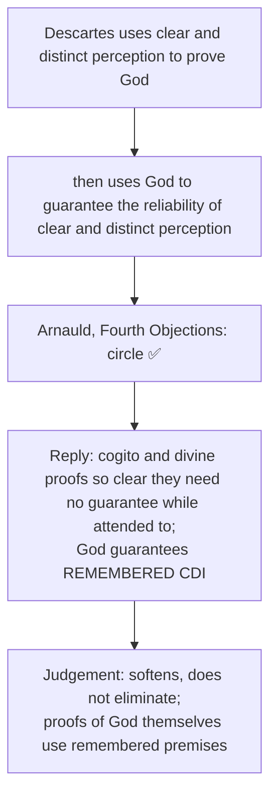

- Optional depth ❓: vicious-circle reading (Arnauld-style); memory-guarantee reading; stronger anti-circle reading (cogito and some intuitions self-certifying while attended to). Extra objection: even the proofs of God rely on premises whose reliability is already in question; counter-reply: present clear intuition compels assent, God guarantees lasting trustworthiness. Safe use: add after method and God; promote to Core if a PYQ asks whether the proof-strategy is circular.

### 3.2 Spinoza's attributes problem ❓

- Substance has infinitely many attributes; humans know only Thought and Extension. Strong reading: attributes are genuine expressions of the whole divine essence, not parts; cognition is structurally limited.
- Competing readings: epistemic-limitation; expressive; stricter conceptual reading resisting quasi-parts of God.
- Objection: unknown attributes are explanatorily idle. Reply: their infinity blocks the anthropomorphic claim that reality is exhausted by the two forms accessible to us. One line suffices to show Thought and Extension are not Cartesian substances in disguise.

### 3.3 Leibniz: contingency by infinite analysis ❓

- Necessary truths terminate in identities by finite analysis; contingent truths need infinite analysis completed only by God. Lets Leibniz say a contingent predicate is in the complete concept without becoming logically necessary. Cost: contingency can look merely epistemic from the creature's standpoint.
- Readings: compatibilist; near-necessitarian; modal (tied to God's free choice of the best world).

### 3.4 "Three counts" refinement ⚠️

- **Substance caution:** "3" is a mnemonic. Descartes says only God is absolutely independent; created mind and body are substances in a dependent or analogical sense. 3-1-∞ compares three Cartesian *kinds*, one Spinozist substance and many Leibnizian monads, not like-for-like counts.

---

## 4. Metaphysics & Ontology (Substance and Mind-Body)

### 4.1 One inherited question, three criteria ⚠️

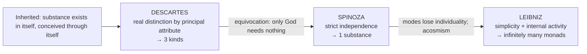

> **Memory chain:** Attribute separates → independence unifies → simplicity multiplies.

### 4.2 Descartes ✅

- Only God (infinite substance) fully satisfies the definition (*Principles* I.51: only God needs nothing whatever). Created: ***res cogitans*** (essence thought; unextended, indivisible) and ***res extensa*** (essence extension; unthinking, divisible, mechanistic).
- Principal attribute constitutes essence; particular thoughts and shapes/motions are modes.
- Tension: by his own definition mind and body need God for creation and conservation, so "substance" is analogical (Spinoza exploits).

### 4.3 Spinoza ✅

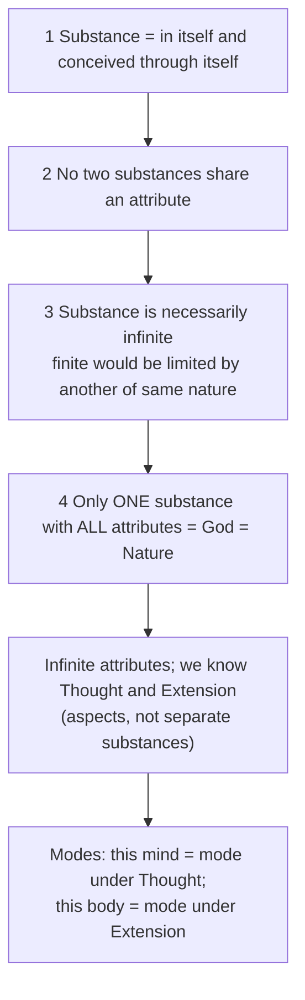

- **"Whatever is, is in God" (I, P15)** (2024 Q2(b)): "in" is ontological, not spatial; nothing exists outside God; God alone absolutely real, finite things real as modes. I, P18: God is **immanent**, not transitive, cause.
- **"Determination is negation" (2025 Q2(b)):** finite modes are limited by other modes (body occupies this region and excludes others); God, infinite, involves no negation. Finite modes are positive expressions of substance, not "what God is not." Hegel's acosmism objection: the finite dissolves.
- **Pantheism? (2022 Q2(c)) ✅/❌/⚠️:** entails pantheism in the qualified sense that no reality exists outside God/Nature and finite things are modes within the one immanent substance; ❌ does not follow that each finite thing, or the aggregate of visible things, is identical with the whole infinite divine essence; ⚠️ panentheism emphasises God exceeds finite modes and the two known attributes; interpreters dispute the better label. Safe view: qualified pantheist.

### 4.4 Leibniz ✅

- Extension is divisible, hence composite, hence not truly simple; true substances are simple (partless).
- **Monads:** infinitely many, simple, unextended, indestructible, soul-like points of force/perception. **Perception** (internal representation of the universe); **appetition** (striving from one perception to the next). Most perceptions are **minute perceptions** (*petites perceptions*); **apperception** is conscious awareness and not attributed to every monad.
- **"Monads have no windows"** (*Monadology* §7): no causal influx; all change internal.
- Hierarchy: bare entelechies (unconscious perception) → animal souls (memory) → rational spirits (reflection, necessary truths).
- **Identity of Indiscernibles:** no two monads exactly alike (else God would have no reason to create both: violates PSR).
- Bodies are **well-founded phenomena** (*phaenomena bene fundata*), not ultimate substances, not arbitrary illusions. An organism is coordinated by a dominant monad and a subordinate organic aggregate, not by exchanged causal signals.
- ⚠️ God is the unique uncreated necessary simple substance; "supreme Monad" is shorthand; God is not merely the highest member of the created series.
- **Entelechy cross-link (2026 Q1(d)) ⚠️:** Leibniz uses *entelechy* (*Monadology* §§18–19) for created simple substances, borrowing an Aristotelian term but changing its category (in Aristotle *entelecheia* = actuality/realisation, not a substance). Comparison owned by `Plato-Aristotle.md` §6.6; supply the Leibnizian half from §4.4, §6 and §4.6.

### 4.5 Substance comparison table ⚠️

| Feature | Descartes | Spinoza | Leibniz |
|---|---|---|---|
| Number and kind | God plus created thinking and extended (3 kinds) | 1 (God = Nature) | infinitely many monads plus God |
| Criterion | created things depend on God, not on one another | only what is in and conceived through itself | created simple unities act internally, still depend on God |
| Essence of the physical | extension | mode of Extension | confused perception of monads (phenomenon) |
| Mind-body | two created substances | one individual under Thought and Extension | dominant mind-monad + organic aggregate correspond by harmony |
| The individual | substance (mind) or mode of extension (body) | mode (of God) | substance (each monad unique) |
| Internal logic | cogito + God → admits 3 | pushes Descartes' definition → 1 | demands simplicity → ∞ |

| Revision | Criterion enforced | Result |
|---|---|---|
| Descartes | principal-attribute distinction | dualist created substances under God |
| Spinoza | absolute independence | one infinite substance |
| Leibniz | simplicity and internal activity | infinitely many monads |

| Movement | Problem solved | New problem generated |
|---|---|---|
| Descartes → Spinoza | dependence and interaction between created substances | finite individuality and freedom weaken |
| Spinoza → Leibniz | restores genuine individual centres | harmony and complete concepts strain explanation |

### 4.6 Mind-body: I-P-H ✅

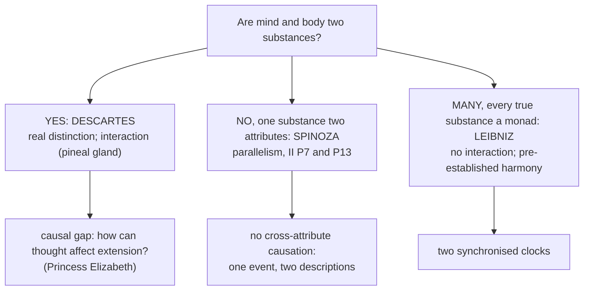

| Solution | Mechanism | Strength | Weakness |
|---|---|---|---|
| Descartes: interaction | direct causal link (pineal gland) | matches common sense | unintelligible how utterly different substances interact |
| Spinoza: parallelism | identity (one thing, two attributes) | no interaction needed; elegant | seems to eliminate genuine mental causation |
| Leibniz: harmony | divine synchronisation | preserves independence of each monad | ad hoc; unfalsifiable; why this arrangement? |

- Descartes: real distinction because I can clearly and distinctly conceive mind without body and body without mind → (God's omnipotence) they can exist apart. Interaction problem: causation seems to need commonality; thought and extension share nothing. Princess Elizabeth's objection: the pineal gland merely gives a location; the union is a "primitive notion" ❓.
- Spinoza: "The order and connection of ideas is the same as the order and connection of things" (II, P7); the human mind is the idea of the human body (II, P13). The mind-body problem is generated by the false two-substance premise ⚠️.
- **2026 Q1(a):** how does Spinoza relate states of mind and bodily processes? → parallelism / double-aspect, with §4.3 and §5.2.

---

## 5. Ultimate Principle: God Across the Trio

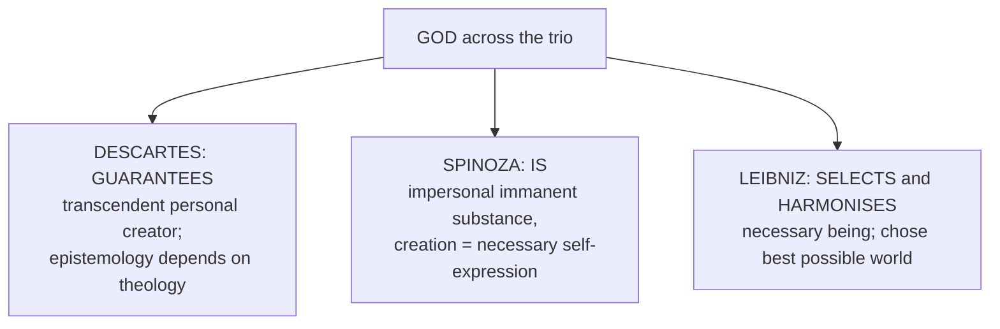

### 5.1 Descartes ✅

| Proof | Steps |
|---|---|
| **Trademark / causal** (Med III) | I have the idea of an infinite perfect being → cause of an idea has at least as much *formal reality* as the idea has *objective reality* → I, finite, cannot be its adequate cause → God exists and stamped it on my mind |
| **Ontological** (Med V) | God = supremely perfect being → existence is a perfection → a supremely perfect being lacking existence is contradictory → God necessarily exists. (Kant: existence is not a real predicate) |
| **Conservation** (Med III) | I exist now and cannot sustain my own existence moment to moment → ultimately God |

God guarantees clear-and-distinct perception, bridging cogito and the world.

### 5.2 Spinoza ✅

- God = one infinite substance = *Deus sive Natura*; **immanent** not transitive cause (I, P18); acts from the necessity of its own nature, not by will or design: no choice, purpose, providence.
- ***Natura naturans*** (active self-caused nature) vs ***Natura naturata*** (totality of modes).
- **I, P16:** infinitely many things in infinitely many ways follow from the necessity of divine nature (2020 Q4(b)); the inference is logical/ontological, not a temporal story. **I, P29:** no contingency in Nature; apparent possibility records limited knowledge of causes.

| Objection | Spinoza's reply | Residual force |
|---|---|---|
| Necessity removes divine personality and choice | Will/intellect are not faculties outside nature; anthropomorphic choice would limit God | Religion loses providential personality |
| If all follows from God, evil also follows | Good/evil express relations to human flourishing, not properties of infinite substance | Suffering still belongs to the necessary order |
| P16 asserts more than the definitions prove | An infinite cause must express itself infinitely | Derivation of determinate finite modes remains difficult |

### 5.3 Leibniz ✅

- **Cosmological via PSR:** contingent things exist → a sufficient reason for the whole series → a necessary being outside the series = God. Also an ontological element (comparison table).
- God freely actualises **this** world, the **best of all possible worlds** (maximum perfection with minimum means / maximum variety with minimum principles, not maximum human comfort), out of infinitely many compossible possible worlds. God establishes **pre-established harmony** at creation.

### 5.4 God comparison ⚠️

| Feature | Descartes | Spinoza | Leibniz |
|---|---|---|---|
| Nature | personal, transcendent, infinite perfection | impersonal, immanent, = substance = Nature | personal necessary being, source of monads |
| Proof | trademark + ontological + conservation | a priori from definition of substance | cosmological (PSR) + ontological |
| Relation to world | creator (transcendent) | all modes in God; God not the finite aggregate | creator who chose the best world |
| God and freedom | created freely; gave humans free will | acts by necessity of own nature (no will) | chose freely among possibles, determined by what is best |
| Role | guarantees knowledge | IS the system | harmonises monads |

---

## 6. Explanatory & Causal Principles

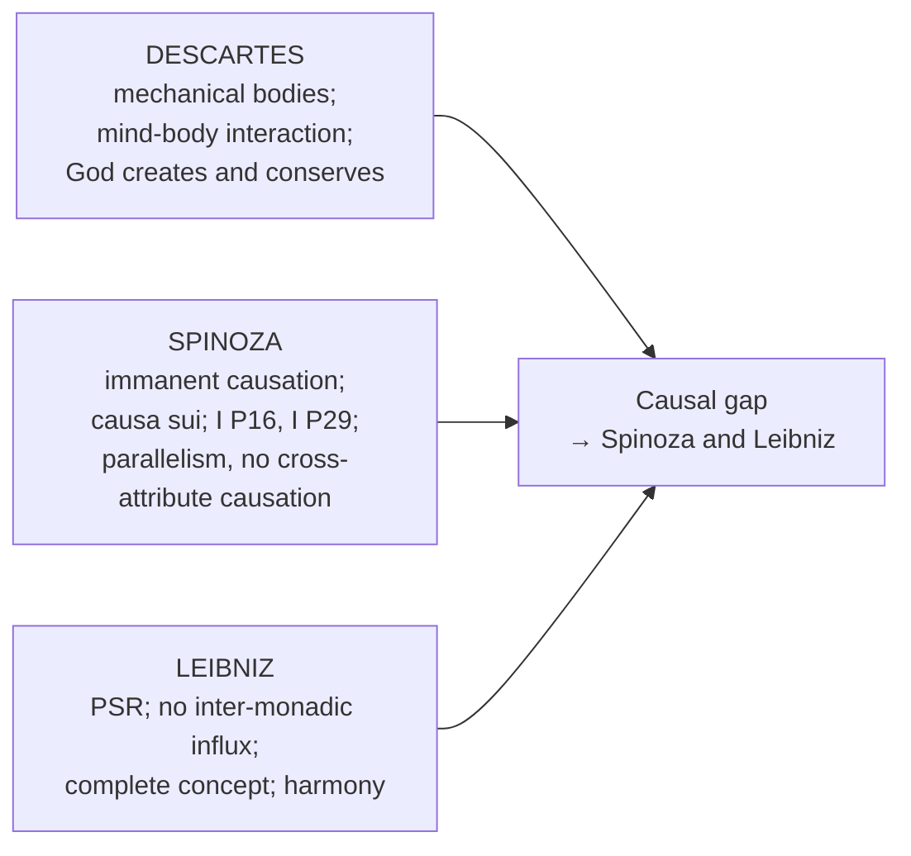

- **Descartes:** body mechanistic; mind affects body at the pineal gland; God is conserving cause. **Spinoza:** *causa sui* (substance self-caused); modes follow immanently from what God is "as conclusions follow from adequate premises"; no cross-attribute causal interaction; no contingency (I, P29). **Leibniz:** PSR (nothing without a sufficient reason); **truths of reason** (necessary; finite analysis to identities) vs **truths of fact** (contingent; infinite analysis); complete individual concept contains every predicate; certainty ≠ absolute necessity; hypothetical vs absolute necessity.
- **Spinoza's necessity vs Leibniz's (restored dossier):** harmony removes inter-monadic exchange, but a rational monad acts from its own perceptions and appetitions ("spontaneity"); Spinoza's infinitely many things follow as immanent causal necessity, not discretionary decree. ❌ Do not call harmony external compulsion or Spinozist freedom an exception to necessity.
- **"What is, cannot be other than what it is" (2019 Q2(c)):** necessitarianism; God free because acts from necessity of own nature (I, Def. 7); contingency = ignorance of causes (I, P29); not passive fatalism.

---

## 7. Freedom & Value Orientation

*The sources give no puruṣārtha-style value scheme for rationalism; this module carries freedom, error and the affective ethics the sources tie to freedom.*

### 7.1 Three accounts of freedom ✅

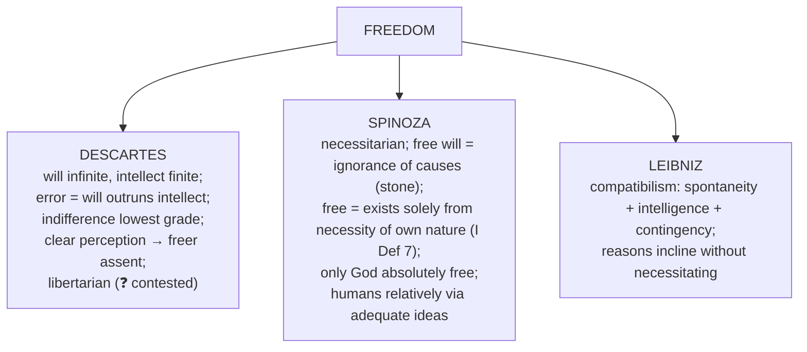

| Feature | Descartes | Spinoza | Leibniz |
|---|---|---|---|
| Position | libertarian free will | hard determinism | compatibilism |
| Will | unlimited in scope; not bodily determined | uncaused choice = illusion | inclined by reasons, not logically necessitated |
| Source of action | mind, uncaused by body | God's necessary nature through modes | monad's complete concept |
| "Freedom" means | ability to do otherwise | acting from one's own adequate knowledge | spontaneity + intelligence + contingency |
| Responsibility | assent and withholding; metaphysical freedom disputed | adequate ideas and active affects | intelligent internal agency; acts settled in actual world |

- **Spinoza's affective ethics ✅:** *conatus* (striving to persevere) is each thing's actual essence (III, P6–P7); in humans, conscious conatus appears as desire. Passive affects: partial cause under external determination (**bondage**); active affects: adequate ideas, increased power of acting. Culmination: *amor Dei intellectualis* and blessedness, not escape from necessity.
- **Leibniz ✅:** Caesar's crossing is certain in this world; its opposite is conceivable in another possible world. Objection: a complete concept fixed from creation leaves too little alternative possibility.
- ⚠️ Optional: Spinoza's full affect taxonomy and Leibniz's full theodicy beyond what supports freedom.

### 7.2 Which mind-body account fits freedom? (2024 Q3(c)) ⚠️

| Criterion | Winner | Cost |
|---|---|---|
| Alternative possibilities (ability to do otherwise) | Descartes | unintelligible interaction |
| Acting from adequate understanding | Spinoza | libertarian freedom disappears |
| Determined yet responsible agency | **Leibniz** | divine coordination; compatibilist only |

State the criterion first; the examiner-safe winner is Leibniz.

---

## 8. Inter-School Comparative Matrices

### 8.1 Master comparison ⚠️

| Axis | Descartes | Spinoza | Leibniz |
|---|---|---|---|
| Substance count | 3 (God, mind, matter) | 1 (God = Nature) | ∞ (monads) |
| God | personal, transcendent, veracity guarantee | impersonal, immanent, IS all reality | necessary being, chose best world |
| Mind-body | interaction (pineal gland) | parallelism (double-aspect) | pre-established harmony |
| Freedom | libertarian free will | freedom = understanding necessity | compatibilism |
| Method | doubt → cogito → reconstruction | geometric deduction (*more geometrico*) | PSR + pre-established harmony |
| Individual | thinking substance (self) | mode of God | unique monad |
| Physical world | *res extensa* (mechanistic) | mode of Extension | phenomenon (confused perception of monads) |

### 8.2 Substance across Western philosophy (theme file) ⚠️

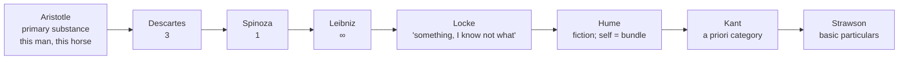

Four moves: **ground** (Aristotle) → **multiply/purify** (rationalists: 3, 1, ∞) → **erode/eliminate** (Locke → Berkeley → Hume) → **relocate/reinterpret** (Kant, Strawson). Hume's dissolution of substance forces Kant's Copernican rescue. Spinoza vs Descartes: if substance needs nothing else there cannot be three, so Spinoza's monism is Descartes made consistent. Hegel's corrective to Spinoza: the Absolute grasped "not only as Substance, but equally as Subject" (bridge to `Hegel.md` §2.2).

### 8.3 Rationalist epistemology vs rivals (theme file) ⚠️

| Thinker | Source of knowledge | Synthetic a priori? | Signature move |
|---|---|---|---|
| Rationalists | reason, innate ideas | (loosely yes) | truths of reason vs fact |
| Empiricists (Hume) | experience only | **NO** (Hume's fork) | causation = habit |
| Kant | reason + sense synthesised | **YES** | Copernican revolution; categories |
| Positivists | verifiable experience | **NO** | analytic/synthetic; verification |
| Quine | holistic web | distinction itself rejected | two dogmas; holism |

---

## 9. Criticisms & Reconstructed Replies

```mermaid
flowchart TD
  X1["DESCARTES: Cartesian Circle (Arnauld)"] --> R1["Present vs remembered CDI ❓<br/>Residual: proofs use extended reasoning"]
  X2["DESCARTES: interaction gap (Princess Elizabeth)"] --> R2["Union is a primitive notion ❓<br/>Residual: not a mechanism"]
  X3["DESCARTES: substance inconsistent"] --> R3["'Substance' used analogically"]
  X4["SPINOZA: pantheism removes personal God"] --> R4["Morality grounded in adequate knowledge, not divine command"]
  X5["SPINOZA: acosmism (Hegel)"] --> R5["Modes real AS expressions;<br/>Residual: dependent individuality thin"]
  X6["SPINOZA: determinism kills responsibility"] --> R6["Freedom = adequate causation;<br/>Residual: alternatives disappear"]
  X7["SPINOZA: all determination is negation"] --> R7["Finite things are positive modes, limited by other modes"]
  X8["LEIBNIZ: harmony ad hoc / unfalsifiable"] --> R8["Only solution avoiding unintelligible interaction and loss of plurality;<br/>Residual: depends heavily on God"]
  X9["LEIBNIZ: best world and Candide"] --> R9["Best = maximum variety with minimum principles"]
  X10["LEIBNIZ: fixed concepts erase freedom"] --> R10["Certainty ≠ necessity;<br/>Residual: actual alternatives difficult"]
```

Other criticisms recorded: Locke on innate ideas (§2.5); Kant on existence as a predicate (targets the ontological proof only, not Descartes' causal arguments, Leibniz's PSR argument or Spinoza's substance argument); Lichtenberg's "there is thinking" and Hume's bundle critique (cogito proves thinking existence, not a substantial self); Gassendi and Berkeley against the wax argument (§2.3).

---

## 10. Controlled Comparisons

*The sources give no systematic East–West table for rationalism; these are the cross-tradition pairs they do give.*

| Pair | Point of contact | Disanalogy |
|---|---|---|
| Spinoza's substance and modes ↔ Advaita Ātman = Brahman (`Self-and-liberation-across-schools.md` §5A) | One reality and its dependent expressions | Spinoza's modes are *real* modifications (pariṇāma, not vivarta), nearer to Rāmānuja than Śaṃkara; Plotinian reversion is an ascent through really emanated hypostases |
| Cartesian thinking substance ↔ Sāṃkhya puruṣa | The pure subject | The cogito's self *thinks, wills and acts*; puruṣa is wholly inactive and all agency belongs to prakṛti. Mistaking this is the commonest comparative error |
| Hume's bundle-self vs Descartes' thinking substance | Cogito's substance vs no impression of a persisting "I" | Theme file bridge to Buddhist nairātmya / anattā; Hume has no karmic continuity or soteriology (`Self-and-liberation-across-schools.md`) |
| Strawson's descriptive vs revisionary metaphysics (`Critiques-of-metaphysics.md`) | Descartes and Leibniz are named examples of **revisionary** metaphysics | Strawson redefines rather than abolishes metaphysics (*Individuals*, 1959) |

> [!WARNING]
> A Western or Indian parallel earns marks only as one or two closing lines with the disanalogy attached; never as an equation.

---

## 11. Diagnostic Deep-Dives for High-Frequency Themes

### 11.1 Substance divergence (2018 Q2(a), 20 marks) ✅

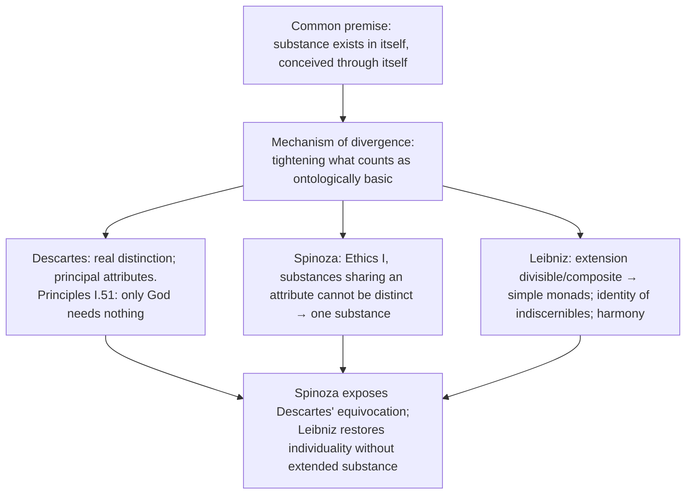

Verdict: "substance" is a criterion whose interpretation generates the metaphysics; the disagreement demonstrates rationalism's internal development, not incoherence. Monads depend on God, so do not meet Spinoza's strict independence.

### 11.2 Leibniz: any place for freedom? (2018 Q1(b); 2020 Q1(b)) ✅

Windowless monads → internal source → **spontaneity**; rational monads act for perceived reasons → **intelligence**; complete concept makes the series certain but the opposite is conceivable in another possible world → **contingency**; reasons "incline without necessitating". Verdict: coherent compatibilism, not libertarian alternatives; the "own comments" paragraph (2020) must be signposted.

### 11.3 Spinoza on freedom (2023 Q1(c)) ✅

I, Def. 7; conscious stone; only God absolutely free; humans relative freedom via adequate ideas (reason, *scientia intuitiva*). Verdict: freedom reconceived as a higher form of determination, not an exception to causation (libertarian critics: determinism renamed).

### 11.4 Certainty of self vs world (2022 Q4(b)) ✅

Self: immediate, performative, no sensory mediation, *res cogitans*; wax gives priority (even if wax does not exist the judging mind is revealed). World: mediate; restored only after God's existence and non-deceptiveness; intellect identifies body's essence as extension. Critical: cogito proves thinking existence not a substantial self (Lichtenberg, Hume); world-proof inherits the Circle. Asymmetry of certainty remains.

### 11.5 Basic tenets and Descartes' system (2025 Q2(a)) ✅

Seven-step map: method over authority (four rules, hyperbolic doubt) → self-evident foundation (cogito by intuition) → innate content (God, substance, mind, extension, mathematical truths) → deductive reconstruction (trademark, conservation, ontological) → intelligibility and truth (non-deceiving God, CDI) → substance metaphysics (God, thought, extension) → mechanistic nature and rational freedom (error when will outruns intellect). Vulnerabilities: cogito proves occurring thought; disputed proofs; Arnauld's Circle; Locke on innate principles; Kant on existence.

### 11.6 "In God" and "all determination is negation" (2024 Q2(b); 2025 Q2(b)) ✅

See §4.3. Provenance mark: Letter 50 → Hegel's universalisation. Dependent individuality, modal change vs eternal substance, loss of a providential personal God are the critical points (replies: independent reality is not the only reality; temporal order belongs to finite modes; personality would anthropomorphise infinity).

### 11.7 P16 and its criticisms (2020 Q4(b)) ✅

Four conclusions: no deliberating God; no genuine contingency; Thought and Extension express one order; finite beings are modes. Three criticisms: loss of personality/worship; acosmism; evil and bondage as divine necessities (reply: good/evil are relational to human power).

---

## 12. PYQ Routing Ledger (2018–2025, plus 2026)

> Corpus signal: **14** primary-owned parts out of 112 (2018–2025), joint-highest in Western Philosophy; **2021 is the only year without one**. 2026 adds one primary-owned part (Q1(a)). Total primary-owned listed here: **15**.

| Year | Q | Marks | Exact demand | Map to |
|---|---|---:|---|---|
| 2018 | Q1(b) | 10 | Is there any place for freedom in Leibniz's philosophy, when he speaks of 'pre-established harmony'? Discuss. | §11.2 |
| 2018 | Q2(a) | 20 | What is the reason for the difference in the definitions and classifications of substances made by Descartes, Spinoza and Leibniz in spite of the fact that they all belonged to the rationalist school of thought? Discuss. | §4.1, §11.1 |
| 2019 | Q1(d) | 10 | How does Descartes prove the existence of things other than himself and God? Discuss. | §2.4 |
| 2019 | Q2(c) | 15 | What do you understand by Spinoza's statement that what is, cannot be other than what it is? Explain. | §6 |
| 2020 | Q1(b) | 10 | How does Leibniz's conception of monads bear upon his views on determinism and freedom? Discuss with your own comments. | §4.4, §11.2 |
| 2020 | Q4(b) | 15 | "From the necessity of the divine nature there must follow infinitely many things in infinitely many ways." Explain this statement by Spinoza along with some possible criticisms. | §5.2, §11.7 |
| 2022 | Q2(c) | 15 | Discuss the concept of substance according to Spinoza. Does his discussion on substance lead to pantheism? Substantiate your view. | §4.3 |
| 2022 | Q4(b) | 15 | How does Rene Descartes explain the notion of certainty with reference to knowledge of the self? Critically discuss the way it differs from the knowledge of the world. | §2.2, §11.4 |
| 2023 | Q1(c) | 10 | "That thing is said to be free which exists solely from the necessity of its own nature, and is determined to action by itself alone." Discuss Spinoza's views on freedom and determinism in the light of the above statement. | §7.1, §11.3 |
| 2023 | Q2(c) | 15 | Discuss Descartes' theory of innate ideas and the grounds on which Locke refutes it. | §2.5 |
| 2024 | Q2(b) | 15 | How does Spinoza establish that God alone is absolutely real with his statement — "Whatever is, is in God"? Critically discuss. | §4.3, §11.6 |
| 2024 | Q3(c) | 15 | Among the rationalists, whose account of mind-body problem is compatible with the notion of human freedom and free will? Critically discuss. | §4.6, §7.2 |
| 2025 | Q2(a) | 20 | What are the basic tenets of Rationalism? How does Descartes build a system of Philosophy in consonance with them? Discuss. | §2.1, §11.5 |
| 2025 | Q2(b) | 15 | "All determination is negation." Comment with reference to Spinoza. | §4.3, §11.6 |
| 2026 | Q1(a) | 10 | How does Spinoza explain the relationship between states of mind and bodily processes? | §4.6 |

**Cross-owned (listed, not counted):**

| Year | Q | Marks | Demand | Owner / link |
|---|---|---:|---|---|
| 2026 | Q1(d) | 10 | Compare and contrast the notion of entelechy as presented in Aristotle's and Leibniz's philosophy. | `Plato-Aristotle.md` §6.6; Leibniz half from §4.4 |
| 2025 | Q4(a) | 20 | How is Husserl's account of "I think" different from that of Descartes? Critically discuss. | `Phenomenology-Husserl.md`; Cartesian half from §2.2 |

**Per-year counts (owner file):** 2018: 2 · 2019: 2 · 2020: 2 · 2021: 0 · 2022: 2 · 2023: 2 · 2024: 2 · 2025: 2 = 14.

---

## 13. Top Exam Traps

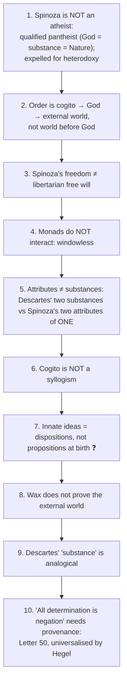

Further traps in the sources: harmony is not occasional divine intervention after creation; Leibnizian certainty is not absolute necessity; comparative answers without a criterion stay descriptive; "3" is a mnemonic of kinds, not individual beings; pantheism ≠ God is merely the aggregate of visible things; the Latin *cogito ergo sum* is not in the *Meditations*; do not call Leibniz a simple libertarian or fatalist.

---

## 14. Technical Vocabulary Bank

| English gloss | Original | Meaning | Status |
|---|---|---|---|
| I think, therefore I am | *cogito, ergo sum* | Descartes' certain knowledge | ✅ |
| Thinking substance / extended substance | *res cogitans* / *res extensa* | Descartes' created substances | ✅ |
| Evil demon | *genius malignus* | extreme doubt | ✅ |
| Clear and distinct perception | | criterion of truth | ✅ |
| Wax; mental scrutiny | *cera*; *inspectio mentis* | wax argument | ✅ |
| Flexible and changeable | *flexibile et mutabile* | wax's nature | ✅ |
| Adventitious / factitious / innate | | three classes of ideas | ✅ |
| God or Nature | *Deus sive Natura* | substance = God = Nature | ✅ |
| Self-caused | *causa sui* | substance is self-caused | ✅ |
| Determination is negation | *determinatio negatio est* (Letter 50); *omnis determinatio est negatio* (Hegel) | provenance split | ⚠️ |
| Naturing / natured nature | *natura naturans* / *natura naturata* | active vs produced | ✅ |
| Geometric method | *more geometrico* | Ethics' method | ✅ |
| Imagination / reason / intuitive science | *imaginatio, ratio, scientia intuitiva* | three kinds of knowledge | ✅ |
| Vague experience; from signs | *experientia vaga*; *ex signis* | first kind sources | ✅ |
| Common notions | *notiones communes* | second kind basis | ✅ |
| Adequate / inadequate idea | *idea adaequata* / *inadaequata* | | ✅ |
| Under the aspect of eternity | *sub specie aeternitatis* | third kind | ✅ |
| Intellectual love of God | *amor Dei intellectualis* | V, P32C | ✅ |
| Striving | *conatus* | III, P6–P7 | ✅ |
| Blessedness | *beatitudo* | highest good | ✅ |
| Bondage | *servitus* | determination by external causes | ✅ |
| Monad | | simple windowless substance | ✅ |
| Minute perceptions | *petites perceptions* | below reflective awareness | ✅ |
| Apperception | | conscious awareness of perception | ✅ |
| Well-founded phenomena | *phaenomena bene fundata* | extended bodies | ✅ |
| Principle of Sufficient Reason | PSR | nothing without a sufficient reason | ✅ |
| Identity of Indiscernibles | | no two monads alike | ✅ |
| Truths of reason / of fact | | necessary vs contingent | ✅ |
| Pre-established harmony | | synchronised clocks | ✅ |
| Best of all possible worlds | *le meilleur des mondes possibles* | God's choice | ✅ |
| Incline without necessitating | *incliner sans nécessiter* | reasons and will | ✅ |
| Acosmism | | denial of the world's reality (Hegel's charge) | ❓ |
| Pantheism / panentheism | | all in God / God exceeds finite modes | ❓ |
| Occurrent vs dispositional innatism | | explicit vs capacity | ❓ |

---

## 15. Graded Verdict & Answer Architectures

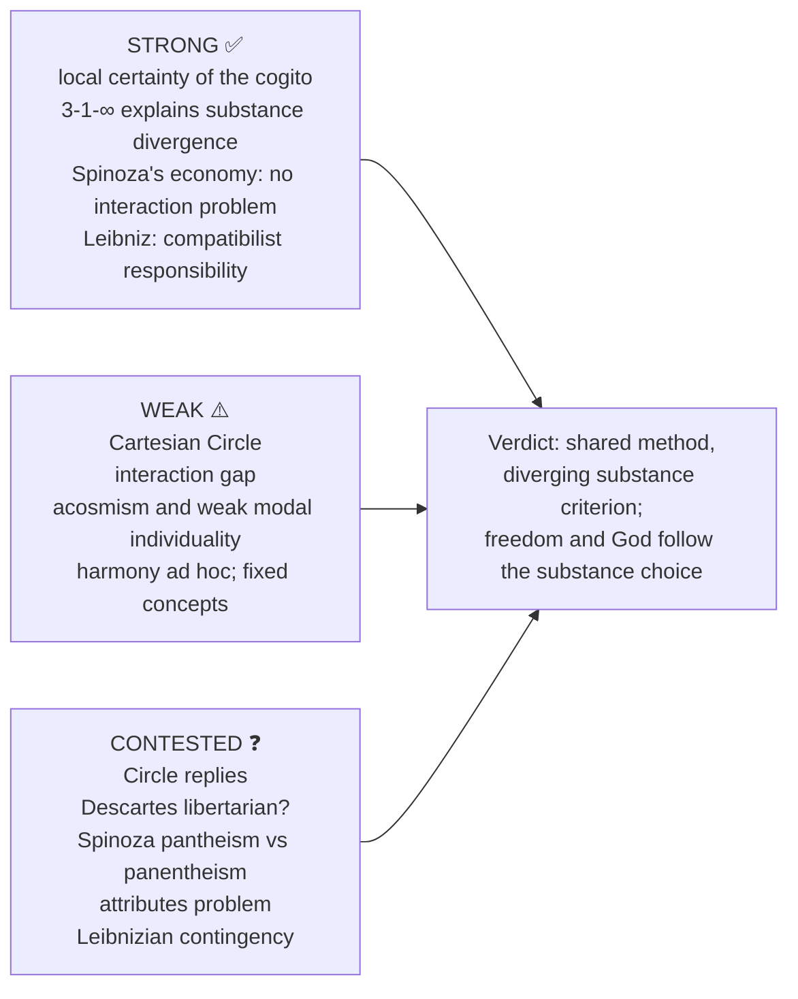

### 15.1 10-mark spine: D-R-A-E

```text
Define -> Reconstruct -> Apply one named text/example -> Evaluate
```
**Example (2023, Spinoza on freedom):** Line 1 strict determinism → (i) free will illusion from ignorance of causes (stone) (ii) freedom = self-determination through adequate ideas (iii) I, Def. 7 (iv) only God absolutely free → Eval: freedom reconceived, not abandoned; libertarian critics say determinism renamed.
**Anchor:** "The wax argument does not prove that bodies exist; it proves that *if* bodies are known at all they are known by intellect and not by sense, and that self-knowledge is epistemically prior to world-knowledge."

### 15.2 15-mark spine: D-R-D-E-V

```text
Define -> Reconstruct -> Debate (objection/reply) -> Evaluate -> Verdict
```
**Example (2025 Q2(b), "All determination is negation"):** Frame: infinite substance unlimited → A: determination = bounding, hence negation → B: finite things limited yet positive expressions; God pure affirmation → C: adequate knowledge sees things *sub specie aeternitatis* → Assess: Hegel's acosmism → Close: illuminates why finite beings are dependent but becomes reductive if limitation is mistaken for unreality.
**Anchor:** "Spinoza needs both the negation of independence and the affirmation of modal expression."

### 15.3 20-mark spine: C-M-C

```text
Common premise -> Mechanism of divergence -> Comparative costs and conclusion
```
**Example (2025 Q2(a)):** Frame: reason as source of certain knowledge → tenets (§2.1) → Descartes' system step by step → how each step instantiates a tenet; contrast Locke's attack and Hume's fork → Assess: coherent but fragile (depends on the cogito not being circular and God's proof not begging the question).
**Anchor:** "Descartes does not merely assert rationalist tenets; he constructs a system that embodies them as its operating logic."

### 15.4 Directive decoder ⚠️

| Directive | Obligation | Fatal error |
|---|---|---|
| Discuss | exposition + assessment (~60:40) | pure exposition |
| Critically discuss / examine | assessment dominates; compulsory verdict | listing criticisms without ruling |
| Comment (2025 Q2(b)) | short, thesis-first, meaning *in Spinoza's system*; one consequence each for God, finite modes, knowledge; one-line judgment | general essay on Spinoza |
| Explain (2019 Q2(c), 2020 Q4(b)) | foreground the derivation (Def. 7, P16, P29) | restating the quotation |
| Substantiate your view (2022 Q2(c)) | take a side with textual grounds | fence-sitting |
| Discuss with your own comments (2020 Q1(b)) | signposted first-person evaluation (~last 25%) | omitting the personal verdict |
| Whose account is compatible…? (2024 Q3(c)) | explicit ranking against a stated criterion | neutral description of all three |
| What is the reason for the difference…? (2018 Q2(a)) | a mechanism: one inherited definition, three applications | tabulating without explaining |

### 15.5 Graded closing verdicts ⚠️

| Sub-topic | One-line verdict (10 marks) |
|---|---|
| Cartesian method | The method of doubt destroys itself to deliver a performatively certain cogito; success is local, because the cogito secures a thinker, not a substantial thinker |
| Wax argument | Self-knowledge is epistemically prior; wax proves intellectual judgement of body, not bodies' existence |
| Substance | The rationalists share a question about what exists fundamentally, not an identical criterion of independence |
| God | Descartes' God guarantees cognition; Spinoza's is immanent substance; Leibniz's selects and harmonises. Kant's objection targets the ontological premise only |
| Mind-body | Three verdicts on whether the question is well-formed: Descartes accepts it and cannot answer; Spinoza dissolves it by denying two substances; Leibniz by denying causation among substances |
| Freedom | Spinoza relocates freedom from indifference of will to adequacy of intellect; examiner-safe ranking: Leibniz |
| Three kinds of knowledge | Three *ontological positions of the knower*, not degrees of confidence; epistemology and ethics are one subject; most vulnerable because the third kind is self-certifying |

**Cost-of-each-system summary (20-mark thesis):** Descartes: gain = clear basis for mathematical nature and personal consciousness; cost = definitional equivocation and interaction problem. Spinoza: gain = unity, dissolves interaction; cost = necessitarianism, threat of acosmism. Leibniz: gain = active plurality and internal agency; cost = bodies phenomenal, correspondence needs harmony and a divine selector. Coherence, individuality and experiential plausibility cannot all be maximised simultaneously.

> [!TIP]
> **Memory lines.** "3-1-∞" · "I-P-H: Interaction → Parallelism → Harmony" · "M-M-S: Merchant · Mathematician · Seer" · "God **guarantees** (Descartes), **is** (Spinoza), **selects** (Leibniz)" · "Attribute separates → independence unifies → simplicity multiplies."

---

## Sources

Masih, *A Critical History of Western Philosophy*; Copleston, *A History of Philosophy* Vol. IV; Warburton, *Philosophy: The Classics*; Audi (ed.), *The Cambridge Dictionary of Philosophy*; Kenny, *A New History of Western Philosophy* Vol. III; Stace, *A Critical History of Greek Philosophy* (theme file); primary texts: Descartes, *Meditations* (1641); Spinoza, *Ethics* (1677); Leibniz, *Monadology* (1714), *Discourse on Metaphysics* (1686). Optional-depth source trail (dossier §2): Descartes, *Meditations* and Fourth Replies; Spinoza, *Ethics* I–II; Leibniz, *Theodicy*; Antoine Arnauld; Edwin Curley; Michael Della Rocca; Robert Adams; Nicholas Jolley.
