# EMPIRICISM (Locke, Berkeley, Hume) — Examiner-Grade Mindmap

> **Syllabus (verbatim):** Empiricism (Locke, Berkeley, Hume) : Theory of Knowledge; Substance and Qualities; Self and God; Scepticism.
> **Catalogue key:** `philosophy-paper-i-western-philosophy-03` · Paper I · Western Philosophy (Section A)
> **Sources used:** `paper-1/western/Empiricism.md` (canonical owner, read in full) · `_advanced/Western-Philosophy-Dossier.md` §3 (optional depth) · `paper-1/_PYQ-Western-Philosophy-2018-2025.md` · `paper-1/_PYQ-Western-Philosophy-2026.md` · `paper-1/_themes/Substance-across-western.md` · `paper-1/_themes/A-priori-a-posteriori-knowledge.md` · `paper-1/_themes/Critiques-of-metaphysics.md` (Hume entries) · `paper-1/_themes/Self-and-liberation-across-schools.md` (Hume row of the Western-comparison table) · `paper-1/_themes/Pramana-across-schools.md` (Cārvāka–Hume row) · `paper-1/_themes/Causation-across-schools.md` (read in full; Indian-school theme, only its Humean disanalogy row is relevant).
> **Evidence key:** ✅ canonical doctrine · ⚠️ analytical synthesis · ❓ contested / uncertain · ❌ trap
> **Adaptation note:** the 15-module blueprint is Indian-school oriented. Here Module 1 = textual map and lineage; Module 2 = theory of knowledge; Module 3 = internal critiques and refinements; Module 4 = substance, qualities and self; Module 5 = God, scepticism and the limits of metaphysics; Module 6 = causation and induction; Module 7 = value orientation. Where the sources give nothing for a module, it says so.

> [!IMPORTANT]
> **Core thesis.** Empiricism = experiential origin of simple ideas + mental operations on them (comparing, combining, abstracting). Locke **represents**, Berkeley **immaterialises**, Hume **naturalises and limits**. The "slide" Realism → Idealism → Scepticism is an exam heuristic, not a deduction: each step adds a named premise. ⚠️

---

## 0. Master Overview

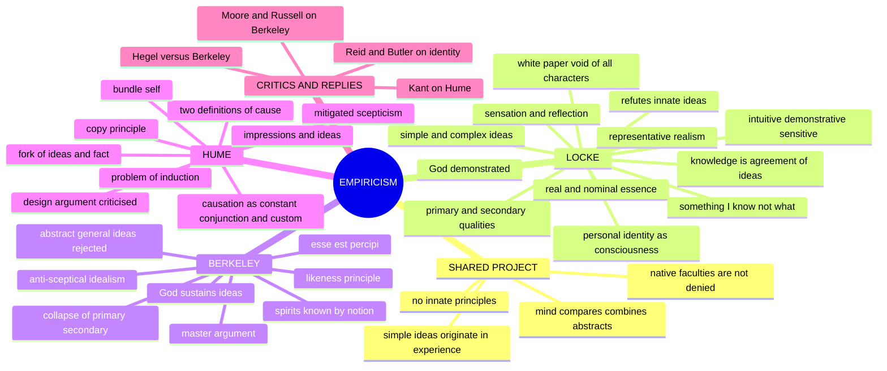

---

## 1. Identity, Lineage & Textual Map

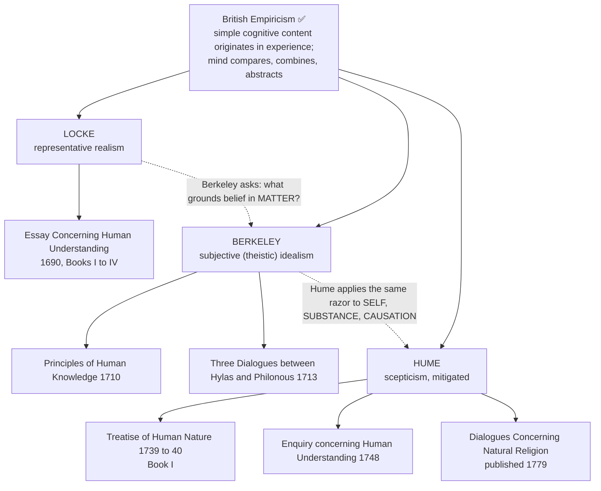

| Thinker | Primary source ownership | Core method |
|---|---|---|
| **Locke** | *An Essay Concerning Human Understanding*, especially Books I–IV | genetic account of ideas, limits and degrees of knowledge, representative realism |
| **Berkeley** | *Principles of Human Knowledge* and *Three Dialogues* | critique of abstraction and material substance; direct immaterialism |
| **Hume** | *Treatise of Human Nature* Book I and *Enquiry concerning Human Understanding* | copy principle, association, naturalistic explanation, mitigated scepticism |

- ✅ Empiricism denies innate **ideas/principles** in Locke's target sense; it does not deny native faculties, mental operations, or a priori relations of ideas in Hume's classification.
- ✅ "Experience" includes Locke's **reflection** on mental operations, not external sensation alone.
- ⚠️ The slide Locke → Berkeley → Hume is useful only when each new step's additional premise is named.
- ❌ Replace "Berkeley kills matter; Hume kills mind and causation" with exact claims: Berkeley denies material substratum; Hume denies impressions of a substantial self and of objective necessary connection while retaining perceptions and natural causal belief.

### 1.1 Translation, quotation and provenance discipline ✅

| Text | Safe practice | Caution |
|---|---|---|
| Locke, *Essay* (1st ed. 1690; 4th ed. 1700; standard scholarly text Nidditch, Clarendon 1975) | Cite by **Book.Chapter.Section**: II.i.2 (white paper), II.viii (qualities), II.xxiii.2 (*something I know not what*), II.xxvii.9 (person), III.iii.6–11 (abstraction), IV.vii.9 (general triangle) | Section references are edition-invariant. The personal-identity chapter II.xxvii was **added in the 2nd edition (1694)**: not part of the 1690 text |
| *Tabula rasa* | ⚠️ **Not Locke's own wording**; he writes "**white paper, void of all characters**" (II.i.2). The Latin is Scholastic/Aristotelian vocabulary applied to him | Write: "the mind as 'white paper, void of all characters' — the doctrine traditionally labelled *tabula rasa*" |
| Berkeley, *Principles* (1710), *Three Dialogues* (1713) | Cite *Principles* by section (Intro §§6–25 abstraction; §§1–4, 8, 9–15, 22–23, 27, 30–33) | "*Esse est percipi*" is Berkeley's own (*Principles* §3). ❌ "*esse est percipi aut percipere*" is a **later commentators' expansion** |
| Berkeley on Locke's triangle | Berkeley quotes *Essay* IV.vii.9 verbatim at *Principles* Intro §13 | Safe to say "Berkeley quotes Locke's own words back at him" |
| Hume, *Treatise* (1739–40), *Enquiry* (1748; titled *Philosophical Essays* in 1748, renamed 1758) | *Treatise* by Book.Part.Section (I.i.1 missing shade; I.iii.14 necessary connexion; I.iv.6 personal identity; **Appendix** for the retraction); *Enquiry* by Section (II copy principle; IV induction; VII necessary connexion + two definitions; XII mitigated scepticism) | Do not merge the two works: Hume disowned the *Treatise*; the *Enquiry* drops personal identity |
| "Commit it then to the flames" | *Enquiry* XII, final paragraph | Aimed at "divinity or school metaphysics" |
| "Reason is, and ought only to be, the slave of the passions" | *Treatise* II.iii.3 — Paper II / ethics material | ❌ Not an epistemology quotation |
| "Constant conjunction"; "custom is the great guide of human life" | *Enquiry* V | Safe verbatim |

> [!WARNING]
> **Never write** that Hume "denied causation" or that Berkeley "denied the existence of the external world". Hume denies *observable objective necessity*; Berkeley denies *matter as unperceiving substratum*.

**Optional-enrichment boundary ⚠️.** Locke's political philosophy and detailed theory of language beyond abstract ideas / nominal essence; Berkeley's mathematics controversies and full philosophy of science; Hume on passions, liberty/necessity, is–ought, history and economics; Kant's positive system (next owner; appears only as the routed response to Hume).

---

## 2. Theory of Knowledge (Epistemology)

### 2.1 Locke: attack on innate ideas (Essay I) ✅

| Locke's argument | Target |
|---|---|
| **Consent argument refuted:** if innate ideas were universal, children and "idiots" would have them; they manifestly do not | Universal-assent claim |
| **No unconscious ideas:** "to be in the mind" = "to be perceived by the mind"; a thought the mind does not think is self-contradictory | Descartes' claim that innate ideas may be dispositional |
| **Genetic account available:** every idea claimed innate can be explained as acquired; if experience suffices, the innate hypothesis is otiose | God, identity, non-contradiction |

- Routes: PYQ 2022 Q4(c) (and 2023 Q2(c), owned by Rationalism) demand this.
- ⚠️ Directive "How does X refute Y?": give Locke's three lines **and** Descartes' dispositional reply. A refutation answer without the reply is one-sided.

### 2.2 Locke: tabula rasa and sources of ideas ✅

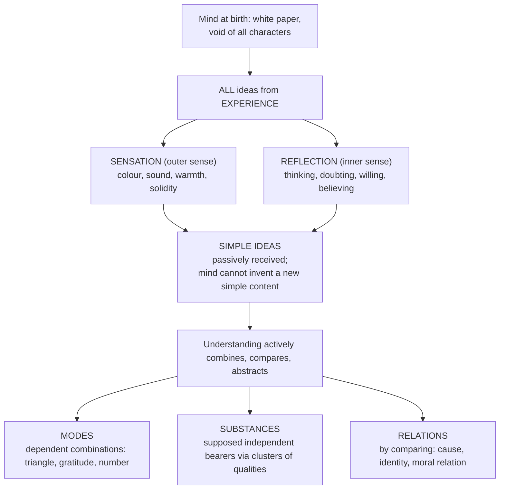

- ⚠️ The blank-slate thesis denies innate propositional content, not native faculties.
- ❌ "Tabula rasa = mind is wholly passive": sensation is passive, **reflection** is an active source, complex ideas are actively constructed.

### 2.3 Locke: degrees of knowledge (2026 Q1(b)) ✅

**Definition.** Knowledge = "the perception of the connexion and agreement, or disagreement and repugnancy, of any of our ideas" (*Essay* IV.i.2). The degrees differ in the **mode** of perceiving the agreement, **not** in subject matter.

| Degree | How agreement is perceived | Certainty | Stock examples | Text |
|---|---|---|---|---|
| **Intuitive** | immediately, by themselves, no intervening idea | highest; "irresistible"; the "light" by which other knowledge is seen | white is not black; three is more than two; a circle is not a triangle; one's own existence | IV.ii.1 |
| **Demonstrative** | not immediately; needs **intermediate ideas ("proofs")** | certain but lower; needs "pains and attention", steps, memory | mathematical proof; God's existence demonstrated from one's own existence; hoped-for demonstrative morality | IV.ii.2–7 |
| **Sensitive** | actual present existence of a particular external thing on the occasion of sensation | lowest; "goes not beyond… the bare existence"; sufficient for life | this paper, this fire now before me | IV.ii.14 |

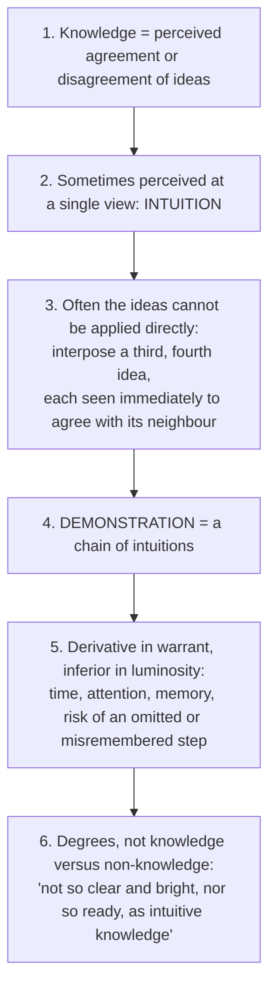

**Presuppositions ⚠️:** P1 both termini are ideas the mind already has (knowledge "extends no further than our ideas"); P2 a connecting idea must be findable (no method guarantees it); P3 trustworthy memory of earlier links; P4 below these degrees (probability, testimony, faith) is **judgement/opinion**, not knowledge. Sensitive knowledge is the awkward third case, since "this thing exists" is not straightforwardly an agreement between two ideas.

| Objection | Locke's reply | Verdict |
|---|---|---|
| Demonstration is just intuition strung out | Difference is in **mode of access**, not warrant | ⚠️ holds if "degree" means phenomenology of evidence |
| Memory is fallible, so long proofs lose certainty | Concedes practical risk; certainty preserved in principle | ❓ open; concede it |
| Sensitive knowledge breaks the definition | Kept because existence is forced on us and indispensable; ranked lowest because anomalous | ⚠️ admitted strain |
| Demonstrative morality promised, not delivered | Moral ideas are **mixed modes**, made by us, fully definable, so possible in principle | ❓ unfulfilled programme |

**Close-neighbour discriminations ⚠️**

| Position | Meaning of "intuition" | Do NOT conflate with Locke |
|---|---|---|
| Locke | immediate intellectual perception that two of *my own ideas* agree or disagree | — |
| Descartes | *intuitus* of a simple nature + *deductio* | grounds a metaphysical foundation |
| Spinoza | *scientia intuitiva*, third kind, *sub specie aeternitatis* | a higher ontological standpoint |
| Kant | *Anschauung*, sensible givenness | ❌ never translate Locke's intuition into Kantian intuition |
| Popular usage | hunch, mystical insight | ❌ Locke's intuition is neither non-rational nor extraordinary |

**Traps ❌:** "intuitive = certain, demonstrative = probable" (both are knowledge; probability begins below); treating the degrees as three *sources*; omitting sensitive knowledge; writing the innate-ideas essay instead; claiming Locke demonstrated morality (he claimed it was **possible**).

### 2.4 Locke: representative realism (veil of perception) ✅

- We perceive **ideas** that *represent* external objects; this creates an epistemic gap (how do we know ideas match reality?). Locke trusts that ideas of primary qualities resemble objects; Berkeley and Hume exploit the gap.

### 2.5 Locke: abstract general ideas (the doctrine Berkeley destroys; 2025 Q4(c)) ✅

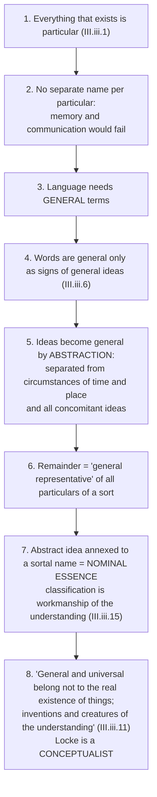

- Printed subterms: *abstraction* · *abstract general idea* · *general representative* · "circumstances of time and place" · *nominal essence* vs *real essence* · Locke's admission that the abstract idea is "something imperfect, that cannot exist".
- **Canonical example ✅ — the general triangle** (IV.vii.9): "neither oblique nor rectangle, neither equilateral, equicrural, nor scalenon; but all and none of these at once". Hinge of the Locke–Berkeley dispute.
- **Presuppositions ⚠️:** P1 meaning is ideational (drop it, as Wittgenstein and Quine do, and premise 4 collapses); P2 ideas are imagistic/particular in origin; P3 mental subtraction is possible; P4 one idea per general word.

### 2.6 Berkeley: theory of knowledge ✅

- All knowledge is of **ideas perceived by the mind**; no material substance behind ideas. We perceive ideas **immediately** (no veil); an "external object" is a collection of ideas.
- **"Sensible things are those only which are immediately perceived by sense"** (2021 Q1(c)).
- **Nominalism and rejection of abstract general ideas** (*Principles* Intro §§6–25): we can have particular ideas that *stand for* a class, not an idea stripped of all particular determination. Consequence: Locke's "substance in general" is incoherent; "matter" is an empty word.

**Berkeley's demolition of abstraction, numbered ✅ (2025 Q4(c))**

| Step | Content |
|---|---|
| 1 | I can imagine particulars I have perceived, and compound/divide them (a hand without a body): separation of parts that **could** exist apart |
| 2 | Abstraction proper needs separating what **cannot** exist apart: extension without colour, motion without determinate speed, "man" without stature or complexion |
| 3 | Locke's triangle is **self-contradictory** (Berkeley quotes it at Intro §13) |
| 4 | So there are no abstract general ideas |
| 5 | **Positive replacement:** an idea is general "by being made to represent or stand for all other particular ideas of the same sort" (Intro §12): the geometer draws *this* black inch-long line and proves a theorem about all lines |
| 6 | **Corollary:** words do not always stand for ideas; language also raises passion, prompts action (Intro §§19–20). ⚠️ Anticipates Wittgenstein's meaning as use |
| 7 | **Metaphysical payload:** "material substance in general" and "substratum" are abstract general ideas; if abstraction is impossible, "matter" is a **meaningless expression**. Immaterialism rests on nominalism, not the reverse |

| Berkeley's charge | Locke's available reply | Verdict |
|---|---|---|
| Abstract triangle is contradictory | It is *partial*, not contradictory: three-sidedness with angles **left undetermined**; determinables need not be determinate | ⚠️ strongest defence; requires giving up the imagistic model of ideas |
| No such image can be formed | Concede no *image*; relocate to a non-imagistic act of understanding | ❓ then not an "idea" in Locke's own sense; empiricist derivation strained |
| Selective attention suffices | What fixes *which* respect is attended to? The resemblance-respect looks like the abstract idea returning | ⚠️ standard modern rejoinder |

**Executable verdict ⚠️:** Berkeley wins against the *imagistic* Locke and loses against the *determinable* Locke. The lasting damage is to the ideational theory of meaning that made abstraction necessary; the true heir is Wittgenstein's family resemblance, not Hume.

### 2.7 Hume: impressions, ideas and the copy principle ✅

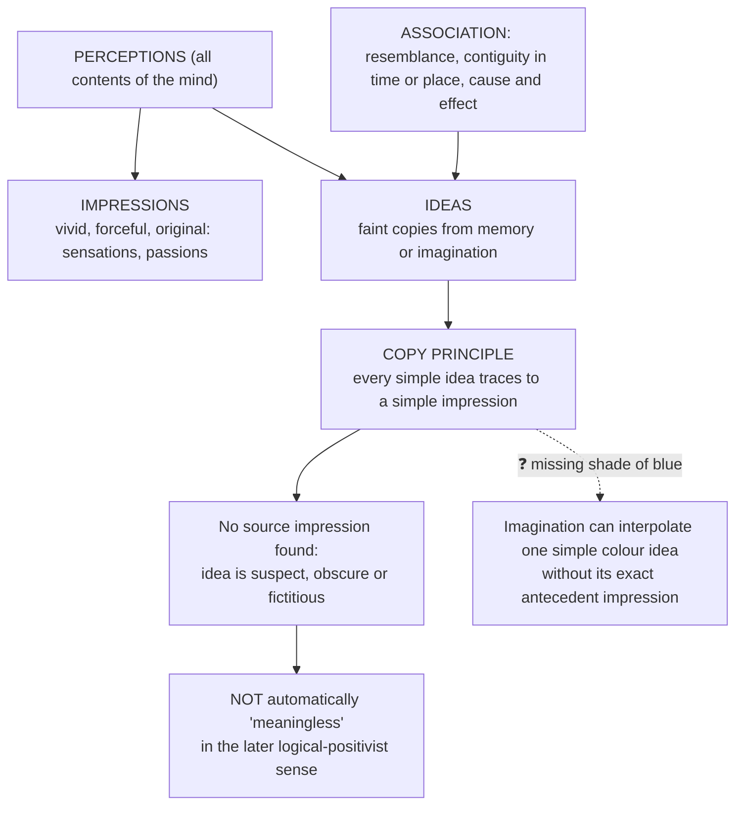

- ✅ Association is the psychological mechanism decisive for Hume's accounts of self and causal belief.
- ❓ **Missing shade** (*Treatise* I.i.1; *Enquiry* II): Hume grants the case, calls it "so singular" that it is not worth altering his maxim. ⚠️ Shows the copy principle is an **empirical generalisation**, not an analytic truth, and converts a descriptive answer into a critical one. Hume's reply: interpolation between impressions actually had preserves the principle's spirit (no idea without experiential materials).

### 2.8 Hume's Fork ✅

| Relations of Ideas | Matters of Fact |
|---|---|
| Known a priori; by thought alone | Known a posteriori; need experience |
| Necessary; denial self-contradictory | Contingent; contrary always conceivable |
| "2+2=4"; "a bachelor is unmarried" | "the sun will rise tomorrow"; "fire causes heat" |
| Do not depend on what exists | Depend on how the world is |

- ⚠️ *Enquiry* XII: a book with neither abstract reasoning about quantity/number nor experimental reasoning about matters of fact — "commit it then to the flames". A polemic against speculative metaphysics, **not** the later technical verification criterion.
- ❌ Do not say Hume assigns "the Sun will rise" and "2+2=4" the same necessity or probability (2018 Q1(a)): the first is a matter of fact (contrary conceivable; rests on uniformity of nature, which cannot be non-circularly proved), the second a relation of ideas (denial contradictory).

### 2.9 "Ideas of reason": Hume and Kant (2026 Q2(b)) ✅/⚠️

| Step | Content |
|---|---|
| Caution ⚠️ | "Ideas of reason" is **not** Hume's name for a single settled category. Do not rename his **relations of ideas** as Kant's technical **Ideas of pure reason** (soul, world, God) |
| Hume | Start with the copy principle (qualified by the missing shade); then the two grounds of judgement: relations of ideas (thought alone; contrary contradictory; mathematics) and matters of fact (experience; contrary conceivable; incl. the future course of nature) |
| Limit | Reason alone cannot infer necessary connection from repeated conjunction, nor show unobserved cases resemble observed. Hume permits demonstrative reasoning but denies it establishes substantive necessary causal truths. He is **not** saying all ideas are irrational or reason never operates |
| Kant's response ✅ | The fork leaves no place for an *informative yet necessary* judgement about objects of possible experience. Maths and the causal principle are **synthetic a priori**: space/time and the categories are conditions of experiencing objects, not copies of impressions. **Second Analogy:** objective succession, unlike subjective apprehension order, requires a causal rule; valid for **phenomena**, not things in themselves |
| Caution ⚠️ | Kant's *Ideas of pure reason* concern the unconditioned (soul, world, God) and do not by themselves yield knowledge; do not confuse with Humean relations of ideas or Kant's categories |
| Verdict | Kant diagnoses the missing third possibility in Hume's fork, but Hume can ask whether objective experience truly requires the specific causal rule Kant supplies rather than regular expectations. "Hume denies reason, Kant restores it" is not an argument |

---

## 3. Dialectical Wings, Internal Critiques & Refinements

### 3.1 Why empiricism "slides" ⚠️

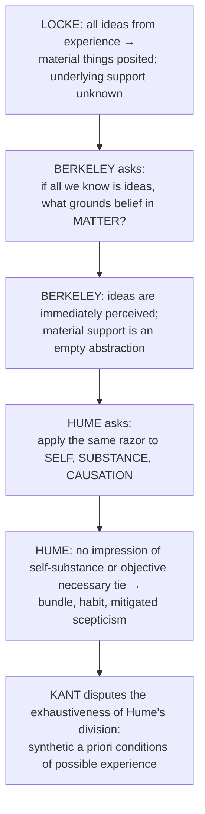

- ⚠️ Berkeley adds the premise that a sensible thing consists only of perceived ideas, yet retains active spirits and God; Hume's copy test challenges substantial self while natural belief in bodies persists. None follows from Locke's genetic account alone.
- **Bring out / Trace** directive: show a **development**; use the slide logic, each thinker as the previous one taken consistently. ❌ Three parallel summaries.

### 3.2 Berkeley's five arguments, reconstructed ✅/⚠️ (never present *esse est percipi* as a bare slogan)

| # | Argument | Reconstruction | Presupposition / strongest objection |
|---|---|---|---|
| 1 | **Semantic / analytic** (*Principles* §§1–4) | Objects of knowledge are ideas; "sensible things" *means* things immediately perceived; an apple, stone, tree, book are collections of such ideas; ideas cannot exist unperceived; so for sensible things *esse est percipi*; "absolute existence without relation to being perceived" is unintelligible | Step 3 is a **definition**, not a discovery: grant it and immaterialism follows in four lines |
| 2 | **Likeness principle** (§8) | Locke says ideas of primary qualities resemble qualities in bodies; "an idea can be like nothing but an idea"; if originals are unperceivable no comparison is possible; so resemblance is unintelligible | **Objection:** structural/mathematical resemblance (isomorphism) needs no qualitative likeness: a map resembles terrain without being terrain-coloured |
| 3 | **Collapse of primary/secondary** (§§9–15; *Dialogues* I) | A **parity argument**: every relativity argument Locke accepts for secondary qualities applies to primary ones (apparent size with distance, motion with frame, shape with angle); extension cannot be conceived without colour; figure inseparable from extension | **Objection:** perceptual relativity does not entail mind-dependence; a mind-independent thing with real shape looks different from different positions |
| 4 | **Master Argument** (§§22–23) | Challenge: conceive an extended movable body existing unconceived. You imagine a tree in a park with nobody by; but *you* are conceiving it; so you have not conceived it **unconceived**; the supposition is self-refuting | **Objection ❓ (Russell; refined by Prior and Gallois):** scope / use–mention confusion: inconceivable is "I conceive of X that it is not conceived by me"; required is only "I conceive that X exists and is not conceived". **Berkeley's reply:** he has no object over and above the idea, so the distinction is what is at issue |
| 5 | **God as guarantor of continuity** (§§6, 30–33, 48; *Dialogues* II) | Ideas are passive; sense-ideas come involuntarily and in regular order; the producer must be an active spirit greater than I; so God; laws of nature = grammar of God's language of ideas (regularities are signs, not causes); objects persist because always perceived by the infinite Mind | **Presupposition:** only spirits are active causes (voluntarism). **Objection:** turns unperceived existence into a hypothesis about an unobserved being, the move forbidden to Locke. **Reply:** spirit known by **notion** not idea (§§27, 89, 140) |

> [!TIP]
> **Answer craft.** In a 15/20-marker on Berkeley, name the arguments (semantic · likeness · parity · master · continuity). Five named arguments, where the average script asserts one slogan, is the largest differentiator.

### 3.3 Optional-depth modules from the advanced dossier ❓/⚠️

| Module | Issue | Competing readings | Extra objection → counter-reply | Use rule |
|---|---|---|---|---|
| **Locke: real essence and corpuscular explanation** | Humble realist about hidden structures, or sceptical placeholder? | realist/corpuscular; anti-essentialist (nominal essence, modesty); middle (real essence exists but rarely usable) | **Obj.:** "something I know not what" looks empty. **Reply:** explanatory posit tied to stable powers and kinds, not a positively known object of intuition | One-line refinement in Locke's substance answer, or when explaining why Berkeley finds Locke unstable. Promote to Core if a PYQ asks whether the substratum is meaningful or real essence knowable |
| **Berkeley's Master Argument after the textbook summary** | Proves unperceived object inconceivable, or only that one cannot at the same time conceive an object while conceiving it as unconceived? | strong conceivability argument; anti-abstraction polemic; dialectical reading targeting Locke's representational assumptions | **Obj.:** I can think of a tree unperceived in a forest. **Reply:** still conceived by you in that very act; target is "conceived-as-unconceived" | Only after *esse est percipi* and abstraction attack are in place |
| **Hume the destructive sceptic vs Hume the naturalist** | Does Hume dissolve reason into habit or reconstruct philosophy on ordinary practice? | radical sceptic; mitigated/naturalist; combined | **Obj.:** appeal to custom is surrender. **Reply:** cognition inescapably runs on habit; philosophy should explain the limit | One closing evaluative paragraph; never replaces copy principle, bundle theory, habit argument |

### 3.4 Kant's responses (routed from Hume) ✅/❓

| Hume's problem | Kant's response | Hume's counter ❓ |
|---|---|---|
| Causation (no impression of necessary connexion) | Agrees necessity is not copied from impression; **Second Analogy**: the category of cause is an a priori rule distinguishing objective event-succession from subjective succession; "every event has a cause" is synthetic a priori for possible experience; no knowledge of causality among things in themselves | Does Kant prove the category or build it into the definition of objective experience? Kantian reply: without rule-governed synthesis, experience of an event would not be possible |
| Bundle self | Accepts no impression reveals a simple soul-substance; the **"I think"** must be able to accompany all representations; **transcendental unity of apperception** is a formal condition of synthesising a manifold, not another item in the bundle | A condition of description rather than an entity discovered; Kant accepts the non-entity point but insists rule-governed unity is presupposed by judgement |
| Substance as fiction | **First Analogy** (cited in the substance theme): time cannot be perceived, so determining duration and succession needs something persisting; substance is a condition of perceiving anything in one time | — |

⚠️ These do not prove an immortal Cartesian soul nor settle every question of personal identity through time. ❌ The unity of apperception is a formal condition, not an observed Cartesian ego. ❌ Do not treat Kant's reply as Hume's own doctrine.

---

## 4. Metaphysics & Ontology: Substance, Qualities and Self

### 4.1 Locke: primary and secondary qualities ✅

| Primary | Secondary |
|---|---|
| Solidity, extension, figure, motion/rest, number | Colour, sound, taste, smell, warmth/cold |
| Really *in* the object | **Powers** in the object to produce sensations in us |
| Ideas of them **resemble** the qualities | Ideas do NOT resemble anything in the object |
| Inseparable from body (every fragment retains them) | Depend on the perceiver's sense organs |

Basis: primary qualities are those any body must have however small ("objective"); secondary qualities are relational, the result of primary-quality configurations acting on sense organs.

### 4.2 Locke: real vs nominal essence; substance as "something I know not what" ✅

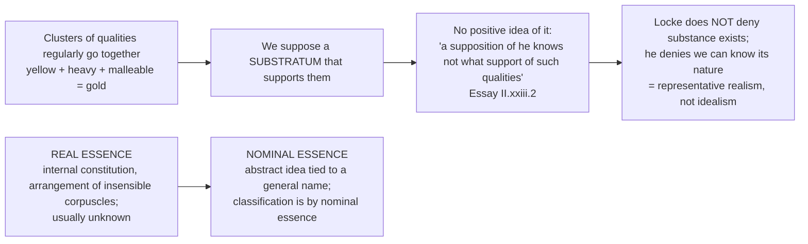

### 4.3 Berkeley: collapse of the distinction, *esse est percipi* ✅

| Step | Content |
|---|---|
| 1 | Locke admits secondary qualities are mind-dependent |
| 2 | Primary qualities are equally mind-dependent: extension cannot be conceived without colour/some visual quality; motion/rest relative to observer; figure inseparable from extension, which is inseparable from colour |
| 3 | All qualities are ideas; the distinction collapses |
| 4 | Nothing is left for "material substance" to be: an empty abstraction |

- "The table I write on, I say, exists; that is, I see and feel it" (*Principles* §3). **Reality = minds (spirits) + their ideas**: subjective idealism / immaterialism.
- **Berkeley "saves" common sense ⚠️:** he denies only the philosopher's fiction of matter; the ordinary person never believed in Locke's veil; the *materialists* undermine common sense by positing an unknowable world behind appearances.
- **Scope ✅:** *esse est percipi* applies to sensible ideas; spirits are active perceivers/willers known by **notion**. ⚠️ "to be is to be perceived or to perceive" is a later explanatory summary. Sense-ideas are involuntary, vivid, coherent, law-governed; imagination-ideas comparatively voluntary and irregular; **illusion/error concerns judgement and interpretation**, not whether the presented idea exists. Natural laws are stable sequences in God's language of ideas, supporting prediction and science; Berkeley denies material efficient powers, not regularity. Other finite minds are inferred from purposive signs by analogy; God explains the comprehensive involuntary order. ⚠️ Blocks crude solipsism, but knowledge of other spirits and God is less immediate than awareness of one's own activity and ideas.

### 4.4 Hume: substance, qualities, and continued and external existence ✅

- Apply the copy principle: no impression of substance, only of particular qualities (redness, hardness, sweetness). The idea of an underlying support is a **fiction of the imagination**: habit groups qualities and adds a bearer not separately given.
- Hume questions warrant for both material and spiritual substrata; this does **not** demonstrate that nothing mind-independent exists.
- **Qualities without substance:** only *bundles of perceptions*; the object is a stable bundle, the self a flowing bundle.

| Continued and external existence (§2.3A of owner) | Content |
|---|---|
| Sense presents only interrupted perceptions | Not an object existing continuously while unperceived, nor distinctly beyond perception |
| Constancy and coherence | Similar perceptions' constancy and coherent reappearance lead imagination to feign continued objects and smooth perceptual gaps |
| Double-existence theory | Philosophers say private perceptions represent independent objects; unverifiable, since comparison remains within perceptions |
| Naturalism ⚠️ | Hume does not demonstrate that no external world exists; reflection undermines rational justification, nature restores unavoidable belief in bodies. Pattern: explain why belief is psychologically inevitable after showing reason cannot establish its metaphysical object |

### 4.5 The self across the three ✅

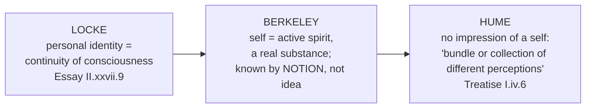

**Locke on personal identity (2021 Q1(d)) ✅**
- A person: "a thinking intelligent being, that has reason and reflection, and can consider itself as itself, the same thinking thing, in different times and places" (II.xxvii.9).
- Distinguishes the identity of a **person**, a **human animal/man**, and a **substance**. Identity extends as far as present consciousness can appropriate a past thought or action as its own.
- Memory is the chief mechanism/evidence; the constitutive notion is **consciousness** (reducing it to bare memory intensifies circularity).
- **Prince-and-cobbler:** transfer of the prince's consciousness into the cobbler's body transfers the person but not the human animal.
- **Forensic concept:** linked to moral responsibility (accountable for acts one can appropriate).

| Objection | Source | Force |
|---|---|---|
| **Circularity:** memory presupposes identity (I remember only *my own* experiences) | Reid, Butler | ✅ definition circular |
| **Transitivity failure (Brave Officer):** boy → officer → general; the officer remembers being the boy, the general remembers being the officer but not the boy; by Locke's criterion general ≠ boy while officer = boy and general = officer | Reid | ⚠️ overlapping chains of memory is the reply, but sharp |
| **Gaps in consciousness:** dreamless sleep, amnesia | critics | Locke needs continuous *capacity* for memory; strained |
| Reply on circularity | — | Locke might distinguish *constitutive* criterion (consciousness) from *evidential* (memory) ❓ |

**Hume's bundle self (2020 Q2(a)) ✅**
- Introspection never finds an impression of a self, only particular perceptions in flux: "I never can catch myself at any time without perception…" The self is "nothing but a bundle or collection of different perceptions, which succeed each other with an inconceivable rapidity, and are in a perpetual flux and movement" (*Treatise* I.iv.6).
- The **fiction of unity** is produced by imagination via **resemblance** (present ideas resemble past memories) and **causation** (one perception seems to produce the next; memory links them).
- **Appendix confession:** "all my hopes vanish when I come to explain the principles that unite our successive perceptions." ⚠️ He does not clearly retract every claim about lacking an impression of self; the *Enquiry* drops personal identity.
- ❌ "Bundle theory = self does not exist": perceptions are real; denied is a simple, identical **owner** behind them.

---

## 5. God, Scepticism and the Limits of Metaphysics

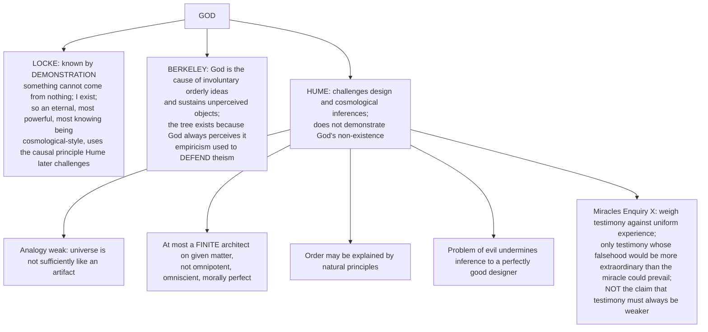

- Cross-paper: 2025 Paper II Q6(a) asks the design argument with Hume's criticism (this is the required content). Miracles are secondary enrichment; the critique of God is Core because "God" is printed.
- ⚠️ **Hume's causal/cosmological critique:** no impression of a "first cause" or of causation as objectively necessary; observed finite effects cannot establish the character of an unexperienced transcendent cause.

### 5.1 Scepticism across the three ✅/⚠️

| Thinker | Stance |
|---|---|
| **Locke** | Moderate limits, not global scepticism; cannot know most real essences or substance-in-itself; sensitive knowledge reliable enough for life; the veil of perception creates a *potential* problem his account must address. Objection → reply: God would not make us systematically deceived |
| **Berkeley** | Anti-sceptical idealism; claims to **refute** scepticism (the materialist produces doubt by positing an unknowable world); identifies reality with ideas, so we perceive real things directly; God guarantees continuity. **Dogmatic theistic idealism**, not doubt about knowledge |
| **Hume** | Systematic culmination: causation, induction, self, external world. **Excessive/Pyrrhonian scepticism** (total suspension) is impossible in practice; **mitigated scepticism**: limit enquiry to what experience can answer, avoid speculation beyond possible experience (substance, God, the soul), proportion belief to evidence; philosophical humility + natural beliefs that custom compels |

### 5.2 Critiques of metaphysics: Hume's place ✅/⚠️

| Who | Verdict | Ground | Fate |
|---|---|---|---|
| **Hume** | illegitimate | empiricism: no impression of substance/self/cause | "commit it to the flames" (content test) |
| Kant | illusory but explicable | categories misapplied beyond experience → antinomies | limited to phenomena |
| Positivism | literally meaningless | verification principle | nonsense (meaning test) |

Mnemonic F-L-N-T: Hume **F**lames, Kant **L**imits, Positivists **N**onsense, Wittgenstein **T**herapy. ⚠️ Hume vs Positivists: both empiricist, but Hume attacks **content** (no impression), positivists attack **meaning**; positivism is Hume "logicised".

---

## 6. Explanatory & Causal Principles

### 6.1 Hume on causation ✅ (centrepiece; 2019 Q4(b), 2021 Q1(e), 2023 Q2(a), 2025 Q2(c))

| Element | Hume's analysis |
|---|---|
| What we observe | constant conjunction (A always followed by B) + temporal priority + spatial contiguity |
| What we do NOT observe | a *necessary connection* |
| Source of the idea of necessary connexion | NOT an impression of objects; an **impression of reflection**: a *felt determination of the mind* to pass from idea of A to idea of B after repeated experience |
| Mechanism | **custom/habit**: psychological compulsion, not rational demonstration |
| Conclusion | no impression of objective causal necessity; the idea derives from felt mental determination |

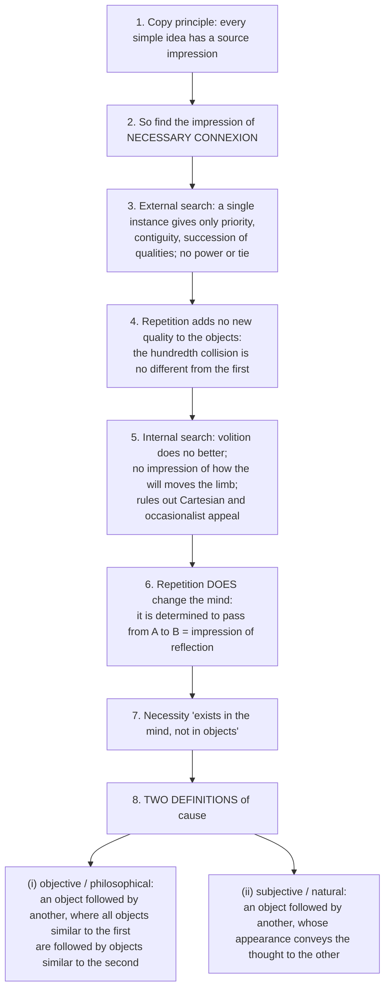

- Examples: two billiard balls (*Enquiry* IV, VII); bread nourishing the body (*Enquiry* IV).
- **Presuppositions ⚠️:** P1 copy principle exceptionless; P2 causation must be visible in a single instance if objective at all; P3 impressions are atomic and separable, so no relation is given *with* its terms; P4 necessity must be observed or projected — no third option such as a theoretical posit.
- **Is there any element of necessity?** (2019 Q4(b)): in *objects* — no perceived or demonstrated necessity (not a proof that no unperceived power could exist); in the *mind* — yes, psychological (felt compulsion). A fact about **us**, not nature. ❌ a flat "no".
- ✅ **Naming both definitions** is the single highest-value move.

### 6.2 The problem of induction as a dilemma ✅

| Step | Content |
|---|---|
| 1 | All reasoning about matters of fact beyond present sense and memory rests on cause and effect |
| 2 | Causal inference rests on the **Uniformity Principle (UP)**: the future will resemble the past |
| 3 | UP can be established only **demonstratively** or **probably** |
| 4 | Not demonstratively: "the course of nature may change" implies no contradiction |
| 5 | Not probably: every probable argument presupposes UP, so circular |
| 6 | So UP has no rational foundation |
| 7 | Inductive inference is produced by **custom/habit**, "the great guide of human life" |

- **Presupposition ⚠️:** step 3 assumes the exhaustiveness of the demonstrative/probable dichotomy (the Fork applied reflexively). Replies break this step: **Kant** (third category, synthetic a priori), **Popper** (science needs no induction), **Strawson** (demanding justification of induction as a whole misapplies the standards of rationality it constitutes).
- ❌ Hume does not deny the *practice* of causal inference; he denies its *rational* foundation (practice vs justification).

### 6.3 Causation in Locke and Berkeley ✅

| Thinker | Causation |
|---|---|
| Locke | real power, though knowledge of mechanism is limited |
| Berkeley | ideas are passive and inert; only spirits are active causes; God's will produces ideas in us; laws of nature are regularities that are **signs, not causes** |
| Hume | constant conjunction + habit; no perceived objective necessary power |

⚠️ Theme-file note: the *Causation-across-schools* file is an Indian-school axis (satkārya / asatkārya). Its only Humean line is the disanalogy with Buddhist pratītyasamutpāda: **Hume denies necessary connexion but keeps enduring objects; Buddhism keeps strict causal conditioning while denying any enduring substance at all.**

---

## 7. Value Orientation

The sources give **no** puruṣārtha-style value scheme and no ethics for empiricism within this owner. Source-backed value-adjacent content only:

- ✅ Locke's **forensic** concept of the person ties personal identity to **moral responsibility** (accountable for acts one can appropriate).
- ✅ Locke: morality could be **demonstrative** in principle because moral ideas are *mixed modes*, made by us and fully definable; ❓ an unfulfilled programme: do not claim Locke proved it.
- ⚠️ Hume on passions, liberty/necessity and is–ought is **optional enrichment, outside this owner**; "Reason is the slave of the passions" (*Treatise* II.iii.3) is Paper II / ethics material, not an epistemology quotation.
- ⚠️ Hume's **mitigated scepticism** carries a practical recommendation: philosophical humility, proportioning belief to evidence, reliance on natural beliefs custom compels.

---

## 8. Inter-School Comparative Matrices

### 8.1 Locke · Berkeley · Hume ⚠️

| Axis | Locke | Berkeley | Hume |
|---|---|---|---|
| **Matter** | real but unknowable substrate | does not exist (fiction) | no impression → fiction |
| **Qualities** | primary (objective) vs secondary (subjective) | ALL mind-dependent; distinction collapses | all are impressions; no basis for objective/subjective split |
| **Substance** | "something I know not what" | spirit only; no material substance | no impression justifying belief in material or spiritual substratum; not a demonstration that neither exists |
| **Self** | continuity of consciousness (memory) | active spirit (real) | bundle of perceptions |
| **Causation** | real power (mechanism limited) | God's will producing ideas | constant conjunction + habit; not proof regularity is unreal |
| **God** | demonstrated via cosmological-style argument | required to sustain unperceived ideas | challenges design and cosmological inferences; does not demonstrate non-existence |
| **Scepticism** | rejected (moderate realism) | claims to refute scepticism | embraced (mitigated) |
| **Overall** | representative realism | subjective (theistic) idealism | phenomenalism + scepticism |

### 8.2 Berkeley's subjective idealism vs Hegel's absolute idealism (2024 Q2(a)) ✅

| Axis | Berkeley | Hegel |
|---|---|---|
| Basic reality | finite spirits, God and ideas | self-developing Absolute Spirit/Concept |
| Why objects are mind-dependent | sensible existence consists in perception | objectivity is a moment within dialectical self-development |
| God/system role | infinite spirit causes and coordinates ideas | Absolute is not an external perceiver preserving private idea-collections |
| Method | anti-abstraction and immaterialist argument | dialectical development through determinate negation |

Both reject independently self-subsisting matter as final reality, but Berkeley's theistic subjective idealism is **not** an early Hegel. ❌ Do not confuse with Kant's transcendental idealism (Kant explicitly rejects the identification in the *Refutation of Idealism*; his concerns the *form* of experience, not existence of objects).

### 8.3 Moore and Russell against Berkeley (2018 Q3(a)) ✅/⚠️

| Axis | Moore | Russell |
|---|---|---|
| Attack | idealist inference from "experienced" to "dependent on experience"; distinguishes **act of awareness** from its **object** (awareness of blue ≠ blue) | also rejects Berkeleyan idealism |
| Positive view | **transparency** argument supports **direct realism**: object presented through, not constituted by, consciousness | **analytical reconstruction**: physical objects are inferred or logically constructed from sense-data, perspectives, relations |
| Emphasis | act–object distinction; common-sense directness | logical construction; structural objectivity |

⚠️ Common ground: both resist reducing object to act/idea. ✅ Evaluation: both resist idealism, yet Moore stresses the transparency of sensation while Russell replaces ordinary objects with constructions. (Russell, with Prior and Gallois, also charges the Master Argument with a scope/use–mention confusion.)

### 8.4 The a priori / a posteriori grid ⚠️

| Thinker | Source of knowledge | Synthetic a priori? | Signature move |
|---|---|---|---|
| Rationalists | reason, innate ideas | (loosely yes) | truths of reason vs fact |
| **Empiricists (Hume)** | experience only | **NO** (fork) | causation = habit |
| Kant | reason + sense synthesised | **YES** | Copernican revolution; categories |
| Positivists | verifiable experience | NO | analytic/synthetic; verificationism |
| Quine | holistic web | the distinction itself rejected | two dogmas; holism |

Arc: Rationalism ⇄ Empiricism → Hume pushes to scepticism → **Kant** synthesises ("Thoughts without content are empty, intuitions without concepts are blind", the theme file's quotation) → Positivism → Quine. Hume's bombshell: "every event has a cause" is not a priori (denial uncontradictory) and not observed (only conjunction).

### 8.5 Substance across Western philosophy ⚠️ (theme grid)

| Thinker | Count / what | Status |
|---|---|---|
| Aristotle | primary = individuals | real, form + matter |
| Descartes | 3 (God, mind, matter) | real, dualist |
| Spinoza | 1 (God = Nature) | real, monist |
| Leibniz | ∞ monads | real, pluralist |
| **Locke** | unknown substratum | real but unknowable |
| **Berkeley** | only spirits | material substance denied |
| **Hume** | none | fiction; self = bundle |
| Kant | a category | mind-imposed form |
| Strawson | basic particulars | conceptual/linguistic |

Mnemonic "1-3-1-∞ then dissolve": Locke weakens, Hume eliminates, Kant relocates, Strawson reinterprets. **Hume's dissolution of substance forces Kant's Copernican rescue.** Strawson's argument against the empiricist line: basic particulars are basic because identification and re-identification need a single spatio-temporal framework; sense-data are private, momentary and lack spatial relations, so constructing objects from sensory items fails **in principle**.

---

## 9. Criticisms & Reconstructed Replies

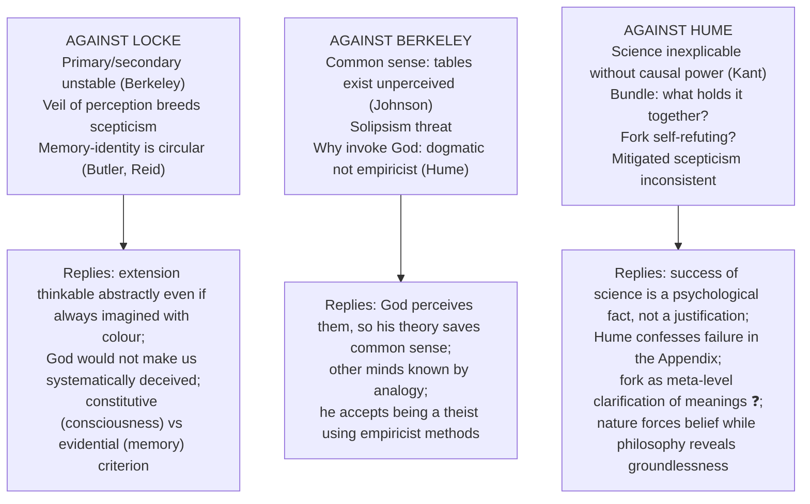

| Target | Criticism | Source | Reply | Status |
|---|---|---|---|---|
| Locke | Primary/secondary unstable: can extension be conceived without a sensory quality? | Berkeley | Think extension abstractly via mathematical reasoning | ❓ |
| Locke | Representative realism generates scepticism (veil) | Berkeley, sceptics | God would not systematically deceive; inference to external causes reliable enough | ⚠️ |
| Locke | Personal identity via memory is circular | Butler, Reid | Constitutive vs evidential criterion | ❓ contested |
| Berkeley | Tables exist unperceived! | Samuel Johnson ("I refute it thus!") | Table exists unperceived by you, perceived by God | ✅ |
| Berkeley | Solipsism if reality = my ideas | critics | Other spirits known by analogy; God guarantees the system | ⚠️ |
| Berkeley | Invoking God is dogmatic | Hume | Accepts being a theist using empiricist methods | ✅ |
| Berkeley | Likeness principle ignores isomorphism | modern rescue of Locke | structural resemblance needs no qualitative likeness | ⚠️ |
| Berkeley | Master Argument: use–mention / scope confusion | Russell, Prior, Gallois | Berkeley: no object over and above the idea | ❓ |
| Hume | If no real causal power, science inexplicable | Kant, scientists | Science works by inductive habit; success is a psychological fact | ⚠️ |
| Hume | What holds the bundle together? | critics; Hume (Appendix) | Hume confesses failure | ✅ |
| Hume | Is the Fork a relation of ideas or a matter of fact? If neither it refutes itself | critics | A meta-level clarification of meanings | ❓ |
| Hume | Mitigated scepticism uses induction while denying its rational basis | critics | Nature forces belief; philosophy reveals groundlessness | ⚠️ |
| Hume | Copy principle has a counterexample (missing shade) | Hume himself | Interpolation preserves the spirit | ❓ |

---

## 10. Controlled Comparisons

The owner file's own cross-tradition bridge, plus the Hume rows of the theme files. Each parallel carries its disanalogy; use after the empiricist case is complete.

| Comparator | Point of contact | Decisive disanalogy |
|---|---|---|
| **Buddhist anātman / nairātmyavāda** (owner §3.5; self theme) | Hume's bundle: no impression of a persisting "I", only fleeting perceptions. ⚠️ "The examiner may reward this bridge" | Hume has no karmic continuity, no rebirth, no soteriology; the self is a *fiction of the imagination*. Buddhism has a functionally real causal series (**santāna**) carrying moral weight that can be liberated |
| **Cārvāka on vyāpti** (pramāṇa theme) | Hume on induction: no number of observed conjunctions yields a necessary connexion | Hume still **endorses** inductive practice as natural and indispensable; Cārvāka denies inference the status of **pramāṇa**. Hume's route is the theory of impressions; Cārvāka's is the regress/upādhi argument. ❌ "Cārvāka is the Indian Hume" without disanalogies |
| **Buddhist pratītyasamutpāda** (causation theme) | Humean regularity | Hume denies necessary connexion but keeps enduring objects; Buddhism keeps strict causal conditioning while denying any enduring substance |
| **Logical positivism** | Hume's fork → verification principle (owner link-out) | Hume's polemic is not the technical verification criterion; Hume attacks content, positivists meaning |
| **Kant** | Hume woke him from dogmatic slumber | Kant accepts the non-entity and not-from-impression points but inverts the conclusion (so it must come from the mind) |
| **Wittgenstein** | Berkeley's corollary that words need not stand for ideas anticipates meaning as use; Locke's ideational theory of meaning is dropped by Wittgenstein and Quine | ⚠️ "Anticipation", not identity |
| **Strawson** | Basic particulars vs empiricist construction from sense-data | Descriptive metaphysics of conceptual scheme vs experiential derivation |

---

## 11. Diagnostic Deep-Dives for High-Frequency Themes

### 11.1 Hume on "Sun will rise" vs "2+2=4" (2018 Q1(a)) ✅

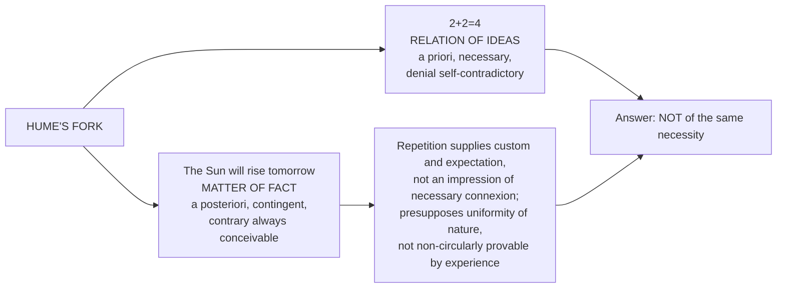

### 11.2 Hume on personal identity and Kant's reply (2020 Q2(a)) ✅

Quotation → copy principle applied to self → no impression of a simple, identical self → bundle; imagination's fiction via resemblance and causation → Appendix dissatisfaction → Kant: accepts no soul-substance is revealed; "I think" must accompany representations; transcendental unity of apperception = formal condition of unified experience → verdict: answers Hume's missing unity at the level of possible experience; not an immortal soul; Humean can say it states a condition, not an entity.

### 11.3 Berkeley under Moore and Russell (2018 Q3(a)) ✅

(a) How Berkeley establishes that Mind and ideas alone are real: the five arguments (§3.2). (b) Moore: act/object distinction, transparency, direct realism. (c) Russell: logical construction from sense-data; structural objectivity. (d) Difference: Moore = common-sense directness; Russell = analytical reconstruction. Close with evaluation of both.

### 11.4 Is rejection of Locke's primary qualities instrumental to Berkeley's idealism? (2024 Q2(a)) ✅

Berkeley's parity argument and collapse of primary/secondary → nothing left for material substance → immaterialism (answer: instrumental, but not sufficient on its own; the semantic argument and the nominalism that makes "matter" meaningless also carry weight, ⚠️ "Berkeley's immaterialism rests on his nominalism, not the reverse"). Then Berkeley vs Hegel (§8.2).

### 11.5 "Why and how does Locke refute innate ideas?" (2022 Q4(c)) ✅

Three lines of attack (§2.1) + Descartes' dispositional reply + nature and source of knowledge: white paper, sensation + reflection, simple/complex ideas, knowledge as agreement of ideas in three degrees. ⚠️ "Locke wins the debate as staged and loses it as reformulated": Leibniz's "nothing in the intellect that was not in the senses — except the intellect itself" shows innatism survives as a thesis about *structure*, the form Kant vindicates.

---

## 12. PYQ Routing Ledger (2018–2025, plus 2026)

> Corpus signal: **12 primary-owned parts out of 112** (2018–2025), present in every year; per-year 2/1/1/3/1/1/1/2. 2026 adds **2 primary-owned** parts. **Total primary-owned: 14.**

| Year | Q | Marks | Exact demand | Map to |
|---|---|---:|---|---|
| 2018 | Q1(a) | 10 | Are the two truths—'The Sun will rise tomorrow' and '2+2=4' of the same necessity for Hume? Give reasons in favour of your answer. | §2.8, §11.1 |
| 2018 | Q3(a) | 20 | How does Berkeley establish that Mind and its ideas alone are real? How do Moore and Russell react to Berkeley's view in this regard? Do you find any difference between Moore's reaction and Russell's one? Discuss. | §3.2, §8.3, §11.3 |
| 2019 | Q4(b) | 15 | Is there any element of necessity in causal relations according to Hume? Discuss. | §6.1 |
| 2020 | Q2(a) | 20 | "I never can catch myself at any time without perception, and never can observe anything but the perception." How does this statement by Hume problematize the philosophical notion of personal identity? How does Kant deal with this problem in his Critique of Pure Reason? | §4.5, §3.4, §11.2 |
| 2021 | Q1(c) | 10 | "Sensible things are those only which are immediately perceived by sense." Explain Berkeley's theory of knowledge with reference to the above statement. | §2.6, §3.2 |
| 2021 | Q1(d) | 10 | Examine the concept of personal identity by Locke. | §4.5 |
| 2021 | Q1(e) | 10 | "The relation between cause and effect is one of constant conjunction". Examine Hume's criticism of causation in the light of the above statement. | §6.1 |
| 2022 | Q4(c) | 15 | Why and how does John Locke refute the innate ideas? Elucidate the nature and source of knowledge in Locke's epistemology. | §2.1–2.3, §11.5 |
| 2023 | Q2(a) | 20 | Critically analyse Hume's argument that causality is a matter of habit/custom involving psychological principle of association. | §6.1–6.2 |
| 2024 | Q2(a) | 20 | Is rejection of Locke's notion of primary qualities instrumental in Berkeley's leaning towards idealism? In this context, also discuss how subjective idealism is different from the absolute idealism proposed by Hegel. | §3.2, §8.2, §11.4 |
| 2025 | Q2(c) | 15 | Examine Hume's refutation of Causal relation and Kant's response to it. | §6.1, §3.4 |
| 2025 | Q4(c) | 15 | Explain Berkeley's doctrine of nominalism and his refutation of Abstract ideas. | §2.5–2.6 |
| 2026 | Q1(b) | 10 | Explain the distinction between Intuitive knowledge and Demonstrative knowledge as propounded by Locke. | §2.3 |
| 2026 | Q2(b) | 15 | How does Hume account for ideas of reason? How does Kant respond to Hume's views in this regard? Critically discuss. | §2.9 (Kant half cross-linked to Kant.md) |

**Cross-owned, listed but not counted:**

| Year | Q | Marks | Demand | Owner |
|---|---|---:|---|---|
| 2023 | Q2(c) | 15 | Discuss Descartes' theory of innate ideas and the grounds on which Locke refutes it. | Rationalism (Locke half: §2.1) |
| 2024 | Q1(b) | 10 | How does Kant respond to Hume's scepticism with regard to a priori judgments? Discuss. | Kant (Hume half: §2.8–2.9, §3.4) |

Routing note (2026): Q2(b) → Empiricism (not Kant) because the owner is the philosopher whose position the question asks to be *established* before the response is assessed.

---

## 13. Top Exam Traps

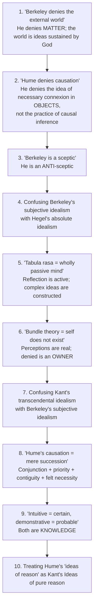

Further traps recorded in the sources: *tabula rasa* is not Locke's own wording; "esse est percipi aut percipere" is a commentators' formula; the *Enquiry* drops personal identity; Hume's Fork is not the positivists' verification principle; Locke's II.xxvii (person) was added in the 2nd edition; Hume does not make the unrestricted claim that testimony must **always** be weaker; Hume does not demonstrate God's non-existence or that no external world exists; "Reason is the slave of the passions" is not an epistemology quote; Locke promised, not proved, demonstrative morality; Kant's reply is not Hume's own doctrine; Locke's sensitive knowledge must be named and its anomaly flagged.

---

## 14. Technical Vocabulary Bank

| Term | Meaning / use | Status |
|---|---|---|
| *tabula rasa* / "white paper, void of all characters" | Locke, against innate ideas; Latin not Locke's own | ✅ / provenance ⚠️ |
| Sensation / Reflection | Locke's two sources of ideas | ✅ |
| Simple / complex ideas; modes, substances, relations | Locke | ✅ |
| Intuitive / demonstrative / sensitive knowledge | Locke's degrees; modes of perceiving agreement | ✅ |
| Representative realism; veil of perception | Locke | ✅ |
| Primary / secondary qualities | resemblance vs powers | ✅ |
| Real essence / nominal essence | Locke | ✅ |
| "Something I know not what"; substratum | Locke II.xxiii.2 | ✅ |
| Abstract general idea; general representative | Locke III.iii | ✅ |
| Conceptualist | Locke on universals | ✅ |
| Prince-and-cobbler; forensic concept | Locke on persons | ✅ |
| Brave Officer | Reid's transitivity objection | ✅ |
| *Esse est percipi* | Berkeley *Principles* §3 | ✅ |
| Immaterialism; subjective idealism | Berkeley | ✅ |
| Nominalism | Berkeley on abstraction | ✅ |
| Likeness principle | "an idea can be like nothing but an idea" | ✅ |
| Master Argument | *Principles* §§22–23 | ✅ / objection ❓ |
| Notion vs idea | knowledge of spirit | ✅ |
| Language of ideas | God's grammar of nature | ✅ |
| Impressions / ideas; copy principle | Hume | ✅ |
| Missing shade of blue | Hume's concession | ❓ |
| Fork: relations of ideas / matters of fact | Hume | ✅ |
| Constant conjunction; custom/habit | Hume | ✅ |
| Impression of reflection; "determination of the mind" | source of necessary connexion | ✅ |
| Two definitions of cause | objective and subjective | ✅ |
| Uniformity Principle | the future resembles the past | ✅ |
| Bundle theory | "bundle or collection of different perceptions" | ✅ |
| Constancy and coherence | Hume on external existence | ✅ |
| Mitigated vs Pyrrhonian scepticism | Hume | ✅ |
| Synthetic a priori; Second Analogy; First Analogy | Kant's replies | ✅ |
| Transcendental unity of apperception | formal "I think" | ✅ |
| Scope / use–mention confusion | Russell's objection to the Master Argument | ❓ |
| Isomorphism | structural resemblance, modern rescue of Locke | ⚠️ |
| Transparency (Moore); logical construction (Russell) | responses to Berkeley | ✅ |

---

## 15. Graded Verdict & Answer Architectures

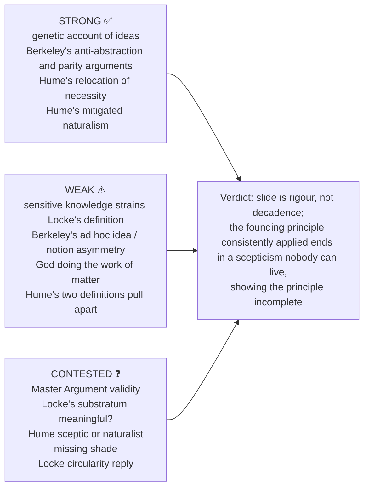

### 15.1 Graded verdict bank ⚠️

| Sub-topic | 10-mark | 15-mark | 20-mark |
|---|---|---|---|
| **Innate ideas** | Locke defeats the *naive* innatist thesis, not the dispositional version Descartes held | His decisive premise is that nothing can be in the mind unperceived; that premise, not the facts about children, does the work, and it is a stipulation | The dispute is about what "in the mind" means; Leibniz ("except the intellect itself") shows innatism survives as a thesis about *structure*, the form Kant vindicates |
| **Abstract ideas** | Berkeley refutes abstraction only on an imagistic reading | His positive account must specify the respect of representation, which looks like the abstract idea readmitted | Lasting casualty is the **ideational theory of meaning**; true heir is Wittgenstein's family resemblance |
| **Primary/secondary** | Survives as measurable-structural vs response-dependent, not as the resemblance thesis | Parity argument defeats *resemblance*, not isomorphism | Locke's mistake was to base it on a picture rather than explanatory role; reconstructed, it survives in science |
| **Berkeley's idealism** | Denies an *unperceivable substratum*, not the grocer's apple | Preserves ordinary object-talk at the price of an ad hoc asymmetry (ideas vs notions) | God does the work of Locke's matter: immaterialism replaces an unknowable substance with an unperceivable spirit, a change of vocabulary before a gain in intelligibility |
| **Hume on causation** | Does not deny causation; relocates necessity from object to observer | The two definitions pull apart (objective regularity vs psychological); never reconciled: origin of the regularity-vs-projectivist debate | Result follows from the atomism of impressions, not experience itself; Kant correctly attacks the atomism |
| **Induction** | Genuine and unsolved; Hume's answer is descriptive (custom), not justificatory | A dilemma: every reply must break a horn (Kant, Popper, Strawson) | Depends on the exhaustiveness of demonstrative/probable, i.e. on the Fork; survives only as long as the Fork |
| **Self** | Applies the copy test to a supposed simple identical perceiver | Appendix: cannot explain what unites perceptions | Absence of an impression of soul-substance does not settle what unifies experience; Kant's apperception answers one part; personal identity over time contested |
| **Scepticism** | Mitigated, not Pyrrhonian: nature compels the beliefs reason cannot justify | Stable only if natural beliefs are exempt from the demand for justification | Each thinker applies the founding principle more consistently; Kant: Hume awoke him from dogmatic slumber |

### 15.2 Answer architectures

**10-mark: Locke's personal identity (2021 Q1(d))**
```text
L1: identity = continuity of consciousness, not of soul-substance or body.
Body: person vs man vs substance; forensic concept; prince-and-cobbler.
Obj: Butler/Reid circularity; Brave Officer transitivity; gaps.
Close: "Examine" = state + test with objection; the circularity's force.
```
**Anchor:** "A person at T2 is the same person as at T1 if conscious of having had T1's experiences."

**10-mark: Locke's degrees (2026 Q1(b))**
```text
L1: knowledge = agreement of ideas (IV.i.2); degrees differ by MODE of perception.
Body: intuitive (immediate); demonstrative (via proofs; chain of intuitions; lower: successive, effortful, memory-dependent); sensitive as anomalous third.
Close: a difference in luminosity, not a demotion to opinion.
```

**15-mark: Hume's refutation of causal relation and Kant's response (2025 Q2(c))**
```text
Frame: Hume's challenge; Kant's Copernican answer.
A: no impression of necessary connexion; conjunction + custom; two definitions; induction unjustified.
B: Kant: causation an a priori category; Second Analogy; synthetic a priori for phenomena only.
Assess: does Kant work against Hume or relocate the problem (why that rule?).
Close: Hume demolished dogmatic metaphysics; Kant rebuilt science on critical foundations.
```

**20-mark: Hume on causality as habit/custom (2023 Q2(a))**
```text
Frame: hinge of empiricism's critique of metaphysics and science.
A: conjunction + priority + contiguity; no impression; custom.
B: impression of reflection; practice of inference vs justification.
C: objections: Kant; science works; self-refutation worry.
Assess: experience alone cannot ground causal necessity; best solution open.
Close: "Critically analyse" = exposition + verdict; deliver one.
```

### 15.3 Directive decoder ⚠️

| Directive | Obligation here | Fatal error |
|---|---|---|
| **Elucidate / Explain** (2025 Q4(c), 2021 Q1(c)) | Give the numbered argument (Berkeley's five, Hume's two), not the conclusion | Restating *esse est percipi* or "constant conjunction" in synonyms |
| **Critically examine / discuss** | 3–4 lines of reconstruction, then objection → reply → **adjudication** | Listing objections without ruling |
| **Discuss** (2023 Q2(a), 2019 Q4(b)) | Exposition + assessment, 60:40; both Humean definitions of cause | Only the negative half |
| **Is there any element of necessity…?** | Yes-and-no with a distinction: not in objects; yes in the mind | A flat "no" |
| **Comment on the statement** | Locate the sentence in its own text and system first | Generic essay on the thinker |
| **How does X refute Y?** | Reconstruct the refuting argument and record the reply | Only listing Locke's points |
| **Substantiate / Do you agree?** | State the ruling first, defend, concede the strongest counter | Balanced neutrality |
| **Bring out / Trace** | Show development, using the slide logic | Three parallel summaries |

> [!TIP]
> **Exam sentences.** (1) "Berkeley wins against the imagistic Locke and loses against the determinable Locke." (2) "Hume's result follows from the atomism of impressions, not from experience itself." (3) "Empiricism's slide from Locke to Hume is not decadence but rigour: each thinker applies the founding principle more consistently."

> [!NOTE]
> Answer both the Humean account **and** the Kantian reply whenever the question routes there; complete the empiricist argument before the secondary reply.

---

## Sources

Masih, *A Critical History of Western Philosophy*; Copleston, *A History of Philosophy* Vol. V; Kenny, *A New History of Western Philosophy* Vol. III; Warburton, *Philosophy: The Classics*; Locke, *Essay* (1690); Berkeley, *Principles* (1710) and *Three Dialogues* (1713); Hume, *Treatise* (1739–40), *Enquiry* (1748), *Dialogues Concerning Natural Religion* (1779). Advanced-dossier trail: Michael Ayers; Kenneth Winkler; George Pappas; Norman Kemp Smith; Barry Stroud; Don Garrett. Theme files: Substance-across-western, A-priori-a-posteriori-knowledge, Critiques-of-metaphysics, Self-and-liberation-across-schools, Pramana-across-schools, Causation-across-schools.
