# KANT — Examiner-Grade Mindmap

> **Syllabus (verbatim):** Kant: Possibility of Synthetic a priori Judgments; Space and Time; Categories; Ideas of Reason; Antinomies; Critique of Proofs for the Existence of God.
> **Catalogue key:** `philosophy-paper-i-western-philosophy-04` · Paper I · Western Philosophy (Section A)
> **Sources used:** `paper-1/western/Kant.md` (canonical owner, read in full) · `_advanced/Western-Philosophy-Dossier.md` §4 (optional depth) · `paper-1/_PYQ-Western-Philosophy-2018-2025.md` · `paper-1/_PYQ-Western-Philosophy-2026.md` · `paper-1/_themes/A-priori-a-posteriori-knowledge.md` · `paper-1/_themes/Critiques-of-metaphysics.md` · `paper-1/_themes/Substance-across-western.md` (Kant entries). The other three theme files (`Causation-across-schools.md`, `Pramana-across-schools.md`, `Self-and-liberation-across-schools.md`) contain no Kant entry; Causation is linked from the owner and its Kant row is covered by the owner's own Hume-vs-Kant table.
> **Evidence key:** ✅ canonical doctrine · ⚠️ analytical synthesis · ❓ contested / uncertain · ❌ trap
> **Adaptation note:** the 15-module blueprint is Indian-school oriented. Here Module 1 = works, editions and provenance; Module 2 = theory of knowledge (the whole Aesthetic and Analytic); Module 3 = internal disputes and refinements; Module 4 = phenomena, noumena, substance and self; Module 5 = Ideas of Reason, antinomies and God-proofs; Module 6 = causation (Hume, Second Analogy, freedom); Module 7 = value orientation (bounded: practical postulates only). Where the sources give nothing for a module, it says so.

> [!IMPORTANT]
> **Core thesis.** Kant's question is *how are synthetic a priori judgments possible?* The answer (the change of standpoint traditionally called the Copernican revolution) is that sensibility and understanding structure appearances through a priori forms, so these judgments are valid **for objects of possible experience only**. Beyond experience, theoretical reason generates illusion: paralogisms, antinomies and failed God-proofs. ✅

---

## 0. Master Overview

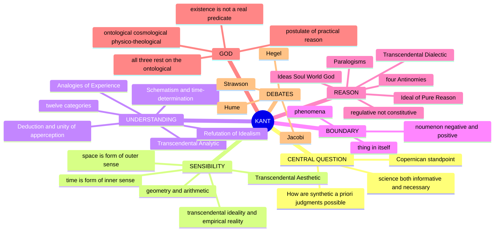

> [!TIP]
> **Mnemonic "SSU-CRN".** Sensibility Supplies Space-Time; Understanding Uses Categories; Reason generates (illusory) Noumenal ideas. ⚠️

### 0.1 One-screen architecture ⚠️

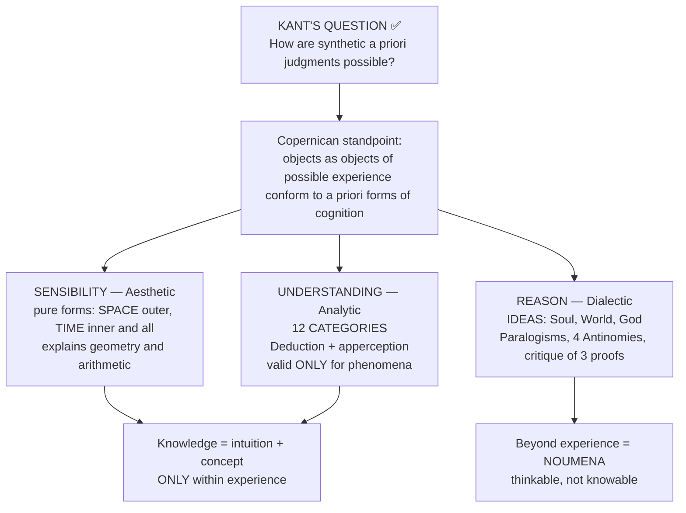

---

## 1. Identity, Lineage, Works and Provenance Discipline

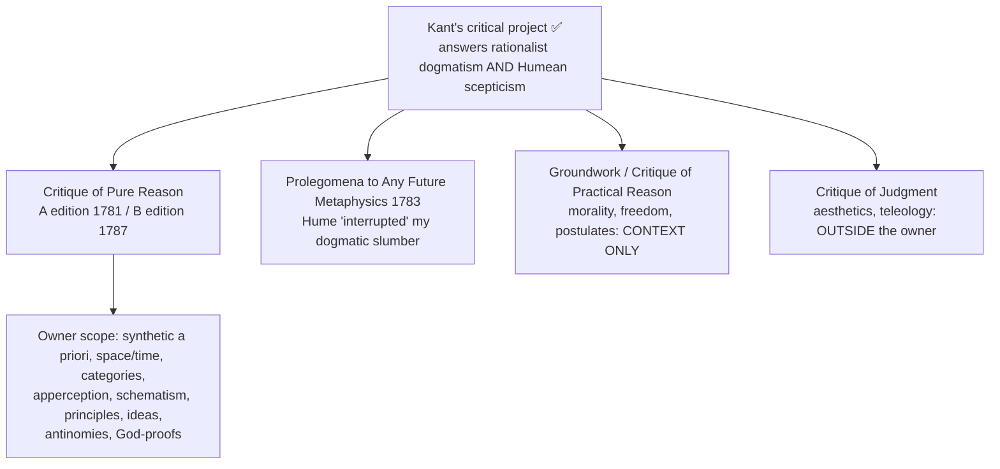

| Work | Marks-essential ownership |
|---|---|
| *Critique of Pure Reason* (A/B editions) | synthetic a priori judgment, space/time, categories, apperception, schematism, principles, ideas, antinomies and God-proofs |
| *Prolegomena to Any Future Metaphysics* | shorter retrospective statement of Hume's challenge and the critical project |
| *Groundwork* / *Critique of Practical Reason* | morality, freedom and practical postulates — context only here |
| *Critique of Judgment* | aesthetics and teleology — outside the printed owner |

- ✅ Theoretical philosophy alone is printed. Good will, categorical imperatives, autonomy, kingdom of ends, sublime and aesthetic judgment are **not** owner content.
- ⚠️ Practical freedom, God and immortality appear only to explain what speculative reason cannot prove and why Kant says he limits knowledge to make room for rational belief.
- ❌ Kant does **not** claim private minds create empirical objects, or that things in themselves conform to the categories.

### 1.1 Translation, quotation and provenance discipline ✅

Kant wrote in German; every English sentence is a translation. **A/B pagination is translation-invariant** — cite by it (Guyer–Wood CUP 1998 is the current standard; Kemp Smith 1929 is the version most Indian guides reproduce; Pluhar 1996).

| Item | Reference | Caution |
|---|---|---|
| "Thoughts without content are empty, intuitions without concepts are blind" | A51/B75 | ✅ Safe; Kemp Smith and Guyer–Wood agree almost word for word |
| "I had to deny knowledge in order to make room for faith" | Bxxx (2nd-ed. Preface) | ⚠️ *Glaube* = "faith" (Kemp Smith) or "belief" (Guyer–Wood); say which |
| "An art concealed in the depths of the human soul" | A141/B180–1 | ⚠️ Renderings vary; attribute with A/B reference |
| "Scandal of philosophy" | Bxxxix note | ✅ A **footnote in the 2nd-ed. Preface**, not in the Refutation itself |
| "Existence is not a real predicate" | A598/B626 | ⚠️ Kant's German: *Sein* ist offenbar kein reales Prädikat — "being is obviously not a real predicate"; *real* here means **determining / content-adding** |
| "Copernican Revolution" | Bxvi–xviii | ⚠️ The label is the **commentators'**, not Kant's own; write "the change of standpoint traditionally called Kant's Copernican revolution" |
| "Transcendental unity of apperception"; "*I think* must be able to accompany all my representations" | B131–2 | ✅ Safe with the reference (*Ich denke*) |
| Hume and the "dogmatic slumber" | *Prolegomena* Preface (1783) | ⚠️ German *unterbrach* = **interrupted**; "awoke me" is a loose rendering; it is in the *Prolegomena*, **not** the *Critique* |
| Thesis / Antithesis | Antinomy chapter | ✅ Kant's own printed headings (unlike Hegel, where the triad is not Hegel's own) |

**Edition-specific material ⚠️.** The **Refutation of Idealism (B274–9)** and the second-edition Deduction (B129–69) are **B-only**; the **Fourth Paralogism** in its original form is **A-only**. Never write "Kant argues in the *Critique*" where the point is edition-specific.

> [!WARNING]
> Never write that Kant "proved space and time do not exist," or that the noumenon is "a thing behind appearances that causes them." The second is Jacobi's objection about causal application beyond experience, and stating it as Kant's own doctrine is the most common Kant error in scripts.

---

## 2. Theory of Knowledge (Epistemology)

### 2.1 The central problem ✅

| | **A priori** (independent of experience; necessary, universal) | **A posteriori** (dependent on experience; contingent, particular) |
|---|---|---|
| **Analytic** (predicate contained in subject; denial self-contradictory) | "All bodies are extended." — adds no new information | (empty — does not exist for Kant) |
| **Synthetic** (predicate adds new information; denial not self-contradictory) | ⭐ **THE KEY CLASS:** "7 + 5 = 12"; "Every event has a cause"; "The straight line between two points is the shortest" | "This table is brown." — informative but contingent |

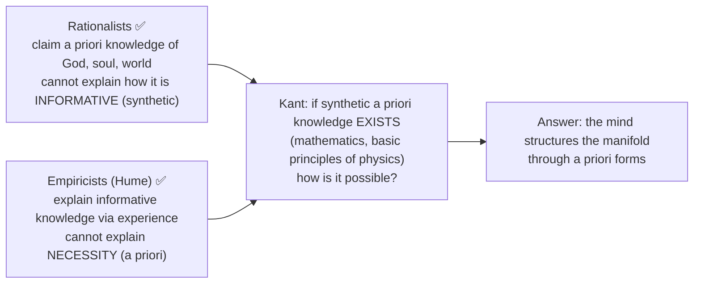

### 2.2 The Copernican standpoint ✅/⚠️

- The mind does not passively mirror a ready-made object; sensibility and understanding **structure** a sensible manifold through a priori forms (space, time and categories).
- Because these forms are conditions under which anything can count as an object for us, they are necessarily valid for all possible experience; hence synthetic a priori truths are legitimate **only for phenomena**.
- ⚠️ "Raw data plus imposed scheme" is a pedagogic shorthand only: sensory content is already given under space/time, and categories do not arbitrarily colour a fully formed thing-in-itself.
- Beyond experience these forms have no constitutive use; claims about soul, world-totality and God exceed theoretical knowledge.

### 2.3 The synthesis formula (2023 Q1(a)) ⚠️

> The paper prints "**Precepts** without concepts are blind and concepts without precepts are empty." The accurate Kantian formulation is "Thoughts without content are empty; intuitions (*Anschauungen*) without concepts are blind" (A51/B75). Quote the printed text exactly, then give the correct original, flagging the substitution; do not silently correct UPSC.

| Position | Failure |
|---|---|
| Rationalism: concepts without intuitions | "empty" metaphysics |
| Empiricism: intuitions without concepts | "blind" unstructured sensation |
| **Kant: intuitions + concepts** | **experience** |

### 2.4 Transcendental Aesthetic: Space and Time ✅

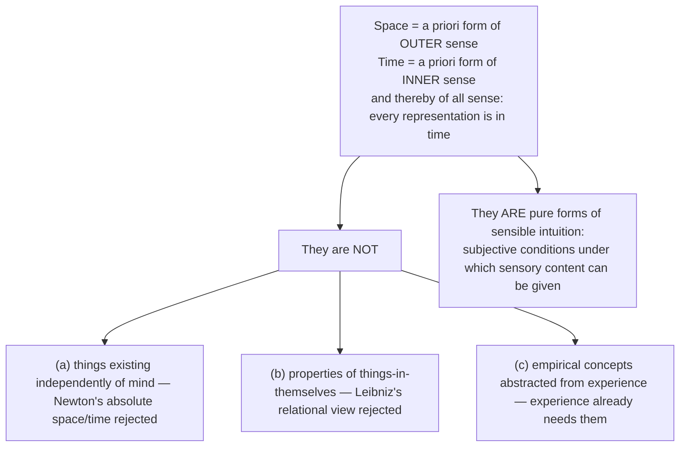

**Metaphysical exposition of space — four arguments ✅** (similar arguments, *mutatis mutandis*, for time)

| # | Argument | Content |
|---|---|---|
| 1 | Not derived from experience | To perceive things "outside me" or "beside each other," space must already be represented |
| 2 | Necessary | Space can be represented without objects, but not objects without space |
| 3 | A pure intuition, not a discursive concept | Only ONE space (the "spaces" are limitations within it); a concept applies to many instances, space is singular |
| 4 | Given as infinite | An infinite space is *given*, not built from finite parts; a concept contains infinite instances *under* it, not *in* it |

**Transcendental exposition (2019 Q4(a); bridge to 2022 Q1(e)) ✅**

| Form | What it explains |
|---|---|
| **Space** | **Geometry** (synthetic a priori): truths like "angles of a triangle sum to 180°" hold necessarily of all objects of experience because we construct spatial figures in pure intuition |
| **Time** | **Arithmetic** and the pure science of motion (mechanics): succession, duration and simultaneity are conditions under which appearances are given and ordered |

- ⚠️ The 2019 word "transcendence" must not be read as space/time existing beyond experience. Kant argues for their **a priori and transcendentally ideal** status through the metaphysical and transcendental expositions.
- ⚠️ Non-Euclidean geometry and relativity weaken the inference from one privileged Euclidean geometry to a fixed form of intuition; they do not by themselves refute the general claim that human experience has a priori spatial-temporal form.

**Consequence: transcendental ideality / empirical reality ✅.** Space and time are not features of things in themselves (transcendentally ideal) yet are objectively valid for all phenomena (empirically real). This is **transcendental idealism**, NOT Berkeley's subjective idealism.

### 2.5 Transcendental Analytic: the twelve categories ✅

| Group | Categories |
|---|---|
| **Quantity** | Unity, Plurality, Totality |
| **Quality** | Reality, Negation, Limitation |
| **Relation** | Inherence & Subsistence (substance/accident), Causality & Dependence (cause/effect), Community (reciprocity) |
| **Modality** | Possibility/Impossibility, Existence/Non-existence, Necessity/Contingency |

The categories are derived from the twelve logical forms of judgment (**metaphysical deduction**: identifies the categories). The star category for the syllabus is **Causality**, which answers Hume.

### 2.6 Transcendental Deduction and unity of apperception ✅

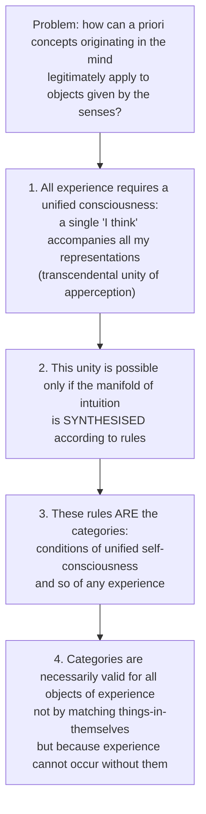

**Apperception (2022 Q1(e)) ✅**
- The *Ich denke* must be able to accompany all my representations; otherwise something would be represented in me that could not be thought (B131–2).
- Not an empirical, introspectable self (not Hume's bundle) but a **logical / formal condition**; **transcendental** (a condition of possibility), not **transcendent** (a knowable substance).
- ⚠️ Against Hume: Hume found no impression of a self because he looked for an empirical self; the "I think" is the form of all thinking and cannot appear IN experience because it is the condition OF experience.
- Against rational psychology: cannot infer that this "I think" is a substance or soul (Paralogism, §5.2). The transcendental ego is a **function**, not a thing.

**Relation of apperception to space and time ✅/⚠️.** Space and time supply pure forms in which a manifold is given; apperception requires that this manifold be combinable in one self-conscious experience; categories are the rules of synthesis. The transcendental exposition of space/time does **not** itself deduce apperception. Architecture: Aesthetic gives forms of intuition → Deduction justifies categories through apperceptive unity → Schematism mediates their temporal application. Apperception unifies what sensibility gives; it neither creates sensible matter nor proves a soul-substance.

### 2.7 The Schematism ✅ (A137–47 / B176–87)

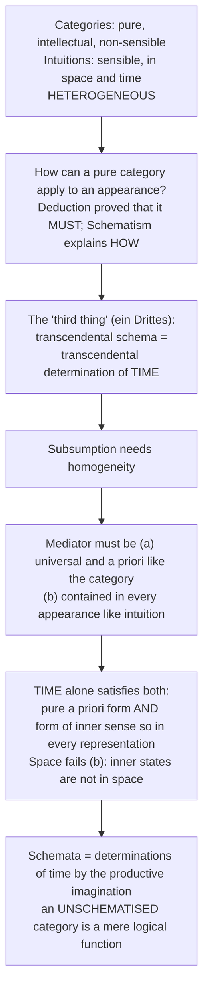

**Schema ≠ image ✅ — Kant's three examples**

| Case | Image | Schema |
|---|---|---|
| Triangle | any drawn triangle is determinately right-angled or oblique, equilateral or scalene | the **rule of synthesis** by which imagination can construct a triangle in general |
| Number five | five dots | "a **method** of representing a multitude in one image": successive homogeneous addition |
| Dog | this picture of this dog | the rule by which imagination "can delineate the figure of a four-footed animal in general" |

> [!WARNING]
> The schema is a **rule / procedure**; an image is a **product**. Writing "the schema is a mental picture that resembles both" loses the section. Kant calls schematism "an art concealed in the depths of the human soul" (A141/B180–1): the mechanism is postulated, not exhibited.

**The time-architecture ✅ (A142–5 / B182–4)**

| Category-group | Aspect of time | Schema |
|---|---|---|
| Quantity | time-**SERIES** (*Zeitreihe*) | **Number**: successive addition of homogeneous units |
| Quality | time-**CONTENT** (*Zeitinhalt*) | **Degree / intensive magnitude**: the filling of time |
| Relation | time-**ORDER** (*Zeitordnung*) | Substance = permanence of the real in time; Cause = succession of the manifold according to a rule; Community = coexistence of determinations according to a universal rule |
| Modality | time-**SCOPE** (*Zeitinbegriff*) | Possible = agreement with the conditions of time at some time; Actual = existence at a determinate time; Necessary = existence at all times |

> [!TIP]
> **Mnemonic "SCOR-S":** Series · Content · Order · Sum-total for Quantity · Quality · Relation · Modality. ⚠️

**Presuppositions ⚠️.** P1 time is the form of inner sense and so of all representations; P2 subsumption strictly requires homogeneity (objection: empirical subsumption may not); P3 the productive imagination is a genuine third faculty; P4 categories have no *sense* apart from schemata, so the unschematised category can be *thought* (noumenon in the negative sense) but yields no knowledge.

### 2.8 The Analogies of Experience ✅ (A176–218 / B218–265)

**General principle (B218):** "Experience is possible only through the representation of a necessary connection of perceptions." The Analogies are regulative with respect to intuition but constitutive with respect to experience. **One engine:** ✅ "Time itself cannot be perceived" (A176/B219, A183/B226), so every objective time-relation is determined by proxy through a rule found in appearances.

| Analogy | Mode of time | Principle | Proxy |
|---|---|---|---|
| **First** | Duration / persistence | In all change of appearances **substance persists**, quantum neither increased nor diminished (B224) | the persisting substratum |
| **Second** | Succession | All alterations occur according to the law of **cause and effect** (B232) | the causal rule |
| **Third** | Simultaneity | All substances perceived as simultaneous in space are in thoroughgoing **reciprocity** (B256) | mutual causal community |

The detailed arguments of the First and Second Analogies are mapped in Module 4 (substance) and Module 6 (causation).

### 2.9 Refutation of Idealism ✅ (B274–9, second edition 1787)

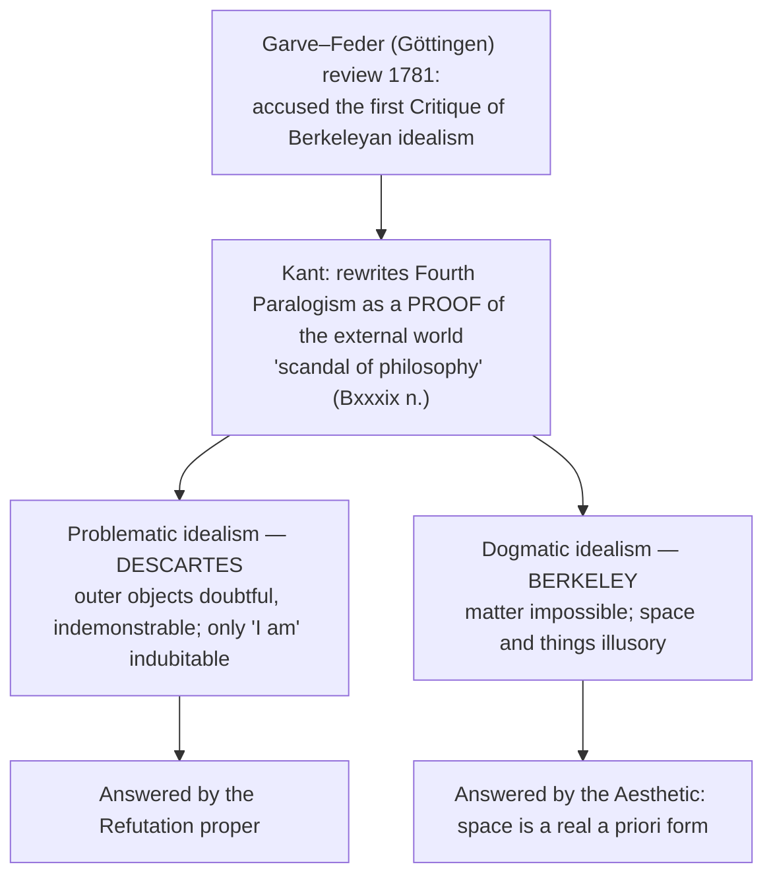

**Thesis (B275):** "The mere, but empirically determined, consciousness of my own existence proves the existence of objects in space outside me."

| Step | Content |
|---|---|
| 1 | I am conscious of my own existence as **determined in time**; inner experience has a determinate order (even the *cogito* is a dated episode) |
| 2 | All determination of time presupposes **something persistent** in perception (the **First Analogy**: one argument) |
| 3 | This persistent cannot be an intuition in me: inner determinations are what is to be determined by it; the flux cannot supply its own fixed point |
| 4 | So the persistent is **outside me and distinct from my representations**, a thing in space |
| 5 | Consciousness of my existence in time is at once immediate consciousness of things outside me; outer experience is a *condition* of inner |
| 6 | **Corollary (B278–9):** "Inner experience in general is possible only through outer experience in general": Descartes' order inverted |

Presuppositions ⚠️: P1 First Analogy sound; P2 determinate (not merely felt) temporal knowledge of my states; P3 nothing inner can be the persistent (this step does all the work).

| Objection ❓ | Reply |
|---|---|
| Proves at most that I must **represent** something persistent and external, not that it **exists** (Strawson; Guyer): the standard modern verdict | A merely represented persistent would itself be a fluxing inner determination; it must be *given*, not posited |
| Kant rewrote the proof in a **Preface footnote** (Bxxxix n.): dissatisfaction | The revision clarifies: what is intuited is the persisting *thing*, not a persisting *representation* of a thing |
| Defeats Descartes but leaves the thing-in-itself untouched: objects proved are only **empirically** external | Correct, and the doctrine: **empirical realism + transcendental idealism**. Kant proves the desk, not the noumenal desk |

**One-line comparison ⚠️:** Moore's "Proof of an External World" (1939) is a common-sense refusal of the sceptic's demand; Kant's is a transcendental derivation showing the sceptic's own premise entails what he doubts. Moore blocks the question; Kant turns it.

---

## 3. Dialectical Wings, Internal Disputes and Refinements

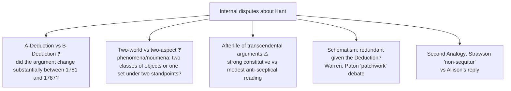

### 3.1 Advanced-dossier modules ❓/⚠️ (optional enrichment only)

| Module | Issue | Competing readings | Objection → reply | Safe use ⚠️ |
|---|---|---|---|---|
| **A- vs B-Deduction** ❓ | Did Kant substantially change the Deduction between 1781 and 1787, or mainly rewrite for clarity? | Two-deductions reading; continuity reading; mixed reading where B sharpens a self-consciousness route implicit in A | **Obj.:** rival reconstructions make the argument unstable. **Reply:** the split concerns route and emphasis; the core claim stays that categories are conditions of possible experience | One sentence only, when evaluating why the Deduction is famous and difficult; never a substitute for explaining categories and apperception. Do not memorise A/B paragraph numerology. Promote to Core if a PYQ asks whether the deductions differ |
| **Two-world vs two-aspect** ❓ | Are phenomena and noumena different classes of objects, or the same objects under different standpoints? | Traditional two-world; Henry Allison-style two-aspect; mixed readings | **Obj.:** two-aspect makes noumenon too thin and Kant too mild. **Reply:** it better preserves empirical realism and avoids duplicating worlds while keeping unknowability | Brief evaluative note after phenomena/noumena or antinomies; do not rewrite an answer as Allison vs Guyer |
| **Afterlife of transcendental arguments** ⚠️ | Can "conditions of possibility" survive where full transcendental idealism is rejected? | Strong constitutive reading (conditions of experience reveal features of objects-for-us); modest anti-sceptical reading (what must be presupposed in thought/practice) | **Obj.:** from conditions of experience one cannot infer reality's structure. **Reply:** later philosophers use Kant more modestly | One closing line; do not import later Strawsonian or analytic reconstructions into the main exposition |

Source trail: Kant *Critique of Pure Reason*; Henry Allison; Paul Guyer; P. F. Strawson; Robert Stern; Karl Ameriks.

### 3.2 Schematism: strongest objections ✅/⚠️/❓

| Objection | Reply | Residual |
|---|---|---|
| The schema, being both intellectual and sensible, is as puzzling as what it explains | Time is not a *mixture* but the one form that is a priori *and* universally instantiated in intuition; homogeneous with each in a different respect | ❓ "Concealed art" concedes the mechanism is not exhibited |
| **Hegel:** the apparatus is external machinery of faculties artificially divided then rejoined | Kant: the division is forced: sensibility is receptive, understanding spontaneous | ⚠️ Deepest objection; flag it in any 20-mark answer |
| Redundant given the Deduction (Warren; Paton's "patchwork" debate) | The Deduction proves *that* categories apply; the Schematism supplies the *rule of application* the Analogies deploy; the Analogies literally *are* the schemata of Relation in operation | ⚠️ Best defence is functional |

**Executable verdict:** "The Schematism is not an appendix but the load-bearing joint of the *Critique*: it converts twelve logical functions into rules of time-determination, and thereby converts the Deduction's abstract entitlement into the concrete Principles. Its cost is Kant's own admission that the productive imagination's procedure is 'an art concealed in the depths of the human soul'."

### 3.3 Cross-thinker bridge: Hegel ↔ Strawson on the thing-in-itself ⚠️

| Step | **Hegel** (1807–31) | **Strawson** (1966) |
|---|---|---|
| Target | Kant's noumenon | Kant's noumenon |
| Charge | To **posit** a limit to thought is already to **think beyond** it; the thing-in-itself is thought's own product | The doctrine of a supersensible reality **affecting** sensibility is **incoherent**: it uses the very concepts (existence, cause, object) whose application beyond experience it forbids (*The Bounds of Sense*) |
| Method | Dialectical: the concept destroys itself from within | Analytic: the doctrine violates its own restriction |
| Positive residue | Reality **is** rational; no unknowable remainder: **Absolute Idealism** | Kant's **austere** core survives once transcendental idealism is stripped away: **descriptive metaphysics** |

> [!TIP]
> Two traditions that despise each other's methods converge on one verdict: the noumenon cannot be both posited and declared unthinkable. They part on the remedy: Hegel abolishes the limit by expanding thought to the Absolute; Strawson abolishes it by shrinking metaphysics to the description of our actual scheme. In Strawson's vocabulary Hegel's Absolute is **revisionary** metaphysics.

*Kant's best reply (theme file):* the noumenon as a purely **negative** limiting concept escapes Hegel, but then it cannot "affect" anything, which is what Strawson's objection requires it to do; the doctrine survives only by giving up a role Kant himself assigned it. ⚠️

---

## 4. Metaphysics & Ontology: Phenomena, Noumena, Substance and Self

### 4.1 Phenomena and noumena ✅

| Phenomena (*Erscheinungen*) | Thing in itself / noumenal boundary |
|---|---|
| Things as they *appear* (structured by space, time, categories) | Things as they are *in themselves* (apart from our cognitive forms) |
| Objects of possible experience | NOT objects of knowledge |
| Knowable (science applies) | Thinkable (we can form the concept) but not knowable |
| Realm of empirical nature and causal law | Freedom assigned only from a practical / intelligible standpoint, not theoretically cognised |

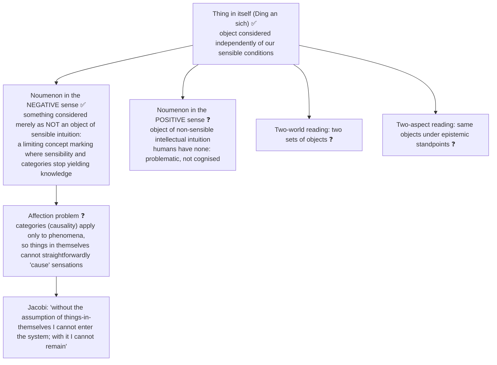

- ⚠️ Noumenon and thing-in-itself overlap in boundary-function; do not treat them as interchangeable names for a hidden second object.
- Kant insists on one world under two *aspects* (how things appear / how they are in themselves), not two worlds. ⚠️ State the shared limit before choosing a reading.
- ❌ "Noumena = Plato's Forms" is superficial: Forms are *knowable* by reason; noumena are precisely *un*knowable.

### 4.2 Substance: First Analogy ✅ (answer to Hume on substance)

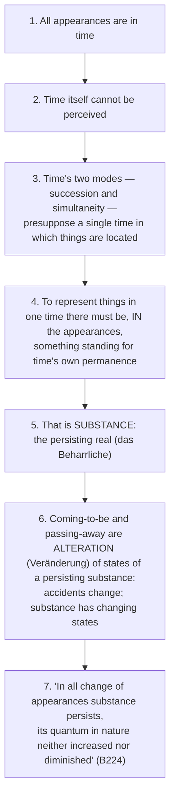

- **Defeats Hume without contradicting him:** Hume is right that there is no *impression* of substance; Kant's move is transcendental: substance is a **condition of perceiving anything as located in one time**, so "show me the impression" is the wrong demand.
- Presuppositions ⚠️: P1 time is unitary and unperceivable; P2 time-determination proceeds by a perceptible proxy; P3 "alteration" is intelligible only against a persisting bearer.
- Strongest objection ❓: the argument may prove only that *something* must be treated as relatively persisting, not a sempiternal, quantitatively conserved substance; the conservation claim looks like Newtonian physics smuggled into transcendental philosophy.
- Theme-file arc ⚠️: Hume's dissolution of substance (bundle) forces Kant's Copernican rescue; Kant relocates substance from a thing out there to a **category** (a condition of experience); Strawson relocates it to the basic particular.

### 4.3 The self: apperception, Hume and the Paralogisms ✅

| Position | Self |
|---|---|
| Rationalism (Descartes) | substance (cogito) |
| Empiricism (Hume) | bundle of perceptions |
| **Kant** | **transcendental unity of apperception**: logical condition, not a substance |

(2020 Q2(a) cross-owned: Hume's "I never can catch myself without perception" and how Kant deals with personal identity in the *Critique*: use §2.6 + §5.2 here; primary owner is Empiricism.)

---

## 5. Ideas of Reason, Antinomies and Proofs of God

### 5.1 Ideas of Reason ✅

Reason (*Vernunft*) seeks the **unconditioned**: the totality of conditions for any conditioned thing.

| Idea | Object | Totality sought | Faculty misapplied |
|---|---|---|---|
| **Soul** (*Psychologische Idee*) | absolute unity of the thinking subject | totality of *inner* conditions | categories applied to the "I think" |
| **World** (*Kosmologische Idee*) | absolute totality of the series of conditions in appearance | totality of *outer* conditions | categories applied to the world-as-a-whole |
| **God** (*Theologische Idee*) | absolute unity of the condition of all objects of thought | totality of *all* conditions | categories applied to the *ens realissimum* |

**Regulative vs constitutive ✅.** The Ideas are **regulative**: heuristic guides toward systematic unity ("seek the soul's unity," "explain nature as if a complete system," "think of all existence as grounded in a necessary being"). They are NOT **constitutive**: no theoretical knowledge of actually existing objects. **Transcendental illusion:** reason mistakes regulative Ideas for constitutive knowledge, then falls into Paralogisms, Antinomies and failed God-proofs.

### 5.2 Paralogisms (the soul) ✅

Rational psychology infers from the bare "I think" that the soul is: (1) a *substance*, (2) *simple* (immaterial), (3) *numerically identical* (personal identity), (4) in relation to possible objects in space (existence distinct from body). **Kant's reply:** all four commit **equivocation** (*Paralogismus*): they confuse the logical unity of apperception (formal condition) with a real, knowable *thing*. The "I think" is a function, not a substance. (Edition note: the Fourth Paralogism in original form is A-only.)

### 5.3 The Ideal of Pure Reason ✅/⚠️

- Reason seeks the complete determination of every thing by contrasting all possible predicates and their negations; it represents the totality of positive reality as the **most real being (*ens realissimum*)**, the transcendental Ideal associated with God.
- ⚠️ Legitimate regulative use: guide systematic unity and complete explanation. Illegitimate: hypostatise the ideal and infer a corresponding being.
- The ontological proof converts the Ideal into existence; the cosmological and design proofs ultimately depend on identifying their necessary / intelligent cause with this most-real being. The Ideal explains why God becomes reason's natural focus, not why speculative reason succeeds in proving God.

### 5.4 The Antinomies ✅ (2020 Q3(c); 2022 Q3(a))

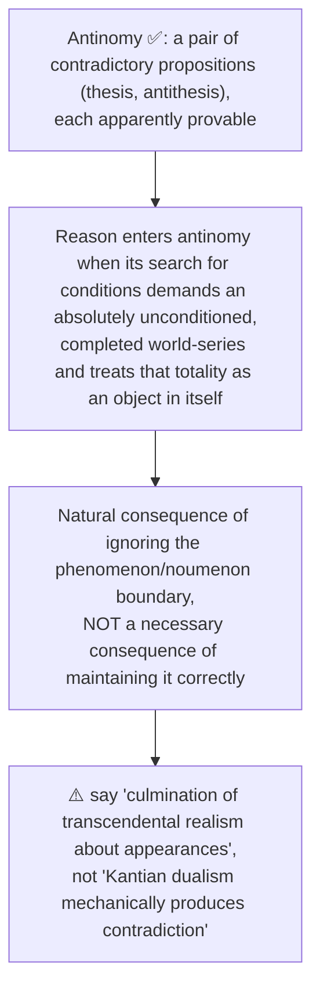

| # | THESIS | ANTITHESIS |
|---|---|---|
| **1st (Time & Space)** | The world has a *beginning* in time and is *limited* in space | No beginning, no limits in space: infinite |
| **2nd (Composition)** | Every composite substance consists of *simple* (indivisible) parts | No composite consists of simple parts; nothing simple exists |
| **3rd (Freedom)** | Causality by laws of nature is *not* the only causality; there is also *freedom* (spontaneous causality) | No freedom; everything happens solely by laws of nature |
| **4th (Necessary Being)** | The world contains or is caused by an *absolutely necessary* being | No absolutely necessary being, in or outside the world |

| | Mathematical (1st, 2nd) | Dynamical (3rd, 4th) |
|---|---|---|
| Subject | magnitude / composition of the world-series | causality / existence grounding the world |
| Resolution | **Both claims false** if the world is assumed a completed thing in itself | Claims **may both hold** at phenomenal and intelligible standpoints, without theoretical knowledge of noumena |
| Why | "World as a whole" is never given as a completed whole: neither finite nor infinite; the empirical series is always *in progress* | Freedom and necessity (or necessary being and contingent nature) can coexist if they apply to different realms |

- **3rd:** in the phenomenal world every event is determined by prior causes (antithesis holds for phenomena), but the same agent as a *noumenon* may possess freedom: room for **moral freedom** alongside natural determinism.
- **4th:** no absolutely necessary being need occur in the phenomenal series; an intelligible ground outside it is not contradicted, but no theoretical proof of its existence follows.
- **Significance ⚠️:** dogmatic speculative metaphysics of the supersensible cannot be a science; knowledge is confined to phenomena, while practical reason may postulate freedom, God and immortality. The antinomies are Kant's most dramatic argument against pre-critical rationalist cosmology.
- ❌ "The antinomies show reason is unreliable" is wrong: reason is perfectly reliable within phenomena; it contradicts itself only beyond experience.

### 5.5 Critique of the proofs for God's existence ✅

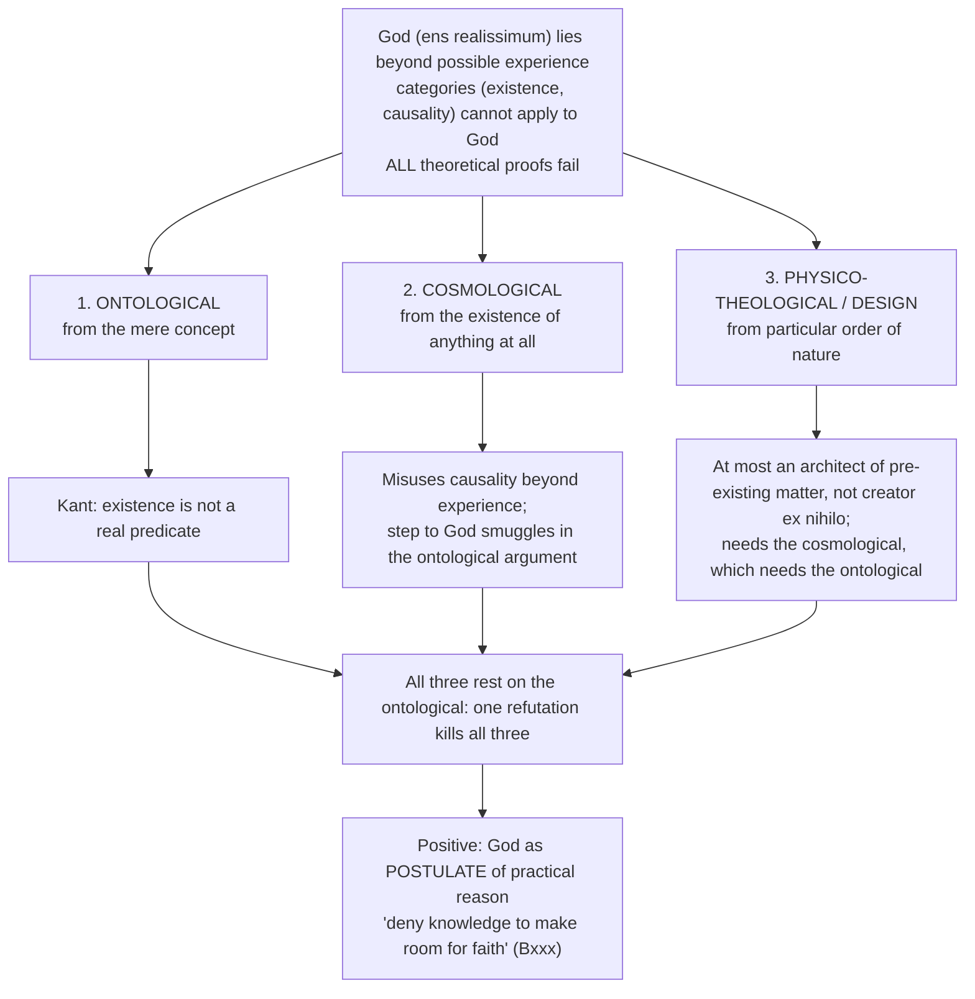

**Ontological argument (Descartes / Anselm form) and Kant's refutation ✅ (2021 Q2(c); 2024 Q2(c))**

| Step | Argument | Kant |
|---|---|---|
| 1 | God = most perfect / most real being | |
| 2 | Existence is a perfection / reality | **"Existence is not a real predicate"** (*kein reales Prädikat*): a real predicate (*Bestimmung*) *adds to* the concept; existence merely *posits* the thing |
| 3 | A being lacking existence would lack a perfection | "A hundred real thalers do not contain the least coin more than a hundred possible thalers": the concept is identical whether or not the object exists |
| 4 | ∴ God necessarily exists | One cannot include existence among the perfections in the concept and argue from the concept to actuality |

**Cosmological ✅:** (1) something exists; (2) the contingent requires a necessary ground; (3) a necessary being exists; (4) the only candidate is the *ens realissimum*. Kant: step 2 misuses causality beyond possible experience; step 4 **covertly depends on the ontological argument** (identifying necessary being with the most perfect requires that its concept include necessary existence).

**Physico-theological ✅:** (1) order, purpose, design; (2) not from blind matter; (3) ∴ an intelligent designer. Kant: at best a powerful **architect** of pre-existing material, not an omnipotent **creator ex nihilo**; to reach infinite God it smuggles in the cosmological argument, which depends on the ontological.

**Positive doctrine ✅:** theoretical reason cannot prove or disprove God; **practical reason** requires God as a *postulate*: the highest good (virtue + happiness proportioned to virtue) is morally necessary; its realisation requires a being with the power and goodness to ensure that proportion. Kant is **theoretically agnostic, not atheist**.

---

## 6. Explanatory & Causal Principles

### 6.1 Hume vs Kant on causation ✅

| Hume | Kant |
|---|---|
| Causation = constant conjunction + custom | Causation = an a priori **category** the mind necessarily applies |
| No impression of necessary connection → subjective | "Every event has a cause" is **synthetic a priori**, necessarily true of all possible experience |
| Induction cannot be justified | The causal principle is not *inductive* but *constitutive*: a condition of experience |
| Science rests on habit | Science objectively valid; principles are the mind's own contribution, "legislating to nature" |

But causality applies **only to phenomena**: inferring God as "first cause" is illegitimate. This limits Hume's scepticism and rationalist dogmatism equally. (Theme arc ⚠️: Hume concedes necessity is not from sense; Kant *concedes* that but *inverts* the conclusion: it must come from the mind.)

### 6.2 Second Analogy ✅ (highest-yield; 2024 Q1(b); cross-owned 2025 Q2(c), 2026 Q2(b))

**The house and the ship (A190–3 / B235–8):**

| Case | Order of apprehension | Reversible? | What it is |
|---|---|---|---|
| **House:** roof → door → basement, or the reverse | I choose | **Yes** | merely **subjective** succession of perceptions of a *coexisting* object |
| **Ship drifting downstream:** upstream → downstream | I cannot choose | **No** | **objective** succession: an *event* |

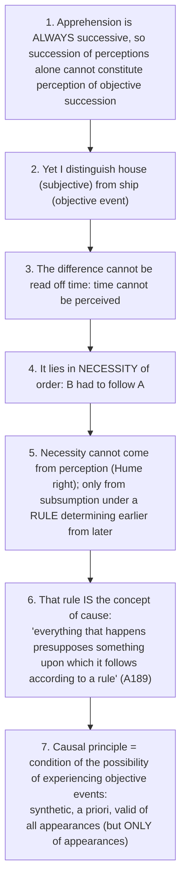

- Presuppositions ⚠️: P1 the objective/subjective distinction in temporal order is genuine and must be grounded; P2 irreversibility requires a rule; P3 the only available rule for fixing temporal position is causal.
- **Strongest objection ✅ — Strawson's "non-sequitur of numbing grossness"** (*The Bounds of Sense*, 1966): Kant slides from "the order of my perceptions is determined by the object" to "the event is necessitated by a causal law." Guyer presses a related point: at most *some* rule, not the universal causal law.
- **Reply:** Allison's transcendental-idealist reading: the argument concerns conditions under which a succession of representations can be *judged* objective; the only candidate rule for fixing an irreversible position in one time is causal.
- **Adjudication:** Kant defeats Hume at the level of *conceptual entitlement* (the concept of cause is no bastard of the imagination) but does **not** deliver knowledge of particular causal connections — which is what he intended; particular laws remain empirical.

### 6.3 Third Analogy: community ✅

Simultaneity, like succession, cannot be read off unperceivable time. Perceiving A and B in either order (moon-then-earth, earth-then-moon) does not by itself make them simultaneous; what fixes them in one time is **mutual causal influence** (*commercium*). This is the schema of the category of **Community**.

### 6.4 Natural causation vs freedom ✅

Third antinomy (§5.4): determinism holds for phenomena; freedom is assigned to the agent as noumenon from the practical standpoint. This "makes room" for moral freedom without theoretical knowledge of the noumenal.

### 6.5 "Understanding makes Nature" (2018 Q2(b)) ✅/⚠️/❓

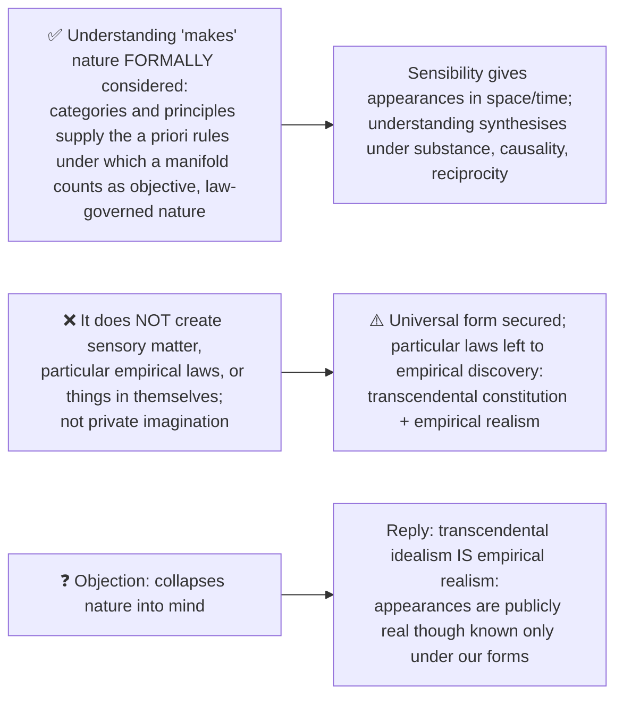

---

## 7. Value Orientation (bounded)

> [!NOTE]
> The owner prints **theoretical philosophy only**. Good will, duty, rigorism, hypothetical/categorical imperatives, universal law, humanity, autonomy, kingdom of ends (ethics) and beauty, sublime, purposiveness (*Critique of Judgment*) are **not** owner content. There is no puruṣārtha-style value scheme in the sources. ⚠️

What the sources do give, as a bounded consequence of speculative limits:

- Kant limits knowledge "to make room for faith / rational belief" (Bxxx).
- Freedom, God and immortality are **practical postulates** of practical reason; God is required for the highest good (virtue + proportioned happiness).
- The third antinomy's resolution makes room for **moral freedom** alongside natural determinism.
- Do not turn a God-proof answer into an ethics survey; formalism, empty universalisation and conflicting-duty objections are ethics objections and should not displace the theoretical Hegel / Jacobi / scheme-content criticisms owned here.

---

## 8. Inter-School Comparative Matrices

### 8.1 Rationalism · Empiricism (Hume) · Kant ✅/⚠️

| Axis | Rationalism | Empiricism (Hume) | **Kant** |
|---|---|---|---|
| Source of knowledge | reason / innate structure grounds necessity | experience supplies content; necessity problematic | **both**: pure intuitions and categories organise sensory content |
| Causality | rational, necessary truth | mere habit / custom | **a priori category**, necessary for experience |
| Synthetic a priori | asserted beyond secure limits | excluded by Hume's Fork | **explained** through conditions of possible experience |
| Metaphysics | possible and necessary | impossible (anti-metaphysics) | impossible as *science* of noumena; possible as *critique* of reason |
| God | provable (ontological, cosmological) | unknowable (scepticism) | **thinkable but not knowable**; postulate of practical reason |
| Things-in-themselves | knowable by reason | (Hume does not raise the question) | **unknowable** (noumena) |
| Self | substance (Descartes' cogito) | bundle (Hume) | **transcendental unity of apperception**: logical condition, not substance |

### 8.2 The a priori / a posteriori grid across thinkers ⚠️ (theme file)

| Thinker | Source of knowledge | Synthetic a priori? | Signature move |
|---|---|---|---|
| Rationalists | reason, innate ideas | (loosely yes) | truths of reason vs fact |
| Empiricists (Hume) | experience only | **NO** (Hume's fork) | causation = habit |
| **Kant** | reason + sense synthesised | **YES** (its whole point) | Copernican revolution; categories |
| Positivists | verifiable experience | **NO** | analytic/synthetic dichotomy; verificationism |
| Quine | holistic web (naturalised) | distinction itself rejected | two dogmas; holism |

> [!TIP]
> **Kant is the hinge.** Everything before builds toward the Hume-crisis; everything after reacts to Kant's synthetic-a-priori solution (accepting or rejecting it). The whole fight is one box: *does the synthetic a priori cell exist?* ⚠️

### 8.3 Critiques of metaphysics ⚠️

| Critic | Test applied | Verdict | Metaphysics is… | Key term |
|---|---|---|---|---|
| Hume | empirical content (impressions) | illegitimate | fiction, to be burned | fork; no impression |
| **Kant** | limits of the categories | illusion beyond experience | limited to phenomena | antinomies; noumena |
| Positivism | verifiability of meaning | meaningless | nonsense (not even false) | verification principle |
| Later Wittgenstein | ordinary use of language | confusion | a muddle to dissolve | language "on holiday"; therapy |
| Quine | holism / analyticity | no a priori privilege | naturalised, revisable | web of belief |
| Strawson | none: reinstates | legitimate **as description** | analysis of our conceptual scheme | descriptive vs revisionary |

*Kant vs the rest:* Kant alone **saves** a chastened metaphysics (of experience) and *explains why* the illusion arises: he limits, he doesn't behead. Trajectory: content-attack (Hume) → limit-drawing (**Kant**) → meaning-criterion (Positivism) → therapeutic dissolution (Wittgenstein) → naturalised ontology (Quine) → descriptive reinstatement (Strawson).

### 8.4 Substance across Western thinkers ⚠️ (Kant row)

| Thinker | Substance |
|---|---|
| Hume | eliminated: bundle, habit-born fiction |
| **Kant** | a category; mind-imposed form; condition of experience |
| Strawson | basic particular (re-identifiable material body in one spatio-temporal framework) |

### 8.5 Kant and Hegel on reality and thought (2026 Q4(b)) ✅/⚠️

| Axis | **Kant** | **Hegel** |
|---|---|---|
| Objectivity | Experience is objectively valid because sensible intuitions are synthesised under a priori categories | Reality is intelligible through a developing Concept, not a static given facing an external knower |
| What thought contributes | Space/time condition givenness; categories constitute the law-governed *form* of objects of possible experience; they do not create sensible matter or particular natural laws | Determinate thought articulates its own limits and overcomes them through negation and sublation; development concerns reality and thought together |
| Limit | Things independent of our sensible conditions stay outside theoretical knowledge; negative noumenon marks a boundary | An unknowable in-itself is an empty, fixed opposition: stating its limit is already thinking a relation to it |
| Method | **Transcendental**: conditions that make experience of objects necessary and valid | **Immanent / dialectical**: test each finite determination by its own claims and develop a more concrete one |

- ✅ **Shared insight:** knowing is not a passive copy of preformed objects.
- ⚠️ **Difference:** Kant restricts constitutive validity of categories to phenomena; Hegel contests the permanent thought/reality divide and takes the Absolute as a self-developing intelligible whole.
- Do not infer that Hegel equates the Absolute with a person's ideas, or that Kant doubts the empirical reality of nature.
- **Objection and reply:** Hegel's challenge is strongest against a *positive* description of a hidden noumenal object; Kant replies that the *negative* noumenon is a limiting concept. Hegel presses that even a fixed unknowable limit presupposes an unexamined separation; Kant objects that dialectical unity has not shown knowledge independent of our conditions. Neither simply asserts "reality is mind."

### 8.6 Is Hegel the culmination of Kantian dualism? (2018 Q2(b)) ✅/⚠️/❓

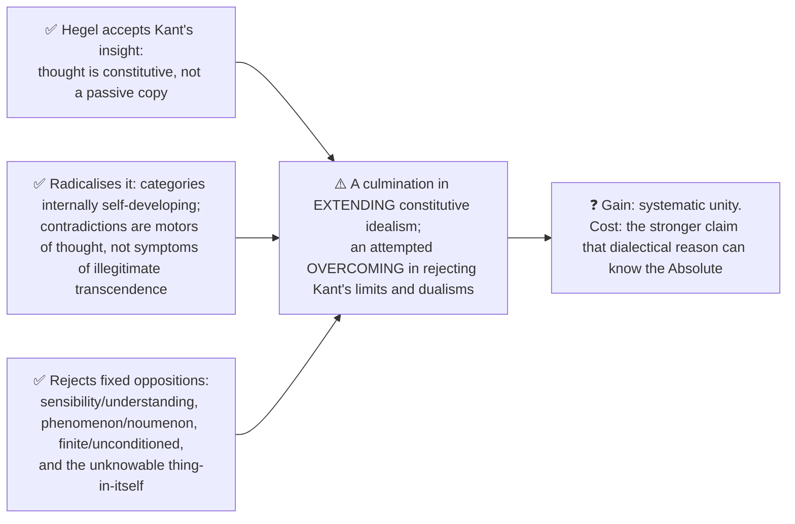

A strong answer calls Hegel a **radicalisation and attempted overcoming** of Kant, not a straightforward deduction from Kantian dualism. ⚠️

---

## 9. Criticisms & Reconstructed Replies

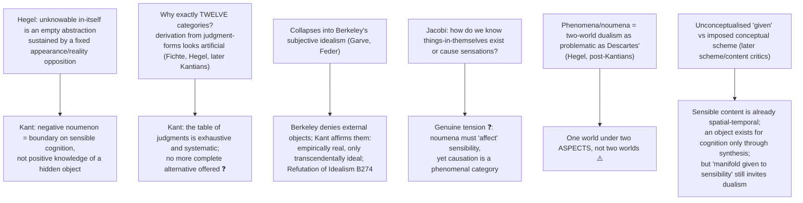

| Criticism | Source | Kant's possible reply |
|---|---|---|
| Unknowable in-itself is empty | Hegel | Negative noumenon is a boundary, not positive knowledge |
| Twelve categories artificial | Fichte, Hegel, later Kantians | Table of judgments exhaustive ❓ |
| Collapses into Berkeley | Garve, Feder | Refutation of Idealism (B274) ✅ |
| Existence / affection of in-itself | Jacobi ("without the assumption … I cannot enter the system; with it I cannot remain") | Genuine tension ❓ |
| Two-world dualism | Hegel, post-Kantians | One world, two aspects ⚠️ |
| Given vs scheme | later scheme/content critics | Content already spatial-temporal; dualism language remains |
| Second Analogy non-sequitur | Strawson, Guyer | Allison's judgment-conditions reading |
| Refutation proves only representation | Strawson, Guyer | The persistent must be *given* |
| Synthetic a priori examples hostage to science | non-Euclidean geometry, relativity | 7+5=12 survives; the *kind* of claim survives (see §15) |

---

## 10. Controlled Comparisons

| Comparator | Point of contact | Decisive disanalogy |
|---|---|---|
| **Hume** | Both reject that necessity comes from sense experience; Kant starts from Hume's challenge | Hume: necessity is custom; Kant inverts the conclusion: it comes from the mind as a category; Hume finds no self-impression, Kant's "I think" is a form, not an impression |
| **Berkeley** | Both "idealist" in label | Berkeley: objects are ideas (denies existence of external objects); Kant: objects empirically real, form (space, time, categories) mind-contributed |
| **Descartes** | Ontological argument; cogito | Kant: existence is not a real predicate; cogito is a dated inner episode needing outer persistent (Refutation) |
| **Plato's Forms** | Both "beyond sense" | Forms are *knowable* by reason; noumena are *un*knowable (superficial resemblance only) |
| **Moore** | External-world proof (1939) | Moore refuses the sceptic's demand by common sense; Kant derives the conclusion from the sceptic's own premise |
| **Wittgenstein (private language)** | The Refutation turns on inner experience depending on outer | Same manoeuvre without the machinery: "the best evidence that Kant located the right pressure point" ⚠️ |
| **Logical Positivism / Quine** | Verdict bank: both attack the synthetic a priori | Quine damages Kant's *classification* while confirming his point that experience rests on commitments not themselves given in experience |
| **Strawson** | Austere core of Kant survives; rebuilds the Analogies without transcendental idealism | Strawson's *Bounds of Sense* objections: affection incoherence, Second Analogy non-sequitur |
| **Hegel** | Thought is constitutive | See §8.5–8.6 |
| **Indian traditions** | The theme files record only Hume ↔ Buddhist nairātmya / anattā for the self; no Kant–Indian table is given in the sources | ⚠️ Do not invent one |

> [!WARNING]
> Comparisons are analogical. State the decisive disanalogy with every parallel; never write "Kant = Hume" or "noumena = Plato's Forms."

---

## 11. Diagnostic Deep-Dives for High-Frequency Themes

### 11.1 Transcendental vs transcendent vs transcendence ❌

| Term | Meaning |
|---|---|
| **Transcendental** | concerning the a priori *conditions* of possible experience (legitimate) |
| **Transcendent** | going *beyond* all possible experience (illegitimate); the errors Kant attacks are transcendent |
| 2019 "transcendence" of space and time | = the **a priori character** established by the metaphysical and transcendental expositions, not existence beyond experience |

### 11.2 Metaphysical vs transcendental deduction ❌

Metaphysical: identifies the categories from the table of judgments. Transcendental: justifies their application to experience via apperception.

### 11.3 "How does Kant respond to Hume?" (2024 Q1(b); 2026 Q2(b); 2025 Q2(c)) ✅

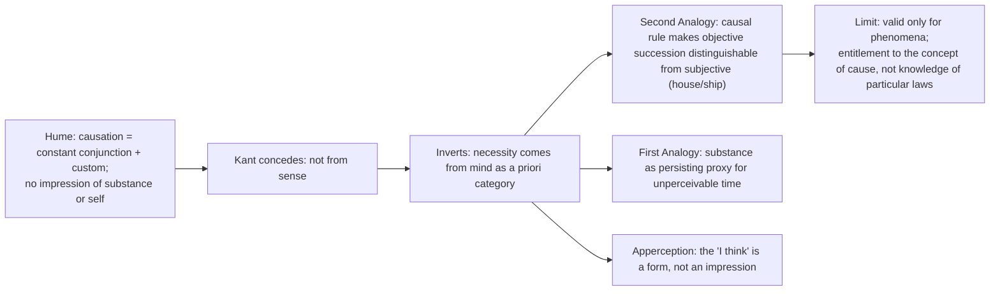

The point of disagreement is *not* that Kant found necessity in objects; Kant **relocates the question from psychology to the conditions of objective time-determination** (Second Analogy).

### 11.4 Apperception (2022 Q1(e)) ✅

Line 1: the transcendental unity of apperception is the formal condition that the "I think" must be able to accompany all my representations. Body: not an empirical self (Hume's bundle) but a logical / formal condition; requires synthesis of the manifold under categories; connection to space/time as §2.6. Close: do **not** claim the transcendental exposition itself deduces apperception.

### 11.5 Kant on God: what he does and does not prove ❌

Kant does **not** prove God does not exist; he proves existence cannot be **demonstrated** by theoretical reason, then **postulates** God via practical reason: agnostic theoretically, not atheistic.

### 11.6 Cross-paper bridge ⚠️

The antinomies and critique of the proofs flow from the phenomena/noumena limit → Paper II *Proofs for the Existence of God* (Kant's refutations in the Religion context); the owner links `Proofs-for-God.md`.

### 11.7 Quine on Kant's a priori (2018 Q2(c), cross-owned) ⚠️

Primary owner is Quine–Strawson. Within Kant's own sources the relevant point is the verdict bank: Quine's attack on the analytic/synthetic distinction damages Kant's *classification* while confirming his real point that experience rests on commitments not themselves given in experience.

### 11.8 Antinomy and the phenomena/noumena boundary (2020 Q3(c)) ✅

"When does pure reason enter antinomies?" → when its search for the unconditioned treats the world-whole as a completed thing in itself (§5.4). "Natural culmination of phenomena/noumena?" → ⚠️ it is the culmination of **transcendental realism about appearances** (the diagnosis), and the antinomies are the **indirect proof** of transcendental idealism; but ❌ not a mechanical product of the distinction itself.

---

## 12. PYQ Routing Ledger (2018–2025, plus 2026)

> Corpus signal: **10 primary-owned parts** in 2018–2025 out of 112; **2025 is the only year without a Kant-owned part**. Per-year counts 1/1/1/1/2/2/2/0 (2018–2025). Plus **1 primary-owned 2026 part** (Q4(b)). **Total primary = 11.**

| Year | Q | Marks | Exact demand | Map to |
|---|---|---:|---|---|
| 2018 | Q2(b) | 15 | Explain the significance of the Kantian dictum, 'Understanding makes Nature'. How far do you agree that Hegel's Absolutism is the culmination of the Kantian Dualism? Discuss. Give reasons in favour of your answer. | §6.5, §8.6 |
| 2019 | Q4(a) | 20 | How does Kant argue for the transcendence of Space and Time? Discuss. | §2.4, §11.1 |
| 2020 | Q3(c) | 15 | When does Pure Reason enter into the realm of Antinomies according to Kant? Is Kant's notion of Antinomies of Pure Reason a natural culmination of his distinction between Phenomena and Noumena? Give reasons in favour of your answer. | §5.4, §11.8 |
| 2021 | Q2(c) | 15 | Explain how Cartesian formulation of ontological argument is criticised by Kant. | §5.5 |
| 2022 | Q1(e) | 10 | What is apperception, according to Immanuel Kant? Discuss with reference to his transcendental exposition of space and time. | §2.6, §11.4 |
| 2022 | Q3(a) | 20 | How does Kant construct antinomies to illustrate the illusory tendencies of pure reason? Explain and examine the antinomies presented by Kant. | §5.4 |
| 2023 | Q1(a) | 10 | "Precepts without concepts are blind and concepts without precepts are empty." In the light of this statement discuss how Kant reconciles rationalism with empiricism. ❓ The official English line prints "Precepts" twice; that printed wording is retained. | §2.3 |
| 2023 | Q1(e) | 10 | What are the main arguments offered by Kant to prove that apriori synthetic judgements are possible? Discuss with examples. | §2.1–2.2, §2.4–2.5 |
| 2024 | Q1(b) | 10 | How does Kant respond to Hume's scepticism with regard to a priori judgments? Discuss. | §6.1–6.2, §11.3 |
| 2024 | Q2(c) | 15 | Critically examine Kant's objections against the ontological argument for the existence of God. | §5.5 |
| 2026 | Q4(b) | 15 | Analyze and discuss the different ways in which Kant and Hegel conceived the relationship between reality and our thinking about reality. (Hegel half cross-linked to `Hegel.md`.) | §8.5 |

**Cross-owned parts that route into Kant material (not counted above):**

| Year | Q | Marks | Owner | Demand (abridged) | Kant material |
|---|---|---:|---|---|---|
| 2018 | Q2(c) | 15 | Quine–Strawson | How does Quine show that the notion of a priori knowledge as discussed by Kant is 'a metaphysical article of faith'? | §2.1, §11.7 |
| 2020 | Q2(a) | 20 | Empiricism | Hume: "I never can catch myself at any time without perception…" — how does this problematize personal identity? How does Kant deal with this problem in his *Critique of Pure Reason*? | §2.6, §4.3, §5.2 |
| 2025 | Q1(e) | 10 | Hegel | How does Hegel challenge Kant's distinction between Phenomena and Noumena? Discuss. | §3.3, §4.1 |
| 2025 | Q2(c) | 15 | Empiricism | Examine Hume's refutation of Causal relation and Kant's response to it. | §6.1–6.2 |
| 2026 | Q2(b) | 15 | Empiricism | How does Hume account for ideas of reason? How does Kant respond to Hume's views in this regard? Critically discuss. (Kant's reply at §§1.1–1.3, 3.4, 3.6.2 of the owner.) | §2.1–2.2, §6.1–6.2 |

2026 routing note: Q4(b) was routed to Kant on the 2018 Q2(b) precedent (the question moves from the Kantian settlement to Hegel's correction); Q2(b) routed to Empiricism because the owner is the philosopher whose position the question asks to be established first.

---

## 13. Top Exam Traps

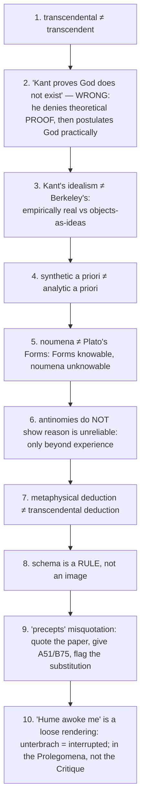

Further traps recorded in the sources:
- ❌ "Kant proved space and time do not exist."
- ❌ "The noumenon is a thing behind appearances that causes them" (Jacobi's objection stated as Kant's doctrine).
- ❌ Reading "Understanding makes Nature" as empirical creation of objects.
- ❌ Writing "Kant argues in the *Critique*" for edition-specific material (Refutation is B-only; Fourth Paralogism original is A-only).
- ❌ Saying the Schematism or Deduction "proves" a soul-substance; apperception is a function, not a thing.
- ❌ Calling the antinomies a mechanical product of Kantian dualism (say "culmination of transcendental realism about appearances").
- ❌ Presenting the Refutation as proving the noumenal desk; it proves only empirically external objects.
- ❌ Turning a God-proof answer into an ethics survey.
- ❌ Treating "Copernican revolution" as Kant's own phrase (commentators' label).
- ⚠️ "Raw data plus imposed scheme" is shorthand, not Kant's doctrine.

---

## 14. Technical Vocabulary Bank

| English gloss | German / term | Meaning | Status |
|---|---|---|---|
| Synthetic a priori | — | informative yet necessary judgment: THE central problem | ✅ |
| Intuition | *Anschauung* | pure (space/time) vs empirical (sensation) | ✅ |
| Transcendental Aesthetic / Analytic / Dialectic | — | three divisions of the *Critique* | ✅ |
| Transcendental exposition | — | explains how an a priori representation makes synthetic a priori knowledge possible | ✅ |
| Categories (12) | — | esp. causality, substance | ✅ |
| Transcendental unity of apperception | *Ich denke* | the "I think" accompanying all representations | ✅ |
| Schema | *transzendentale Zeitbestimmung* | rule of time-determination mediating category and intuition | ✅ |
| Productive imagination | *produktive Einbildungskraft* | produces schemata | ✅ |
| Time-series / content / order / scope | *Zeitreihe / Zeitinhalt / Zeitordnung / Zeitinbegriff* | the four schematic aspects of time | ✅ |
| Persisting real | *das Beharrliche* | substance in the First Analogy | ✅ |
| Alteration | *Veränderung* | change of states of a persisting substance | ✅ |
| Reciprocity / commerce | *commercium* | Third Analogy | ✅ |
| Phenomena | *Erscheinungen* | appearances | ✅ |
| Thing in itself | *Ding an sich* | object independent of sensible conditions | ✅ |
| Noumenon (negative / positive) | — | limiting concept / object of non-sensible intuition | ✅ / ❓ |
| Ideas of Reason | *Psychologische, Kosmologische, Theologische Idee* | Soul, World, God | ✅ |
| Regulative / constitutive | — | status of the Ideas | ✅ |
| Paralogism | *Paralogismus* | fallacious inference about the soul; equivocation | ✅ |
| Antinomy | — | thesis/antithesis pair; mathematical (1–2) vs dynamical (3–4) | ✅ |
| Most real being | *ens realissimum* | the transcendental Ideal | ✅ |
| Real predicate | *reales Prädikat / Bestimmung* | content-adding predicate; existence is not one | ✅ |
| Postulate of practical reason | — | God, freedom, immortality as conditions of the moral life | ✅ |
| Transcendental / transcendent | — | conditions of experience / beyond all experience | ✅ |
| Empirical realism + transcendental idealism | — | Kant's combined position | ✅ |
| Problematic / dogmatic idealism | — | Descartes / Berkeley (Refutation taxonomy) | ✅ |
| Copernican revolution | — | commentators' label for the change of standpoint (Bxvi–xviii) | ⚠️ |
| Two-world / two-aspect | — | rival readings of phenomena/noumena | ❓ |

---

## 15. Graded Verdict & Answer Architectures

### 15.1 Graded verdict ⚠️

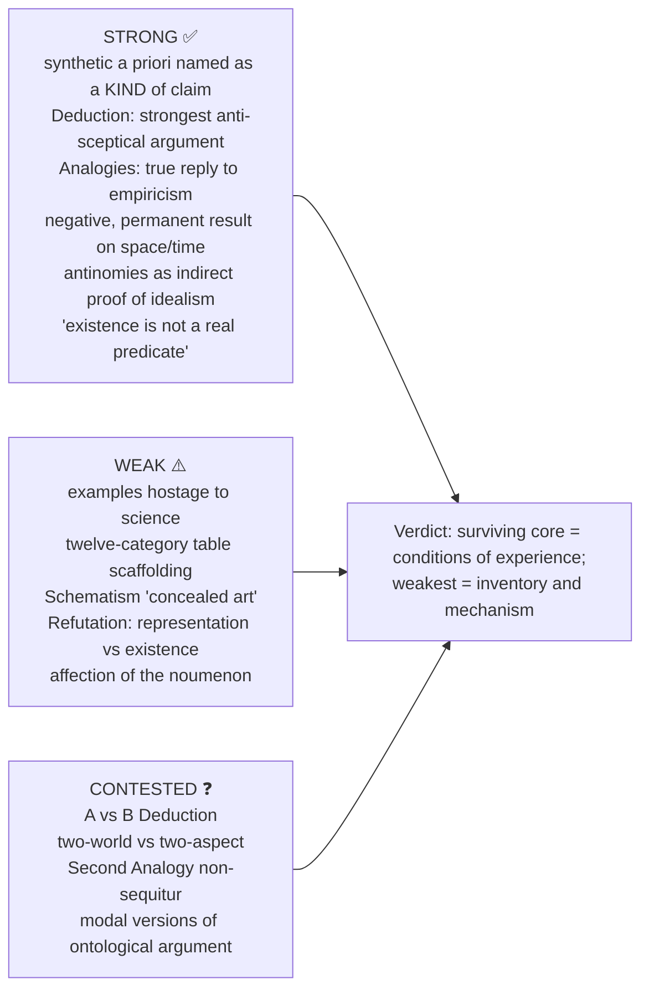

### 15.2 Verdict bank (10 / 15 / 20) ⚠️

| Sub-topic | **10-mark** | **15-mark** | **20-mark** |
|---|---|---|---|
| **Synthetic a priori** | A genuine discovery, not a compromise: judgments informative yet necessary, which Hume's Fork declared impossible | Cost: its examples are hostage to science: non-Euclidean geometry and relativity removed two showcase cases (7+5=12 survives; "the straight line is the shortest" does not) | The doctrine survives its examples: Kant identified a *kind* of claim, presuppositional, revisable in content, unavoidable in form. Quine's attack damages Kant's *classification* while confirming that experience rests on commitments not themselves given in experience |
| **Space & time** | Neither things (Newton) nor relations among things (Leibniz) but **forms of intuition** | The Transcendental Exposition ties this to the apodictic status of geometry; when geometry ceased to be uniquely Euclidean the argument from geometry lapsed, though the Metaphysical Exposition (space as given singular whole) does not | The Newton–Leibniz debate is unanswerable because both treat space as something *encountered*; once space is the form of encounter the antinomy dissolves, the pattern repeated for the world-whole |
| **Categories / Deduction** | Valid not because they mirror reality but because without them there could be no unified self-conscious experience | Strength: needs no premise the sceptic can refuse (only that experience is *mine*); weakness: the metaphysical deduction's table of judgments Kant did not himself justify | Strongest anti-sceptical argument in modern philosophy; the table is its weakest scaffolding; detach strategy from inventory (Strawson's "austere" reading): objectivity is a condition, not a discovery |
| **Schematism** | The schema is a **rule of time-determination**, not an image | Without schemata the Analogies would be impossible: functional, not ornamental; but "concealed art" concedes the mechanism is postulated | The chapter succeeds *internally* and remains vulnerable *externally*: if Hegel is right that the faculties were artificially separated, the bridge repairs a self-inflicted wound |
| **Analogies** | Substance secures duration, causality succession, community simultaneity, all because time cannot be perceived | Second Analogy answers Hume at the level of *entitlement*, not knowledge of particular laws; Strawson shows the gap between order-necessity and causal necessitation | The part of the *Critique* most nearly independent of transcendental idealism (Strawson could rebuild it without appearances); permanent result: objectivity is rule-governed time-determination |
| **Refutation of Idealism** | Kant inverts Descartes: outer experience is the condition of inner | Delivers only *empirically* external objects; Strawson/Guyer: at most a need to *represent* a persistent; the footnoted revision suggests strain | The moment transcendental idealism turns out to be empirical realism; the sceptic's own starting point presupposes what he doubts; Wittgenstein's private-language argument is the same manoeuvre without the machinery |
| **Antinomies** | A symptom of a false shared assumption: that the world is a given totality | Mathematical resolved by **both false**; dynamical by **both true** in different respects | The *indirect proof* of transcendental idealism; powerful but not decisive: it succeeds only if there is no third diagnosis, and Hegel supplies one: contradictions are productive, not pathological |
| **God-proofs** | Kant disproves the *provability* of God, then reinstates God as a postulate of practical reason | Core: "existence is not a real predicate"; cosmological and physico-theological proofs terminate in the ontological, so one refutation kills all three | Clears theoretical metaphysics to make room for faith: God relocated from an object of proof to a condition of the moral life, at the price of conceding that theology can never be a science |

### 15.3 Answer architectures ⚠️

**10-mark: apperception (2022)**
```text
Line 1: transcendental unity of apperception = the formal condition that the "I think" must be able
        to accompany all my representations; without it nothing counts as MY experience.
Body  : (i) not an empirical self (Hume's bundle) but a logical / formal condition.
        (ii) requires synthesis of the manifold according to categories.
        (iii) Aesthetic supplies forms in which a manifold is given; Deduction shows this manifold
              must be combinable under categories in one apperceptive unity.
Close : do not claim the transcendental exposition itself deduces apperception.
```

**15-mark: objections to the ontological argument (2024)**
```text
Frame : Descartes/Anselm: God = most perfect being; existence a perfection; ∴ God exists.
Body A: "Existence is not a real predicate": to say God exists posits the concept as actual.
        100 real thalers = 100 possible thalers in concept.
Body B: one cannot define a thing into existence.
Body C: cosmological and design arguments depend on the same move.
Assess: widely regarded as devastating; Plantinga and Malcolm try modal rehabilitation;
        contested whether Kant fully refutes modal versions ❓.
Close : "critically examine" = assess the objection's strength and deliver a verdict.
```

**20-mark: construction of the antinomies (2022)**
```text
Frame : the Dialectic diagnoses reason's natural illusion: seeking the unconditioned beyond experience.
Body A: what an antinomy is: thesis + antithesis both "provable".
Body B: all four, table; mathematical (1-2) vs dynamical (3-4).
Body C: resolution: mathematical = both false (world-whole not an object);
        dynamical = both may be true in different domains; 3rd = room for moral freedom.
Assess: strongest argument that speculative metaphysics is impossible.
Close : reason is not flawed; it must respect its boundaries.
```

### 15.4 Directive decoder ⚠️

| Directive | What it demands | Structural obligation | Fatal error |
|---|---|---|---|
| **How is X possible?** | a transcendental argument: undisputed fact, then necessary conditions | Given F, and F possible only if C, therefore C | Psychological or causal story about how minds work |
| **Examine / Critically examine** | assessment dominates; the *resolution* is marked | State thesis + antithesis, then the resolution (math = both false; dynamical = both may be true), then judge | A list of four antinomies with no resolution |
| **Discuss** | exposition + assessment, about 60:40 | Reconstruct as numbered transcendental steps, then one objection with a named source | Paraphrase without argument structure |
| **Elucidate the statement** | locate the sentence in the **architecture**, then unpack | Name the section (Aesthetic / Analytic / Dialectic), the problem solved, doctrine before and after | Free-standing definition |
| **Do you agree? / Comment** | take a defended side | State a ruling in line 1, then defend | Reporting both views neutrally |
| **Bring out the significance of** | show what changes if the doctrine is true | For the Copernican turn: what it explains that neither rationalism nor empiricism could | Definition without consequence |
| **Justify / Substantiate** | textual and architectural grounds | Cite by A/B pagination | Assertion |
| **How does Kant answer Hume?** | reconstruct both sides, locate the exact disagreement | Kant relocated the question from psychology to conditions of objective time-determination | "Kant said causation is a category" with no argument |

> [!TIP]
> **Exam hooks.** "Kant limits to make room, he doesn't behead." · "Moore blocks the question; Kant turns it." · "The schema is a rule, not a picture." · "Kant defeats Hume on entitlement to the concept of cause, not on knowledge of particular laws." ⚠️

---

## Sources

Masih, Y., *A Critical History of Western Philosophy*; Copleston, F., *A History of Philosophy* Vol. VI; Kenny, A., *A New History of Western Philosophy* Vol. III; Warburton, N., *Philosophy: The Classics*; Gardner, S., *Kant and the Critique of Pure Reason*; Kant, *Critique of Pure Reason* (A 1781 / B 1787, trans. Guyer & Wood or Kemp Smith); advanced trail: Henry Allison, Paul Guyer, P. F. Strawson, Robert Stern, Karl Ameriks; theme files `A-priori-a-posteriori-knowledge.md`, `Critiques-of-metaphysics.md`, `Substance-across-western.md`.
