# HEGEL — Examiner-Grade Mindmap

> **Syllabus (verbatim):** Hegel : Dialectical Method; Absolute Idealism.
> **Catalogue key:** `philosophy-paper-i-western-philosophy-05` · Paper I · Western Philosophy (Section A)
> **Sources used:** `paper-1/western/Hegel.md` (canonical owner, read in full) · `_advanced/Western-Philosophy-Dossier.md` §5 (optional depth) · `paper-1/_PYQ-Western-Philosophy-2018-2025.md` · `paper-1/_PYQ-Western-Philosophy-2026.md` · `paper-1/_themes/Critiques-of-metaphysics.md` (§1A Bridge 1, §6) · `_themes/Substance-across-western.md` (Hegel vs Spinoza; "determination is negation") · `_themes/Causation-across-schools.md` (Jaina contrast row) · `_themes/Self-and-liberation-across-schools.md` (Aurobindo contrast row). `_themes/A-priori-a-posteriori-knowledge.md` and `_themes/Pramana-across-schools.md` contain no Hegel material.
> **Evidence key:** ✅ canonical doctrine · ⚠️ analytical synthesis · ❓ contested / uncertain · ❌ trap
> **Adaptation note:** the 15-module blueprint is Indian-school oriented. Here Module 1 = works, registers and provenance; Module 2 = the dialectical method as Hegel's "theory of knowledge" (immanent development of categories and shapes of consciousness); Module 3 = internal interpretive disputes and the sceptical / existential counter-wing; Module 4 = metaphysics and ontology of the Absolute; Module 5 = stance on transcendent realities (the thing-in-itself, God and religion); Module 6 = explanatory principles (immanent necessity, history, contingency); Module 7 = freedom and ethical life (the owner file gives no puruṣārtha-type scheme); Module 10 = comparisons given in the sources, including the Indian pairs.

> [!IMPORTANT]
> **Core thesis.** Hegel's method is not a recipe imposed on material but the immanent self-undermining of a finite determination treated as complete. Its demonstrated transitions lead (via determinate negation and sublation) to the Absolute as a self-developing, self-mediating whole: "The True is the Whole." Exam shorthand "thesis–antithesis–synthesis" must be translated at once into abstract determination → determinate negation → sublation. ⚠️

---

## 0. Master Overview

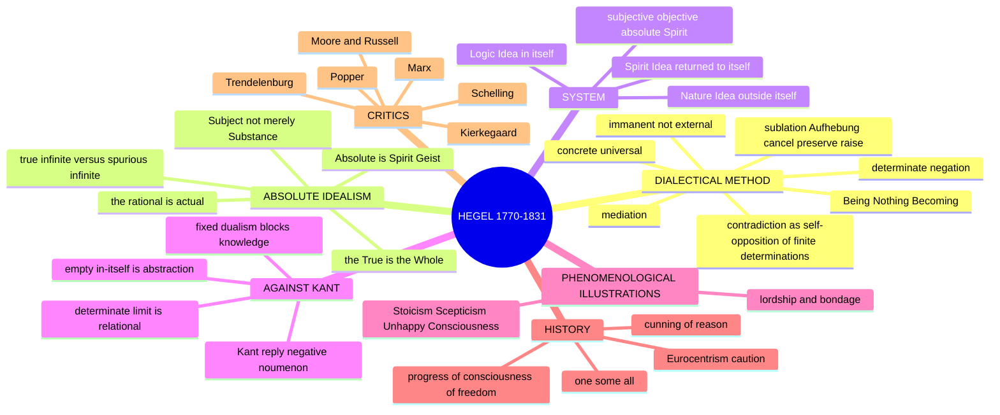

> [!TIP]
> **Provenance reflex.** If you write "thesis–antithesis–synthesis", add one clause on provenance (Fichte; popularised by Heinrich Moritz Chalybäus, 1837) and then demonstrate the immanent transition. ✅

### 0.1 One-screen architecture ⚠️

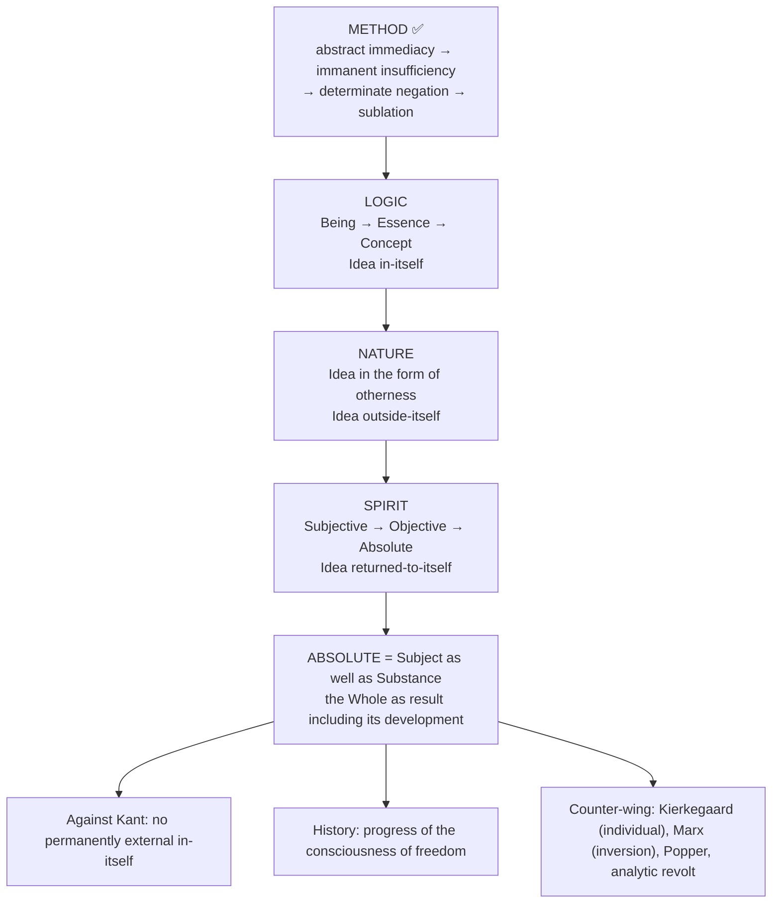

---

## 1. Identity, Lineage, Works and Provenance Discipline

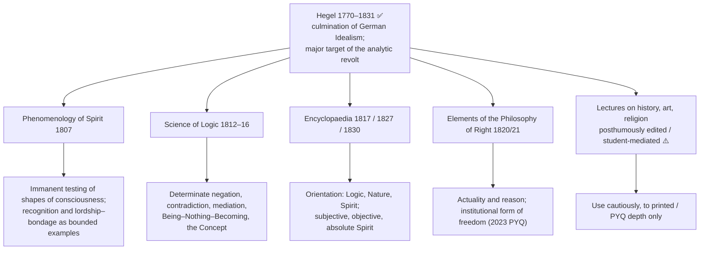

### 1.1 Three registers — never collapse ✅

| Register | What develops | Safe use |
|---|---|---|
| **Logical** | categories through internal conceptual insufficiency | primary explanation of dialectical method |
| **Phenomenological** | a shape of consciousness through failure by its own criterion | one concrete illustration, not a universal template |
| **Historical / social** | practices and institutions through tensions in embodied freedom | required for the 2023 PYQ, with teleology and Eurocentrism cautions |

- ✅ The printed owner is only **Dialectical Method; Absolute Idealism**.
- ✅ Prerequisites: Kant's fixed oppositions, mediation, finite/infinite, substance/subject and the basic system map.
- ⚠️ Recognition, history and objective Spirit become marks-essential only to the depth required by the 2020, 2023 and 2025 PYQs and by an executable account of Absolute Idealism.
- ⚠️ Detailed political philosophy, art, religion, later Marxism and later analytic philosophy remain bounded comparison or optional enrichment.

### 1.2 Translation, quotation and provenance table ✅

| Item | Status | Practice |
|---|---|---|
| *Phenomenology* (1807) | Miller (OUP 1977); Pinkard (CUP 2018, current scholarly standard); Baillie (1910) | Cite by paragraph number or chapter. Miller *Mind* vs Pinkard *Spirit* for *Geist*; Baillie's *Phenomenology of Mind* as the title — name your edition ⚠️ |
| *Science of Logic* (1812–16) | Miller (1969); di Giovanni (CUP 2010) | Cite by section / division, not page |
| *Encyclopaedia* | Wallace (Logic, Mind); Petry (Nature) | Cite by § (edition-invariant): §244 release into Nature; §247 Nature as the Idea in otherness; §250 impotence of nature |
| "Thesis–antithesis–synthesis" | ❌ not Hegel's general schema; via Fichte, popularised by Chalybäus (1837) | Add provenance clause, then demonstrate transition |
| "The True is the Whole" (*Das Wahre ist das Ganze*) | *Phenomenology*, Preface ¶20 | ✅ safe; stable across Miller and Pinkard |
| "What is rational is actual, and what is actual is rational" | *Philosophy of Right*, Preface | ⚠️ *wirklich* = **actual** (having realised its essence), **not** "existing" |
| "Substance… equally as Subject" | *Phenomenology*, Preface ¶17 | ✅ safe with the reference |
| Lordship and bondage / master and slave | *Phenomenology* Ch. IV A; *Herrschaft und Knechtschaft* | "Master–slave" is conventional; "lordship–bondage" textually closer |
| "Identity of identity and non-identity / difference" | early *Difference* essay (1801); rendering varies | Paraphrase as identity-in-difference; never numerical identity of opposites |
| "The owl of Minerva spreads its wings only with the falling of the dusk" | *Philosophy of Right*, Preface | ✅ safe; concedes philosophy is **retrospective** — useful against Popper |
| "The Idea freely releases itself" (*entläßt sich frei*) | *Enc.* §244 | ⚠️ renderings differ; give § and mark as rendering |
| "Cunning of reason" (*List der Vernunft*) | *Lectures on the Philosophy of History*; also *Enc.* §209 | ⚠️ lectures are student transcripts edited posthumously (Gans 1837, Karl Hegel 1840); say "in the lectures", not a printed sentence |
| "World history is the progress of the consciousness of freedom" | History lectures, posthumously edited | Attribute to lectures; add Eurocentrism/teleology caution |
| "Absolute Spirit is God" | ❌ not a Hegelian formula in that bald form | Paraphrase: religion's *Vorstellung* of God and philosophy's *Begriff* of Absolute Spirit are the same content in different forms |
| Russell's verdict | broadly hostile assessment in *History of Western Philosophy* (1945) | Attribute the specific logical charge; do not sharpen an epigram; distinguish Hegel from later British neo-Hegelians |

> [!WARNING]
> **Never write:** "Hegel said thesis, antithesis, synthesis" without provenance; "the real is the rational means whatever exists is justified"; or that Hegel "deduced the planets from the Idea" (a caricature of a passage in the 1801 *Dissertation*, contradicted by §250's admission of nature's contingency).

---

## 2. Theory of Knowledge: the Dialectical Method

### 2.1 Statement of the method ✅

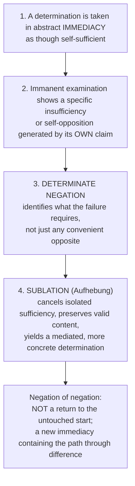

- Not an algorithm imposed from outside; not every passage has the same visible three-beat form ✅.
- Safest reading: self-undermining instability of finite determinations treated as complete, **not** the formal assertion `P ∧ not-P` in the same respect. Whether Hegel also commits to genuine ontological contradiction remains contested ❓.
- The transition must be **demonstrated** in each case. Naming "contradiction" or drawing a triad is not yet a dialectical argument.

### 2.2 Key technical terms ✅

| Term | Meaning |
|---|---|
| **Determinate negation** (*bestimmte Negation*) | negation of a specific content, so the successor answers the precise defect disclosed |
| **Mediation** (*Vermittlung*) | a term becomes intelligible and fully itself through its relation to what it initially excludes; not dependence on an external referee |
| **Negation of negation** | produces a new immediacy containing the path through difference |
| **Contradiction** (*Widerspruch*) | self-opposition of a finite determination absolutised beyond its limits; not licence to infer anything from arbitrary inconsistency |
| **Identity-in-difference** | genuine identity maintained through determinate difference, not by erasing it |
| **Concrete universal** | retains and organises its own differentiations; the abstract universal (a genus got by stripping differences) is a shadow |

> *"The True is the Whole. But the Whole is nothing other than the essence completing itself through its development."* ✅

### 2.3 Sublation (*Aufhebung*) ✅

| Meaning | Role |
|---|---|
| **Cancel** | the one-sided claim to independent completeness is negated |
| **Preserve** | valid determinate content is retained |
| **Raise** | content is reorganised within a richer, mediated unity |

Distinguishes dialectic from contradiction-and-collapse; nothing is simply lost. Caution ⚠️: not every error is automatically a preserved partial truth.

### 2.4 The first triad: Being–Nothing–Becoming ✅

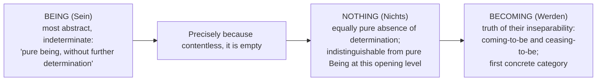

- Not a temporal creation sequence; Nothing is not "a kind of Being".
- Critics may deny that indistinguishability establishes transition; the example illustrates the method without proving every later transition ✅.

#### 2.4.1 The Absolute as being and as becoming (2026 Q1(c)) ✅/⚠️

| Point | Content |
|---|---|
| Two senses of "Absolute" | Pure Being is the **opening**, maximally indeterminate category of the *Logic*; it is not Hegel's completed Absolute nor a permanent substance underneath change |
| First transition | Being → Nothing → **Becoming** models, but does not complete, the later development Being → Essence → Concept → Absolute Idea (§2.7, §4) |
| The Whole | Absolute only as a result **including the development**; as Subject as well as Substance it differentiates itself and returns to itself |
| What the claim is | "Absolute as being is becoming" is a claim about self-mediated intelligibility, not that an existent cosmic person begins to change in time |
| ⚠️ Critical step | lack of content in pure Being may show indistinguishability from Nothing but does not by itself prove their transition or the entire system; Hegel's reply: Becoming articulates the unstable attempt to think either abstraction in isolation; the burden of demonstrating each further transition remains |

*10-mark spine:* distinguish beginning from result → Being/Nothing/Becoming → connect sublation to the self-developing whole → give this limited objection.

### 2.5 The Concept (*Begriff*) and identity-in-difference ✅

| Moment of the Concept | Function |
|---|---|
| **Universality** (*Allgemeinheit*) | the common intelligible structure |
| **Particularity** (*Besonderheit*) | the universal differentiating itself in determinate forms |
| **Individuality** (*Einzelheit*) | concrete unity in which universal and particular are realised together |

- The Concept is a self-differentiating intelligible structure, not a private mental image or an abstract class.
- Belongs to the **logical** register: do not mechanically identify with political individuals, historical periods or the three divisions of Spirit.

### 2.6 Why "thesis–antithesis–synthesis" misleads ❓/❌

- Verified PYQs ask for the **dialectical method** and do not print the formula.
- Hegel's operative vocabulary: moment, determinate negation, sublation.
- Never let the labels substitute for a demonstrated transition.

### 2.7 Dialectic applied: Logic, Nature, Spirit ✅

1. **Logic** — pure categories: Being → Essence → Concept.
2. **Nature** — the Idea in self-alienation; externalised opposite of thought.
3. **Spirit** — the Idea returning to itself through minded, social and cultural life.

The *Phenomenology* is a distinct itinerary through shapes of consciousness toward philosophical science, not another name for the *Encyclopaedia* division. Each domain develops immanently, but not by mechanically repeating one identical triad.

### 2.8 Lordship and bondage (*Phenomenology*, Ch. IV A) ⚠️

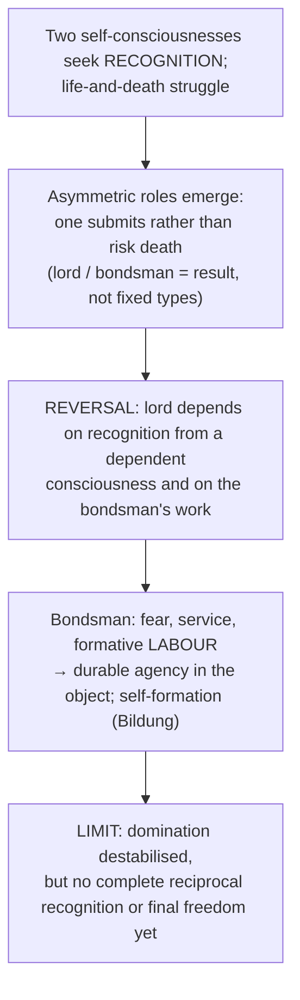

⚠️ Later Marxist, Kojèvian, feminist and anti-colonial receptions make this episode central. Marx's labour, alienation and class accounts transform broader Hegelian resources; they are **not** a simple transcription of this passage.

### 2.9 Stoicism → Scepticism → Unhappy Consciousness (*Phenomenology*, Ch. IV B) ✅

Optional phenomenological illustration; no routed Hegel PYQ requires full reconstruction.

**Printed subterms:** *Gestalt* (shape of consciousness) · *das unglückliche Bewusstsein* · *das Unwandelbare* (Unchangeable) vs *das Wandelbare* (Changeable) · *Andacht* (devotion) · *Entäußerung* (externalisation / self-relinquishment) · *Mittler* (mediator / priest) · *Entzweiung* (self-diremption).

| Shape | Claim to freedom | Internal contradiction |
|---|---|---|
| **Stoicism** | free in thought whatever the condition — "whether on the throne or in chains" | freedom abstract and empty: indifferent to all content, so can only say "the true, the good" in general |
| **Scepticism** | negativity enacted: actively dissolves every determinate content | performative self-contradiction: asserts nothing can be asserted while living as a determinate individual; "the unconscious babble of contradiction" |
| **Unhappy Consciousness** | the contradiction becomes conscious of itself: one consciousness containing two | knows itself as "dual-natured, merely contradictory": Unchangeable (essential, beyond, God) vs Changeable (inessential, this self); cannot abandon either |

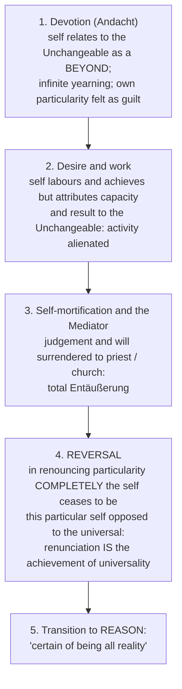

**Presuppositions ⚠️:** P1 shapes have an internal logic that destroys them from within; the philosopher only watches (no external criterion). P2 alienation is self-inflicted and therefore self-curable. P3 the sequence is **logical, not chronological**.

| Objection | Source | Reply | Residual |
|---|---|---|---|
| "Overcoming" is verbal; relation to the eternal is the permanent human condition; the individual before God cannot be a moment of a system | **Kierkegaard**, *Concluding Unscientific Postscript* | Mistakes the phenomenology's level: overcome for consciousness as such, not extinguished in a particular life | ⚠️ strongest charge; bridge to Existentialism |
| Account of Christianity is reductive | theological critics; Feuerbach from the other side | Religion = Absolute Spirit in representational form (*Vorstellung*), not error; only philosophy's conceptual form (*Begriff*) surpasses it | ❓ whether "surpassing" respects religion is disputed |
| Literary description, not argument; nothing forces Scepticism → Unhappy Consciousness | analytic critics; Russell generally | Force = performative contradiction; necessity retrospective ("owl of Minerva") | ⚠️ fair as far as it goes |

*Executable verdict:* "The Unhappy Consciousness is where the *Phenomenology* proves that Hegelian dialectic is not a formula applied to material but a description of how a form of life destroys itself by living out its own commitment… Hegel identified something real and resolved it too quickly."

---

## 3. Internal Disputes, Interpretive Wings and Counter-Currents

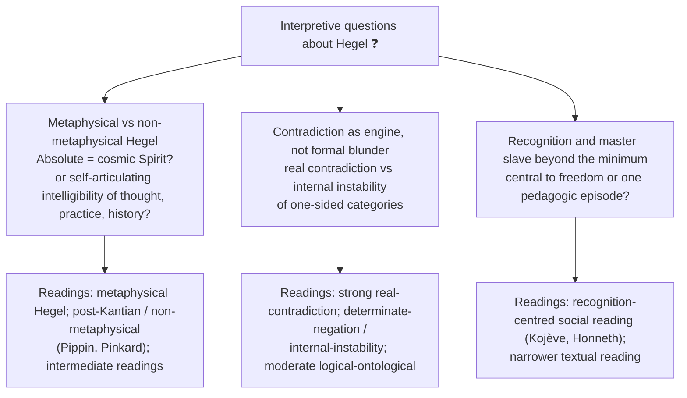

| Advanced module (optional enrichment ⚠️) | Objection → counter-reply | Safe 15/20 use | Promote to Core if |
|---|---|---|---|
| Metaphysical vs non-metaphysical Hegel ❓ | **Obj.:** non-metaphysical readings domesticate Hegel and flatten Absolute Idealism. **Reply:** they explain how Hegel answers Kant by treating rationality as immanent to experience and institutions, not an occult beyond | one evaluative sentence after expounding Absolute Idealism; the Absolute need not mean a "mysterious cosmic blob" | a PYQ asks what the Absolute *is* or whether to read Hegel metaphysically |
| Contradiction as engine ❓ | **Obj.:** literal contradiction would explode logic. **Reply:** finite categories collapse when absolutised; contradiction marks insufficiency, not licence for arbitrary inconsistency | clarifying note when asked about the method itself | a PYQ asks whether dialectic violates non-contradiction |
| Recognition beyond minimum ⚠️ | **Obj.:** all-Hegel-as-recognition-theory shrinks Absolute Idealism to social psychology. **Reply:** used sparingly, recognition concretises freedom as relational and historically mediated | one short illustration only | a PYQ asks about recognition / master–slave |

Do not over-study: modern commentator fights; paraconsistent logic unless forced; Marx, Fanon or Honneth unless asked. Short source trail: Hegel's *Phenomenology*, *Science of Logic*, *Philosophy of Right*; Pippin; Pinkard; Houlgate; Taylor; Kojève; Honneth.

**Counter-current to the method (from the owner file):** Trendelenburg's objection that dialectical transition presupposes motion in static determinations (see §9) and Schelling's "positive philosophy" demand (see §5.2).

---

## 4. Metaphysics & Ontology: Absolute Idealism

### 4.1 Statement ✅

**Absolute Idealism:** thought, nature and finite spirit are intelligible only within a self-developing rational whole, the **Absolute**. Hegel calls the whole **Spirit** (*Geist*) at the stage where it knows itself through finite social and cultural life; Spirit is neither a private mind nor a supernatural ghost. Nature and finite minds are real but not self-sufficient **moments**.

- ⚠️ Interpretive control: metaphysical readings treat Absolute Spirit as reality's own self-knowing structure; post-Kantian / non-metaphysical readings stress historically achieved collective self-comprehension. Marks-safe core: immanent intelligibility, mediation, substance-as-subject, rejection of an unknowable external remainder. **Do not turn the Absolute into a cosmic person.**

> *"What is rational is actual, and what is actual is rational."* (Preface, *Philosophy of Right*) ✅

**Actuality (*Wirklichkeit*)** is the effective unity of essence and existence, the realised operation of a concept, **not** bare existence (*Dasein*). Blocks "whatever exists is right"; critics can still ask whether Hegel applies it too conservatively to the modern state.

### 4.2 Substance AND Subject ✅

> *"Everything turns on grasping and expressing the True, not only as Substance, but equally as Subject."* (*Phenomenology*, Preface)

| Substance (as Hegel criticises Spinozism) | Subject (Hegel's correction) |
|---|---|
| Infinite unity affirmed, but determinate difference appears absorbed rather than returned into self-conscious unity | Absolute is active self-mediation: differentiates itself and returns to itself in Spirit |
| Immanent causality does not yet make substance a self-developing subject | Development through determinate negation and sublation |
| Unity without Hegelian self-return | Living, self-relating totality |

**Theme-file link ⚠️ (Substance across Western):** Hegel accepts Spinoza's monism and charges it with **acosmism** (if only the one substance is real, finite things vanish). Corrective: the Absolute "not only as Substance, but equally as Subject" — self-developing activity, not inert unity. Also: "all determination is negation" — the exact Latin formula (*omnis determinatio est negatio*) is **not** in the *Ethics*; Spinoza writes *determinatio negatio est* in **Letter 50 to Jarig Jelles (2 June 1674)**; the universalised slogan is Hegel's rendering ✅.

### 4.3 Finite / infinite and the three forms of Spirit ✅

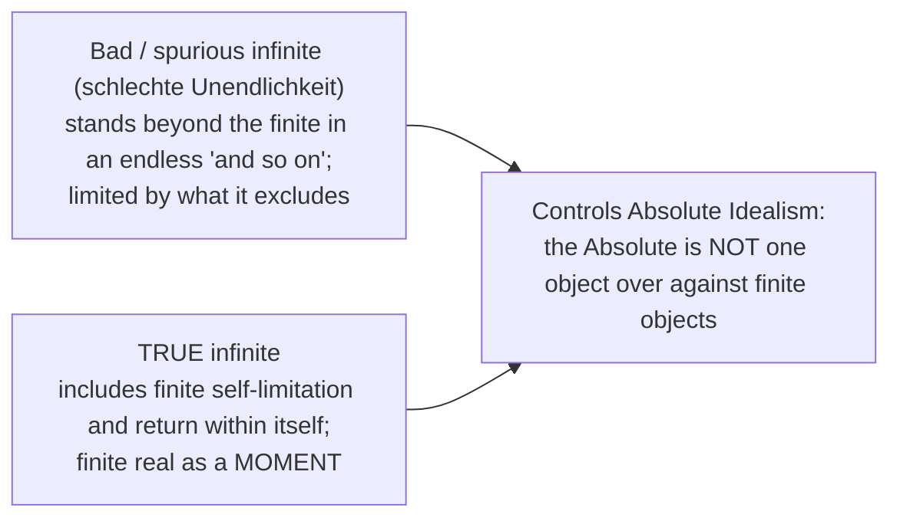

| Form of Spirit | Orientation |
|---|---|
| **Subjective Spirit** | individual minded life and agency |
| **Objective Spirit** | freedom embodied in right, morality and ethical institutions |
| **Absolute Spirit** | art, religion and philosophy: sensuous, representational and conceptual self-comprehension |

Philosophy is the highest form of Absolute Spirit — the system's claimed standpoint of conceptual self-comprehension; this does not make each finite philosopher omniscient ✅.

### 4.4 The three-stage unfolding ✅

| Stage | Character | Content |
|---|---|---|
| **Logic** (Idea *in-itself*) | pure thought, categories prior to nature | Being → Essence → Concept |
| **Nature** (Idea *outside-itself*) | Spirit alienated / externalised | space, time, matter, organisms: the Idea in its otherness |
| **Spirit** (Idea *returned-to-itself*) | self-conscious rational life | subjective → objective (law, morality, state) → absolute (art, religion, philosophy) |

### 4.5 Reality of the phenomenal world (2020 Q1(d)) ✅/⚠️/❓

- ✅ **Statement:** the phenomenal world is neither an independent thing-in-itself nor a private mental illusion; it is a finite, mediated manifestation of the self-developing Absolute.
- ✅ **Argument:** finite determinations generate contradictions when treated as self-sufficient; dialectical negation preserves their partial truth while locating them in a more comprehensive unity; appearance is real as a moment, not ultimate as isolated.
- ⚠️ **Distinction:** differs from Berkeleyan idea-dependence and from a two-world reading of Kant: abstract independence vs mediated concreteness.
- ❓ **Objection → reply:** if only the whole is fully true, individual reality seems dissolved; reply: sublation preserves determinate content rather than annihilating it, though critics question whether individuality survives.
- ❌ **Trap:** do not convert Hegel into Berkeleyan subjective idealism or use a mechanical triad; explain determinate negation, mediation and the overcoming of the finite/infinite opposition.

### 4.6 Logic-to-Nature problem ⚠️→✅ (the system's most exposed joint)

**Problem.** The *Logic* claims to move by internal necessity from Being to the **Absolute Idea**; the *Encyclopaedia* then passes to the Philosophy of Nature (space, time, matter, contingent particulars). What licenses that step? If necessary, how can a category produce an existent? If not, the claim to be presuppositionless collapses.

**Hegel's text ✅.** *Enc.* §244: the Absolute Idea "freely releases itself" (*entläßt sich frei*); Nature (*Enc.* §247) = "the Idea in the form of otherness". *Enc.* §250: "impotence of nature" (*die Ohnmacht der Natur*): nature is unable to hold fast to the Concept, hence contingency, imprecision, monstrosity. Hegel does **not** claim to deduce particular natural facts.

**Not a creation story ⚠️:** not temporal (no before); not causal (categories exert no force); **logical / structural** — a form that is nothing but self-relation has no content of its own, so it *is* its own externality.

| # | Objection | Source | Reply | Residual |
|---|---|---|---|---|
| 1 | **Leap from essence to existence**: the Logic shows what anything must be *if* it is, not *that* anything is | **Schelling**, Berlin lectures (1841–2), audience including Kierkegaard and Engels | No *if*: Being is the first category and the most immediate existent; the Logic never left existence | ⚠️ strongest objection; Schelling's "positive philosophy" launches the existentialist line to Kierkegaard and Heidegger |
| 2 | **Theology in disguise**: creation *ex nihilo* with the Creator renamed | **Feuerbach**, *Towards a Critique of Hegelian Philosophy* (1839) | Christian *Vorstellung* pictures narratively what the Logic states conceptually | ❓ protects the system only if philosophy translates religion without loss |
| 3 | **Motion smuggled in**: transition presupposes movement and time | **Trendelenburg**, *Logische Untersuchungen* (1840) | "Movement" is not spatiotemporal but self-undermining of a determination | ⚠️ generalises beyond this step; name it in any method answer |
| 4 | **Category mistake / personification**: "resolves", "releases" are verbs of agency | analytic critics; Russell's "destitute of valid argument" | Verbs mark a logical transition, not a decision; German reflexive constructions avoid an agent | ⚠️ metaphor does rhetorical work Hegel cannot fully cash out |

*Executable verdict:* read as temporal or causal derivation it is indefensible; read as pure self-relating form *is* self-externality it is coherent but no longer obviously demonstrative; Schelling's objection lands. The post-Hegelian century divides into those who kept the dialectic and dropped the Idea (Marx) and those who kept existence and dropped the system (Kierkegaard, Heidegger).

---

## 5. Stance on Transcendent Realities: the Thing-in-Itself, God and Religion

### 5.1 The challenge to Kant's phenomena / noumena (2025 Q1(e)) ✅

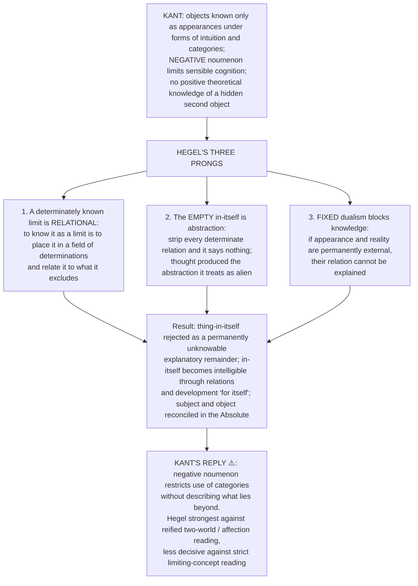

- Not immediate omniscience; the thought-limit argument does not by itself prove the completeness of Hegel's system ✅.

### 5.2 Religion, God and the Absolute ⚠️

- Religion = **Absolute Spirit in representational form** (*Vorstellung*); philosophy's **conceptual** form (*Begriff*) surpasses it; Hegel treats the *Vorstellung* of God and the *Begriff* of Absolute Spirit as the same content in different forms.
- ❌ "Absolute Spirit is God" is not a Hegelian formula in that bald form.
- Feuerbach (theology in disguise) and Kierkegaard (the individual before God cannot be a moment of a system) attack from opposite sides; see §2.9, §4.6.
- Schelling's demand for a "positive philosophy" beginning from *that* something is: see §4.6.

---

## 6. Explanatory and Causal Principles: Immanent Necessity, History and Contingency

### 6.1 Dialectic in history (2023 Q1(b)) ✅

> *"World history is the progress of the consciousness of freedom."* (history lectures, posthumously edited ⚠️)

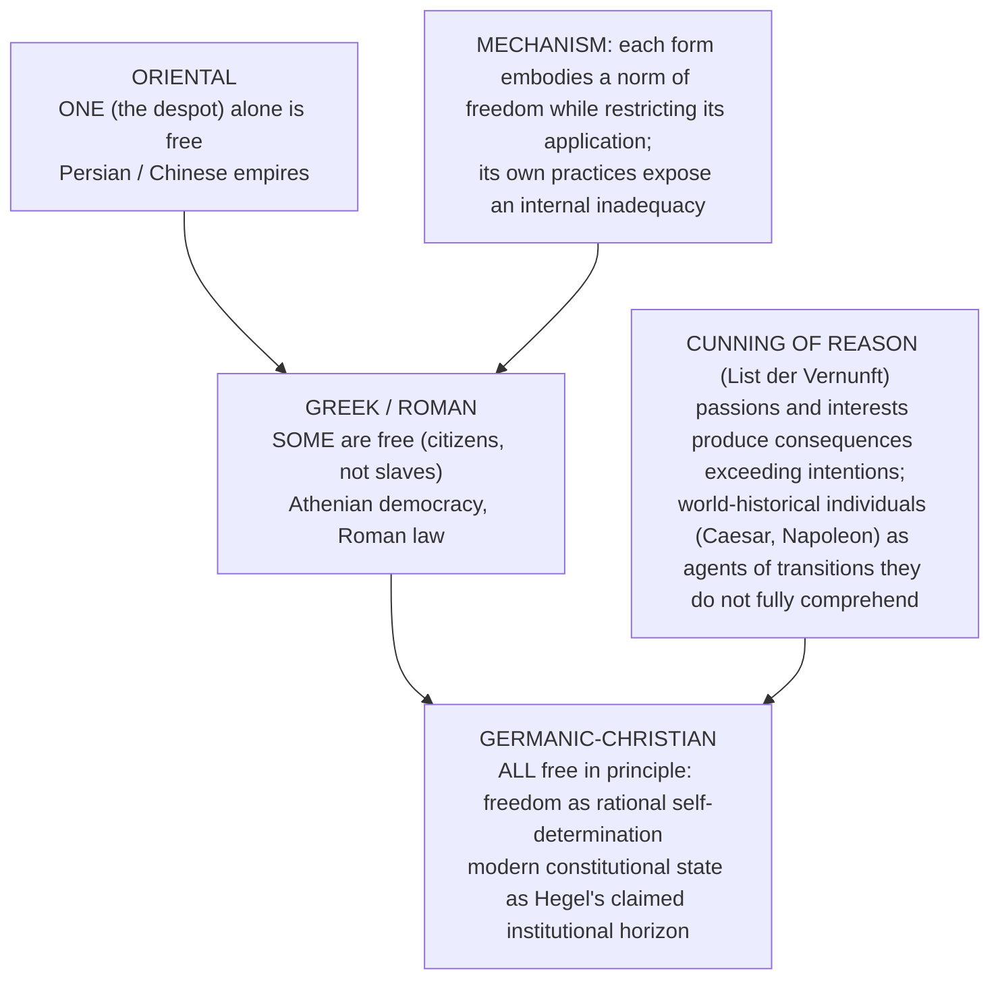

- A retrospective philosophical schema, **not** a predictive law or a claim that every event improves; direction and intelligibility, not simple linearity or causal determinism.
- Spirit here names the intelligible historical process, not an occult person manipulating events.
- **Required criticism:** the Oriental / Greek-Roman / Germanic sequence is a dated Eurocentric hierarchy treating European modernity as telos; "all are free" states a principle, not evidence that Hegel's Europe realised equal freedom; retrospective teleology can rationalise victors and understate contingency, colonialism, class and gender exclusion.
- *2023 Q1(b) spine:* norm → internal restriction → more adequate institution; add consciousness of freedom and cunning of reason; qualify teleology and Eurocentrism; do not offer the civilisation list as proof.

### 6.2 Contingency and the impotence of nature ✅

Nature cannot hold fast to the Concept (*Enc.* §250); contingency enters here; Hegel does not deduce natural particulars (see §4.6).

### 6.3 Explanation by immanent critique ⚠️

Shapes of consciousness fail by their **own** criterion; no external criterion is applied (P1, §2.9). Defence against Popper: the *Logic* is not empirical prediction; the "owl of Minerva" concedes retrospectivity.

---

## 7. Freedom, Ethical Life and Human Goals

> The owner file gives **no kāma / artha / dharma / mokṣa-type scheme** for Hegel. This module carries only the source-backed freedom and ethical-life material.

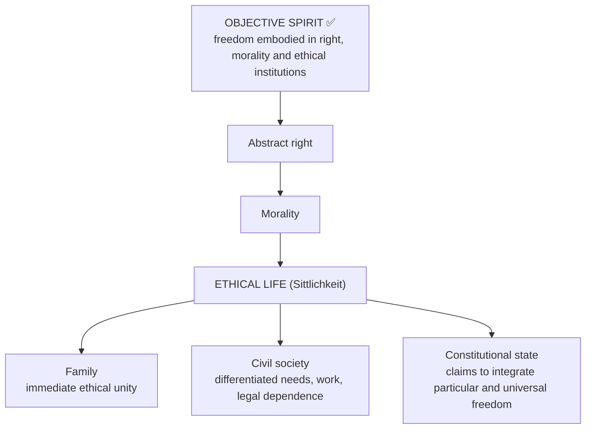

- Orientation, not endorsement of every existing state; detailed political philosophy remains optional enrichment ⚠️.
- Glorifying every state is a trap: Hegel's state is a claimed integration of universal and particular freedom, not whatever government exists; conservative application remains contestable.
- Freedom compared (see §8): Kant moral autonomy (noumenal); Hegel historical self-realisation of Spirit; Marx proletarian liberation; Kierkegaard existential choice, dread, faith.

---

## 8. Inter-School Comparative Matrices

### 8.1 Kant · Hegel · Marx · Kierkegaard ⚠️

| Axis | Kant | **Hegel** | Marx | Kierkegaard |
|---|---|---|---|---|
| Thing-in-itself | Unknowable noumenon | Abolished — thought encompasses all | Irrelevant (materialism) | — |
| Ultimate reality | Theoretical cognition limited to appearances | Absolute as self-developing intelligibility / Spirit | Material social relations; "dialectical materialism" is a later systematisation | The existing individual before abstraction / system |
| Dialectic | Antinomies diagnose reason's illegitimate world-totality claims | Contradiction within finite determinations drives immanent development | Transformed critique of material and social contradictions | Hegelian total system rejected, not every dialectical contrast |
| Freedom | Moral autonomy (noumenal) | Historical self-realisation of Spirit | Proletarian liberation | Existential choice, dread, faith |
| Truth | Phenomenal adequacy | The Whole (system) | Praxis, revolutionary transformation | Subjectivity, passionate inwardness |

### 8.2 Absolute vs subjective idealism: Hegel vs Berkeley (cross-link 2024 Q2(a)) ⚠️

| Axis | Berkeley (Subjective) | Hegel (Absolute) |
|---|---|---|
| What exists | Sensible ideas and active spirits within a divinely ordered world | Nature and finite spirit as moments of a self-developing intelligible whole |
| Individual mind | Finite spirit perceives ideas but does not create the entire order | Finite moment within the Absolute, not the sole ground |
| External world | Denied as independent; depends on perception | Nature is real but as Spirit's own self-externalisation |
| Development | None: static dependence on God | Dialectical self-development through contradiction |
| Knowledge | Direct awareness of ideas; spirits known differently from ideas | Systematic self-comprehension achieved through finite knowing, without making each knower omniscient |

Berkeley rejects matter but not spirits, God or experienced order; Hegel's claim concerns mediated intelligibility, not dependence on one finite perceiver.

### 8.3 Hegel's heirs: what each kept and dropped ⚠️

| Heir | Kept | Dropped |
|---|---|---|
| Marx | the dialectic | the Idea (relocates development in material social relations; transforms and "inverts") |
| Feuerbach / Marx | the analysis of alienation | the resolution |
| Kierkegaard | the diagnosis | any resolution; the system |
| Bradley (British Idealism) | internal relations | — (note: Moore / Russell targeted often British neo-Hegelians, not every claim of Hegel's texts) |

### 8.4 Bridging comparisons from the theme files ⚠️

| Comparator | Contrast stated in the sources |
|---|---|
| Spinoza | Hegel accepts monism, charges **acosmism**; corrective: Substance AND Subject |
| Jaina *sadasatkāryavāda* (Indian bridge) | Hegel's opposites are **sublated** into a higher synthesis; Jaina aspects simply coexist, indexed to standpoints, with no synthesis and no movement |
| Aurobindo's divine life (Indian bridge) | Teilhard's Omega Point is Christological and terminal; Hegel's self-realising Absolute is conceptual and realised in Spirit's history; Aurobindo's Supermind descends into matter and body within manifestation |

---

## 9. Criticisms & Reconstructed Replies

```mermaid
flowchart TD
  C1["Kierkegaard<br/>system swallows the INDIVIDUAL;<br/>existence cannot be captured in a concept-system"] --> R1["Hegel: Spirit includes individuality at the subjective-spirit stage.<br/>⚠️ but MY existence is not a 'moment'; remains powerful"]
  C2["Marx<br/>Idea primary; reconciliation too conceptual;<br/>labour, class, institutions ground alienation"] --> R2["✅ rational core praised, Hegel said to mystify it;<br/>critique transforms both method AND ground"]
  C3["Moore and Russell / analytic revolt<br/>idealist holism and internal relations obscure logical distinctions"] --> R3["Targets were often British neo-Hegelians such as Bradley;<br/>do not attribute all their doctrines to Hegel"]
  C4["Popper<br/>historicist narratives rationalise outcomes retrospectively, immunise themselves"] --> R4["⚠️ Logic is not empirical prediction; Popper often caricatures;<br/>stronger against deterministic uses of Hegelian history"]
  C5["Formal logicians<br/>contradiction explodes (ex falso quodlibet)"] --> R5["Contradiction = tension of opposed determinations within a concept,<br/>not truth-functional P ∧ ¬P; ❓ coherence debated"]
  C6["Trendelenburg / analytic critics<br/>movement smuggled into static determinations"] --> R6["Conceptual vs temporal motion; residual burden: demonstrate each transition"]
  C7["Particularity / totalisation critics<br/>finite items dissolved as moments of the whole"] --> R7["Sublation preserves determinate difference;<br/>works only if the system SHOWS how the particular stays irreducible"]
  C8["Political and historical critics<br/>reconciliation with the state, Eurocentric stages, retrospective teleology"] --> R8["Actuality/existence distinction permits immanent criticism;<br/>does not erase conservative passages or exclusions"]
```

---

## 10. Controlled Comparisons

### 10.1 Hegel and Strawson on a reified noumenon ⚠️ (optional; owned by Quine–Strawson)

| Step | Hegel (1807–31) | Strawson (1959, 1966) |
|---|---|---|
| Target | Kant's thing-in-itself | Kant's thing-in-itself |
| Charge | A wholly external in-itself is an empty abstraction generated by fixed opposition; to **posit** a limit is already to **think beyond** it | A supersensible reality said to affect sensibility illegitimately applies concepts beyond experience (*The Bounds of Sense*, 1966) |
| Method | dialectical: the concept destroys itself from within | analytic: the doctrine violates its own restriction |
| Positive residue | subject and object reconciled by immanent mediation | Kant's "austere" transcendental core survives |
| Result | Absolute Idealism (**revisionary** in Strawson's vocabulary) | **Descriptive metaphysics** (*Individuals*, 1959): material bodies and persons as basic particulars |

**Theme-file verdict ⚠️:** one verdict, two methods; opposite remedies — expand thought to the Absolute vs contract metaphysics to the description of our scheme. Kant's best reply: the noumenon as a purely **negative** limiting concept escapes Hegel, but then it cannot "affect" anything, which is what Strawson's objection requires it to do.

> [!WARNING]
> Use only **after** the Hegel–Kant argument is complete. The two critics overlap against a causalised two-world reading, not against every negative-noumenon reading.

### 10.2 Indian pairs ⚠️

Jaina *sadasatkāryavāda* and Aurobindo (§8.4) are the only Indian comparators in the sources. Treat as analogy, not influence.

---

## 11. Diagnostic Deep-Dives for High-Frequency Themes

### 11.1 Directive decoder ⚠️

| Directive | What it demands | Structural obligation | Fatal error |
|---|---|---|---|
| **Explain the dialectical method** | the **mechanism**, then an instance | §2.1 + Being–Nothing–Becoming or one bounded example; demonstrate the transition | Defining T-A-S and stopping |
| **Critically examine / evaluate** | assessment dominates | Reconstruct in 4 lines, then Kierkegaard **or** Trendelenburg **or** Popper by name, then adjudicate | Anonymous "some critics say" |
| **Comment on the statement** ("The real is the rational") | disambiguate the technical term first | *wirklich* ≠ *Dasein*; not a political endorsement; say so in line 2 | Reading it as "whatever exists is right" |
| **Discuss with reference to Kant** (2025 Q1(e)) | two-sided engagement | Hegel's three prongs, Kant's reply (limiting concept), then rule | One-sided demolition of Kant |
| **How does history exhibit dialectic?** (2023 Q1(b)) | mechanism plus telos, with instances | one → some → all, the internal contradiction driving each collapse, cunning of reason, a named example per stage | A list of civilisations |
| **Distinguish** (Hegel vs Berkeley) | criterion-led contrast | Fix the axis first (finite mind vs infinite Spirit), then run the table | Parallel summaries with no axis |
| **Trace the development** | necessity between stages | State *why* each stage collapses | Listing stages |
| **Assess the influence of** | heirs **and** what each kept / dropped | §8.3 | "Hegel influenced Marx." |

### 11.2 Graded verdict bank ⚠️

| Sub-topic | 10-mark | 15-mark | 20-mark |
|---|---|---|---|
| Dialectical method | Dialectic is the self-destruction of a determination that cannot be thought consistently, not a formula imposed on material | Power: needs no external criterion; cost: necessity visible only retrospectively, so Popper's unfalsifiability bites where prediction is claimed | Defensible as *descriptive of conceptual breakdown*, indefensible as *predictive*. Trendelenburg's objection is the deepest technical challenge; Hegel's reply (conceptual instability is not borrowed motion) is available but never uncontroversially made |
| Sublation | Distinguishes dialectic from mere refutation: cancels isolated sufficiency, preserves content | Supports a cumulative history of philosophy: an earlier system may be partial, not worthless | Triple sense is load-bearing, but the transition must still be demonstrated |
| Absolute Idealism | The Absolute is not a thing behind the world but the world grasped as a self-developing rational whole | "Substance is also Subject" adds self-differentiation and self-return to Spinozist immanence | Defensible core: intelligibility is immanent and mediated; the stronger claim that reality literally achieves self-knowledge is interpretively contested |
| Against Kant's noumenon | Strongest against a reified two-world reading, weaker against negative noumenon | Affection problem pressures Kant when things in themselves are said to affect sensibility | Hegel shows instability in an externalised boundary; he does not establish the complete Absolute by showing a known limit lies within thought |
| Lordship and bondage | One-sided recognition defeats the lord's claim to independence | Fear, service and formative labour transform the bondsman, but reciprocal recognition is incomplete | Do not retroject later class, gender or colonial theories into the text |
| Unhappy consciousness | Religious alienation is self-inflicted | Renunciation is genuinely dialectical: total surrender of particularity attains universality | Hegel identified something real and resolved it too quickly |
| Logic → Nature | The "free release" is a logical claim about self-relating form, not a creation story | Hegel concedes the "impotence of nature"; contingency enters there | The seam of the system; Schelling's demand is not met; the post-Hegelian split follows |
| History | History interpreted as developing consciousness of freedom, not guaranteed improvement | Mechanism: tension between an embodied freedom-norm and its restriction; cunning of reason names consequences exceeding intentions | Eurocentric hierarchy, retrospective necessity and exclusion prevent an uncontested universal history |

---

## 12. PYQ Routing Ledger (2018–2025, plus 2026)

> Corpus signal: 6 primary-owned parts out of 112 in 2018–2025 (per year 2018 0 · 2019 1 · 2020 1 · 2021 1 · 2022 1 · 2023 1 · 2024 0 · 2025 1), plus 1 primary-owned 2026 part = **7 primary-owned parts**. Cross-links do not create duplicate ownership.

| Year | Q | Marks | Exact demand | Answer route | Map to |
|---|---|---:|---|---|---|
| 2019 | Q1(c) | 10 | What is the role of dialectics in realizing the truth in Hegel's philosophy? | truth as whole/result → immanent failure → determinate negation/sublation → one example → qualified systemic verdict | §2, §4.1 |
| 2020 | Q1(d) | 10 | Examine the reality of the phenomenal world in the light of Hegel's Absolute Idealism. | reject illusion/independent in-itself binary → finite appearance as real mediated moment → identity-in-difference → individuality objection | §4.5 |
| 2021 | Q2(a) | 20 | Discuss Hegel's Dialectical method. Explain how his dialectical method leads him to the Absolute Idealism. | method mechanism → Being/Nothing/Becoming → concrete universal/Concept → Logic/Nature/Spirit → Kant and objections | §2, §4, §5.1, §9 |
| 2022 | Q3(b) | 15 | What is the dialectical method in the philosophy of Georg Wilhelm Hegel? How does this method help in realizing the Absolute? Discuss. | immanent development, not T-A-S recipe → sublation → substance-as-subject → whole as result → transition objection | §2, §4.2 |
| 2023 | Q1(b) | 10 | "History is a process of dialectical change." In the light of this statement discuss Hegel's approach in understanding history. | embodied norm of freedom → internal restriction → cunning of reason → one/some/all schema → teleology/Eurocentrism caution | §6.1 |
| 2025 | Q1(e) | 10 | How does Hegel challenge Kant's distinction between Phenomena and Noumena? Discuss. | Kant's negative noumenon → Hegel on relational limit/empty abstraction → mediation → Kant reply → graded verdict | §5.1 |
| 2026 | Q1(c) | 10 | Explain Hegel's idea that the concept of the Absolute as being is the concept of the Absolute as becoming as a process of self-development. | **primary** | §2.4.1 |

### 12.1 Cross-owned parts (listed, not counted)

| Year | Q | Marks | Owner | Exact demand | Hegel link |
|---|---|---:|---|---|---|
| 2018 | Q2(b) | 15 | Kant | Explain the significance of the Kantian dictum, 'Understanding makes Nature'. How far do you agree that Hegel's Absolutism is the culmination of the Kantian Dualism? Discuss. Give reasons in favour of your answer. | §5.1, §8.1 |
| 2023 | Q1(d) | 10 | Existentialism | How does Kierkegaard argue against Hegel's idea of universal spirit in favour of the individual as the essence of spirit? Critically discuss. | §8.1, §9 |
| 2024 | Q2(a) | 20 | Empiricism | Is rejection of Locke's notion of primary qualities instrumental in Berkeley's leaning towards idealism? In this context, also discuss how subjective idealism is different from the absolute idealism proposed by Hegel. | §8.2 |
| 2026 | Q4(b) | 15 | Kant | Analyze and discuss the different ways in which Kant and Hegel conceived the relationship between reality and our thinking about reality. | §5.1, §8.1 (primary owner `Kant.md` §7.2A; Hegel half cross-linked) |
| 2022 | Q4(a) | 20 | Existentialism | How does Soren Kierkegaard define the notion of 'subjectivity'? Explain it with reference to three stages of existence as propounded by him. | link-out only (owner file §9 lists it as a Kierkegaard-against-Hegel bridge; the printed demand does not name Hegel) |

---

## 13. Top Exam Traps

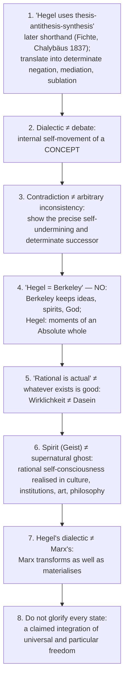

Additional pitfalls recorded in the sources: do not state that Hegel deduced the planets (§1.2); never present "Absolute Spirit is God" as Hegel's formula (§5.2); history list is not proof (§6.1); Russell's judgement must be attributed, not sharpened; the Hegel half of 2026 Q4(b) belongs to the Kant owner.

---

## 14. Technical Vocabulary & Terminology Bank

| English gloss | German | Meaning | Status |
|---|---|---|---|
| Sublation | *Aufhebung* | cancel + preserve + raise | ✅ |
| Determinate negation | *bestimmte Negation* | negation of a specific content | ✅ |
| Mediation | *Vermittlung* | intelligible through relation to what it excludes | ✅ |
| Contradiction | *Widerspruch* | self-opposition of an absolutised finite determination | ✅ |
| Being / Nothing / Becoming | *Sein / Nichts / Werden* | first triad of the *Logic* | ✅ |
| The Concept | *Begriff* | universality, particularity, individuality | ✅ |
| Universality / Particularity / Individuality | *Allgemeinheit / Besonderheit / Einzelheit* | moments of the Concept | ✅ |
| Spirit | *Geist* | Absolute at the stage of self-knowing through finite social and cultural life | ✅ |
| Actuality / mere existence | *Wirklichkeit / Dasein* | effective unity of essence and existence / bare existence | ✅ |
| Ethical life | *Sittlichkeit* | family, civil society, state | ⚠️ |
| Cunning of reason | *List der Vernunft* | consequences exceed intentions | ⚠️ |
| Spurious infinite | *schlechte Unendlichkeit* | endless "and so on" | ✅ |
| Shape of consciousness | *Gestalt* | stage in the *Phenomenology* | ✅ |
| Unhappy consciousness | *das unglückliche Bewusstsein* | Unchangeable (*das Unwandelbare*) vs Changeable (*das Wandelbare*) | ✅ |
| Devotion / externalisation / diremption | *Andacht / Entäußerung / Entzweiung* | moments of Unhappy Consciousness | ✅ |
| Mediator | *Mittler* | priest / church | ✅ |
| Formation / self-formation | *Bildung* | bondsman's labour | ⚠️ |
| Representation / concept | *Vorstellung / Begriff* | religion's form vs philosophy's form | ⚠️ |
| Impotence of nature | *Ohnmacht der Natur* | *Enc.* §250 | ✅ |
| Lordship and bondage | *Herrschaft und Knechtschaft* | *Phenomenology* Ch. IV A | ⚠️ |
| Identity of identity and non-identity | — | early *Difference* essay; paraphrase as identity-in-difference | ⚠️ |
| Acosmism | — | Hegel's charge against Spinoza | ⚠️ |
| Revisionary / descriptive metaphysics | — | Strawson's categories; Hegel's Absolute is revisionary | ⚠️ |
| Concrete universal | — | universal that includes its own differentiations | ⚠️ |

**Statement bank ⚠️:** (1) "What is rational is actual…" — with *Wirklichkeit* vs *Dasein* caution. (2) "The True is the Whole." (3) The Absolute "not only as Substance but equally as Subject." (4) "World history is the progress of the consciousness of freedom." (5) "The owl of Minerva spreads its wings only with the falling of the dusk." (6) *Aufhebung* — cancel / preserve / raise. (7) Cunning of Reason. (8) Concrete Universal.

---

## 15. Graded Verdict & Answer Architectures

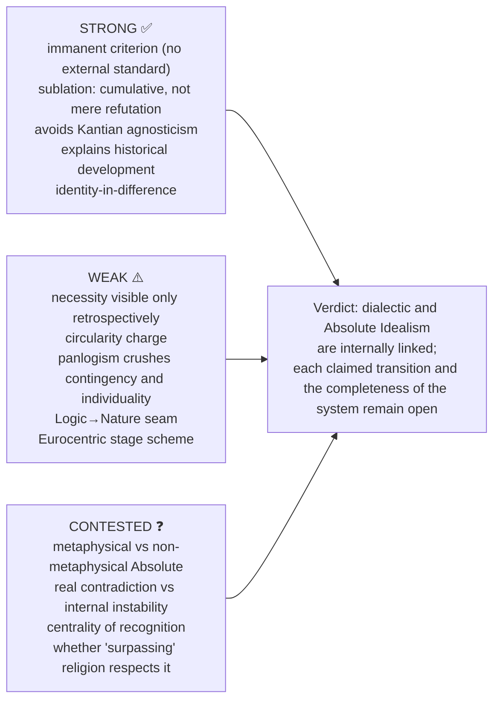

### 15.1 10-mark: "How does Hegel challenge Kant's phenomena/noumena distinction?" (2025)

```text
Definition : Kant's negative noumenon limits sensible cognition; Hegel targets its
             treatment as a permanently external thing-in-itself.
Argument   : (1) a determinately known limit is relational; (2) the empty in-itself is an
             abstraction produced by thought; (3) a fixed appearance/reality dualism cannot
             explain their relation.
Result     : Reject the in-itself as a permanently external explanatory remainder;
             identity-in-difference through mediation.
Evaluate   : Kant replies: negative noumenon = limiting concept, not knowledge of a beyond.
             Hegel pressures reified two-world/affection readings; the limit argument alone
             does not prove his complete Absolute system.
```

### 15.2 15-mark: "What is the dialectical method? How does it help in realising the Absolute?" (2022)

```text
Frame    : Immanent development, not an external recipe.
Expo-A   : abstract immediacy → determinate negation → sublation (cancel, preserve, raise);
           demonstrate the self-undermining; use Being–Nothing–Becoming; note T-A-S provenance.
Expo-B   : The Absolute realises itself THROUGH dialectic — Logic → Nature → Spirit;
           each stage sublates the previous; "The True is the Whole."
Critique : Popper (unfalsifiable post-hoc justification); Kierkegaard (crushes the individual).
           Reply: logic of development, not empirical prediction; individual addressed
           at the subjective-spirit level.
Close    : Dialectic and Absolute Idealism are internally linked, but each claimed
           transition and the completeness of the system remain open to criticism.
```

### 15.3 20-mark: "Discuss Hegel's dialectical method. How does it lead to Absolute Idealism?" (2021)

```text
Frame   : Hegel inherits Kant's problem (how is metaphysics possible?) but refuses Kant's
          solution (it is not possible as knowledge). Thought CAN grasp the Real because
          the Real is itself rational.
Body-A  : Method — immanent critique, determinate negation, mediation, sublation;
          Being–Nothing–Becoming; T-A-S provenance.
Body-B  : Application across Logic, Nature, Spirit; the whole movement is the Absolute coming
          to self-knowledge; "the Absolute is Subject, not merely Substance."
Body-C  : Challenge to Kant — reject a permanently external in-itself; reconcile subject and
          object through identity-in-difference; lordship–bondage only as bounded illustration.
Assess  : Strengths — systematic, avoids Kantian agnosticism, explains historical development.
          Weaknesses — circularity charge; panlogism crushes contingency and individuality
          (Kierkegaard); Marx relocates dialectic in matter; analytic revolt finds logic obscure.
Close   : Method IS the Absolute's life. Accept or reject, you must engage this equation.
```

> [!TIP]
> **Executable closing positions.** Dialectic: "defensible exactly to the extent that it is *descriptive of conceptual breakdown* and indefensible to the extent that it claims *predictive* force." Logic → Nature: "the seam of the system… keep the dialectic and drop the Idea (Marx), or keep existence and drop the system (Kierkegaard, Heidegger)." Unhappy Consciousness: "Hegel identified something real and resolved it too quickly."

> [!NOTE]
> **Constructible answer from theme file.** "Compare Hegel's and Strawson's objections to Kant's thing-in-itself" — Frame: one verdict, two methods. Body A: Hegel (to posit a limit is to think beyond it). Body B: Strawson (the doctrine is incoherent by its own rule). Assess: opposite remedies (revisionary vs descriptive). Close: the negative-noumenon reading escapes Hegel but then cannot "affect" anything (§10.1).

---

## Sources

Y. Masih, *A Critical History of Western Philosophy* (Hegel chapter); Frederick Copleston, *A History of Philosophy*, vol. VII; Peter Singer, *Hegel: A Very Short Introduction*; Robert Audi (ed.), *The Cambridge Dictionary of Philosophy*, "Hegel"; Hegel, *Phenomenology of Spirit* (Preface, Ch. IV), *Philosophy of Right* (Preface), *Science of Logic*; Karl Popper, *The Open Society and Its Enemies*, vol. 2; Charles Taylor, *Hegel*; advanced-dossier trail: Pippin, Pinkard, Houlgate, Kojève, Honneth; repository theme files cited in the header.
