# MOORE, RUSSELL AND EARLY WITTGENSTEIN — Examiner-Grade Mindmap

> **Syllabus (verbatim):** Moore, Russell and Early Wittgenstein : Defence of Commonsense; Refutation of Idealism; Logical Atomism; Logical Constructions; Incomplete Symbols; Picture Theory of Meaning; Sying and Showing. (📝 the official line prints "Sying"; retain when quoting the syllabus, use **Saying and Showing** for the doctrine.)
> **Catalogue key:** `philosophy-paper-i-western-philosophy-06` · Paper I · Western Philosophy (Section A)
> **Sources used:** `paper-1/western/Moore-Russell-EarlyWittgenstein.md` (canonical owner, read in full) · `_advanced/Western-Philosophy-Dossier.md` §6 (optional depth) · `paper-1/_PYQ-Western-Philosophy-2018-2025.md` · `paper-1/_PYQ-Western-Philosophy-2026.md` · `paper-1/_themes/Critiques-of-metaphysics.md` (read in full; it carries no Moore or Russell material and only the owner's Tractatus link-out). `_themes/A-priori-a-posteriori-knowledge.md`, `Substance-across-western.md`, `Causation-across-schools.md`, `Pramana-across-schools.md` and `Self-and-liberation-across-schools.md` were searched and contain no Moore, Russell or Wittgenstein material.
> **Evidence key:** ✅ canonical doctrine · ⚠️ analytical synthesis · ❓ contested / uncertain · ❌ trap
> **Adaptation note:** the 15-module blueprint is Indian-school oriented. Here Module 1 = works, dating and provenance; Module 2 = theory of knowledge (Moore's certainty method, acquaintance/description, bipolarity of sense); Module 3 = internal disputes and interpretive wings; Module 4 = ontology (atoms, facts, objects, logical space, constructions); Module 5 = stance on the unsayable and the metaphysical; Module 6 = analysis and logical form as explanatory method; Module 7 = value (the sources give only the say/show boundary of ethics); Modules 8–15 as in the blueprint. Where the sources are silent the module says so.

> [!IMPORTANT]
> **Core thesis.** The three programmes are an **analytic revolt against Hegelian/Bradleyan idealism**, but they are **not one doctrine**. **Moore DEFENDS, Russell DISSECTS, Wittgenstein PICTURES.** Moore exposes the act/object confusion and reverses the sceptic's burden; Russell separates grammatical from logical form; early Wittgenstein separates what propositions say from the logical form that can only be shown. ✅

---

## 0. Master Overview

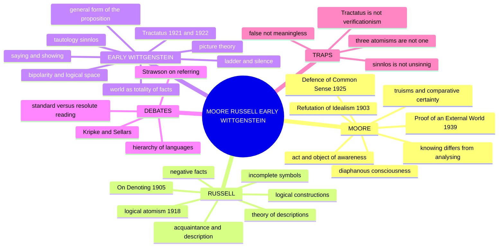

### 0.1 One-screen architecture ⚠️

```text
THE ANALYTIC REVOLT AGAINST ABSOLUTE IDEALISM
═══════════════════════════════════════════════════════════════
  G.E. MOORE (1873–1958)      B. RUSSELL (1872–1970)       EARLY WITTGENSTEIN (1889–1951)
  Defence of Commonsense      Logical Atomism              Picture Theory of Meaning
  Refutation of Idealism      Logical Constructions        Saying vs Showing
  "Here is one hand"          Incomplete Symbols           (German 1921; bilingual 1922)
  analysis ≠ system           Theory of Descriptions
═══════════════════════════════════════════════════════════════
```

### 0.2 Who owns what — attribution table ✅

| Syllabus term | Owner | Key text |
|---|---|---|
| Defence of Commonsense | **Moore** | "A Defence of Common Sense" (1925) |
| Refutation of Idealism | **Moore** | "The Refutation of Idealism" (1903) |
| Logical Atomism | **Russell** (and distinctly Wittgenstein in the *Tractatus*) | "The Philosophy of Logical Atomism" (1918); *Tractatus* |
| Logical Constructions | **Russell** | "The Relation of Sense-Data to Physics" (1914); *Our Knowledge of the External World* |
| Incomplete Symbols | **Russell** | "On Denoting" (1905); *Principia Mathematica* |
| Picture Theory of Meaning | **Early Wittgenstein** | German 1921; bilingual *Tractatus* 1922 |
| Saying and Showing | **Early Wittgenstein** | *Tractatus* 4.12–4.1212, 6.522, 7 |

---

## 1. Identity, Lineage, Works and Provenance Discipline

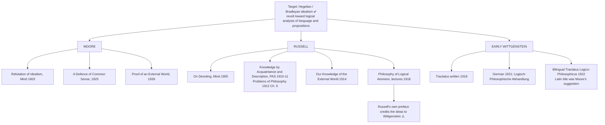

### 1.1 Provenance table ✅

| Item | Correct provenance | Caution |
|---|---|---|
| "The Refutation of Idealism" | *Mind*, **1903** | Same year as *Principia Ethica*; do not conflate |
| "A Defence of Common Sense" | *Contemporary British Philosophy*, **1925** | The **truisms/list** paper |
| "Proof of an External World" | British Academy lecture, **1939** | The **hands** paper. Three different papers, three different arguments; commonest error is merging 1925 and 1939 |
| Hands gesture | Moore's text: **right hand first, then left** | If unsure write "holding up first one hand and then the other" |
| "On Denoting" | *Mind*, **1905** | Theory of descriptions proper |
| Acquaintance / description | *PAS* **1910–11**; *Problems of Philosophy* **1912**, Ch. 5 | Principle of Acquaintance safe to quote from *Problems* |
| "Philosophy of Logical Atomism" | lectures **1918**, published in *The Monist* 1918–19 | Preface credits Wittgenstein; saying so earns a mark |
| "Wherever possible, substitute constructions out of known entities for inferences to unknown entities" | "Logical Atomism" (1924) / *Our Knowledge of the External World* (1914), called the **supreme maxim in scientific philosophising** | Safe |
| Strawson's reply | "On Referring", *Mind*, **1950** | Not a refutation of the logic; a claim about presupposition in ordinary use |
| Kripke's reply | *Naming and Necessity*, lectures **1970**, book **1980** | Give the lecture date **or** the book date, not a merged one |
| *Tractatus* | Written 1918; German 1921; bilingual 1922 | Never write "published in English in 1921" |
| Translations | **Ogden** (with Ramsey, 1922, checked by Wittgenstein) and **Pears–McGuinness** (1961) | Differ at exactly the points most quoted |
| Proposition 7 | Ogden: "Whereof one cannot speak, thereof one must be silent." Pears–McGuinness: "What we cannot speak about we must pass over in silence." | Name the translation whenever quoting 7 |
| Citation | Decimal numbering identical in every edition (1.1, 2.11, 2.223, 3.4, 4.0312, 4.06, 4.461, 4.5, 5, 5.51, 5.6, 6, 6.1251, 6.522, 6.54, 7) | Safest citation in the Western syllabus. **There is no proposition 7.1** |
| *Sachverhalt* | "atomic fact" (Ogden/Ramsey); "state of affairs" (Pears–McGuinness) | Choose one; do not equate with Russell's sense-datum atoms |
| "Es verhält sich so und so" (4.5) | Ogden: "Such and such is the case"; P–M: "This is how things stand" | Flag the rendering |
| Colour exclusion | "Some Remarks on Logical Form", *PAS Supp.* **1929**; proposed analysis quickly abandoned | Not a settled later solution |
| "Picture theory" | Commentators' label; Wittgenstein writes *Bild* and *abbilden* | Say "the doctrine usually called the picture theory" |
| Ladder passage | 6.54; wording differs between translations | Name translation or paraphrase |

> [!WARNING]
> Never write that the *Tractatus* was "published in English in 1921"; that Wittgenstein "said language is a picture of the world" without the *logical form* qualification; or that Russell invented logical atomism unaided.

### 1.2 Period and owner-scope map ⚠️

- Russell's views changed: sense-data/acquaintance, 1918 atomism and later neutral monism must not be presented as one timeless doctrine.
- Moore's naturalistic fallacy and Open Question Argument belong to **ethics**, not this owner; the paradox of analysis is method-context, not a syllabus limb.
- Russell's paradox, theory of types and later neutral monism are optional orientation.
- **Verification principle** belongs to **Logical Positivism**; **meaning-as-use, language-games, family resemblance, private language** belong to **Later Wittgenstein**. Colour exclusion and the 1929 transition diagnose internal pressure only.
- Analysis is the cross-cutting method but differs: Moore distinguishes what ordinary judgment commits us to; Russell exposes quantified logical form; early Wittgenstein investigates conditions and limits of propositional representation.

---

## 2. Theory of Knowledge

### 2.1 Moore: "A Defence of Common Sense" (1925) ✅

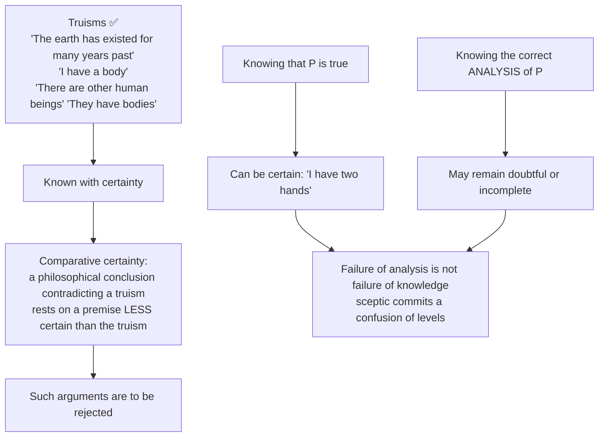

- "Common sense" is **not** opinion polling or convention; it is a set of ordinary world-claims Moore says each of us knows, plus a comparative-certainty method. The list is philosophically contestable rather than infallible by definition.

### 2.2 Moore: "Proof of an External World" (1939) ✅

| Step | Content |
|---|---|
| 1 | "Here is one hand" (gesture, right hand) |
| 2 | "and here is another" (left hand) |
| 3 | Therefore at least two material objects exist |
| 4 | Therefore an external world exists |

**Moore's three conditions for a rigorous proof** (part most scripts omit): (i) premiss **different** from conclusion, so not circular; (ii) premiss **known**, not merely believed; (iii) conclusion **follows** — hands are things met with in space, Moore's own gloss on "external".

- Significance: Moore **reverses the burden of proof**. He cannot prove the premises themselves but insists knowing them is more certain than any sceptical premiss.
- **Objection ❓:** question-begging, since the sceptic doubts that Moore *knows* the premiss. **Reply:** Moore need not first prove every known premiss; no sceptical argument has premises more certain than the ordinary proposition denied (defenders such as Pryor: the burden shifts).
- **Later boundary:** *On Certainty* re-examines whether such propositions are ordinary knowledge-claims or framework (hinge) certainties; that positive account belongs to Later Wittgenstein. Contrast Kant's transcendental strategy (Kant owner §3.7).

### 2.3 Moore: paradox of analysis ⚠️ (optional context)

If "X is a brother" = "X is a male sibling", then either the analysis says the same thing (trivially uninformative) or something different (not an analysis). No settled Moorean solution; Fregean sense/mode-of-presentation differences are proposed responses. Use only to show analysis cannot be trivial verbal substitution.

### 2.4 Russell: knowledge by acquaintance vs description ✅

| ACQUAINTANCE | DESCRIPTION |
|---|---|
| **Direct**, presentational, non-inferential — "directly aware… without the intermediary of any process of inference" | **Indirect**, propositional — I know that *there is exactly one thing* answering to a description |
| Objects: **sense-data**, **memory** data, **introspective** data, **universals** (redness, before, diversity) | Objects: physical objects, other minds, historical persons, unobservables of science |
| In the austere 1910s phase, demonstratives "this/that" for present acquaintance are candidates for **logically proper names** | Yields denoting phrases "the F", contextually eliminated rather than treated as names |
| Basis of all understanding | Built from acquaintance-items by logical construction |

**Principle of Acquaintance** (quote verbatim from *Problems*, Ch. 5): "**Every proposition which we can understand must be composed wholly of constituents with which we are acquainted.**"

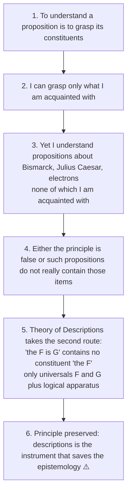

**Bismarck series ✅:** Bismarck himself (acquaintance with his own self-consciousness) → someone who met Bismarck (sense-data anchored) → someone who only read of him (pure description: "the first Chancellor of the German Empire") → all of us, of "the most long-lived of men". Russell: "merely descriptive" knowledge when "we do not know any proposition 'a is the so-and-so' where a is something with which we are acquainted."

**Presuppositions ⚠️:** P1 items given without inference (Sellars later: "the Myth of the Given"); P2 understanding is constituent-grasping; P3 sense-data are objects distinct from the act of sensing (inherited from Moore's act/object distinction); P4 in the austere phase only demonstratives tied to present acquaintance are logically proper names (phase-specific; Kripke later attacks the ordinary-name thesis).

| Objection | Source | Reply | Residual |
|---|---|---|---|
| Ordinary names are not disguised descriptions; "Aristotle" would still name Aristotle if every associated description were false (rigid designators) | **Kripke**, *Naming and Necessity* | Retreat to claim about *logically* proper names only | The *logic* of descriptions survives; the *theory of names* does not ⚠️ |
| Nothing is given uninterpreted; the given cannot be both non-conceptual and justifying | **Sellars** (1956); anticipated by Kant's "intuitions without concepts are blind" | Acquaintance is presentation, not knowledge-of-truths | How does it *ground* anything? ❓ |
| Acquaintance with universals is a large Platonic concession | general | Russell accepts: realist about universals (against Berkeley's nominalism) | Point where Russell breaks with the British empiricist line ⚠️ |

**Executable verdict:** "The logical machinery has proved permanent; the epistemology it was built to serve — sense-data as bedrock, names as disguised descriptions — has not survived Sellars and Kripke."

### 2.5 Early Wittgenstein: bipolarity as the condition of sense ✅

1. A proposition depicts a possible situation; depicting is representing something *as* being the case.
2. To represent something as the case is to allow it might not be; a representation that could not be false is not representing.
3. Therefore sense requires the availability of **both** truth-values (not mere bivalence: **bipolarity**).

Anchors: 4.06 ("A proposition can be true or false only by being a picture of reality"); 2.223; 2.224. The term comes from *Notes on Logic* (1913).

| Consequence | Content |
|---|---|
| 1 | Tautologies and contradictions are **sinnlos** (senseless, 4.461–4.4611): well-formed, say nothing |
| 2 | Metaphysical sentences are **unsinnig** (nonsensical): "The Absolute is perfect", "objects exist" fail to depict any possible situation |
| 3 | Elementary propositions are postulated **logically independent** (2.061, 4.211) |
| 4 | **Not verificationism:** the *Tractatus* asks whether a proposition depicts a possible fact; the Vienna Circle's empirical criterion belongs to Logical Positivism |

---

## 3. Internal Disputes, Interpretive Wings and Counter-Currents

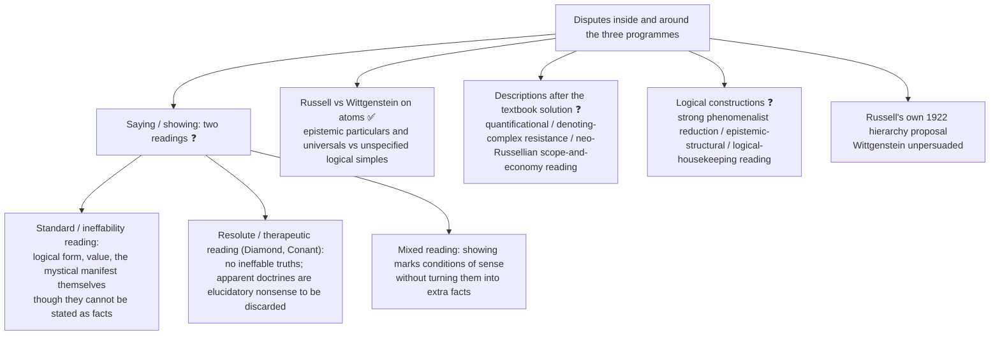

- **Agreement of both readings:** ethics, aesthetics and the mystical are not factual propositions within logical space.
- **Advanced objection → counter-reply (showing) ❓:** if the book's own theses are nonsense it self-destructs → that self-undermining is either deliberate ladder-work or a method forcing the reader to see the limit between meaningful proposition and what can only be manifested. One closing paragraph suffices; do not let it swamp the picture theory.
- **Descriptions (advanced) ❓:** propositional-attitude cases and negative existentials still create pressure; even so the theory decisively handles existence/uniqueness puzzles without populating the world with nonexistent objects.
- **Constructions (advanced) ❓:** building the world from private sense-data invites solipsism → reply: constructions are public-theoretical reconstructions aimed at explanatory economy, not a denial of common objects or science.
- **Promotion triggers (advanced dossier):** descriptions as names or full resolution of denoting; Russell as phenomenalist / constructions avoiding solipsism; whether the *Tractatus* is self-refuting or what "showing" means.
- Source trail (advanced): Stephen Neale; Peter Hylton; David Pears; P.M.S. Hacker; Cora Diamond; James Conant.

---

## 4. Metaphysics and Ontology

### 4.1 Russell's logical atomism ✅

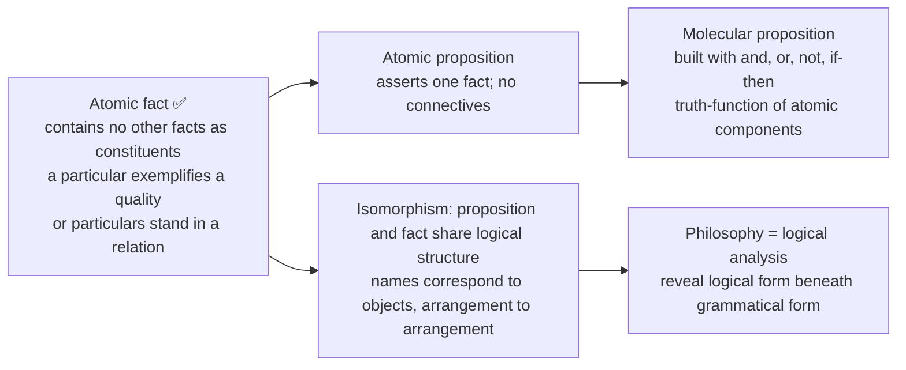

- "Atomic" means **logical** atoms, not physical atoms (2020 Q2(c)); not microscopic size.
- **Facts** make propositions true or false; facts are not truth-bearers.
- **Negative facts:** Russell reluctantly accepts them to account for true negatives ("Socrates is not alive"); contested because it adds absences to ontology — a cost of preserving a direct truth-making relation.
- Early Wittgenstein's alternative: obtaining elementary states constitute the world; their totality also determines which possible states do not obtain; negation is not a further object or logical constant standing for something.
- Truth-functionality: no extra "facts" correspond to "and" or "or".

### 4.2 Russell's logical constructions ✅

> "Wherever possible, substitute constructions out of known entities for inferences to unknown entities." — the "supreme maxim of scientific philosophizing", a methodological Occam's razor.

| Apparent entity | Constructed out of |
|---|---|
| Physical object ("this table") | Classes of actual and possible sense-data from various viewpoints |
| A "nation" | Patterns of behaviour of individual persons |
| A number | Classes of equinumerous classes (Frege–Russell) |
| A point of space | Convergent classes of volumes |

| Logical atoms | Logical constructions |
|---|---|
| Genuinely exist as independent simples | Not additional entities; *symbols* defined contextually |
| Constituents treated as basic within the analysis | Contextual construction adds no separate entity |
| Ground of knowledge | Shorthand for complexes of atoms |

Period-specific programme, not Russell's permanent ontology. Constructions are **not fictions** and ordinary objects are not meaningless; "the table" is reconstructed through ordered actual and possible perceptual data in the phenomenalist phase.

### 4.3 The Tractatus world ✅

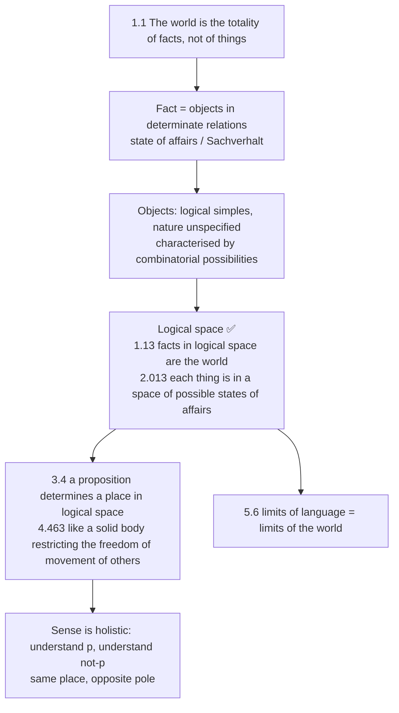

| Russell | Wittgenstein |
|---|---|
| Acquainted particulars plus qualities/relations in the 1918 programme; not physical particles | Objects: logical simples, nature unspecified, combination possibilities fix logical space |
| Combines logical analysis with a changing acquaintance epistemology | Primarily a condition-of-sense argument |
| Logical independence acknowledged, somewhat loosely | Strictly insisted on: elementary propositions logically independent |
| 1918 lectures acknowledge Wittgenstein's influence | *Tractatus* written 1918, published 1921 |

### 4.4 Presuppositions of the Tractatus apparatus ⚠️

P1 elementary propositions and simple objects exist (no uncontested example given); P2 elementary propositions are logically independent (colour exclusion pressures this); P3 all propositions are truth-functions of elementary ones (belief-contexts and modality create difficulties); P4 the N-operator handles infinite domains (disputed). State as pressures and later developments, not refutations conceded inside the *Tractatus*.

---

## 5. Stance on the Unsayable, the Metaphysical and the Idealist

### 5.1 Moore: Refutation of Idealism (1903) ✅

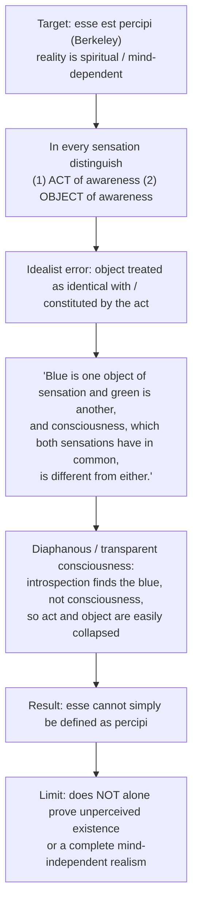

| Moore does | Moore does NOT do |
|---|---|
| Shows idealism cannot be established by the *esse est percipi* argument | Prove realism directly |
| Distinguishes act from object | Provide a full theory of perception |
| Restores respectability of commonsense realism | Directly target Hegel's Absolute Idealism ("the Real is the Rational") |

**"Blue exists" argument (2020 Q2(b)) ✅:** if "Blue exists" meant "Both blue and consciousness exist" the two would have the same content, which Moore denies; the identification is a **self-contradictory mistake**. ❓ Objection: introspective discriminability may not establish mind-independence → Moore's point is narrower but damaging: esse cannot simply be defined as percipi.

### 5.2 Russell: the theory of descriptions rejects ghostly objects ✅

- "The present King of France is bald": is it meaningless? about a non-existent entity (Meinong, ontology inflated)? Russell: neither — it is **false**.
- Analysis: **(∃x)[Kx ∧ ∀y(Ky → y = x) ∧ Bx]** = existence + uniqueness + predication; existence clause fails, whole conjunction false.
- **"The golden mountain is very high"** (2025 Q1(d)): same analysis; false, not meaningless, no Meinongian commitment; "the golden mountain" is an incomplete symbol that disappears on analysis.

### 5.3 Tractatus: what can be said and what can only be shown ✅

| SAID (*gesagt*) | SHOWN (*gezeigt*) |
|---|---|
| Propositions of natural science: pictures of facts; contingent states of affairs | **Logical form**, the structure every proposition shares with reality |
| | **The existence of objects**, presupposed by meaningful language |
| | **Logical truths** (tautologies) show the scaffolding of the world |
| | **Ethics, aesthetics, the meaning of life, the mystical**: not *in* the world, not sayable |
| | **That a proposition pictures a fact** shows itself; cannot be said in a further proposition |

> 4.1212 "What can be shown, cannot be said." · 7 "Whereof one cannot speak, thereof one must be silent." (Ogden)

### 5.4 Ladder (6.54) and the limits of the *Tractatus* ✅

> Pears–McGuinness: "My propositions serve as elucidations in the following way: anyone who understands me eventually recognises them as nonsensical, when he has used them — as steps — to climb beyond them. (He must, so to speak, throw away the ladder after he has climbed it.)"

- The *Tractatus* tries to say what can only be shown; once grasped, its propositions are discarded.
- Proposition 7 is **not** a verification principle nor a declaration that value-claims are empirically false.
- Philosophy is an **activity of clarification**, not a doctrine (4.111–4.115).

---

## 6. Explanatory Principles: Analysis, Logical Form and Contextual Definition

### 6.1 Incomplete symbols and the three puzzles ✅

An **incomplete symbol** has no meaning in isolation, contributes to the meaning of whole sentences, and "disappears" on logical analysis; paradigm: definite descriptions.

| Puzzle | Problem | Solution |
|---|---|---|
| Negative existentials | "The present King of France does not exist": how say *of it* that it doesn't exist? | Asserts "It is not the case that there is exactly one present King of France"; no entity denoted |
| Excluded middle | "The King of France is bald" must be true or false, yet there is no King | FALSE (existence clause fails); its negation, correctly parsed (primary occurrence), is TRUE |
| Identity / substitutivity | George IV wished to know whether Scott was the author of *Waverley* | "The author of *Waverley*" is an incomplete symbol, quantificational not referential; substitution fails |

| Occurrence | "The King of France is not bald" |
|---|---|
| **Primary** (wide scope) | "There is exactly one King of France and he is not bald" → FALSE |
| **Secondary** (narrow scope) | "It is not the case that there is exactly one King of France who is bald" → TRUE |

- **Core principle:** grammatical form ≠ logical form; the surface structure may radically mislead. This is the fundamental principle of analytic philosophy.
- Relation to atomism: contextual analysis removes apparent constituents and leaves quantified structure plus genuine logical constituents, **supporting** the atomist search; it does **not** prove analysis terminates, identify all simples or show reality exhaustively atomic.

### 6.2 Picture theory ✅ (2022 Q3(c))

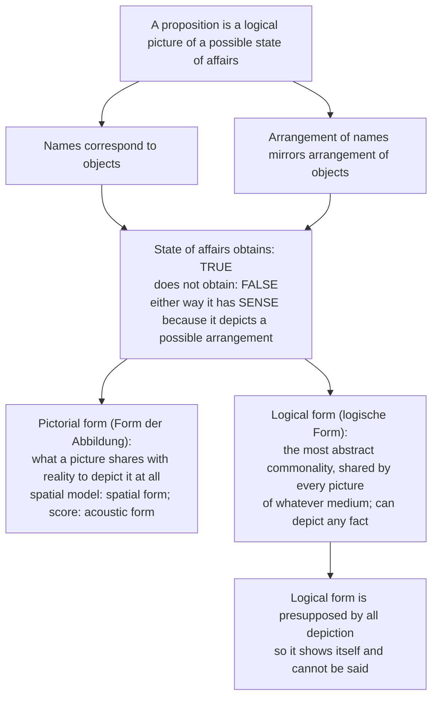

### 6.3 The general form of the proposition ✅

- **Informal (4.5):** "This is how things stand" (*Es verhält sich so und so*).
- **Formal (6): [ p̄ , ξ̄ , N(ξ̄) ]** — p̄ the totality of elementary propositions; ξ̄ any selected set of propositions already formed; N(ξ̄) the result of applying the N-operator.
- **N-operator (5.502, 5.51)** = joint negation ("none of the selected propositions is true"). With N(p,q) = not-p and not-q: not-p = N(p); p or q = N(N(p,q)); p and q = N(N(p),N(q)). Quantification via sets of values of propositional functions (5.52); adequacy for infinite or multiply general cases disputed.

| # | What proposition 6 asserts |
|---|---|
| 1 | Every proposition is a truth-function of elementary propositions (5) |
| 2 | Every truth-function can be produced by successive applications of the single operation N |
| 3 | One and only one general form: a formal series generated from the elementary base |
| 4 | **Logic needs no primitive propositions and no logical objects**: decisive break with Russell and Frege |
| 5 | "There can be no surprises in logic" (6.1251); logical propositions are tautologies (6.1) |
| 6 | Whatever cannot be produced by the rule is not a proposition: criterion of the sayable and the boundary of the Preface |

*Fundamental idea* (4.0312): logical constants are not representatives; negation names nothing.

### 6.4 Tautology, contradiction, nonsense ✅

| Term | Status | Example |
|---|---|---|
| Tautology, *sinnlos* | True under all truth-conditions; says nothing | "It is raining or it is not raining" |
| Contradiction, *sinnlos* | False under all truth-conditions | "It is raining and it is not raining" |
| Metaphysical pseudo-proposition, *unsinnig* | Fails the conditions of factual sense | "The Absolute is perfect"; "There are objects" |

---

## 7. Value and Human Goals

The sources give **no kāma/artha/dharma/mokṣa-type scheme and no ethical theory** for these three thinkers. What they give:

- **Early Wittgenstein:** ethics, aesthetics, the meaning of life and the mystical are not facts in logical space and therefore not sayable (6.4–6.522); on the standard reading they manifest themselves, on the resolute reading there are no ineffable truths; **7** is not a claim that value-claims are false.
- **Moore's** naturalistic fallacy and Open Question Argument belong to **ethics** and are not printed in this owner.
- **Russell, Moore:** no value doctrine in the owner file.
- ❌ Trap: "The *Tractatus* rejects ethics and religion as false" — they are not factual propositions; ❌ treating ethics and the mystical as a further layer of syntax — they are not facts at any level.
- Cross-paper link (owner): Religious Language — the say/show distinction as ancestor of non-cognitivism about religious language.

---

## 8. Inter-School Comparative Matrices

### 8.1 Moore · Russell · Early Wittgenstein ✅/⚠️

| Axis | Moore | Russell | Early Wittgenstein |
|---|---|---|---|
| Target | Scepticism and idealist conflation | Misleading grammar and ontological inflation | Conditions and limits of propositional sense |
| Core tool | Commonsense + act/object distinction | Logical analysis (theory of descriptions) | Picture theory of propositions |
| Ontology | Ordinary objects accepted; full perceptual theory underdetermined | Particulars, qualities/relations, facts, phase-specific constructions | Facts in logical space; simple objects unspecified |
| Metaphysics | Reject conclusions less certain than truisms | Eliminate pseudo-constituents and test what remains | Factual propositions say; logic/value/metaphysics raise the say/show problem |
| Self / subject | Conscious act distinguished from its object | Acquaintance framework varies by phase | Metaphysical subject appears at the limit of the world (optional here) |
| Legacy | Analytic / common-sense method | Formal analysis, ontological economy | Influences positivism, then Wittgenstein's own later criticism |

### 8.2 Russell's atomism vs the *Tractatus* atomism ✅

(See §4.3 table.) Mnemonic: **Moore DEFENDS, Russell DISSECTS, Wittgenstein PICTURES.**

### 8.3 Moore vs Russell on Berkeley (2018 Q3(a), owned by Empiricism)

Listed as a cross-owned question: *How do Moore and Russell react to Berkeley's view? Do you find any difference between Moore's reaction and Russell's one?* Material in this owner: Moore blocks *esse est percipi* by distinguishing act from object (§5.1); Russell inherits the act/object distinction for sense-data (P3 in §2.4) and is a realist about universals against Berkeley's nominalism. The full Berkeley material sits in the Empiricism owner.

### 8.4 Bridge from the theme file ⚠️

*Critiques of Metaphysics* trajectory: content-attack (Hume) → limit-drawing (Kant) → meaning-criterion (Positivism) → therapeutic dissolution (Later Wittgenstein) → naturalised ontology (Quine) → descriptive reinstatement (Strawson). The *Tractatus* is the owner's link-out into this chain: its saying/showing boundary is the historical pressure that Logical Positivism transforms into a verification criterion, and the *Investigations* then abandons.

---

## 9. Criticisms and Reconstructed Replies

```mermaid
flowchart TD
  O1["Moore: 'Here is one hand' begs the question"] --> R1["Burden shifts: sceptic must show why abstruse premises beat immediate perceptual knowledge ⚠️"]
  O2["Moore: paradox of analysis"] --> R2["Moore does not say analysis is easy; knowledge of truisms does not wait on it"]
  O3["Moore: refutes Berkeley, not Hegel"] --> R3["Correct: act/object blocks esse est percipi, not 'the Real is the Rational' ✅"]
  O4["Russell: Strawson, 'On Referring' 1950<br/>presupposition failure, truth-value question does not arise"] --> R4["Genuine rival analysis: pragmatics of ordinary use; the quantificational logic stays powerful ✅"]
  O5["Russell: logically proper names only 'this' and 'that'"] --> R5["Russell knew this shrinks genuine names drastically ✅"]
  O6["Russell: negative facts inflate ontology; atoms unstable across phases"] --> R6["Accepted as a truth-making cost; analysis provisional"]
  O7["Tractatus: ethics, aesthetics, religion are not factual pictures"] --> R7["Deliberate demarcation; readings divide on ineffable truths"]
  O8["Tractatus: self-application, its own propositions fail its criterion"] --> R8["6.54 acknowledges the ladder; successful therapy or unstable doctrine disputed"]
  O9["Tractatus: no uncontested simple objects or elementary propositions"] --> R9["Argued as needed for determinate sense; critics question the transcendental route"]
  O10["Tractatus: colour exclusion resists independence"] --> R10["Motivates later revision; meaning-as-use stays with the later owner"]
```

### 9.1 Is the hierarchy of languages a solution? (2026 Q4(a), 20 marks) ✅/⚠️

**The difficulty (steps):** (1) picture theory: a proposition pictures by sharing logical form (2.161, 2.17); (2) a picture "cannot depict its pictorial form: it displays it" (2.172–2.174); (3) so propositions say how things contingently stand, while logical form, internal relations and sense can only be shown (4.121–4.1212); (4) whatever is not a contingent fact in logical space cannot be said (6.4–6.522); (5) philosophy is clarification (4.111–4.115); (6) the self-reference problem → the ladder (6.54).

**Russell's proposal (1922 Introduction):** L₁ cannot state its own structure → metalanguage L₂ describes L₁ → L₃ describes L₂ "and so on to any assignable extent", **no final language**. "Every language has, as Mr Wittgenstein says, a structure concerning which, *in the language*, nothing can be said, but there may be another language dealing with the structure of the first language." Russell offers it as a **possible loophole**; Wittgenstein was unpersuaded. **Tarski** (1933/1935) later shows a truth-definition for L needs an essentially richer metalanguage — a later, independent development on semantic paradox, never Wittgenstein's direct answer.

| Test | Succeeds | Fails |
|---|---|---|
| Crude self-reference (language stating its own syntax / truth) | ✅ blocked; stated rigorously in L₂ | |
| Formal semantics of an object language | ✅ Tarskian truth-definitions | |
| **Logical form as such** | | ❌ each metalanguage has a form it cannot characterise internally; problem displaced upward |
| **Totality** | | ❌ open hierarchy; "limits of language" never stated |
| Wittgenstein's actual claim | | ❌ concerns logical form common to representation as such, not vocabulary missing from one language |
| **Ethics, value, metaphysical subject, mystical** | | ❌ not facts in logical space; ascent does not touch them |
| The *Tractatus*'s own sentences | ⚠️ partially, some recast as metalinguistic syntax | ❌ transcendental and mystical remarks (5.6–7) cannot |

> [!TIP]
> **Balanced verdict line:** "The hierarchy is a genuine solution to a **formal-semantic** problem and an evasion of a **transcendental** one: it tames self-reference at the cost of turning a single unsayable limit into an infinite series of unsayable limits."

Presuppositions: P1 representation requires shared logical form which cannot be represented from outside; P2 sense is bipolar, logical form and value are not; P3–P4 (Russell/Tarski) languages individuated as formal systems, ascent legitimate — **exactly what Wittgenstein's argument denies as a solution**.

| Objection | Reply | Verdict |
|---|---|---|
| ❌ "Hierarchy dissolves say/show: what is shown in L₁ is said in L₂" | Only structural features are recovered; L₂'s form remains shown | ⚠️ Strong for Wittgenstein |
| ❌ "Infinite hierarchy is no worse than the natural-number series" | Harmless for arithmetic, fatal here: stating the limits needs a final standpoint | ✅ Decisive |
| ❌ "Tarski proved Wittgenstein wrong" | Conditional result about formalised languages; says nothing on logical form or value | ✅ |
| ❌ "If the *Tractatus* is nonsense it cannot pose the problem" | Traditional: elucidatory; resolute: therapeutic. Hierarchy misses the target either way | ❓ flag split |
| ❌ "Later Wittgenstein concedes the point" | *Investigations* abandons picture theory and single logical form; dissolves the problem | ✅ closing move |

If the **resolute** reading is accepted, the hierarchy answers a question the *Tractatus* never asked. The later Wittgenstein does not ascend the hierarchy; he abandons the demand for a single logical form.

---

## 10. Controlled Comparisons

The owner gives **no East–West comparison table** for this topic and no Indian comparison. It gives only the following internal and cross-tradition pairs:

| Pair | Point of contact | Decisive disanalogy |
|---|---|---|
| Moore vs Kant ⚠️ | Owner's contrast on the external world | Moore reverses the burden by comparative certainty and the hands proof; Kant's is a transcendental strategy (Kant owner §3.7) |
| Moore's hands vs *On Certainty* | Both concern propositions like "I have hands" | Later Wittgenstein asks whether they are ordinary knowledge-claims or framework (hinge) certainties |
| Moore's act/object vs Hegel | Moore's paper targets Berkeley-style *esse est percipi* | It does not directly target Hegel's Absolute Idealism ("the Real is the Rational") |
| Russell vs Strawson | Both treat "The present King of France is bald" | Falsity by failed existence clause vs presupposition failure (no truth-value question); see Quine–Strawson owner §3.4 |
| Russell vs Kripke | Both on proper names | Russell: ordinary names are disguised descriptions; Kripke: rigid designators |
| Tractatus vs Logical Positivism | Both draw a boundary of sense | *Tractatus*: possible factual picturing; Vienna Circle: empirical verifiability. Unsayable is **shown**, not discarded as empirically empty |
| Tractatus vs Later Wittgenstein | Both concern language and sense | Later work abandons picture theory, single logical form and ideal language |
| Tractatus say/show vs religious language (cross-paper) | Ancestor of non-cognitivism about religious language | See Paper II Religious Language owner |

> [!WARNING]
> Keep the three programmes distinct; do not import meaning-as-use into the early answer.

---

## 11. Diagnostic Deep-Dives for High-Frequency Themes

### 11.1 Directive decoder ⚠️

| Directive | Demand | Structural obligation | Fatal error |
|---|---|---|---|
| Discuss / Explain with reference to the theory of descriptions (2025 Q1d, 2024, 2023) | Symbolic analysis, not paraphrase | Three conjuncts (existence, uniqueness, predication) in notation, then scope, then the puzzle solved | Explaining "the golden mountain" in words only |
| Elucidate (quotation-led, e.g. "Blue exists") | Locate the sentence in the paper's argument | Name paper and year, target (idealism / *esse est percipi*), distinction (act vs object) | Free-floating gloss |
| Critically examine the picture theory | Assessment dominates | Reconstruct via bipolarity + logical space + general form, then colour-exclusion breakdown, then ruling | Describing "propositions picture facts" plus one criticism |
| What is meant by saying/showing? (2021 Q4c) | Show the distinction is forced | Derive: logical form presupposed by depiction, so not depictable; then ladder and 7 | Listing sayable and showable items |
| Examine Moore's defence of common sense | Structure of the burden reversal | Truisms → knowing vs analysing → certainty comparison → *On Certainty* diagnosis | "Moore held up his hands" |
| Distinguish / Compare Russell's vs *Tractatus* atomism | Fix a criterion first | Are simples epistemic (Russell's sense-data) or logical posits (Wittgenstein's objects)? | Two parallel descriptions |
| Comment on "incomplete symbol" | Definition + test + consequence | No meaning in isolation; does it disappear on analysis?; ontological economy | Repeating the phrase |
| Assess the significance of | What changed in philosophy | Grammatical form ≠ logical form → analysis programme; Moore's method → ordinary language philosophy | Praise without content |

### 11.2 Graded verdict bank ⚠️

| Sub-topic | 10-mark verdict | 15-mark verdict | 20-mark verdict |
|---|---|---|---|
| Defence of common sense | Moore changes the burden: no sceptical premiss is more certain than the ordinary proposition denied | Knowing/analysing prevents conceptual difficulty from automatically defeating ordinary knowledge | Weighs certainty but supplies no neutral proof of its premiss; hinge analysis is comparison, not owner content |
| Refutation of Idealism | Awareness is distinguished from its presented object, so *esse* cannot simply mean *percipi* | Transparency explains the temptation to conflate; introspective distinction alone may not establish mind-independence | Blocks one route to idealism and aids analytic realism; neither refutes every idealism nor completes a theory of perception |
| Theory of descriptions | Contextually eliminated into existence, uniqueness, predication | Handles empty descriptions, negative existentials and scope without a denoted non-existent object | Strawson pressures it as pragmatics/presupposition; the quantificational analysis remains powerful without being the only complete semantic account |
| Acquaintance vs description | Explains how discourse can concern items not directly presented | Acquaintance principle motivates contextual analysis, but descriptions have independent logical payoffs | Russell's acquaintance candidates and genuine names change across phases; Sellars/Kripke bounded evaluation only |
| Logical atomism | Analysis seeks atomic facts and propositions; descriptions do not prove a final base | Russell: phase-specific particulars/universals; Wittgenstein: objects by combinatorial logical role | Negative facts, unstable simples, colour incompatibility, non-extensional contexts pressure the two differently; not one failed thesis |
| Logical constructions | Contextual construction substitutes analysed structure for an extra inferred entity | Physical-object construction is phase-specific and strained by possible sense-data | Establishes ontological economy; Carnap/Quine afterlives remain later ownership |
| Picture theory | Sense by presenting a possible situation through shared logical form | Bipolarity, logical space and truth-functional generation form the programme | Colour incompatibility and attitude/modal contexts pressure its assumptions; do not smuggle in meaning-as-use |
| Saying vs showing | Logical form cannot be pictured as one more fact because every picture presupposes it | The ladder makes self-application deliberate | Standard and resolute readings disagree on any remaining ineffable truth; state both before ruling |

### 11.3 Colour exclusion as pressure ✅/❓

"This patch is red all over" and "This patch is blue all over" are incompatible though neither looks like a truth-function of the other. It pressures the independence of elementary propositions and helped drive Wittgenstein's 1929 search for a richer logical form; it does not prove no deeper analysis could preserve independence.

---

## 12. PYQ Routing Ledger (2018–2025, plus 2026)

> Corpus signal: **14** primary-owned parts out of 112 in 2018–2025 (joint-highest Western clause, at least one in every year) **plus 2 in 2026 = 16 primary-owned parts**. 2026 table: this owner 2 parts, 30 marks.

| Year | Q | Marks | Exact demand | Route | Map to |
|---|---|---:|---|---|---|
| 2018 | Q3(c) | 15 | How does Wittgenstein apply the distinction between 'saying' and 'showing' to point to a single way of apprehending the most decisive problems of philosophy? Is he justified? Give reasons for your answer. | picture/logical-form limit → say/show table → 6.54 ladder → standard/resolute → verdict | §5.3–5.4, §9.1 |
| 2018 | Q4(c) | 15 | How is Russell's theory of definite description related to his Logical Atomism? Discuss and give reasons for your answer. | contextual elimination → genuine logical constituents → atomist search → does not prove termination | §6.1, §4.1 |
| 2019 | Q3(c) | 15 | Why is Moore's philosophy called common-sense realism? | truisms → knowing/analysis → comparative certainty → hands proof → sceptical objection | §2.1–2.2 |
| 2020 | Q2(b) | 15 | Critically discuss the following statement by Moore: "If anyone tells us that to say 'Blue exists' is the same thing as to say that 'Both blue and consciousness exist', he makes a mistake and a self-contradictory mistake." | awareness/object → transparency → anti-identity → no automatic proof of unperceived existence | §5.1 |
| 2020 | Q2(c) | 15 | "The reason that I call my doctrine logical atomism is because the atoms that I wish to arrive at as the sort of last residue in analysis are logical atoms and not physical atoms." Write a note on the nature of atomic facts according to Russell in the light of the above statement. | logical not physical → particulars/qualities/relations → atomic/molecular → negative-fact cost | §4.1 |
| 2021 | Q3(a) | 20 | What are the main arguments put forward by Moore in his paper "A Defence of Common Sense" to prove that there are possible propositions about the world that are known to be true with certainty? Do you think Moore's arguments provide a sufficient response to objections presented by the sceptic against the possibility of knowledge? Give reasons in support of your answer. | truism list → knowledge before analysis → certainty comparison → question-begging → qualified burden-shift | §2.1–2.2, §9 |
| 2021 | Q4(c) | 15 | What does Wittgenstein mean by the statement — "Whereof one cannot speak, thereof one must be silent?" Critically discuss. | proposition 7 translation → factual sense → ethics/mystical boundary → ladder/self-application → graded reading | §5.3–5.4 |
| 2022 | Q1(b) | 10 | What is Bertrand Russell's method of logical analysis? How does it ultimately end in establishing atomic theory of meaning? Discuss. | grammar/logical form → descriptions/constructions → atomic facts/propositions → provisional endpoint and limits | §6.1, §4.1–4.2 |
| 2022 | Q3(c) | 15 | Is there any difference between pictorial form and logical form in Ludwig Wittgenstein's picture theory of language? How does the logical form define the relation between language and reality? Explain. | objects/states → depicting relation → pictorial form → logical form → showing | §6.2 |
| 2023 | Q4(b) | 15 | Why according to Russell is the proposition — "The present king of France is bald" problematic? Critically discuss. | empty apparent subject → existence/uniqueness/predication → false not meaningless → scope/presupposition objection | §5.2, §6.1 |
| 2024 | Q1(c) | 10 | What arguments are offered by Moore to prove that there are certain truisms, knowledge of which is a matter of common sense? Critically discuss. | list and comparative certainty → no popular-opinion reading → sceptical burden → limited verdict | §2.1 |
| 2024 | Q3(a) | 20 | Explain Russell's notion of incomplete symbols. Also explain how this notion leads to the doctrine of logical atomism. | contextual definition → description analysis → constructions → genuine residues → supports but does not entail atomism | §6.1, §4 |
| 2025 | Q1(d) | 10 | "The golden mountain is very high." Discuss this statement in the context of Russell's theory of descriptions. | quantificational expansion → failed existence/uniqueness → false not meaningless → no Meinongian object | §5.2 |
| 2025 | Q3(c) | 15 | "Blue is one object of sensation and green is another, and consciousness, which both sensations have in common, is different from either." Present an account of Moore's refutation of idealism with reference to this statement. | exact paper/target → awareness/object → transparency → *esse/percipi* non-identity → bounded conclusion | §5.1 |
| 2026 | Q1(e) | 10 | "I can prove now, for instance, that two human hands exist." How does Moore use this illustration to prove the existence of an external world? Critically discuss. | primary — §2.2 with §2.1 | §2.2 |
| 2026 | Q4(a) | 20 | "Wittgenstein's difficulty about not being able to say anything within a given language about the structure of that language can be met by the idea of a hierarchy of languages." Do you agree with this statement? Give reasons and justifications for your answer. | primary — owner §6.7 with §§6.1–6.6; paired owner Logical Positivism §3.6 | §9.1 |

**Count check:** 14 (2018–2025) + 2 (2026) = **16 primary-owned parts**; matches the owner's "all sixteen routed 2018–2026 PYQs" and both ledgers (2018–2025 table row 14; 2026 row 2 parts / 30 marks).

### 12.1 Cross-owned (listed, not counted)

| Year | Q | Marks | Demand | Primary owner |
|---|---|---:|---|---|
| 2018 | Q3(a) | 20 | How does Berkeley establish that Mind and its ideas alone are real? How do Moore and Russell react to Berkeley's view in this regard? Do you find any difference between Moore's reaction and Russell's one? Discuss. | Empiricism |

---

## 13. Top Exam Traps

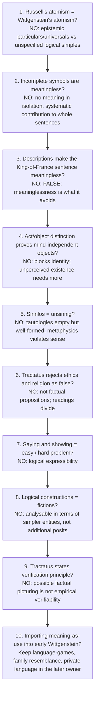

Extra traps recorded in the owner: merging Moore's 1925 and 1939 papers; inverting the hands order; writing "proposition 7.1" (none exists); merging Kripke's lecture and book dates; attributing the hierarchy of languages to Wittgenstein (it is **Russell's** Introduction, which Wittgenstein rejected); anachronism of Tarski (1933/1935) as an answer to the *Tractatus* (1921); confusing "cannot be said" with positivist meaninglessness; agreeing or disagreeing on 2026 Q4(a) without the picture-theoretic **reason** for the limit; writing the 2021-style essay without ever evaluating the hierarchy; a Russell answer burdened with formal logic beyond what shows structure (advanced dossier).

---

## 14. Technical Vocabulary and Terminology Bank

| English gloss | Original term | Meaning | Status |
|---|---|---|---|
| Common-sense truisms | — | Ordinary world-claims known with certainty | ✅ |
| Act / object of awareness | — | Moore's distinction | ✅ |
| Diaphanous / transparent consciousness | — | Introspection finds the object, not the act | ✅ |
| To be is to be perceived | *esse est percipi* | Berkeley's thesis, Moore's target | ✅ |
| Incomplete symbol | — | No meaning in isolation; disappears on analysis | ✅ |
| Definite description | "the so-and-so" | Contextually eliminated | ✅ |
| Primary / secondary occurrence | — | Wide / narrow scope of a description | ✅ |
| Knowledge by acquaintance / by description | — | Direct vs indirect | ✅ |
| Principle of Acquaintance | — | Every understood proposition is composed wholly of acquainted constituents | ✅ |
| Logically proper name | — | "this/that" for present acquaintance, in the austere phase | ⚠️ |
| Logical construction | — | Substituted for an inferred entity | ✅ |
| Atomic fact / proposition | — | Logical, not physical, atoms | ✅ |
| Molecular proposition | — | Truth-function of atomic ones | ✅ |
| Negative fact | — | Truth-maker for true negatives | ❓ |
| State of affairs | *Sachverhalt* | Possible combination of objects | ✅ |
| Object | — | Tractatus logical simple, nature unspecified | ✅ |
| Picture | *Bild* | Model of a possible situation | ✅ |
| Depict | *abbilden* | Represent by shared logical form | ✅ |
| Pictorial form | *Form der Abbildung* | What a picture shares with reality to depict | ✅ |
| Logical form | *logische Form* | Commonality of all representation | ✅ |
| Logical space | *logischer Raum* | Field of possible configurations | ✅ |
| Bipolarity | — | Capable of being true and false | ✅ |
| Elementary proposition | — | Names in immediate combination | ✅ |
| Truth-function | — | Value fixed by components and connective | ✅ |
| N-operator | — | Joint negation | ✅ |
| General form of the proposition | [ p̄ , ξ̄ , N(ξ̄) ] | Rule generating every proposition | ✅ |
| Senseless | *sinnlos* | Tautology / contradiction | ✅ |
| Nonsensical | *unsinnig* | Violates conditions of sense | ✅ |
| Said / shown | *gesagt* / *gezeigt* | The central distinction | ✅ |
| Ladder | 6.54 | Elucidations to be thrown away | ✅ |
| Standard / resolute readings | — | Ineffable truths vs therapeutic nonsense | ❓ |
| Hierarchy of languages | L₁, L₂, L₃… | Russell's 1922 proposal, no final language | ✅ |
| Paradox of analysis | — | Analysis either trivial or incorrect | ⚠️ |
| Rigid designator | — | Kripke's term for names | ⚠️ |
| Myth of the Given | — | Sellars's attack on acquaintance | ⚠️ |

---

## 15. Graded Verdict and Answer Architectures

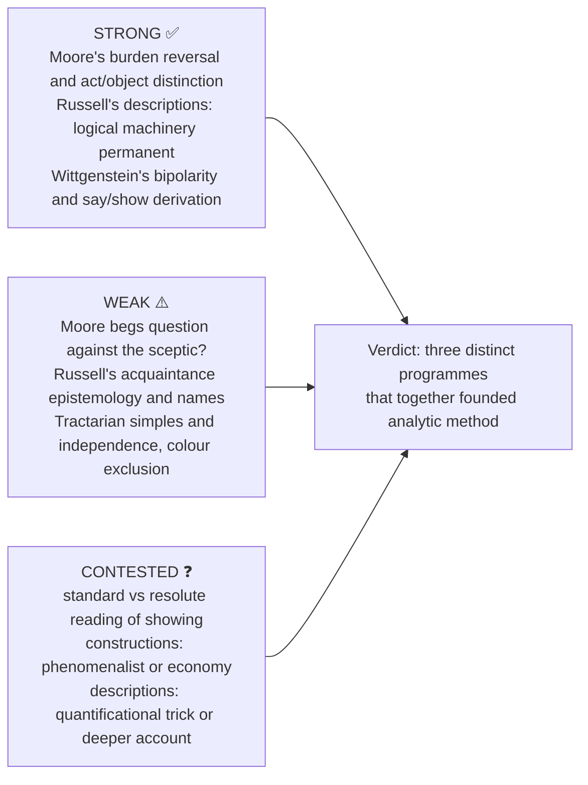

### 15.1 10-mark: "The golden mountain is very high" (2025 Q1(d)) ✅

```text
Problem : Seems ABOUT a non-existent entity; does it commit us to golden mountains? Meaningless?
Analysis: "The golden mountain" is an INCOMPLETE SYMBOL. Analysed: "There exists exactly one thing
          that is a golden mountain, and it is very high." ∃x[Gx ∧ ∀y(Gy→y=x) ∧ Hx].
Result  : Existence clause false → whole statement FALSE, not meaningless; no golden mountain
          need "subsist" (contra Meinong).
Point   : Grammatical form ≠ logical form; descriptions eliminate ontological inflation.
```

### 15.2 15-mark: Moore's refutation of idealism (2025 Q3(c)) ✅

```text
Frame   : Idealist claim esse est percipi.
Moore   : Distinguish (1) ACT of awareness (2) OBJECT of awareness (blue, green).
Quote   : "Blue is one object of sensation and green is another, and consciousness, which both
          sensations have in common, is different from either."
Key move: Consciousness is DIAPHANOUS; we see through it to the object, tempting us to conflate.
Result  : Object ≠ act, so esse cannot be defined as percipi; blocks one idealist argument,
          does not alone prove unperceived mind-independent existence.
Assess  : Refutes one argument FOR idealism (Berkeley's equation), not Absolute Idealism (Hegel);
          the act-object distinction became foundational for analytic philosophy.
```

### 15.3 20-mark: Russell's incomplete symbols → logical atomism (2024 Q3(a)) ✅

```text
Frame   : Analytic method: reveal logical form behind grammatical form.
Body-A  : Incomplete symbols; Theory of Descriptions; three puzzles solved.
Body-B  : Logical constructions: "substitute constructions for inferences".
Body-C  : Logical atomism: atomic facts ↔ atomic propositions; molecular = truth-functions.
          Description theory removes pseudo-constituents and supports the search for genuine
          residues; it does not prove analysis terminates or identify all atoms.
Assess  : Strengths: Occam's razor, dissolves pseudo-problems. Weaknesses: what are the "atoms"?
          Strawson's presupposition account; Quine's holism questions meaning "in isolation".
Close   : Incomplete symbols are the scalpel of analytic philosophy; logical atomism is the
          metaphysics toward which the scalpel cuts.
```

### 15.4 20-mark: hierarchy of languages (2026 Q4(a)) ⚠️

```text
Position: Partial agreement — meets the FORMAL difficulty, fails the TRANSCENDENTAL one (line 1).
Body A  : Why the difficulty arises: picture theory → shared logical form → a picture cannot
          depict its own form (2.172–2.174) → say/show (4.1212) → self-application and ladder (6.54).
Body B  : Russell's proposal: L1, L2, L3…, "no final language"; his admission it is a loophole;
          Tarski's later formalisation as evidence of technical fruitfulness.
Body C  : Evaluation grid: solves self-reference and truth-definition; cannot reach the form of each
          metalanguage, totality, representation as such, ethics/value/mystical.
Body D  : Standard vs resolute readings; on the resolute reading the hierarchy answers a question
          never asked.
Close   : The later Wittgenstein does not ascend the hierarchy; he abandons the demand for a
          single logical form.
15-mark reword ("Can logical form be spoken of?"): say/show + difficulty steps + compressed grid.
10-mark reword ("limits of language in the Tractatus"): facts → picture → form shown → ladder →
          silence; one line on the hierarchy.
```

> [!TIP]
> **Anchor sentences.** (1) "Acquaintance/description is where Russell's logic and his epistemology meet." (2) "The hierarchy tames self-reference at the cost of turning a single unsayable limit into an infinite series of unsayable limits." (3) Moore: "Blue is one object of sensation and green is another, and consciousness… is different from either."

---

## Sources

G.E. Moore, "The Refutation of Idealism" (1903); "A Defence of Common Sense" (1925); "Proof of an External World" (1939). Bertrand Russell, "On Denoting" (1905); *The Problems of Philosophy* (1912); *Our Knowledge of the External World* (1914); "The Philosophy of Logical Atomism" (1918); Introduction to the *Tractatus* (1922). Ludwig Wittgenstein, *Logisch-Philosophische Abhandlung* (1921); bilingual *Tractatus Logico-Philosophicus* (1922). Strawson, "On Referring" (1950). A.J. Ayer, *Russell and Moore: The Analytical Heritage*; Y. Masih, *A Critical History of Western Philosophy*; Anthony Kenny, *A New History of Western Philosophy* vol. 4; Audi (ed.), *Cambridge Dictionary of Philosophy*; Warburton, *Philosophy: The Classics*. Advanced trail: Stephen Neale; Peter Hylton; David Pears; P.M.S. Hacker; Cora Diamond; James Conant.
