# LOGICAL POSITIVISM — Examiner-Grade Mindmap

> **Syllabus (verbatim):** Logical Positivism : Verification Theory of Meaning; Rejection of Metaphysics; Linguistic Theory of Necessary Propositions.
> **Catalogue key:** `philosophy-paper-i-western-philosophy-07` · Paper I · Western Philosophy (Section A)
> **Sources used:** `paper-1/western/Logical-Positivism.md` (canonical owner, read in full) · `_advanced/Western-Philosophy-Dossier.md` §7 (optional depth) · `paper-1/_PYQ-Western-Philosophy-2018-2025.md` · `paper-1/_PYQ-Western-Philosophy-2026.md` · `paper-1/_themes/Critiques-of-metaphysics.md` (read in full) · `paper-1/_themes/A-priori-a-posteriori-knowledge.md` (read in full) · `paper-1/_themes/Pramana-across-schools.md` §3A (Cārvāka–Ayer row only). `Causation-across-schools.md` was searched and carries no positivism material; `Substance-across-western.md` and `Self-and-liberation-across-schools.md` were not opened because neither the owner file nor any other source links them to this topic.
> **Evidence key:** ✅ canonical doctrine · ⚠️ analytical synthesis · ❓ contested / uncertain · ❌ trap
> **Adaptation note:** the 15-module blueprint is Indian-school oriented. Here Module 1 = Vienna Circle, figures and provenance; Module 2 = theory of meaning and its epistemic base (verification, protocol sentences); Module 3 = internal diversity (Schlick, Carnap, Neurath, Ayer, Stevenson); Module 4 = the analytic/synthetic inventory of meaningful statements and the linguistic theory of necessity; Module 5 = rejection of metaphysics, theology and ethics as factual discourse; Module 6 = explanatory/justificatory principles (tolerance, unity of science, confirmation); Module 7 = value (emotivism); Modules 8–15 as in the blueprint. Where the sources are silent the module says so.

> [!IMPORTANT]
> **Core thesis.** One weapon, the Verification Principle, is deployed to fix meaning, reject metaphysics and re-explain logic and mathematics. It is a criterion of **meaning, not truth**: a metaphysical sentence is not false, it is cognitively meaningless. The programme fails from within (strong/weak dilemma, protocol sentences) before and alongside the self-refutation objection. ⚠️

---

## 0. Master Overview

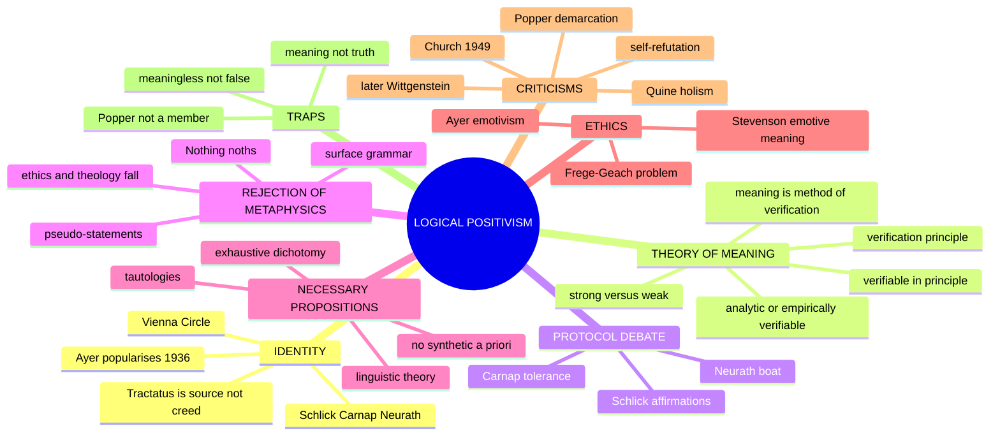

### 0.1 One-screen architecture ⚠️

```text
LOGICAL POSITIVISM — "Meaning = Method of Verification"
═══════════════════════════════════════════════════════════════════
             THE VERIFICATION PRINCIPLE
        ┌─────────────┼──────────────────────┐
  ANALYTIC        SYNTHETIC (empirical)     OTHER EXPRESSIONS
  (a priori,      (a posteriori,            metaphysics lacks cognitive content
   necessary,      verifiable by            → LITERALLY MEANINGLESS (not false)
   tautologies —   sense-experience)        ethics/value may retain emotive use
   logic & maths)
═══════════════════════════════════════════════════════════════════
  LINGUISTIC THEORY        REJECTION OF         SELF-REFUTATION
  OF NECESSARY             METAPHYSICS          the principle is neither
  PROPOSITIONS:            Carnap: "Nothing     analytic nor verifiable
  necessity = verbal;      noths" = pseudo-     → by its own standard
  no synthetic a priori    statement            it is meaningless
═══════════════════════════════════════════════════════════════════
```

> [!TIP]
> **Mnemonic "A-or-E":** cognitive/factual statements are **A**nalytic or **E**mpirically testable. Failing the test means no factual assertion; it does not mean every utterance is useless, unintelligible or without emotive/practical force.

---

## 1. Identity, Lineage, Works and Provenance Discipline

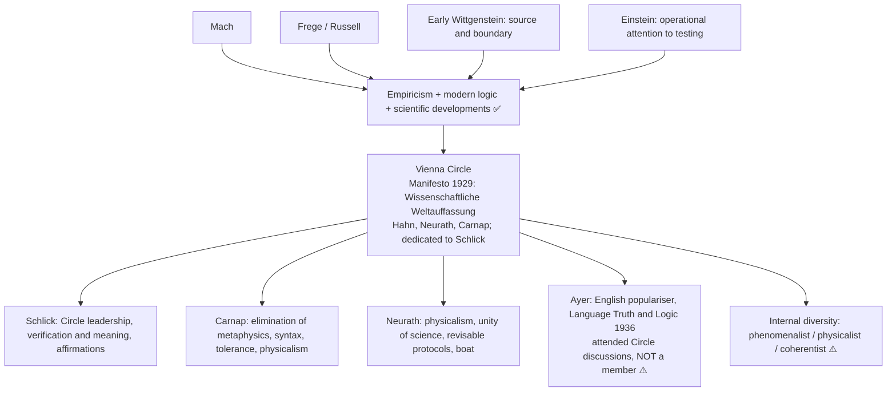

### 1.1 Figures and roles ✅

| Figure / source | Marks-essential role |
|---|---|
| Vienna Circle manifesto, *The Scientific Conception of the World* (1929) | Collective scientific-worldview programme; Hahn, Neurath, Carnap; dedicated to Schlick |
| Moritz Schlick | Circle leadership; verification/meaning debate; foundational "affirmations" |
| Rudolf Carnap | Logical elimination of metaphysics; syntax/tolerance; frameworks and physicalist developments |
| Otto Neurath | Physicalism; unity of science; revisable protocols; anti-foundational "boat" |
| A. J. Ayer | English populariser; strong/weak distinction; emotivist application in *Language, Truth and Logic* |

### 1.2 The *Tractatus*-to-verification lineage ⚠️/✅

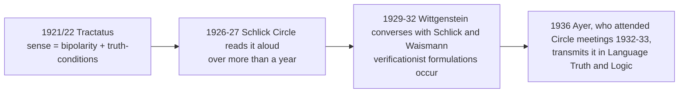

| *Tractatus* | Vienna Circle |
|---|---|
| Sense = **truth-conditions** (4.022, 4.024) | Sense = **verification-conditions**: the *method* of establishing it |
| Bipolarity is a **logical** requirement | Verifiability is an **epistemic** requirement |
| Metaphysics is *unsinnig* because it fails to depict a possible state of affairs | Metaphysics is meaningless because no observation is relevant |
| Elementary base: **objects**, a logical postulate | Base: **observations / protocols**, an empirical claim |
| Value / the mystical manifest but not factual propositions (standard reading) | Ayer gives value utterances an emotive role: an added metaethical theory |

> [!WARNING]
> (i) Wittgenstein was **never a member** of the Vienna Circle. (ii) The *Tractatus* is **not** a verificationist text; the move from truth-conditions to verification-conditions is the Circle's own empiricist addition and generates the strong/weak dilemma, because truth-conditions can be specified for universal laws while conclusive verification-conditions cannot. (iii) Later Wittgenstein no longer treats one empirical criterion as the essence of meaning; that belongs to the next owner.

### 1.3 Provenance and quotation discipline ✅

| Item | Correct provenance | Caution |
|---|---|---|
| "The meaning of a proposition is the method of its verification" | Standardly associated with Schlick/Waismann-era discussions; formulations vary | ⚠️ Not a *Tractatus* quotation; not one creed of every member |
| *Language, Truth and Logic* | Ayer, **1936**; revised Introduction in **2nd ed. 1946** | Revised criterion is in the 1946 Introduction; Church's criticism is **1949** |
| Vienna Circle manifesto | *Wissenschaftliche Weltauffassung: Der Wiener Kreis* (**1929**), by Hahn, Neurath and Carnap | Collective document, not Schlick's |
| Carnap on Heidegger | "Überwindung der Metaphysik durch logische Analyse der Sprache" (*Erkenntnis*, **1932**) | Safe with the reference |
| "Nothing noths" | Heidegger's *Das Nichts nichtet* (*Was ist Metaphysik?*, **1929**) | ❌ **"Nothing noughts" must never be written** |
| Neurath's boat | "Protokollsätze," *Erkenntnis* (**1932**); earlier versions in *Anti-Spengler* (1921) and a 1913 paper | Renderings vary; **Quine uses it as the epigraph of *Word and Object* (1960)** |
| Principle of Tolerance | Carnap, *Logische Syntax der Sprache* (**1934**); English **1937**, **§17** | "In logic, there are no morals" |
| Internal/external questions | Carnap, "Empiricism, Semantics, and Ontology" (**1950**) | Safe |
| Schlick on affirmations | "Über das Fundament der Erkenntnis," *Erkenntnis* (**1934**) | *Konstatierungen* = "affirmations" or "observation statements"; give German once |
| Emotivism | Ayer, *LTL* Ch. 6 (1936); Stevenson, "The Emotive Meaning of Ethical Terms," *Mind* (**1937**), *Ethics and Language* (**1944**) | Never merge them |
| Popper | *Logik der Forschung* (**1934**); English **1959** | ❌ Not a Circle member ("official opposition"); demarcation, not meaning |
| Quine's attacks | "Truth by Convention" (**1936**); "Two Dogmas of Empiricism" (**1951**); *Word and Object* (**1960**) | Bounded later criticism |

---

## 2. Theory of Meaning (Epistemology of Significance)

### 2.1 The criterion ✅

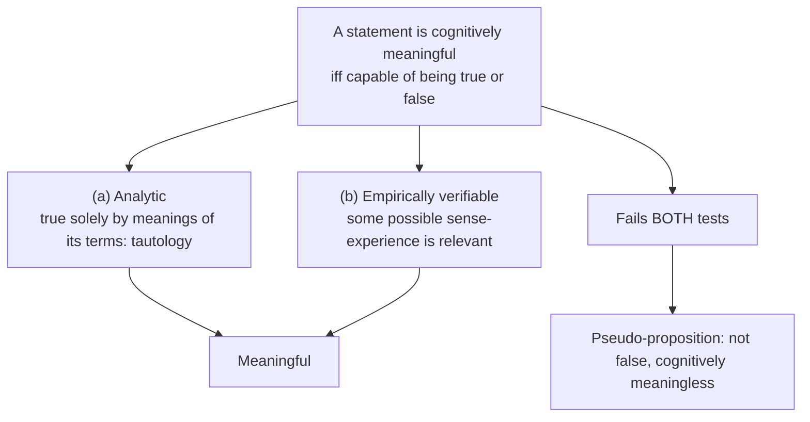

- **Meaning, not truth ✅.** "The earth is flat" is false but meaningful (we know what observations would refute it). "The Absolute is beyond time" fails because **no** observation is even relevant.
- "Meaning" = cognitive/factual significance. A cheer, command, poem, ritual utterance or moral expression may be intelligible and practically important while failing to state a verifiable fact.
- **Verifiable in principle vs in practice ✅:** "There are mountains on the far side of the moon" was meaningful before spaceflight because we could specify what observations would settle it; "The Absolute is beyond all experience" is not verifiable even in principle.

### 2.2 Strong vs weak verification (2025 Q3(b)) ✅

| | Strong (strict) | Weak (liberal) |
|---|---|---|
| Formulation | Meaningful iff **conclusively verifiable** by a finite set of observations | Meaningful iff some possible observations are **relevant** (render it probable or improbable) |
| Advantage | Rigorous; excludes metaphysics cleanly | Saves scientific generalisations and past/future statements |
| Problem | Too strict: universal laws ("All metals expand when heated") never conclusively verified; "Caesar crossed the Rubicon" not now observable. Strong verification kills science | Too liberal: almost any statement can be linked to some observation by an elaborate auxiliary hypothesis, so metaphysics creeps back |
| Attribution | Ayer's strong terminology | Ayer's weak terminology; revised in the 1946 Introduction |

- Strong/weak terminology is especially **Ayer's**; earlier Circle members offered different formulations.
- **Ayer's revisions fail ⚠️/✅:** the 1936 weak test appealed to observations making a proposition probable; the 1946 Introduction added technical direct/indirect verifiability conditions; **Alonzo Church (1949)** showed the revised criterion admitted statements it was designed to exclude. Later confirmation/testability approaches improved scientific methodology but lost the clean sentence-by-sentence meaning criterion.
- The strong/weak dilemma is the principle's **internal** problem, distinct from the external **self-refutation** objection (§9).

### 2.3 Why anyone believed it: five motivations ⚠️→✅

| # | Motivation | Statement | Strength |
|---|---|---|---|
| 1 | **Difference-argument** (Schlick, "Positivism and Realism," 1932) | Hypotheses agreeing on every possible observation do not differ in content | ⚠️ Strongest; survives longest; a principle of **significance**, not epistemology |
| 2 | **Einstein model** | Relativity encouraged operational attention to how claims such as distant simultaneity are fixed and tested | ✅ Major influence, not proof that every concept reduces to one measurement |
| 3 | **Meaning and use-conditions** | Understanding a factual sentence includes knowing circumstances relevant to testing | ⚠️ Do not import later meaning-as-use |
| 4 | **Demarcation motive** | A public criterion to separate science from metaphysics | ❓ Popper offers falsifiability as a rival demarcation, not a theory of meaning |
| 5 | **Unity-of-science programme** | Phenomenalist reduction, then physicalist/public-language projects | ⚠️ Carnap and Neurath differed; no single reduction thesis |

**Positive argument ⚠️:** 1. To understand a sentence is to know what it would be for it to be true. 2. That is to distinguish the circumstances in which it holds from those in which it does not. 3. That is to know what would count as evidence either way. 4. So understanding = grasping verification-conditions. 5. A sentence for which no evidence could count either way has nothing for understanding to consist in. 6. So it is not false; it is **without cognitive content**.

**Presuppositions ⚠️:** **P1** understanding is exhausted by truth-conditions, and those by observation-conditions (step 2→3 identifies them without argument); **P2** observation statements are epistemically privileged (the protocol debate breaks this open); **P3** sentences face experience **individually** (Duhem–Quine holism disputes it); **P4** the analytic/synthetic distinction is sharp (Quine attacks it).

### 2.4 Protocol-sentence debate (Schlick vs Neurath, 1932–35) ✅

| | **Schlick** (1934) | **Neurath** (1932) |
|---|---|---|
| Position | **Foundationalism** | **Coherentism + physicalism** |
| The base | *Konstatierungen* ("affirmations"): "Here now blue" | Fully explicit physicalist protocols including observer and time: *"Otto's protocol at 3:17: [at 3:16 Otto's speech-thinking was: [at 3:15 there was a table perceived by Otto in the room]]"* |
| Status | Absolutely certain: understanding and verifying are one act | Fallible and revisable; even a protocol may be struck out |
| Relation to reality | "Unshakeable point of contact" | "Statements are compared with statements, not with 'experiences'" |
| Catch | Affirmations cannot be written down and preserved; certainty is momentary and unusable | Consistency with the accepted system is the only test; community practice decides |
| Image | Structure needing a fixed ground | **Neurath's boat:** "*We are like sailors who have to rebuild their ship on the open sea, without ever being able to dismantle it in dry-dock…*" (a rendering) |

- **Carnap's mediation (1932):** the *form* of protocol sentences is a **matter of choice of language**, his Principle of Tolerance applied to the Circle's own foundations; this effectively ends foundationalism inside the Circle.
- **Schlick's objection ❓:** if truth is coherence, a consistent fairy-tale is as "true" as science. **Neurath's reply:** selection is made by the actual encyclopaedic practice of scientists. **Residual:** that makes the choice sociological rather than epistemic.
- **Take-aways ⚠️:** the Circle had competing rather than one agreed incorrigible base; Quine takes Neurath's boat as epigraph of *Word and Object* (1960), while his holism remains his own development.

---

## 3. Internal Diversity and Refinements

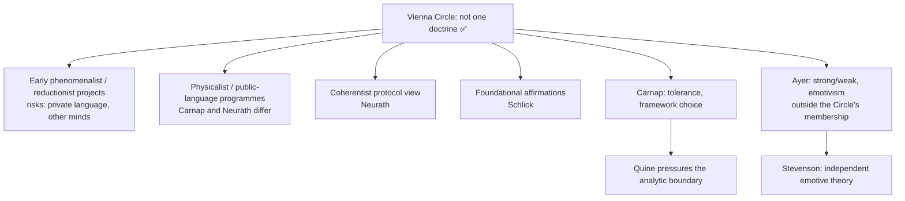

### 3.1 Carnap's Principle of Tolerance ✅ (*Logical Syntax of Language*, 1934; English 1937, §17)

> "**In logic, there are no morals.** Everyone is at liberty to build up his own logic, i.e. his own form of language, as he wishes. All that is required of him is that, if he wishes to discuss it, he must state his methods clearly, and give **syntactical rules instead of philosophical arguments**."

1. No single "correct" logic or language is given by reality; only **frameworks**, each constituted by rules.
2. Frameworks are chosen on **pragmatic** grounds (fruitfulness, simplicity, convenience), not truth.
3. Metaphysical disputes (numbers, classes, things vs events) are **disguised proposals** about which framework to adopt.
4. Intuitionist vs classical logic, or phenomenalist vs physicalist language, is a choice of instrument.

| Question type | Example | How settled |
|---|---|---|
| **Internal** to a framework | "Is there a prime number greater than 100?" | Mathematical rules and proof; yes |
| **External** | "Are there **really** numbers?" | Not a theoretical question; the practical question whether to adopt the number-language, answered by usefulness |

- Internal ontological questions stay legitimate; Carnap does not abolish every use of ontology.
- **Quine's bounded attack:** internal/external depends on an analytic/synthetic boundary he rejects; Carnapians reply that pragmatic framework choice need not be a disputed analytic truth. Full dispute belongs to Quine–Strawson.

### 3.2 Optional-depth modules (advanced dossier §7) ❓/⚠️

| Module | Issue | Safe use |
|---|---|---|
| Protocol debate, second-order layer (✅ core status since 15 Aug 2026) | Was Neurath's coherentism a repair of empiricism or an abandonment? Does intersubjective testability still deserve the name verification? | Closing evaluative clause only: if observation language is theory-laden and revisable, verification loses its bedrock, which is Quine's opening |
| Carnap vs Neurath on physicalism and unified science | Translate everything into physical language, or coordinate inside a testable encyclopedia? Objection: physicalism excludes mental/cultural vocabulary; reply: aim was public checkability | One extra sentence showing the movement was more nuanced than "metaphysics is nonsense" |
| From verification to confirmation ⚠️ | Did later positivism keep its meaning-criterion or retreat into a philosophy of scientific support? | Last paragraph only; do not replace the verification principle with Hempelian confirmation theory |

Source trail named by the dossier: Schlick; Carnap; Neurath; Ayer; Carl Hempel; Alonzo Church; Michael Friedman; Thomas Uebel.

---

## 4. Ontology of Statements and the Linguistic Theory of Necessary Propositions

### 4.1 The problem for empiricism ✅

Logic and mathematics are **necessary**, **a priori** and **certain**, yet empiricism says all knowledge comes from experience.

| Position | Account of necessity | Problem |
|---|---|---|
| **Kant** (synthetic a priori) | Necessary truths are synthetic, known a priori because the mind imposes spatio-temporal and categorial structure | Empiricists reject a "third box" |
| **Mill** (empirical generalisation) | "2 + 2 = 4" is a well-confirmed generalisation | Absurd: we do not discover it by counting pebbles; no experience could refute it |
| **Logical Positivism** | Necessary truths are **analytic**: true solely by meanings/conventions of symbols; necessity is **verbal** | The positivists' own answer |

### 4.2 The linguistic theory ✅

| Feature | Explanation |
|---|---|
| Necessary | Follows from rules laid down for symbols; no experience could refute them because they say nothing experience could bear on |
| A priori | Grasping the meanings suffices; no observation needed |
| Certain | Denying them violates one's own conventions: self-contradiction |
| Empty of factual content | "All bachelors are unmarried" records our resolve to use the terms interchangeably |

### 4.3 The exhaustive dichotomy ✅

| Analytic | Synthetic |
|---|---|
| Necessary, a priori, empty of content, certain | Contingent, a posteriori, factual, fallible |
| Logic, mathematics, definitions | Empirical science, history, commonsense |

**No third box.** "Synthetic a priori" is declared incoherent; Kant's central innovation is dissolved. The theme file's epistemic/semantic grid:

| | ANALYTIC | SYNTHETIC |
|---|---|---|
| **A PRIORI** | "bachelors unmarried" (all agree) | ★ synthetic a priori ★ (7+5=12; "every event has a cause"): Kant YES · empiricists/positivists NO |
| **A POSTERIORI** | (empty) | "the table is brown" (all agree) |

### 4.4 Kinds of statements and their significance ✅

| Statement | Branch | Why meaningful |
|---|---|---|
| "2 + 2 = 4" | Analytic | True by rules of arithmetic |
| "Electrons have negative charge" | Empirical | Testable, even indirectly |
| "All objects are either red or not red" | Analytic tautology (P ∨ ¬P) | Logically true; says nothing about the world |
| "This page is white" | Synthetic | Could be checked and could be false |
| "The soul is immortal"; "The Good transcends Being"; "The Absolute is perfect" | Neither | Pseudo-statements |
| "Caesar is a prime number" | Terms meaningful, combination yields no truth-conditions | Senseless |

### 4.5 Observation language, reduction, unity of science ⚠️

| Programme | Core claim | Caution |
|---|---|---|
| Phenomenalist / reconstructionist | Scientific/object talk reconstructed from elementary experiential statements | Private-language and other-minds problems |
| Physicalist / public-language | Protocols and science use an intersubjectively testable physical language | Neurath and Carnap versions differ |
| Unity of science | Sciences coordinated in a common language or encyclopedia | May mean translation, coordination or methodological integration, not one reduction theorem |

Theoretical terms gain empirical significance through laws, auxiliary assumptions and consequences of a theory-network, not one-to-one translation; this repairs scientific practice but loosens the sharp meaning criterion.

---

## 5. Rejection of Metaphysics and Transcendent Claims

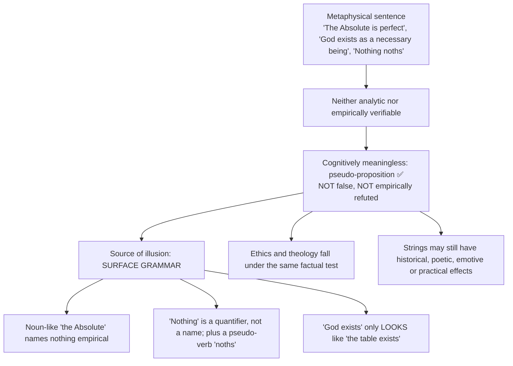

> *"A metaphysical sentence is one which purports to express a genuine proposition, but does not."* — Ayer ✅

### 5.1 Identifying pseudo-statements (2021 Q2(b)) ✅

A statement is a pseudo-statement if: (1) it employs terms for which no empirical criterion of application can be given ("the Absolute," "Being-in-itself," "noumenon"); OR (2) its terms are individually meaningful but combined so as to yield no truth-conditions ("Caesar is a prime number").

### 5.2 Carnap on Heidegger ✅

Carnap (1932): "Nothing noths" commits a **double** violation: using the syncategorematic quantifier "nothing" as a name, and predicating of it a pseudo-verb.

> [!WARNING]
> A critical answer must also record **Heidegger's available reply** ⚠️: *das Nichts* is disclosed in the mood of *Angst*, and the breach of logical grammar is deliberate, since logic itself presupposes the disclosure of beings as a whole. Reporting it turns ridicule into assessment (see Existentialism). Render "Nothing noths" / "the nothing nothings", never "Nothing noughts".

### 5.3 Does rejection concern meaning, knowledge or nature of things? (2023 Q3(a)) ⚠️

| Level | Positivist handling |
|---|---|
| **Meaning** (primary) | The sentences themselves are defective: they fail both tests |
| **Knowledge** | No knowledge-claim can arise about what is not a proposition; the knowledge question is dissolved, not answered |
| **Nature of things** | Positivists do not say "metaphysical objects don't exist" (a meaningful denial); the *question* of existence is ill-formed |
| **All together** | Meaning grounds knowledge; knowledge grounds claims about the world; cutting at meaning eliminates pseudo-knowledge and pseudo-ontology |

### 5.4 Theology ✅

Transcendent existence-claims fail Ayer's factual criterion ("God exists" if God is defined as transcendent is not false but meaningless); ritual, expressive or practical religious uses are a separate question, not thereby analysed exhaustively. Cross-paper link-out in the owner file: Paper II *Religious Language*, "positivism → theology as meaningless → the eschatological-verification reply (John Hick)"; its content is not reproduced in the sources used here.

---

## 6. Explanatory and Justificatory Principles

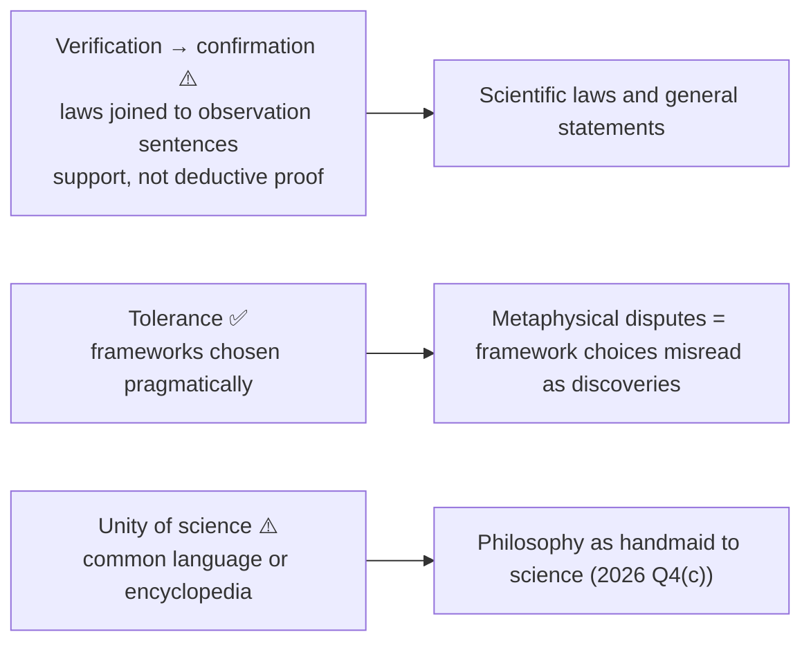

### 6.1 General/universal statements (2019 Q2(a)) ✅

- Universal laws are synthetic but cannot be conclusively verified by finitely many observations. Ayer's weak route: relevant observations and successful consequences render them **probable**; later confirmation theory develops degrees of support. Falsification is **Popper's contrasting demarcation**, not Ayer's definition of meaning.
- **Law as system ✅:** a law joins a system of hypotheses to observation sentences; successful predictions support the system without deductively proving the universal.
- **Can the same account apply to metaphysical statements? No.** A metaphysical universal ("All reality is spiritual") specifies no observation counting for or against it, even in principle; scientific generalisations have systematic empirical consequences.
- Historical statements are assessed through present records and causal traces; other-minds statements through publicly observable behaviour and theory; theoretical entities through their role in testable systems. These routes are indirect and theory-dependent, weakening simple sentence-by-sentence reduction **without making every such statement meaningless**.
- **Objection → reply ❓:** weakening verification risks admitting metaphysics; reply: systematic empirical consequences, though the boundary stays contested.

### 6.2 Philosophy as handmaid to science: programme and failure (2026 Q4(c)) ⚠️

**Positive programme:** logical analysis clarifies the language of science instead of adding a competing metaphysics; the analytic/empirical division separates formal inference from testable claims; verification and Carnap's diagnosis of misleading grammar exclude pseudo-problems; some projects reconstructed science from observation reports, while Neurath and Carnap's physicalist programmes sought a shared intersubjective language or coordinated encyclopedia. **No single complete reduction of all sciences to private sensations was a common achieved result.**

**Why the stronger project failed:**
1. Strict verification excludes universal laws; weakened/indirect confirmation loses a sharp line between science and metaphysics.
2. Theoretical terms are tested through laws and auxiliary assumptions, not translated one by one.
3. Schlick's momentary affirmations and Neurath's revisable protocols supply no single agreed foundation.
4. The criterion fails its own test if asserted as a factual universal (a proposed-rule reply is possible).
5. Quine pressures both the analytic boundary and sentence-by-sentence reduction.

**Verdict ⚠️:** logical clarification, formal semantics and cooperative science survived; the claim that **one** verification rule and **one** reductive language could settle meaning, demarcation and all scientific discourse did not. Do not turn this into failure of every logical or empiricist insight, or attribute Popper's demarcation test to the Circle.

**Metalanguage cross-link ⚠️:** the "unified language of science" and Carnap's logical-syntax programme presuppose the object-language/metalanguage distinction, which Russell first floated (1922 Introduction to the *Tractatus*) as a way round Wittgenstein's claim that a language cannot state its own structure (2026 Q4(a), owned by Moore–Russell–Early Wittgenstein §6.7). ❌ Do not equate Wittgenstein's *unsayable-but-shown* with the positivists' *cognitively meaningless*.

---

## 7. Ethics and Human Goals (Value Theory)

The sources give no puruṣārtha-style scheme; the value content is the **emotivist** application of the criterion. ✅

### 7.1 Fate of ethics and aesthetics ✅

Ayer treats value judgments as non-factual expressions of approval/disapproval; they may express and influence attitudes without reporting a value-fact. *"You stole that money" — I add no factual content; I merely evince my moral disapproval* (Ayer, in substance).

### 7.2 Ayer vs Stevenson: two emotivisms, not one ⚠️→✅

| Axis | **Ayer** (*LTL* Ch. 6, 1936) | **Stevenson** (1937; *Ethics and Language* 1944) |
|---|---|---|
| What an ethical term does | **Pure expression** of feeling; adds no factual content; *evinces* and may *evoke* | Two meanings: **descriptive** and **emotive** (a disposition to express and evoke attitude) |
| Report of feeling? | **No**; "I disapprove of stealing" would be a true/false statement about the speaker (subjectivism); expression ≠ report | Same rejection; both are **non-cognitivists**, not subjectivists |
| Working model of "X is good" | An expression with no propositional paraphrase | "**I approve of X; do so as well.**" |
| Ethical disagreement | Always really about facts; once facts agree, "we should not attempt to argue" | **Disagreement in belief vs in attitude**; attitude disagreement can survive full factual agreement |
| Moral argument possible? | Essentially no | **Yes**; reasons work **causally**, altering beliefs on which attitudes rest; rational vs persuasive methods |
| Further doctrine | Emotivism is a **corollary** of verification (top-down) | **Persuasive definition** ("*real* democracy is…"); built bottom-up from the psychology of linguistic influence, independent of verification |

| Shared objection | Force | Reply |
|---|---|---|
| **Frege–Geach embedding problem** (Geach 1960, 1965; anticipated by Frege): "If lying is wrong, then getting your brother to lie is wrong" | **Decisive against simple emotivism** | Later expressivists (Blackburn, Gibbard) build logics of attitude; neither Ayer nor Stevenson had an answer |
| Cannot distinguish moral disapproval from mere distaste (broccoli vs murder) | Strong | Stevenson can appeal to generality and social function; Ayer cannot |
| Makes moral progress unintelligible | Strong | Stevenson: convergence of attitude under fuller belief; Ayer concedes |

**Verdict:** Ayer's emotivism is a deduction from the verification principle and shares its fate; Stevenson's is an independent theory of linguistic influence that survives only until the Frege–Geach problem is met.

---

## 8. Inter-School Comparative Matrices

### 8.1 Logical Positivism against other Western positions ⚠️

| Axis | Logical Positivism | Kant | Rationalism | Later Wittgenstein | Quine |
|---|---|---|---|---|---|
| Necessary truths | Analytic/verbal (tautologies) | **Synthetic a priori** | Rational insight into reality | Grammar/rules of language-games | No sharp analytic/synthetic line |
| Metaphysics | Meaningless nonsense | Limited; illusions explained (dialectic of pure reason) | Legitimate (substance, God, soul) | Dissolved via therapy | Naturalised; no special status |
| Source of meaning | Analytic rules or empirical-test relevance | Conditions of possible experience | Reason and innate structure with experience | Varied use in forms of life | Holistic web of theory |
| Ethics | Emotive/non-cognitive | Rational (categorical imperative) | Rational intuition of value | Embedded in forms of life | Naturalised ethics possible |
| Self-application pressure | Proposal/rule reply available but costly | Different critical project | Not a meaning criterion | No single criterion proposed | No sentence-level criterion proposed |

### 8.2 The a priori/a posteriori arc (theme file) ⚠️

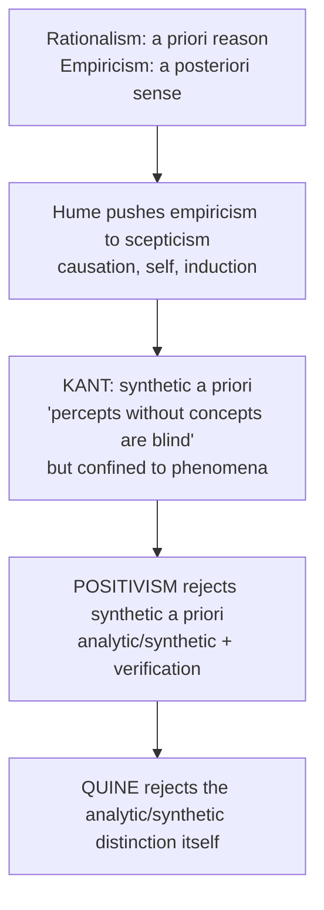

| Thinker | Source of knowledge | Synthetic a priori? | Signature move |
|---|---|---|---|
| Rationalists | Reason, innate ideas | (loosely yes) | Truths of reason vs fact |
| Empiricists (Hume) | Experience only | **NO** (Hume's fork) | Causation = habit |
| Kant | Reason + sense | **YES** | Copernican revolution; categories |
| Positivists | Verifiable experience | **NO** | Analytic/synthetic dichotomy; verificationism |
| Quine | Holistic web | Distinction itself rejected | Two dogmas; holism |

### 8.3 Five assaults on metaphysics, one reinstatement (theme file) ⚠️

| Critic | Test applied | Verdict | Metaphysics is… | Key term |
|---|---|---|---|---|
| **Hume** | Empirical content (impressions) | Illegitimate | Fiction, to be burned | Fork; no impression |
| **Kant** | Limits of the categories | Illusion beyond experience | Limited to phenomena | Antinomies; noumena |
| **Positivism** | Verifiability of meaning | Meaningless | Nonsense (not even false) | Verification principle |
| **Later Wittgenstein** | Ordinary use | Confusion | A muddle to dissolve | Language "on holiday"; therapy |
| **Quine** | Holism / analyticity | No a priori privilege | Naturalised, revisable | Web of belief |
| **Strawson** | None: reinstates | Legitimate **as description** | Connective analysis of our scheme | Descriptive vs revisionary |

Mnemonic **F-L-N-T**: Hume burns it (Flames), Kant limits it (Limits), Positivists call it nonsense (Nonsense), Wittgenstein dissolves it (Therapy); then Quine naturalises, Strawson reinstates.

---

## 9. Criticisms and Reconstructed Replies

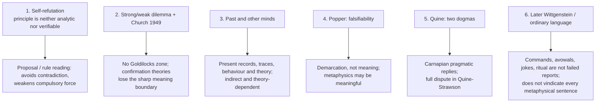

### 9.1 Self-refutation ✅

The principle is not analytic (its denial is coherent) and not empirically verifiable, so by its own standard it is meaningless.

| Positivist reply | Assessment |
|---|---|
| A *recommendation / proposal* about how to use "meaningful" | ⚠️ Retreats from discovery to policy; why must anyone accept it? |
| Analytic *of* the positivists' proposed concept of meaning | ❓ Circular |
| A meta-linguistic rule, not an object-language statement | ⚠️ Needs justification; the question recurs at the meta-level |

Decline had several causes: scientific generalisations, disputed protocols, theory-dependence and analytic/synthetic pressure, as well as self-application. Lead an evaluation with the protocol-sentence collapse rather than the easiest objection (theme file).

### 9.2 Past, other minds ⚠️

"Caesar crossed the Rubicon" is supported through present records and traces; strict phenomenalist reduction confuses evidence for the claim with its past-directed content. Other minds are indirectly supported through behaviour, language and explanatory theory; reducing pain to behaviour is one behaviourist route, not the only weak-verification account.

### 9.3 Popper ⚠️

Falsifiability is a **demarcation** criterion of scientific status; Popper held metaphysics may be meaningful but unscientific. It changes the question from meaning to scientific status and is a contrast, not a repaired verification theory.

### 9.4 Quine ✅

(1) The analytic/synthetic distinction cannot be non-circularly defined, so the linguistic theory rests on an unclear category. (2) Reductionism is false: statements face experience as a **corporate body**. Quine's decisive blow lands on **Carnap's** internal/external distinction (theme file). Quine also uses Neurath's boat as epigraph.

### 9.5 Later Wittgenstein and ordinary language ⚠️

Rejects one essence/criterion of meaning and examines varied uses in language-games; Ryle/Austin-style criticism asks whether a sentence's role can be judged apart from ordinary use. Positive theory belongs to Later Wittgenstein.

### 9.6 Presupposition ledger ⚠️

| Doctrine | Presupposition | What collapses if denied |
|---|---|---|
| Verification as meaning | Understanding = truth-conditions = observation-conditions (P1) | Meaning outruns verification; metaphysics may regain significance |
| Verification terminates in protocols | Observation reports are privileged (P2) | No incorrigible base; Neurath/Quine direction |
| Sentence-by-sentence testing | Sentences face experience individually (P3) | Holism replaces reduction |
| Linguistic theory of necessity | Sharp analytic/synthetic line (P4) | Quine: no non-circular definition |
| Rejection of synthetic a priori | Exhaustive dichotomy | Kant's third box survives |
| Emotivism (Ayer) | Verification principle | Value statements may regain cognitive status |

---

## 10. Controlled Comparisons

### 10.1 Western comparisons given by the sources ⚠️

| Pair | Point of contact | Decisive disanalogy |
|---|---|---|
| **Hume vs Positivists** | Both empiricist | Hume attacks **content** (no impression); positivists attack **meaning**. Positivism is Hume "logicised" |
| **Kant vs the rest** | Both limit pretensions of metaphysics | Kant alone saves a chastened metaphysics of experience and explains the illusion |
| **Positivists vs Later Wittgenstein** | Both target language | Positivists use one sharp criterion; Wittgenstein dissolves case by case via use |
| **Quine vs Carnap** | Both empiricists | Quine's blow lands on internal/external, because it presupposes analyticity |
| **Popper vs Positivists** | Both concerned with science and metaphysics | Demarcation vs meaning; Popper not a Circle member |
| **Tractatus vs Circle** | Source and influence | Truth-conditions vs verification-conditions; never a member |
| **Strawson** | Reverses the trajectory | Descriptive metaphysics survives every one of the four assaults |

### 10.2 Indian comparison (Pramāṇa theme §3A) ⚠️

| Indian position | Western point of contact | Disanalogy |
|---|---|---|
| Cārvāka's perceptual criterion | **Ayer's** verification principle rejecting metaphysics | Ayer's claim is *semantic* (statements meaningless); Cārvāka's is *epistemic-ontological* (entities unknown, hence unadmitted). Ayer preserves scientific theory; strict Cārvāka would not. Both face a self-refutation charge |

The Cārvāka owner file (§2.10, 2024 Q5(a)) treats "positivistic" as a loose comparative label to be qualified: Cārvāka's empiricist criterion is not the logical-positivist claim that unverified sentences are meaningless. Place such parallels in one or two lines after the main case.

> [!WARNING]
> Parallels are illustrative; never present "Cārvāka is Indian positivism" without stating the disanalogies.

---

## 11. Diagnostic Deep-Dives for High-Frequency Themes

### 11.1 "The Soul of Superman is Good" (2020 Q1(e)) ✅/⚠️

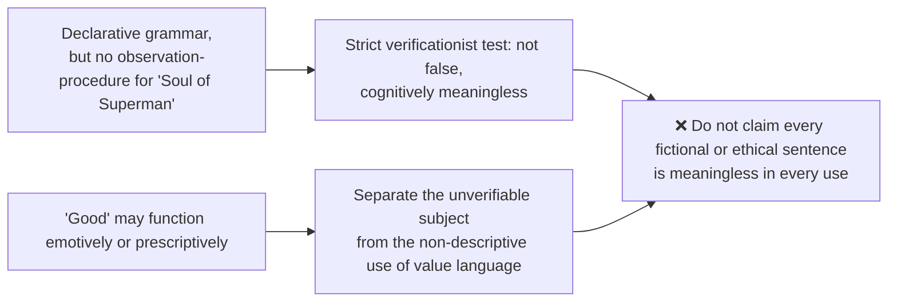

### 11.2 "All objects are either red or not red" vs "This page is white" (2024 Q3(b)) ⚠️

Answer **NO**: both fall within the positivist classification but by different branches. The first is analytic/tautological (P ∨ ¬P), true under all truth-conditions and factually empty; its truth depends only on "or" and "not". The second is synthetic and empirically testable and could be false. Metaphysics fits neither.

### 11.3 General statements and metaphysics (2019 Q2(a)) → §6.1.

### 11.4 Verification and scientific sentences (2018 Q3(b)) ⚠️

Route: cognitive criterion → pseudo-statements → laws/theoretical terms → weak/indirect confirmation → self-application verdict. Can verification account for the meaningfulness of **all** scientific sentences? Strong verification excludes laws; weak/indirect confirmation saves them but loses the sharp line; theoretical terms gain significance through theory-networks.

### 11.5 Meaning vs knowledge vs nature of things (2023 Q3(a)) → §5.3. Framework refinement: Carnap's tolerance (§3.1) is stronger than Ayer's meaninglessness verdict.

### 11.6 Handmaid to science (2026 Q4(c)) → §6.2.

---

## 12. PYQ Routing Ledger

> Corpus signal: **7 primary-owned parts** in 2018–2025 (2022 has none) plus **1** primary in 2026 = **8**. Year headings were checked against the PYQ bank.

| Year | Q | Marks | Exact demand | Route | Map to |
|---|---|---:|---|---|---|
| 2018 | Q3(b) | 15 | How do the logical positivists show that metaphysical sentences are meaningless? Can their verification theory of meaning account for the meaningfulness of all scientific sentences? Discuss. | cognitive criterion → pseudo-statements → laws/theoretical terms → weak/indirect confirmation → self-application verdict | §5, §6.1, §11.4 |
| 2019 | Q2(a) | 20 | How do the logical positivists account for the meaning of general statements? Can the same account be applied to metaphysical statements? Discuss. | universal-law problem → testable consequences/probability → system dependence → no comparable metaphysical test | §6.1 |
| 2020 | Q1(e) | 10 | "The Soul of Superman is Good." Critically examine the above statement in the light of logical positivism. | unverifiable subject-term → value predicate's emotive role → cognitively meaningless, not useless in every use | §11.1, §7 |
| 2021 | Q2(b) | 15 | What according to Logical Positivists are "pseudostatements"? How does one identify "pseudostatements"? Critically discuss with examples. | analytic/empirical filter → meaningless term vs illicit combination → Carnap/Ayer examples → ordinary-use objection | §5.1, §5.2 |
| 2023 | Q3(a) | 20 | Does the rejection of metaphysics as proposed by Logical Positivists relate to problem of meaning or problem of knowledge or nature of things or all of them together? Discuss with suitable examples. | meaning primary → epistemic/ontological consequences → no existential denial → framework refinement → criticisms | §5.3, §3.1 |
| 2024 | Q3(b) | 15 | Is the sentence "All objects are either red or not red" meaningful in the same way as "This page is white" is, according to the logical positivists? Discuss with arguments. | analytic tautology vs synthetic observation → two branches of significance → Quine pressure | §11.2, §4 |
| 2025 | Q3(b) | 15 | Present an exposition of the verification theory of meaning as propounded by the logical positivists. In this context also differentiate between the "strong" and the "weak" sense of the word "verifiable". | Ayer attribution → strong/weak/in-principle → scientific hard cases → Church/self-refutation → graded verdict | §2.1–2.2 |
| 2026 | Q4(c) | 15 | How did the logical positivists try to make philosophy a handmaid to science and establish a unified language of science? Why did their project fail? Discuss. | programme → five failure reasons → verdict | §6.2 |

**Cross-owned (listed, not counted):** 2026 Q4(a), 20 marks, *Moore–Russell–Early Wittgenstein*: "Wittgenstein's difficulty about not being able to say anything within a given language about the structure of that language can be met by the idea of a hierarchy of languages." Do you agree? → owner block `Moore-Russell-EarlyWittgenstein.md` §6.7; the metalanguage/unified-science link is cross-noted in §3.6 of this topic's owner file (see §6.2 here).

---

## 13. Top 10 UPSC Exam Traps

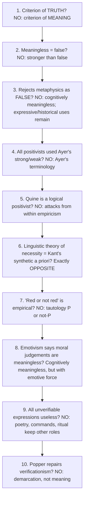

Extra pitfalls recorded in the sources: the *Tractatus* is not verificationist and Wittgenstein was never a Circle member (§1.2); Ayer was not a Circle member (§1.1); never write "Nothing noughts" (§1.3); merging Ayer and Stevenson (§7.2); the manifesto is collective, not Schlick's (§1.3); Church's refutation is 1949, the revised criterion 1946 (§1.3); do not attribute the verification slogan to the *Tractatus*; do not turn the failure of the ambitious programme into failure of every logical or empiricist insight (§6.2); Popper was "official opposition", not a member (§1.3).

---

## 14. Technical Vocabulary and Terminology Bank

| English gloss | Original / form | Meaning | Status |
|---|---|---|---|
| Verification principle | — | Meaning = method of verification; analytic or empirically verifiable | ✅ |
| Cognitive meaning | — | Capable of being true or false | ✅ |
| Pseudo-proposition / pseudo-statement | — | Fails both tests; neither true nor false | ✅ |
| Analytic / synthetic | — | True by meaning/convention / true by fact | ✅ |
| Tautology | — | Analytic truth, e.g. P ∨ ¬P | ✅ |
| Strong / weak verification | — | Conclusive / relevant-and-probabilifying (Ayer) | ✅ |
| Verifiable in principle | — | Observations specifiable even if not now makeable | ✅ |
| Vienna Circle manifesto | *Wissenschaftliche Weltauffassung* | 1929, Hahn–Neurath–Carnap | ✅ |
| Protocol sentences | *Protokollsätze* | Observation statements where verification terminates | ✅ |
| Affirmations | *Konstatierungen* | Schlick's "Here now blue" | ⚠️ |
| Neurath's boat | — | Rebuilding the ship at sea | ⚠️ |
| Physicalism | — | Public, intersubjectively testable physical language | ⚠️ |
| Unity of science | — | Common language / coordinated encyclopedia | ⚠️ |
| Principle of Tolerance | *Logische Syntax der Sprache* §17 | No morals in logic | ✅ |
| Internal / external questions | — | Within a framework / about adopting it | ✅ |
| Nothing noths | *Das Nichts nichtet* | Heidegger's phrase; Carnap's paradigm pseudo-statement | ✅ |
| Syncategorematic term | — | "Nothing" as quantifier, not a name | ✅ |
| Emotivism | — | Value judgments express/evoke attitude, state no fact | ✅ |
| Persuasive definition | — | Stevenson: redefining a term loaded with emotive force | ✅ |
| Frege–Geach problem | — | Embedding problem for expressivism | ✅ |
| Descriptive / revisionary metaphysics | *Individuals* (1959) | Strawson's distinction | ⚠️ |
| Falsifiability | *Logik der Forschung* (1934) | Popper's demarcation criterion | ✅ |
| Duhem–Quine holism | — | Tests implicate auxiliary assumptions | ⚠️ |
| Synthetic a priori | — | Kant's third box; denied by positivists | ✅ |

---

## 15. Graded Verdict and Answer Architectures

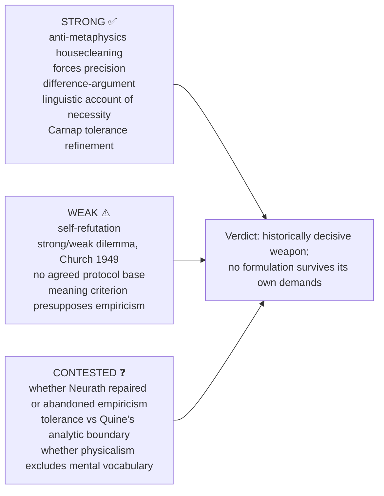

### 15.1 Graded verdict bank ⚠️

| Sub-topic | 10-mark | 15-mark | 20-mark |
|---|---|---|---|
| Verification principle | A criterion of cognitive significance, not truth; relativity, empiricism and logical analysis motivate it | Strong/weak dilemma and Church's objection show the difficulty of saving science while excluding metaphysics | Protocol disagreement, theory-dependence and Quinean pressure show no single observation test serves every scientific sentence; the difference-argument survives as a weaker significance heuristic |
| Rejection of metaphysics | Non-factual rather than empirically false | Logical/grammatical diagnosis is more discriminating than blanket dismissal and permits expressive roles | Carnap's framework approach refines Ayer; Quine contests its boundary without ending the debate by fiat |
| Self-refutation | If asserted as a universal factual criterion, it fails its own tests | A proposal/rule reading avoids contradiction but weakens the claim | Combine self-application with scientific and protocol problems |
| Linguistic theory of necessity | Necessary propositions are analytic/linguistic, so empiricism can reject synthetic a priori | Must explain mathematical application and how conventions generate consequences | Quine challenges non-circular "truth by convention"; Gödel limits particular formal systems but is not a one-line refutation |
| Protocol sentences | The Circle lacked one agreed incorrigible base | Schlick prioritises immediacy; Neurath publicity/revisability; each pays a cost | The debate moves positivism toward system-level testing and helps explain later holism |
| Emotivism | Value judgments are non-factual expressions | Stevenson adds descriptive meaning, attitude-disagreement and persuasion | Frege–Geach pressures simple emotivism |
| Tolerance | Frameworks assessed pragmatically; internal questions settled by rules | Internal/external separates theory from adoption proposals | Quine challenges the analytic/framework boundary; pragmatic replies remain |

### 15.2 10-mark: "Is the verification principle itself verifiable?"

```text
State    : "meaningful iff analytic or verifiable."
Problem  : neither analytic (denial coherent) nor verifiable (no observation tests it).
Attempts : (i) proposal/recommendation → why binding?  (ii) analytic of defined "meaning" → circular.
Verdict  : fails its own criterion; proposal/rule replies weaken universality;
           decline also reflects laws, protocols, theory-dependence and analyticity.
```

### 15.3 15-mark: Verification theory, strong vs weak (2025)

```text
Frame  : Vienna Circle's criterion of MEANING (not truth).
Expo   : two baskets — analytic + synthetic verifiable; others cognitively meaningless;
         value language keeps emotive/practical force.
Strong : conclusive by finite observations → kills laws, past, other minds.
Weak   : relevant observations render probable → too liberal; Ayer's 1946 revision refuted by Church.
Assess : internal, unresolved dilemma + self-refutation; Popper changes the issue to demarcation;
         Quine challenges reduction and analyticity — neither is the positivists' own repair.
Close  : historically decisive anti-metaphysics weapon, but no formulation survives its own demands.
```

### 15.4 20-mark: Does rejection of metaphysics relate to meaning, knowledge or nature of things? (2023)

```text
Frame   : primarily AT THE LEVEL OF MEANING, with consequences for knowledge and ontology.
Body-A  : MEANING — pseudo-propositions fail both tests ("the Absolute is perfect", "Nothing noths").
Body-B  : KNOWLEDGE — no knowledge-claim can arise about what is not a proposition; dissolved, not answered.
Body-C  : NATURE OF THINGS — not "metaphysical objects don't exist"; the existence question is ill-formed.
Body-D  : ALL TOGETHER — meaning grounds knowledge grounds claims about the world.
Assess  : strengths — housecleaning, precision; weaknesses — self-refutation; meaning criterion presupposes empiricism;
          later use/holism objections cross-owned.
Close   : the rejection is primarily about meaning but cascades into epistemology and ontology.
```

### 15.5 Directive decoder ⚠️

| Directive | Demand | Structural obligation | Fatal error |
|---|---|---|---|
| Discuss verification theory | Positive case first, then critique | §2.3 motivations, strong/weak, presupposition-based critique | Opening with "self-refuting" |
| Critically examine rejection of metaphysics | Assessment dominates; diagnosis is the marked part | Show *how* metaphysics is generated (surface grammar); then Carnap's tolerance version | "Metaphysics is meaningless" repeated |
| Elucidate linguistic theory of necessity | Show it solves a problem for empiricism | State the trilemma before the answer | Defining "analytic" and stopping |
| Strong and weak verification (2025) | Show the dilemma | Strong kills science; weak readmits metaphysics; Church 1949; then rule | Two definitions with no dilemma |
| Identify pseudo-statements (2021) | Criterion plus worked examples | Two routes + four graded examples including one meaningful control | Examples with no criterion |
| Comment on "Nothing noths" | Attribute correctly; analyse grammatical error | Carnap 1932 diagnosis, then Heidegger's reply | Ridicule; "noughts" |
| Assess emotivism | Distinguish Ayer from Stevenson and rule | §7.2 table, Frege–Geach, verdict | Treating it as one doctrine |
| Trace Wittgenstein's influence on positivism | What was taken and what was added | §1.2 | "The *Tractatus* founded logical positivism" |

> [!TIP]
> **Quotable lines.** (1) "The meaning of a proposition is the method of its verification" (associated with Schlick/Waismann-era discussions). (2) "A metaphysical sentence purports to express a genuine proposition, but does not." (Ayer). (3) "In logic, there are no morals." (Carnap, §17). (4) Neurath's boat. (5) "Quine's decisive blow lands on Carnap, not on metaphysics" (theme file).

> [!NOTE]
> Source-file link-outs not expanded here: Quine–Strawson (analytic/synthetic attack, holism), Later Wittgenstein (meaning as use), Kant (synthetic a priori), Hegel (Absolute Idealism as paradigm of positivist-meaningless metaphysics), Paper II *Religious Language* (Hick's eschatological-verification reply).

---

## Sources

A.J. Ayer, *Language, Truth and Logic* (1936; 2nd ed. 1946); Rudolf Carnap, "The Elimination of Metaphysics through Logical Analysis of Language" (1932); Moritz Schlick, "The Turning Point in Philosophy" (1930) and "Meaning and Verification" (1936); Y. Masih, *A Critical History of Western Philosophy*; Anthony Kenny, *A New History of Western Philosophy* vol. 4; Nigel Warburton, *Philosophy: The Classics*; Robert Audi (ed.), *The Cambridge Dictionary of Philosophy*; Karl Popper, *The Logic of Scientific Discovery* (1934); W.V.O. Quine, "Two Dogmas of Empiricism" (1951); Copleston (theme-file grounding); Chatterjee & Datta and C.D. Sharma (Pramāṇa theme grounding); dossier source trail (Schlick, Carnap, Neurath, Ayer, Hempel, Church, Friedman, Uebel).
