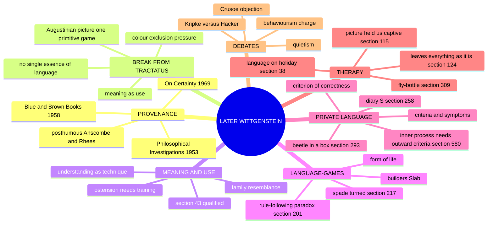
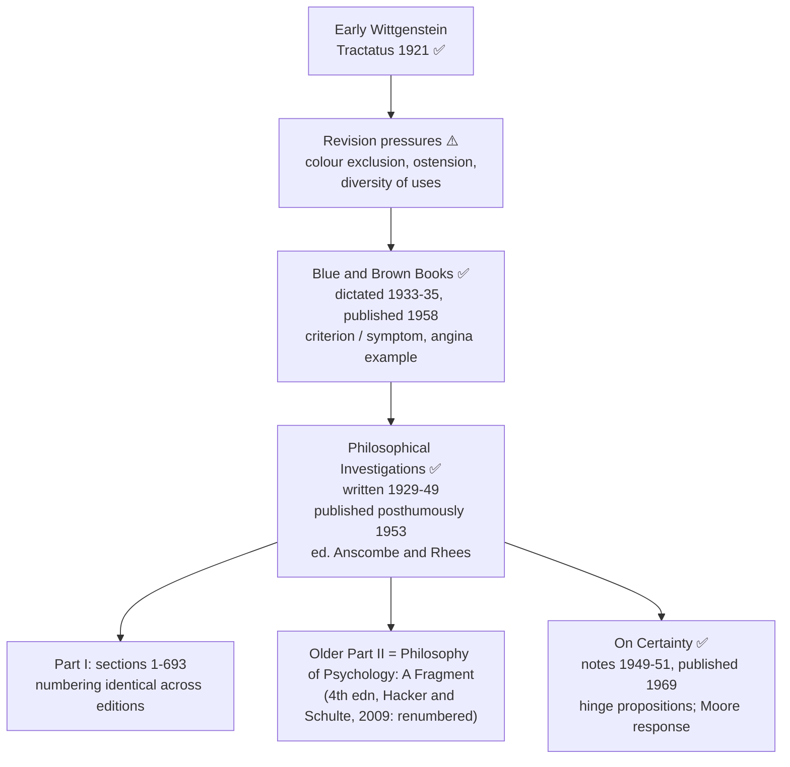
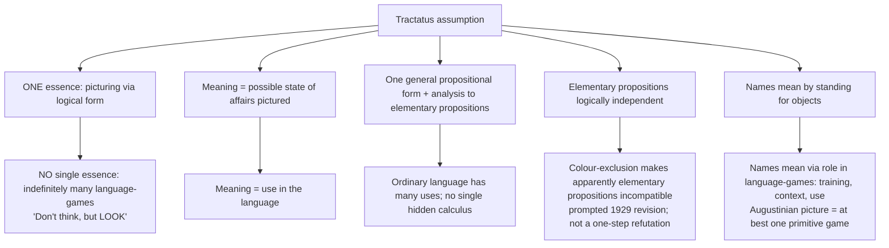
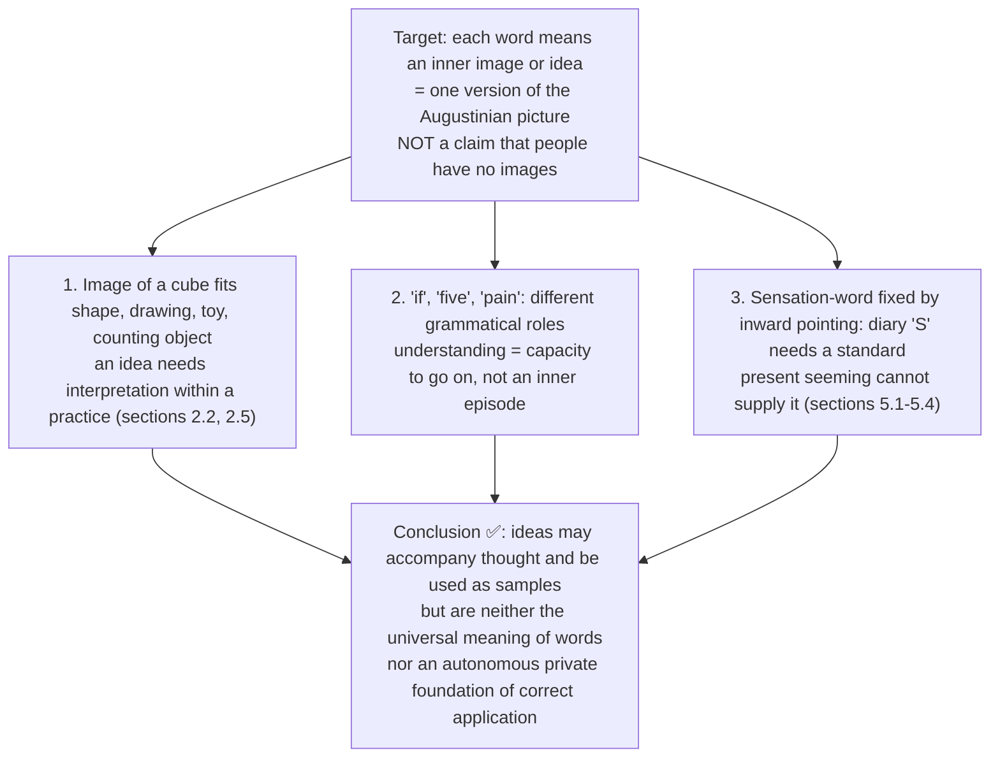
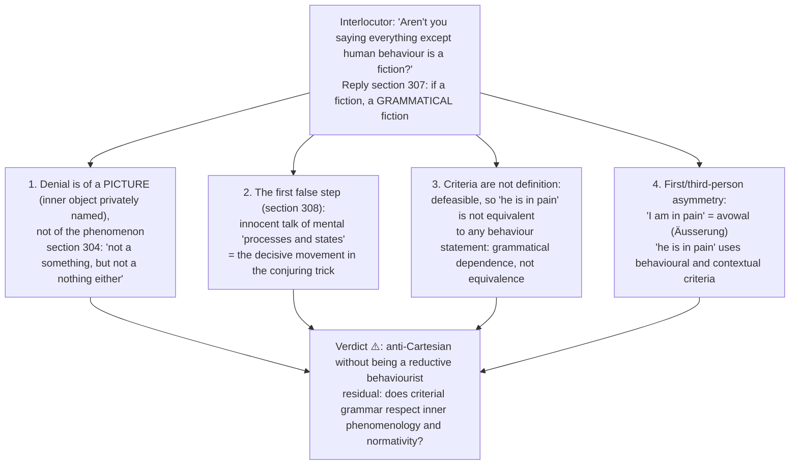
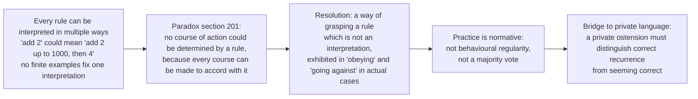
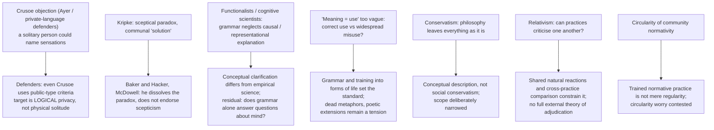
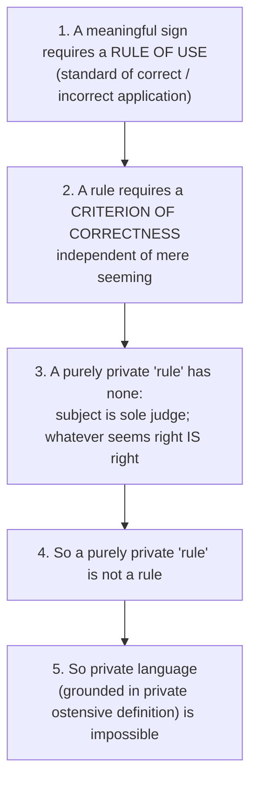
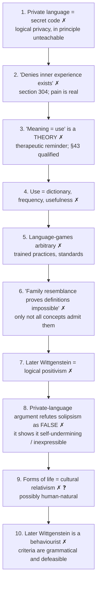
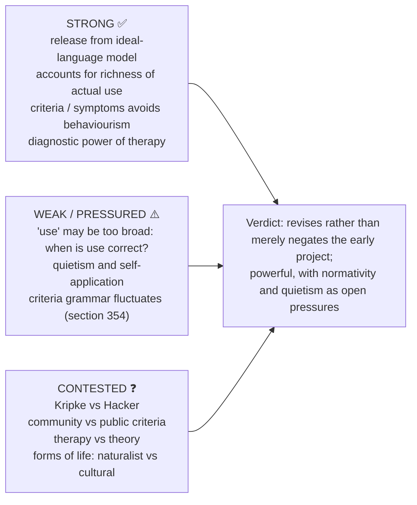

# LATER WITTGENSTEIN — Examiner-Grade Mindmap

> **Syllabus (verbatim):** Later Wittgenstein : Meaning and Use; Language-games; Critique of Private Language.
> **Catalogue key:** `philosophy-paper-i-western-philosophy-08` · Paper I · Western Philosophy (Section A)
> **Sources used:** `paper-1/western/Later-Wittgenstein.md` (canonical owner, read in full) · `_advanced/Western-Philosophy-Dossier.md` §8 (optional depth) · `paper-1/_themes/Critiques-of-metaphysics.md` (§0 D, §1A Bridge 2, §2–§5; the only theme file with Later-Wittgenstein content) · `paper-1/_PYQ-Western-Philosophy-2018-2025.md` · `paper-1/_PYQ-Western-Philosophy-2026.md`.
> **Evidence key:** ✅ canonical doctrine · ⚠️ analytical synthesis · ❓ contested / uncertain · ❌ trap
> **Adaptation note:** the 15-module blueprint is Indian-school oriented. Here Module 1 = works, period and provenance discipline; Module 2 = theory of meaning and its epistemic base (use, ostension, training); Module 3 = internal diversity (Kripke, community vs public criteria, therapy vs theory); Module 4 = ontology of the inner/outer (criteria, avowals, aspect-seeing); Module 5 = stance on metaphysics and "transcendent" pictures (therapy, fly-bottle); Module 6 = rule-following as the explanatory principle; Module 7 = the sources give no value scheme — recorded as such; Module 10 = comparisons the sources themselves give.

> [!IMPORTANT]
> **Core thesis.** For a **large class of cases — though not for all** — the meaning of a word is its **use in the language** (PI §43); use lives in **language-games** woven into a **form of life**; and a **private language** fails because a rule needs a criterion of correctness independent of mere seeming. Philosophy then becomes **therapy**, not theory. ⚠️

---

## 0. Master Overview



### 0.1 One-screen architecture (from owner §0) ⚠️

| Axis | Early (*Tractatus*, 1921) | Later (*Investigations*, 1953) |
|---|---|---|
| Meaning | Centred on factual picturing | For many cases clarified by **use** |
| Essence | One essence of language (logical form) | No single essence: **family resemblance** |
| Names | Name → object (fixed reference) | Countless **language-games** |
| Deep grammar | One general logical form | No single hidden calculus behind all uses |
| Solipsism | Placed at language's limit | Private ostension cannot found a language |
| Philosophy | Draw limits of the sayable; "be silent" | **Therapy**: dissolve knots made by language "on holiday" |

Key terms: use · language-game · form of life · family resemblance · rule-following · private language · beetle-in-a-box · therapeutic conception.

> [!TIP]
> **Mnemonic "U-G-F":** investigate **U**se within language-**G**ames and their **F**orm-of-life background. A method of clarification, not a universal dictionary definition.

---

## 1. Identity, Lineage, Works and Provenance Discipline



### 1.1 Source and owner-scope map ✅

| Source | Marks-essential role |
|---|---|
| *Philosophical Investigations*, Part I | meaning/use, ostension, family resemblance, language-games, rule-following, private language |
| *Philosophy of Psychology — A Fragment* (older "Part II") | aspect-seeing and natural-history remarks; bounded enrichment |
| *Blue and Brown Books* | transitional examples; criterion/symptom vocabulary |
| *On Certainty* | hinge/certainty comparison only; no routed owner demand |

- The *Tractatus* appears only to explain the verified 2023/2025 transition questions. It already treats ordinary propositions as logically ordered and discusses solipsism; do not caricature it as advocating an artificial language or ignoring the self.
- Rule-following and forms of life are indispensable prerequisites. Therapy, criteria/avowals and ostensive definition make the printed limbs executable.
- Aspect-seeing and *On Certainty* are bounded enrichment. Religious-language/fideist applications belong to Philosophy of Religion; Ryle, Austin, Strawson and Quine retain their own ownership.

### 1.2 Translation, numbering and provenance discipline ✅/⚠️

| Item | Rule |
|---|---|
| *Investigations* | ❌ Never write "Wittgenstein published the *Investigations*"; published 1953 posthumously, arrangement of remarks partly editorial |
| Translations | Anscombe (1953); revised Hacker and Schulte (4th edn, 2009), which renames Part II "Philosophy of Psychology — A Fragment" and renumbers. Cite the duck-rabbit as "Part II §xi / PPF" |
| Citation | Use § numbers for Part I (identical across editions) |
| "Meaning is use" | §43 is hedged: "For a *large class* of cases — though not for all". ❌ Dropping the qualification is the most frequent misquotation |
| "Language goes on holiday" (§38) | German *wenn die Sprache feiert* is closer to "idles"; image is machinery running without load |
| Fly-bottle (§309), beetle (§293) | Safe verbatim with the § |
| Diary "S" (§258) | Renderings vary; give §258, paraphrase if unsure |
| *Blue and Brown Books* | Dictations to students, not a work prepared for print |
| *On Certainty* | Last work, unrevised |
| Kripke | *Wittgenstein on Rules and Private Language* (1982) is "Wittgenstein's argument as it struck Kripke"; say "Kripke's Wittgenstein" |
| "Forms of life" | Occurs only a handful of times (§19, §23, §241 and PPF); mark interpretation as interpretation |
| Duck-rabbit | Jastrow's figure (1899); do not attribute the drawing to Wittgenstein |
| "If a lion could talk…" | Older Part II / PPF; natural-history / intelligibility caution, not proof of total relativism |
| 2022 "motion of language" | Printed "motion" retained; interpret as language as form of life |
| 2025 quotation | Unmatched quotation mark before "logical structure" retained |

**Section numbers to cite:** §1 (Augustine), §7/§23 (language-games), §38, §43, §66–67 (family resemblance; "Don't think, but look!" is §66), §109, §115, §123, §124, §128, §133, §201, §217, §241–242, §243–271 (private language), §244 (avowal), §255, §258, §293, §304, §307–308, §309, §354, §580.

---

## 2. Theory of Meaning (Epistemology of Significance)

### 2.1 The break from the *Tractatus* (2025 Q3(a), 2023 Q4(c)) ✅



> [!WARNING]
> The *Tractatus* itself says everyday propositions are logically in order; the later break concerns **one essence / deep analysis**, not a move from "bad" to "good" ordinary language. Colour exclusion pressures the early analysis but does not by itself prove no deeper analysis was possible.

**The transition quoted (2025 Q3(a)) ⚠️:** "We should look not to an ideal language … but empirically, to the ways in which languages are actually used." Captures the shift from a general logical account of factual sense toward grammatical investigation of actual practice. The later Wittgenstein resists one explanatory essence but still offers arguments, comparisons and descriptions; "no theory" must not become another dogma.

### 2.2 Meaning and use ✅

> "For a large class of cases — though not for all — in which we employ the word 'meaning' it can be defined thus: the meaning of a word is its use in the language." (§43)

| Move | Content |
|---|---|
| Rejection of Augustinian / referential picture | Every word names an object: works for "table", useless for "the", "if", "five", "pain", "meaning", "perhaps". Words are **tools in a toolbox** |
| Understanding = mastery of a technique | Shown in ability to go on appropriately within a norm-governed practice; not a private image or "aha"; performance may be absent or mistaken, so not behaviourist identity |
| Context-dependence | "Water!" means different things shouted in a fire, requested at a table, noted on a chemistry board |

**Use is not** dictionary entry, frequency, usefulness, or whatever an individual chooses. §43 redirects investigation from hidden object / mental entity to the role of an expression in practice.

### 2.3 Family resemblance ✅ ("Don't think, but look!")

- "Game": board-games, ball-games, card-games, Olympic games, war-games, language-games. Inspection shows "a complicated network of similarities overlapping and criss-crossing."
- Shared use need not rest on one necessary-and-sufficient feature; not the stronger claim that no two games share any property.
- Consequence: concepts need not have sharp boundaries; definitions by necessary and sufficient conditions (the Socratic demand; the *Tractatus* demand for a single logical form) are not always possible, and that is fine.
- **Open texture is not arbitrariness:** training, examples, correction and established applications give local normative shape.
- 2018 Q1(c) route: no one essence required → overlapping similarities → varied norm-governed games → non-arbitrariness.

### 2.4 Method: "Don't think, but look" ⚠️

Descriptive, not explanatory: do not ask "What must meaning be?"; do not seek a hidden essence; assemble reminders of how words are used in various language-games and the puzzlement dissolves.

### 2.5 Ostensive definition, samples and training ✅

- Pointing does not fix meaning by itself: "two red squares" may teach colour, shape, number, material or direction.
- Ostensive definition works only against prior training, attention and a language-game fixing the sample's role.
- A sample (e.g. colour chart for "sepia") is part of the method of representation within a practice, not a private object guaranteeing its own interpretation.
- Training and correction establish how to continue; no further mental interpretation supplies a final foundation without restarting the regress.
- Not conventional whim: human reactions, material circumstances and established practices constrain what counts as teaching and following.

### 2.6 Are words ideas in the speaker's mind? (2026 Q3(c)) ✅/⚠️



**Objection** (a speaker sometimes understands silently without overt action) → **Reply:** capacity for trained use need not be exercised on each occasion; a grammatical claim about how understanding is attributed, not identity of thought with behaviour. For "pain", preserve first-person avowal and outward third-person criteria rather than denying the sensation.

---

## 3. Internal Diversity and Refinements

The sources do not describe a sceptical wing within later Wittgenstein; this module records the interpretive splits the owner and advanced dossier give.

### 3.1 Kripke vs anti-sceptical readings ❓

| Reading | Content |
|---|---|
| **Kripke** (1982) | Rule-following argument yields a sceptical paradox: no fact about me determines what I mean; the "solution" is communal agreement (a *sceptical solution*). Kripke presents it as "Wittgenstein's argument as it struck Kripke" |
| **Anti-sceptical** (Baker and Hacker, McDowell) | Wittgenstein dissolves the paradox; he does not endorse scepticism about meaning |
| **Practice-based non-sceptical** | Practice is normative without being a sceptical solution |

- Status: the rule-following paradox, regress of interpretations and one-line Kripke summary are now **Core**; the plus/quus reconstruction and the sceptical-solution debate remain optional.
- Second-order issue (advanced §8.1): is the "sceptical solution" a legitimate Wittgensteinian move, or a constructive theory his method forbids? **Objection:** Kripke makes Wittgenstein a theory-builder. **Counter-reply:** even critics admit the sharpening helps show why private interpretation cannot fix normativity alone.
- Safe use ⚠️: one short evaluative sentence. Do not reconstruct the plus/quus literature.

### 3.2 Community requirement vs public criteria ❓ (advanced §8.2)

- Does Wittgenstein need an actual community, or only standards in principle shareable? Readings: strong communitarian; public-criteria; solitary-but-trainable.
- **Objection:** a solitary person can still follow rules. **Counter-reply:** the point is not headcount but the distinction between *seeming right* and *being right*, which needs standards not exhausted by one moment's private impression.
- Use only to refine the private-language critique; never replace the diary argument. Promote to Core only if a PYQ asks whether he makes language essentially social.

### 3.3 Therapy or positive theory? ❓ (advanced §8.3)

- Is "meaning is use" a substantive theory or a therapeutic reminder? Readings: quietist/therapeutic; moderate positive-use theory; hybrid (§43 as a rule of philosophical method, not a universal definition).
- **Objection:** no theory makes the slogans empty. **Counter-reply:** clarity often comes from reminding us of ordinary grammar rather than positing hidden mechanisms.
- Best as the final evaluative note on the early-to-later transition.
- Short source trail (dossier): Kripke, Baker, Hacker, McDowell, McGinn, Cavell.

---

## 4. Ontology of the Inner and Outer: Criteria, Avowals and Aspects

### 4.1 Criteria vs symptoms ✅ (Blue Book; PI §354, §580)

| | **Criterion** | **Symptom** |
|---|---|---|
| Relation to concept | Internal / grammatical: part of what it is for the concept to apply | External / inductive: a correlation taught by experience |
| How established | By grammar of the language-game | By empirical investigation |
| If it fails | We would not know what the word means; concept loses footing | Revise a generalisation; concept untouched |
| Angina (*Blue Book*) | Presence of a particular **bacillus**, defined as the criterion | **Inflamed throat**, which experience says usually goes with it |
| Pain | Pain-behaviour in appropriate circumstances | Raised pulse, sweating, an actor's groan: evidence at best |

Three points ⚠️: (1) criteria are **defeasible** (pretence, acting, suppression): non-inductive but defeasible grounds, which blocks behaviourism; (2) criteria are not evidence for something hidden — they are the circumstances where the concept has its home; (3) **grammar fluctuates** (§354): what is a criterion in one language-game may be a symptom in another.

### 4.2 "An inner process stands in need of outward criteria" (§580) ✅

| It does say | It does not say |
|---|---|
| Application of an inner-process concept needs outward criteria | That there are no inner processes |
| "Remembering", "intending", "expecting", "understanding" are not names of private episodes we then report | That mental life is nothing but behaviour |
| Grammar of psychological words is learned in shared practices | That I normally infer a sincere present pain-avowal from my behaviour; first-person uses often express rather than report |

Argument: (1) possessing a concept = mastering a technique of right/wrong application (§§143–202); (2) mastery requires circumstances of right and wrong; (3) for an "inner" concept those circumstances cannot be further inner items (private criterion for a private criterion); (4) so they must be outward — behaviour, situation, what precedes and follows (the *Umgebung*, "surroundings"); (5) so an inner process stands in need of outward criteria.

### 4.3 The behaviourism charge and reply (§§304, 307–308) ✅



Not every first-person psychological sentence is an avowal; neither use identifies pain with behaviour.

### 4.4 Optional enrichment: aspect-seeing and the duck-rabbit ⚠️ (Part II §xi / PPF)

No routed PYQ owns it; use only as enrichment. Key line: "I see that it has not changed; and yet I see it differently."

1. Nothing in the drawing alters (lines, ink, retinal image). 2. Something changes: the **dawning of an aspect** (*das Aufleuchten eines Aspekts*). 3. The change is neither in the object nor mere inference: "seeing-as" is a third category, "half visual experience, half thought". 4. Seeing the aspect presupposes mastery of a technique (one must know the shape of a rabbit). 5. **Aspect-blindness** is conceivable: full acuity yet no dawning; their relation to meaning would be impoverished, which illuminates the experience of meaning.

| Target | Damage |
|---|---|
| Sense-data / the Given | Pressures claim that all seeing is conceptually innocent; does not refute every acquaintance theory |
| Picture theory | Role of a picture depends on practices of use |
| Meaning as inner process | The dawning feels inner but its criteria are what one does and says next (§580) |
| Philosophy's own method | A therapeutic comparison makes a familiar use appear under a new aspect: analogy, not stated identity |

---

## 5. Stance on Metaphysics and "Transcendent" Pictures: Therapy

### 5.1 Philosophy as therapy ✅ (§§38, 115, 123, 255, 309)

| Remark | § | What it does |
|---|---|---|
| "Philosophical problems arise when language goes on holiday" (*wenn die Sprache feiert*) | §38 | Locates origin: a word removed from its language-game keeps surface grammar but loses use |
| "A picture held us captive…" | §115 | Names the mechanism: a *Bild* — the inner object, the essence, the hidden mechanism of meaning |
| "A philosophical problem has the form: 'I don't know my way about'" (*Ich kenne mich nicht aus*) | §123 | Disorientation, not ignorance of a fact |
| "The philosopher's treatment of a question is like the treatment of an illness" | §255 | Therapeutic analogy |
| "To show the fly the way out of the fly-bottle" | §309 | Governing image |

Also: "Philosophy is a battle against the bewitchment of our intelligence by means of language" (§109); "Philosophy leaves everything as it is" (§124); perspicuous representation; §133 speaks of "methods, like different therapies" and of being able to stop philosophising when one wants.

Reading the fly-bottle ⚠️: the thinker repeatedly moves in a way that sustains the trap; the remedy is reorientation, not a competing scientific explanation; "leaves everything as it is" concerns ordinary grammar and does not imply political passivity or forbid every substantive argument.

### 5.2 Objections → replies ❓

| Objection | Reply | Residual |
|---|---|---|
| **Quietism / conservatism** | Concerns *conceptual* description, not social practice; therapy does not forbid reform | Range of what philosophy may do is severely narrowed |
| **Self-application** (therapy is itself a philosophical thesis) | Accepts a version: remarks are ladder-like; §133 speaks of plural "methods" | Same structure as the *Tractatus* ladder; continuity with early Wittgenstein is a first-class observation |
| **Real problems survive** (personal identity, free will, status of mathematics) | Persistence shows the captive picture is not yet fully exhibited | Unfalsifiable as stated: the most serious methodological complaint |

### 5.3 The five assaults on metaphysics: where Later Wittgenstein sits (theme file) ⚠️

| Critic | Test | Verdict | Metaphysics is… | Key term |
|---|---|---|---|---|
| Hume | impressions | illegitimate | fiction, to be burned | fork; no impression |
| Kant | limits of categories | illusion beyond experience | limited to phenomena | antinomies |
| Positivism | verifiability | meaningless | nonsense (not even false) | verification principle |
| **Later Wittgenstein** | **ordinary use** | **confusion** | **a muddle to dissolve** | **"on holiday"; therapy** |
| Quine | holism / analyticity | no a priori privilege | naturalised, revisable | web of belief |
| Strawson | none — reinstates | legitimate as description | analysis of our conceptual scheme | descriptive vs revisionary |

Discriminators: positivists use a **single sharp criterion**; Wittgenstein rejects any such criterion and dissolves case by case via use; he even turns against the *Tractatus*, his own attempt to draw limits. Descriptive metaphysics is untouched by Wittgenstein's therapy because it describes ordinary use rather than departing from it.

---

## 6. Explanatory and Justificatory Principles: Language-Games, Form of Life, Rule-Following

### 6.1 Language-games ✅

- **Language-game** (*Sprachspiel*): the whole of language **and the activities into which it is woven**. The analogy highlights training, moves, circumstances and standards; it does not imply explicit codified rules or arbitrary invention.
- Examples: giving orders, describing, reporting, speculating, forming hypotheses, presenting results, telling jokes, making up a story, play-acting, singing, guessing riddles, requesting, thanking, cursing, greeting, praying.
- **Builders' example:** A shouts "Slab!" and B brings a slab; "Block!", "Pillar!". A primitive language complete for the stipulated activity; naming/describing is not the sole function.
- Norm-governed through training, examples and correction; new games arise, old ones die.

### 6.2 Form of life (*Lebensform*) ✅ (2022 Q1(c))

- "To imagine a language means to imagine a form of life." (§19)
- Language-games rest on shared human practices, activities and natural reactions. Agreement is not mere majority opinion; it includes agreement in judgments and ways of acting that make correction and disagreement possible.
- "If a lion could talk, we could not understand him": vocabulary alone may not bridge radically different natural history; not proof of total cultural incommensurability.
- At bedrock, explanation ends in trained action: "This is simply what I do" (§217; "my spade is turned"). Not majority behaviour; marks where justification gives way to practice.
- ❓ Naturalist (shared biology, natural reactions) vs cultural readings; shared practice enables disagreement and does not automatically entail relativism.

### 6.3 The rule-following paradox (§201) ✅



Actual surveillance by a community is not required; the issue is whether the practice contains a stable standard beyond the present impression. Circularity worry (community normativity): practice explains correctness only by invoking what practitioners count as correct; the reply distinguishes trained normative practice from regularity, and whether this escapes circularity remains contested.

---

## 7. Ethics and Human Goals (Value Theory)

The sources give no kāma/artha/dharma/mokṣa-type scheme and no ethical doctrine for later Wittgenstein. Relevant source-backed points only:

- "Philosophy leaves everything as it is" (§124) concerns described use of language and does **not** require political or moral conservatism ⚠️.
- Quietism objection (§5.2): therapy removes confusion and does not forbid reform; the range of philosophy's critical role is narrowed.
- Ethics/religion applications: later Wittgensteinian applications to practices are cross-owned (Philosophy of Religion, *Religious Language*), not owned here. Early Wittgenstein: not factual saying on the standard reading; Ayer: emotive/non-cognitive (comparison grid, §8).

---

## 8. Inter-School Comparative Matrices

### 8.1 Later Wittgenstein against other positions ⚠️ (owner §6)

| Axis | Later Wittgenstein | Early Wittgenstein | Logical Positivism | Descartes / Empiricism |
|---|---|---|---|---|
| Meaning | Varied use in practices; §43 qualified | Factual sense via picturing/logical form | Cognitive significance via verification | Often ideas/reference |
| Essence of language | None (family resemblance) | One logical form | One criterion (verifiability) | Naming inner/outer objects |
| Metaphysics | Dissolve as language-on-holiday | Show what cannot be said; be silent | Reject as meaningless | Pursue as first philosophy |
| Private inner realm | Private ostension cannot alone ground standards; sensations remain | Solipsism treated at the limit of world and language | Not central | Inner access often foundational |
| Philosophy's task | Therapy; "leaves everything as it is" | Draw limits of the sayable | Analysis; eliminate pseudo-problems | Build system from foundations |
| Ethics/religion | Applications cross-owned | Not factual saying | Ayer: emotive | Diverse |

### 8.2 Quine ↔ Later Wittgenstein: holism and use (theme Bridge 2) ⚠️

| Axis | Quine | Later Wittgenstein |
|---|---|---|
| Target | the **museum myth** — words as labels on determinate mental meanings | the **Augustinian picture** |
| Positive account | meaning = dispositions to verbal behaviour within a total theory | meaning = use in a language-game and form of life |
| Holism | unit of empirical significance = the whole of science | a word has meaning only within a practice |
| Anti-foundationalism | **Neurath's boat** (epigraph of *Word and Object*) | bedrock where "my spade is turned" (§217) |
| Against the private | radical translation: nothing beyond public behaviour fixes meaning | private-language argument: nothing private *can* fix meaning |
| Metaphysics | naturalised, not expelled | dissolved |
| Where they part | Quine regiments language into canonical notation and wants a scientific theory | Wittgenstein forbids theory: ordinary language "is in order as it is" (§98) |

Both reach the impossibility of determinate private meanings from opposite directions: Quine asks what evidence could fix meaning, Wittgenstein what could count as a rule. Historical link: Neurath's anti-foundationalism feeds Quine directly.

### 8.3 Sources' link-outs ⚠️

- Moore–Russell–Early Wittgenstein: early picture/logical-form programme revised by the later work.
- Logical Positivism: verificationism is narrower than varied use; influence does not make the *Tractatus* a Circle manifesto.
- Quine–Strawson: Quine's holism as parallel dissolution of the analytic/synthetic basis; Strawson's descriptive metaphysics as conceptual analysis in a different key.
- Self and Liberation theme: the private-language argument bears on the Buddhist *anātman* thesis and the Western self/consciousness debate (a link-out; no argument given in the theme file).

---

## 9. Criticisms and Reconstructed Replies



### 9.1 Presupposition ledger ⚠️

| Doctrine | Presupposition | What collapses if denied |
|---|---|---|
| Private language impossible | A meaningful sign needs a rule with a criterion independent of seeming | Private ostensive naming becomes coherent |
| Meaning as use | Investigation of use can dissolve the hidden-essence demand | Referential / mentalistic theory regains force |
| Family resemblance | Concepts can function without one essence | Socratic / *Tractatus* definition demand returns |
| Therapy | Grammatical description dissolves at least a major class of philosophical confusions | Philosophy needs constructive theory |
| Rule-following as practice | Normativity exhibited in trained practice, not further interpretation | Regress of interpretations returns |

---

## 10. Controlled Comparisons

The sources give Western comparisons only (no East–West comparison table for this topic beyond the *anātman* link-out in §8.3).

| Comparator | Point of contact | Decisive disanalogy |
|---|---|---|
| **Early Wittgenstein** | Philosophy as clarification; saying/showing and solipsism treated at limits | One general factual form vs plural games; do not rewrite the *Tractatus* in use-theory vocabulary |
| **Logical Positivism** | Both target language; metaphysics rejected | Single sharp verification criterion vs case-by-case dissolution; use is not exhausted by verification conditions |
| **Quine** | Anti-referential, holist, anti-private | Regimentation and scientific theory vs prohibition on theory (§8.2) |
| **Descartes / empiricism** | Target: inner access as foundation | Private ostension cannot alone fix correctness |
| **Kripke** | Rule-following paradox | Sceptical solution vs dissolution (§3.1) |
| **Strawson** | Conceptual analysis of ordinary scheme | Descriptive metaphysics survives all assaults |

> [!WARNING]
> Keep "later Wittgenstein = logical positivism" and "later Wittgenstein = behaviourist" as traps (§13).

---

## 11. Diagnostic Deep-Dives for High-Frequency Themes

### 11.1 Private language: five-step logical core (2020 Q4(c), 2024 Q1(d)) ✅/⚠️



**What a private language is ✅:** words that refer to the speaker's immediate private sensations, *logically* private (not contingently secret), in principle unteachable.

> [!WARNING]
> The argument does **not** target a secret code (an encrypted public language), talking to oneself, or having private thoughts. It targets the logical possibility of a language whose meaning is constituted by private ostensive definition of inner sensations.

**Diary "S" (§258):** (1) the private ostension supplies no criterion independent of present seeming; memory cannot be a standard if its correctness is defined by the same unaided impression. (2) "If whatever seems right to me is right, that only means that here we can't talk about 'right'." (3) Without a genuine rule, "S" has no meaning.

**Beetle in a box (§293):** each person has a box no one else can see into, each calls its content "beetle". The hidden item plays no role in the public use of "beetle" and drops out. Does not prove sensations do not exist; shows a shared word's grammar cannot be fixed by an object only one speaker can access.

**What the argument demolishes ✅:**

| Target | How it falls |
|---|---|
| Private-inner foundation | Sensation words cannot get standards solely through private ostension; does not deny an inner life or refute every dualism |
| Classical empiricist foundation | Private sense-data alone cannot fix re-identification and correctness |
| Referential theory (for sensations) | "Pain" gets meaning from public language-games of pain-behaviour, expression, treatment |
| Solipsism (2019 Q3(b)) | See §11.2 |

### 11.2 Solipsism → private language (2019 Q3(b)) ✅/⚠️

1. Solipsist: "Only my experiences are real." 2. To state this he uses rule-governed concepts whose criteria cannot be fixed by present private seeming. 3. Actual solitude is compatible with language learned or usable through stable public-type criteria; logical privacy is the target. 4. So grounding all meaning in what only this subject can identify is self-undermining.

> [!WARNING]
> The argument does not prove solipsism *false* or other minds to exist by observation; it dissolves the proposed linguistic foundation. Never write "language is public, therefore other minds exist." The *Tractatus* already treats solipsism at 5.62 through saying/showing and the limit of the world; the later route is grammar, criteria and rule-following, **not** a simple completion of an unchanged early doctrine.

### 11.3 "Language as form of life" (2022 Q1(c)) → §6.2. Preserve printed "motion"; language/activity whole → agreement/practice/natural history → relativism caution.

### 11.4 Family resemblance and "Language is a game" (2018 Q1(c)) → §2.3 and §6.1.

### 11.5 Early-to-later transition (2023 Q4(c), 2025 Q3(a)) → §2.1; reasons: colour-exclusion pressure; failure to specify "objects"; language serves indefinitely many purposes beyond stating facts; Augustinian picture covers a tiny fragment.

### 11.6 Words as ideas in the mind (2026 Q3(c)) → §2.6.

---

## 12. PYQ Routing Ledger

> Corpus signal: **7 primary-owned parts** out of 112 in 2018–2025 (no primary-owned part in 2021), plus **1** in the 2026 paper = **8 primary-owned parts** in total.

| Year | Q | Marks | Exact demand | Route |
|---|---|---:|---|---|
| 2018 | Q1(c) | 10 | How does the notion of 'family resemblance' help Wittgenstein to uphold that 'Language is a game'? Discuss. | §2.3 |
| 2019 | Q3(b) | 15 | Show how Wittgenstein's critique of solipsism culminates in the critique of private language. | §11.2, §11.1 |
| 2020 | Q4(c) | 15 | "But could we also imagine a language in which a person could write down or give vocal expression to his inner experiences—his feelings, moods and the rest—for his private use?" Critically discuss the answer offered by Wittgenstein to this question. | §11.1, §9 |
| 2022 | Q1(c) | 10 | Establish the tenability of later Wittgenstein's motion of language as form of life. (printed "motion" retained) | §6.2 |
| 2023 | Q4(c) | 15 | What were the main reasons that led Wittgenstein to shift from picture-theory of meaning to use-theory of meaning? Critically discuss. | §2.1 |
| 2024 | Q1(d) | 10 | Why does later Wittgenstein think that there cannot be a language that only one person can speak — a language that is essentially private? Discuss. | §11.1 |
| 2025 | Q3(a) | 20 | "We should look not to an ideal language which derives its meaning from facts and has a precise 'logical structure but empirically, to the ways in which languages are actually used." Explain the transition from early views of Wittgenstein to his later views on language and meaning with reference to this statement. (unmatched opening quotation retained) | §2.1, §15.4 |
| 2026 | Q3(c) | 15 | Can words be viewed as the ideas in the mind of the person who uses them? Answer with reference to the philosophy of later Wittgenstein. | §2.6 |

**Cross-owned, not counted (early Wittgenstein, owned by Moore–Russell–Early Wittgenstein):** 2021 Q4(c) (15 marks, "Whereof one cannot speak, thereof one must be silent"); 2022 Q3(c) (15 marks, pictorial form vs logical form); 2026 Q4(a) (20 marks, hierarchy of languages). They explain why the early work appears here only for the transition.

---

## 13. Top 10 UPSC Exam Traps



Further ❌ from the sources: never quote §43 without "for a large class of cases"; never say Wittgenstein published the *Investigations*; do not call colour exclusion a one-step refutation; do not caricature the *Tractatus*; do not attribute the duck-rabbit drawing to him; do not say family resemblance means absence of all order; do not build a large "form of life" doctrine and present it as his stated theory; "Kripke's Wittgenstein" not simply "Wittgenstein".

---

## 14. Technical Vocabulary and Terminology Bank

| English gloss | Original | Meaning | Status |
|---|---|---|---|
| Language-game | *Sprachspiel* | Language plus the activities it is woven into | ✅ |
| Form of life | *Lebensform* | Shared practices, activities, natural reactions (§19, §23, §241, PPF) | ✅/❓ |
| Family resemblance | — | Overlapping, criss-crossing similarities, no one essence (§§66–67) | ✅ |
| Meaning as use | — | "For a large class of cases…" (§43) | ✅ |
| Augustinian picture | — | Words as names of objects; one primitive game (§1) | ✅ |
| Ostensive definition | — | Pointing; works only against prior training | ✅ |
| Rule-following paradox | — | §201 | ✅ |
| Private language | — | Words for logically private sensations; impossible | ✅ |
| Criterion / symptom | *Kriterium* / *Symptom* | Grammatical, defeasible / inductive | ✅ |
| Avowal | *Äusserung* | First-person expression, not a report (§244) | ✅ |
| Outward criteria | — | §580 | ✅ |
| Surroundings | *Umgebung* | Circumstances of an utterance | ⚠️ |
| Beetle in a box | — | Private object drops out (§293) | ✅ |
| Diary "S" | — | §258 | ✅ |
| Perspicuous representation | — | Method of therapy | ⚠️ |
| Language on holiday | *wenn die Sprache feiert* | Idling (§38) | ✅ |
| Fly-bottle | *Fliegenglas* | §309 | ✅ |
| Dawning of an aspect | *das Aufleuchten eines Aspekts* | Seeing-as; PPF / Part II §xi | ⚠️ |
| Aspect-blindness | — | Acuity without dawning | ⚠️ |
| Kripkenstein / sceptical solution | — | Kripke's reading (1982) | ❓ |
| Quietism | — | Charge against therapy | ❓ |
| Hinge propositions | — | *On Certainty*; Moore response; enrichment only | ⚠️ |

---

## 15. Graded Verdict and Answer Architectures



### 15.1 Graded verdict bank ⚠️

| Sub-topic | 10 marks | 15 marks | 20 marks |
|---|---|---|---|
| Break from *Tractatus* | Revises one general factual-form programme while retaining philosophy as clarification | Colour incompatibility and linguistic diversity pressure elementary independence and exhaustive picturing; *Tractatus* already regards ordinary propositions as in order | Argue both continuity and discontinuity: early limits of factual saying become later grammatical therapy |
| Meaning and use | Meaning clarified by role in practice, not a hidden referent | Use is not frequency, utility or verification | Normativity pressure: practice distinguishes mistake from innovation; use cannot become "whatever people do is correct" |
| Language-games / forms of life | Varied activities without one required essence | At bedrock trained action replaces interpretation; §217 not a complete definition of form of life | Naturalist and cultural readings differ; shared practice enables disagreement, no automatic relativism |
| Rule-following | No interpretation fixes its own application | Practice is normative, not regularity or majority | Kripke's reading influential and textually disputed |
| Private language | Fails when correctness collapses into seeming | Denies neither sensations nor solitary users; community surveillance not the criterion | Pressures Cartesian / empiricist foundations; debate on memory, Crusoe, community normativity remains |
| Criteria vs symptoms | Criteria grammatical and defeasible; symptoms inductive | Behaviour constitutive of the *concept* of pain without being identical to pain; preserves first/third-person asymmetry | Third-way philosophy of mind; but §354 fluctuation: candid recognition of how concepts work, or key notion not sharp — say which and why |
| Therapy / fly-bottle | Reminders and perspicuous comparison, not new empirical theory | "Leaves everything as it is" concerns grammar, not social conservatism | Quietism / self-application remain serious |
| Aspect-seeing | Seeing-as links perceptual description with technique | Pressures a conceptually innocent Given without refuting every acquaintance theory | Optional enrichment; analogy for therapeutic reorientation |

### 15.2 10-mark: "Why can there be no essentially private language?" (2024) ⚠️

```text
Define  : words getting meaning from logically private sensations, in principle
          unteachable (NOT a secret code).
Argument: (i) meaningful sign needs a rule with a criterion of correct application;
          (ii) a private "rule" has none: whatever seems right IS right;
          (iii) no rule, no meaning: private language impossible.
Illustr : beetle-in-a-box: the private object drops out as irrelevant.
Result  : private ostension cannot alone fix correctness; solitary use remains
          possible where a stable public-type technique / criterion is available.
```

### 15.3 15-mark: "Critique of solipsism → critique of private language" (2019) ⚠️

```text
Frame   : solipsism = "only my experiences are real"; stating it needs a language
          of HIS private experiences.
Step 1  : diary "S": no independent criterion → no rule → no meaning.
Step 2  : beetle: the hidden item has no role in shared use.
Step 3  : solipsism cannot ground every concept in present private seeming.
Assess  : dissolution, not refutation (does not prove other minds empirically).
Close   : later critique is grammatical dissolution, not a deductive proof that
          other minds exist; Tractatus 5.62 route differs (saying / showing).
```

### 15.4 20-mark: "Transition from early to later views" (2025) ⚠️

```text
Frame   : Tractatus (1921) to Investigations (1953).
Body-A  : early: picture theory; shared logical form; one general account of factual
          sense; limits of language = limits of the world; silence on the unsayable.
Body-B  : reasons for break: colour-exclusion pressure; failure to specify "objects";
          language serves indefinitely many purposes; Augustinian picture covers a
          tiny fragment.
Body-C  : later: meaning = use; language-games (builders, ordering, praying, joking);
          family resemblance; forms of life as bedrock; rule-following in practice.
          Consequence: philosophy = therapy; private language impossible.
Assess  : theoretical to therapeutic. Strength: release from the ideal-language model.
          Critique: "use" may be too broad (when is use correct?); quietism.
Close   : revises rather than merely negates; both retain philosophy as clarification.
```

### 15.5 Directive decoder ⚠️

| Directive | Obligation | Fatal error |
|---|---|---|
| Discuss meaning as use | Contrast replaced (Augustinian) → use → family resemblance → forms of life; worked example (builders' "Slab!") | "Wittgenstein said meaning is use" plus paraphrase |
| Critically examine private language (2024, 2019) | Five-step core → criteria/symptoms defence → behaviourism reply (§§304–308) → Kripke vs Hacker | Retelling beetle and diary with no argument-structure |
| Elucidate a numbered remark | § → doctrine → work done; e.g. §580 and what it does not say | Paraphrasing the sentence |
| Critique of solipsism (2019) | Connect early limit to later grammar without claiming proof of other minds | "Language is public, therefore other minds exist" |
| Compare early and later (2025, 2023) | Name specific changes and pressures | "He changed his mind about language" |
| Explain philosophy as therapy | §38 → §115 → §123 → §309 → perspicuous reminders and limits | Treating a physical detail of the bottle as the argument |
| Assess "family resemblance" | What it denies (essences) and permits (extensible concepts); objection that unlimited resemblance makes anything similar; reply: bounded by practice | Listing games |
| Comment / Do you agree? | Defended ruling in line 1 on behaviourism, Kripke or quietism | Reporting the debate |

> [!TIP]
> **Anchor lines.** (1) "Wittgenstein is anti-Cartesian without being a reductive behaviourist: he rejects the private-object model as the foundation of psychological grammar while retaining sensation and first-person expression." (2) "Later Wittgenstein revises rather than merely negates the early project; both retain philosophy as clarification while changing the diagnosis of sense." (3) "An 'inner process' stands in need of outward criteria" (§580), and say what it does **not** claim.

---

## Sources

Ludwig Wittgenstein, *Philosophical Investigations* (1953; §§1–693); *The Blue and Brown Books* (1958); Saul Kripke, *Wittgenstein on Rules and Private Language* (1982); P.M.S. Hacker, *Wittgenstein: Meaning and Mind* (1990); Y. Masih, *A Critical History of Western Philosophy*; Anthony Kenny, *Wittgenstein* (1973) and *A New History of Western Philosophy*, vol. 4; Nigel Warburton, *Philosophy: The Classics*; Audi (ed.), *The Cambridge Dictionary of Philosophy*; dossier trail: Baker, McDowell, McGinn, Cavell. Theme grounding: `Critiques-of-metaphysics.md` (Masih; Copleston; Kenny; Ayer, *LTL*).
