# PHENOMENOLOGY (HUSSERL) — Examiner-Grade Mindmap

> **Syllabus (verbatim):** Phenomenology (Husserl): Method; Theory of Essences; Avoidance of Psychologism.
> **Catalogue key:** `philosophy-paper-i-western-philosophy-09` · Paper I · Western Philosophy (Section A)
> **Sources used:** `paper-1/western/Phenomenology-Husserl.md` (canonical owner, read in full) · `_advanced/Western-Philosophy-Dossier.md` §9 (optional depth) · `paper-1/_PYQ-Western-Philosophy-2018-2025.md` · `paper-1/_PYQ-Western-Philosophy-2026.md` · `paper-1/_themes/` (linked files `A-priori-a-posteriori-knowledge.md` and `Critiques-of-metaphysics.md` contain no Husserl or phenomenology passage; `Substance-across-western.md` has none either — see Module 10 note).
> **Evidence key:** ✅ canonical doctrine · ⚠️ analytical synthesis · ❓ contested / uncertain · ❌ trap
> **Adaptation note:** the 15-module blueprint is Indian-school oriented. Here Module 1 = works, development and provenance discipline; Module 2 = method as the route to evidence (theory of knowledge); Module 3 = internal refinements and later developments; Module 4 = ontology of consciousness, essences and regions; Module 5 = stance on the natural attitude, realism and idealism, and the other mind; Module 6 = explanatory principles (intentional correlation, constitution); Module 7 = the sources give no value scheme — recorded as such; Module 10 = comparisons the sources themselves give.

> [!IMPORTANT]
> **Core thesis.** Husserl's programme is a **presuppositionless, rigorous science of consciousness** ("to the things themselves", *zu den Sachen selbst*). Its three syllabus terms map onto three questions: **Method** = *how* to philosophise; **Theory of Essences** = *what* is grasped; **Avoidance of Psychologism** = *what enemy* is excluded. ⚠️

---

## 0. Master Overview

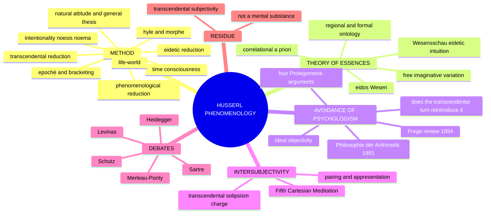

```text
HUSSERL'S PROGRAMME: PRESUPPOSITIONLESS, RIGOROUS SCIENCE of consciousness
                    MOTTO: "to the things themselves" (zu den Sachen selbst)
   1. METHOD                 2. THEORY OF ESSENCES      3. AVOIDANCE OF PSYCHOLOGISM
   natural attitude          eidos / Wesen              psychologism defined
   epoché                    free imaginative variation Frege's criticism
   phenomenological red.     Wesensschau                four Prolegomena arguments
   eidetic reduction         regional ontologies        act vs content
   transcendental red.       material vs formal         transcendental turn ≠ psychologism
   intentionality            correlational a priori
   Lebenswelt
   RESIDUE after all reductions: TRANSCENDENTAL SUBJECTIVITY — the field of
   sense-constitution, NOT a mental substance
```

> [!TIP]
> **Mnemonic "NEIT-L":** natural attitude → suspension → intentional correlation → transcendental inquiry → life-world. An orientation, **not** one fixed chronological ladder of reductions.

---

## 1. Identity, Lineage, Works and Provenance Discipline

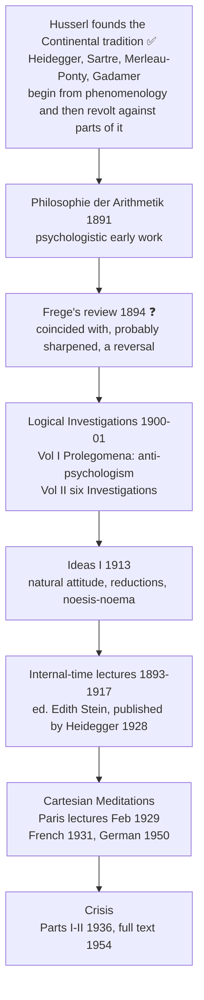

| Phase / work | Marks-essential role |
|---|---|
| *Logical Investigations* (1900–01) | anti-psychologism, intentionality and descriptive/eidetic analysis before the mature transcendental turn |
| *Ideas I* (1913) | natural attitude, suspension, phenomenological/transcendental reduction, noesis–noema vocabulary |
| Internal-time lectures/manuscripts | retention, primal impression, protention — optional methodological depth |
| *Cartesian Meditations* (French 1931; German 1950) | transcendental ego, embodiment, empathy/appresentation, intersubjectivity |
| *Crisis* (Parts I–II 1936; full text 1954) | late life-world, sedimentation, crisis of scientific objectivism |

### 1.1 Provenance table ✅

| Work | Correct status | Practice |
|---|---|---|
| *Philosophie der Arithmetik* | **1891** | Psychologistic early work |
| Frege's review | **1894**, *Zeitschrift für Philosophie und philosophische Kritik* | ❌ do **not** quote "one might as well explain astronomy by the psychology of astronomers" as Frege's. Paraphrase. ❓ Do not assert the review *caused* the turn: Føllesdal says yes; Mohanty (*Husserl and Frege*, 1982) says no |
| *Logische Untersuchungen* | **1900–01**; 2nd revised edn 1913; Eng. tr. J. N. Findlay (1970) | Specify the volume; Vol I = *Prolegomena to Pure Logic* |
| "Philosophy as a Rigorous Science" | *Logos*, **1911** | Programmatic essay |
| *Ideen I* | **1913**; Eng. tr. W. R. Boyce Gibson (1931), F. Kersten (1982) | Cite by § number: §24 principle of principles; §31–32 epoché; §85 hyle/morphe. *Ideas II* and *III* are posthumous (1952) |
| Internal-time lectures | 1893–1917; ed. **Edith Stein**, published by **Heidegger 1928** | Always note editorial history |
| *Cartesianische Meditationen* | Paris lectures **Feb 1929**; **French first** (Levinas and Peiffer, **1931**); German **1950**; Eng. tr. Dorion Cairns (1960) | ❌ never "1931, German" |
| *Krisis* | Parts I–II *Philosophia* (Belgrade) **1936**; Husserl died **1938**; complete **1954** (*Husserliana* VI, ed. Biemel); Eng. tr. David Carr (1970) | Safe form: "Parts I–II 1936; full text posthumously 1954" |

- **"Zu den Sachen selbst"** — Husserl's slogan, *Logical Investigations* Vol II, Introduction. *Sachen* = "matters/subject-matters", not physical things; gloss it or it sounds like naive realism.
- **Principle of principles** (*Ideas I* §24): wording differs between Gibson and Kersten; give the § and name the translation, or paraphrase.
- **Development caution ⚠️:** do not project *Ideas I* terminology unchanged into the *Logical Investigations*. Husserl's project moves from descriptive phenomenology and anti-psychologism to transcendental constitution and later genetic/life-world themes.
- **Owner-scope map:** printed owner = Method; Theory of Essences; Avoidance of Psychologism. Intentionality, natural attitude and reductions are indispensable prerequisites. Time-consciousness, horizons, intersubjectivity and life-world are bounded depth unless a routed question needs them. Heidegger, Sartre and Merleau-Ponty keep their own owners.

---

## 2. Method as the Route to Evidence (Theory of Knowledge)

### 2.1 Natural attitude and its general thesis (2021 Q4(a), 20 marks) ✅

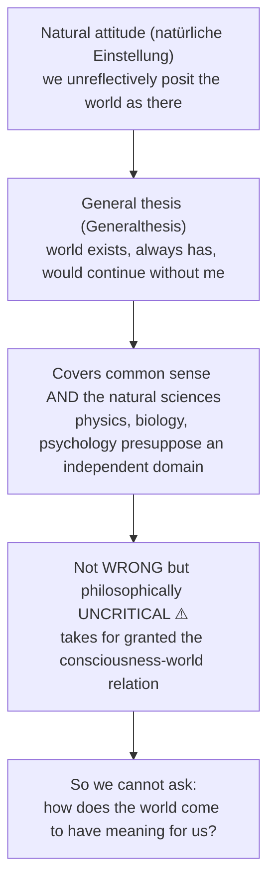

### 2.2 Epoché and the reductions ✅

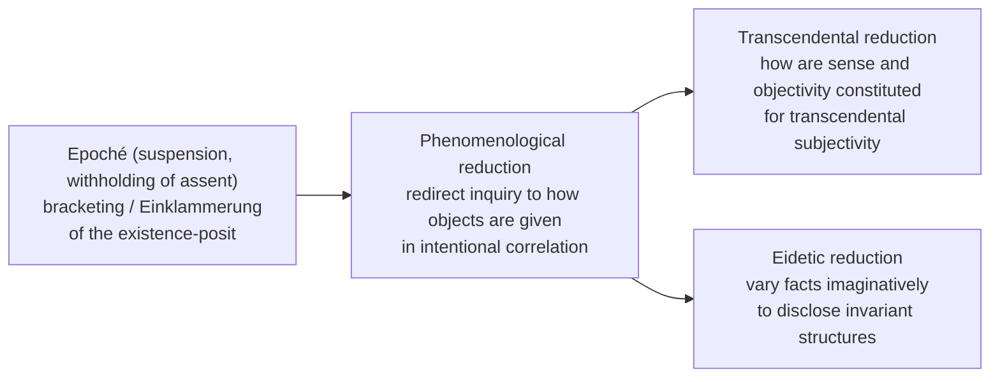

- **What is bracketed:** the existence-positing of the general thesis, **not** the content of experience. The tree is still described with colour, shape, placement, but I neither assert nor deny that it exists beyond my experience of it.
- **What is NOT bracketed:** the stream of consciousness with its intentional contents. The **residuum** is the field of pure experience as lived.
- **Do not collapse the reductions:**

| Operation | Function |
|---|---|
| Suspension (*epoché*) | withholds the natural-attitude existence-posit |
| Phenomenological reduction | redirects inquiry to givenness in intentional correlation |
| Transcendental reduction | asks how sense/objectivity are constituted for transcendental subjectivity |
| Eidetic reduction | varies facts imaginatively to disclose invariant structures |

Relations are methodological and developed across Husserl's career, **not one universally agreed mechanical sequence**. Eidetic variation can be used in descriptive phenomenology and is not always a later step presupposing completed transcendental reduction.

### 2.3 Epoché ≠ Cartesian doubt ✅

| Axis | Descartes | Husserl |
|---|---|---|
| Move | Withholds assent from what can be doubted to find the indubitable cogito | Suspends the natural-attitude **positing** of world-existence without testing whether the world exists |
| Aim | Then seeks to establish the external world | Describe how the world is given |
| Character | Methodic doubt, not blanket denial | Methodological neutralisation, **not scepticism** |

### 2.4 Why bracketing and reduction matter (2023 Q3(b), 15 marks) ⚠️

1. **Secure first-person evidence under a changed attitude:** the cogito/stream is apodictically unavoidable as experienced, though particular self-descriptions can remain inadequate or corrigible. Apodicticity ≠ exhaustive transparency.
2. **Avoid the Cartesian substance inference:** consciousness analysed as intentional life, not established as a separate mental thing. This reformulates rather than magically eliminates every mind/body problem.
3. **Open eidetic and transcendental questions:** suspending factual commitment clarifies structures of givenness; imaginative variation is a distinct method not mechanically sequenced after every reduction.

### 2.5 Intentionality, noesis and noema ✅

| Element | Content |
|---|---|
| **Intentionality** | Inherited from **Franz Brentano** (*intentionale Inexistenz*) but transformed. Every act is consciousness **of** something: perceiving-of-X, imagining-of-Y, judging-that-p |
| **Noesis** | Act-aspect: the mode of intending (perceiving, remembering, doubting, loving) |
| **Noema** | Object-as-intended / sense-aspect: what is intended precisely as the act intends it |
| **Correlation** | Noesis–noema is the structure of every intentional experience. *Ideas I* vocabulary, not unchanged in every phase |
| **No mental-image intermediary** | In veridical perception the intended object may be the actual worldly object under a determinate sense and profile. Readings differ: ideal sense, object-as-intended, structured appearance |
| **Existence not required** | Imagining a centaur or hallucinating still has directed structure. Intentionality = directedness, not deliberate intention, not guaranteed existence |

### 2.6 Hallucination as intentional act (2019 Q1(b), 10 marks) ✅

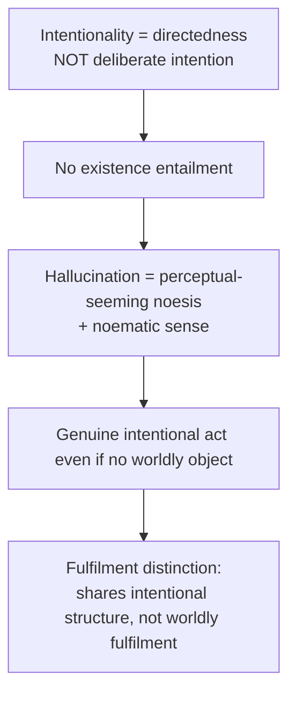

### 2.7 Principle of principles, profiles, horizons, fulfilment ✅

- **Principle of principles** (*Ideas I* §24): every originary presentive intuition is a legitimating source of cognition; accept what is given as it is presented, but only within the limits of its presentation. Ground of evidence = **givenness to consciousness**.
- **Profiles / adumbrations** (*Abschattungen*): a spatial thing is given through changing profiles; only one side originally seen, unseen sides co-intended.
- **Internal horizon:** the open system of further profiles of this object. **External horizon:** its meaningful surroundings and relations to other objects.
- **Synthesis of identification:** a temporal synthesis holds changing profiles together as appearances of the same object.
- **Intuitive fulfilment:** an empty intention is fulfilled when the object is given more fully; **disappointment** can require correction.
- **Evidence** (*Evidenz*) is dynamic and graded. Adequate givenness is an ideal limit for transcendent spatial objects, not total possession in one act.

### 2.8 Hyle and morphe (*Ideas I* §85) ✅

| | **Hyle** (matter) | **Morphe** (form) |
|---|---|---|
| What | Non-intentional **sensory content** actually lived through (colour-data, sound-data) | The **animating apprehension** that interprets hyletic stuff as presentation of an object |
| Intentional? | **No** | **Yes** — confers directedness |
| Perceived? | **No**; lived (*erlebt*), not observed | Disclosed only under the reduction |
| Example | Same brownish colour-data | animated as *this house*, *a brown patch in a painting*, *a stain* |

Exact printed subterms: *sensuous hylē* / *hyletische Daten*; *intentional morphē*; *Empfindungsdaten*; *Auffassung* / *Beseelung*; chapter formula "sensuous hylē, intentional morphē".

Why it earns marks ⚠️: (1) same sensory material can found different objects (duck-rabbit also belongs to Later Wittgenstein §5B); (2) Husserl is **not** a sense-datum theorist — no veil of ideas, separating him from Locke and Russell; (3) Merleau-Ponty rejects the scheme (the body already organises the field); Sartre rejects hyletic data as a residue of the "digestive" conception. ❓ Standing difficulty: if hyletic data are non-intentional, in what sense are they given at all? Later genetic phenomenology largely absorbs hyle into passive synthesis, a tacit concession.

### 2.9 Inner time-consciousness ✅

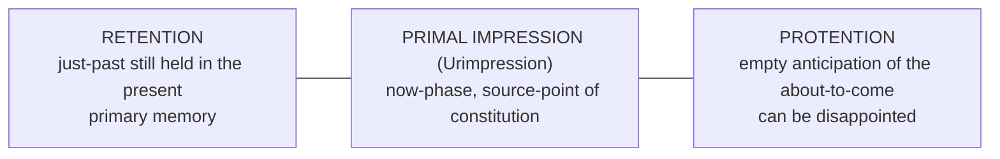

- **Problem:** if consciousness were a succession of now-points, we could never experience a melody. How is temporal extension possible within a present?
- **Key contrast ⚠️:** **retention is NOT recollection.** Retention is part of present perception; recollection (*Wiedererinnerung*, secondary memory) is a re-presentation (*Vergegenwärtigung*) of what is no longer present. "The single most examinable point."
- **Example:** hearing a melody; secondary example: a spoken sentence. Running-off phenomena (*Ablaufsphänomene*).
- **Consequences:** answers Hume (he looked for the self *among* contents, not in the constituting flow); grounds identity and habituality; Heidegger transforms it into ecstatic temporality (*Being and Time*).
- ❓ **Objection:** regress. If the flow constitutes time, what constitutes the flow? Husserl: the flow constitutes its own unity — genuine self-grounding or stipulation; commentators divide.

---

## 3. Internal Diversity, Refinements and Later Developments

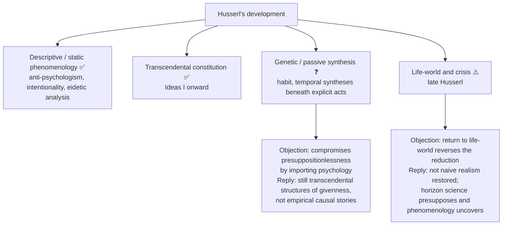

### 3.1 Life-world (*Lebenswelt*) ⚠️

- In *Crisis*: the pre-scientific, pre-theoretical world of everyday lived experience. Sciences **abstract** from it and substitute idealisations (Galilean mathematisation); the "crisis" is that science forgot its own origin in the life-world and treats abstractions as the real.
- Philosophically it is the pre-given horizon presupposed by scientific idealisation. **Sedimentation** = how meanings and methods become inherited, taken-for-granted achievements.
- Verdict bank: *10 marks* science presupposes a pre-given horizon of lived sense; critique targets objectivism, not science. *15 marks* sedimentation explains inherited meanings. *20 marks* the unfinished *Crisis* may deepen rather than reverse transcendental phenomenology; optional unless late method is asked.
- Safe form: "*Crisis* (Parts I–II 1936; full text posthumously 1954)"; do not treat unfinished later sections as settled doctrine.

### 3.2 Advanced-dossier modules (optional depth, §9 of the dossier) ❓/⚠️

| Module | Issue | Competing readings | Objection → counter-reply | Safe use / promote if |
|---|---|---|---|---|
| **What is the noema?** ❓ | Frege-like sense, object-as-intended, or structured appearance? | Ideal-sense; object-as-meant; appearance-structure | Third thing between mind and world reintroduces a representational veil → noema is the object *as intended in a determinate act*, not an inner picture | One clarifying line if an answer slides into crude mentalism. Promote if a PYQ asks directly what the noema is |
| **Static vs genetic phenomenology; passive synthesis** ❓ | Snapshot description of acts, or also passive, temporal, habitual syntheses beneath acts? | Early static reading; later genetic reading; continuity reading (deepening, not replacing) | Passive synthesis compromises presuppositionlessness → still transcendental structures of givenness | Late-Husserl enrichment after method is explained. Promote if PYQ asks about passive synthesis, habit or later development |
| **Lifeworld and the late turn** ⚠️ | Retreat from transcendental idealism, or recovery of the horizon science forgets? | Continuity; late worldly/pragmatic turn; mixed reading | If Husserl returns to the life-world the reduction seems reversed → life-world is not naive realism | One final evaluative paragraph. Promote if PYQ asks about life-world, crisis or late revision |

Short source trail named in the dossier: Husserl's *Logical Investigations*, *Ideas I*, *Cartesian Meditations*, *Crisis*; Dagfinn Føllesdal; Robert Sokolowski; Dan Zahavi; John Drummond; David Carr.

---

## 4. Ontology of Consciousness, Essences and Regions

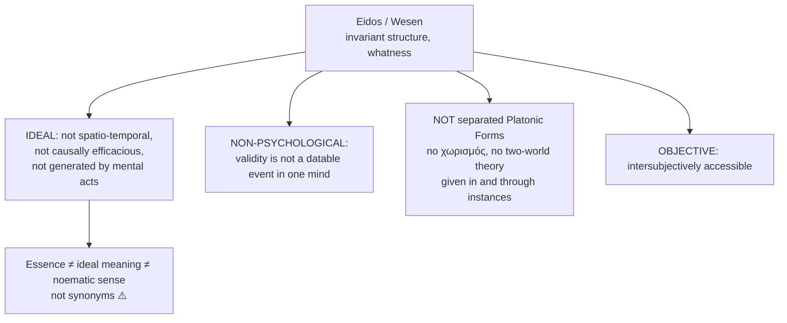

### 4.1 Free imaginative variation ✅

1. Begin with a factual instance (a perceived object, a melody, a judgement).
2. Vary it freely in imagination: colour, size, material, duration, context.
3. At each step ask: does the phenomenon **survive**, or collapse into something else?
4. What **cannot be varied away without destroying the phenomenon** is its essence.

- Example: vary a triangle's size, orientation, material presentation; closed three-sided plane-figure structure remains. The angle-sum claim depends on the geometrical framework — do not present it as the invariant of every possible geometry.
- **Not induction**; an *a priori* procedure in imagination; a single instance suffices to launch variation.

### 4.2 Wesensschau and categorial intuition ✅

- Essences are **seen**, not inferred: *Wesensschau* (eidetic intuition).
- **Categorial intuition** (*kategoriale Anschauung*), Sixth *Logical Investigation*: fulfils intentions directed to states of affairs and categorial formations not given as a mere sensory item. Do not collapse it into one unchanged doctrine with later eidetic intuition.
- Evidence is graded and can be partial; not a private feeling of certainty guaranteeing truth. Constraints: imaginative variation, fulfilment, counter-variation, intersubjective repeatability.
- **Presupposition ⚠️:** a form of *intellectual* seeing as legitimate and self-grounding as sense-perception — a strong claim, source of much criticism.
- Verdict bank: *10* variation seeks invariants without induction or separated Platonic objects; *15* eidetic evidence is graded and testable by counter-variation; *20* framework dependence and intersubjective repeatability remain challenges.

### 4.3 Regional and formal ontologies ✅

| Type | Content |
|---|---|
| **Formal ontology** | Most general categorial forms (object, property, relation, state of affairs, whole-part) applying to **every** region; analogous to formal logic |
| **Material (regional) ontology** | Essential structures of each region: physical thing (extension, duration, causality); psyche (intentionality, temporal flow); social (intersubjectivity, norms) |

Phenomenology is the **foundational science** grounding all regional ontologies by clarifying how their objects are constituted in consciousness ⚠️. Orientation depth only.

### 4.4 The transcendental ego ✅

- The transcendental reduction asks about the constituting subjectivity for which object-sense and validity arise. It is **not simply the third step after a completed eidetic reduction.** The empirical psychophysical person is bracketed as a worldly object.
- The transcendental ego is the **field of sense-constitution**, that *for which* meaning is constituted. It is **NOT**: (a) a Cartesian *res cogitans*; (b) identical without qualification to Kant's formal "I think" (Husserl analyses habitualities, sedimentation, temporal constitution); (c) the empirical psyche.

---

## 5. Stance on the Natural Attitude, Realism/Idealism and the Other Mind

### 5.1 Correlational a priori: essences and continuity of consciousness and being (2024 Q4(b), 15 marks) ✅

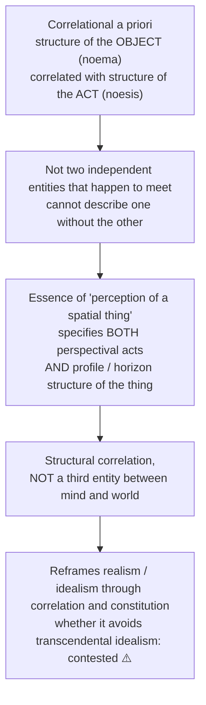

### 5.2 Husserl's "I think" vs Descartes' cogito (2025 Q4(a), 20 marks) ✅/⚠️

| Axis | Descartes | Husserl |
|---|---|---|
| Start | Indubitable self-givenness of the thinking act; presuppositionless beginning | Same shared aspiration |
| Nature of self | Thinking **substance** (*res cogitans*) | Suspends the mundane ontological inference; studies **constituting subjectivity** |
| World | Needs divine non-deception (*veracitas Dei*) to rebuild world-knowledge | Never denies the world; brackets its natural-attitude positing; analyses modes of givenness |
| Character of ego | Sealed inner thing | Intentional, temporal and ultimately intersubjective |

**Critical discussion:** the charge of **transcendental solipsism**; Husserl's reply is the Fifth Meditation (§5.3). Whether it fully escapes solipsism is debated ❓.

### 5.3 Fifth *Cartesian Meditation*: intersubjectivity ✅

**Correct the question first ⚠️:** Husserl is **not** trying to *prove* other minds exist (a natural-attitude question the epoché has suspended). He asks: how does the sense "another subject, for whom the world is also there" get constituted in my experience, with the evidence proper to it? Treating it as a failed proof misidentifies the task.

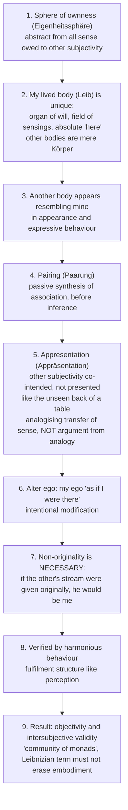

**Presuppositions ⚠️:** P1 the reduction to ownness is coherent; P2 my body is originally given as lived body before any experience of others; P3 pairing is genuinely passive and pre-predicative; P4 the order of constitution is asymmetrical (me first, others through me).

| Objection | Source | Husserl's available reply | Residual |
|---|---|---|---|
| **Circularity:** ownness supposedly free of reference to others, yet my body is recognised as a body like others' only if I already have the sense "other" | **Alfred Schutz** (1957) | Ownness is an abstractive layer, not a temporal stage; validity-founding, not chronology | The most serious objection |
| **Encountered in the Look**, not appresented: the other makes me an object in shame | **Sartre**, *Being and Nothingness* (1943), Part III | Sartre's modality presupposes the constituted sense "other subject" | Strong rival |
| **Alter ego erases otherness**; ethics is first philosophy | **Levinas**, *Totality and Infinity* (1961) | The analysis is of sense-constitution, silent on ethical priority | Reply concedes the point |
| **No problem to solve:** Dasein is *Mitsein* | **Heidegger**, *Being and Time* (1927) §26 | Description, not clarification of legitimation | Dispute is whether legitimation is needed |

**Verdict:** the Fifth Meditation treats the other's non-original givenness as part of the sense "other" and links objectivity to intersubjectivity; its ownness-first method remains vulnerable to circularity and reduction of alterity.

### 5.4 Natural-attitude critique and response (2021 Q4(a), 20 marks): criticisms Husserl faces

- **Heidegger (*Being and Time*, 1927):** the epoché brackets existence, yet existence (being-in-the-world) is what philosophy must think. *Reply:* it thematises the meaning of existence by suspending the naïve presupposition.
- **Merleau-Ponty:** return to the natural attitude is inevitable and enriching; complete reduction impossible (§9.1).

### 5.5 Sartre cross-link (2026 Q2(c)) ✅

Sartre accepts intentionality and pre-reflective self-awareness but denies any ego **inhabits** consciousness: the "I" is a transcendent object constituted in reflection (*The Transcendence of the Ego*, 1936–37); consciousness is "nothing". His four objections to the transcendental ego (superfluity, opacity, priority, reification), the full contrast table, and the answer spines are owned by `Existentialism.md` §2.4A. Supply the Husserlian half from owner §1.2–1.5 and §3A; ❌ never write that Sartre simply "refuted" Husserl. The *Logical Investigations* Husserl was himself non-egological.

---

## 6. Explanatory Principles: Intentional Correlation, Constitution, Ideal Objectivity

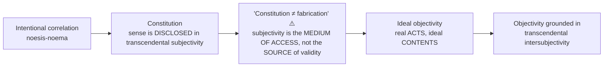

---

## 7. Ethics and Human Goals

The sources (owner file and the advanced dossier §9) give **no value or puruṣārtha-type scheme** for Husserl's phenomenology. Nothing is invented here. The only value-related content is epistemic: the programme's aspiration to **rigour** ("Philosophy as a Rigorous Science", *Logos* 1911), and the *Crisis* critique of scientific objectivism that forgets its origin in lived experience (§3.1).

---

## 8. Inter-School Comparative Matrices

### 8.1 Inter-thinker matrix (owner §9) ⚠️

| Axis | Husserl | Descartes | Kant | Heidegger | Merleau-Ponty |
|---|---|---|---|---|---|
| Starting point | Epoché → pure phenomena | Methodic doubt → cogito | Transcendental conditions | Being-in-the-world (no reduction) | Embodied perception |
| Ego/subject | Transcendental constituting subjectivity | *Res cogitans* (substance) | Formal unity of apperception | Dasein not modelled as a Cartesian subject | Embodied subject / lived body |
| World-access | Intentional correlation (world never lost) | Needs God's guarantee | Phenomena vs noumena | World is constitutive of Dasein | Primacy of perception |
| Essence | Eidetic intuition via free variation | Clear and distinct ideas | Categories (a priori concepts) | "Essence of Dasein = existence" | Essences incarnate in body |
| Status of logic | Ideal, objective, atemporal | Innate, guaranteed by God | A priori forms of understanding | Presupposed, not thematised | Grounded in lived experience |

### 8.2 What became of phenomenology: heirs and the doctrine each rejected ✅

| Heir | What was rejected |
|---|---|
| Heidegger | The reduction and the theoretical attitude |
| Sartre | Hyle and the transcendental ego |
| Merleau-Ponty | Complete reduction; hyle/morphe |
| Levinas | The alter-ego constitution of the Other |

❌ "Husserl influenced existentialism" scores nothing; name the specific doctrine.

### 8.3 Link-out relations (owner §10)

- **Existentialism:** Heidegger and Sartre transform intentionality/reduction; positive systems separately owned.
- **Empiricism:** contrast empirical psychology/association with ideal validity; do not reduce all empiricism to psychologism.
- **Kant:** both investigate conditions of objectivity, but Husserl's intentional/transcendental subjectivity is not simply Kant's apperception with added content.
- **Rationalism:** Husserl vs Descartes on the cogito (§5.2).
- **Logical Positivism:** both combat psychologism, but positivists reject eidetic intuition as "metaphysics".

---

## 9. Criticisms and Reconstructed Replies

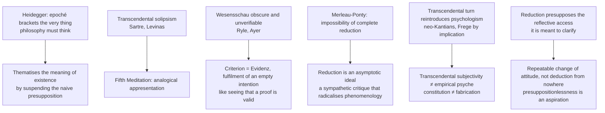

### 9.1 Full criticism ledger ⚠️/❓

| Criticism | Source | Husserl's reply / counter |
|---|---|---|
| Epoché brackets existence, which is what philosophy must think | Heidegger (1927) | Thematises meaning of existence; you cannot examine what you unreflectively live in |
| Transcendental solipsism | Traditional (cf. Sartre, Levinas) | Fifth Meditation appresentation |
| *Wesensschau* obscure; how do different subjects intuit *the same* essence? | Analytic tradition (Ryle, Ayer) | Self-evidence (*Evidenz*), fulfilment of an empty intention |
| "Impossibility of a complete reduction" | Merleau-Ponty, *Phenomenology of Perception* (1945), Preface | Our embeddedness always shapes the starting point; epoché is asymptotic |
| Transcendental turn reintroduces psychologism | Neo-Kantians, Frege (by implication) | Transcendental ≠ empirical; constitution ≠ fabrication; ideality accessed, not created |
| Reduction presupposes reflective access and subject/object distinctions | Circularity objection | Repeatable change of attitude; presuppositionlessness an aspiration |
| Reflection distorts pre-reflective experience | Sartre, Merleau-Ponty, later phenomenology | Reflection can attend to modes of givenness, but embodiment and operative intentionality may precede explicit noetic analysis |
| Language, history, embodiment under-described by transcendental-ego start | Hermeneutic and embodied phenomenology | Genetic phenomenology, sedimentation, life-world and lived body broaden the field; whether this repairs the priority is disputed |
| Noema becomes a private representational intermediary | Noema critics | Object-as-intended is not another inner object; competing readings remain |

⚠️ **Merleau-Ponty translation caution:** Landes (2012): "The most important lesson of the reduction is the impossibility of a complete reduction"; Smith (1962): "The most important lesson which the reduction teaches us is the impossibility of a complete reduction". Name the translation.

---

## 10. Controlled Western Comparisons

| Comparator | Point of contact | Decisive disanalogy (from the sources) |
|---|---|---|
| **Descartes** | Indubitable self-givenness; presuppositionless start; a "reduction" from the external world | No substance inference; no God-bridge; world bracketed not denied (§5.2) |
| **Kant** | Conditions of objectivity | Husserl's subjectivity is intentional, temporal, habitual; not simply Kant's formal apperception (§4.4) |
| **Hume** | Time-consciousness answers why he found no self | Hume looked for the self among contents, not in the constituting flow (§2.9) |
| **Locke / Russell** | Contrasted via hyle/morphe | Husserl is not a sense-datum theorist: hyletic data are never the objects of perception; no veil of ideas (§2.8) |
| **Frege** | Content of thought vs act of thinking | Frege's objection stated in substance; causal influence on Husserl's turn is disputed (§1.1) |
| **Logical positivists** | Both combat psychologism | Positivists reject eidetic intuition as "metaphysics" (§8.3) |
| **Sartre / Heidegger / Merleau-Ponty / Levinas** | Begin from phenomenology | Each rejects a specific doctrine (§8.2) |

> [!NOTE]
> **Indian comparison.** The sources attach **no** Husserl–Indian comparison table. The owner file links `Religious-Experience.md` (phenomenology of religious experience: the *intentional object* of the sacred; Otto, Scheler) and `Reason-Revelation-Faith.md` (life-world and faith as lived prior to theoretical theology) in Paper II, but states no Indian parallel. `_themes/Substance-across-western.md` contains no Husserl material (its only "phenomenology" hit is Hegel's *Phenomenology*). No Indian parallel is invented here.

---

## 11. Diagnostic Deep-Dives for High-Frequency Themes

### 11.1 Psychologism and its avoidance (2020 Q1(c), 2022 Q1(d)) ✅

**Psychologism** = logical laws are empirical generalisations about how humans in fact think; logic is a branch, or consequence, of descriptive psychology. Representatives: **John Stuart Mill, Theodor Lipps, Christoph Sigwart**, and (earlier) **Husserl himself**.

Psychologism's specific claims: non-contradiction reports a psychological impossibility; logical laws hold because of the constitution of the human mind; truth is what we are compelled to believe.

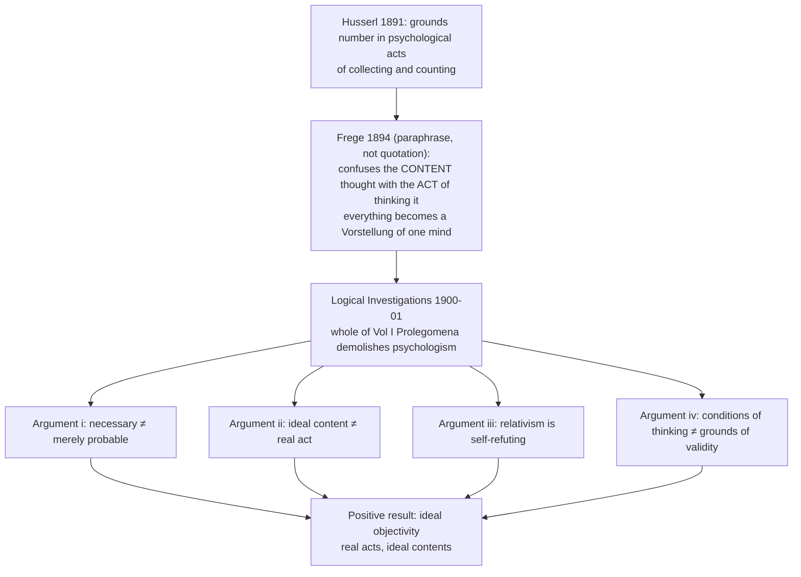

| # | Argument (*Prolegomena*) | Logic |
|---|---|---|
| (i) | Necessary → merely probable | Psychological laws are inductive, at best highly probable; logical laws are necessary. The necessary cannot be derived from the merely probable |
| (ii) | Confusion of ideal content and real act | Content of "2+2=4" is an ideal atemporal meaning; the act of judging it is a real datable event |
| (iii) | Relativism and self-refutation | If laws hold only "for beings like us", truth is species-relative (*Anthropologismus*); but "truth is relative" is offered as absolutely true |
| (iv) | Conditions of thinking ≠ grounds of validity | That we *must* think in line with non-contradiction (causal necessity) does not explain why the law *holds*; conflation = genetic fallacy |

- **Ideal objectivity:** validity not identical with any datable psychological act. Avoid "subsist" if it suggests a separately located Platonic realm. Phenomenology studies consciousness as the site where ideal meanings are grasped without reducing them to the acts that grasp them. This is Husserl's decisive move against psychologism (denied the ideal) and naive Platonism (denied its accessibility to consciousness).
- ❌ Frege's astronomy sentence is a textbook paraphrase, **not** a quotation.
- ❌ Do not confuse avoiding psychologism with excluding consciousness: Husserl studies intentional acts while refusing to make logical truth depend on empirical mental laws (depth delta).

### 11.2 Does the transcendental turn reintroduce psychologism? (2022 Q1(d) reflexive worry) ❓

- **Charge:** after *Ideas* (1913) meaning is constituted in the transcendental ego; is truth subject-dependent again, at the transcendental level?
- **Reply:** (1) the transcendental ego is not the empirical psyche, which is a mundane object within the world; (2) constitution means **disclosure**, not creation or fabrication; (3) objectivity is grounded in transcendental intersubjectivity (problem: Fifth Meditation).
- **Assessment:** coherent but not decisive; neo-Kantians and, differently, the analytic tradition remain unconvinced; Heidegger and Merleau-Ponty hold the transcendental ego stays too close to the idealist subject.

### 11.3 Directive decoder ⚠️

| Directive | What it demands | Fatal error |
|---|---|---|
| Discuss the phenomenological method | Distinguish operations, development, purposes; natural attitude → suspension → eidetic and transcendental | Defining epoché or drawing an automatic ladder |
| Why bracketing and reduction? (2023) | Three-purpose answer with consequences | Describing the technique instead of justifying it |
| Critically discuss Husserl's "I think" vs Descartes (2025) | Structured comparison with a ruling: agreement → three divergences → solipsism and Fifth Meditation → verdict | Two separate descriptions with no axis |
| Explain the theory of essences | The method (free imaginative variation) is the marked content; one worked case | Asserting that essences are grasped in *Wesensschau* |
| How does Husserl avoid psychologism? (2022) | Four *Prolegomena* arguments, then the reflexive worry and reply | Defining it and asserting Husserl rejected it |
| Elucidate a technical term | English concept first, source term, contrast, function | A source word with no English explanation |
| Assess / Do you agree? | A defended ruling (does the Fifth Meditation escape solipsism? is *Wesensschau* verifiable?) | Reporting the debate |
| Trace the influence | Name heirs **and** the doctrine each rejected | "Husserl influenced existentialism" |

---

## 12. PYQ Routing Ledger

> **Corpus signal:** 7 primary-owned parts out of 112 (2018–2025); 2018 has no primary-owned part, though epoché is a secondary premise in the 2018 Q4(a) Heidegger question (owned by Existentialism). 2026: 0 primary-owned; Phenomenology appears only as a cross-owned half, the first such year in the local corpus.

### Primary-owned (7)

| Year | Q | Marks | Exact demand | Answer route | Map to |
|---|---|---:|---|---|---|
| 2019 | Q1(b) | 10 | Can hallucination be regarded as an intentional act by Husserl? Explain. | directedness not deliberate intention → no existence entailment → perceptual-seeming act/noematic sense → fulfilment distinction | §2.5–2.6 |
| 2020 | Q1(c) | 10 | What, according to Husserl, is wrong with psychologism? How does Husserl address the problems with psychologism in his phenomenological method? | act/content → necessity/probability → validity/causal genesis → ideal objectivity → transcendental worry | §11.1 |
| 2021 | Q4(a) | 20 | Present a critical exposition of Husserl's criticism of 'natural attitude'. How does Husserl propose to address the problems involved in natural attitude through his phenomenological method? | general thesis → uncritical presupposition → suspension → phenomenological/transcendental redirection → idealism/circularity objections | §2.1–2.2, §5.4 |
| 2022 | Q1(d) | 10 | What is psychologism? Critically discuss the way Edmund Husserl avoids the problem of psychologism in the discourse of transcendental phenomenology. | definition → four *Prolegomena* arguments → empirical/transcendental distinction → constitution-not-fabrication → verdict | §11.1–11.2 |
| 2023 | Q3(b) | 15 | Elucidate the significance of bracketing and reduction in Husserl's phenomenological method. | distinguish suspension/phenomenological/eidetic/transcendental operations → purposes → evidence → incomplete-reduction objection | §2.2, §2.4 |
| 2024 | Q4(b) | 15 | Why does Husserl think that essences exhibit a kind of continuity between consciousness and being? Discuss. | correlational a priori → noesis/noema caution → profiles/horizons/synthesis → imaginative variation → idealism objection | §5.1, §4 |
| 2025 | Q4(a) | 20 | How is Husserl's account of "I think" different from that of Descartes? Critically discuss. | common Cartesian aspiration → substance versus constituting subjectivity → world bracketing → temporality/intersubjectivity → solipsism verdict | §5.2–5.3 |

### Cross-owned (listed, not counted)

| Year | Q | Marks | Exact demand | Owner |
|---|---|---:|---|---|
| 2026 | Q2(c) | 15 | Describe Sartre's notion of consciousness as 'nothing'. How is it different from Husserl's notion of consciousness? Discuss. | `Existentialism.md` §2.4A (Husserlian half from owner §1.2–1.5, §3A) |
| 2018 | Q4(a) | 20 | What is 'Epoché'? How does Heidegger reject this method of phenomenological reduction? Explain Heidegger's concept of 'being in the world' as opposed to the concept of a transcendental ego. | `Existentialism.md`; epoché as secondary premise |

---

## 13. Top 10 UPSC Exam Traps

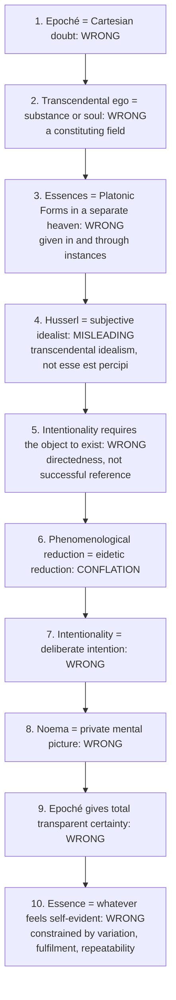

Further ❌ errors recorded in the sources: epoché "denies the existence of the world"; *Wesensschau* as mystical intuition; retention as a kind of memory; Husserl "proved other minds exist"; Heidegger, Sartre, Merleau-Ponty as Husserl's "disciples" without naming the doctrine each rejected; quoting Frege's astronomy sentence; "*Cartesian Meditations* (1931, German)"; "*Crisis* (1936)" for the whole book; citing *Ideas II/III* as 1913; "Logical Investigations" for a *Prolegomena* argument without the volume; treating the unfinished *Crisis* as settled doctrine; asserting Frege's review *caused* the reversal.

---

## 14. Technical Vocabulary and Terminology Bank

| English concept | Source term | Meaning / contrast | Status |
|---|---|---|---|
| To the things themselves | *zu den Sachen selbst* | Return to subject-matters as given; *Sachen* ≠ physical things | ✅ |
| Rigorous science | *Philosophie als strenge Wissenschaft* (1911) | Programmatic aspiration | ✅ |
| Natural attitude / general thesis | *natürliche Einstellung* / *Generalthesis* | Pre-philosophical positing of world-existence | ✅ |
| Suspension / bracketing | *epoché* (ἐποχή) / *Einklammerung* | Neutralisation of the general thesis | ✅ |
| Phenomenological / transcendental / eidetic reduction | | Distinct operations | ✅ |
| Intentionality | | Directedness; not deliberate intention (Brentano's *intentionale Inexistenz*, transformed) | ✅ |
| Act-aspect / object-as-intended | noesis / noema | *Ideas I* correlation; interpretation caution | ✅ |
| Sensuous matter / animating form | *hylē* / *morphē*; *hyletische Daten*; *Auffassung*, *Beseelung* | Non-intentional lived sensory content / apprehension | ✅ |
| Profile | *Abschattung* | Perspectival adumbration | ✅ |
| Evidence | *Evidenz* | Graded intuitive fulfilment | ✅ |
| Principle of principles | *Ideas I* §24 | Ground of evidence = originary givenness | ✅ |
| Essence | *eidos*, *Wesen* | Invariant whatness | ✅ |
| Eidetic intuition | *Wesensschau* | Claimed intuitive disclosure of essences | ✅ |
| Categorial intuition | *kategoriale Anschauung* | Sixth *Logical Investigation* | ✅ |
| Free imaginative variation | | Extract invariant from variable | ✅ |
| Transcendental ego | | Constituting field, not a substance | ✅ |
| Retention / primal impression / protention | *Retention*, *Urimpression*, *Protention* | Retention ≠ recollection (*Wiedererinnerung*) | ✅ |
| Life-world | *Lebenswelt* | Pre-scientific horizon | ⚠️ |
| Sphere of ownness | *Eigenheitssphäre* | Primordial sphere | ✅ |
| Lived body / physical body | *Leib* / *Körper* | The absolute "here" / mere physical thing | ✅ |
| Pairing / appresentation | *Paarung* / *Appräsentation* | Passive association / co-intending the unpresented | ✅ |
| Correlational a priori | | Inseparability of noetic and noematic structure | ⚠️ |
| "Constitution ≠ fabrication" | | Key reply to idealism/psychologism charge | ⚠️ |
| Psychologism / anthropologism | *Anthropologismus* | Logic as empirical psychology / species-relative truth | ✅ |
| Transcendental solipsism | | Others as moments of my constituting life | ❓ |

---

## 15. Graded Verdict and Answer Architectures

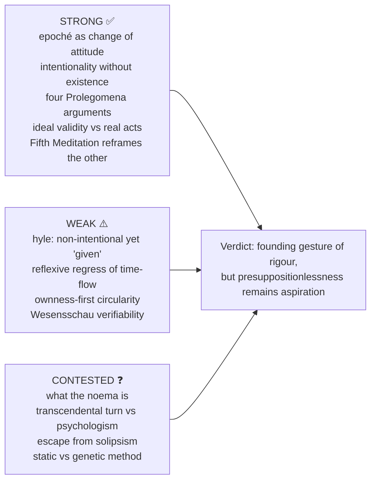

### 15.1 Verdict bank (owner §V) ⚠️

| Sub-topic | 10-mark | 15-mark | 20-mark |
|---|---|---|---|
| Method / epoché | Suspension brackets the existence-posit, not the experienced world | Eidetic and transcendental reductions have distinct functions, not one mechanical sequence | Reduction succeeds as change of attitude while complete presuppositionlessness remains contested; Merleau-Ponty's incomplete reduction is a bounded later criticism |
| Intentionality | Consciousness is directed; noesis/noema is an *Ideas I* correlation, not a private image | Veridical perception and hallucination share intentional structure, not worldly fulfilment | Noema interpretations and hyle/form difficulties stop intentionality dissolving every representational or embodied problem |
| Time-consciousness | Retention holds just-past in the living present; recollection re-presents | Primal impression, retention, protention constitute temporal object-unity | Self-constituting flow is powerful but reflexively difficult; optional unless asked |
| Essences | Imaginative variation seeks invariants without induction or separated Platonic objects | Eidetic evidence graded and testable by counter-variation | Framework dependence and repeatability remain challenges |
| Psychologism | Confuses *content* thought with *act* of thinking; four arguments turn on that confusion | Strongest = self-refutation: the psychologist's own reasoning is only probable | Deepest question: does the transcendental turn reinstate at a higher level what the *Prolegomena* expelled? Reply coherent, not decisive |
| Life-world | Science presupposes a pre-given horizon | Sedimentation explains inherited meanings | Unfinished *Crisis* may deepen rather than reverse |
| Intersubjectivity | The other is appresented, not originally given | Embodiment, pairing, empathy constitute otherness without inference from analogy | Ownness-first remains exposed to circularity and reduction of alterity |

### 15.2 Answer architecture: 2025 Q4(a), 20 marks

```text
Frame  : Both seek an indubitable starting-point in the thinking subject; both reduce from
         the external world to the self-given. Outcomes diverge on substance, world-access,
         intersubjectivity.
Body A : Descartes: cogito → res cogitans → God as guarantor → world recovered externally.
Body B : Husserl: transcendental subjectivity not inferred as mundane substance; world
         bracketed not denied; modes of givenness, temporality, objectivity analysed
         without a divine guarantee.
Body C : Critical: (i) solipsism risk, Fifth Meditation reply (analogical appresentation);
         (ii) Merleau-Ponty: complete reduction impossible; (iii) Heidegger: even the
         transcendental ego remains within the "theoretical attitude".
Assess : Husserl advances beyond Descartes by avoiding substance-dualism and the God-bridge,
         but retains a constitutive role for subjectivity close to idealism, not subjective.
Close  : Descartes establishes a thinking substance and reconstructs world-knowledge; Husserl
         suspends that ontology to analyse intentional, temporal and intersubjective
         constitution, while remaining vulnerable to transcendental-idealism concerns.
```

### 15.3 Answer architecture: 2024 Q4(b), 15 marks

```text
Frame  : Correlational a priori: object structure inseparable from the structure of the act.
Body A : Essences are not empirical mental events or separated Platonic objects.
Body B : "Perceived spatial thing" specifies (a) how perception proceeds (perspectivally,
         in adumbrations) and (b) what the thing must be (3-D, given in profiles).
Assess : Reframes rather than conclusively dissolves realism/idealism.
Close  : Continuity is a structural correlation, not a merger; essence is the a priori form
         of their togetherness.
```

### 15.4 Answer architecture: 2023 Q3(b), 15 marks

```text
Frame  : "Significance" = why Husserl needs epoché and reductions, not merely what they are.
Body A : Epoché suspends the general thesis → field of pure phenomena free from prejudice.
         Without it philosophy is another natural-attitude discipline (= psychology).
Body B : Phenomenological redirection to givenness; eidetic variation of invariants;
         transcendental inquiry into constituting subjectivity: related, not one ladder.
Assess : Gateway that converts the naive gaze into the philosophical gaze. Limitation:
         Merleau-Ponty's asymptotic reduction.
Close  : Mark Husserl's philosophical attitude; circularity, embodiment and completeness open.
```

### 15.5 Answer architecture: 2022 Q1(d), 10 marks

```text
Defn  : Psychologism = logic is a branch of empirical psychology.
Args  : (i) necessary ≠ probable; (ii) ideal content ≠ real act; (iii) relativism
        self-refuting; (iv) conditions of thinking ≠ grounds of validity.
Avoid : Transcendental ego ≠ empirical psyche; constitution discloses ideal objectivity
        without reducing it to mental events.
Close : The fight against psychologism is the founding gesture securing phenomenology's rigour.
```

### 15.6 Answer architecture: 2021 Q4(a), 20 marks

```text
Frame  : Natural attitude is not an error but pre-philosophical naïveté.
Body A : General thesis (world posited as existing, independent, always there).
Body B : Problem: prevents asking how things acquire meaning; leaves scientific naturalism
         and common-sense realism unexamined.
Body C : Solution: suspension + phenomenological redirection → intentional description →
         transcendental question of constitution; eidetic variation distinct.
Crit   : Heidegger: cannot bracket being-in-the-world without already being in it;
         Merleau-Ponty: return to the natural attitude is inevitable and enriching.
Close  : Not "about" the world but about the meaning-structures within which any world appears.
```

### 15.7 Answer architecture: 2019 Q1(b), 10 marks

```text
Defn  : Intentionality = directedness; noema = object-as-intended/sense structure, not a picture.
Arg   : Hallucination has a perceptual-seeming noesis and a noematic sense (e.g. a pink
        elephant with specific shape and colour): a genuine intentional act.
Key   : Intentionality needs directedness, not existence of the referent.
Close : Yes — paradigmatically intentional: it concerns mode of givenness, not successful reference.
```

> [!TIP]
> **Answer-grabbing lines.** (1) "Frege's objection, in substance, is that explaining arithmetic by the mental operations of the arithmetician confuses the content thought with the act of thinking it." (2) The strongest sentence on the Fifth Meditation: Husserl is not proving other minds exist; he asks how the sense "another subject" is constituted with its proper evidence. (3) "Constitution is disclosure, not fabrication."

---

## Sources

Husserl, *Logical Investigations* (1900–01), esp. Vol I *Prolegomena to Pure Logic* and Vol VI (categorial intuition); *Ideas I* (1913); *Cartesian Meditations* (French 1931, German 1950); *Crisis* (Parts I–II 1936; full text 1954); *On the Phenomenology of the Consciousness of Internal Time* (lectures 1893–1917, ed. Edith Stein, publ. Heidegger 1928); "Philosophy as a Rigorous Science" (1911); Masih, *A Critical History of Western Philosophy*; Kenny, *A New History of Western Philosophy* Vol 4; Warburton, *Philosophy: The Classics*; Audi (ed.), *Cambridge Dictionary of Philosophy*; Copleston, *A History of Philosophy* Vol 7; Merleau-Ponty, *Phenomenology of Perception* (1945, Preface; Smith 1962, Landes 2012); Frege's 1894 review (paraphrase only); Mohanty, *Husserl and Frege* (1982); dossier source trail: Føllesdal, Sokolowski, Zahavi, Drummond, Carr.
