# EXISTENTIALISM (Kierkegaard, Sartre, Heidegger) — Examiner-Grade Mindmap

> **Syllabus (verbatim):** Existentialism (Kierkegaard, Sarte, Heidegger): Existence and Essence; Choice, Responsibility and Authentic Existence; Being-in-the-world and Temporality. *(The printed "Sarte" is a misspelling of Sartre; preserve it only when quoting the syllabus.)*
> **Catalogue key:** `philosophy-paper-i-western-philosophy-10` · Paper I · Western Philosophy (Section A)
> **Sources used:** `paper-1/western/Existentialism.md` (canonical owner, read in full) · `_advanced/Western-Philosophy-Dossier.md` §10 (optional depth) · `paper-1/_PYQ-Western-Philosophy-2018-2025.md` · `paper-1/_PYQ-Western-Philosophy-2026.md` · `paper-1/_themes/Critiques-of-metaphysics.md` (the only theme file with an existentialism passage: Heidegger's *das Nichts nichtet*). `Self-and-liberation-across-schools.md` (linked by the owner for Dasein vs ātman vs anātman) contains no Dasein, Sartre, Kierkegaard or existentialism passage, so no cross-school self-theory is supplied here beyond the owner's link-outs.
> **Evidence key:** ✅ canonical doctrine · ⚠️ analytical synthesis · ❓ contested / uncertain · ❌ trap
> **Adaptation note:** the 15-module blueprint is Indian-school oriented. Here Module 1 = three projects, works and provenance discipline; Module 2 = truth, moods and method as the route to disclosure (theory of knowledge); Module 3 = internal refinements, later revisions and the pseudonymous strategy; Module 4 = ontology (en-soi/pour-soi, Dasein, worldhood); Module 5 = stance on God and transcendence; Module 6 = explanatory principles (freedom against determinism, care and temporality); Module 7 = values, responsibility and authenticity (the sources give no puruṣārtha-type scheme); Module 10 = comparisons the sources themselves give.

> [!IMPORTANT]
> **Core thesis.** "Existentialism" is a retrospective **family label** for three distinct projects: **Kierkegaard** is theistic and anti-systematic, **Sartre** atheistic and freedom-centred, **Heidegger** ontological and anti-humanist. What they share is that concrete existence, finitude and situated choice resist abstract closure. ⚠️

---

## 0. Master Overview

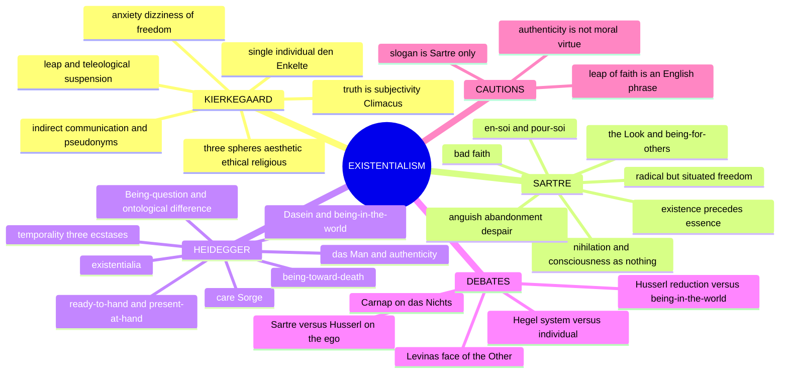

```text
THREE DISTINCT PROJECTS — A FAMILY RESEMBLANCE, NOT ONE CREED
  KIERKEGAARD (theistic)     SARTRE (atheistic)          HEIDEGGER (ontological)
  den Enkelte                pour-soi / en-soi           Dasein / In-der-Welt-sein
  truth = subjectivity       radical situated freedom    ready-to-hand / present-at-hand
  3 spheres                  bad faith; anguish          Care (Sorge); being-toward-death
  leap; vs Hegel's system    choice legislates for all   Temporality (3 ecstases); das Man
```

> [!TIP]
> **Mnemonic K-S-H = Faith / Freedom / Finitude.** Kierkegaard = the leap (what English calls the leap of **F**aith); Sartre = radical **F**reedom; Heidegger = **F**initude (being-toward-death). ⚠️

---

## 1. Identity, Lineage, Works and Provenance Discipline

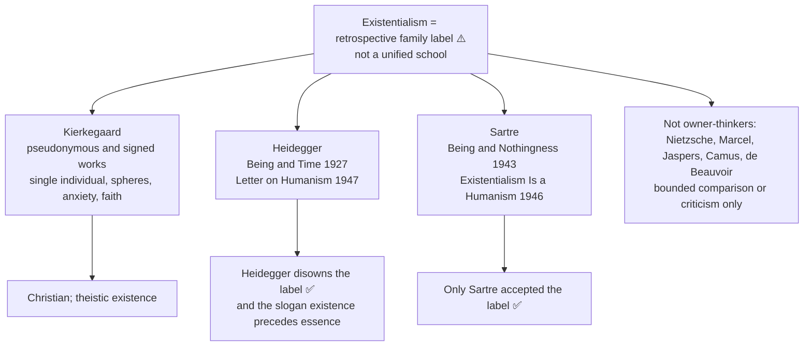

| Thinker / source | Marks-essential ownership |
|---|---|
| Kierkegaard's pseudonymous and signed works | single individual, subjective appropriation, spheres, anxiety/despair, faith and anti-system critique |
| Heidegger, *Being and Time* (1927) | Dasein, Being-question, being-in-the-world, care, authenticity, temporality |
| Heidegger, "Letter on Humanism" (1947) | rejection of Sartrean humanism and slogan ownership |
| Sartre, *Being and Nothingness* (1943) | in-itself/for-itself, nothingness, facticity/transcendence, bad faith, freedom, the Look |
| Sartre, *Existentialism Is a Humanism* (1946) | existence precedes essence, anguish/abandonment/despair, universal responsibility |

### 1.1 Provenance and translation discipline ✅

| Item | Status | Practice |
|---|---|---|
| Kierkegaard pseudonyms | Cite the pseudonym | Write "Johannes de Silentio argues…" or "Climacus holds…". Kierkegaard asked for this in the "First and Last Declaration" appended to the *Postscript* (1846); "Kierkegaard says in *Fear and Trembling*…" ignores it ❌ |
| "Truth is subjectivity" | *Concluding Unscientific Postscript* (1846), by Climacus | Safe; attribute to Climacus |
| "Anxiety is the dizziness of freedom" | *The Concept of Anxiety* (1844), by Vigilius Haufniensis | Safe as a rendering with attribution. *Angest* = "dread" (Lowrie) vs "anxiety" (Hong); name the translation |
| "Leap of faith" | Kierkegaard writes of *the leap* (*Springet*) and of faith; the fused phrase is the **English tradition's** | Write "the leap — what the English tradition calls the leap of faith" ⚠️ |
| "Life must be lived forwards but understood backwards" | From the **journals**, not a published work | Say "in his journals" |
| *The Point of View for My Work as an Author* | Written 1848, published posthumously 1859 | Retrospective self-interpretation; not contemporaneous evidence of intention |
| *Sein und Zeit* | 1927; Division Two of Part One only; the projected Part Two was never written ✅ | Cite by § number (§26 *Mitsein*; §§27, 35–38 *das Man*, *Gerede*, *Verfallen*; §40 *Angst*; §§46–53 being-toward-death; §§54–60 conscience; §65 temporality). Never say the book completes the analysis of Being |
| Heidegger translations | Macquarrie & Robinson (1962); Stambaugh (1996, rev. Schmidt 2010) | *Befindlichkeit* = "state-of-mind" (M&R) vs "attunement" (Stambaugh); *das Man* = "the 'they'" vs "the they"; name the translation for quoted phrases |
| "Nothing noths" | *Was ist Metaphysik?* (1929) | Correct: "Nothing noths" / "the nothing nothings". ❌ "Nothing noughts" is wrong |
| Letter on Humanism | Written 1946, published 1947 | Heidegger denies his thought is existentialism and rejects the formula as a metaphysical inversion |
| *L'Être et le Néant* | 1943; tr. Barnes (1956); newer Richmond (2018) | Name the translation or keep the French term |
| *Existentialism Is a Humanism* | Lecture October 1945, published 1946; a popular lecture Sartre later regretted publishing | Slogans ("condemned to be free", "existence precedes essence", "man is nothing else but what he makes of himself") come from **here**, not from *Being and Nothingness* |
| *Huis clos* (*No Exit*) | Play, 1944 | "L'enfer, c'est les autres" is safe verbatim in French; add Sartre's own correction (§2A.4) |
| *Critique of Dialectical Reason* | 1960 | Cite for later concessions: scarcity, seriality, the practico-inert, the group-in-fusion |

> [!WARNING]
> Never write "the existentialists held that…" as if the three share a doctrine; never say authenticity means being true to oneself; never say *Being and Time* is a completed system; never say "leap of faith" is Kierkegaard's phrase.

---

## 2. Truth, Moods and Method — the Route to Disclosure (Theory of Knowledge)

### 2.1 Kierkegaard: truth as subjectivity ✅

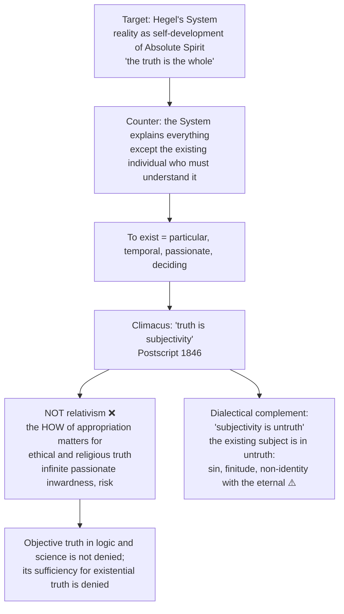

- Example: knowing that God exists as an item in a system differs from existing before God in faith, trembling and passionate commitment.
- The concern is ethical/religious existence and appropriation, not a general theory that factual truth varies with passion.

### 2.2 Indirect communication and pseudonymity ✅ (Core, owner §2B)

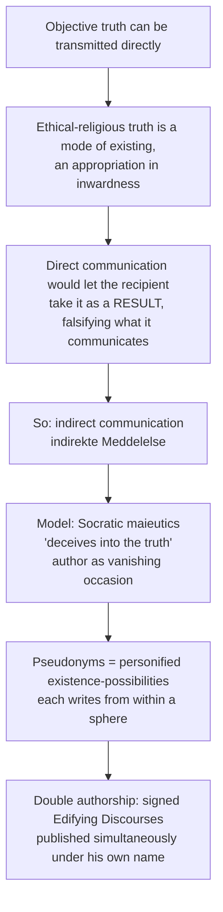

| Pseudonym | Work (year) | Standpoint |
|---|---|---|
| **Victor Eremita** (editor) | *Either/Or* (1843) | presents aesthetic ("A") and ethical (Judge William) papers side by side without deciding; reader must choose |
| **Johannes de Silentio** | *Fear and Trembling* (1843) | admires faith but does not have it; hence "silence" |
| **Constantin Constantius** | *Repetition* (1843) | aesthetic-experimental observer |
| **Vigilius Haufniensis** ("watchman of Copenhagen") | *The Concept of Anxiety* (1844) | psychological observer, deliberately not a dogmatician |
| **Johannes Climacus** | *Philosophical Fragments* (1844); *Postscript* (1846) | a humorist explicitly **not a Christian**, so he can pose the problem of becoming one |
| **Anti-Climacus** | *The Sickness unto Death* (1849); *Practice in Christianity* (1850) | a Christian at an extraordinarily high level, above Kierkegaard himself; mirror image of Climacus |

- Kierkegaard calls himself the pseudonyms' "author's author" and a prompter (*souffleur*) in the "First and Last Declaration".
- **Presuppositions ⚠️:** (P1) a category of truth cannot be held without being lived; (P2) the reader's freedom must be protected from authorial authority; (P3) pseudonymous voices are coherent standpoints, not the author behind a mask.

### 2.3 Moods as disclosure: fear versus anxiety ✅

| | **FEAR** (*Frygt* / *Furcht* / *peur*) | **ANXIETY / DREAD / ANGUISH** (*Angest* / *Angst* / *angoisse*) |
|---|---|---|
| Object | a determinate entity within the world | no determinate object; Kierkegaard: "the object of anxiety is a *nothing*" |
| Really about | the threatening thing | Kierkegaard: *possibility* (own "possibility of being able"); Heidegger: *being-in-the-world as such*; Sartre: *my own freedom* |
| Direction | flight toward the familiar world | individualises: world's significance collapses, *das Man* falls away |
| Disclosive value | discloses a threat | discloses freedom, finitude and groundlessness; privileged mood (*Grundbefindlichkeit*) |
| Formula | — | Kierkegaard: "anxiety is the dizziness of freedom"; "a sympathetic antipathy and an antipathetic sympathy" |

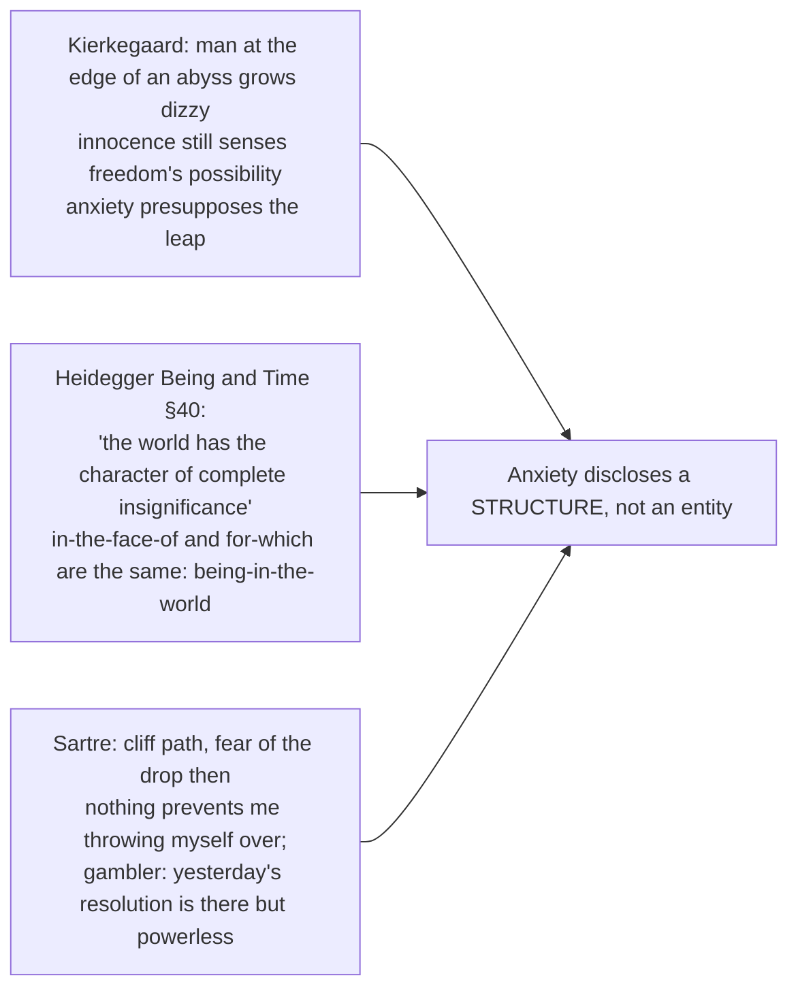

**Argument ⚠️:** 1. Moods disclose one's situation, not private colouring. 2. Fear discloses an entity as threatening. 3. Anxiety has no entity as object, so cannot disclose an entity. 4. Yet it discloses something definite. 5. So it discloses a structure: freedom (Kierkegaard, Sartre) or being-in-the-world (Heidegger). 6. Hence anxiety is the mood in which existence as a whole becomes an issue.

- **Presuppositions ⚠️:** (P1) moods are cognitively disclosive; (P2) difference in kind, not degree, between indefinite and definite objects; (P3) a rare mood's disclosure is not thereby less real.
- **Strongest objection ❓:** anxiety is a pathological or neurochemical state with no cognitive credentials. **Reply:** the claim is not that anxious people know more, but that the object-less structure of the mood is itself a datum, and no account in terms of an unnoticed object has succeeded.
- Heidegger, "What is Metaphysics?" (1929): anxiety reveals *das Nichts*, the source of Carnap's attack (see §11.5).
- Do not combine Kierkegaardian despair (misrelation of the self to itself and to the power that established it, *Sickness unto Death*, Anti-Climacus) with Sartre's "despair" (acting without relying on outcomes beyond one's control).

### 2.4 Heidegger's method redirect: epoché and being-in-the-world (2018 Q4(a)) ✅/⚠️

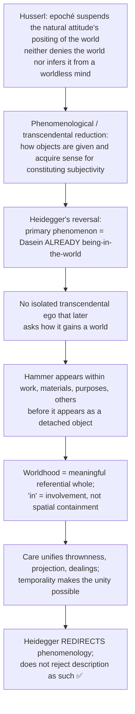

- **Objection/reply ⚠️:** Husserl need not posit a Cartesian substance: his transcendental ego is a field of intentional world-correlation and suspension is methodological. Heidegger's stronger complaint is **priority**: reflective constitution presupposes practical and temporal involvement. Whether intentional correlation can accommodate that is contested.

---

## 3. Internal Wings, Revisions and Later Developments

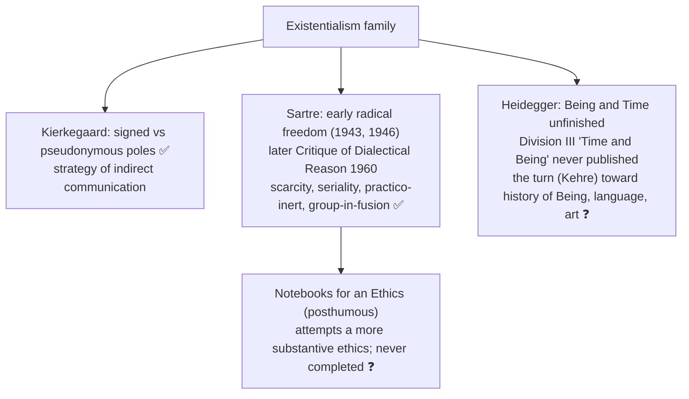

- **Pseudonymity second-order question (advanced ❓):** how far may a reader treat a pseudonym's thesis as Kierkegaard's own, and does the method leave him any assertible doctrine? Readings: authorial-doctrine; strict indirect-communication; mixed (pseudonyms as dramatised standpoints the reader must occupy and exhaust). Objection: masks make doctrine unstable. Counter: the instability is deliberate and self-limiting; the signed works retain first-person religious assertion. Use only as one attribution-caution clause, not literary biography.
- **Later Sartre concession ⚠️:** early freedom is "absolute" only in the structural sense that the for-itself cannot become a completed thing; coercion, trauma and social structures constrain action and the intelligibility of alternatives.
- **Heidegger authenticity (advanced ❓):** heroic/decisionist reading vs formal-existential reading vs political-shadow reading. In *Being and Time* authenticity is not a programme or virtue-code.
- **Self-consuming texts ⚠️:** Climacus revokes the *Postscript*; cross-link to the early Wittgenstein's ladder (6.54) and Hegel's Unhappy Consciousness (owner cites `Moore-Russell-EarlyWittgenstein.md` §6.6 and `Hegel.md` §1.8).

---

## 4. Ontology: Existence and Essence

### 4.1 Sartre: "existence precedes essence" (2024 Q4(a)) ✅

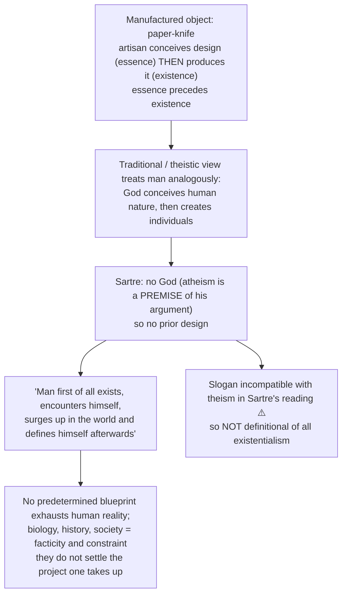

- "Man is nothing else but what he makes of himself" belongs to the 1946 lecture and must be balanced by situation.

### 4.2 Heidegger's rejection of the slogan ✅

- "The essence of Dasein lies in its existence" (*Being and Time* §9) is an **ontological** claim: Dasein's "what" is its manner of being (*Existenz*, standing out into the clearing of Being), not a fixed *quidditas*.
- *Letter on Humanism* (1947): Sartre merely reverses essence/existence priority within the **metaphysics of subjectivity**; the question is about **Being**, and man is the "shepherd of Being", not lord of beings. ⚠️
- Never attribute the slogan to Heidegger without noting his repudiation; Kierkegaard never used it.

### 4.3 Sartre: en-soi and pour-soi (2025 Q1(c); 2023 Q3(c)) ✅

| | **En-soi** (being-in-itself) | **Pour-soi** (being-for-itself) |
|---|---|---|
| Nature | full, solid, self-identical, opaque | nihilating, self-surpassing, never self-identical |
| Formula | "It is what it is" | "It is what it is not and is not what it is" |
| Examples | stone, table | consciousness, always beyond itself |
| Freedom | none: complete | structurally inescapable yet situated / factical |
| Relation | groundless, brute, "de trop" (in excess, contingent) | desires to become en-soi (self-identity); impossible; a "pour-soi-en-soi" (= God) is a contradiction |

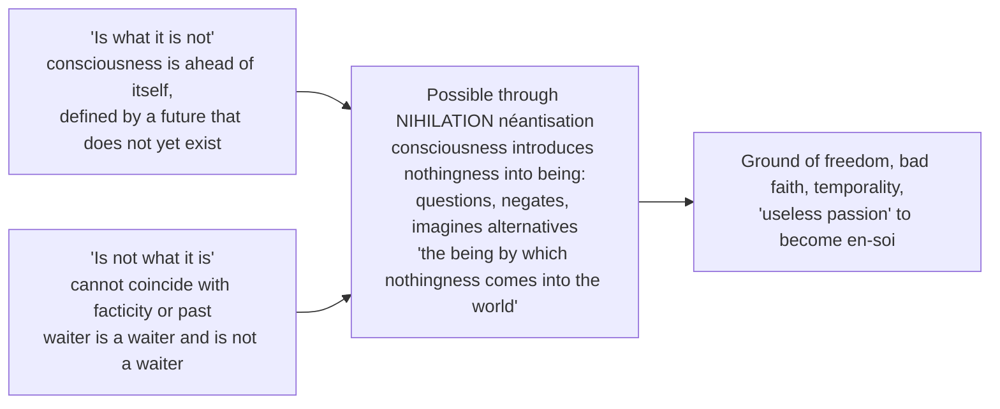

> [!WARNING]
> En-soi is **not** "matter" and pour-soi is **not** "mind". It is an ontological distinction (self-identical being vs nihilating consciousness), not a mind–matter one.

### 4.4 Sartre: consciousness as 'nothing' versus Husserl (2026 Q2(c)) ✅

**Shared floor (state first):** intentionality (consciousness of something; the object is not an inner picture); anti-representationalism ("stomach of consciousness" refused); pre-reflective self-awareness; descriptive method.

**Sartre's radicalisation, six steps:**

| Step | Content |
|---|---|
| 1 | **No contents:** consciousness is "a great emptiness, a wind blowing toward objects" |
| 2 | **No inhabitant:** the Ego is a transcendent object constituted in reflection (*Transcendence of the Ego*, 1936–37) |
| 3 | **Pre-reflective cogito:** non-positionally self-aware while positionally directed at the world; reflection is second-order and produces the Ego |
| 4 | **Why 'nothing':** *néant* because it lacks the self-identity and plenitude of being-in-itself, not because it does not exist |
| 5 | **Nihilation:** negation introduced into being |
| 6 | **Freedom:** nothingness is the ontological ground of freedom |

- **Pierre in the café ✅:** expecting Pierre, I find the café organised around his **absence**; negation structures the experienced field, evidence that nothingness is phenomenologically real.

| Axis | **Husserl** | **Sartre** |
|---|---|---|
| Ego | reduction discloses constituting subjectivity; pure ego with habitualities and sedimented history | ego is a transcendent object of reflection; consciousness non-egological |
| Unifier of experience | the ego with inner time-consciousness | the object and intentional structure |
| Core task | **constitution** of meaning for a transcendental subjectivity | **disclosure** of transcendent being and contingency ("de trop") |
| Metaphysical tendency | a transcendental-idealist strand after *Ideas* | initially phenomenological realism: being-in-itself not constituted by consciousness |
| Negation | analysed within intentional acts | the ontological structure of the for-itself |
| Self | an ego studied in its constituting life | selfhood as task/project, never substance |
| Freedom | not the organising problem | direct consequence of lack of being |

**Sartre's four objections to the transcendental ego:** superfluity, opacity, priority, reification.

**Required qualification ❓:** the opposition is contested. In the *Logical Investigations* Husserl himself denied finding an ego as an immanent item; the pure ego enters later. Dan Zahavi reads Sartre as a non-egological reorientation **within** phenomenology. Husserlian reply: the pure ego is the formal pole of acts, not an inner object. ❌ Do not write "Sartre refuted Husserl."

**Presuppositions ⚠️:** P1 intentionality is exhaustive; P2 consciousness is translucent (rules out the ego and the Freudian unconscious, generates bad faith rather than repression); P3 being-in-itself is fully positive; P4 reflection modifies consciousness.

### 4.5 Heidegger: Being-question, Dasein, worldhood, existentialia ✅

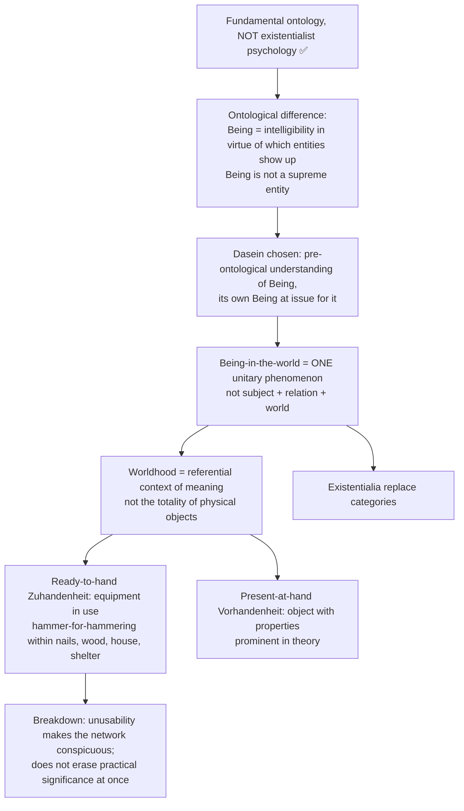

| Existentiale | German | Meaning |
|---|---|---|
| Attunement / state-of-mind | *Befindlichkeit* | always already in a mood; mood discloses world and situation |
| Understanding | *Verstehen* | projection upon possibilities; practical know-how |
| Discourse | *Rede* | articulation of understanding; condition of speech and listening |

These three constitute **disclosedness** (*Erschlossenheit*): the "there" (*Da*) of Da-sein. The referential chain is the "in-order-to" (*Um-zu*): hammer → nail → board → house → dwelling.

> [!WARNING]
> Being-in-the-world is not spatial containment and not Sartrean consciousness; Dasein is not merely "a human being in the world".

---

## 5. Stance on God and Transcendence

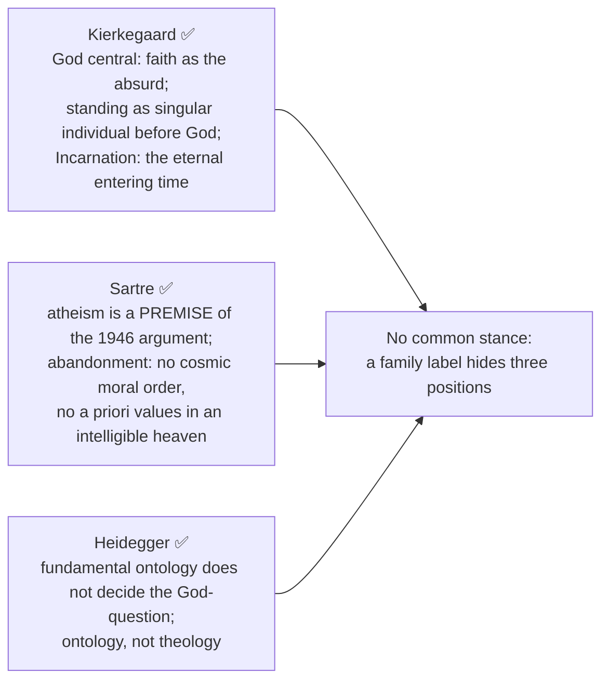

- Kierkegaard: the leap from the ethical to the religious cannot be mediated by reason (contra Hegel). Faith is a paradox: the eternal entering time and the suspension of the universal ethical law are absurd by rational standards.
- **Knight of faith (*Fear and Trembling*):** outwardly indistinguishable from a bourgeois citizen, unlike the knight of infinite resignation who renounces the world visibly; lives fully in the finite while relating absolutely to the Absolute.
- **Teleological suspension of the ethical:** Johannes de Silentio stages the paradox of faith through Abraham; it is **not** Kierkegaard's straightforward licence for private revelation to override morality.
- Kierkegaard's stages: relapse always possible; spheres are qualitative, not chronological.
- Link-outs given by the owner (not expanded in the sources): Reason-Revelation-Faith (the leap), Soul-Immortality-Rebirth (being-toward-death vs immortality), Vedanta ("self is Brahman" vs "no fixed self/essence").

### 5.1 Kierkegaard's three spheres (2022 Q4(a), 2023) ✅

| Sphere | Core | Mode | Limit / despair |
|---|---|---|---|
| **Aesthetic** | living for the moment, the interesting, avoidance of binding commitment | immediacy, detachment, irony (*Either/Or*) | boredom, fragmentation, despair |
| **Ethical** | universal duty, commitment, marriage, vocation, transparency | Judge Wilhelm; self as responsible agent | guilt: the universal cannot accommodate the individual's singularity |
| **Religious** | standing before God as singular individual; faith as the absurd, infinite passion | Abraham, knight of faith; infinite resignation + double movement of faith | the paradox: not rational, not universal, not mediated by crowd or church |

---

## 6. Explanatory Principles: Freedom, Determinism, Care and Temporality

### 6.1 Sartre on freedom and determinism (2019 Q4(c); 2020 Q4(a)) ✅

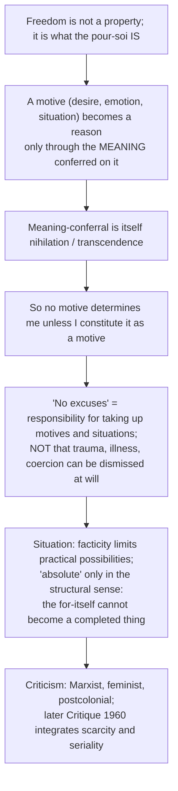

- "Man is condemned to be free" (1946): we did not choose existence yet cannot escape taking a stance. "Thrown" is Heidegger's term, not Sartre's.
- **"I can always choose, but I ought to know that if I do not choose, I am still choosing"** (2021 Q4(b)): deferral and conformity are choices, typically of bad faith.
- Determinism misunderstands the pour-soi by treating it as en-soi, a thing among causes.

### 6.2 Heidegger: care and temporality (2019 Q3(a)) ✅

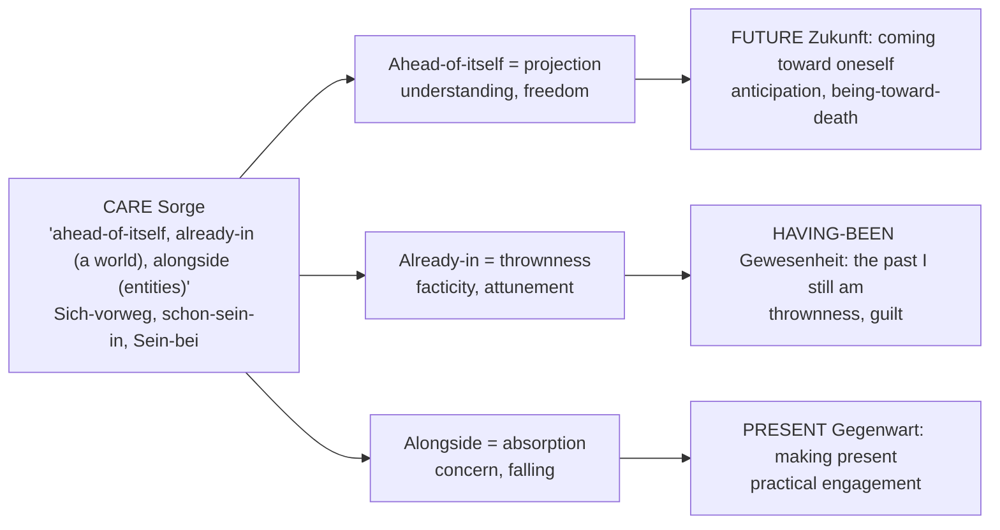

- Care is the ontological structure making all attitudes possible, not a psychological attitude such as worry.
- **Thesis of Division Two:** the meaning of Care is **temporality** (*Zeitlichkeit*).
- **Priority of the future ✅:** past and present are temporalised from the future; authenticity is futural.
- **Ecstatic ✅:** the three dimensions are not segments of a line; Dasein *stands out* (*ek-stasis*) into each simultaneously.

| Primordial temporality (*Zeitlichkeit*) | Vulgar / ordinary time (*innerzeitige Zeit*) |
|---|---|
| ecstatic, finite, unified, futural | sequence of "nows": past gone, present, future not yet |
| the temporality *of Dasein* | time measured by clocks, the time *in which* events occur |
| finite, bounded by death | infinite now-series |
| more primordial existential condition | derived public/world-time interpretation |

- Clock time is not thereby false or morally inauthentic; "vulgar" names a levelled conceptual interpretation.
- **Historicality** (*Geschichtlichkeit*): Dasein inherits and projects possibilities; history is an existential structure.

---

## 7. Values: Choice, Responsibility and Authentic Existence

> The sources give no puruṣārtha-type value hierarchy for existentialism; this module records responsibility and authenticity as the owner presents them.

### 7.1 Sartre: anguish, abandonment, despair; universal responsibility ✅

| Mood | Source | Structure |
|---|---|---|
| **Anguish** (*angoisse*) | recognising that I am free; nothing compels me | not fear of an object but vertigo before one's own freedom |
| **Abandonment** (*délaissement*) | no God, no cosmic moral order, no a priori values | I must invent values by choosing |
| **Despair** (*désespoir*) | do not rely on outcomes beyond my action and reasonable probabilities | Sartre's lecture sense differs from Kierkegaard's theological despair |

- **"In choosing myself, I choose man" ⚠️:** a quasi-Kantian universalisability; every choice implies an image of what human beings ought to be. Objection: this conflicts with the claim of no a priori values. Sartre's reply: universalisability is inherent in the *form* of free choice. ❓

### 7.2 Bad faith (2018 Q1(d)) ✅

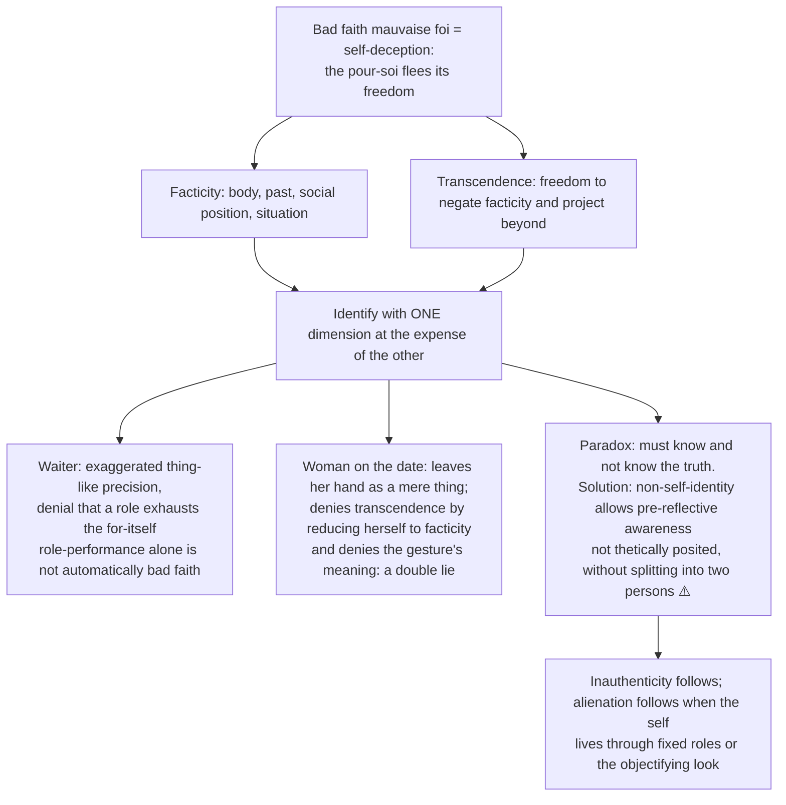

### 7.3 Heidegger: authenticity and inauthenticity (2026 Q3(b); 2019; 2022) ✅

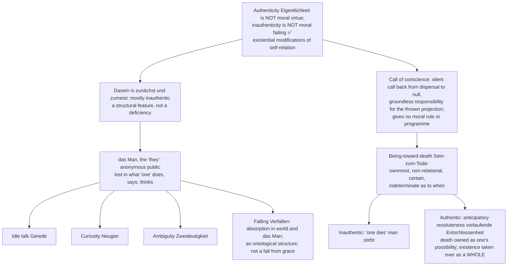

- Individualisation by death does not abolish being-with or prescribe social withdrawal.
- Being-toward-death is **not** contemplating suicide or fearing death; it concerns death as one's ownmost possibility, not the empirical event.
- Kierkegaard's route to authenticity is the leap (§5); Sartre's positive authenticity remains underdeveloped in *Being and Nothingness* ⚠️.

---

## 8. Inter-Thinker Comparative Matrices

| Concept | Kierkegaard | Sartre | Heidegger |
|---|---|---|---|
| Core term for human being | single individual (*den Enkelte*) | for-itself (*pour-soi*) | Dasein |
| "Existence precedes essence" | not his formula; existing individual resists systematic closure | explicit founding slogan of atheistic existentialism | rejected as humanistic misreading, yet "the essence of Dasein lies in its existence" |
| Route / authenticity | religious faith in pseudonymous/signed contexts | bad-faith critique; positive authenticity underdeveloped | anticipatory resoluteness toward death, not a moral programme |
| God | central | atheism a premise (1946) | not decided by fundamental ontology |
| Chief enemy | Hegel's objective spirit; the crowd; objective Christianity | determinism; bad faith; the serious spirit | Cartesian subject–object dualism; *das Man*; metaphysics of presence |
| Key mood | anxiety/dread (*Angest*), despair | anguish (*angoisse*), nausea (*la nausée*) | anxiety (*Angst*), discloses the nothing / thrownness |
| Freedom | qualitative choice within a finite God-relation | radical but situated and factical | thrown projection of possibilities, not voluntarism |
| Temporality | existence as *repetition* and the *moment* (*Øjeblikket*): the eternal entering time | pour-soi as ecstatic (past/present/future); freedom nihilates the past | *Zeitlichkeit*: three ecstases, future-primacy, finite |
| Relation to Hegel | existing individual vs completed system | uses negation/otherness but rejects teleological totality | reopens the Being-question against metaphysics; not simple inheritance |

### 8.1 The four accounts of the Other ⚠️

| Thinker | How the Other is reached | Basic relation |
|---|---|---|
| **Husserl** | passive pairing and appresentation, not discursive analogy-inference | Other non-originally given; ownness-first circularity remains (owner cites `Phenomenology-Husserl.md` §3A) |
| **Heidegger** | Dasein is always already being-with (*Mitsein*) | social existence constitutive |
| **Sartre** | the **Look**; the Other revealed in the shame of being objectified | **conflict**; recognition structurally unattainable |
| **Levinas** | the **face** (*visage*) of the Other commands before it is known | **ethical asymmetry**: responsibility precedes freedom; reply to both Husserl and Sartre |

### 8.2 The Look and being-for-others (bounded core, owner §2A) ✅

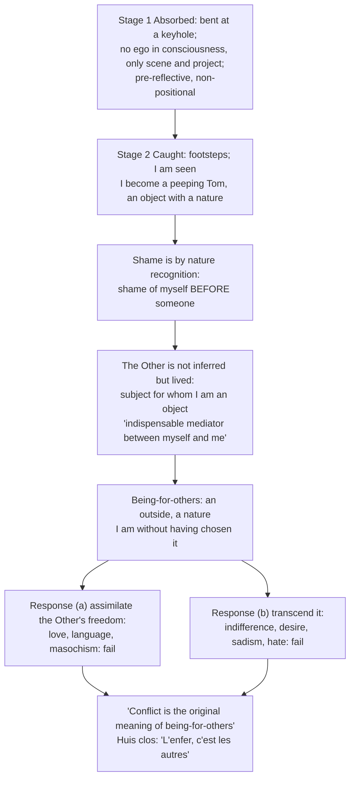

- **Exact printed subterms:** *le regard*, *l'être-pour-autrui*, *la honte*, *le corps-pour-autrui*, "objet-autrui" / "sujet-autrui", "la chute originelle", *conflit*.
- ⚠️ **Correct the popular misreading:** in a 1965 recorded preface Sartre said the line does not mean relations with others are always poisonous; if relations are twisted, the Other's judgement becomes the medium of self-torment; the characters are dead, i.e. fixed.
- **Presuppositions ⚠️:** P1 shame is irreducibly relational; P2 pre-reflective consciousness is egoless; P3 subject and object are exclusive (no reciprocity in one act); P4 no third term (we-subject), discussed and rejected in Part III.
- Bounded relevance: must not displace the freedom/choice spine in every Sartre answer.

---

## 9. Criticisms and Reconstructed Replies

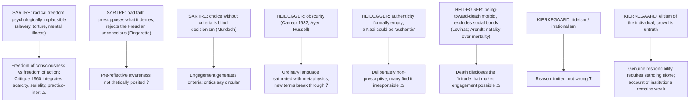

| Criticism | Source | Reply / counter |
|---|---|---|
| Radical freedom under-describes gendered, racialised and material constraint | de Beauvoir, Fanon, feminist/postcolonial | situated freedom can appropriate facticity without reducing to it; later Sartre broadens social mediation, early vocabulary stays abstract |
| Universalisability sits uneasily with denial of objective values | Kantians, communitarians | Sartre concedes tension; *Notebooks for an Ethics* (posthumous) never completed ❓ |
| Fundamental ontology never delivered its second half | internal | the turn (*Kehre*); failure or deepening is debated ❓ |
| Ontological formality permits political ambiguity | critics citing the 1933 politics | fundamental ontology is not a political programme; textually relevant but does not settle whether formal authenticity lacks critical norms |
| "Truth is subjectivity" collapses into relativism | common misreading | distinguishes *what* is believed from *how*; objective truth for logic/science is retained |
| Sartre generalises conflict from pathological encounters | critics of the Look | ontological claim about possibility-conditions; Critique 1960 "group-in-fusion" permits non-objectifying solidarity ⚠️ |
| Love, trust and care are equally basic | critics | analysis compelling only if one accepts P3 (subject/object exclusivity) ❓ |
| Levinas: encountering the Other only as rival freedom still thinks him from the self | Levinas | no reply within *Being and Nothingness*; strongest single line of criticism ⚠️ |
| Indirect communication makes Kierkegaard unattributable | critics | signed discourses and *Point of View* provide the direct pole; *Point of View* is itself disputed ⚠️ |
| If subjective truth cannot be said directly, the thesis is self-undermining | critics | Climacus concedes; the *Postscript* revokes itself like the *Tractatus* ladder ⚠️ |
| Hegelian reply: the existing individual is simply sublated | Hegelians | "a logical system is possible; an existential system is impossible" ⚠️ |

**Movement-level objections require thinker-specific replies:** subjectivism/irrationalism (Kierkegaard: appropriation; Sartre: choice with responsibility; Heidegger: ontology, not validated opinion); pessimism (anxiety, death, nothingness are diagnostic structures, not a claim that every life is miserable); social abstraction (facticity, being-with and later situated ethics offer partial replies).

---

## 10. Controlled Comparisons (as the sources give them)

> The owner supplies no East–West comparison table; its Indian references are link-outs only (Dasein vs ātman vs anātman and "liberation" as authenticity vs mokṣa via `Self-and-liberation-across-schools.md`; Advaita "self is Brahman" vs "no fixed self/essence" via `Vedanta.md`), and the linked theme file has no existentialism text. The comparisons below are the internal Western pairs the sources actually give.

| Pair | Point of contact | Decisive difference |
|---|---|---|
| Kierkegaard vs Hegel | both concern spirit and the individual | existing individual vs completed system; leap vs mediation; either/or vs both/and; Hegel need not simply deny individuality |
| Heidegger vs Husserl | both phenomenological; Heidegger was Husserl's student and dedicated *Being and Time* to him | Dasein's already-being-in-the-world vs transcendental ego |
| Sartre vs Husserl | intentionality, pre-reflective self-awareness | ego as transcendent object vs constituting pure ego; disclosure vs constitution |
| Sartre vs Heidegger | both reject Cartesian inner subject | Sartre's slogan and subject-centred freedom vs Heidegger's thrown projection and anti-humanism |
| Heidegger vs Carnap | *das Nichts nichtet* | Carnap: quantifier "nothing" treated as name; Heidegger: nothing is disclosed in *Angst* and logic presupposes the prior disclosure of beings as a whole |
| Sartre's Kantian echo | universalisability | Kant's form from reason vs Sartre's from the structure of free choice (owner link-out: `Kant.md`) |
| Self-consuming texts | Kierkegaard's *Postscript*, early Wittgenstein 6.54, Hegel's Unhappy Consciousness | all end with a text that consumes itself ⚠️ |

> [!WARNING]
> Nietzsche, Marcel, Jaspers, Camus and de Beauvoir are optional comparisons only; Nietzschean nihilism, will to power, recurrence and overhuman doctrine are outside the owner.

---

## 11. Diagnostic Deep-Dives for High-Frequency Themes

### 11.1 Fear vs anxiety (see §2.3)
Directive: bring out the difference; preserve three vocabularies; fatal error is treating them as one mood theory.

### 11.2 "Existence precedes essence" (2024 Q4(a)) — three freedom concepts

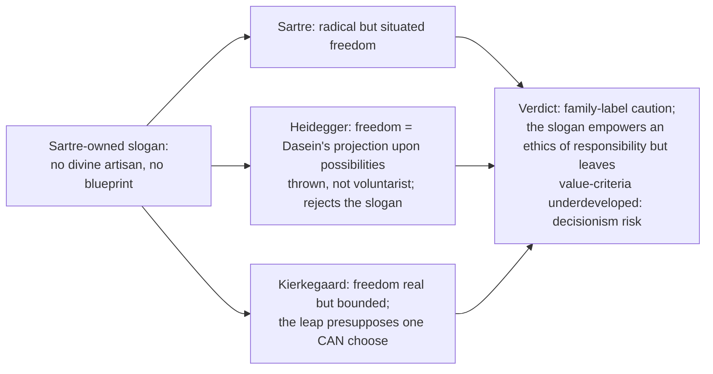

### 11.3 "You can always make something out of what you have been made into" (2020 Q4(a))
Route: facticity vs transcendence → situated project → "no excuses" qualified → oppression and late Sartre.

### 11.4 Kierkegaard against Hegel (2023 Q1(d)) 
Route: existing individual → system closure → choice and death → Hegel's reply → bounded verdict. Structural opposition: existing individual vs system; either/or vs both/and; leap vs mediation; indirect communication vs lecture. Kierkegaard exposes first-person appropriation that the system-view risks losing; he offers no rival comprehensive ontology.

### 11.5 Heidegger and the nothing (Critiques-of-metaphysics theme) ⚠️
- Heidegger's *das Nichts nichtet* (*What is Metaphysics?*, 1929): "Nothing noths" / "the nothing nothings"; ❌ never "Nothing noughts".
- Carnap's charge (1932): the sentence treats the syncategorematic quantifier "nothing" as a **name** and predicates a **pseudo-verb**.
- Heidegger's available reply, which a critical answer must record: *das Nichts* is disclosed in *Angst*, and the breach of logical grammar is deliberate since logic presupposes the prior disclosure of beings as a whole. Reporting the reply turns ridicule into assessment.

---

## 12. PYQ Routing Ledger (2018–2026)

> Corpus signal: 14 primary-owned parts out of 112 in 2018–2025, at least one in every year (2018: 2, 2019: 2, 2020: 2, 2021: 1, 2022: 2, 2023: 2, 2024: 2, 2025: 1), plus 2 primary-owned in the 2026 paper: **16 primary-owned parts in total**.

| Year | Q | Marks | Exact demand | Map to |
|---|---|---:|---|---|
| 2018 | Q1(d) | 10 | How does Sartre connect inauthenticity with bad faith? Why does Sartre show that inauthenticity and bad faith lead to alienation? Discuss. | §7.2 |
| 2018 | Q4(a) | 20 | What is 'Epoché'? How does Heidegger reject this method of phenomenological reduction? Explain Heidegger's concept of 'being in the world' as opposed to the concept of a transcendental ego. | §2.4, §4.5 |
| 2019 | Q3(a) | 20 | Is Dasein authentic existence for Heidegger? How does he relate temporality with Dasein? Discuss. | §6.2, §7.3 |
| 2019 | Q4(c) | 15 | How does Sartre look at the problem of freedom of choice and determinism? Explain. | §6.1 |
| 2020 | Q3(a) | 20 | What does Kierkegaard mean by saying "Subjectivity is the truth" in the context of the problem of 'the single individual'? | §2.1, §2.2 |
| 2020 | Q4(a) | 20 | "You can always make something out of what you have been made into." Critically discuss this statement by Sartre with reference to his views on existentialism. | §6.1, §11.3 |
| 2021 | Q4(b) | 15 | "I can always choose, but I ought to know that if I do not choose, I am still choosing". Critically discuss Sartre's conception of choice and responsibility in the light of above statement. | §6.1, §7.1 |
| 2022 | Q2(a) | 20 | Provide a critical account of Heidegger's Being-in-the-world and discuss the problem of 'authenticity' in the context of Dasein. | §4.5, §7.3 |
| 2022 | Q4(a) | 20 | How does Soren Kierkegaard define the notion of 'subjectivity'? Explain it with reference to three stages of existence as propounded by him. | §2.1, §5.1 |
| 2023 | Q1(d) | 10 | How does Kierkegaard argue against Hegel's idea of universal spirit in favour of the individual as the essence of spirit? Critically discuss. | §11.4 |
| 2023 | Q3(c) | 15 | "Consciousness is what it is not and is not what it is." In the light of this statement bring out the chief features of Sartre's conception of consciousness. | §4.3 |
| 2024 | Q1(e) | 10 | How does Kierkegaard define truth in terms of subjectivity? Critically discuss. | §2.1 |
| 2024 | Q4(a) | 20 | What do the existentialist thinkers mean by the slogan "existence precedes essence"? How is human existence related to human freedom according to them? Discuss. | §4.1, §4.2, §11.2 |
| 2025 | Q1(c) | 10 | Explain the difference between being-for-itself and being-in-itself as presented by Sartre. | §4.3 |
| 2026 | Q2(c) | 15 | Describe Sartre's notion of consciousness as 'nothing'. How is it different from Husserl's notion of consciousness? Discuss. | §4.4 (Husserl half cross-owned by `Phenomenology-Husserl.md`) |
| 2026 | Q3(b) | 15 | Explain Heidegger's conception of authenticity and inauthenticity as modes of Dasein's being. | §7.3, §6.2 |

**Count check:** 14 rows (2018–2025) + 2 rows (2026) = **16 primary-owned parts**, matching the owner file and both PYQ banks (`Existentialism | 2 | 2 | 2 | 1 | 2 | 2 | 2 | 1 | 14`; 2026: Q2(c) and Q3(b)).

**Cross-owned halves (listed, not counted):** the Husserl half of 2026 Q2(c) (owned by Phenomenology: Husserl); the epoché half of 2018 Q4(a) draws on `Phenomenology-Husserl.md` §§1.1–1.2, 1.5.

---

## 13. Top Exam Traps

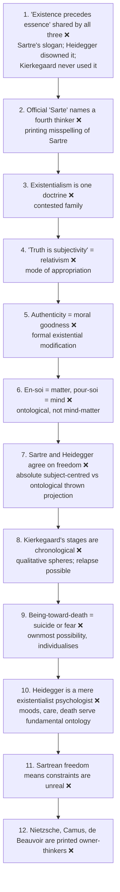

Extra pitfalls recorded in the sources: do not merge Heidegger's critique of the transcendental ego with Sartrean bad faith (state each thinker's problem, ontology of the agent and criterion of authenticity); do not equate being-in-the-world with spatial containment or with Sartrean consciousness; do not write "Sartre refuted Husserl"; consciousness "is nothing" does not mean it does not exist; do not confuse Sartre's *néant* with Buddhist emptiness or Vedāntic negation; do not attribute to Husserl the view that there is no ego (early Husserl and Sartre), nor to Sartre that there is no self (there is, as a constituted worldly object); do not cite "Hell is other people" as a complete theory of relations; do not write "Nothing noughts"; do not cite the fused phrase "leap of faith" as Kierkegaard's own; do not present the teleological suspension as a licence for private revelation; do not treat "thrown" as Sartre's term; do not combine Kierkegaardian and Sartrean despair.

---

## 14. Technical Vocabulary Bank

| English gloss | Original term | Meaning | Thinker | Status |
|---|---|---|---|---|
| the single individual | *den Enkelte* | the existing, particular individual before the System / God | Kierkegaard | ✅ |
| indirect communication | *indirekte Meddelelse* | withholding the result so the reader appropriates for self | Kierkegaard | ✅ |
| anxiety / dread | *Angest* | dizziness of freedom; object is a nothing | Kierkegaard (Haufniensis) | ✅ |
| despair | — | misrelation of the self to itself and to the power that established it | Anti-Climacus | ✅ |
| teleological suspension of the ethical | — | Abraham staging the paradox of faith | de Silentio | ✅ |
| the leap | *Springet* | non-mediated transition between spheres | Kierkegaard | ✅ (English "leap of faith" is the tradition's) |
| in-itself / for-itself | *en-soi* / *pour-soi* | self-identical being / nihilating consciousness | Sartre | ✅ |
| nihilation | *néantisation* | consciousness introducing nothingness into being | Sartre | ✅ |
| nothingness | *néant* | lack of self-identity and plenitude | Sartre | ✅ |
| bad faith | *mauvaise foi* | self-deception fleeing freedom/facticity | Sartre | ✅ |
| facticity / transcendence | *facticité* | the given / the self-surpassing | Sartre | ✅ |
| anguish / abandonment / despair | *angoisse* / *délaissement* / *désespoir* | three moods of the 1946 lecture | Sartre | ✅ |
| the Look | *le regard* | being seen discloses being-for-others | Sartre | ✅ |
| being-for-others | *l'être-pour-autrui* | my being as object for another subject | Sartre | ✅ |
| shame | *la honte* | recognition of being as the Other sees me | Sartre | ✅ |
| de trop | — | in excess, contingent | Sartre | ✅ |
| being-there | *Dasein* | entity whose own Being is at issue | Heidegger | ✅ |
| being-in-the-world | *In-der-Welt-sein* | unitary structure dissolving subject/object | Heidegger | ✅ |
| ready-to-hand | *Zuhandenheit* | equipment in use | Heidegger | ✅ |
| present-at-hand | *Vorhandenheit* | object with properties | Heidegger | ✅ |
| in-order-to | *Um-zu* | referential structure of equipment | Heidegger | ✅ |
| thrownness | *Geworfenheit* | being thrown into a world not chosen | Heidegger | ✅ |
| attunement / state-of-mind | *Befindlichkeit* | mood as disclosure | Heidegger | ✅ |
| understanding / discourse | *Verstehen* / *Rede* | projection / articulation | Heidegger | ✅ |
| disclosedness | *Erschlossenheit* | the "there" of Dasein | Heidegger | ✅ |
| care | *Sorge* | ahead-of-itself, already-in, alongside | Heidegger | ✅ |
| the "they" | *das Man* | anonymous public self | Heidegger | ✅ |
| idle talk / curiosity / ambiguity | *Gerede* / *Neugier* / *Zweideutigkeit* | three marks of das Man | Heidegger | ✅ |
| falling | *Verfallen* | absorption; ontological, not theological | Heidegger | ✅ |
| authenticity | *Eigentlichkeit* | existential modification, not virtue | Heidegger | ✅ |
| being-toward-death | *Sein-zum-Tode* | ownmost, non-relational, certain, indeterminate | Heidegger | ✅ |
| anticipatory resoluteness | *vorlaufende Entschlossenheit* | authentic relation to death | Heidegger | ✅ |
| temporality / ecstases | *Zeitlichkeit* | future, having-been, present | Heidegger | ✅ |
| historicality | *Geschichtlichkeit* | Dasein's inheriting and projecting of possibilities | Heidegger | ✅ |
| ontological difference | — | Being vs beings | Heidegger | ✅ |
| shepherd of Being | — | man as guardian, not lord of beings | Heidegger | ⚠️ |
| the turn | *Kehre* | later movement toward history of Being, language, art | Heidegger | ❓ |
| the nothing | *das Nichts* | disclosed in Angst; "Nothing noths" | Heidegger | ✅ |

---

## 15. Graded Verdict and Answer Architectures

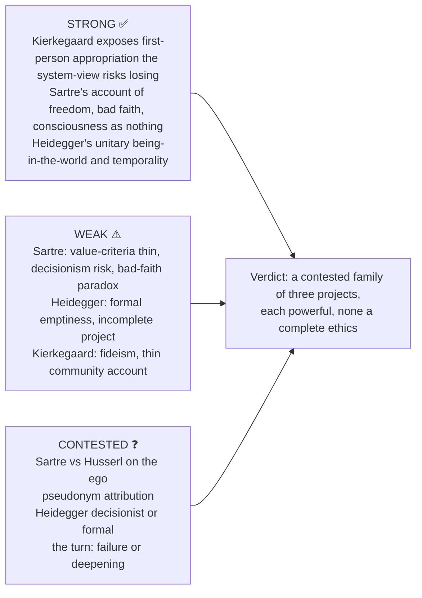

### 15.1 10-mark: Sartre's for-itself and in-itself (2025 Q1(c))
```text
Defn : en-soi = being that is what it is, full, self-identical, opaque;
       pour-soi = being that is not what it is and is not what it is: consciousness, nihilation.
Body : en-soi solid, complete, non-relational (a stone simply is). pour-soi introduces nothingness,
       questions, negates, projects; constituted by freedom.
Close: the pour-soi seeks to become en-soi (a for-itself-in-itself = God): a contradictory ideal;
       hence "man is a useless passion".
```

### 15.2 15-mark: "Consciousness is what it is not and is not what it is" (2023 Q3(c))
```text
Frame : the formula captures the ontology of the pour-soi: constitutively non-self-identical.
Body A: "is what it is not": ahead of itself, defined by a future that does not yet exist.
Body B: "is not what it is": cannot coincide with facticity or past; waiter is and is not a waiter.
Body C: how: nihilation; the pour-soi secretes nothingness.
Assess: accounts for freedom, bad faith, restlessness; is non-self-identity coherent?
Close : the key to the system: freedom, bad faith, temporality, the useless passion.
```
**Anchor (2026 Q2(c)):** "For Husserl consciousness is that FOR WHICH the world has sense; for Sartre it is that BY WHICH nothingness — and therefore freedom — enters being."

### 15.3 20-mark: Heidegger's being-in-the-world and authenticity (2022 Q2(a))
```text
Frame : being-in-the-world is the fundamental constitution; authenticity a modification WITHIN it.
Body A: unitary being-in-the-world; ready-to-hand vs present-at-hand; Befindlichkeit, Verstehen, Rede; care.
Body B: das Man: idle talk, curiosity, ambiguity; inauthenticity as default.
Body C: call of conscience + being-toward-death → anticipatory resoluteness; NOT a moral category.
Crit  : formally empty; Levinas: primacy of the Other; political danger of content-free authenticity.
Close : being-in-the-world is the WHAT; authenticity is the HOW.
```

### 15.4 20-mark: Kierkegaard's subjectivity and three stages (2022 Q4(a))
```text
Frame : "truth is subjectivity" is the counter to Hegel's objective System.
Body A: subjectivity is not relativism: the MODE of appropriation; the how over the what for existential truth.
Body B: three stages with their limits: despair, guilt, paradox; movement by leap, not dialectic.
Body C: against Hegel: the existing individual cannot be replaced by a completed system-view.
Assess: critique of impersonal systems; risks fideism and elitism.
Close : the stages trace intensifying inwardness; subjectivity is this intensification.
```

### 15.5 Directive decoder ⚠️

| Directive | Obligation | Fatal error |
|---|---|---|
| Comment / elucidate the statement | locate the sentence in its own thinker's system; unpack technical terms; two consequences; a judgment | treating it as a general maxim about life |
| Discuss existence precedes essence | reconstruct Sartre's no-blueprint argument; then Heidegger's rejection | attributing the slogan to every existentialist |
| Critically examine authenticity | non-moral reading first; das Man, conscience, death; then formal emptiness | "being true to yourself" |
| Discuss being-in-the-world | the hyphens are the doctrine; refuse subject/object first; then equipment, breakdown, care, temporality | "a human being in the world" |
| How does Kierkegaard oppose Hegel? | structural opposition, not a list of complaints | "Kierkegaard disliked abstraction" |
| Explain freedom and determinism in Sartre | meaning-conferral together with facticity | pretending coercion and trauma are unreal |
| Assess / Do you agree? | a defended ruling in the first line | neutral survey |

### 15.6 Graded one-line verdicts ⚠️

| Sub-topic | 10-mark | 15-mark | 20-mark |
|---|---|---|---|
| Existence precedes essence | Sartre's atheistic argument denies a predetermined blueprint; it does not erase biological or social facticity | It is Sartre's slogan, not the common creed; Heidegger repudiates the humanist inversion and Kierkegaard is theistic | Foregrounds project and responsibility but leaves value-criteria and situated constraint underdeveloped |
| Radical freedom | freedom is the for-itself's non-coincidence with facticity, exercised only in situation | motives acquire significance within a project; they are not irrelevant causes or instantly dismissible feelings | coercion, trauma, material structures pressure early radicalism; later scarcity and seriality broaden Sartre without simply retracting freedom |
| Bad faith | evades the tension of facticity and transcendence rather than merely lying | pre-reflective, non-thetic awareness is Sartre's answer to the self-deception paradox | influential but normatively incomplete: positive authenticity thin |
| The Look | shame discloses myself as object for another subject; not an empirical proof of all other minds | improves on inferential models but may generalise conflict from selective examples | love, solidarity, de Beauvoir, Fanon, later Sartre pressure subject/object exclusivity |
| Anguish / fear | fear has a determinate threat; anxiety discloses possibility, freedom or world-collapse by thinker | related but non-identical moods | a mood can disclose a structure without being infallible; naturalistic and clinical explanations remain competitors |
| Authenticity (Heidegger) | existential modification, not moral achievement; inauthentic proximally and for the most part | anticipatory resoluteness gives Dasein its ownmost possibility and a whole, but prescribes no content | the formality is deliberate and is the doctrine's deepest problem; Adorno's "jargon of authenticity" and the 1933 politics press the same question; the defence that ontology is not ethics is textually correct and philosophically unsatisfying |
| Kierkegaard vs Hegel | no completed system substitutes for the temporal choice of the existing individual | leap, either/or and indirect communication resist systematic closure, but Hegel need not deny individuality | exposes first-person appropriation the system-view risks losing; offers no rival comprehensive ontology |
| Indirect communication | ethical-religious appropriation cannot be handed over as neutral information | pseudonyms stage existence-possibilities; attribution must follow their voices | revocation makes the method self-limiting; whether it clarifies or evades doctrine is disputed |

> [!TIP]
> **Executable verdict (pseudonymity):** "Pseudonymity is the formal counterpart of the doctrine that truth is subjectivity: because ethical-religious truth is a mode of existing rather than a result, it can be communicated only in a form that refuses to deliver a result. The method's cost is that it is self-consuming — Climacus revokes the *Postscript* — and its power is that the cost is intended."

> [!NOTE]
> **Provenance reminder.** Name the translation for quoted phrases; cite pseudonyms rather than Kierkegaard; cite *Being and Time* by § number.

---

## Sources

Sartre, *Being and Nothingness* (1943); *Existentialism Is a Humanism* (1946); *Critique of Dialectical Reason* (1960); *The Transcendence of the Ego* (1936–37). Heidegger, *Being and Time* (1927); "Letter on Humanism" (1947); "What is Metaphysics?" (1929). Kierkegaard, *Either/Or*, *Fear and Trembling*, *The Concept of Anxiety*, *Concluding Unscientific Postscript*, *The Sickness unto Death*, *The Point of View* (as listed in the owner file and advanced dossier). Optional-depth trail in the advanced dossier: Hubert Dreyfus, William Blattner, Steven Crowell, Joseph Catalano, Thomas Flynn. SEP, *Jean-Paul Sartre* §§2, 4.1 and *Edmund Husserl* §2 (owner's source anchors).
