# QUINE AND STRAWSON — Examiner-Grade Mindmap

> **Syllabus (verbatim):** Quine and Strawson : Critique of Empiricism; Theory of Basic Particulars and Persons.
> **Catalogue key:** `philosophy-paper-i-western-philosophy-11` · Paper I · Western Philosophy
> **Sources used:** `paper-1/western/Quine-Strawson.md` (canonical owner, read in full) · `_advanced/Western-Philosophy-Dossier.md` §11 (optional depth) · `paper-1/_PYQ-Western-Philosophy-2018-2025.md` · `paper-1/_PYQ-Western-Philosophy-2026.md` · themes: `_themes/A-priori-a-posteriori-knowledge.md`, `_themes/Substance-across-western.md`, `_themes/Critiques-of-metaphysics.md` (Quine/Strawson passages read; `Pramana-across-schools.md` and `Causation-across-schools.md` carry no Quine/Strawson entry; `Self-and-liberation-across-schools.md` is linked by the owner for the person/ātman contrast but has no Quine/Strawson passage).
> **Evidence key:** ✅ canonical doctrine · ⚠️ analytical synthesis · ❓ contested / uncertain
> **Adaptation note:** the blueprint is Indian-school oriented. For this Western topic, Module 1 = thinkers, works and dating; Module 5 = stance on metaphysics and transcendent claims; Module 7 = value/ethical aims (the sources give none; stated there); Module 10 = comparisons the sources give.

> [!IMPORTANT]
> **Printed ownership split.** *Critique of Empiricism* belongs to **Quine**; *Basic Particulars* and *Persons* belong to **Strawson**. Do not turn the item into one joint anti-empiricist doctrine. Strawson's positive framework may pressure sense-datum reconstruction, but that is a bounded connection, not a reassignment of the printed limb. ✅/⚠️

> [!TIP]
> **Mnemonic.** "Quine kills TWO dogmas; Strawson saves TWO Ps" — Quine: analytic/synthetic and reductionism; Strawson: **P**articulars (material bodies) and **P**ersons (primitive concept).

---

## 0. Master Overview

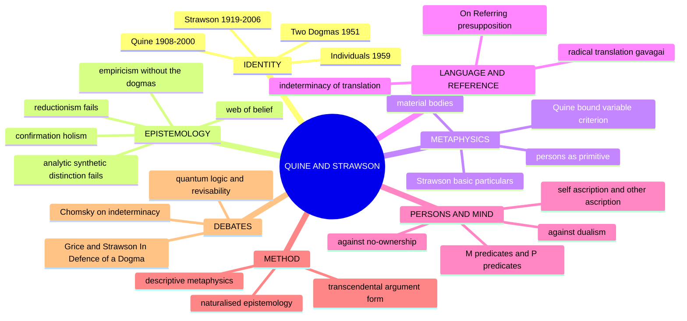

```text
═══════════════════════════════════════════════════════════════════
  QUINE (1908–2000)                       STRAWSON (1919–2006)
  "Two Dogmas of Empiricism" (1951)       Individuals (1959)
                                          "On Referring" (1950)
  DOGMA 1: analytic/synthetic             DESCRIPTIVE METAPHYSICS
    → untenable (circle of synonymy)        vs revisionary metaphysics
  DOGMA 2: reductionism/verificationism   BASIC PARTICULARS = material
    → untenable                             bodies (re-identifiable in one
  POSITIVE: CONFIRMATION HOLISM             spatio-temporal framework)
    "web of belief"                       PERSONS = primitive concept
  Bound-variable commitment criterion       M-predicates + P-predicates
  Indeterminacy of translation              → undercuts dualism AND
  Ontological relativity                      no-ownership theory
═══════════════════════════════════════════════════════════════════
```

---

## 1. Identity, Lineage & Doxography

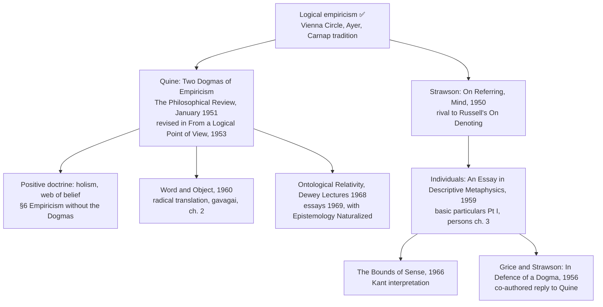

| Item | Correct provenance ✅ | Caution ⚠️ |
|---|---|---|
| Two Dogmas of Empiricism | *Philosophical Review*, Jan 1951; *From a Logical Point of View* (1953) | The "web of belief / field of force" passage is §6; cite the section |
| "Any statement can be held true come what may…" | Two Dogmas §6 | Never truncate before the conditional clause: "if we make drastic enough adjustments elsewhere in the system" |
| "To be is to be the value of a bound variable" | Standard slogan for the criterion in "On What There Is" (*Review of Metaphysics*, 1948) | Not from "Two Dogmas"; treat as canonical summary |
| *Word and Object* | 1960; radical translation ch. 2 | Epigraph is Neurath's boat |
| Ontological Relativity | Dewey Lectures 1968; 1969 volume (same as "Epistemology Naturalized") | Do not date naturalised epistemology to 1951 |
| *Individuals* | 1959 | Quote the subtitle "An Essay in Descriptive Metaphysics" |
| On Referring | *Mind*, 1950 | Precursor of, not an application of, descriptive metaphysics |
| In Defence of a Dogma | *Philosophical Review*, 1956 | **Co-authored with H. P. Grice**; spelling "Defence" |
| *The Bounds of Sense* | 1966 | "non-sequitur of numbing grossness" is Strawson's own phrase against Kant's Second Analogy |
| *Introduction to Logical Theory* | 1952; dissolution of induction, ch. 9 | optional |
| Chomsky's objection | "Quine's Empirical Assumptions," *Words and Objections* (1969) | Attribute to Chomsky, not "critics" |
| Davidson | "Radical **Interpretation**" (1973) | Interpretation, not translation: charity and a truth-theory |
| Duhem | *La Théorie physique* (1906); Eng. 1954 (tr. Wiener) | Thesis restricted to physics; logic and mathematics exempt |
| Popper | *Logik der Forschung* (1934); Eng. 1959 | Accepts the logical point; answers methodologically |

> [!WARNING]
> Never write that Quine "rejected empiricism", that Strawson "defended empiricism", that Duhem and Quine hold the same thesis, or that Quine denied meaning *tout court* rather than meanings as determinate entities.

---

## 2. Theory of Knowledge (Epistemology) — Quine's Critique of Empiricism

### 2.1 The two dogmas ✅

| Dogma | Content | Why Quine calls it a dogma |
|---|---|---|
| **1. Analytic/synthetic distinction** | A principled line between statements true by meaning and true by fact | Cannot be defined non-circularly |
| **2. Reductionism (verificationism)** | Each meaningful statement is individually reducible to / confirmable by sense-experience | Statements face experience as a corporate body, not individually |

**Mutual support ⚠️.** If each synthetic statement had its own determinate experiential content, an analytic statement could be contrasted as one with none. Once confirmation belongs to the network, that contrast cannot by itself secure a sharp boundary. The two dogmas are not logically identical, and this does not show that all evidential testing has failed.

### 2.2 Dogma 1: the circle of synonymy ✅ (PYQ 2018, 2019, 2021, 2024, 2025 routes)

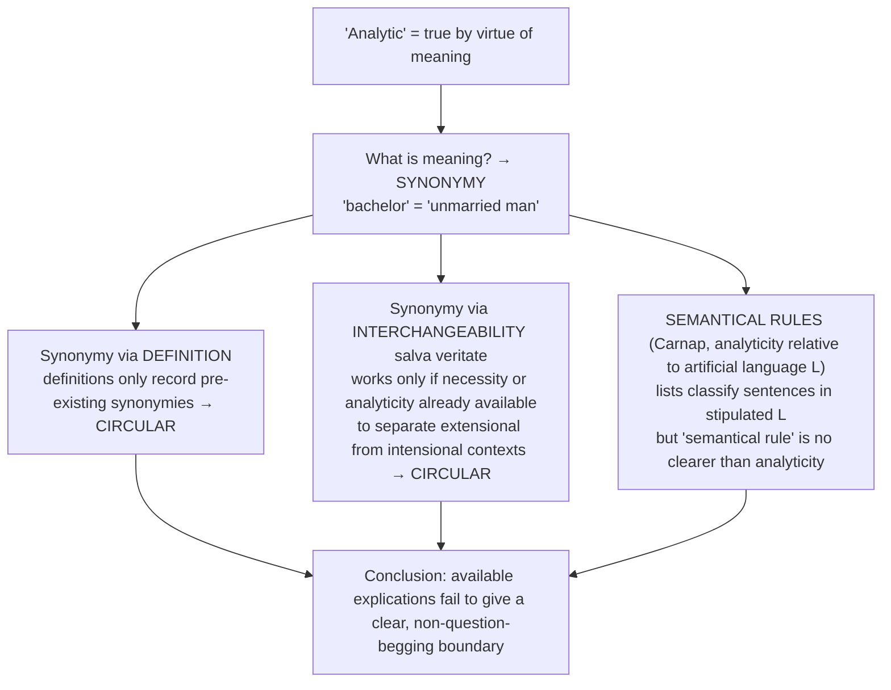

- Logical truths such as "No man who is not married is married" hold by logical form; "No bachelor is married" needs replacing *bachelor* by a supposed synonym. The problem is what independently warrants that synonymy.
- Quine does **not** infer from one missing dictionary definition that every use of "analytic" is unintelligible. ✅
- Centrality caution ⚠️: practical entrenchment explains why logic and mathematics are normally protected from revision; it is not itself a replacement definition of "analytic".

### 2.3 Dogma 2: reductionism ✅

Each individual statement is assumed to have a private stock of confirming or disconfirming experiences. Quine rejects this: no statement has its meaning or confirmation conditions in isolation from the rest of the system. "Reductionism" = attempting to reduce each sentence's meaning to observation sentences.

### 2.4 Positive doctrine: confirmation holism and the web of belief ✅ (PYQ 2025 Q4(b), 2021 Q3(c))

> ✅ "Our statements about the external world face the tribunal of sense experience not individually but only as a corporate body."
> ✅ "Any statement can be held true come what may, if we make drastic enough adjustments elsewhere in the system." — Two Dogmas §6.
> ✅ "Conversely, by the same token, no statement is immune to revision."

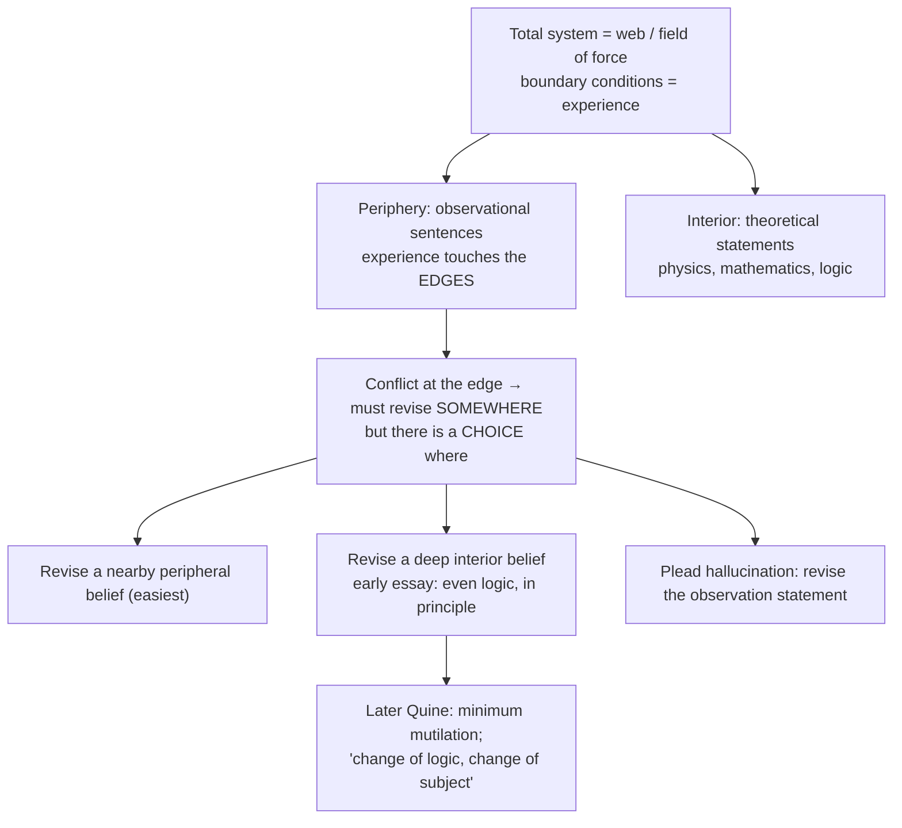

| Consequence | Explanation |
|---|---|
| No sharp analytic/synthetic line | Central logic/mathematics are highly entrenched; centrality ≠ a new definition of analyticity |
| No sharp a priori/a posteriori line | All beliefs revisable in light of experience, even if remote from the periphery |
| Pragmatism about theory-choice | Choice by **simplicity, conservatism, fecundity**, not algorithmic rules |
| Pressure on positivist meaning-criteria | Sentence-by-sentence reductionist verification undermined; holistic verificationism is a further question |

> [!WARNING]
> Quine does NOT say "All bachelors are unmarried" is false; he says the available accounts do not secure the sharp foundational boundary. "Web of belief" ≠ arbitrary revision: experience, predictive success, conservatism, simplicity and minimum mutilation constrain it.

### 2.5 The Duhem–Quine thesis ✅ (engine of holism)

| | **Duhem** (*La Théorie physique*, 1906) | **Quine** (Two Dogmas, 1951) |
|---|---|---|
| Scope | **Physics only**; physiology and some other sciences can test hypotheses more nearly in isolation | **All knowledge**: "the unit of empirical significance is the whole of science" |
| Logic and mathematics | **Exempt** | **Included**: no statement immune |
| Chief corollary | No automatic *experimentum crucis* against an isolated hypothesis | Confirmation holism and underdetermination pressure; the stronger claim of rival total theories equivalent under all possible evidence needs further argument |
| Motive | Philosophy of physics | Demolition of the second dogma |

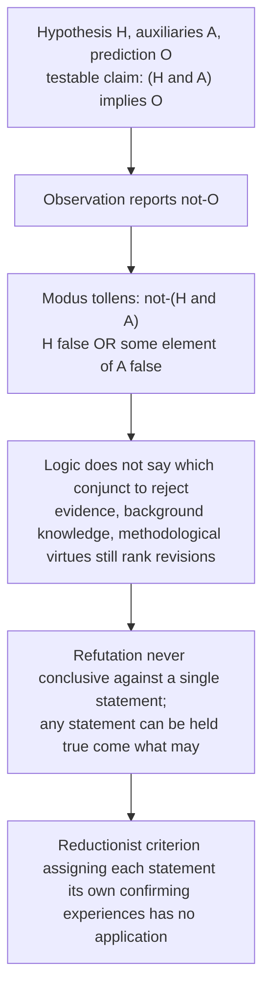

- **Uranus and Neptune ✅:** anomalies in Uranus's orbit; astronomers revised the auxiliary assumption about the number of planets; Neptune found (Le Verrier and Adams, 1846).
- **Mercury and "Vulcan" ⚠️:** the same strategy for Mercury's perihelion produced hypothesised "Vulcan", which does not exist; the correct revision was deep: general relativity (1915). Same logical situation, opposite correct responses, no rule choosing in advance. Deploy both.
- **Popper's reply ❓:** accepts the logical point; falsification is a methodological decision; basic statements treated as unproblematic by convention; *ad hoc* rescues forbidden. **Lakatos:** research programmes with protected "hard core" and revisable "protective belt".

### 2.6 Quine's relation to empiricism ⚠️

Quine does not simply reject empiricism. **Empiricism without the dogmas** keeps sensory evidence and scientific naturalism while rejecting sentence-by-sentence reduction and a foundational analytic/synthetic boundary. Safer: an internal reform; he is neither a logical positivist nor the uniquely purified empiricist. He is the positivists' most devastating *internal* critic.

### 2.7 Quine on Kant's a priori — "a metaphysical article of faith" (2018 Q2(c)) ⚠️

- "Metaphysical article of faith" is the **2018 PYQ's framing**, not a verified verbatim Quine quotation; do not put it in quotation marks as Quine's own formula.
- Route: label as PYQ framing → analytic/synthetic explication failure → holistic revisability → logic qualification → Grice–Strawson objection.
- Objection → reply ❓: revisability does not give every proposition the same status; Quine replies with gradients of entrenchment instead of a sharp a priori boundary.

### 2.8 Naturalised epistemology ⚠️ (bounded enrichment)

Philosophy is not an external *a priori* foundation for science; inquiry proceeds from within the revisable scientific web. Quine proposes a scientific study of how sensory input produces theoretical output, relocating epistemology within psychology.

| Normative objection | Quinean reply | Residual |
|---|---|---|
| A causal story about belief acquisition replaces "What ought one believe?" with "How is belief produced?" | Prediction, truth-seeking and method-selection can themselves be studied and improved from within science; later formulations allow a naturalised normative "engineering" of inquiry | Continuity with science blocks first philosophy but does not derive epistemic norms from causal facts |

---

## 3. Dialectical Wings & Sceptical Refinements

The sources give no sceptical wing *within* Quine or Strawson. The sceptical/dialectical pressure points they record are:

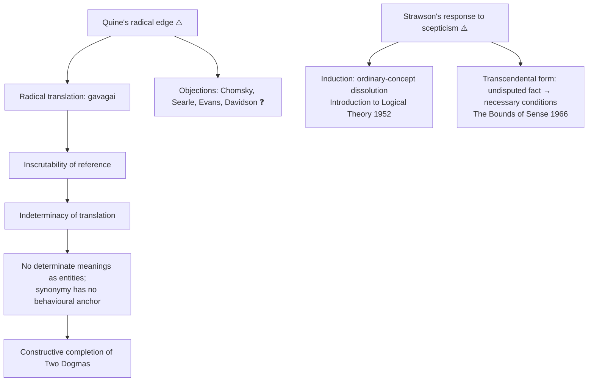

### 3.1 Radical translation and gavagai ✅ (bounded enrichment; not independently PYQ-owned 2018–2025)

| Term | Meaning |
|---|---|
| **Radical translation** | A field linguist, no dictionary, bilingual informant or shared script; evidence only what natives are exposed to and what they assent to or dissent from |
| **Stimulus meaning** | Class of stimulations prompting assent to a sentence, paired with those prompting dissent |
| **Occasion sentence** | Assent commanded only when freshly prompted ("Gavagai", "It's raining") |
| **Standing sentence** | Assent persists without prompting ("Copper conducts electricity") |
| **Observation sentence** | Occasion sentence whose stimulus meaning is constant across speakers; the only place translation is secure |
| **Analytical hypotheses** | Linguist's segmentation of native sentences into words and grammar, projected beyond the observational base; not determined by evidence |
| **Inscrutability of reference** | Even with whole-sentence translation fixed, the reference of inner terms stays undetermined |

**Argument ✅.** (1) A rabbit runs past; native says "Gavagai"; tentative translation "Rabbit". (2) Same stimulus meaning fits "undetached rabbit-parts", "a temporal stage of a rabbit", "rabbithood", or "it's rabbiting" (feature-placing). (3) Asking "Is this gavagai the same as that one?" requires already having translated identity, articles, plurals and quantifiers, i.e. the apparatus of individuation. (4) Compensating adjustments elsewhere in the manual keep behaviour predictions identical. (5) ∴ inscrutability of reference. (6) Upward: rival analytical hypotheses give manuals agreeing on all observation sentences yet non-equivalent on theoretical sentences. (7) ∴ indeterminacy of translation. (8) ∴ no determinate meanings as entities; the first dogma's key notion lacks foundation. (9) **Ontological relativity:** reference specified relative to a background theory/manual; distinct from the commitment criterion.

| Doctrine | Unit at issue | Claim |
|---|---|---|
| Radical translation | method / situation | translation from public evidence without a prior dictionary |
| Indeterminacy of translation | sentences / manuals | incompatible manuals can preserve the total evidence |
| Inscrutability of reference | sub-sentential terms | reference can vary under compensating changes in individuation apparatus |
| Ontological relativity | reference within theory | reference is answerable relative to a background language/theory |

**Presuppositions ⚠️:** P1 behaviourism about the *evidence* ("in linguistics one has no choice"); P2 the move from total behavioural equivalence to "no further fact" is a substantive Quinean commitment; P3 naturalism: no first-philosophy standpoint.

| Objection | Source | Quine's reply | Residual |
|---|---|---|---|
| Indeterminacy is ordinary underdetermination, which afflicts physics too | **Chomsky** | In physics there is a fact the theories imperfectly track; in translation nothing beyond dispositions to verbal behaviour | Whether this asymmetry avoids begging the question is the central dispute; name it and take a side |
| Proves too much: I would not determinately know what I mean by my own words | Searle; Evans | At home we acquiesce in our mother tongue; no privileged first-person status | Many find the bullet too large |
| Innate constraints on grammars (universal grammar) cut down admissible manuals | **Chomsky** | Residual manuals still behaviourally equivalent; innateness restricts candidates, creates no fact | ❓ open |
| Radical **interpretation** shows more determinacy once charity and a truth-theory are built in | **Davidson** | Davidson accepts indeterminacy but confines it to something like a choice of measurement scale (Fahrenheit/Celsius) | Most influential softening; one sentence |

**Executable verdict.** Gavagai is the constructive half of Quine's critique: Two Dogmas showed analyticity could not be defined, radical translation shows why. Its force is proportional to its behaviourist premise; Chomsky identifies the pressure point. What survives: nothing in observable use fixes reference uniquely.

---

## 4. Metaphysics & Ontology

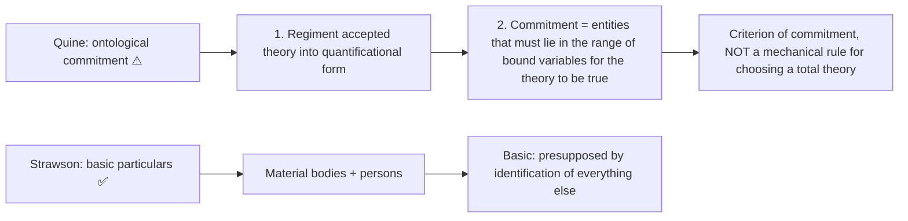

### 4.1 Quine's ontological commitment ⚠️ (bounded enrichment)

- Theory-choice still invokes empirical adequacy, simplicity, conservatism and explanatory power.
- Not surface word-counting: names can be paraphrased away; apparently name-free quantification can carry commitment.
- "Taste for desert landscapes" expresses parsimony, not nominalism at any cost. He accepts abstract entities where the best regimented science indispensably quantifies over them; the indispensability argument is commonly associated with Quine **and** Putnam.
- Objection: rival paraphrases can display different commitments. Reply: correct; the formula is applied after theory/regimentation choice, not an algorithm.
- Ontological relativity is a separate framework-dependence thesis. Quine and Carnap overlap in rejecting theory-free ontology but differ over analyticity and the status of framework choice.

### 4.2 Descriptive vs revisionary metaphysics ✅

| Type | Definition | Examples |
|---|---|---|
| **Descriptive** | Describes the actual structure of our conceptual scheme | Aristotle and Kant (principal affinities) |
| **Revisionary** | Proposes a better scheme to replace the actual one | Descartes, Leibniz, Berkeley (standard contrasts) |

Strawson's project: map the conceptual structure we already use. Revisionary metaphysics is in the service of descriptive.

### 4.3 Basic particulars ✅ (PYQ 2020 Q3(b), 2021 Q3(b))

**Question:** which particulars are conceptually basic, i.e. on which does the possibility of identification and reference in general depend? **Answer:** **material bodies** (and persons).

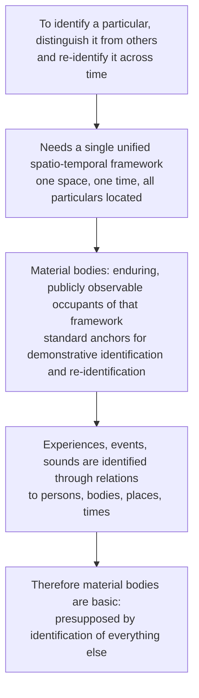

- The framework is not a psychological image built out of bodies.
- **Sense-data fail ⚠️:** private (cannot ground public identification), momentary (cannot be re-identified), lacking the spatial relations a framework needs. The empiricist programme of constructing objects from sensory items fails in principle (Substance theme).
- Basic particulars are **macroscopic** material bodies and persons, not atoms or ultimate simples.

### 4.4 The no-space (auditory) world ⚠️

A world of pitch and temporal succession does not yet support robust objective re-identification. Strawson does not simply prove an auditory scheme impossible: objective reference would need an **analogue of space** (reconstructed through a continuously available "master-sound"). It supports the need for a framework doing the individuating role space does; it does not prove every scheme must contain visual/tactile bodies like ours.

### 4.5 Significance and reference ⚠️

- Neither a Moorean proof of the external world nor a causal/scientific claim: **transcendental in form**, from practice of objective identification to its conditions; the conclusion concerns *our conceptual scheme*.
- Basic particulars are basic objects of reference; subject–predicate structure depends on identifying something and predicating something of it. Feature-placing ("It is raining here") does not replace the framework making particular-reference possible.

### 4.6 Persons ✅ (PYQ 2018 Q1(e), 2023 Q4(a), 2026 Q3(a))

| Position | Claim | Problem (per Strawson) |
|---|---|---|
| **Cartesian dualism** | Two substances: res cogitans + res extensa | How identify or re-identify an immaterial soul not locatable in space? How does interaction work? |
| **No-ownership theory** (reconstructed and criticised) | Experiences causally depend on a body but are not possessed by a person | Cannot explain the uniquely identifying role of the body without reintroducing the person whose ownership it sought to eliminate |
| **Strawson: person primitive** | Concept of a person logically primitive, not analysable into body + mind | — |

> ✅ "The concept of a person is logically prior to that of an individual consciousness."

| Predicate type | Definition | Examples |
|---|---|---|
| **M-predicates** | Also applicable to mere bodies | "weighs 70 kg", "is in the kitchen", "has brown hair" |
| **P-predicates** | Ascribe states of consciousness | "is in pain", "is thinking of Vienna", "believes it will rain", "intends to leave" |

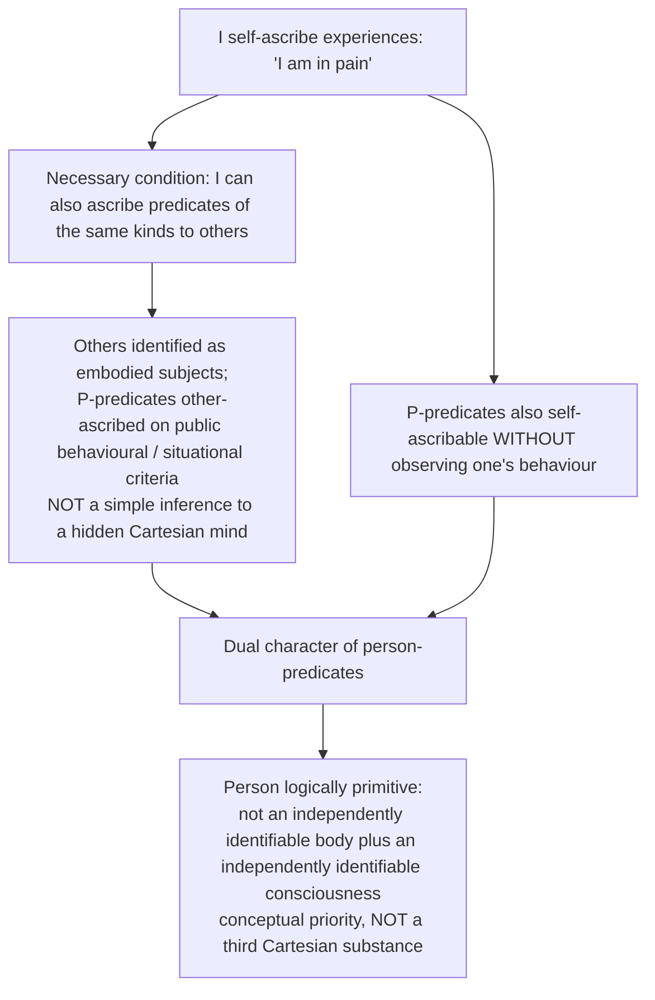

---

## 5. Rejection / Affirmation of Transcendent Realities (stance on metaphysics)

The sources give no pramāṇa-style rejection of *transcendent* realities for this topic; the relevant stance is each thinker's position on metaphysics (Critiques-of-metaphysics theme):

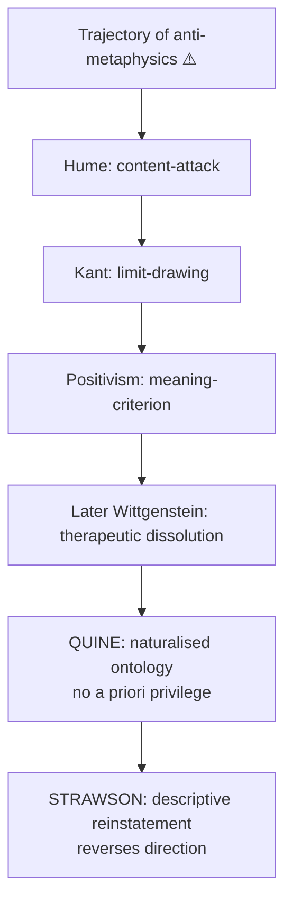

- **Quine ⚠️:** by demolishing analytic/synthetic and adopting holism/naturalism, denies metaphysics or logic any special a priori standing but allows a naturalised ontology. His decisive blow lands on **Carnap**: the internal/external distinction presupposes analytic/synthetic; remove it and only one kind of ontological question remains, answered within our best total theory.
- **Strawson ⚠️:** does not attack metaphysics but redefines and saves it. The four assaults (Hume, Kant, Positivism, Later Wittgenstein) target revisionary/transcendent metaphysics; descriptive metaphysics is immune: no claim beyond experience (Kant's limit does not bite), nothing unverifiable about a supersensible realm (verification does not bite), describes ordinary use (Wittgenstein's therapy does not bite).
- **Hegel ↔ Strawson bridge ⚠️ (theme):** both reach the verdict that Kant's noumenon cannot be both posited and declared unthinkable. Strawson: the doctrine of a supersensible reality *affecting* sensibility is incoherent, using concepts whose application beyond experience it forbids (*The Bounds of Sense*). They part on the remedy: Hegel expands thought to the Absolute; Strawson shrinks metaphysics to description of our scheme. In Strawson's vocabulary Hegel's Absolute is revisionary.
- **Cross-paper link (owner):** Quine's ontological commitment bears on whether "God" is a value of a bound variable (Notions of God).

---

## 6. Explanatory & Causal Principles

The sources give no causal doctrine for this topic beyond the following:

| Principle | Content | Status |
|---|---|---|
| Holistic explanation | Statements face experience as a corporate body; revision choice is pragmatic (simplicity, conservatism, fecundity) | ✅ |
| Duhem–Quine underdetermination logic | Failed prediction condemns only the conjunction (H and A) | ✅ |
| Naturalised epistemology | Study how sensory input produces theoretical output, within science | ⚠️ |
| Strawson's transcendental style | Undisputed fact about thought → necessary conditions → empiricist materials cannot satisfy them → something else is basic, *conceptually* not causally | ⚠️ |
| Mind–body unity | Strawson does not explain the *mechanism* of unity; only that "person" is not derivable from separate mind and body concepts | ❓ genuine limitation |

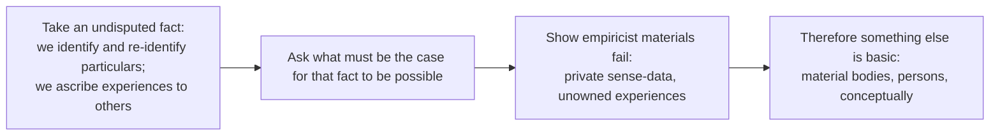

> [!NOTE]
> Kantian-style argument executed through conceptual analysis; identifies conditions internal to our scheme; not a theory-free proof of reality.

---

## 7. Ethics & Human Goals (Puruṣārthas)

The sources give no ethical or puruṣārtha scheme for Quine or Strawson in this topic. Quine's only value-like content is the **pragmatic virtues** guiding theory-choice (simplicity, conservatism, fecundity, minimum mutilation). Strawson's reactive-attitudes and free-will work is named in the owner file only as bounded enrichment or cross-owner material and is not developed; it must not displace basic particulars and persons.

---

## 8. Inter-School Comparative Matrices

| Axis | Quine | Strawson | Logical Positivism | Descartes | Later Wittgenstein |
|---|---|---|---|---|---|
| Analytic/synthetic | Rejects distinction | Retains it cautiously (Grice–Strawson) | Central, unquestioned | — | Rules of grammar, not a sharp dichotomy |
| Meaning | Holistic, indeterminate, behavioural | Ordinary conceptual scheme; context-dependent use | Verification-conditions | Clear and distinct ideas | Use in a form of life |
| Metaphysics | Naturalised; no special philosophical method | **Descriptive metaphysics** revived | Meaningless | Foundational enterprise | Dissolved via therapy |
| Mind–body | Naturalist (no special status for the mental) | **Person = primitive** (M + P predicates) | — | Two substances | Inner grounded in public criteria |
| Method | Science-continuous; no first philosophy | Connective analysis of our conceptual scheme | Logical analysis + verification | Methodic doubt | Description of language-games |
| Reference | "To be = value of a bound variable" | Referring = what speakers do | — | Ideas represent objects | Words refer only within a game |

### 8.1 Quine vs Strawson: direct confrontation ⚠️

- **Grice and Strawson (1956):** the analytic/synthetic distinction is ordinarily intelligible (we can classify cases pre-theoretically) even without a reductive analysis; Quine sets the bar too high, demanding a non-circular *definition* when we have a useful *distinction*.
- **Quine's implicit reply:** ordinary intelligibility ≠ theoretical legitimacy (witch vs non-witch); burden on those who use analyticity in philosophy.
- This prevents the caricature of a united "Quine–Strawson front". Verdict bank: the dispute concerns standards of explication.

### 8.2 Quine and Later Wittgenstein ⚠️ (bounded comparison; no direct influence)

| Axis | Quine | Later Wittgenstein |
|---|---|---|
| Target | Museum myth of meaning | Augustinian picture |
| Positive account | Stimulus meaning behaviourally specified for suitable occasion sentences; theoretical language holistic | Meaning is use in a language-game and form of life |
| Holism | Unit of empirical significance = whole of science | "To understand a sentence is to understand a language" |
| Anti-foundationalism | Neurath's boat | Bedrock where "my spade is turned" (PI §217) |
| Against the private | Indeterminacy permits nothing beyond public behaviour to fix meaning | Private-language argument: nothing private *can* fix meaning |
| Method | Epistemology naturalised | Philosophy as therapy |
| Where they part | Quine **reforms** language: scientific account, regimentation | Wittgenstein **describes**: ordinary language "is in order as it is" (PI §98) |

Neurath's anti-foundationalism in the protocol-sentence debate feeds Quine directly (historical link). Both reach the impossibility of determinate private meanings from opposite directions.

### 8.3 Strawson vs Russell on referring ⚠️ (bounded; cross-owned with Russell)

| Issue | Russell ("On Denoting") | Strawson ("On Referring") |
|---|---|---|
| "The present King of France is bald" (no king) | Quantified analysis false: existence condition fails | Speaker fails to make a true-or-false assertion: existence presupposition unfulfilled |
| Existence-claim | **Asserted** | **Presupposed** |
| Referring | Description eliminated in logical analysis; scope handled formally | Referring is what *speakers* do on occasions; sentence meaning ≠ use on an occasion |
| Meaning | Fixed by logical form | Context-dependent use |

> [!WARNING]
> "Neither true nor false" reports Strawson's treatment of the unsuccessful use/assertion, not that the sentence-type is meaningless. Later presupposition theories differ (gap, falsity, projection); do not attribute them to the 1950 paper. "On Referring" is not printed in the syllabus.

### 8.4 Strawson's pressure on empiricist starting points ⚠️

| # | Empiricist doctrine | Strawson's argument | Where |
|---|---|---|---|
| 1 | Sense-data as basic particulars (Russell, Carnap's *Aufbau*, phenomenalism) | Re-identification needs a unified spatio-temporal framework of persisting bodies; private transient sense-data do not supply it | *Individuals* Pt I |
| 2 | Bundle theory of the self (Hume) and the no-ownership view | Thesis cannot be stated without reintroducing possession ("experiences had by this body"); P-predicates ascribable to others on behaviour and to oneself not on that basis | *Individuals* ch. 3 |
| 3 | Logical reconstruction detached from use | Referring performed by speakers; existence as presupposition | "On Referring" |
| 4 | Global scepticism about induction | Ordinary-concept dissolution | *Introduction to Logical Theory* (optional) |
| 5 | Objectivity from private data | Objective experience presupposes unified framework and enduring objects; later limits transcendental arguments to internal/descriptive work | *Bounds of Sense*; *Skepticism and Naturalism* (optional) |

**Honest qualification:** an empiricist can accept all of *Individuals* as conceptual geography while denying it settles what exists; conceding this strengthens an answer.

### 8.5 A priori / a posteriori grid ⚠️ (theme)

| Thinker | Source of knowledge | Synthetic a priori? | Signature move |
|---|---|---|---|
| Quine | holistic web (naturalised) | distinction itself rejected | two dogmas; holism |

"Quine erases the grid." The whole fight is one box: does the synthetic a priori exist? Rationalists ~yes (loosely), Empiricists no, Kant yes, Positivists no, Quine erases the grid.

### 8.6 Substance storyline ⚠️ (theme)

"1-3-1-∞ then dissolve": Aristotle grounds it → Descartes 3, Spinoza 1, Leibniz ∞ → Locke weakens → Hume eliminates (bundle) → Kant relocates (category) → **Strawson reinterprets (basic particular)**.

---

## 9. Criticisms & Reconstructed Replies

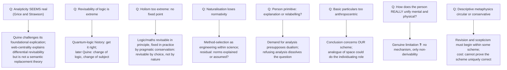

### 9.1 Criticisms of Quine ⚠️

| Objection | Assessment |
|---|---|
| Grice and Strawson: distinction pre-theoretically clear | Live debate; the philosophical work done by the distinction (positivist meaning-criterion) collapses without a principled ground |
| Analyticity seems real ("All bachelors are unmarried" vs "All swans are white") | Quine challenges its foundational explication |
| Revisability of logic extreme | See 9.2 |
| Holism too extreme | Softened: revisable by choice, not by nature |
| Naturalisation loses normativity | Residual: truth-conducive norms explained or assumed? |
| Ontological commitment depends on regimentation | Correct; criterion not algorithm |
| Translation indeterminacy collapses into underdetermination | Quine denies a further semantic fact beyond dispositions; critics: the asymmetry presupposes his naturalism |

### 9.2 Quantum-logic provenance ✅/❓

- Non-classical "quantum logic" (non-distributive lattice of propositions): **Garrett Birkhoff and John von Neumann**, "The Logic of Quantum Mechanics," *Annals of Mathematics*, **1936**.
- Claim that logic is empirical (revise the **distributive law**): **Hilary Putnam**, "Is Logic Empirical?" (**1968**; reprinted 1976 as "The Logic of Quantum Mechanics").
- ❌ Never write "Putnam/Birkhoff" as a joint proposal or merge dates.
- ❓ Putnam later abandoned the quantum-logic realism; Quine's *Philosophy of Logic* (1970): "change of logic, change of subject", maxim of minimum mutilation. The strongest support for revising logic is Putnam's, not the later Quine's.

### 9.3 Criticisms of Strawson ⚠️

| Objection | Assessment |
|---|---|
| "Person is primitive" an explanation or relabelling? Hard problem untouched | Defenders: the demand for analysis (into mind + body) presupposes dualism; refusing analysis is the solution |
| Basic-particulars argument too anthropocentric | Conclusion concerns our scheme; auditory-world discussion concedes an analogue of space could suffice |
| How does the person really unify mental and physical? | ❓ Genuine limitation; no mechanism given |
| Russell's account cleaner; handles empty descriptions without a presupposition mechanism | They partly answer different questions: logical regimentation vs ordinary use |
| Descriptive metaphysics circular or conservative | Internal task; cost: cannot prove the scheme uniquely correct or unrevisable |

---

## 10. Controlled Western Comparisons

All comparisons here are within the Western analytic tradition, as the sources give them; the sources provide no East–West table for this topic. The one cross-tradition pointer is the owner's link-out: Strawson's person concept vs Indian *ātman/anātman* debates (see `Self-and-liberation-across-schools.md`; that theme file contains no Quine/Strawson passage, so no further detail is stated here).

| Comparator | Point of contact | Decisive disanalogy |
|---|---|---|
| **Logical Positivism / Carnap** | Quine reforms the empiricism of analytic/synthetic and reductionist pillars | Quine accepts empiricism but rejects both pillars; his blow lands on Carnap's internal/external distinction |
| **Later Wittgenstein** | Anti-private-meaning, holism, anti-foundationalism | Quine reforms/regiments language scientifically; Wittgenstein describes and forbids theory |
| **Russell** | Both analytic tradition; Strawson's rival on descriptions | Existence asserted (Russell) vs presupposed (Strawson); logical form vs use |
| **Descartes** | Person/mind-body | Descartes decomposes person into two substances; Strawson: person logically prior |
| **Kant** | Quine blurs the synthetic a priori; Strawson revives the transcendental argument form and the descriptive project | Strawson's conclusion concerns our scheme, not theory-free reality |
| **Hegel** | Both reject the noumenon | Hegel expands thought to the Absolute; Strawson shrinks metaphysics to description |
| **Hume** | Bundle theory of self vs Strawson's no-ownership foil | See §8.4 |

> [!WARNING]
> Do not present Quine and Strawson as one anti-empiricist front. On analytic/synthetic they are opponents (Grice–Strawson, 1956).

---

## 11. Diagnostic Deep-Dives for High-Frequency Themes

### 11.1 Quotation question (2025 Q4(b)) ⚠️

Route: preserve the conditional clause → the conjunction under test (modus tollens) → compensating revisions → pragmatic/minimum-mutilation constraints → no relativism. Use the Uranus/Neptune and Mercury/Vulcan pair. Fatal error: quoting the first half and calling it relativism.

### 11.2 Why ascribe consciousness at all, and to the same things that bear physical properties? (2026 Q3(a), 20 marks) ✅

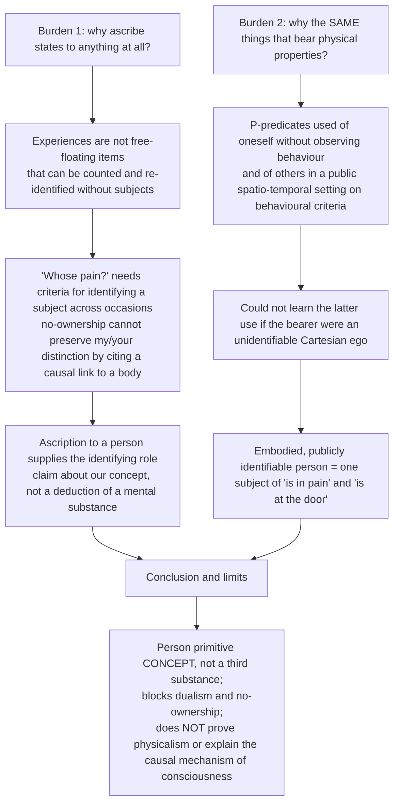

20-mark route: distinguish the two questions → ownership and identification → dual criteria for P-predicates and public re-identification → single subject of M and P → dualism/no-ownership objections and bounded verdict.

### 11.3 Basic particulars and spatio-temporal thinking (2020 Q3(b), 2021 Q3(b)) ⚠️

Route: objective identification → re-identification → unified framework → auditory-world analogue → internal/transcendental limitation → alien-scheme/circularity objection. Directive fatal error: listing what a basic particular is instead of arguing why it is basic.

### 11.4 Person as primitive and dualism (2018 Q1(e), 2023 Q4(a)) ⚠️

Route: predicate duality → self-/other-ascription → conceptual priority → dualism and no-ownership foils → explanation-versus-dissolution verdict. Fatal error: refuting only dualism.

### 11.5 Why persons are primitive: dissolution vs solution ⚠️

Strawson does not ask how mind and body interact; he shows the question presupposes a prior unity neither term can supply. Cost: "primitive" marks the end of analysis rather than an explanation.

---

## 12. PYQ Routing Ledger (2018–2026)

> Corpus signal: **10 primary-owned parts** — 9 in 2018–2025 (per year 2/1/1/2/0/1/1/1; no part in 2022) plus 1 in 2026. The 2018–2025 bank's own count for this topic is 9; the 2026 bank lists 1 (Q3(a), 20 marks). No cross-owned part is recorded against this topic in either bank. The owner file carries no pre-2018 table.

| Year | Q | Marks | Exact demand | Answer route | Map to |
|---|---|---:|---|---|---|
| 2018 | Q1(e) | 10 | How does Strawson explain the concept of person in his philosophy? Discuss. | person as primitive → physical/psychological predicates → self-/other-ascription → neither Cartesian dualism nor reductive materialism | §4.6 |
| 2018 | Q2(c) | 15 | How does Quine show that the notion of a priori knowledge as discussed by Kant is 'a metaphysical article of faith'? Give reasons for your answer. | label as PYQ framing → analytic/synthetic failure → holistic revisability → logic qualification → Grice–Strawson | §2.7 |
| 2019 | Q1(e) | 10 | Explain Quine's arguments against synthetic-analytic distinction. | two classes of analytic truth → synonymy/definition → interchangeability → semantical rules → limited conclusion | §2.2 |
| 2020 | Q3(b) | 15 | Evaluate the role of spatio-temporal thinking in objective thinking with reference to Strawson's theory of basic particulars. | objective identification → re-identification → unified framework → auditory-world analogue → internal/transcendental limitation | §4.3–4.4 |
| 2021 | Q3(b) | 15 | What according to Strawson are basic particulars? What reasons does Strawson offer to believe that 'material bodies' and 'persons' are basic particulars? Critically discuss. | bodies as public anchors → persons as primitive → reference/predication → alien-scheme/circularity objection | §4.3, §4.6 |
| 2021 | Q3(c) | 15 | Critically examine Quine's postulate of empiricism without the dogmas with reference to his 'Two Dogmas of Empiricism'. | both dogmas → corporate testing → web/revision constraints → empiricism retained → arbitrariness/analyticity objections | §2.1–2.6 |
| 2023 | Q4(a) | 20 | Why does Strawson consider person to be a primitive concept? What implication does it have for the mind-body dualism? Discuss. | predicate duality → self-/other-ascription → conceptual priority → dualism/no-ownership foils → explanation-versus-dissolution verdict | §4.6, §11.4 |
| 2024 | Q4(c) | 15 | Explain the nature of the two dogmas that Quine refers to in his paper 'Two Dogmas of Empiricism'. | define both dogmas → failed analyticity explications → reductionism → holism/pragmatism → bounded criticism | §2.1–2.4 |
| 2025 | Q4(b) | 15 | "We can affirm the truth of any sentence in our total system, in the face of whatever experience, just so long as we are prepared to make adjustments elsewhere." Discuss this statement in the light of Quine's 'Two Dogmas of Empiricism'. | preserve conditional clause → conjunction under test → compensating revisions → pragmatic/minimum-mutilation constraints → no relativism | §2.4–2.5, §11.1 |
| 2026 | Q3(a) | 20 | Why are states of consciousness ascribed to anything at all and why are they ascribed to the same things to which we also ascribe physical properties? How does Strawson answer these questions in his work *Individuals*? | §3.3A of owner: first why (ownership/identification) → second why (public other-ascription plus non-observational self-ascription) → one person bearing M- and P-predicates → dualism/no-ownership objections | §11.2 |

---

## 13. Top 10 UPSC Exam Traps

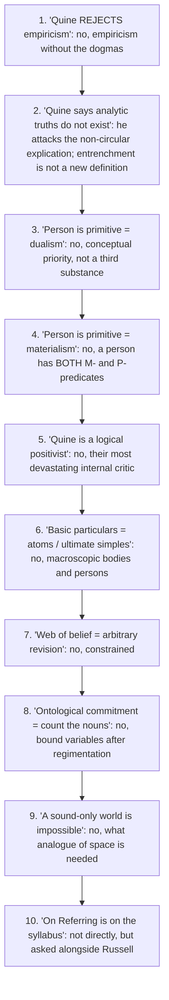

Extra pitfalls recorded: "metaphysical article of faith" is the 2018 PYQ's framing, not a verbatim Quine quote; "To be is to be the value of a bound variable" is from "On What There Is" (1948), not "Two Dogmas"; "In Defence of a Dogma" is co-authored with Grice; never write "Putnam/Birkhoff" jointly; Duhem ≠ Quine in scope; Davidson's is *interpretation*, not translation; do not truncate the 2025 quotation's conditional clause; do not convert Strawson's descriptive metaphysics into a proof of mind-independent reality.

---

## 14. Technical Vocabulary & IAST Bank

The sources are English-language Western texts; no IAST applies. Original-language terms are given as in the sources.

| English term | Original / label | Meaning | Status |
|---|---|---|---|
| Analytic / synthetic | — | True by meaning / true by fact | ✅ |
| Reductionism | — | Each statement reducible to experience | ✅ |
| Confirmation holism | — | Statements face experience as a corporate body | ✅ |
| Web of belief / field of force | — | Quine's model of the total system | ✅ |
| Circle of synonymy | — | Analytic → meaning → synonymy → definition/interchangeability/semantical rules → circular | ✅ |
| Interchangeability salva veritate | Latin | Substitution preserves truth-value | ✅ |
| Semantical rules | — | Carnap's rules for artificial language L | ✅ |
| Duhem–Quine thesis | — | Hypotheses tested only with auxiliaries; two non-identical claims | ✅ |
| *Experimentum crucis* | Latin | Crucial experiment; no automatic one against an isolated hypothesis | ✅ |
| Minimum mutilation | — | Later Quine's maxim on revision | ❓ |
| Radical translation | — | Translation without any prior dictionary | ⚠️ |
| Stimulus meaning | — | Assent and dissent classes | ⚠️ |
| Occasion / standing / observation sentence | — | Types of sentence in radical translation | ⚠️ |
| Analytical hypotheses | — | Linguist's segmentation, undetermined by evidence | ⚠️ |
| Gavagai | — | Native sentence; rabbit / rabbit-parts / rabbit-stage / rabbithood / "it's rabbiting" | ⚠️ |
| Inscrutability of reference | — | Terms' reference undetermined | ⚠️ |
| Indeterminacy of translation | — | Incompatible manuals fit all evidence | ⚠️ |
| Ontological relativity | — | Reference relative to background theory | ⚠️ |
| Ontological commitment | — | Entities in the range of bound variables of a regimented theory | ⚠️ |
| Regimentation | — | Recasting into perspicuous quantificational form | ⚠️ |
| Naturalised epistemology | — | Epistemology within science | ⚠️ |
| Descriptive / revisionary metaphysics | — | Describe vs replace our conceptual scheme | ✅ |
| Basic particulars | — | Material bodies and persons | ✅ |
| Identification / re-identification | — | Picking out / re-picking out across time | ✅ |
| Spatio-temporal framework | — | One space, one time | ✅ |
| Master-sound | — | Reconstructed analogue of space in the auditory world | ⚠️ |
| Feature-placing | — | "It is raining here" | ⚠️ |
| M-predicates / P-predicates | — | Material / personal (psychological) | ✅ |
| No-ownership theory | — | Experiences not possessed by a person | ✅ |
| Cartesian dualism | res cogitans / res extensa | Mind and body as two substances | ✅ |
| Presupposition vs assertion | — | Strawson vs Russell on existence | ⚠️ |
| Transcendental argument | — | From undisputed fact to its necessary conditions | ⚠️ |
| Neurath's boat | — | Rebuild at sea; epigraph of *Word and Object* | ✅ |

---

## 15. Graded Verdict & Answer Architectures

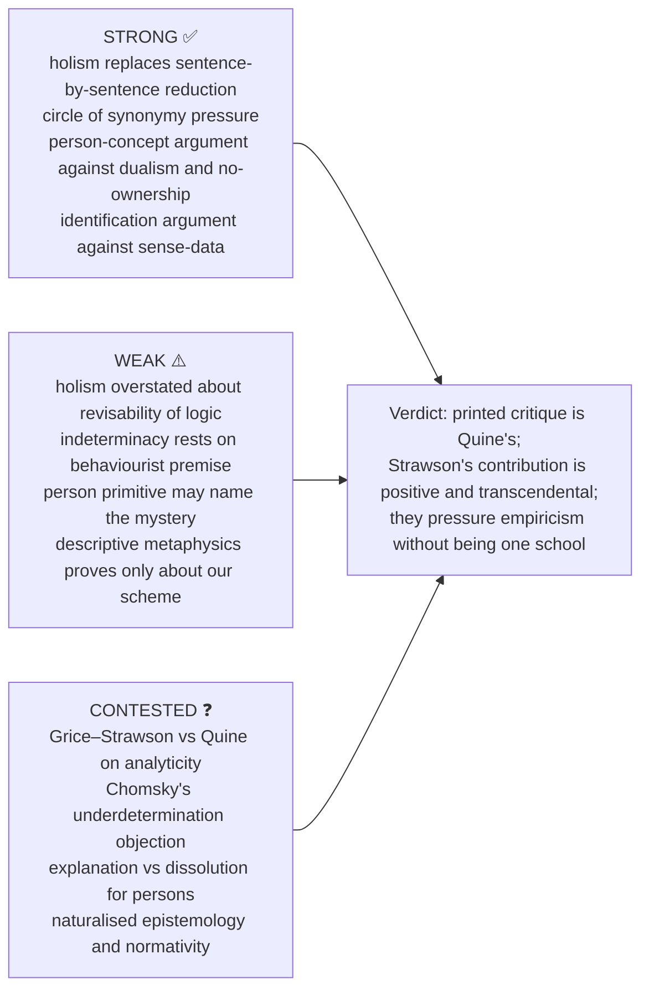

### 15.1 10-mark (2019): Quine against analytic/synthetic

```text
State   : Positivists distinguish analytic (true by meaning) from synthetic (true by fact).
Quine   : "Analytic" cannot be non-circularly defined:
          analytic → synonymy → definition → presupposes synonymy (CIRCULAR);
          or interchangeability salva veritate → needs necessity → presupposes analyticity;
          or semantic rules of L → "analytic-in-L" → presupposes what we want to define.
Result  : Difference of degree (centrality in web), not kind.
Assess  : Grice and Strawson: we can sort cases pre-theoretically.
          Quine: pre-theoretical sorting ≠ principled philosophical distinction.
```
**Verdict (10):** Quine does not show that familiar classifications are unintelligible; he argues available explications cannot ground the sharp foundational boundary empiricism required.

### 15.2 15-mark (2025): web of belief quotation

```text
Frame   : After demolishing both dogmas, holism is the positive replacement.
Expo    : (i) corporate body (ii) web: experience at periphery; interior = logic, maths
          (iii) conflict at edge → choice where to revise
          (iv) "any statement can be held true come what may" → revise elsewhere
          (v) "no statement is immune to revision".
Consequence: no sharp analytic/synthetic or a priori/a posteriori line;
             pragmatic theory-choice; positivist meaning-criterion collapses.
Assess  : Strength: captures scientific practice (Neptune/Vulcan; quantum-logic debate:
          Birkhoff–von Neumann 1936, Putnam 1968).
          Weakness: if logic revisable, what constrains belief? (pragmatic conservatism)
Close   : Holism liberates empiricism from atomism: "web" over "bucket".
```
**Verdict (15):** Grice and Strawson preserve ordinary contrast-cases but may not supply the theoretical account Quine demands. Duhem confined his thesis to physics and exempted logic; Quine's extension to *all* knowledge is the controversial step.

### 15.3 20-mark (2023, and 2026 Q3(a)): person as primitive

```text
Frame   : Descartes = two substances; no-ownership = no subject; Strawson rejects BOTH.
Body-A  : Descriptive metaphysics: our scheme identifies persons as single entities bearing
          BOTH M-predicates and P-predicates.
Body-B  : Other-ascription: to self-ascribe pain I must be able to ascribe it to others,
          identified as embodied subjects. P-predicates: DUAL character.
Body-C  : Dualism decomposes person into mind + body and cannot reunite them;
          person is LOGICALLY PRIOR to both. Blocks no-ownership: cannot state the denial.
Assess  : Strengths: dissolves the problem by refusing its dualist premise.
          Weakness: does not explain HOW the person unifies mental and physical.
Close   : Strawson does not solve the mind-body problem; he dissolves the premise that
          generates it.
```
**Verdict (20):** Strawson defeats Cartesianism more economically than any argument from interaction: the question presupposes a prior unity neither term can supply. The cost is that "primitive" marks the end of analysis, not an explanation.

### 15.4 Further graded verdicts (owner bank) ⚠️

| Sub-topic | Verdict |
|---|---|
| Holism / Duhem–Quine | Holism is right about confirmation and overstated about revisability; Quine's own *Philosophy of Logic* (1970) concedes as much. Defensible position: Duhem's thesis with Quine's motivation. |
| Radical translation | Force proportional to behaviourist premise; Chomsky identifies the pressure point; what survives independently is that use alone does not fix reference, a result Later Wittgenstein reaches by a different route. |
| Ontological commitment | "To be is to be the value of a bound variable" audits the commitments of a regimented theory; it does not count nouns. |
| Basic particulars | Conclusion is about our conceptual scheme; an empiricist can accept it as conceptual geography. |
| Strawson vs Russell | Approaches partly answer different questions; Strawson's 1950 proposal must not stand for all later presupposition theories. |

### 15.5 Directive decoder ⚠️

| Directive | Obligation | Fatal error |
|---|---|---|
| Critique of empiricism — discuss | Quine's printed burden; one sentence that Strawson's framework also pressures sense-datum reconstruction | Turning it into one joint anti-empiricist doctrine |
| Comment on the quotation | Duhem–Quine: modus tollens condemns only the conjunction; then Neptune/Vulcan | Quoting the first half and calling it relativism |
| Examine analytic/synthetic | Chain of failed explications, then holistic alternative | Inferring no sentence can ever be called analytic |
| Explain basic particulars | Argument from identification; sense-data private, momentary, non-spatial | Listing what a basic particular is |
| Discuss persons | Primitiveness argument against two rivals | Refuting only dualism |
| Distinguish descriptive from revisionary | Strawson's own examples and the point | Two definitions with no examples |
| Assess indeterminacy of translation | Gavagai, then behaviourist premise, Chomsky, take a side | Asserting "meanings are indeterminate" |
| Do you agree? / Substantiate | A ruling in line 1, defended | Neutral summary |

> [!TIP]
> **Closing line (owner).** "The printed critique belongs directly to Quine: holism replaces sentence-by-sentence reduction. Strawson's printed contribution is positive and transcendental in form: public identification requires basic particulars and the person is conceptually primitive. Read together, they pressure both empiricist confirmation atomism and sense-datum reconstruction without becoming one school."

> [!NOTE]
> **Optional-depth firewall (advanced dossier §11).** Core first, always. One add-on in a 15-marker, at most two in a 20-marker: (1) indeterminacy and ontological relativity, only after gavagai steps; (2) descriptive vs revisionary as a methodological dispute (conservative common-sense mapping vs transcendental-argument vs modest methodological reading; counter-reply: even radical revision must start from some functioning scheme); (3) is the person concept really primitive (Strawson vs material-body-first reductions vs neo-Lockean psychological reductions; counter-reply: the argument is conceptual, not mystical). Do not make all of *Word and Object* compulsory; do not import the whole personal-identity literature.

---

## Sources

W.V.O. Quine, "Two Dogmas of Empiricism" (1951), *From a Logical Point of View*; *Word and Object* (1960); P.F. Strawson, *Individuals* (1959); "On Referring" (1950); H.P. Grice and P.F. Strawson, "In Defence of a Dogma" (1956); Y. Masih, *A Critical History of Western Philosophy*; Anthony Kenny, *A New History of Western Philosophy* vol. 4; Roger Gibson, *The Philosophy of W.V. Quine*; A.C. Grayling (ed.), *Philosophy 2*; dossier trail: Quine "Ontological Relativity" and Strawson "Persons"; Christopher Hookway; Gareth Evans; Paul Snowdon. Themes: `A-priori-a-posteriori-knowledge.md`, `Substance-across-western.md`, `Critiques-of-metaphysics.md`.
